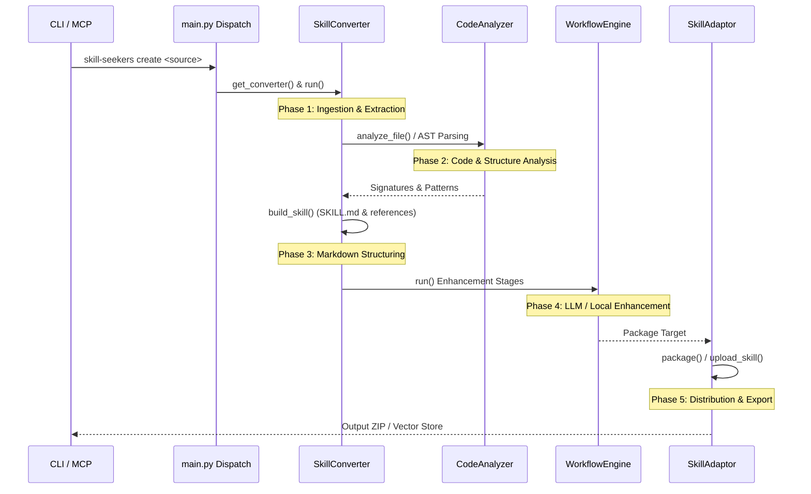
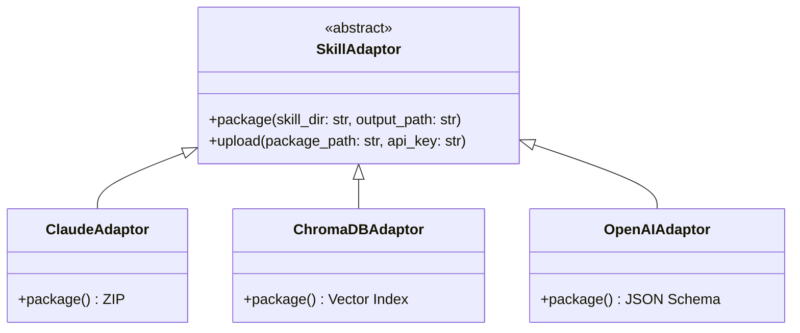

<!-- source: DeepWiki mcp.deepwiki.com · repo yusufkaraaslan/Skill_Seekers · page 14 Architecture & Internals · fetched 2026-10-26 -->

# Architecture & Internals

<details>
<summary>Relevant source files</summary>

The following files were used as context for generating this wiki page:

- [CHANGELOG.md](CHANGELOG.md)
- [CLAUDE.md](CLAUDE.md)
- [README.md](README.md)
- [docs/UML/exports/01_cli_core.png](docs/UML/exports/01_cli_core.png)
- [docs/UML/exports/02_scrapers.png](docs/UML/exports/02_scrapers.png)
- [docs/UML/exports/09_parsers.png](docs/UML/exports/09_parsers.png)
- [docs/UML/exports/13_utilities.png](docs/UML/exports/13_utilities.png)
- [docs/UML/exports/14_create_pipeline_sequence.png](docs/UML/exports/14_create_pipeline_sequence.png)
- [docs/UML/exports/17_mcp_invocation_sequence.png](docs/UML/exports/17_mcp_invocation_sequence.png)
- [docs/UML/exports/19_runtime_components.png](docs/UML/exports/19_runtime_components.png)
- [docs/UML/exports/20_browser_rendering_sequence.png](docs/UML/exports/20_browser_rendering_sequence.png)
- [docs/UML/skill_seekers.mdj](docs/UML/skill_seekers.mdj)
- [docs/UML_ARCHITECTURE.md](docs/UML_ARCHITECTURE.md)
- [pyproject.toml](pyproject.toml)
- [src/skill_seekers/_version.py](src/skill_seekers/_version.py)
- [tests/test_cli_paths.py](tests/test_cli_paths.py)
- [tests/test_package_structure.py](tests/test_package_structure.py)
- [uv.lock](uv.lock)

</details>


This page serves as a technical deep-dive into the internal architecture and design of Skill Seekers for core contributors and advanced system integrators. As a parent architectural document, this page outlines the high-level subsystems, module interactions, and control flows, delegating granular class-level and protocol specifications to dedicated child pages.

For granular implementation details, refer to the child pages: [System Architecture Overview](#14.1), [Package Structure & Imports](#14.2), [Five-Phase Pipeline Implementation](#14.3), [DocToSkillConverter Architecture](#14.4), [Multi-Language Code Analysis](#14.5), [Platform Adaptor Pattern Implementation](#14.6), [FastMCP Server Implementation](#14.7), [Merge Sources & Conflict Resolution](#14.8), and [Execution Context & Argument System](#14.9).

---

## 1. System Architecture Overview

The Skill Seekers execution model revolves around transforming heterogenous documentation sources, repositories, and local codebases into structured AI agent knowledge assets and vector embeddings [README.md:22](). The overarching system bridges natural language invocations and high-level commands to deterministic code execution pathways through a modular pipeline architecture [docs/UML_ARCHITECTURE.md:12-35]().

Title: Natural Language and CLI to Code Execution Bridge
```mermaid
graph TD
    subgraph "Natural Language & User Space"
        NL["Natural Language Prompt / CLI Invocation"] --> CLI["src/skill_seekers/cli/main.py"]
    end

    subgraph "Code Entity Execution Space"
        CLI --> ED["ExecutionContext"]
        ED --> SC["src/skill_seekers/cli/doc_scraper.py"]
        ED --> GH["src/skill_seekers/cli/github_scraper.py"]
        ED --> PDF["src/skill_seekers/cli/pdf_scraper.py"]
        
        SC & GH & PDF --> CA["src/skill_seekers/cli/code_analyzer.py"]
        CA --> WE["src/skill_seekers/cli/workflow_engine.py"]
        WE --> SA["src/skill_seekers/cli/adaptors/"]
    end

    subgraph "Control Plane & Interfaces"
        MCP["src/skill_seekers/mcp/server_fastmcp.py"] --> CLI
        HUD["src/skill_seekers/web/app.py"] --> ED
    end

    Sources: [src/skill_seekers/cli/main.py:1-50](), [docs/UML_ARCHITECTURE.md:12-35]()
```

For complete structural diagrams and UML exports, see [System Architecture Overview](#14.1).

---

## 2. Package Structure & Imports

The project strictly adheres to a modern Python `src/` layout [tests/test_package_structure.py:119-126](). All executable packages reside within `src/skill_seekers/`, isolating the runtime implementation from namespace pollution during test execution [CLAUDE.md:16-18](). Version management is unified dynamically via `src/skill_seekers/_version.py`, reading directly from `pyproject.toml` to prevent version drift [src/skill_seekers/_version.py:1-52]().

Title: Package Sub-Component Hierarchy
```mermaid
graph TD
    Root["src/skill_seekers/"] --> CLI["cli/ (Command Dispatchers & Scrapers)"]
    Root --> MCP["mcp/ (FastMCP & Tool Implementations)"]
    Root --> WEB["web/ (FastAPI & React HUD)"]
    Root --> SVC["services/ (Sync, Storage, Config)"]
    Root --> EMB["embedding/ (Vector Generation)"]
    Root --> BENCH["benchmark/ (Performance Suites)"]
    Root --> VER["_version.py (Dynamic Version Loader)"]

    Sources: [src/skill_seekers/_version.py:1-52](), [tests/test_package_structure.py:1-175]()
```

For detailed sub-package export matrices (`__all__` lists) and typing configurations (`py.typed`), see [Package Structure & Imports](#14.2).

---

## 3. Five-Phase Pipeline Implementation

Every ingestion and conversion workflow executes sequentially through a deterministic five-phase data processing pipeline [docs/UML_ARCHITECTURE.md:43-47](). Control flows from CLI entry-point parsing through template-method execution and workflow enhancement into final packaging adaptors.

Title: Five-Phase Execution Flow


Sources: [CLAUDE.md:85-93](), [docs/UML_ARCHITECTURE.md:43-47]()

For step-by-step code path tracing across all phases, see [Five-Phase Pipeline Implementation](#14.3).

---

## 4. DocToSkillConverter Architecture

Documentation scraping is anchored by the `DocToSkillConverter` class, which manages iterative link discovery, breadth-first search (BFS) queue management, checkpointing, and headless browser rendering [src/skill_seekers/cli/doc_scraper.py]() (see child page for class details). It integrates tightly with `llms.txt` discovery protocols and BeautifulSoup parsing pipelines [tests/test_package_structure.py:40-56]().

For internal state machine diagrams, method call graphs, and parser interactions, see [DocToSkillConverter Architecture](#14.4).

---

## 5. Multi-Language Code Analysis

The `CodeAnalyzer` core service dispatches source files for syntax tree evaluation across diverse programming languages [docs/UML_ARCHITECTURE.md:23](). It yields structured `FunctionSignature` and `ClassSignature` representations utilizing abstract syntax tree (AST) parsers for primary languages and robust regular expression strategies with C-style comment masking for auxiliary environments.

For information regarding depth configuration levels, Swift/Kotlin support, and signature data structures, see [Multi-Language Code Analysis](#14.5).

---

## 6. Platform Adaptor Pattern Implementation

Distribution targets are governed by the `SkillAdaptor` abstract base class and instantiated via a centralized factory registry (`ADAPTORS`) [docs/UML_ARCHITECTURE.md:22](). Concrete classes translate structured skill directories into platform-specific export formats ranging from target AI assistant archives to vector database indices [README.md:22]().

Title: SkillAdaptor Factory and Strategy Mapping


Sources: [docs/UML_ARCHITECTURE.md:22](), [tests/test_package_structure.py:80-118]()

For a comprehensive walkthrough of implementing a concrete adaptor and utilizing the `SkillMetadata` dataclass, see [Platform Adaptor Pattern Implementation](#14.6).

---

## 7. FastMCP Server Implementation

The Model Context Protocol (MCP) server layer (`src/skill_seekers/mcp/server_fastmcp.py`) instantiates a `FastMCP` application wrapper [src/skill_seekers/mcp/__init__.py:7-29]() that exposes internal pipeline features as modular tools [src/skill_seekers/mcp/tools/__init__.py:1-14](). Transport mechanisms support both `stdio` (for local subprocess agent integration) and `HTTP`/SSE configurations [src/skill_seekers/mcp/__init__.py:7-29]().

For detailed decorator mapping, transport protocols, and tool delegation tables, see [FastMCP Server Implementation](#14.7).

---

## 8. Merge Sources & Conflict Resolution

When synthesizing multi-source documentation and repository structures, the `merge_sources` module orchestrates data reconciliation. It employs `ThreeStreamData` data structures alongside rule-based engines (`RuleBasedMerger`) and enhanced AI subprocess routines (`ClaudeEnhancedMerger`) to resolve structural discrepancies.

For priority logic matrices and multi-layer synthesis workflows, see [Merge Sources & Conflict Resolution](#14.8).

---

## 9. Execution Context & Argument System

The `ExecutionContext` singleton pattern acts as the single source of truth for runtime arguments, configurations, and environment credentials across CLI commands and API calls [src/skill_seekers/cli/__init__.py:24-25](). It coordinates tiered option resolution (universal, source-specific, and advanced parameters) while maintaining strict drift guards against underlying argument parsers.

For singleton initialization rules, contextvar thread isolation, and parser registry mappings, see [Execution Context & Argument System](#14.9).

---

