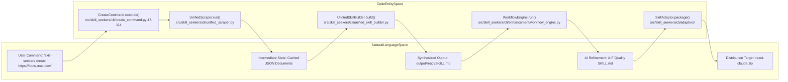
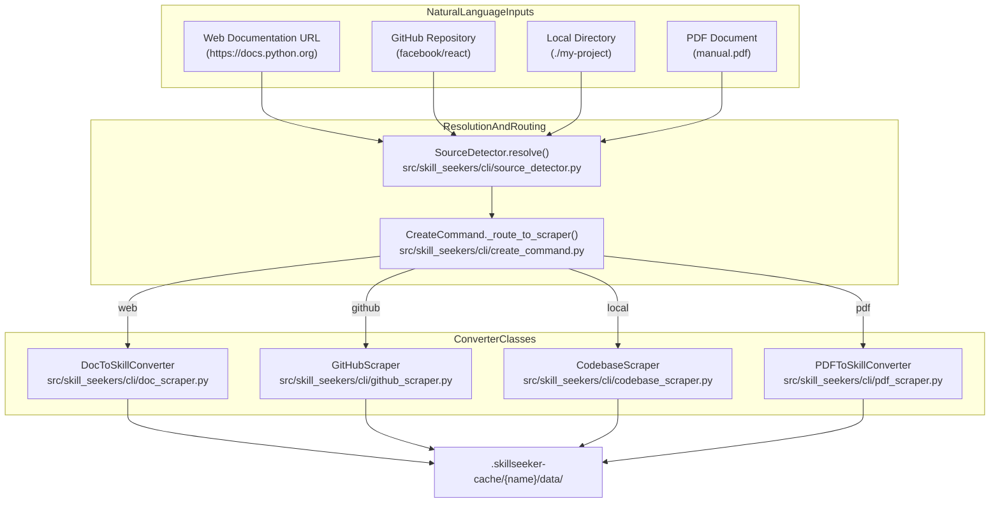
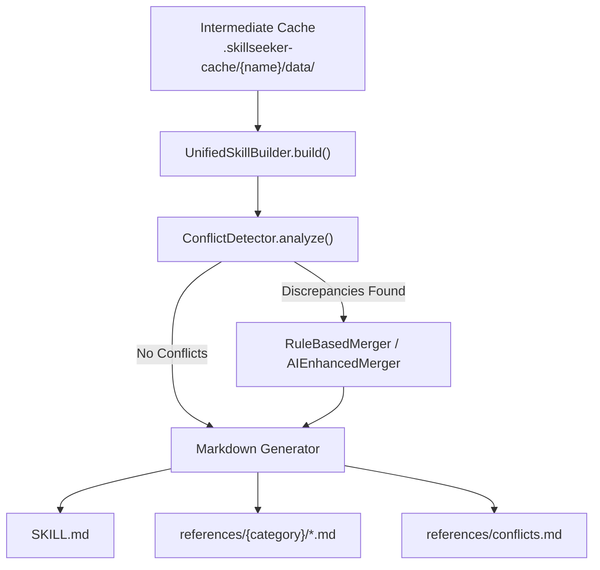
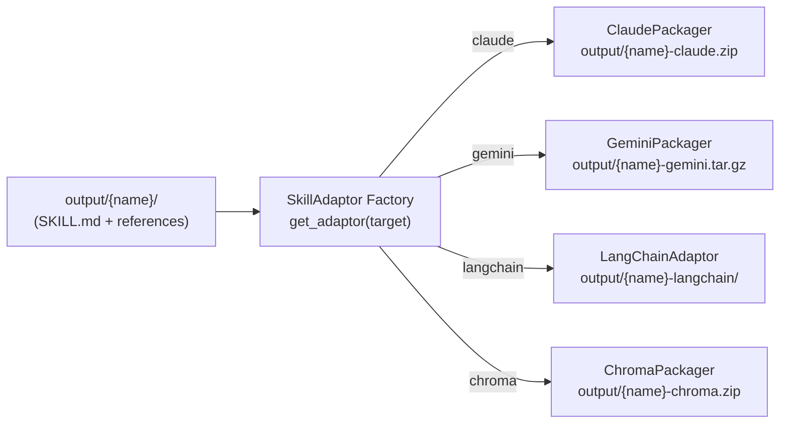

<!-- source: DeepWiki mcp.deepwiki.com · repo yusufkaraaslan/Skill_Seekers · page 2.3 Understanding the Five-Phase Workflow · fetched 2026-10-26 -->

# Understanding the Five-Phase Workflow

Relevant source files

The following files were used as context for generating this wiki page:

- [docs/features/SKILL_SEARCH_INDEX.md](docs/features/SKILL_SEARCH_INDEX.md)
- [docs/getting-started/01-installation.md](docs/getting-started/01-installation.md)
- [docs/getting-started/02-quick-start.md](docs/getting-started/02-quick-start.md)
- [docs/getting-started/03-your-first-skill.md](docs/getting-started/03-your-first-skill.md)
- [docs/getting-started/04-next-steps.md](docs/getting-started/04-next-steps.md)
- [docs/user-guide/01-core-concepts.md](docs/user-guide/01-core-concepts.md)
- [docs/user-guide/02-scraping.md](docs/user-guide/02-scraping.md)
- [docs/user-guide/03-enhancement.md](docs/user-guide/03-enhancement.md)
- [docs/user-guide/04-packaging.md](docs/user-guide/04-packaging.md)
- [docs/user-guide/05-workflows.md](docs/user-guide/05-workflows.md)
- [docs/user-guide/06-troubleshooting.md](docs/user-guide/06-troubleshooting.md)
- [src/skill_seekers/cli/arguments/common.py](src/skill_seekers/cli/arguments/common.py)
- [src/skill_seekers/cli/arguments/create.py](src/skill_seekers/cli/arguments/create.py)
- [src/skill_seekers/cli/arguments/scrape.py](src/skill_seekers/cli/arguments/scrape.py)
- [src/skill_seekers/cli/create_command.py](src/skill_seekers/cli/create_command.py)
- [src/skill_seekers/cli/skill_indexer.py](src/skill_seekers/cli/skill_indexer.py)
- [tests/test_create_arguments.py](tests/test_create_arguments.py)
- [tests/test_create_integration_basic.py](tests/test_create_integration_basic.py)

## Purpose and Scope

This page explains the five-phase pipeline architecture that transforms raw documentation sources, codebases, and files into deployable AI skills. Each phase performs a specific function with well-defined inputs, outputs, and intermediate data structures. Understanding this workflow is essential for customizing the pipeline, debugging ingestion issues, and extending functionality with custom scrapers or adaptors.

**Related Pages:**
- For installation and prerequisites, see **2.1. Installation & Prerequisites**
- For hands-on quick start tutorials, see **2.2. Quick Start Tutorial**
- For detailed CLI command references, see **3. Unified CLI Commands**
- For MCP integration workflows, see **4. MCP Integration**

Sources: [src/skill_seekers/cli/create_command.py:29-114](), [docs/getting-started/02-quick-start.md:1-22]()

## Overview of the Five Phases

The Skill Seekers execution pipeline consists of five sequential phases managed by the unified command dispatcher and orchestration engines [src/skill_seekers/cli/create_command.py:47-114](). 

| Phase | Name | Primary Module / Class | Input | Output | Optional / Gated |
|-------|------|------------------------|-------|--------|------------------|
| 1 | **Ingestion** | `SourceDetector` / `DocToSkillConverter` / `GitHubScraper` | URLs, repos, local paths, files | Intermediate JSON files in cache | No |
| 2 | **Structuring** | `UnifiedSkillBuilder` / `ConflictDetector` | Intermediate JSON cache | `SKILL.md` + `references/` directory | No |
| 3 | **Enhancement** | `WorkflowEngine` / `LocalSkillEnhancer` / `AgentClient` | Raw `SKILL.md` | AI-Optimized `SKILL.md` | Yes (`--enhance-level 0`) |
| 4 | **Packaging** | `SkillAdaptor` implementations (`ADAPTORS`) | Skill output directory | `.zip`, `.tar.gz`, or index directory | No |
| 5 | **Export** | `upload_skill_api` / `install_to_agent` | Platform package file | Deployed skill on platform or agent | Yes (`--upload`) |

Sources: [src/skill_seekers/cli/create_command.py:47-114](), [src/skill_seekers/cli/arguments/create.py:58-72]()

### Natural Language Space to Code Entity Space: High-Level Data Flow

This diagram bridges natural language inputs and user requests to the precise Python classes and methods executing each phase of the workflow.

Sources: [src/skill_seekers/cli/create_command.py:47-114](), [src/skill_seekers/cli/arguments/create.py:58-72]()

---

## Phase 1: Ingestion (Scrape) — Data Collection

Phase 1 extracts raw content from 18 distinct source types and caches it in a structured intermediate format. When a user runs a creation command, `CreateCommand` resolves the input via `SourceDetector.resolve()` [src/skill_seekers/cli/create_command.py:56-60]() and routes execution to the appropriate converter implementation [src/skill_seekers/cli/create_command.py:89-91]().

### Natural Language Space to Code Entity Space: Ingestion Routing

Sources: [src/skill_seekers/cli/create_command.py:56-91](), [src/skill_seekers/cli/arguments/create.py:29-50]()

### Implementation Mechanics
- **Source Detection:** `SourceDetector.resolve()` inspects the positional argument or `--html-path` flag to determine the source classification (`web`, `github`, `local`, `pdf`, `config`) [src/skill_seekers/cli/create_command.py:56-60]().
- **Execution Context Initialization:** `ExecutionContext.initialize()` sets up the global configuration singleton based on CLI flags, environment variables, and detected parameters [src/skill_seekers/cli/create_command.py:80-84]().
- **BFS & Caching:** Web scraping (`DocToSkillConverter`) utilizes breadth-first search queues (`visited_urls`, `pending_urls`) and persists scraped pages to `.skillseeker-cache/{name}/data/` to support resumption via `--resume` [src/skill_seekers/cli/arguments/scrape.py:73-78]().

Sources: [src/skill_seekers/cli/create_command.py:56-84](), [src/skill_seekers/cli/arguments/scrape.py:73-78]()

---

## Phase 2: Structuring (Analysis) — Content Synthesis

Phase 2 reads the cached intermediate JSON files and synthesizes them into an organized skill directory layout containing a primary `SKILL.md` entry point and categorized markdown reference files in `references/`.

### Synthesis Flow & Conflict Resolution
1. **Loading Data:** `UnifiedSkillBuilder` loads the raw parsed items from the intermediate cache directories [src/skill_seekers/cli/create_command.py:106-108]().
2. **Conflict Detection:** When combining multiple sources (such as official documentation and local repository analysis), `ConflictDetector` identifies contradictions or divergent interface definitions between documentation and code [src/skill_seekers/cli/arguments/create.py:169-172]().
3. **Merging Strategies:** `RuleBasedMerger` and `AIEnhancedMerger` reconcile multi-stream data into a cohesive structure, emitting a `conflicts.md` report if necessary.

Sources: [src/skill_seekers/cli/create_command.py:106-108](), [src/skill_seekers/cli/arguments/create.py:169-172]()

---

## Phase 3: Enhancement — AI Quality Boost

Phase 3 executes after structuring and refines the generated markdown files using AI models or local coding agents. It is gated by the `--dry-run` flag and the configured enhancement level (`--enhance-level`) [src/skill_seekers/cli/create_command.py:100-104]().

### Enhancement Levels & Modes
- **Level 0:** Disabled. Outputs raw structured documentation.
- **Level 1:** Enhances `SKILL.md` core metadata, description, and summary tables.
- **Level 2:** Enhances `SKILL.md` plus architecture, configuration patterns, and category summaries.
- **Level 3:** Full comprehensive enhancement across all reference guides and API references.
- **Mode Selection:** `AgentClient` automatically selects **API Mode** if API keys (such as `ANTHROPIC_API_KEY`, `OPENAI_API_KEY`, `GOOGLE_API_KEY`, or `MOONSHOT_API_KEY`) are present in the environment; otherwise, it falls back to **Local Mode** via integrated AI coding agents (Claude Code, Cursor, Aider, etc.) [src/skill_seekers/cli/arguments/create.py:58-70]().

Sources: [src/skill_seekers/cli/create_command.py:100-104](), [src/skill_seekers/cli/arguments/create.py:58-70]()

---

## Phase 4: Packaging — Platform Adaptation

Phase 4 transforms the local skill directory into platform-specific export bundles using the **Platform Adaptor Pattern**. 

### Adaptor Architecture
The packaging engine uses an `ADAPTORS` registry to map target platforms (`--target`) to specific serializer and packager classes:
- **LLM Platforms:** Claude (`.zip`), Gemini (`.tar.gz`), OpenAI, MiniMax, DeepSeek, Qwen, Kimi.
- **RAG Frameworks:** LangChain, LlamaIndex, Haystack (directory structures with semantic chunking options via `--chunk-for-rag`).
- **Vector Databases:** ChromaDB, Weaviate, Qdrant, FAISS, Pinecone (`.zip` bundles containing vector collections or indices).

Sources: [docs/user-guide/04-packaging.md:10-45](), [docs/getting-started/02-quick-start.md:18-21]()

---

## Phase 5: Export (Upload) — Deployment

The final phase handles the physical delivery of the packaged skill bundle to remote hosting APIs or local agent runtime directories.

### Deployment Options
- **Cloud Platform Upload:** Using `upload_skill_api` with retry-with-backoff mechanics and API key validation, packages are uploaded directly to vendor platforms [docs/getting-started/02-quick-start.md:230-249]().
- **Local Agent Installation:** The `install-agent` command locates supported agent directories (such as Cursor, Windsurf, Cline, or Claude Code) and installs the skill context locally [docs/user-guide/04-packaging.md:46-54]().
- **Quality Gate Verification:** Prior to export, `SkillQualityChecker` runs automated checks on structural integrity, link validity, and content coverage, assigning an A–F quality grade to the generated skill bundle [CHANGELOG.md:20-22]().

Sources: [docs/getting-started/02-quick-start.md:230-249](), [docs/user-guide/04-packaging.md:46-54]()

---

