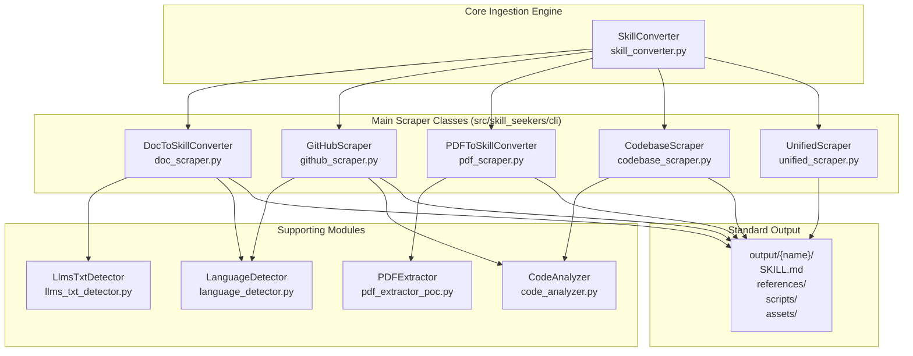
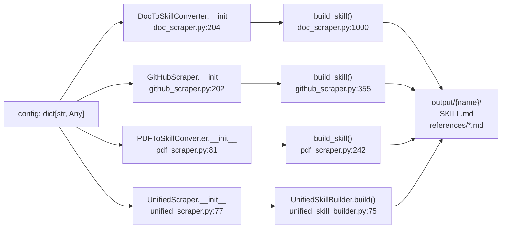

<!-- source: DeepWiki mcp.deepwiki.com · repo yusufkaraaslan/Skill_Seekers · page 5 Core Scrapers · fetched 2026-10-26 -->

# Core Scrapers

<details>
<summary>Relevant source files</summary>

The following files were used as context for generating this wiki page:

- [src/skill_seekers/cli/doc_scraper.py](src/skill_seekers/cli/doc_scraper.py)
- [src/skill_seekers/cli/main.py](src/skill_seekers/cli/main.py)
- [src/skill_seekers/cli/parsers/__init__.py](src/skill_seekers/cli/parsers/__init__.py)
- [src/skill_seekers/cli/skill_converter.py](src/skill_seekers/cli/skill_converter.py)
- [src/skill_seekers/cli/source_detector.py](src/skill_seekers/cli/source_detector.py)
- [src/skill_seekers/cli/unified_scraper.py](src/skill_seekers/cli/unified_scraper.py)
- [src/skill_seekers/cli/unified_skill_builder.py](src/skill_seekers/cli/unified_skill_builder.py)
- [tests/test_c3_integration.py](tests/test_c3_integration.py)
- [tests/test_cli_parsers.py](tests/test_cli_parsers.py)
- [tests/test_multi_source.py](tests/test_multi_source.py)
- [tests/test_new_source_types.py](tests/test_new_source_types.py)
- [tests/test_unified.py](tests/test_unified.py)
- [tests/test_unified_scraper_orchestration.py](tests/test_unified_scraper_orchestration.py)

</details>


This page provides an overview of the source-specific scraper modules in `skill-seekers`, the `SkillConverter` base class and `CONVERTER_REGISTRY`, and their shared design principles. It covers high-level module architecture and orchestrates ingestion across multiple formats. For deep technical details on specific engines, see the child pages:

- [Documentation Scraper](#5.1) — DocToSkillConverter: config init, BFS traversal, checkpoint/resume, browser rendering, content extraction pipeline, build_skill output.
- [GitHub Scraper](#5.2) — GitHubScraper: PyGithub init, token handling, extraction pipeline (README, languages, issues, changelog, releases) and GitHubToSkillConverter output.
- [PDF Scraper](#5.3) — PDFToSkillConverter and PDFExtractor: code block detection strategies, OCR, table extraction, chapter detection, chunking, parallel processing.
- [Codebase Scraper](#5.4) — Local codebase scraper: directory traversal with pathspec, language detection, markdown doc processing, integration with CodeAnalyzer, output structure.
- [Additional Source Types](#5.5) — Cover the remaining ingestion engines: word, epub, jupyter, html, openapi, asciidoc, pptx, confluence, notion, rss, manpage and chat scrapers — their configs, optional dependencies, and output shape.
- [Video & Multimedia Ingestion](#5.6) — video_scraper, video_transcript, video_visual and video_setup: transcript fetching, frame/visual analysis, GPU-aware dependency setup, and --video-url flags.

---

## Module Overview

Each scraper converts a specific source type into the standard skill directory layout (`output/{name}/`). All source handlers inherit from the base class `SkillConverter` and interface through unified configurations or the CLI `create` dispatcher [src/skill_seekers/cli/doc_scraper.py:1-53](), [src/skill_seekers/cli/unified_scraper.py:41-75]().

| Scraper | File | Main Class | Target Source |
|---|---|---|---|
| Documentation | `doc_scraper.py` | `DocToSkillConverter` | HTML Documentation & `llms.txt` |
| GitHub | `github_scraper.py` | `GitHubScraper` | GitHub Repositories |
| PDF | `pdf_scraper.py` | `PDFToSkillConverter` | PDF Documents |
| Codebase | `codebase_scraper.py` | `CodebaseScraper` | Local Directories / Codebases |
| Additional Sources | Various | Ingestion Engines | Word, EPUB, Jupyter, OpenAPI, etc. |
| Video | `video_scraper.py` | `VideoScraper` | Multimedia & Transcripts |

---

## Diagram: Scraper Landscape

**Scraper classes, supporting modules, and shared output format.**



Sources: [src/skill_seekers/cli/doc_scraper.py:1-53](), [src/skill_seekers/cli/github_scraper.py:1-55](), [src/skill_seekers/cli/pdf_scraper.py:1-25](), [src/skill_seekers/cli/unified_scraper.py:41-75]()

---

## Shared Design Principles

Despite targeting different source types, all scrapers follow consistent structural and behavioral conventions established by the core converter infrastructure.

### 1. Config-Dict Initialization & CONVERTER_REGISTRY

Every scraper's `__init__` accepts a configuration dictionary (`config: dict[str, Any]`) or path as its primary argument. Runtime options such as rate limits, selectors, and credentials flow directly from this dictionary [src/skill_seekers/cli/doc_scraper.py:204-216](), [src/skill_seekers/cli/github_scraper.py:202-225]().

```python
DocToSkillConverter(config, dry_run=False, resume=False)
GitHubScraper(config, local_repo_path=None)
PDFToSkillConverter(config)
```

Sources: [src/skill_seekers/cli/doc_scraper.py:204-216](), [src/skill_seekers/cli/github_scraper.py:202-225](), [src/skill_seekers/cli/pdf_scraper.py:81-102]()

### 2. Identical Output Directory Layout

All scrapers produce the standard output structure, ensuring uniform downstream processing by enhancement workflows and packaging adaptors:

```
output/{name}/
├── SKILL.md          # Primary skill descriptor
├── references/       # Per-category or per-source content files
├── scripts/          # Helper utilities
└── assets/           # Media and static resources
```

Intermediate files are mirrored in `.skillseeker-cache/{name}/` [src/skill_seekers/cli/unified_scraper.py:178-180]().

### 3. Terminal Extraction Methods (`build_skill`)

Converters implement a terminal extraction and synthesis lifecycle (`extract()`, followed by `build_skill()`), allowing offline rebuilding of documentation skills and cached datasets without re-executing network queries [src/skill_seekers/cli/doc_scraper.py:1000-1001](), [src/skill_seekers/cli/pdf_scraper.py:242-268]().

---

## Documentation Scraper

`DocToSkillConverter` executes breadth-first search (BFS) URL exploration over documentation websites, featuring automated `llms.txt` shortcuts, CSS selector content extraction, BeautifulSoup parsing, rate-limiting, and checkpoint recovery [src/skill_seekers/cli/doc_scraper.py:204-].

For full technical details, including BFS queue management, browser rendering options, and categorization heuristics, see [Documentation Scraper](#5.1).

Sources: [src/skill_seekers/cli/doc_scraper.py:1-216]()

---

## GitHub Scraper

`GitHubScraper` integrates with PyGithub to extract repository metadata, README documentation, contributor statistics, issue logs, changelogs, release notes, and source code structures [src/skill_seekers/cli/github_scraper.py:184-]. It supports both remote API scraping and local repository analysis.

For complete coverage of token handling, symlink resolution, and large-file fallbacks, see [GitHub Scraper](#5.2).

Sources: [src/skill_seekers/cli/github_scraper.py:1-225]()

---

## PDF Scraper

`PDFToSkillConverter` and `PDFExtractor` handle offline portable document formats. They implement intelligent chapter detection, OCR fallback, code block heuristics, table extraction, and chunked parallel processing.

For implementation specifics, see [PDF Scraper](#5.3).

Sources: [src/skill_seekers/cli/pdf_scraper.py:1-121]()

---

## Codebase Scraper

The local codebase scraper performs directory traversals using `pathspec`, detects programming languages, processes markdown documentation files, and integrates directly with the `CodeAnalyzer` and C3.x suites.

For details on architectural parsing and output schemas, see [Codebase Scraper](#5.4).

Sources: [tests/test_c3_integration.py:1-137]()

---

## Additional Source Types

In addition to core documentation and code repositories, `skill-seekers` supports ingestion engines for Word documents (`.docx`), EPUB e-books, Jupyter notebooks (`.ipynb`), static HTML mirrors, OpenAPI/Swagger specifications, AsciiDoc files, PowerPoint presentations (`.pptx`), Confluence pages, Notion databases, RSS/Atom feeds, Unix man pages, and chat exports (Slack/Discord).

For configuration parameters, optional dependencies, and output schemas, see [Additional Source Types](#5.5).

Sources: [src/skill_seekers/cli/source_detector.py:1-175](), [tests/test_new_source_types.py:1-165]()

---

## Video & Multimedia Ingestion

Multimedia ingestion modules (`video_scraper`, `video_transcript`, `video_visual`, and `video_setup`) handle video URLs (`--video-url`) and media files. They fetch platform transcripts, execute frame/visual analysis using computer vision pipelines, and manage GPU-accelerated dependency setups.

For complete documentation, see [Video & Multimedia Ingestion](#5.6).

Sources: [src/skill_seekers/cli/unified_scraper.py:41-75]()

---

## Diagram: Scraper Initialization and Output Flow

**Data flow from configuration inputs to standardized output directories.**



Sources: [src/skill_seekers/cli/doc_scraper.py:204-216](), [src/skill_seekers/cli/github_scraper.py:202-225](), [src/skill_seekers/cli/pdf_scraper.py:81-102](), [src/skill_seekers/cli/unified_skill_builder.py:26-75]()

---

## Key Constants and Defaults

Scrapers rely on shared constants defined in `src/skill_seekers/cli/constants.py`:

| Constant | Role |
|---|---|
| `DEFAULT_RATE_LIMIT` | Controls request delays between successive web fetches [src/skill_seekers/cli/doc_scraper.py:41]() |
| `DEFAULT_MAX_PAGES` | Restricts BFS traversal depth and volume [src/skill_seekers/cli/doc_scraper.py:40]() |
| `DEFAULT_CHECKPOINT_INTERVAL` | Defines state persistence frequency during crawls [src/skill_seekers/cli/doc_scraper.py:39]() |
| `MIN_CATEGORIZATION_SCORE` | Threshold for keyword-based smart content sorting [src/skill_seekers/cli/doc_scraper.py:43]() |

Sources: [src/skill_seekers/cli/doc_scraper.py:36-44]()

---

