# Page: Overview

# Overview

<details>
<summary>Relevant source files</summary>

The following files were used as context for generating this wiki page:

- [CHANGELOG.md](CHANGELOG.md)
- [CLAUDE.md](CLAUDE.md)
- [README.ar.md](README.ar.md)
- [README.de.md](README.de.md)
- [README.es.md](README.es.md)
- [README.fr.md](README.fr.md)
- [README.hi.md](README.hi.md)
- [README.ja.md](README.ja.md)
- [README.ko.md](README.ko.md)
- [README.md](README.md)
- [README.pt-BR.md](README.pt-BR.md)
- [README.ru.md](README.ru.md)
- [README.tr.md](README.tr.md)
- [README.zh-CN.md](README.zh-CN.md)
- [pyproject.toml](pyproject.toml)
- [src/skill_seekers/_version.py](src/skill_seekers/_version.py)
- [tests/test_cli_paths.py](tests/test_cli_paths.py)
- [tests/test_package_structure.py](tests/test_package_structure.py)
- [uv.lock](uv.lock)

</details>


This wiki page provides a comprehensive technical overview of **Skill Seekers** (`skill-seekers`), a high-performance data layer for AI systems designed to convert unstructured documentation and codebases into structured knowledge assets [pyproject.toml:6-11](), [README.md:22](). This section details the system's core capabilities, the five-phase pipeline, the "prepare once, export everywhere" philosophy, and its primary subsystems.

---

## What Skill Seekers Does

Skill Seekers bridges the gap between raw, external knowledge sources and AI execution environments. It extracts documentation, code structures, media transcripts, and configuration manifests from **18 distinct source types** [README.md:22]() and transforms them into standardized, context-rich knowledge packs. These packs power **AI Skills** (Claude, Gemini, OpenAI), **RAG pipelines** (LangChain, LlamaIndex, Pinecone), and **AI coding assistants** (Cursor, Windsurf, Cline) [README.md:22]().

```bash
# Ingest and auto-detect a documentation source
skill-seekers create https://docs.djangoproject.com/

# Package the resulting universal knowledge asset for a target environment
skill-seekers package output/django --target claude
```
Sources: [README.md:45-51](), [CLAUDE.md:59-64]()

---

## The Five-Phase Workflow Concept

Every skill creation and enhancement cycle orchestrated by `UnifiedScraper` [src/skill_seekers/cli/unified_scraper.py:41-51]() or `create_command.py` [src/skill_seekers/cli/create_command.py:33-60]() adheres strictly to a deterministic **five-phase pipeline**.

### Pipeline Architecture: Natural Language to Code Entity Space

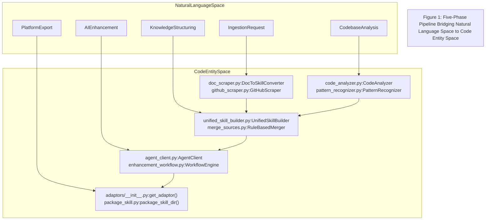
Sources: [CLAUDE.md:55-151](), [src/skill_seekers/cli/unified_scraper.py:41-51]()

| Phase | Functional Role | Primary Classes & Functions |
|-------|-----------------|-----------------------------|
| **1. Ingestion** | Crawling and raw data extraction across 18 source formats. | `DocToSkillConverter` [src/skill_seekers/cli/doc_scraper.py:155](), `GitHubScraper` [src/skill_seekers/cli/github_scraper.py:50]() |
| **2. Analysis** | Deep AST parsing, dependency graphs, and pattern recognition. | `CodeAnalyzer`, `PatternRecognizer`, `DependencyAnalyzer` [src/skill_seekers/cli/github_scraper.py:50]() |
| **3. Structuring** | Category bucketing, conflict resolution, and markdown synthesis. | `UnifiedSkillBuilder` [src/skill_seekers/cli/unified_skill_builder.py:25](), `RuleBasedMerger` [src/skill_seekers/cli/merge_sources.py]() |
| **4. Enhancement** | AI-driven prompt generation, summarization, and distillation. | `AgentClient` [src/skill_seekers/cli/agent_client.py](), `WorkflowEngine` [src/skill_seekers/cli/enhancement_workflow.py]() |
| **5. Export** | Platform adaptation, packaging, RAG chunking, and deployment. | `SkillAdaptor` [src/skill_seekers/cli/adaptors/base.py:76](), `get_adaptor()` [src/skill_seekers/cli/adaptors/__init__.py:80]() |

Sources: [CLAUDE.md:55-151](), [src/skill_seekers/cli/doc_scraper.py:155-188]()

---

## Do-It-Once / Export-To-All-Targets Philosophy

Skill Seekers enforces a strict separation between ingestion/structuring and platform packaging. A user processes a source exactly once, writing a universal knowledge structure to `output/{name}/` [src/skill_seekers/cli/doc_scraper.py:165](). 

The system supports **18 Source Types**:
1. Documentation Websites (`doc_scraper.py`) [src/skill_seekers/cli/doc_scraper.py:155]()
2. GitHub Repositories (`github_scraper.py`) [src/skill_seekers/cli/github_scraper.py:50]()
3. Local Codebases (`codebase_scraper.py`)
4. PDF Documents (`pdf_scraper.py`)
5. Word Documents (`docx`) [pyproject.toml:147-151]()
6. EPUB Books (`epub`) [pyproject.toml:153-156]()
7. Jupyter Notebooks (`jupyter`) [pyproject.toml:208-210]()
8. OpenAPI/Swagger Specs
9. PowerPoint Presentations (`pptx`) [pyproject.toml:216-218]()
10. AsciiDoc Files (`asciidoc`) [pyproject.toml:212-214]()
11. Local HTML Files / Directories
12. RSS/Atom Feeds (`rss`) [pyproject.toml:228-230]()
13. Man Pages
14. Video Content (YouTube/Vimeo/Local via `video_scraper`) [pyproject.toml:159-174]()
15. Confluence Wikis (`confluence`) [pyproject.toml:220-222]()
16. Notion Pages (`notion`) [pyproject.toml:224-226]()
17. Chat Exports (Slack/Discord via `chat`) [pyproject.toml:232-234]()
18. Unified Multi-Source Bundles (`UnifiedScraper`) [src/skill_seekers/cli/unified_scraper.py:41-51]()

And exports to **22 Targets** (LLM platforms, IDE assistants, and vector databases):
* **LLM Platforms**: Claude, Gemini, OpenAI, Kimi, DeepSeek, Qwen, Minimax, OpenRouter, Together AI, Fireworks AI, IBM Bob, OpenCode [CHANGELOG.md:15](), [pyproject.toml:83-126](), [CLAUDE.md:61-64]()
* **AI Coding Assistants & Markdown**: Cursor, Windsurf, Cline, Markdown, Atlas [CLAUDE.md:61-64]()
* **Vector Databases & RAG Frameworks**: ChromaDB, Weaviate, Qdrant, FAISS, Pinecone, LangChain, LlamaIndex, Haystack [pyproject.toml:67-68, 177-198]()

---

## Main Subsystems Summary

### Subsystem Architecture & Code Mapping

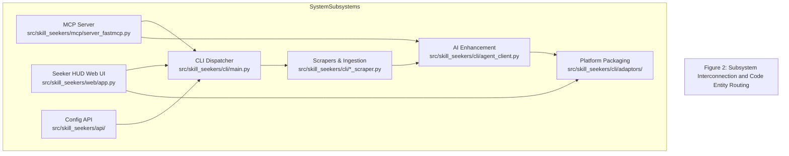
Sources: [CLAUDE.md:55-151](), [CHANGELOG.md:22](), [pyproject.toml:243-254]()

1. **CLI Layer**: Built around a git-style argument dispatcher (`src/skill_seekers/cli/main.py`), supporting unified commands (`create`, `scan`, `package`, `enhance`, `doctor`, `ui`) [CLAUDE.md:55-77]().
2. **Scrapers**: Modular ingestion engines translating raw inputs into standardized markdown and metadata assets [README.md:86]().
3. **Enhancement**: Agent-agnostic rewriting and prompt distillation via `AgentClient` supporting local CLI agents and cloud LLM APIs [CHANGELOG.md:15](), [CLAUDE.md:148]().
4. **Packaging**: Strategy-pattern based adaptors (`get_adaptor()`) compiling universal assets into platform-specific ZIP archives or vector database collections [src/skill_seekers/cli/adaptors/__init__.py:80]().
5. **MCP Server**: FastMCP server implementation exposing 40+ tools via stdio/HTTP transport for AI coding assistants [README.md:12](), [src/skill_seekers/mcp/server_fastmcp.py]().
6. **Seeker HUD Web UI**: Loopback web application (`skill-seekers ui`) providing a React SPA front-end backed by a FastAPI service (`src/skill_seekers/web/app.py`) for managing jobs and configurations [CHANGELOG.md:22]().
7. **Config API & Validation**: Standalone FastAPI service and validator (`config_validator.py`) ensuring JSON configuration schema compliance [src/skill_seekers/cli/doc_scraper.py:35]().

---

## Package Layout

```text
src/skill_seekers/
├── cli/                  # CLI Dispatcher & Business Logic
│   ├── adaptors/         # Platform-specific exporters (Strategy Pattern)
│   ├── arguments/        # CLI flag definitions
│   └── parsers/          # Subcommand registrations
├── mcp/                  # FastMCP Server & Tool Implementations
├── web/                  # Seeker HUD FastAPI Backend & Job Runner
├── api/                  # Standalone Config API Service
├── workflows/            # YAML Enhancement Workflow Presets
└── embedding/            # Vector Embedding & RAG Utilities
```
Sources: [CLAUDE.md:79-122](), [src/skill_seekers/cli/main.py:58-96]()

---

# Page: Getting Started

# Getting Started

<details>
<summary>Relevant source files</summary>

The following files were used as context for generating this wiki page:

- [docs/getting-started/01-installation.md](docs/getting-started/01-installation.md)
- [docs/getting-started/02-quick-start.md](docs/getting-started/02-quick-start.md)
- [docs/getting-started/03-your-first-skill.md](docs/getting-started/03-your-first-skill.md)
- [docs/getting-started/04-next-steps.md](docs/getting-started/04-next-steps.md)
- [docs/user-guide/01-core-concepts.md](docs/user-guide/01-core-concepts.md)
- [docs/user-guide/02-scraping.md](docs/user-guide/02-scraping.md)
- [docs/user-guide/03-enhancement.md](docs/user-guide/03-enhancement.md)
- [docs/user-guide/04-packaging.md](docs/user-guide/04-packaging.md)
- [docs/user-guide/05-workflows.md](docs/user-guide/05-workflows.md)
- [docs/user-guide/06-troubleshooting.md](docs/user-guide/06-troubleshooting.md)

</details>


This page serves as the top-level entry point for new users of Skill Seekers. Its purpose is to introduce the system's core philosophy, provide a minimal viable start, outline installation options, summarize the execution pipeline, and link to detailed child pages. For complete technical deep-dives, see:
- [Installation & Prerequisites](#2.1) — Install via pip/uv, Python version requirements, optional dependency groups (`[mcp]`, `[all-llms]`, `[s3]`, `[embedding]`, `[video-full]`, `[jupyter]`, `[confluence]`, `[notion]`), setup wizard, and required environment variables.
- [Quick Start Tutorial](#2.2) — Create a first skill end-to-end: `skill-seekers create <url>`, inspect output, package, upload or install to an agent.
- [Understanding the Five-Phase Workflow](#2.3) — Explain Ingestion, Analysis, Structuring, Enhancement, Export with concrete examples.

---

## Minimum Viable Start

Three simple commands take any source from raw data to a packaged AI skill ready for deployment.

```bash
# 1. Install core package
pip install skill-seekers

# 2. Create a skill (auto-detects source type)
skill-seekers create https://docs.django.com/

# 3. Package for your target AI platform
skill-seekers package output/django --target claude
```

The `create` command in `src/skill_seekers/cli/main.py` uses `SourceDetector` to route the input to the correct internal scraper.

Sources: [docs/getting-started/02-quick-start.md:8-21]()

---

## Installation Options

Skill Seekers uses a modular dependency approach. Install only what you need:

| Command | Features Added |
|---|---|
| `pip install skill-seekers` | Core scraping (Web, GitHub, PDF) and standard adaptors. [docs/getting-started/01-installation.md:25-26]() |
| `pip install skill-seekers[mcp]` | + FastMCP server for Claude Code, Cursor, etc. [docs/getting-started/01-installation.md:121]() |
| `pip install skill-seekers[all-llms]` | + Every LLM platform. [docs/getting-started/01-installation.md:139]() |
| `pip install skill-seekers[s3]` | + AWS S3 storage. [docs/getting-started/01-installation.md:126]() |
| `pip install skill-seekers[embedding]` | + Embedding server. [docs/getting-started/01-installation.md:129]() |
| `pip install skill-seekers[all]` | Everything. [docs/getting-started/01-installation.md:140]() |

**Requirements:** Python 3.10 or higher. [docs/getting-started/01-installation.md:13]()

Sources: [docs/getting-started/01-installation.md:13](), [docs/getting-started/01-installation.md:25-26](), [docs/getting-started/01-installation.md:121](), [docs/getting-started/01-installation.md:126](), [docs/getting-started/01-installation.md:129](), [docs/getting-started/01-installation.md:139-140]()

---

## Five-Phase Pipeline

Every skill creation operation follows a standardized five-phase pipeline. This bridges the gap between natural language requests and the underlying code entities.

### Diagram: Pipeline from Natural Language to Code Entity Space

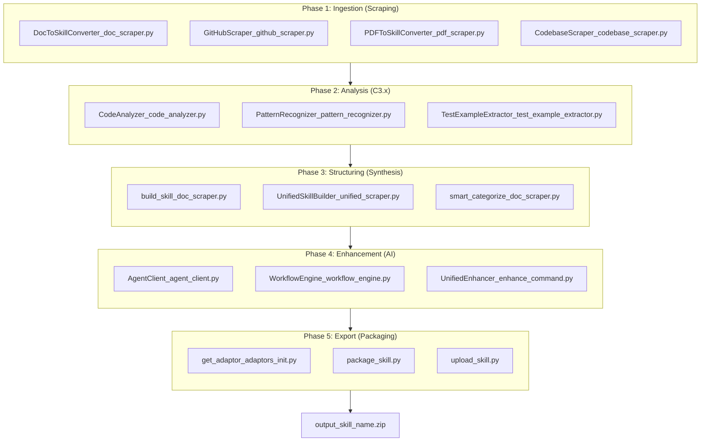

Sources: [docs/user-guide/01-core-concepts.md:324-395]()

---

## CLI Dispatcher

The unified `skill-seekers` command uses a git-style dispatcher in `main.py` to map subcommands to specific implementation modules.

### Diagram: Command Mapping from CLI to Code Modules

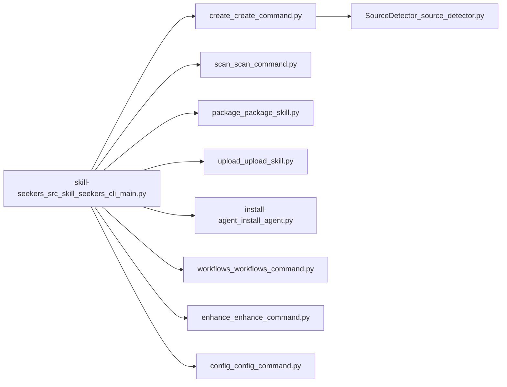

Sources: [docs/user-guide/01-core-concepts.md:159-163]()

---

## Export Targets

Skill Seekers follows a "do-it-once/export-to-all" philosophy. Once a skill is created in the `output/` directory, it can be packaged for different platforms using the `--target` flag.

| Flag | Adaptor Module | Output Format |
|---|---|---|
| `--target claude` | `claude.py` | ZIP + YAML (Claude Code, Claude API) [docs/user-guide/04-packaging.md:26]() |
| `--target gemini` | `gemini.py` | `.tar.gz` (Google Gemini) [docs/user-guide/04-packaging.md:27]() |
| `--target openai` | `openai.py` | ZIP + Vector (Custom GPTs) [docs/user-guide/04-packaging.md:28]() |
| `--target langchain` | `langchain.py` | Directory (RAG pipelines) [docs/user-guide/04-packaging.md:37]() |
| `--target llama-index`| `llama_index.py`| Directory (Query engines) [docs/user-guide/04-packaging.md:38]() |
| `--target chroma` | `chroma.py` | ZIP (Local vector DB) [docs/user-guide/04-packaging.md:41]() |
| `--target cursor` | `cursor.py` | `.cursorrules` (IDE AI context) [docs/user-guide/04-packaging.md:46]() |
| `--target windsurf` | `windsurf.py` | `.windsurfrules` (IDE AI context) [docs/user-guide/04-packaging.md:47]() |
| `--target cline` | `cline.py` | `.clinerules` (VS Code AI) [docs/user-guide/04-packaging.md:48]() |

Sources: [docs/user-guide/04-packaging.md:24-55]()

---

## Key Environment Variables

| Variable | Used By | Purpose |
|---|---|---|
| `ANTHROPIC_API_KEY` | `AgentClient`, `claude.py` | Enables API-mode enhancement and Claude uploads. [docs/getting-started/01-installation.md:158]() |
| `GITHUB_TOKEN` | `GitHubScraper` | Bypasses the 60 req/hr rate limit (increases to 5000). [docs/getting-started/01-installation.md:159]() |
| `SKILL_SEEKER_PROVIDER` | `UnifiedEnhancer` | Forces a specific AI provider for enhancement (e.g., `claude`, `gemini`). [docs/user-guide/03-enhancement.md:54-55]() |
| `GOOGLE_API_KEY` | `gemini.py` | Enables Google Gemini integration. [docs/getting-started/01-installation.md:158]() |

If no API keys are provided, the system falls back to **LOCAL mode**, attempting to use installed CLI agents like `claude` (Claude Code) or `kimi` for enhancement. [docs/user-guide/03-enhancement.md:76-77]()

Sources: [docs/getting-started/01-installation.md:158-159](), [docs/user-guide/03-enhancement.md:54-55](), [docs/user-guide/03-enhancement.md:76-77]()

---

## Next Steps

For detailed information on getting started, proceed to the child pages:
- [Installation & Prerequisites](#2.1)
- [Quick Start Tutorial](#2.2)
- [Understanding the Five-Phase Workflow](#2.3)

Sources: [docs/getting-started/04-next-steps.md:239-262]()

---

# Page: Installation & Prerequisites

# Installation & Prerequisites

<details>
<summary>Relevant source files</summary>

The following files were used as context for generating this wiki page:

- [docs/getting-started/01-installation.md](docs/getting-started/01-installation.md)
- [docs/getting-started/02-quick-start.md](docs/getting-started/02-quick-start.md)
- [docs/getting-started/03-your-first-skill.md](docs/getting-started/03-your-first-skill.md)
- [docs/getting-started/04-next-steps.md](docs/getting-started/04-next-steps.md)
- [docs/user-guide/01-core-concepts.md](docs/user-guide/01-core-concepts.md)
- [docs/user-guide/02-scraping.md](docs/user-guide/02-scraping.md)
- [docs/user-guide/03-enhancement.md](docs/user-guide/03-enhancement.md)
- [docs/user-guide/04-packaging.md](docs/user-guide/04-packaging.md)
- [docs/user-guide/05-workflows.md](docs/user-guide/05-workflows.md)
- [docs/user-guide/06-troubleshooting.md](docs/user-guide/06-troubleshooting.md)
- [requirements.txt](requirements.txt)
- [setup.sh](setup.sh)

</details>


## Purpose & Scope

This page covers the complete installation and setup lifecycle for Skill Seekers. It details system requirements, package installation via `pip` and `uv`, optional dependency groups (`[mcp]`, `[all-llms]`, `[s3]`, `[embedding]`, `[video-full]`, `[jupyter]`, `[confluence]`, `[notion]`), the interactive setup wizard, and required environment variables.

Sources: [docs/getting-started/01-installation.md:1-15](), [setup.sh:1-25]()

---

## System Requirements

### Python Version & OS Support

Skill Seekers requires **Python 3.10 or higher**. This constraint is enforced to leverage modern syntax features such as structural pattern matching (`match` statements) and advanced type hinting utilized across the codebase and the Model Context Protocol (MCP) server.

| Requirement | Minimum | Recommended |
|-------------|---------|-------------|
| **Python** | 3.10 | 3.11, 3.12, or 3.13 |
| **RAM** | 4 GB | 8 GB+ |
| **Disk** | 500 MB | 2 GB+ |
| **OS** | Linux, macOS, Windows (WSL) | Linux, macOS |

**Verification command:**
```bash
python --version  # Should output 3.10.x or higher
```

Sources: [pyproject.toml:10](), [docs/getting-started/01-installation.md:9-17]()

---

## Installation Methods

### Method 1: pip (Standard)

The standard approach for installing stable releases from PyPI:

```bash
# Basic installation
pip install skill-seekers

# With all LLM platform support
pip install skill-seekers[all-llms]

# Verify installation
skill-seekers --version
```

Sources: [docs/getting-started/01-installation.md:20-33]()

### Method 2: uv (Recommended)

`uv` is recommended for high-speed dependency resolution, especially when installing complex optional dependency trees.

```bash
# Install as a global tool
uv tool install skill-seekers --with "all-llms"

# Run ephemerally without permanent installation
uvx skill-seekers create https://docs.python.org
```

Sources: [CLAUDE.md:38-39]()

### Method 3: Development Installation from Source

For contributors working directly with the repository structure:

```bash
git clone https://github.com/yusufkaraaslan/Skill_Seekers.git
cd Skill_Seekers

# Install in editable mode with all optional and development dependencies
pip install -e ".[all,dev]"
```

Sources: [docs/getting-started/01-installation.md:46-58]()

---

## Optional Dependency Groups

Skill Seekers utilizes a modular architecture defined in `pyproject.toml`. The core installation is lightweight, while advanced features require specific optional extras.

### Feature-Based Extras Table

| Extra Group | Purpose / Features Enabled | Install Command | Key Underlying Packages |
|-------------|----------------------------|-----------------|--------------------------|
| `[mcp]` | Model Context Protocol server (stdio/HTTP) | `pip install skill-seekers[mcp]` | `mcp`, `uvicorn`, `sse-starlette` |
| `[all-llms]` | Support for all LLM provider clients | `pip install skill-seekers[all-llms]` | `anthropic`, `google-generativeai`, `openai`, `moonshot` |
| `[s3]` | AWS S3 storage backend | `pip install skill-seekers[s3]` | `boto3` |
| `[embedding]` | Local vector embeddings server | `pip install skill-seekers[embedding]` | `sentence-transformers`, `voyageai`, `fastapi` |
| `[video-full]` | Whisper transcription, scene detection, OCR | `pip install skill-seekers[video-full]` | `torch`, `whisper`, `easyocr`, `opencv-python` |
| `[jupyter]` | Jupyter Notebook (`.ipynb`) extraction | `pip install skill-seekers[jupyter]` | `nbconvert`, `nbformat` |
| `[confluence]` | Atlassian Confluence wiki space ingestion | `pip install skill-seekers[confluence]` | `atlassian-python-api` |
| `[notion]` | Notion workspace and database ingestion | `pip install skill-seekers[notion]` | `notion-client` |
| `[all]` | Installs all stable extension groups | `pip install skill-seekers[all]` | All primary dependency groups |
| `[dev]` | Testing, linting, and docs tools | `pip install skill-seekers[dev]` | `pytest`, `ruff`, `mypy`, `coverage` |

> **Video Visual Dependencies Note:** After installing `skill-seekers[video-full]`, execute `skill-seekers create --setup` to auto-detect your accelerator (NVIDIA CUDA, Apple MPS, or CPU) and install the appropriate PyTorch build and OCR utilities.

Sources: [pyproject.toml:70-284](), [docs/getting-started/01-installation.md:114-144]()

---

## Setup Wizard & Global Configuration Script

Skill Seekers provides an interactive setup utility (`skill-seekers config` or `setup.sh`) to streamline environment configuration, API key verification, and AI coding agent integration (such as Cursor, Claude Code, and Cline).

```bash
# Run interactive setup wizard
skill-seekers config

# Or execute the automated global install & MCP setup script
./setup.sh
```

Sources: [docs/getting-started/01-installation.md:154-156](), [setup.sh:1-15]()

---

## Required Environment Variables

Runtime configuration, authentication, and platform overrides are controlled via environment variables.

### AI Provider Keys (Enhancement Pipeline)
When multiple API keys are present, `AgentClient` evaluates providers in the priority order: **Anthropic → Google → OpenAI → Moonshot**.

| Environment Variable | Description |
|----------------------|-------------|
| `ANTHROPIC_API_KEY` | Required for Claude AI enhancement and cloud uploads. |
| `GOOGLE_API_KEY` | Required for Google Gemini enhancement and uploads. |
| `OPENAI_API_KEY` | Required for OpenAI ChatGPT enhancement. |
| `MOONSHOT_API_KEY` | Required for Kimi (Moonshot AI) enhancement. |
| `SKILL_SEEKER_PROVIDER` | Forces a specific AI provider (e.g., `openai`). |
| `SKILL_SEEKER_MODEL` | Overrides the default model identifier for the chosen provider. |

Sources: [docs/user-guide/03-enhancement.md:40-55](), [docs/reference/ENVIRONMENT_VARIABLES.md:41-111]()

### Integration & Registry Keys
| Environment Variable | Description |
|----------------------|-------------|
| `GITHUB_TOKEN` | Increases GitHub API rate limits (60 to 5000 req/hr), enables private repository scraping, and authenticates publishing configs via `skill-seekers scan`. |

Sources: [docs/user-guide/02-scraping.md:141-155](), [docs/reference/ENVIRONMENT_VARIABLES.md:115-137]()

---

## Natural Language to Code Entity Space

### Setup and Configuration Flow

This diagram maps user intent for configuration and setup to the corresponding internal classes and command modules in the codebase.

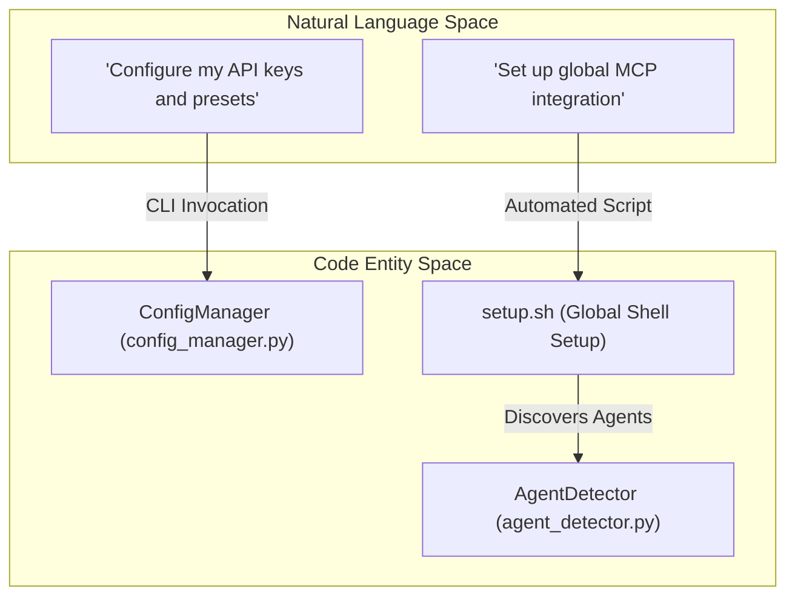

Sources: [docs/getting-started/01-installation.md:154-160](), [setup.sh:146-155]()

### Diagnostics and Installation Validation

This diagram connects verification requests to the underlying diagnostic functions and version registries.

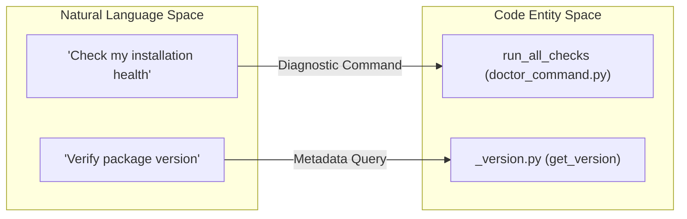

Sources: [docs/getting-started/01-installation.md:164-173](), [src/skill_seekers/_version.py:22-31]()

---

## Verification: The Doctor Command

To validate that your environment, optional packages, and dependencies are correctly provisioned, execute the built-in diagnostic utility:

```bash
skill-seekers doctor
```

The `doctor` command invokes internal check procedures (`run_all_checks`) to inspect Python runtime integrity, verify optional dependency groups (such as `mcp` or `all-llms`), audit API key visibility, and validate external system binaries like `git` and `tesseract`.

Sources: [docs/getting-started/01-installation.md:172-174]()

---

# Page: Quick Start Tutorial

# Quick Start Tutorial

<details>
<summary>Relevant source files</summary>

The following files were used as context for generating this wiki page:

- [docs/getting-started/01-installation.md](docs/getting-started/01-installation.md)
- [docs/getting-started/02-quick-start.md](docs/getting-started/02-quick-start.md)
- [docs/getting-started/03-your-first-skill.md](docs/getting-started/03-your-first-skill.md)
- [docs/getting-started/04-next-steps.md](docs/getting-started/04-next-steps.md)
- [docs/getting-started/BULLETPROOF_QUICKSTART.md](docs/getting-started/BULLETPROOF_QUICKSTART.md)
- [docs/user-guide/01-core-concepts.md](docs/user-guide/01-core-concepts.md)
- [docs/user-guide/02-scraping.md](docs/user-guide/02-scraping.md)
- [docs/user-guide/03-enhancement.md](docs/user-guide/03-enhancement.md)
- [docs/user-guide/04-packaging.md](docs/user-guide/04-packaging.md)
- [docs/user-guide/05-workflows.md](docs/user-guide/05-workflows.md)
- [docs/user-guide/06-troubleshooting.md](docs/user-guide/06-troubleshooting.md)

</details>


This page provides a comprehensive, end-to-end technical tutorial for creating your first knowledge skill using `skill-seekers`. It walks through the complete lifecycle: raw source ingestion, intermediary caching, output inspection, platform-specific packaging, and deployment to AI agents or platform APIs. Throughout this guide, the Django documentation website (`https://docs.djangoproject.com/`) is used as a concrete working example.

For installation prerequisites and optional dependency groups, see [docs/getting-started/01-installation.md:9-17](). For an architectural explanation of the five-phase ingestion pipeline, see [docs/user-guide/01-core-concepts.md:325-337](). For complete command-line options, see [docs/user-guide/02-scraping.md:38-122]().

---

## 1. Prerequisites & Environment Setup

Before running the quick start workflow, verify that your environment meets the minimum Python version requirement and has the package installed correctly.

| Requirement | Minimum Version | Recommended | Source Reference |
|-------------|-----------------|-------------|------------------|
| Python      | 3.10            | 3.11 or 3.12 | [docs/getting-started/01-installation.md:13-13]() |
| RAM         | 4 GB            | 8 GB+        | [docs/getting-started/01-installation.md:14-14]() |
| Package     | `skill-seekers` | `skill-seekers[all-llms]` | [docs/getting-started/01-installation.md:25-29]() |

To install the package in editable development mode or standard mode:
```bash
pip install skill-seekers
skill-seekers --version
```

Sources: [docs/getting-started/01-installation.md:9-33]()

---

## 2. Phase 1 & 2: Ingestion and Scraping via `create`

The `create` subcommand is the primary entry point for turning raw sources into structured skills [docs/getting-started/02-quick-start.md:14-19](). When executed, the CLI dispatcher forwards arguments to the execution layer where `SourceDetector.detect()` identifies the source type and instantiates the corresponding converter class (such as `DocToSkillConverter` for documentation URLs) [docs/user-guide/02-scraping.md:38-48]().

```bash
skill-seekers create https://docs.djangoproject.com/ --name django
```

To preview the execution plan without executing actual network requests or writing files, use the `--dry-run` flag [docs/getting-started/03-your-first-skill.md:48-54]():
```bash
skill-seekers create https://docs.djangoproject.com/ --dry-run
```

### Natural Language to Code Entity Dispatch Flow

The following diagram bridges natural language invocation to the underlying internal Python modules, functions, and cache structures:

Title: "Create Command Execution and Dispatch Flow"
```mermaid
flowchart TD
  NL[""Natural Language: skill-seekers create https://docs.djangoproject.com/""] --> CLI[""CLI Dispatcher: main.py / COMMAND_CLASSES""]
  CLI --> CreateCmd[""CreateCommand.execute()""]
  CreateCmd --> Detector[""SourceDetector.detect(source)""]
  Detector --> Converter[""DocToSkillConverter.run()""]
  Converter --> Cache[""Cache Layer: .skillseeker-cache/django/pages/*.json""]
  Cache --> Builder[""SkillConverter.build_skill()""]
```
Sources: [docs/getting-started/02-quick-start.md:14-19](), [docs/user-guide/02-scraping.md:38-48](), [docs/getting-started/03-your-first-skill.md:48-78]()

---

## 3. Phase 3 & 4: Inspecting Output and Caching Structure

Once the scraper and builder finish executing, `skill-seekers` populates two distinct directory structures: an internal persistence cache used for resumption, and the final structured skill directory [docs/getting-started/03-your-first-skill.md:139-153]().

```
.skillseeker-cache/django/     ← raw scrape cache (used for resume/rebuild)
└── pages/                     ← one JSON file per scraped page

output/django/                 ← the generated skill directory
├── .skill-seekers/            ← metadata and manifest sidecar
│   └── manifest.json
├── SKILL.md                   ← primary AI-facing knowledge asset (YAML frontmatter + sections)
├── references/                ← categorized markdown reference files
│   ├── index.md
│   ├── getting_started.md
│   ├── models.md
│   ├── views.md
│   └── ...
└── assets/                    ← extracted assets and images
```

### Output Generation and Categorization Pipeline

Title: "Output Generation and Categorization Pipeline"
```mermaid
flowchart LR
  Conv[""DocToSkillConverter.run()""] --> Cache[""Cache: .skillseeker-cache/django/pages/*.json""]
  Cache --> Build[""SkillConverter.build_skill()""]
  Build --> SkillMd[""output/django/SKILL.md""]
  Build --> Cats[""smart_categorize() keyword scoring""]
  Cats --> Refs[""output/django/references/{category}.md""]
```
Sources: [docs/user-guide/01-core-concepts.md:24-36](), [docs/getting-started/03-your-first-skill.md:139-153]()

Sources: [docs/user-guide/01-core-concepts.md:24-36](), [docs/getting-started/03-your-first-skill.md:139-153]()

---

## 4. Phase 5: Packaging for Target Platforms

The `package` subcommand reads the compiled skill directory from `output/{name}/` and routes it through the platform adaptor registry (`adaptors/__init__.py:get_adaptor()`) to generate platform-native export bundles [docs/user-guide/04-packaging.md:10-18]().

```bash
# Package for Claude AI (default)
skill-seekers package output/django --target claude
# Generates: output/django-claude.zip

# Package for Google Gemini
skill-seekers package output/django --target gemini
# Generates: output/django-gemini.tar.gz
```

### Platform Adaptor Dispatch Architecture

Title: "Platform Adaptor Dispatch Architecture"
```mermaid
flowchart LR
  PkgCmd[""PackageCommand / skill-seekers package output/django --target TARGET""] --> Factory[""adaptors/__init__.py:get_adaptor(target)""]
  Factory --> Claude[""claude.py:ClaudeAdaptor""]
  Factory --> Gemini[""gemini.py:GeminiAdaptor""]
  Factory --> OpenAI[""openai.py:OpenAIAdaptor""]
  Claude --> OutZip[""output/django-claude.zip""]
  Gemini --> OutTar[""output/django-gemini.tar.gz""]
  OpenAI --> OutOpenAI[""output/django-openai.zip""]
```
Sources: [docs/user-guide/04-packaging.md:58-90]()

---

## 5. Uploading or Installing to AI Agents

After packaging, skills can be published via platform APIs or integrated directly into local AI coding agent environments [docs/user-guide/04-packaging.md:154-160]().

### Option A: API Upload
```bash
export ANTHROPIC_API_KEY=sk-ant-...
skill-seekers upload output/django-claude.zip --target claude
```
Sources: [docs/user-guide/04-packaging.md:225-232]()

### Option B: Local Agent Installation
The `install-agent` command copies the skill directory or links rules files into the target agent's working context [docs/getting-started/04-next-steps.md:137-139]().
```bash
skill-seekers install-agent output/django/ --agent cursor
```
Sources: [docs/getting-started/04-next-steps.md:137-139]()

### Option C: Automated One-Command Workflow
To chain ingestion, scraping, building, packaging, and uploading in a single command, use `install` [docs/getting-started/02-quick-start.md:258-261]():
```bash
export ANTHROPIC_API_KEY=sk-ant-...
skill-seekers install --config django --target claude
```
Sources: [docs/getting-started/02-quick-start.md:258-261]()

---

## 6. Optional AI Enhancement

To improve code examples, architectural depth, and overall structural quality of `SKILL.md`, you can invoke the enhancement system [docs/user-guide/03-enhancement.md:8-19]().

```bash
skill-seekers enhance output/django/ --agent claude
```

Enhancement operates in two primary modes based on environment availability:
- **API Mode:** Activated automatically when provider keys (such as `ANTHROPIC_API_KEY`) are present, invoking model clients directly via `AgentClient` [docs/user-guide/03-enhancement.md:40-43]().
- **LOCAL Mode:** Activated when no API key is set, leveraging local terminal-based coding agents like Claude Code or Codex [docs/user-guide/03-enhancement.md:77-79]().

Sources: [docs/user-guide/03-enhancement.md:8-106]()

---

# Page: Understanding the Five-Phase Workflow

# Understanding the Five-Phase Workflow

<details>
<summary>Relevant source files</summary>

The following files were used as context for generating this wiki page:

- [docs/features/SKILL_SEARCH_INDEX.md](docs/features/SKILL_SEARCH_INDEX.md)
- [docs/getting-started/01-installation.md](docs/getting-started/01-installation.md)
- [docs/getting-started/02-quick-start.md](docs/getting-started/02-quick-start.md)
- [docs/getting-started/03-your-first-skill.md](docs/getting-started/03-your-first-skill.md)
- [docs/getting-started/04-next-steps.md](docs/getting-started/04-next-steps.md)
- [docs/user-guide/01-core-concepts.md](docs/user-guide/01-core-concepts.md)
- [docs/user-guide/02-scraping.md](docs/user-guide/02-scraping.md)
- [docs/user-guide/03-enhancement.md](docs/user-guide/03-enhancement.md)
- [docs/user-guide/04-packaging.md](docs/user-guide/04-packaging.md)
- [docs/user-guide/05-workflows.md](docs/user-guide/05-workflows.md)
- [docs/user-guide/06-troubleshooting.md](docs/user-guide/06-troubleshooting.md)
- [src/skill_seekers/cli/arguments/common.py](src/skill_seekers/cli/arguments/common.py)
- [src/skill_seekers/cli/arguments/create.py](src/skill_seekers/cli/arguments/create.py)
- [src/skill_seekers/cli/arguments/scrape.py](src/skill_seekers/cli/arguments/scrape.py)
- [src/skill_seekers/cli/create_command.py](src/skill_seekers/cli/create_command.py)
- [src/skill_seekers/cli/skill_indexer.py](src/skill_seekers/cli/skill_indexer.py)
- [tests/test_create_arguments.py](tests/test_create_arguments.py)
- [tests/test_create_integration_basic.py](tests/test_create_integration_basic.py)

</details>


## Purpose and Scope

This page explains the five-phase pipeline architecture that transforms raw documentation sources, codebases, and files into deployable AI skills. Each phase performs a specific function with well-defined inputs, outputs, and intermediate data structures. Understanding this workflow is essential for customizing the pipeline, debugging ingestion issues, and extending functionality with custom scrapers or adaptors.

**Related Pages:**
- For installation and prerequisites, see **2.1. Installation & Prerequisites**
- For hands-on quick start tutorials, see **2.2. Quick Start Tutorial**
- For detailed CLI command references, see **3. Unified CLI Commands**
- For MCP integration workflows, see **4. MCP Integration**

Sources: [src/skill_seekers/cli/create_command.py:29-114](), [docs/getting-started/02-quick-start.md:1-22]()

## Overview of the Five Phases

The Skill Seekers execution pipeline consists of five sequential phases managed by the unified command dispatcher and orchestration engines [src/skill_seekers/cli/create_command.py:47-114](). 

| Phase | Name | Primary Module / Class | Input | Output | Optional / Gated |
|-------|------|------------------------|-------|--------|------------------|
| 1 | **Ingestion** | `SourceDetector` / `DocToSkillConverter` / `GitHubScraper` | URLs, repos, local paths, files | Intermediate JSON files in cache | No |
| 2 | **Structuring** | `UnifiedSkillBuilder` / `ConflictDetector` | Intermediate JSON cache | `SKILL.md` + `references/` directory | No |
| 3 | **Enhancement** | `WorkflowEngine` / `LocalSkillEnhancer` / `AgentClient` | Raw `SKILL.md` | AI-Optimized `SKILL.md` | Yes (`--enhance-level 0`) |
| 4 | **Packaging** | `SkillAdaptor` implementations (`ADAPTORS`) | Skill output directory | `.zip`, `.tar.gz`, or index directory | No |
| 5 | **Export** | `upload_skill_api` / `install_to_agent` | Platform package file | Deployed skill on platform or agent | Yes (`--upload`) |

Sources: [src/skill_seekers/cli/create_command.py:47-114](), [src/skill_seekers/cli/arguments/create.py:58-72]()

### Natural Language Space to Code Entity Space: High-Level Data Flow

This diagram bridges natural language inputs and user requests to the precise Python classes and methods executing each phase of the workflow.

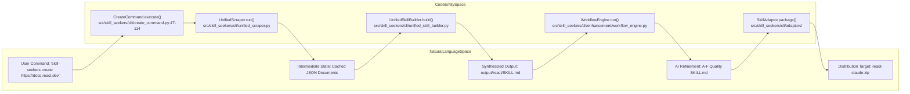

Sources: [src/skill_seekers/cli/create_command.py:47-114](), [src/skill_seekers/cli/arguments/create.py:58-72]()

---

## Phase 1: Ingestion (Scrape) — Data Collection

Phase 1 extracts raw content from 18 distinct source types and caches it in a structured intermediate format. When a user runs a creation command, `CreateCommand` resolves the input via `SourceDetector.resolve()` [src/skill_seekers/cli/create_command.py:56-60]() and routes execution to the appropriate converter implementation [src/skill_seekers/cli/create_command.py:89-91]().

### Natural Language Space to Code Entity Space: Ingestion Routing

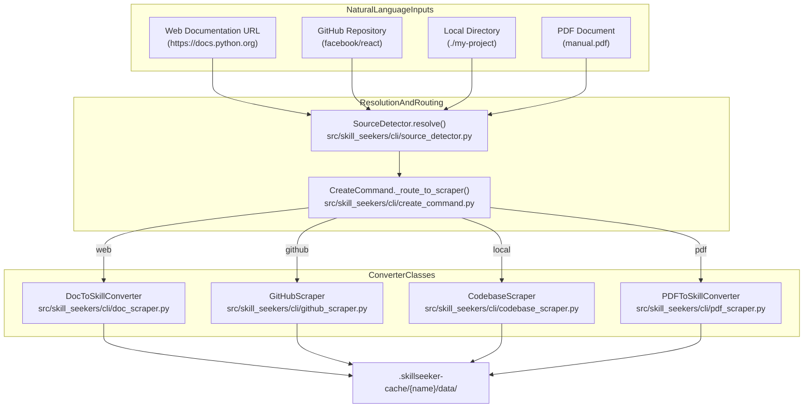

Sources: [src/skill_seekers/cli/create_command.py:56-91](), [src/skill_seekers/cli/arguments/create.py:29-50]()

### Implementation Mechanics
- **Source Detection:** `SourceDetector.resolve()` inspects the positional argument or `--html-path` flag to determine the source classification (`web`, `github`, `local`, `pdf`, `config`) [src/skill_seekers/cli/create_command.py:56-60]().
- **Execution Context Initialization:** `ExecutionContext.initialize()` sets up the global configuration singleton based on CLI flags, environment variables, and detected parameters [src/skill_seekers/cli/create_command.py:80-84]().
- **BFS & Caching:** Web scraping (`DocToSkillConverter`) utilizes breadth-first search queues (`visited_urls`, `pending_urls`) and persists scraped pages to `.skillseeker-cache/{name}/data/` to support resumption via `--resume` [src/skill_seekers/cli/arguments/scrape.py:73-78]().

Sources: [src/skill_seekers/cli/create_command.py:56-84](), [src/skill_seekers/cli/arguments/scrape.py:73-78]()

---

## Phase 2: Structuring (Analysis) — Content Synthesis

Phase 2 reads the cached intermediate JSON files and synthesizes them into an organized skill directory layout containing a primary `SKILL.md` entry point and categorized markdown reference files in `references/`.

### Synthesis Flow & Conflict Resolution
1. **Loading Data:** `UnifiedSkillBuilder` loads the raw parsed items from the intermediate cache directories [src/skill_seekers/cli/create_command.py:106-108]().
2. **Conflict Detection:** When combining multiple sources (such as official documentation and local repository analysis), `ConflictDetector` identifies contradictions or divergent interface definitions between documentation and code [src/skill_seekers/cli/arguments/create.py:169-172]().
3. **Merging Strategies:** `RuleBasedMerger` and `AIEnhancedMerger` reconcile multi-stream data into a cohesive structure, emitting a `conflicts.md` report if necessary.

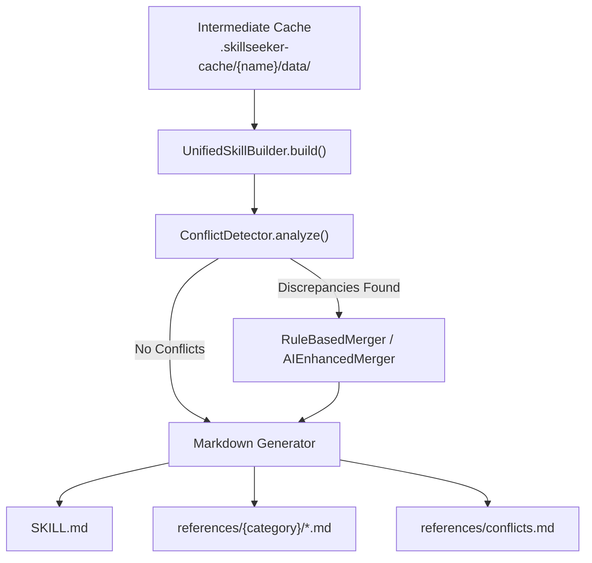

Sources: [src/skill_seekers/cli/create_command.py:106-108](), [src/skill_seekers/cli/arguments/create.py:169-172]()

---

## Phase 3: Enhancement — AI Quality Boost

Phase 3 executes after structuring and refines the generated markdown files using AI models or local coding agents. It is gated by the `--dry-run` flag and the configured enhancement level (`--enhance-level`) [src/skill_seekers/cli/create_command.py:100-104]().

### Enhancement Levels & Modes
- **Level 0:** Disabled. Outputs raw structured documentation.
- **Level 1:** Enhances `SKILL.md` core metadata, description, and summary tables.
- **Level 2:** Enhances `SKILL.md` plus architecture, configuration patterns, and category summaries.
- **Level 3:** Full comprehensive enhancement across all reference guides and API references.
- **Mode Selection:** `AgentClient` automatically selects **API Mode** if API keys (such as `ANTHROPIC_API_KEY`, `OPENAI_API_KEY`, `GOOGLE_API_KEY`, or `MOONSHOT_API_KEY`) are present in the environment; otherwise, it falls back to **Local Mode** via integrated AI coding agents (Claude Code, Cursor, Aider, etc.) [src/skill_seekers/cli/arguments/create.py:58-70]().

Sources: [src/skill_seekers/cli/create_command.py:100-104](), [src/skill_seekers/cli/arguments/create.py:58-70]()

---

## Phase 4: Packaging — Platform Adaptation

Phase 4 transforms the local skill directory into platform-specific export bundles using the **Platform Adaptor Pattern**. 

### Adaptor Architecture
The packaging engine uses an `ADAPTORS` registry to map target platforms (`--target`) to specific serializer and packager classes:
- **LLM Platforms:** Claude (`.zip`), Gemini (`.tar.gz`), OpenAI, MiniMax, DeepSeek, Qwen, Kimi.
- **RAG Frameworks:** LangChain, LlamaIndex, Haystack (directory structures with semantic chunking options via `--chunk-for-rag`).
- **Vector Databases:** ChromaDB, Weaviate, Qdrant, FAISS, Pinecone (`.zip` bundles containing vector collections or indices).

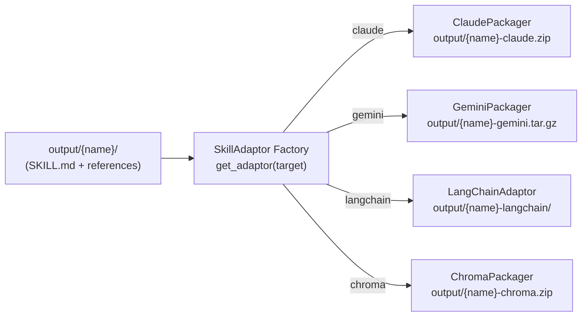

Sources: [docs/user-guide/04-packaging.md:10-45](), [docs/getting-started/02-quick-start.md:18-21]()

---

## Phase 5: Export (Upload) — Deployment

The final phase handles the physical delivery of the packaged skill bundle to remote hosting APIs or local agent runtime directories.

### Deployment Options
- **Cloud Platform Upload:** Using `upload_skill_api` with retry-with-backoff mechanics and API key validation, packages are uploaded directly to vendor platforms [docs/getting-started/02-quick-start.md:230-249]().
- **Local Agent Installation:** The `install-agent` command locates supported agent directories (such as Cursor, Windsurf, Cline, or Claude Code) and installs the skill context locally [docs/user-guide/04-packaging.md:46-54]().
- **Quality Gate Verification:** Prior to export, `SkillQualityChecker` runs automated checks on structural integrity, link validity, and content coverage, assigning an A–F quality grade to the generated skill bundle [CHANGELOG.md:20-22]().

Sources: [docs/getting-started/02-quick-start.md:230-249](), [docs/user-guide/04-packaging.md:46-54]()

---

# Page: Unified CLI Commands

# Unified CLI Commands

<details>
<summary>Relevant source files</summary>

The following files were used as context for generating this wiki page:

- [src/skill_seekers/cli/main.py](src/skill_seekers/cli/main.py)
- [src/skill_seekers/cli/parsers/__init__.py](src/skill_seekers/cli/parsers/__init__.py)
- [src/skill_seekers/cli/parsers/base.py](src/skill_seekers/cli/parsers/base.py)
- [src/skill_seekers/cli/parsers/config_parser.py](src/skill_seekers/cli/parsers/config_parser.py)
- [src/skill_seekers/cli/parsers/create_parser.py](src/skill_seekers/cli/parsers/create_parser.py)
- [src/skill_seekers/cli/parsers/enhance_status_parser.py](src/skill_seekers/cli/parsers/enhance_status_parser.py)
- [src/skill_seekers/cli/parsers/estimate_parser.py](src/skill_seekers/cli/parsers/estimate_parser.py)
- [src/skill_seekers/cli/parsers/install_parser.py](src/skill_seekers/cli/parsers/install_parser.py)
- [src/skill_seekers/cli/parsers/multilang_parser.py](src/skill_seekers/cli/parsers/multilang_parser.py)
- [src/skill_seekers/cli/skill_converter.py](src/skill_seekers/cli/skill_converter.py)
- [src/skill_seekers/cli/source_detector.py](src/skill_seekers/cli/source_detector.py)
- [tests/test_cli_parsers.py](tests/test_cli_parsers.py)
- [tests/test_new_source_types.py](tests/test_new_source_types.py)

</details>


This page documents the `skill-seekers` unified command-line interface. The CLI follows a git-style dispatcher pattern where a single `skill-seekers` entry point routes to individual command modules via the `COMMAND_CLASSES` and `COMMAND_MODULES` dispatch tables in [src/skill_seekers/cli/main.py:42-87](). The dispatcher supports direct class-based execution for core commands (`CreateCommand`, `ScanCommand`, `DoctorCommand`, `DetectCommand`, `UiCommand`) and module-based dispatch for the remaining subcommands [src/skill_seekers/cli/main.py:50-87]().

For detailed documentation of specific command options and flags, see the child pages:
- [Scraping Commands](#3.1) — Document create/scrape/github/pdf/analyze commands, their arguments, source auto-detection, and common flags (`--preset`, `--enhance-level`, `--dry-run`).
- [Enhancement Commands](#3.2) — Document `skill-seekers enhance` and workflow commands: target/agent flags, API vs local mode, background/daemon modes.
- [Distribution Commands](#3.3) — Document `package`, `upload`, `install`, `install-agent`: target platform selection, zip packaging, agent directory installation.
- [Workflow Commands](#3.4) — Document the `workflows` subcommand for managing enhancement workflow presets: list, view, create, delete.
- [Scan Command — AI Project Knowledge Base](#3.5) — Document `skill-seekers scan`: signal collection, AI framework detection, config resolution/generation, codebase config emission, stale config archiving, optional registry publishing, and all flags.
- [Diagnostics & Setup Commands](#3.6) — Document `skill-seekers doctor` (`run_all_checks`, environment diagnostics), `detect` (`SourceDetector` preview), setup wizard, and `ui` command for launching the Seeker HUD.

Sources: [src/skill_seekers/cli/main.py:42-87]()

---

## Overview

The unified CLI provides a single `skill-seekers` command with multiple subcommands registered through a modular parser registry [src/skill_seekers/cli/parsers/__init__.py:34-56](). This design ensures a consistent interface across all 18+ supported source types and export targets.

**Key Benefits:**
- **Single Entry Point**: All functionality accessed through `skill-seekers` [src/skill_seekers/cli/main.py:1-34]().
- **Agent-Agnostic**: All enhancement calls use the `AgentClient` transport, supporting Anthropic, Google, OpenAI, Moonshot, and more.
- **Modern Packaging**: Distributed via PyPI with `src/` layout and `pyproject.toml` entry points.
- **Direct Dispatch**: Class-based commands consume parsed argument namespaces directly without `sys.argv` round-tripping [src/skill_seekers/cli/main.py:42-56]().

Sources: [src/skill_seekers/cli/main.py:1-87](), [src/skill_seekers/cli/parsers/__init__.py:34-56]()

---

## Command Categories & Dispatch Architecture

The CLI organizes commands into functional categories. The dispatcher uses a hybrid model of class-based execution for new commands and module-based dispatch for standard workflows [src/skill_seekers/cli/main.py:50-87]().

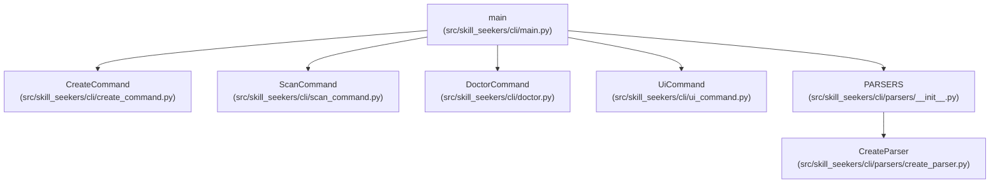
Sources: [src/skill_seekers/cli/main.py:50-87](), [src/skill_seekers/cli/parsers/__init__.py:34-56]()

**Command Categories:**

| Category | Commands | Purpose |
|----------|----------|---------|
| **Knowledge Discovery** | `scan` | AI-driven discovery of tech stacks; emits per-framework configs. For details, see [Scan Command — AI Project Knowledge Base](#3.5). |
| **Primary Creation** | `create`, `detect` | Auto-detect source type (URL, repo, path) and route to appropriate converter or preview source classification [src/skill_seekers/cli/main.py:11-12](), [src/skill_seekers/cli/source_detector.py:48-69](). |
| **Diagnostics & UI** | `doctor`, `ui` | Health check for dependencies/environment and launching the Seeker HUD web UI [src/skill_seekers/cli/main.py:23-24](), [src/skill_seekers/cli/main.py:54-55](). |
| **Enhancement** | `enhance`, `enhance-status`, `workflows` | AI-powered improvement of `SKILL.md` using `AgentClient`. For details, see [Enhancement Commands](#3.2) and [Workflow Commands](#3.4). |
| **Distribution** | `package`, `upload`, `install`, `install-agent` | Prepare skills for platforms and install to coding agent directories [src/skill_seekers/cli/main.py:15-18](). For details, see [Distribution Commands](#3.3). |
| **Utilities** | `estimate`, `extract-test-examples`, `resume`, `quality`, `config`, `sync-config`, `stream`, `update`, `multilang` | Page count estimation, job resumption, quality grading, and credential management [src/skill_seekers/cli/main.py:19-25](). |

Sources: [src/skill_seekers/cli/main.py:10-34](), [src/skill_seekers/cli/parsers/__init__.py:34-56]()

---

## `create` Command and Source Auto-Detection

The `create` command is the primary entry point for skill generation. It utilizes `SourceDetector` to inspect user input and route it to the correct `SkillConverter` implementation via `CONVERTER_REGISTRY` [src/skill_seekers/cli/source_detector.py:48-69](), [src/skill_seekers/cli/skill_converter.py:115-138]().

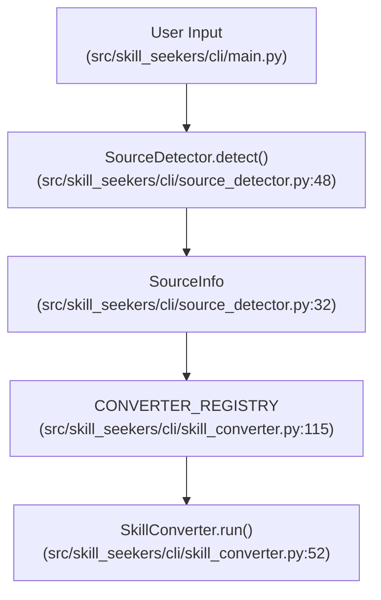
Sources: [src/skill_seekers/cli/source_detector.py:48-69](), [src/skill_seekers/cli/skill_converter.py:52-138]()

For comprehensive details on individual scraping handlers, formats, and auto-detection heuristics, see [Scraping Commands](#3.1).

### Progressive Help Disclosure

To manage the extensive flag set (over 120 flags across all source types), the `create` parser implements a progressive disclosure help system [src/skill_seekers/cli/parsers/create_parser.py:1-123]().

- `skill-seekers create --help`: Shows universal arguments and core options.
- `skill-seekers create --help-web`: Displays web-scraping specific options.
- `skill-seekers create --help-github`: Displays GitHub API and repository analysis options.
- `skill-seekers create --help-local`: Displays local codebase options.
- `skill-seekers create --help-all`: Outputs every available flag.

Sources: [src/skill_seekers/cli/parsers/create_parser.py:1-123](), [src/skill_seekers/cli/main.py:160-178]()

---

## Related Documentation

- **[Scraping Commands](#3.1)**: Detailed guide for web, GitHub, and 18+ source types.
- **[Enhancement Commands](#3.2)**: Documentation for enhancement modes and `AgentClient`.
- **[Distribution Commands](#3.3)**: Reference for packaging, uploading, and agent installation.
- **[Workflow Commands](#3.4)**: Management of enhancement workflow presets.
- **[Scan Command — AI Project Knowledge Base](#3.5)**: Guide to AI-driven tech stack discovery.
- **[Diagnostics & Setup Commands](#3.6)**: Doctor checks, detection previews, and Seeker HUD web UI.

---

# Page: Scraping Commands

# Scraping Commands

<details>
<summary>Relevant source files</summary>

The following files were used as context for generating this wiki page:

- [docs/features/SKILL_SEARCH_INDEX.md](docs/features/SKILL_SEARCH_INDEX.md)
- [src/skill_seekers/cli/arguments/analyze.py](src/skill_seekers/cli/arguments/analyze.py)
- [src/skill_seekers/cli/arguments/common.py](src/skill_seekers/cli/arguments/common.py)
- [src/skill_seekers/cli/arguments/create.py](src/skill_seekers/cli/arguments/create.py)
- [src/skill_seekers/cli/arguments/github.py](src/skill_seekers/cli/arguments/github.py)
- [src/skill_seekers/cli/arguments/pdf.py](src/skill_seekers/cli/arguments/pdf.py)
- [src/skill_seekers/cli/arguments/scrape.py](src/skill_seekers/cli/arguments/scrape.py)
- [src/skill_seekers/cli/arguments/unified.py](src/skill_seekers/cli/arguments/unified.py)
- [src/skill_seekers/cli/create_command.py](src/skill_seekers/cli/create_command.py)
- [src/skill_seekers/cli/skill_indexer.py](src/skill_seekers/cli/skill_indexer.py)
- [tests/test_create_arguments.py](tests/test_create_arguments.py)
- [tests/test_create_integration_basic.py](tests/test_create_integration_basic.py)

</details>


## Purpose and Scope
This page documents the scraping command suite in the Skill Seekers CLI, focusing on the unified `create` dispatcher [src/skill_seekers/cli/create_command.py:29-30](), specialized commands (`scrape`, `github`, `pdf`, `analyze`), input source auto-detection [src/skill_seekers/cli/source_detector.py:39-40](), the three-tier argument system [src/skill_seekers/cli/arguments/create.py:1-10](), and core execution flags like `--preset`, `--enhance-level`, and `--dry-run`.

Sources: [src/skill_seekers/cli/create_command.py:29-30](), [src/skill_seekers/cli/arguments/create.py:1-10](), [src/skill_seekers/cli/source_detector.py:39-40]()

---

## 1. Unified Dispatch & Source Auto-Detection

The command-line interface uses a centralized dispatcher centered around the `CreateCommand` class [src/skill_seekers/cli/create_command.py:29-30](). When a user invokes `skill-seekers create <source>`, the CLI delegates input resolution to `SourceDetector.resolve()` [src/skill_seekers/cli/create_command.py:58-60]() to inspect the target string (URL, GitHub repository slug, local directory path, file path, or JSON configuration file) and assign a recognized source type.

Once the `SourceInfo` object is resolved [src/skill_seekers/cli/create_command.py:42-45](), the execution pipeline initializes the singleton `ExecutionContext` [src/skill_seekers/cli/execution_context.py:1-20](), validates user flags against source compatibility rules [src/skill_seekers/cli/create_command.py:116-120](), and dispatches the execution to the corresponding converter instance via `get_converter()` [src/skill_seekers/cli/skill_converter.py:1-20]().

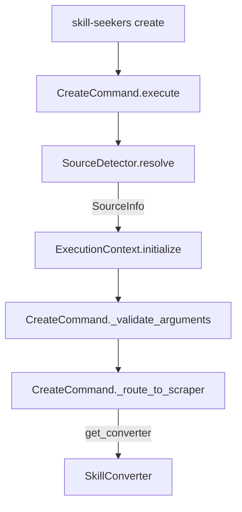
**Diagram: Natural Language Space to Code Entity Space (`CreateCommand` Dispatch)**

Sources: [src/skill_seekers/cli/create_command.py:47-91](), [src/skill_seekers/cli/skill_converter.py:1-20]()

---

## 2. Specialized Scraping Commands

While `create` provides automatic resolution, individual scraper commands can be called directly or via their explicit subcommands. Each command manages distinct ingestion engines and argument mappings.

### 2.1 `create` (Universal Auto-Detection)
* **Class**: `CreateCommand` [src/skill_seekers/cli/create_command.py:29-30]()
* **Description**: Acts as the single entry point for skill creation. It reads positional arguments or `--html-path` overrides [src/skill_seekers/cli/create_command.py:143-162](), performs automatic type detection, initializes state, and routes execution through the enhancement and indexing phases.

Sources: [src/skill_seekers/cli/create_command.py:29-114]()

### 2.2 `scrape` (Web Documentation)
* **Converter**: `DocToSkillConverter` [tests/test_create_integration_basic.py:110-118]()
* **Arguments**: Defined in `SCRAPE_ARGUMENTS` [src/skill_seekers/cli/arguments/scrape.py:23-148]()
* **Description**: Crawl documentation websites using Breadth-First Search (BFS) traversal. Supports optional headless browser rendering via Playwright (`--browser`) [src/skill_seekers/cli/arguments/scrape.py:118-124](), parallel workers (`--workers`) [src/skill_seekers/cli/arguments/scrape.py:95-101](), asynchronous processing (`--async`) [src/skill_seekers/cli/arguments/scrape.py:103-110](), and checkpoint resumption (`--resume`) [src/skill_seekers/cli/arguments/scrape.py:73-79]().

Sources: [src/skill_seekers/cli/arguments/scrape.py:23-148](), [tests/test_create_integration_basic.py:110-118]()

### 2.3 `github` (Repository Analysis)
* **Converter**: `GitHubScraper` [tests/test_create_integration_basic.py:121-128]()
* **Arguments**: Defined in `GITHUB_ARGUMENTS` [src/skill_seekers/cli/arguments/github.py:22-154]()
* **Description**: Extracts codebase overviews, READMEs, issues, pull requests, releases, and changelogs using PyGithub or a local repository clone. Supports rate-limit handling, token authentication (`--token`) [src/skill_seekers/cli/arguments/github.py:40-47](), and issue filtering by date (`--since`) [src/skill_seekers/cli/arguments/github.py:79-87]() or label (`--issue-labels`) [src/skill_seekers/cli/arguments/github.py:88-96]().

Sources: [src/skill_seekers/cli/arguments/github.py:22-154](), [tests/test_create_integration_basic.py:121-128]()

### 2.4 `pdf` (Document Extraction)
* **Converter**: `PDFToSkillConverter` [tests/test_create_integration_basic.py:131-138]()
* **Arguments**: Defined in `PDF_ARGUMENTS` [src/skill_seekers/cli/arguments/pdf.py:20-45]()
* **Description**: Extracts structured text, tables, and embedded code blocks from PDF files. Automatically adjusts default enhancement levels to `0` unless overridden [src/skill_seekers/cli/arguments/pdf.py:60-63]().

Sources: [src/skill_seekers/cli/arguments/pdf.py:20-45](), [tests/test_create_integration_basic.py:131-138]()

### 2.5 `analyze` (Local Codebase C3.x Pipeline)
* **Scraper**: `CodebaseScraper` [src/skill_seekers/cli/arguments/analyze.py:1-20]()
* **Arguments**: Defined in `ANALYZE_ARGUMENTS` [src/skill_seekers/cli/arguments/analyze.py:23-150]()
* **Description**: Scans a local directory (`--directory`) [src/skill_seekers/cli/arguments/analyze.py:25-33]() to execute the C3.x analysis suite (design patterns, test examples, how-to guides, architecture blueprints, and dependency graphs). Overrides output directories to `output/codebase/` by default [src/skill_seekers/cli/arguments/analyze.py:172-173]().

Sources: [src/skill_seekers/cli/arguments/analyze.py:23-150]()

---

## 3. Argument System & Common Flags

Skill Seekers implements a strict three-tier argument architecture (`UNIVERSAL_ARGUMENTS`, source-specific arguments, and `ADVANCED_ARGUMENTS`) to ensure command consistency [src/skill_seekers/cli/arguments/create.py:1-10](). Universal flags can be attached to any scrape or create invocation.

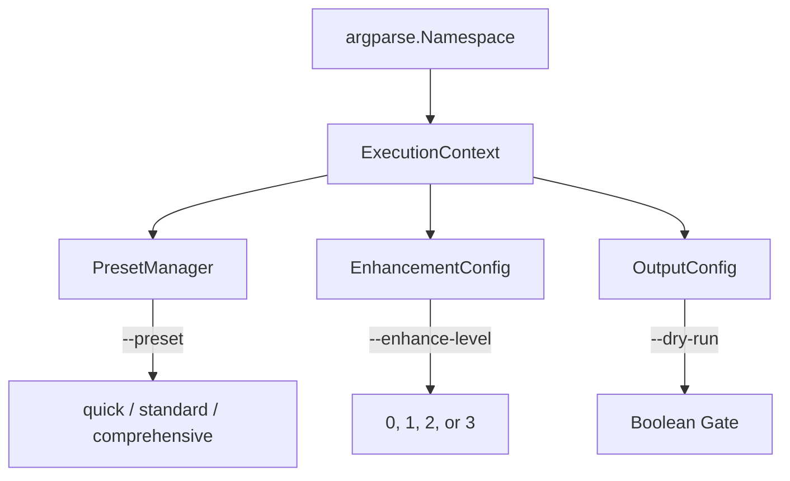
**Diagram: Argument Tier Resolution & ExecutionContext Flow**

Sources: [src/skill_seekers/cli/arguments/create.py:1-10](), [src/skill_seekers/cli/execution_context.py:1-20]()

### 3.1 `--preset` (`-p`)
* **Type**: `str` (`choices=["quick", "standard", "comprehensive"]`) [src/skill_seekers/cli/arguments/create.py:107-113]()
* **Role**: Configures the analysis depth and execution timeout profile:
  * `quick`: Fast execution (1–2 minutes), surface-level parsing.
  * `standard`: Balanced coverage (5–10 minutes).
  * `comprehensive`: Deep inspection (20–60 minutes), including full dependency and design pattern extraction.

Sources: [src/skill_seekers/cli/arguments/create.py:107-113]()

### 3.2 `--enhance-level`
* **Type**: `int` (`choices=[0, 1, 2, 3]`) [src/skill_seekers/cli/arguments/create.py:58-62]()
* **Role**: Controls the AI enhancement pipeline intensity:
  * `0`: Disabled (no AI processing).
  * `1`: `SKILL.md` synthesis only.
  * `2`: `SKILL.md` plus architecture and config summaries (default).
  * `3`: Full multi-stage deep enhancement.
* **Mode Selection**: Automatically selects API mode if an API key environment variable (`ANTHROPIC_API_KEY`, `OPENAI_API_KEY`, etc.) or `--api-key` is supplied; otherwise, it defaults to LOCAL mode interacting with an AI coding agent [src/skill_seekers/cli/arguments/create.py:65-70]().

Sources: [src/skill_seekers/cli/arguments/create.py:58-70]()

### 3.3 `--dry-run`
* **Type**: `action="store_true"` [src/skill_seekers/cli/arguments/create.py:82-87]()
* **Role**: Gates execution steps 6 and 7 in `CreateCommand.execute()` [src/skill_seekers/cli/create_command.py:100-102](). When active, the dispatcher validates inputs, runs source detection, and displays planned actions without executing network requests, file writes, or AI enhancement workflows.

Sources: [src/skill_seekers/cli/create_command.py:96-102](), [src/skill_seekers/cli/arguments/create.py:82-87]()

---

# Page: Enhancement Commands

# Enhancement Commands

<details>
<summary>Relevant source files</summary>

The following files were used as context for generating this wiki page:

- [src/skill_seekers/cli/adaptors/claude.py](src/skill_seekers/cli/adaptors/claude.py)
- [src/skill_seekers/cli/adaptors/gemini.py](src/skill_seekers/cli/adaptors/gemini.py)
- [src/skill_seekers/cli/adaptors/openai.py](src/skill_seekers/cli/adaptors/openai.py)
- [src/skill_seekers/cli/enhance_command.py](src/skill_seekers/cli/enhance_command.py)
- [src/skill_seekers/cli/enhance_skill_local.py](src/skill_seekers/cli/enhance_skill_local.py)
- [src/skill_seekers/cli/parsers/analyze_parser.py](src/skill_seekers/cli/parsers/analyze_parser.py)
- [src/skill_seekers/cli/parsers/enhance_parser.py](src/skill_seekers/cli/parsers/enhance_parser.py)
- [src/skill_seekers/cli/parsers/github_parser.py](src/skill_seekers/cli/parsers/github_parser.py)
- [src/skill_seekers/cli/parsers/package_parser.py](src/skill_seekers/cli/parsers/package_parser.py)
- [src/skill_seekers/cli/parsers/pdf_parser.py](src/skill_seekers/cli/parsers/pdf_parser.py)
- [src/skill_seekers/cli/parsers/scrape_parser.py](src/skill_seekers/cli/parsers/scrape_parser.py)
- [src/skill_seekers/cli/parsers/unified_parser.py](src/skill_seekers/cli/parsers/unified_parser.py)
- [src/skill_seekers/cli/parsers/upload_parser.py](src/skill_seekers/cli/parsers/upload_parser.py)
- [src/skill_seekers/cli/upload_skill.py](src/skill_seekers/cli/upload_skill.py)
- [tests/test_adaptors/test_openai_adaptor.py](tests/test_adaptors/test_openai_adaptor.py)
- [tests/test_enhance_command.py](tests/test_enhance_command.py)
- [tests/test_enhance_skill_local.py](tests/test_enhance_skill_local.py)
- [tests/test_install_skill.py](tests/test_install_skill.py)
- [tests/test_install_skill_e2e.py](tests/test_install_skill_e2e.py)
- [tests/test_mcp_workflow_tools.py](tests/test_mcp_workflow_tools.py)
- [tests/test_pdf_scraper.py](tests/test_pdf_scraper.py)

</details>


This page documents the `skill-seekers enhance` command: its mode-selection logic, the `--target` and `--agent` flags, background execution modes, root-user guard, and the status-monitoring mechanism. For how enhancement fits into the broader five-phase workflow, see [Understanding the Five-Phase Workflow](#2.3). For the AI enhancement internals (API backends, workflow presets, and the `WorkflowEngine`), see [AI Enhancement System](#8) and [Enhancement Workflows & Presets](#8.3).

Sources: [src/skill_seekers/cli/enhance_command.py:3-12](), [src/skill_seekers/cli/enhance_command.py:29-33](), [src/skill_seekers/cli/enhance_skill_local.py:1-5]()

---

## Overview

`skill-seekers enhance <skill_directory>` is a smart dispatcher that routes enhancement to one of two backends:

- **API mode** — calls the platform-adaptor path (`enhance_skill.py`) using Claude, Gemini, or OpenAI API keys.
- **LOCAL mode** — calls `LocalSkillEnhancer` from `src/skill_seekers/cli/enhance_skill_local.py`, which drives a locally installed coding agent CLI (Claude Code, Kimi, Codex, Copilot CLI, or OpenCode CLI).

The dispatch logic lives in `src/skill_seekers/cli/enhance_command.py`. The CLI argument schema is defined once in `src/skill_seekers/cli/arguments/enhance.py` and shared between the dispatcher, the standalone module, and the unified CLI parser.

Sources: [src/skill_seekers/cli/enhance_command.py:3-12](), [src/skill_seekers/cli/enhance_command.py:29-33](), [src/skill_seekers/cli/enhance_skill_local.py:1-5]()

---

## Command Syntax

```bash
skill-seekers enhance <skill_directory> [OPTIONS]
```

### All flags

| Flag | Type | Applies to | Default | Description |
|------|------|-----------|---------|-------------|
| `skill_directory` | positional | both | — | Path to the skill directory |
| `--target` | choice | API mode | `None` | Force API mode: `claude`, `gemini`, `openai`, or `kimi` |
| `--model` | string | API mode | `None` | Override the default enhancement model |
| `--api-key KEY` | string | API mode | env var | Override the API key |
| `--dry-run` | flag | both | `False` | Preview without calling AI |
| `--agent AGENT` | choice | LOCAL mode | `claude` | Local agent: `claude`, `codex`, `copilot`, `opencode`, `kimi`, `custom` |
| `--agent-cmd CMD` | string | LOCAL mode | `None` | Custom command template; `{prompt_file}` placeholder or stdin |
| `--interactive-enhancement` | flag | LOCAL mode | `False` | Open a new terminal window instead of headless mode |
| `--background` | flag | LOCAL mode | `False` | Run in background thread; return immediately |
| `--daemon` | flag | LOCAL mode | `False` | Run as persistent daemon process |
| `--no-force` | flag | LOCAL mode | `False` | Disable force mode (enable confirmations) |
| `--timeout SECONDS` | int | LOCAL mode | `None` | Timeout in seconds (default: 45 minutes) |

Sources: [src/skill_seekers/cli/enhance_command.py:1-191]()

---

## Mode Selection Priority Chain

The `_pick_mode(args)` function in `src/skill_seekers/cli/enhance_command.py` decides API vs. LOCAL mode using a priority chain. It checks for explicit flags, configuration preferences, and then environment variables.

**Mode selection diagram:**

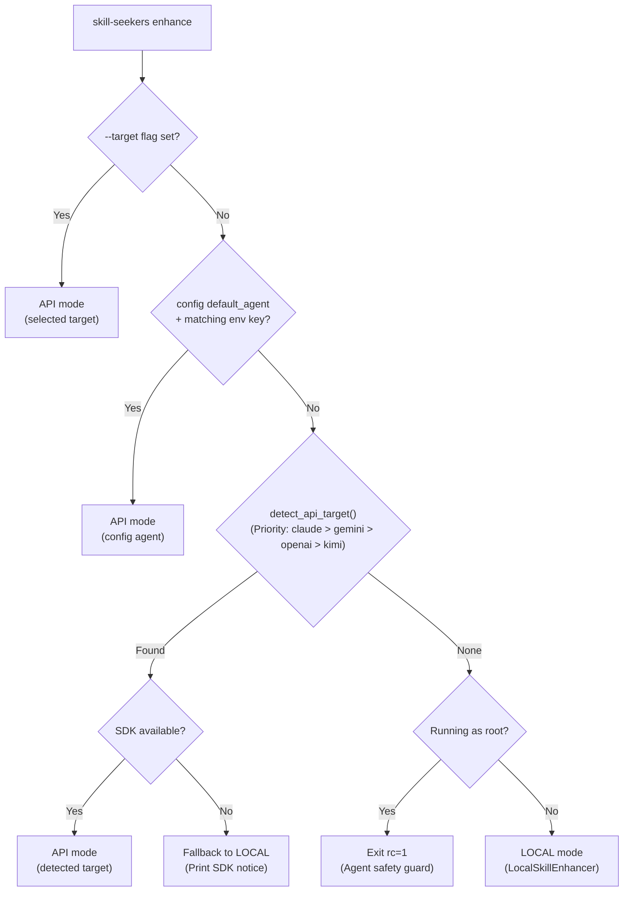

Sources: [src/skill_seekers/cli/enhance_command.py:92-132](), [src/skill_seekers/cli/enhance_command.py:41-46](), [src/skill_seekers/cli/agent_client.py:29-33]()

### Step-by-step rules

1. **Explicit `--target`** — Always routes to API mode with the specified platform [src/skill_seekers/cli/enhance_command.py:102-105]().
2. **Config `default_agent`** — Reads `ai_enhancement.default_agent` from the config manager. Used if the corresponding API key is available [src/skill_seekers/cli/enhance_command.py:107-112]().
3. **Auto-detection** — Uses `detect_api_target()` to check for `ANTHROPIC_API_KEY`, `GOOGLE_API_KEY`, `OPENAI_API_KEY`, or `MOONSHOT_API_KEY` [src/skill_seekers/cli/enhance_command.py:119-121]().
4. **SDK Verification** — If a target is detected but its Python SDK (e.g., `google.generativeai` for gemini) is missing, it falls back to LOCAL mode [src/skill_seekers/cli/enhance_command.py:122-129]().
5. **Root Guard** — If falling back to LOCAL mode while running as root, the command fails as local agents (like Claude Code) refuse root execution [src/skill_seekers/cli/enhance_command.py:21-22](), [src/skill_seekers/cli/enhance_command.py:41-46]().

Sources: [src/skill_seekers/cli/enhance_command.py:41-132]()

---

## API Mode

When resolved to `api`, `_run_api_mode` reconstructs `sys.argv` and delegates to `enhance_skill.main()`. This path uses platform-specific adaptors to format prompts and handle the API transport.

**Code path for API mode:**

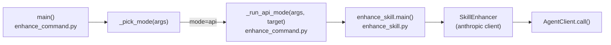

Sources: [src/skill_seekers/cli/enhance_command.py:140-174](), [src/skill_seekers/cli/enhance_skill.py:29-51]()

### Enhancement Prompt Logic
The `SkillEnhancer` builds a comprehensive prompt that includes:
- Current `SKILL.md` content [src/skill_seekers/cli/enhance_skill.py:114-117]().
- Reference file breakdown by source type (GitHub, Documentation, PDF, etc.) [src/skill_seekers/cli/enhance_skill.py:136-146]().
- Reference content (truncated to limit size per file) [src/skill_seekers/cli/enhance_skill.py:156-160]().
- Priority rules (Codebase Analysis > Official Docs > Community) [src/skill_seekers/cli/enhance_skill.py:173-175]().

Sources: [src/skill_seekers/cli/enhance_skill.py:114-175]()

---

## LOCAL Mode

`LocalSkillEnhancer` manages the invocation of local coding agent CLIs. It handles prompt generation, terminal detection, and background process management.

### Agent Configuration

Agents are defined in `AGENT_PRESETS` (imported from `agent_client.py`) [src/skill_seekers/cli/enhance_skill_local.py:64]().

| Agent | Command Template | Supports Skip Perms? |
|-------|------------------|----------------------|
| `claude` | `claude {prompt_file}` | Yes (`--dangerously-skip-permissions`) |
| `kimi` | `kimi --work-dir {skill_dir}` | No |
| `codex` | `codex exec --full-auto -` | No |

Sources: [src/skill_seekers/cli/enhance_skill_local.py:64](), [tests/test_enhance_skill_local.py:38-64]()

### Terminal Selection
For interactive mode (`--interactive-enhancement`), the system detects the terminal app to use:
1. `SKILL_SEEKER_TERMINAL` env var [src/skill_seekers/cli/enhance_skill_local.py:101-103]().
2. `TERM_PROGRAM` env var (mapped to app names like "Ghostty", "iTerm", "WezTerm") [src/skill_seekers/cli/enhance_skill_local.py:105-108]().
3. Fallback to `Terminal.app` [src/skill_seekers/cli/enhance_skill_local.py:110-116]().

Sources: [src/skill_seekers/cli/enhance_skill_local.py:70-117]()

---

## Execution Workflow

`LocalSkillEnhancer.run()` dispatches to the appropriate execution method.

**Execution flow diagram:**

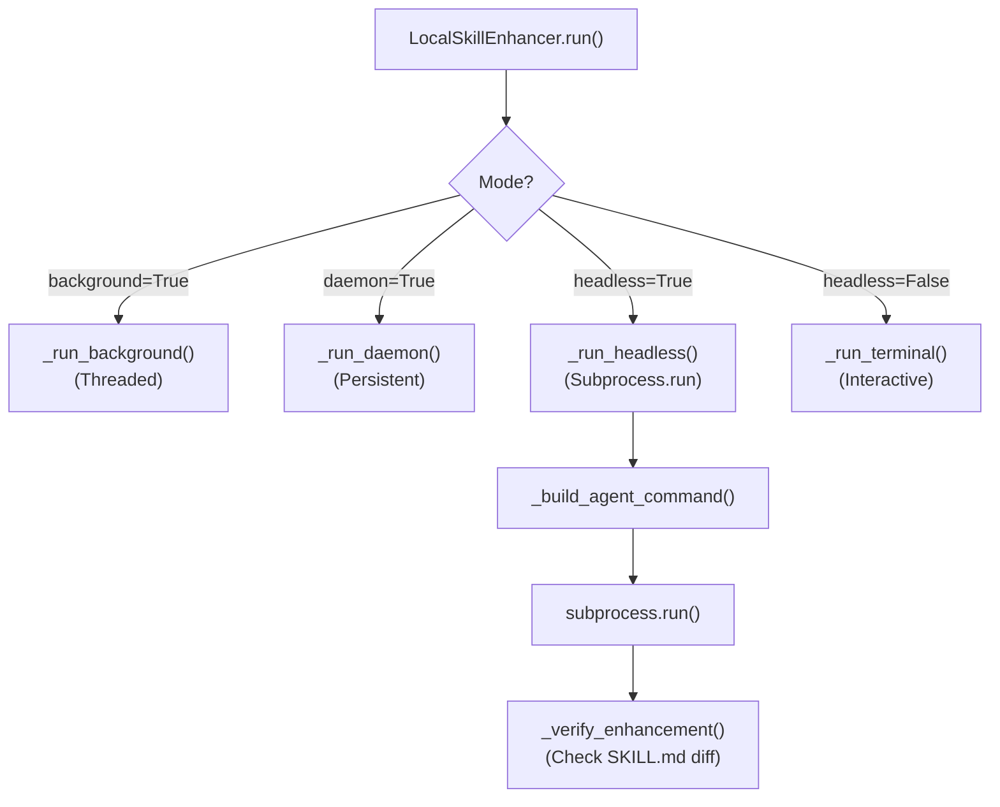

Sources: [src/skill_seekers/cli/enhance_skill_local.py:198-204](), [src/skill_seekers/cli/enhance_command.py:181-205]()

### Status Monitoring
`LocalSkillEnhancer` tracks progress via a hidden JSON file: `<skill_dir>/.enhancement_status.json` [src/skill_seekers/cli/enhance_skill_local.py:133]().
- `_update_status(status, message, progress)` writes state to disk [src/skill_seekers/cli/enhance_skill_local.py:600-632]().
- This allows background and daemon modes to report progress back to the user or other tools.

Sources: [src/skill_seekers/cli/enhance_skill_local.py:133](), [src/skill_seekers/cli/enhance_skill_local.py:600-632]()

---

## Usage Examples

### Standard API Enhancement
```bash
# Uses detected API key (Anthropic, Gemini, or OpenAI)
skill-seekers enhance output/my-skill/
```

### Local Enhancement with Claude Code
```bash
# Force local mode even if API keys exist
skill-seekers enhance output/my-skill/ --agent claude
```

### Background Daemon Mode
```bash
# Start enhancement in background and return immediately
skill-seekers enhance output/my-skill/ --daemon
```

### Custom Agent Command
```bash
# Use a custom agent with a specific prompt flag
skill-seekers enhance output/my-skill/ --agent custom --agent-cmd "my-ai-cli --file {prompt_file}"
```

Sources: [src/skill_seekers/cli/enhance_skill_local.py:7-29](), [src/skill_seekers/cli/arguments/enhance.py:11-126]()

---

# Page: Distribution Commands

# Distribution Commands

<details>
<summary>Relevant source files</summary>

The following files were used as context for generating this wiki page:

- [src/skill_seekers/cli/adaptors/__init__.py](src/skill_seekers/cli/adaptors/__init__.py)
- [src/skill_seekers/cli/adaptors/ibm_bob.py](src/skill_seekers/cli/adaptors/ibm_bob.py)
- [src/skill_seekers/cli/install_agent.py](src/skill_seekers/cli/install_agent.py)
- [src/skill_seekers/cli/install_skill.py](src/skill_seekers/cli/install_skill.py)
- [src/skill_seekers/cli/package_skill.py](src/skill_seekers/cli/package_skill.py)
- [src/skill_seekers/cli/parsers/install_agent_parser.py](src/skill_seekers/cli/parsers/install_agent_parser.py)
- [tests/test_adaptors/test_base.py](tests/test_adaptors/test_base.py)
- [tests/test_adaptors/test_ibm_bob_adaptor.py](tests/test_adaptors/test_ibm_bob_adaptor.py)

</details>


## Purpose and Scope

This document covers the distribution commands in the Skill Seekers unified CLI [src/skill_seekers/cli/main.py:62-84](), which handle packaging, uploading, and installing skills to various platforms and AI agents. These commands transform generated skill directories into deployable artifacts across **18+ target platforms and RAG pipelines** [src/skill_seekers/cli/adaptors/__init__.py:126-173]().

For information about creating skills, see [Scraping Commands](3.1). For information about improving skill quality, see [Enhancement Commands](3.2). For automated end-to-end workflows, see [Workflow Commands](3.4).

Sources: [src/skill_seekers/cli/main.py:62-84](), [src/skill_seekers/cli/adaptors/__init__.py:126-173]()

## Command Overview

Distribution commands transform a skill directory (`output/{name}/`) into platform-specific distributable formats:

| Command | Purpose | Platform Support | CLI Entry Point |
|---------|---------|------------------|----------------|
| `package` | Create platform-specific package | 18+ platforms (Claude, Gemini, OpenAI, LangChain, IBM Bob, etc.) | [src/skill_seekers/cli/package_skill.py:56-71]() |
| `upload` | Upload to platform API | Claude, Gemini, OpenAI, Weaviate, Chroma | [src/skill_seekers/cli/install_skill.py:32-35]() |
| `install` | End-to-end automated installation | Fetch → Scrape → Enhance → Package → Upload | [src/skill_seekers/cli/install_skill.py:42-113]() |
| `install-agent` | Install to local AI agent directories | 19+ AI coding agents (Cursor, Windsurf, Claude Code, etc.) | [src/skill_seekers/cli/install_agent.py:34-54]() |

All commands are registered as CLI subcommands in the dispatcher modules [src/skill_seekers/cli/main.py:62-84]().

Sources: [src/skill_seekers/cli/main.py:62-84](), [src/skill_seekers/cli/install_agent.py:34-54](), [src/skill_seekers/cli/package_skill.py:56-71](), [src/skill_seekers/cli/install_skill.py:42-113]()

## Distribution Command Flow

Title: Multi-Platform Distribution Architecture

```mermaid
graph TB
    subgraph "Input"
        SKILL_DIR["output/{name}/<br/>SKILL.md + references/"]
    end
    
    subgraph "package_skill.py"
        PKG_MAIN["package_skill()"]
        QUALITY_CHECK["SkillQualityChecker.check_all()"]
        GET_ADAPTOR["get_adaptor(target)"]
    end
    
    subgraph "adaptors/__init__.py"
        ADAPTOR_FACTORY["ADAPTORS Registry"]
    end
    
    subgraph "Concrete Adaptors"
        CLAUDE_ADAPTOR["ClaudeAdaptor<br/>ZIP + skill.yaml"]
        GEMINI_ADAPTOR["GeminiAdaptor<br/>tar.gz"]
        IBM_BOB_ADAPTOR["IBMBobAdaptor<br/>.bob/skills/ layout"]
        RAG_ADAPTORS["RAG Adaptors<br/>LangChain, LlamaIndex, Haystack"]
        VDB_ADAPTORS["Vector DB Adaptors<br/>Weaviate, Chroma, FAISS, Qdrant"]
    end
    
    subgraph "Output Formats"
        ZIP_FILE["{name}.zip / .tar.gz"]
        BOB_DIR["Local .bob/ directory"]
        JSON_FILE["{name}.json (RAG)"]
        API_UPLOAD["Direct API Upload"]
    end
    
    SKILL_DIR --> PKG_MAIN
    PKG_MAIN --> QUALITY_CHECK
    QUALITY_CHECK --> GET_ADAPTOR
    GET_ADAPTOR --> ADAPTOR_FACTORY
    
    ADAPTOR_FACTORY --> CLAUDE_ADAPTOR
    ADAPTOR_FACTORY --> GEMINI_ADAPTOR
    ADAPTOR_FACTORY --> IBM_BOB_ADAPTOR
    ADAPTOR_FACTORY --> RAG_ADAPTORS
    ADAPTOR_FACTORY --> VDB_ADAPTORS
    
    CLAUDE_ADAPTOR --> ZIP_FILE
    GEMINI_ADAPTOR --> ZIP_FILE
    IBM_BOB_ADAPTOR --> BOB_DIR
    RAG_ADAPTORS --> JSON_FILE
    VDB_ADAPTORS --> API_UPLOAD
```

Sources: [src/skill_seekers/cli/package_skill.py:101-126](), [src/skill_seekers/cli/adaptors/__init__.py:126-173](), [src/skill_seekers/cli/adaptors/ibm_bob.py:84-124]()

## Package Command

### Purpose

The `package` command creates platform-specific distributable packages from a skill directory. It supports **18+ target platforms** via the platform adaptor architecture and validates skill quality before packaging [src/skill_seekers/cli/package_skill.py:101-118]().

### Command Syntax

```bash
skill-seekers package <skill_directory> [options]

Options:
  --target PLATFORM         Target platform (default: auto-detected)
  --no-open                Don't open output folder after packaging
  --upload                 Auto-upload to platform after packaging
  --skip-quality-check     Skip quality validation before packaging
  --streaming              Use streaming ingestion for large docs
  --chunk-for-rag          Enable intelligent chunking for RAG platforms
```

Sources: [src/skill_seekers/cli/package_skill.py:56-71]()

### Platform Adaptor Architecture

The system uses the **Strategy Pattern** to handle different platform requirements. All adaptors inherit from the `SkillAdaptor` abstract base class [src/skill_seekers/cli/adaptors/base.py:11-11](). The `get_adaptor` function [src/skill_seekers/cli/adaptors/__init__.py:175-207]() acts as a factory, returning the appropriate adaptor instance based on the specified `platform`. The `ADAPTORS` dictionary [src/skill_seekers/cli/adaptors/__init__.py:126-173]() registers all available adaptors.

Title: Adaptor Registry and Factory

```mermaid
classDiagram
    class SkillAdaptor {
        <<abstract>>
        +package(skill_path, output_dir) Path
        +upload(package_path, api_key) dict[str, Any]
        +format_skill_md(skill_dir, metadata) str
        +supports_enhancement() bool
        +supports_upload() bool
    }
    class ClaudeAdaptor {
        +PLATFORM: "claude"
        +package() Path
        +upload() dict[str, Any]
        +format_skill_md() str
    }
    class GeminiAdaptor {
        +PLATFORM: "gemini"
        +package() Path
        +upload() dict[str, Any]
        +format_skill_md() str
    }
    class OpenAIAdaptor {
        +PLATFORM: "openai"
        +package() Path
        +upload() dict[str, Any]
        +format_skill_md() str
    }
    class IBMBobAdaptor {
        +PLATFORM: "ibm-bob"
        +package() Path
        +format_skill_md() str
    }
    class LangChainAdaptor {
        +PLATFORM: "langchain"
        +package() Path
    }
    
    SkillAdaptor <|-- ClaudeAdaptor
    SkillAdaptor <|-- GeminiAdaptor
    SkillAdaptor <|-- OpenAIAdaptor
    SkillAdaptor <|-- IBMBobAdaptor
    SkillAdaptor <|-- LangChainAdaptor
    
    class AdaptorRegistry {
        -ADAPTORS: dict[str, type[SkillAdaptor]]
        +get_adaptor(platform: str, config: dict) SkillAdaptor
        +list_platforms() list[str]
        +get_enhancement_platforms() list[str]
        +get_upload_platforms() list[str]
    }

    AdaptorRegistry "1" *-- "many" SkillAdaptor : "registers"
```

Sources: [src/skill_seekers/cli/adaptors/__init__.py:126-207](), [src/skill_seekers/cli/adaptors/base.py:11-11](), [src/skill_seekers/cli/adaptors/ibm_bob.py:18-27]()

### Packaging Logic

The `package_skill` function [src/skill_seekers/cli/package_skill.py:56-71]() orchestrates the packaging process. It first validates the skill directory using `validate_skill_directory` [src/skill_seekers/cli/package_skill.py:95-95]() and performs quality checks via `SkillQualityChecker` [src/skill_seekers/cli/package_skill.py:106-107](). It then retrieves the appropriate `SkillAdaptor` based on the `--target` argument [src/skill_seekers/cli/package_skill.py:122-123]() and calls the adaptor's `package` method [src/skill_seekers/cli/package_skill.py:172-178]().

For example, `IBMBobAdaptor.package` [src/skill_seekers/cli/adaptors/ibm_bob.py:75-124]() creates a Bob-ready directory structure under `.bob/skills/<normalized-name>/` containing `SKILL.md`, `references/`, `scripts/`, and `assets/`.

Sources: [src/skill_seekers/cli/package_skill.py:56-71](), [src/skill_seekers/cli/package_skill.py:95-123](), [src/skill_seekers/cli/package_skill.py:172-178](), [src/skill_seekers/cli/adaptors/ibm_bob.py:75-124]()

### RAG Platform Auto-Chunking

The packager automatically enables intelligent chunking for RAG platforms to optimize embedding generation [src/skill_seekers/cli/package_skill.py:133-146](). This is controlled by parameters such as `enable_chunking`, `chunk_max_tokens`, `preserve_code_blocks`, and `chunk_overlap_tokens` [src/skill_seekers/cli/package_skill.py:67-71]().

**RAG Platforms List:**
- `langchain`, `llama-index`, `haystack`, `weaviate`, `chroma`, `faiss`, `qdrant`, `pinecone` [src/skill_seekers/cli/package_skill.py:133-142]().

Sources: [src/skill_seekers/cli/package_skill.py:67-71](), [src/skill_seekers/cli/package_skill.py:133-146]()

## Upload Command

### Purpose

The `upload` command uploads a previously packaged skill to a target LLM platform or vector database using the `SkillAdaptor`'s `upload` interface [src/skill_seekers/cli/adaptors/base.py:11-11]().

### Command Syntax

```bash
skill-seekers upload <package_file> [options]

Options:
  --target PLATFORM         Target platform (default: auto-detected)
  --api-key API_KEY         API key (otherwise read from environment)
```

Sources: [src/skill_seekers/cli/adaptors/ibm_bob.py:126-135]()

## Install Command (End-to-End)

The `install` command orchestrates the complete skill creation and deployment workflow by invoking the `install_skill_tool` MCP function [src/skill_seekers/cli/install_skill.py:3-35](). This command requires the `mcp` optional dependency group to be installed [src/skill_seekers/cli/install_skill.py:47-56]().

**Phases of the `install` command:**
1. **Fetch Config:** Detects if the argument is a local path or a remote config name [src/skill_seekers/cli/install_skill.py:71-80]().
2. **Scrape:** Executes the ingestion phase.
3. **AI Enhancement:** Performs AI-powered enhancement.
4. **Package:** Formats the skill for the target platform.
5. **Upload:** Automatically uploads if `auto_upload` is `True` [src/skill_seekers/cli/install_skill.py:87-87]().

Sources: [src/skill_seekers/cli/install_skill.py:3-113]()

## Install-Agent Command

### Purpose

The `install-agent` command installs skills to local AI coding agent directories. This supports **local-first workflows** for tools like Cursor, Windsurf, Claude Code, and IBM Bob [src/skill_seekers/cli/install_agent.py:3-24]().

### Command Syntax

```bash
skill-seekers install-agent <skill_directory> [options]

Options:
  --agent AGENT_NAME        Target AI agent (e.g., 'cursor', 'claude', 'bob', 'all')
  --force                   Overwrite existing installation without asking
  --dry-run                 Preview installation without making changes
```

Sources: [src/skill_seekers/cli/parsers/install_agent_parser.py:6-34]()

### Agent Path Mapping

The command maps agent names to specific filesystem locations, handling both global (home directory) and project-relative paths using the `AGENT_PATHS` dictionary [src/skill_seekers/cli/install_agent.py:34-54](). The `get_agent_path` function [src/skill_seekers/cli/install_agent.py:58-91]() resolves the absolute path for a given agent.

| Agent | Path Type | Default Location |
|-------|-----------|------------------|
| `claude` | Global | `~/.claude/skills/` |
| `cursor` | Project | `.cursor/skills/` |
| `vscode` | Project | `.github/skills/` |
| `copilot` | Project | `.github/skills/` |
| `amp` | Global | `~/.amp/skills/` |
| `goose` | Global | `~/.config/goose/skills/` |
| `opencode` | Global | `~/.opencode/skills/` |
| `letta` | Global | `~/.letta/skills/` |
| `aide` | Global | `~/.aide/skills/` |
| `windsurf` | Global | `~/.windsurf/skills/` |
| `neovate` | Global | `~/.neovate/skills/` |
| `roo` | Project | `.roo/skills/` |
| `cline` | Project | `.cline/skills/` |
| `aider` | Global | `~/.aider/skills/` |
| `bolt` | Project | `.bolt/skills/` |
| `kilo` | Project | `.kilo/skills/` |
| `continue` | Global | `~/.continue/skills/` |
| `kimi-code` | Global | `~/.kimi/skills/` |
| `bob` | Project | `.bob/skills/` |

Sources: [src/skill_seekers/cli/install_agent.py:34-91]()

### Installation Logic and File Filtering

The `install_to_agent` function handles the copying of files while excluding temporary files, backups (`*.backup`), and hidden files [src/skill_seekers/cli/install_agent.py:173-191](). It validates the skill directory using `validate_skill_directory` [src/skill_seekers/cli/install_agent.py:144-169]() and the agent name using `validate_agent_name` [src/skill_seekers/cli/install_agent.py:103-142]().

Sources: [src/skill_seekers/cli/install_agent.py:103-191]()

---

# Page: Workflow Commands

# Workflow Commands

<details>
<summary>Relevant source files</summary>

The following files were used as context for generating this wiki page:

- [src/skill_seekers/workflows/default.yaml](src/skill_seekers/workflows/default.yaml)
- [src/skill_seekers/workflows/minimal.yaml](src/skill_seekers/workflows/minimal.yaml)
- [src/skill_seekers/workflows/prompt-injection-check.yaml](src/skill_seekers/workflows/prompt-injection-check.yaml)
- [src/skill_seekers/workflows/security-focus.yaml](src/skill_seekers/workflows/security-focus.yaml)
- [tests/test_workflow_prompt_injection.py](tests/test_workflow_prompt_injection.py)

</details>


The `skill-seekers workflows` subcommand manages **enhancement workflow presets** — YAML files that define multi-stage AI enhancement pipelines. These presets are consumed by the `WorkflowEngine` during the enhancement phase to orchestrate complex analysis tasks such as security scanning, pattern detection, and architectural reviews.

## Overview

Workflows are stored in two locations and surfaced as a unified list by the CLI and MCP tools. User-defined workflows take precedence over bundled ones if they share the same name.

| Source | Location | Mutable | Purpose |
|--------|----------|---------|---------|
| **Bundled** | `src/skill_seekers/workflows/` | Read-only | Standard presets (default, security-focus, minimal, prompt-injection-check) |
| **User** | `~/.config/skill-seekers/workflows/` | Full CRUD | Custom project-specific pipelines |

The workflow management system is implemented in `src/skill_seekers/mcp/tools/workflow_tools.py` and exposed via the `workflows` CLI group.

Sources: [src/skill_seekers/mcp/tools/workflow_tools.py:29-30](), [src/skill_seekers/mcp/tools/workflow_tools.py:44-63]()

## Workflow Structure

A workflow is a YAML file containing metadata and a sequence of `stages`. Each stage defines a specific AI task.

**Example: security-focus.yaml**
```yaml
name: security-focus
description: "Security-focused review: vulnerabilities, auth, data handling"
stages:
  - name: injection_scan
    type: custom
    target: all
    prompt: "Scan this content for potential prompt injection patterns..."
  - name: base_patterns
    type: builtin
    target: patterns
```

### Key Components
*   **Stages**: Ordered list of operations. Can be `builtin` (calling internal analysis functions) or `custom` (sending a specific `prompt` to the LLM) [src/skill_seekers/workflows/security-focus.yaml:9-14]().
*   **Target**: Specifies which part of the skill the stage applies to (e.g., `patterns`, `security`, `architecture`, `all`) [src/skill_seekers/workflows/security-focus.yaml:12]().
*   **Post Process**: Metadata and formatting rules applied after all stages complete, such as adding `security_scanned: true` [src/skill_seekers/workflows/prompt-injection-check.yaml:33-37]().

Sources: [src/skill_seekers/workflows/security-focus.yaml:1-70](), [src/skill_seekers/workflows/default.yaml:1-77](), [src/skill_seekers/workflows/prompt-injection-check.yaml:1-37]()

## CLI Subcommands

The CLI provides a git-style interface for managing these presets, implemented in `src/skill_seekers/cli/workflows_command.py` (or mapped via tool handlers in `src/skill_seekers/mcp/tools/workflow_tools.py`).

| CLI Subcommand | Internal Function | Description |
|---------------|-------------------|-----------|
| `workflows list` | `list_workflows_tool` | Lists all available workflows with their source (bundled/user). |
| `workflows show <name>` | `get_workflow_tool` | Displays the raw YAML content of the specified workflow. |
| `workflows add <file>` | `create_workflow_tool` | Installs a custom YAML workflow to the user directory. |
| `workflows copy <name>` | `copy_workflow` | Copies a bundled workflow to the user directory for modification. |
| `workflows remove <name>` | `delete_workflow_tool` | Removes a workflow from the user directory. Refuses to delete bundled ones. |
| `workflows validate <file>` | `validate_workflow` | Validates a workflow YAML structure (checks for `stages` key). |

Sources: [tests/test_workflows_command.py:23-28](), [src/skill_seekers/mcp/tools/workflow_tools.py:103-240]()

## Implementation & Data Flow

The workflow system uses `importlib.resources` to access bundled files and standard file I/O for user-defined files. It includes path validation to prevent path traversal (CWE-22) by checking for `..`, `/`, or absolute paths in workflow names.

Title: "Workflow Management Data Flow"
```mermaid
graph TD
    subgraph "CLI / MCP Layer"
        UserCmd["workflows get/create/list"]
    end

    subgraph "Logic Layer (workflow_tools.py)"
        Dispatch["Tool Implementation"]
        ValidateName["_validate_name()"]
        ValidateYAML["_validate_yaml()"]
    end

    subgraph "Storage Layer"
        UserDir["~/.config/skill-seekers/workflows/"]
        BundledPkg["skill_seekers.workflows (Package Data)"]
    end

    UserCmd --> Dispatch
    Dispatch --> ValidateName
    Dispatch --> ValidateYAML
    
    ValidateName --> CheckUser["Check User Dir"]
    CheckUser -->|Exists| ReadUser["Read .yaml/.yml"]
    CheckUser -->|Not Found| CheckBundled["Check Bundled Resources"]
    
    ReadUser --> UserDir
    CheckBundled --> BundledPkg
```

Sources: [src/skill_seekers/mcp/tools/workflow_tools.py:32-41](), [src/skill_seekers/mcp/tools/workflow_tools.py:44-63](), [src/skill_seekers/mcp/tools/workflow_tools.py:88-96]()

## Security Workflows

The system includes specialized workflows to ensure the safety of generated skills. Both the `default` and `security-focus` workflows prioritize an `injection_scan` stage as their first operation [src/skill_seekers/workflows/default.yaml:9-22](), [src/skill_seekers/workflows/security-focus.yaml:9-22]().

### Prompt Injection Check
The `prompt-injection-check.yaml` workflow is a dedicated pipeline that scans scraped content for role assumption attempts, instruction overrides, and hidden payloads. It is designed to flag actual injection attempts while ignoring legitimate security tutorials [src/skill_seekers/workflows/prompt-injection-check.yaml:1-37]().

Title: "Security Workflows Entity Mapping"
```mermaid
classDiagram
    class WorkflowTools {
        +list_workflows_tool()
        +get_workflow_tool()
        +create_workflow_tool()
    }
    class BundledWorkflows {
        <<resource>>
        default.yaml
        security-focus.yaml
        prompt-injection-check.yaml
    }
    class InjectionScan {
        +name: "injection_scan"
        +target: "all"
        +type: "custom"
        +prompt: "Scan for role assumption..."
    }

    WorkflowTools ..> BundledWorkflows : reads via importlib_files
    BundledWorkflows --> InjectionScan : defined in stages[0]
```

Sources: [src/skill_seekers/workflows/prompt-injection-check.yaml:1-37](), [tests/test_workflow_prompt_injection.py:69-94](), [src/skill_seekers/workflows/default.yaml:9-22]()

## MCP Integration

The workflow commands are fully exposed as MCP tools, allowing AI agents (like Claude Code) to manage their own enhancement pipelines using natural language.

*   **`list_workflows_tool`**: Returns all workflows with name, description, and source label [src/skill_seekers/mcp/tools/workflow_tools.py:103-130]().
*   **`get_workflow_tool`**: Returns the full YAML text. If not found, it suggests available names [src/skill_seekers/mcp/tools/workflow_tools.py:133-155]().
*   **`create_workflow_tool`**: Writes a new workflow YAML to the user directory after validating it contains a `stages` key [src/skill_seekers/mcp/tools/workflow_tools.py:158-188]().
*   **`update_workflow_tool`**: Overwrites existing user workflows. It explicitly prevents overwriting bundled workflows to maintain system integrity [src/skill_seekers/mcp/tools/workflow_tools.py:191-218]().
*   **`delete_workflow_tool`**: Removes a workflow file from the user configuration directory [src/skill_seekers/mcp/tools/workflow_tools.py:221-240]().

Sources: [src/skill_seekers/mcp/tools/workflow_tools.py:103-130](), [src/skill_seekers/mcp/tools/workflow_tools.py:133-155](), [src/skill_seekers/mcp/tools/workflow_tools.py:158-188](), [src/skill_seekers/mcp/tools/workflow_tools.py:191-218](), [src/skill_seekers/mcp/tools/workflow_tools.py:221-240](), [tests/test_workflow_tools_mcp.py:92-167]()

---

# Page: Scan Command — AI Project Knowledge Base

# Scan Command — AI Project Knowledge Base

<details>
<summary>Relevant source files</summary>

The following files were used as context for generating this wiki page:

- [src/skill_seekers/cli/architectural_pattern_detector.py](src/skill_seekers/cli/architectural_pattern_detector.py)
- [src/skill_seekers/cli/code_analyzer.py](src/skill_seekers/cli/code_analyzer.py)
- [src/skill_seekers/cli/codebase_scraper.py](src/skill_seekers/cli/codebase_scraper.py)
- [src/skill_seekers/cli/dependency_analyzer.py](src/skill_seekers/cli/dependency_analyzer.py)
- [src/skill_seekers/cli/main.py](src/skill_seekers/cli/main.py)
- [src/skill_seekers/cli/parsers/__init__.py](src/skill_seekers/cli/parsers/__init__.py)
- [src/skill_seekers/cli/signal_flow_analyzer.py](src/skill_seekers/cli/signal_flow_analyzer.py)
- [src/skill_seekers/cli/skill_converter.py](src/skill_seekers/cli/skill_converter.py)
- [src/skill_seekers/cli/source_detector.py](src/skill_seekers/cli/source_detector.py)
- [tests/test_cli_parsers.py](tests/test_cli_parsers.py)
- [tests/test_code_analyzer.py](tests/test_code_analyzer.py)
- [tests/test_codebase_scraper.py](tests/test_codebase_scraper.py)
- [tests/test_dependency_analyzer.py](tests/test_dependency_analyzer.py)
- [tests/test_framework_detection.py](tests/test_framework_detection.py)
- [tests/test_kotlin_support.py](tests/test_kotlin_support.py)
- [tests/test_new_source_types.py](tests/test_new_source_types.py)

</details>


The `scan` command serves as an AI-driven project knowledge-base bootstrapper that automatically discovers a codebase's technology stack and emits per-framework configurations along with a unified codebase configuration `[src/skill_seekers/cli/main.py:53]()`.

## Overview and Purpose

The `scan` command automates the initial "Ingestion" and "Analysis" phases of the skill-seekers pipeline by probing a local directory for technical signatures and framework manifests. Instead of requiring manual JSON configuration writing for every library in a complex project, `scan` combines deterministic manifest collection with LLM-driven detection to output ready-to-use skill configurations `[src/skill_seekers/cli/main.py:53]()`.

### Key Features
*   **Signal Collection**: Gathers manifests, READMEs, CI configurations, and source samples within strict byte budgets `[src/skill_seekers/cli/main.py:53]()`.
*   **AI Framework Detection**: Utilizes an LLM agent to identify frameworks from gathered project signals with structured JSON output `[src/skill_seekers/cli/main.py:53]()`.
*   **Config Resolution Pipeline**: Attempts to resolve detected frameworks against the community registry before triggering AI generation `[src/skill_seekers/cli/main.py:53]()`.
*   **Stale Config Archiving**: Automatically moves outdated configurations to a timestamped `.archived/` directory `[src/skill_seekers/cli/main.py:53]()`.
*   **Community Registry Publishing**: Optional async submission of generated configurations to the remote community repository `[src/skill_seekers/cli/main.py:53]()`.

Sources: `[src/skill_seekers/cli/main.py:53]()`

## Implementation Architecture

The core logic is implemented in the `ScanCommand` class (`src/skill_seekers/cli/scan_command.py`), which is dispatched directly through the `COMMAND_CLASSES` registry inside the unified CLI entry point `[src/skill_seekers/cli/main.py:50-56]()`.

### Data Flow Diagram: From Code to Config

The following diagram maps the physical codebase ("Code Entity Space") to internal methods and structured outputs ("Natural Language Space").

Title: Scan Command Execution Pipeline
```mermaid
graph TD
    subgraph "CodeEntitySpace"
        DIR["ProjectDirectory"]
        MAN["ManifestFiles (package.json, pyproject.toml)"]
        SRC["SourceSamples (CodeAnalyzer)"]
        CI["CIFiles (GitHub Actions, Dockerfile)"]
    end

    subgraph "ScanCommandInternals"
        COL["collect_signals()"]
        DET["detect_with_ai()"]
        RES["resolve_or_generate_with_status()"]
        EMIT["emit_codebase_config()"]
    end

    subgraph "NaturalLanguageSpace"
        LLM["AgentClient"]
        REG["CommunityRegistry"]
        OUT["output/ConfigJSON"]
    end

    DIR --> COL
    COL --> MAN
    COL --> SRC
    COL --> CI
    
    COL -- "SignalBundle" --> DET
    DET -- "Prompt" --> LLM
    LLM -- "FrameworkList" --> DET
    
    DET --> RES
    RES -- "LookupSlug" --> REG
    RES -- "Fallback" --> LLM
    
    RES --> OUT
    EMIT -- "LocalConfig" --> OUT
```
Sources: `[src/skill_seekers/cli/main.py:50-56]()`, `[src/skill_seekers/cli/code_analyzer.py:76-88]()`

## Key Internal Components

### 1. Signal Collection (`collect_signals`)
The collector performs a deterministic gathering pass across the repository, organizing files into per-kind byte budgets:
*   **Manifests**: 24 KB (e.g., `package.json`, `Cargo.toml`, `pyproject.toml`).
*   **README**: 6 KB.
*   **CI/Docker**: 6 KB.
*   **Source Samples**: 28 KB (first 2 KB of sampled files).
*   **Total Budget**: 64 KB limit.

Sources: `[src/skill_seekers/cli/code_analyzer.py:76-88]()`

### 2. AI Detection and Resolution
The resolution pipeline follows a strict fallback order for every identified framework:
1.  **Local Cache**: Inspects existing output directories for prior configuration matches.
2.  **Registry Match**: Attempts to resolve canonical slugs against known community configurations.
3.  **AI Generation**: Falls back to `generate_config_with_ai` via `AgentClient` if no canonical configuration exists.

Sources: `[src/skill_seekers/cli/architectural_pattern_detector.py:148-167]()`

### 3. Output Management and Safety
*   **Atomic Writes**: Configuration files are written atomically using temporary staging files followed by replacement (`os.replace`) to prevent corruption.
*   **Archiving**: Frameworks no longer detected during a subsequent scan are moved to `.archived/<timestamp>/` rather than permanently deleted.
*   **Codebase Config**: Always emits a project-level codebase configuration pointing to the local directory root as a `local` source type `[src/skill_seekers/cli/codebase_scraper.py:8-19]()`.

Title: Component Mapping: Code to Logic
```mermaid
graph LR
    subgraph "SourceFiles"
        P1["pyproject.toml"]
        P2["package.json"]
        P3["README.md"]
    end

    subgraph "LogicEntities"
        SD["SourceDetector"]
        SC["ScanCommand"]
        AC["AgentClient"]
    end

    subgraph "OutputEntities"
        OC["CodebaseConfigJson"]
        FC["FrameworkConfigJson"]
        ARC["ArchivedDirectory"]
    end

    P1 & P2 --> SD
    SD --> SC
    P3 --> SC
    SC -- "Context" --> AC
    AC -- "Detections" --> SC
    SC --> OC
    SC --> FC
    SC -- "Stale" --> ARC
```
Sources: `[src/skill_seekers/cli/source_detector.py:48-58]()`, `[src/skill_seekers/cli/codebase_scraper.py:36-41]()`

## CLI Reference

### Command Syntax
```bash
skill-seekers scan <directory> [options]
```

### Arguments and Flags
| Flag | Description | Default |
| :--- | :--- | :--- |
| `--out`, `-o` | Directory where generated `.json` configurations are saved. | `./configs` |
| `--max-ai-generations` | Maximum number of new configurations the AI is allowed to generate in a single run. | 10 |
| `--probe-urls` | Performs `HEAD` verification checks on AI-generated documentation URLs. | False |
| `--publish` | Opt-in flag to submit newly generated configurations to the community registry via GitHub Issues. | False |
| `--dry-run` | Previews detected technologies and signals without executing AI calls or writing files. | False |

Sources: `[src/skill_seekers/cli/main.py:50-56]()`, `[src/skill_seekers/cli/parsers/__init__.py:30-37]()`

## Community Registry Publishing
The `--publish` flag triggers an asynchronous publishing pipeline (`maybe_publish`) that submits valid configurations to the remote repository.

*   **Idempotency**: Queries the GitHub Search API (`_find_existing_issue`) to prevent duplicate submissions of identical configuration slugs.
*   **Authentication**: Requires a valid `GITHUB_TOKEN` environment variable for API authorization.
*   **Resilience**: Implements exponential backoff retry logic to handle transient network errors or API rate limits.

Sources: `[src/skill_seekers/cli/parsers/__init__.py:30-37]()`

---

# Page: Diagnostics & Setup Commands

# Diagnostics & Setup Commands

<details>
<summary>Relevant source files</summary>

The following files were used as context for generating this wiki page:

- [.github/workflows/vector-db-export.yml](.github/workflows/vector-db-export.yml)
- [AGENTS.md](AGENTS.md)
- [docs/README.md](docs/README.md)
- [docs/guides/WEB_UI.md](docs/guides/WEB_UI.md)
- [docs/reference/CLI_REFERENCE.md](docs/reference/CLI_REFERENCE.md)
- [docs/zh-CN/reference/CLI_REFERENCE.md](docs/zh-CN/reference/CLI_REFERENCE.md)
- [scripts/bootstrap_skill.sh](scripts/bootstrap_skill.sh)
- [scripts/skill_header.md](scripts/skill_header.md)
- [src/skill_seekers/cli/detect_command.py](src/skill_seekers/cli/detect_command.py)
- [src/skill_seekers/cli/doctor.py](src/skill_seekers/cli/doctor.py)
- [src/skill_seekers/cli/parsers/detect_parser.py](src/skill_seekers/cli/parsers/detect_parser.py)
- [src/skill_seekers/cli/parsers/doctor_parser.py](src/skill_seekers/cli/parsers/doctor_parser.py)
- [src/skill_seekers/cli/setup_wizard.py](src/skill_seekers/cli/setup_wizard.py)
- [src/skill_seekers/cli/ui_command.py](src/skill_seekers/cli/ui_command.py)
- [tests/test_bootstrap_skill.py](tests/test_bootstrap_skill.py)
- [tests/test_bootstrap_skill_e2e.py](tests/test_bootstrap_skill_e2e.py)
- [tests/test_doctor.py](tests/test_doctor.py)
- [ui/package-lock.json](ui/package-lock.json)
- [ui/package.json](ui/package.json)

</details>


This document provides technical documentation for the diagnostic, source preview, configuration setup, and user interface commands in `skill-seekers`. These commands enable users and AI coding agents to verify environment health, preview ingestion source classification, configure credentials interactively, and launch the Seeker HUD web interface.

---

## 1. Environmental Diagnostics (`skill-seekers doctor`)

The `doctor` subcommand executes a suite of offline diagnostic checks to verify system dependencies, Python version compatibility, optional package availability, and environment variable configurations [src/skill_seekers/cli/doctor.py:1-6]().

### Implementation & Data Structures

The diagnostic subsystem centers around the `CheckResult` dataclass, which encapsulates the outcome of an individual health check [src/skill_seekers/cli/doctor.py:21-30](). Command-line arguments are parsed via `DoctorParser`, supporting `--verbose` for detailed inspection and `--json` for machine-readable output [src/skill_seekers/cli/parsers/doctor_parser.py:6-26]().

```mermaid
graph TD
    User["UserCommand"] -->|Runs| DoctorParser["DoctorParser"]
    DoctorParser -->|Dispatches| DoctorCommand["DoctorCommand.execute()"]
    DoctorCommand -->|Calls| RunAllChecks["run_all_checks()"]
    RunAllChecks -->|Returns| CheckResults["list[CheckResult]"]
    CheckResults -->|Formatters| Output["CLI Report / JSON Payload"]

    subcode1["src/skill_seekers/cli/parsers/doctor_parser.py"]
    subcode2["src/skill_seekers/cli/doctor.py"]
```
*Diagram 1: Diagnostic execution flow bridging CLI invocation to `run_all_checks()` and `CheckResult` generation.*

**Sources:** `[src/skill_seekers/cli/doctor.py:1-30](), [src/skill_seekers/cli/parsers/doctor_parser.py:6-26]()`

### Diagnostic Checks

`run_all_checks()` executes eight distinct validation functions:
1. **Python Version**: Validates that `sys.version_info >= (3, 10)` [src/skill_seekers/cli/doctor.py:84-91]().
2. **Package Installation**: Confirms `skill_seekers` is importable and reads `__version__` [src/skill_seekers/cli/doctor.py:93-102]().
3. **Git Availability**: Checks if `git` is present in `PATH` via `shutil.which` [src/skill_seekers/cli/doctor.py:105-116]().
4. **Core Dependencies**: Verifies core import names (such as `requests`, `bs4`, `github`, `git`, `httpx`, `anthropic`, `fitz`, `pydantic`) [src/skill_seekers/cli/doctor.py:33-48, 118-146]().
5. **Optional Dependencies**: Reports availability of optional extras (such as `mammoth`, `yt_dlp`, `mcp`, `chromadb`, `weaviate`) [src/skill_seekers/cli/doctor.py:51-62, 149-176]().
6. **API Keys**: Evaluates presence and presence-masking of environment variables (`ANTHROPIC_API_KEY`, `GITHUB_TOKEN`, `GOOGLE_API_KEY`, `OPENAI_API_KEY`, `MOONSHOT_API_KEY`) [src/skill_seekers/cli/doctor.py:64-71, 179-215]().
7. **MCP Server**: Validates Model Context Protocol availability.
8. **Output Directory**: Confirms write permissions on local output directories.

**Sources:** `[src/skill_seekers/cli/doctor.py:33-215]()`

---

## 2. Source Detection Preview (`skill-seekers detect`)

The `detect` subcommand allows users to preview how `skill-seekers create` would classify a target URI, path, or repository without performing any scraping, file generation, or enhancement work [docs/reference/CLI_REFERENCE.md:41]().

### Implementation & Data Flow

`DetectCommand` interfaces directly with `SourceDetector` to inspect user inputs, resolve input types (documentation URL, GitHub repository shorthand, local file path, PDF, etc.), and emit a structured classification summary.

```mermaid
graph TD
    CLI["skill-seekers detect"] -->|Parsed by| DetectParser["DetectParser"]
    DetectParser -->|Invokes| DetectCommand["DetectCommand.execute()"]
    DetectCommand -->|Calls| SourceDetector["SourceDetector.detect()"]
    SourceDetector -->|Analyzes| SourceInput["Target URI / Path"]
    SourceDetector -->|Returns| SourceInfo["SourceInfo Object"]
    SourceInfo -->|Renders| ConsoleOutput["CLI / JSON Preview"]

    subcode1["src/skill_seekers/cli/detect_command.py"]
    subcode2["src/skill_seekers/cli/source_detector.py"]
```
*Diagram 2: Source detection architecture routing input strings through `SourceDetector` to resolve target metadata.*

**Sources:** `[docs/reference/CLI_REFERENCE.md:41](), [src/skill_seekers/cli/detect_command.py:1-50](), [src/skill_seekers/cli/source_detector.py:1-60]()`

---

## 3. Interactive Configuration & Setup Wizard (`skill-seekers config`)

The `config` subcommand initiates an interactive setup wizard or direct credential management operations to establish user preferences, API keys, and environment settings [docs/reference/CLI_REFERENCE.md:19, 251-285]().

### Key Operations & Flags

- **Interactive Wizard**: Prompts for missing provider keys and default behaviors.
- `--github`: Directly provisions or validates `GITHUB_TOKEN`.
- `--api-keys`: Directly configures LLM platform API tokens.
- `--show`: Dumps current configuration state.
- `--test`: Executes live connectivity tests against configured services.

**Sources:** `[docs/reference/CLI_REFERENCE.md:251-285](), [src/skill_seekers/cli/setup_wizard.py:1-50]()`

---

## 4. Seeker HUD Web Interface (`skill-seekers ui`)

The `ui` subcommand starts a local FastAPI application serving the Seeker HUD single-page React frontend, providing a visual control plane for the entire toolchain [docs/guides/WEB_UI.md:1-15]().

### Implementation & Execution Flow

`UiCommand` checks for optional FastAPI and Uvicorn dependencies, enforces strict loopback binding (`127.0.0.1`, `localhost`, or `::1`), resolves the workspace root, and boots the application using `uvicorn.run()` [src/skill_seekers/cli/ui_command.py:16-55]().

```mermaid
graph TD
    CLI["skill-seekers ui"] -->|Executed by| UiCommand["UiCommand.execute()"]
    UiCommand -->|Verifies| UvicornCheck["Import Uvicorn & FastAPI"]
    UiCommand -->|Enforces| LoopbackCheck["Validate Loopback Host"]
    LoopbackCheck -->|Builds App| CreateApp["create_app(root_path)"]
    CreateApp -->|Serves UI| StaticAssets["ui/dist (React SPA)"]
    CreateApp -->|Exposes API| RestRoutes["FastAPI /api/* Routes"]
    UiCommand -->|Launches| UvicornRun["uvicorn.run(app, port=8770)"]

    subcode1["src/skill_seekers/cli/ui_command.py"]
    subcode2["src/skill_seekers/web/app.py"]
```
*Diagram 3: Seeker HUD bootstrap lifecycle, validating dependencies and starting the local FastAPI/Uvicorn server.*

**Sources:** `[src/skill_seekers/cli/ui_command.py:16-55](), [docs/guides/WEB_UI.md:1-15]()`

---

# Page: MCP Integration

# MCP Integration

<details>
<summary>Relevant source files</summary>

The following files were used as context for generating this wiki page:

- [configs/godot.json](configs/godot.json)
- [configs/react.json](configs/react.json)
- [docs/zh-CN/reference/CLAUDE_INTEGRATION.md](docs/zh-CN/reference/CLAUDE_INTEGRATION.md)
- [docs/zh-CN/reference/LARGE_DOCUMENTATION.md](docs/zh-CN/reference/LARGE_DOCUMENTATION.md)
- [docs/zh-CN/reference/SKILL_ARCHITECTURE.md](docs/zh-CN/reference/SKILL_ARCHITECTURE.md)
- [src/skill_seekers/__init__.py](src/skill_seekers/__init__.py)
- [src/skill_seekers/cli/__init__.py](src/skill_seekers/cli/__init__.py)
- [src/skill_seekers/mcp/README.md](src/skill_seekers/mcp/README.md)
- [src/skill_seekers/mcp/__init__.py](src/skill_seekers/mcp/__init__.py)
- [src/skill_seekers/mcp/tools/__init__.py](src/skill_seekers/mcp/tools/__init__.py)

</details>


This page covers the Model Context Protocol (MCP) integration layer in skill-seekers: what it enables, which AI coding agents are supported, how the server is structured at a high level, and what tools it exposes. 

As a parent page, this section provides a high-level overview. For detailed technical information, see the child pages below:
- [MCP Server Architecture](#4.1) — FastMCP server implementation, tool registration, transport modes, and tool dispatch.
- [Multi-Agent Support](#4.2) — Supported AI coding agents, the `AgentDetector` class, and config file formats.
- [Setup & Auto-Configuration](#4.3) — Setup scripts, virtual environment preparation, and auto-generation of agent configurations.
- [MCP Tools Reference](#4.4) — Complete reference of tool categories, schemas, and wrapped CLI commands.
- [Natural Language Workflow Examples](#4.5) — Concrete conversational examples triggering multi-tool sequences.

---

## What MCP Integration Enables

The MCP layer exposes skill-seekers functionality as a set of modular tools that AI coding agents can invoke directly via natural language instructions [src/skill_seekers/mcp/__init__.py:1-10](). Instead of manual CLI execution, developers can prompt supported agents to generate configurations, estimate pages, scrape documentation, and package skills [src/skill_seekers/mcp/README.md:8-20]().

The server is implemented using **FastMCP** in `src/skill_seekers/mcp/server_fastmcp.py` [src/skill_seekers/mcp/__init__.py:6-7](). Each tool uses decorator-based registration and delegates execution to modular implementation functions defined across `src/skill_seekers/mcp/tools/` [src/skill_seekers/mcp/tools/__init__.py:1-14]().

Sources: [src/skill_seekers/mcp/__init__.py:1-10](), [src/skill_seekers/mcp/README.md:8-20](), [src/skill_seekers/mcp/tools/__init__.py:1-14]()

---

## Supported AI Coding Agents

Skill-seekers supports multiple AI coding environments through the `AgentDetector` component, which automatically detects installed tools and generates appropriate configuration structures [src/skill_seekers/mcp/__init__.py:21-25]().

| Agent | Config File / Location | Transport Mode |
|---|---|---|
| Claude Code | `~/.claude.json` or `~/.config/claude-code/mcp.json` [src/skill_seekers/mcp/__init__.py:26-29]() | stdio [docs/guides/MCP_SETUP.md:49]() |
| Cursor | Cursor Settings -> MCP | HTTP / SSE [docs/guides/MCP_SETUP.md:68]() |
| Windsurf | Windsurf MCP settings | HTTP / SSE [docs/guides/MCP_SETUP.md:68]() |
| VS Code + Cline | Cline MCP configuration | stdio [docs/guides/MCP_SETUP.md:49]() |
| IntelliJ IDEA | IntelliJ MCP settings | HTTP / SSE [docs/guides/MCP_SETUP.md:68]() |

For details on configuration generation and platform-specific setup, see [Multi-Agent Support](#4.2) and [Setup & Auto-Configuration](#4.3).

Sources: [src/skill_seekers/mcp/__init__.py:21-29](), [docs/guides/MCP_SETUP.md:49-68]()

---

## Package Architecture & Layout

The MCP package organizes its logic into the FastMCP server entry point, agent detection utilities, and specialized implementation modules under `src/skill_seekers/mcp/tools/` [src/skill_seekers/mcp/__init__.py:6-8]().

**Diagram: MCP Package Structure**

```mermaid
graph TD
    subgraph "skill_seekers.mcp"
        A["server_fastmcp.py"]
        B["agent_detector.py"]
        subgraph "tools/"
            C["config_tools.py"]
            D["scraping_tools.py"]
            E["packaging_tools.py"]
            F["splitting_tools.py"]
            G["source_tools.py"]
            H["vector_db_tools.py"]
            I["workflow_tools.py"]
            J["marketplace_tools.py"]
            K["sync_config_tools.py"]
            L["__init__.py"]
        end
    end
    A -->|"imports_via_tools"| L
    L --> C
    L --> D
    L --> E
    L --> F
    L --> G
    L --> H
    L --> I
    L --> J
    L --> K
```

Sources: [src/skill_seekers/mcp/tools/__init__.py:19-135](), [src/skill_seekers/mcp/__init__.py:6-8]()

---

## Tool Categories & CLI Mapping

The server registers tools across nine functional categories [src/skill_seekers/mcp/tools/__init__.py:5-14](). Each tool wraps underlying CLI commands and core engine classes.

**Diagram: Natural Language Space to Code Entity Space**

```mermaid
graph LR
    subgraph "NaturalLanguageSpace"
        NL1["\"Scrape docs for React\""]
        NL2["\"Estimate pages for godot.json\""]
        NL3["\"Package output/react/ for Claude\""]
    end

    subgraph "CodeEntitySpace_MCP"
        T1["scrape_docs()"]
        T2["estimate_pages()"]
        T3["package_skill()"]
    end

    subgraph "CodeEntitySpace_Impl"
        I1["scrape_docs_impl()\n(scraping_tools.py)"]
        I2["estimate_pages_impl()\n(scraping_tools.py)"]
        I3["package_skill_impl()\n(packaging_tools.py)"]
    end

    subgraph "CodeEntitySpace_Core"
        C1["DocToSkillConverter.run()"]
        C2["estimate_pages.main()"]
        C3["SkillAdaptor.package()"]
    end

    NL1 --> T1 --> I1 --> C1
    NL2 --> T2 --> I2 --> C2
    NL3 --> T3 --> I3 --> C3
```

Sources: [src/skill_seekers/mcp/tools/__init__.py:19-135](), [src/skill_seekers/mcp/README.md:88-165]()

### Registered Tool Overview

| Category | Description | Implementation Module |
|---|---|---|
| **Config** | Generate, list, and validate skill configs | `config_tools.py` [src/skill_seekers/mcp/tools/__init__.py:7]() |
| **Scraping** | Doc, GitHub, PDF, video, and codebase scraping | `scraping_tools.py` [src/skill_seekers/mcp/tools/__init__.py:8]() |
| **Packaging** | Packaging, uploading, enhancement, installation | `packaging_tools.py` [src/skill_seekers/mcp/tools/__init__.py:9]() |
| **Splitting** | Config splitting and router generation | `splitting_tools.py` [src/skill_seekers/mcp/tools/__init__.py:10]() |
| **Source** | Remote config sources management | `source_tools.py` [src/skill_seekers/mcp/tools/__init__.py:11]() |
| **Marketplace** | Marketplace publishing and integration | `marketplace_tools.py` [src/skill_seekers/mcp/tools/__init__.py:12]() |
| **Vector DB** | Exporting skills to vector stores | `vector_db_tools.py` [src/skill_seekers/mcp/tools/__init__.py:13]() |
| **Sync Config** | Documentation change monitoring | `sync_config_tools.py` [src/skill_seekers/mcp/tools/__init__.py:118-120]() |
| **Workflow** | Enhancement workflow presets management | `workflow_tools.py` [src/skill_seekers/mcp/tools/__init__.py:121-135]() |

For complete parameter schemas and return types, see [MCP Tools Reference](#4.4).

Sources: [src/skill_seekers/mcp/tools/__init__.py:7-135]()

---

## Request Execution Flow

When an AI agent invokes an MCP tool, the server dispatches the request to the corresponding implementation function, captures CLI logs, and structures the response as MCP `TextContent` [src/skill_seekers/mcp/tools/scraping_tools.py:23-61]().

**Diagram: MCP Request Lifecycle**

```mermaid
sequenceDiagram
    participant Agent as "AI Coding Agent"
    participant Server as "server_fastmcp.py"
    participant Tool as "scraping_tools.py"
    participant CLI as "skill_seekers.cli"

    Agent->>Server: "estimate_pages(config_path)"
    Server->>Tool: "estimate_pages_impl()"
    Tool->>CLI: "run_cli_tool()"
    CLI-->>Tool: "captured logs & return code"
    Tool-->>Server: "TextContent"
    Server-->>Agent: "Result string"
```

For advanced server architecture and transport configuration details, refer to [MCP Server Architecture](#4.1) and [Setup & Auto-Configuration](#4.3).

Sources: [src/skill_seekers/mcp/tools/scraping_tools.py:23-61]()

---

# Page: MCP Server Architecture

# MCP Server Architecture

<details>
<summary>Relevant source files</summary>

The following files were used as context for generating this wiki page:

- [docs/BUG_AUDIT.md](docs/BUG_AUDIT.md)
- [src/skill_seekers/cli/merge_sources.py](src/skill_seekers/cli/merge_sources.py)
- [src/skill_seekers/mcp/server.py](src/skill_seekers/mcp/server.py)
- [src/skill_seekers/mcp/server_fastmcp.py](src/skill_seekers/mcp/server_fastmcp.py)
- [src/skill_seekers/mcp/tools/scraping_tools.py](src/skill_seekers/mcp/tools/scraping_tools.py)
- [tests/test_agent_client.py](tests/test_agent_client.py)
- [tests/test_create_pipeline_regressions.py](tests/test_create_pipeline_regressions.py)
- [tests/test_mcp_scrape_generic_word.py](tests/test_mcp_scrape_generic_word.py)
- [tests/test_mcp_server.py](tests/test_mcp_server.py)
- [tests/test_unified_mcp_integration.py](tests/test_unified_mcp_integration.py)

</details>


## Purpose and Scope

This document describes the architecture of the Skill Seekers MCP (Model Context Protocol) server, including the FastMCP framework, dual transport system, and tool organization. For information about configuring specific AI agents, see [Multi-Agent Support](#4.2). For setup instructions, see [Setup & Auto-Configuration](#4.3). For detailed tool documentation, see [MCP Tools Reference](#4.4).

The MCP server provides a standardized interface that allows AI coding agents to execute Skill Seekers functionality through natural language commands. The server acts as a bridge between conversational AI and the underlying CLI tools.

Sources: [src/skill_seekers/mcp/server_fastmcp.py:1-50]()

---

## FastMCP Framework

The Skill Seekers MCP server uses the **FastMCP framework** [src/skill_seekers/mcp/server_fastmcp.py:3-5](). This represents a significant architectural improvement over the previous implementation, reducing the codebase by approximately 68% (from ~2200 lines in `server.py` to ~708 lines in `server_fastmcp.py`) [src/skill_seekers/mcp/server_fastmcp.py:8-9]().

### Framework Benefits

- **Decorator-based tool registration**: Tools are defined using `@mcp.tool()` or a `safe_tool_decorator` wrapper for safe fallback and testing [src/skill_seekers/mcp/server_fastmcp.py:136-146]().
- **Automatic schema generation**: Input schemas are automatically generated from Python function type annotations and signatures [src/skill_seekers/mcp/server_fastmcp.py:153-164]().
- **Modular architecture**: Tool implementations are separated into dedicated modules under the `src/skill_seekers/mcp/tools/` package [src/skill_seekers/mcp/server_fastmcp.py:75-124]().
- **Built-in transport handling**: Native support for both standard I/O (stdio) and HTTP/SSE transports [src/skill_seekers/mcp/server_fastmcp.py:24-49]().

### Backward Compatibility Shim (`server.py`)

The legacy `server.py` file serves as a compatibility shim that delegates to `server_fastmcp.py` [src/skill_seekers/mcp/server.py:3-5](). It re-exports tool functions for backward compatibility with older test suites and issues a `DeprecationWarning` alerting users to migrate to `server_fastmcp` [src/skill_seekers/mcp/server.py:16-25]().

Sources: [src/skill_seekers/mcp/server.py:1-26](), [src/skill_seekers/mcp/server_fastmcp.py:1-146]()

---

## Dual Transport Architecture

The MCP server supports two transport modes, selected based on the AI coding agent's runtime requirements.

### Transport Mode Overview

Title: MCP Transport Architecture
```mermaid
graph TB
    subgraph "Natural_Language_Space"
        STDIO_AGENTS["stdio_Agents<br/>Claude_Code<br/>VS_Code_+_Cline"]
        HTTP_AGENTS["HTTP_Agents<br/>Cursor<br/>Windsurf<br/>IntelliJ_IDEA"]
    end
    
    subgraph "Code_Entity_Space"
        SERVER["FastMCP_Server<br/>src/skill_seekers/mcp/server_fastmcp.py"]
        STDIO_HANDLER["stdio_Transport<br/>Standard_I/O"]
        HTTP_SERVER["HTTP_Transport<br/>SSE_via_FastAPI/Starlette"]
        M_RUN["mcp.run_stdio()"]
        M_SSE["mcp.run_sse()"]
    end
    
    STDIO_AGENTS -->|"spawns_subprocess"| STDIO_HANDLER
    HTTP_AGENTS -->|"HTTP_request"| HTTP_SERVER
    
    STDIO_HANDLER --> M_RUN
    HTTP_SERVER --> M_SSE
    
    M_RUN --> SERVER
    M_SSE --> SERVER
```

Sources: [src/skill_seekers/mcp/server_fastmcp.py:24-50](), [src/skill_seekers/mcp/server_fastmcp.py:127-132]()

### stdio Transport

- **Execution Model**: The agent spawns the MCP server as a subprocess, communicating via `stdin` and `stdout` pipes [src/skill_seekers/mcp/server_fastmcp.py:24-25]().
- **Command**: `python -m skill_seekers.mcp.server_fastmcp` [src/skill_seekers/mcp/server_fastmcp.py:25]()
- **Supported Agents**: Claude Code, VS Code + Cline [src/skill_seekers/mcp/server_fastmcp.py:31-40]()

Sources: [src/skill_seekers/mcp/server_fastmcp.py:24-40]()

### HTTP Transport

- **Execution Model**: The MCP server runs as a standalone server using Server-Sent Events (SSE) [src/skill_seekers/mcp/server_fastmcp.py:42-43]().
- **Command**: `python -m skill_seekers.mcp.server_fastmcp --http --port 8080` [src/skill_seekers/mcp/server_fastmcp.py:28-29]()
- **Supported Agents**: Cursor, Windsurf, IntelliJ IDEA [src/skill_seekers/mcp/server_fastmcp.py:42-49]()

Sources: [src/skill_seekers/mcp/server_fastmcp.py:27-49]()

---

## Tool System Organization

The MCP server exposes 34 tools organized into functional categories [src/skill_seekers/mcp/server_fastmcp.py:12-21](). Each category is implemented in modular files within the `src/skill_seekers/mcp/tools/` package and imported into `server_fastmcp.py`.

### Tool Registration and Dispatch

Title: Tool Registration and Dispatch
```mermaid
graph LR
    subgraph "Natural_Language_Space"
        AI_CALL["AI_Agent_Tool_Invocation"]
    end

    subgraph "Code_Entity_Space"
        F_MCP["FastMCP_Instance<br/>src/skill_seekers/mcp/server_fastmcp.py"]
        T_CONFIG["skill_seekers.mcp.tools.config_tools"]
        T_SCRAPE["skill_seekers.mcp.tools.scraping_tools"]
        T_PACK["skill_seekers.mcp.tools.packaging_tools"]
        T_SPLIT["skill_seekers.mcp.tools.splitting_tools"]
        T_SOURCE["skill_seekers.mcp.tools.source_tools"]
        T_VDB["skill_seekers.mcp.tools.vector_db_tools"]
        T_WORKFLOW["skill_seekers.mcp.tools.workflow_tools"]
        T_MARKETPLACE["skill_seekers.mcp.tools.marketplace_tools"]
        C_EST["estimate_pages.main()"]
        C_DOC["skill_converter.get_converter()"]
        C_VAL["config_validator.validate_config()"]
        C_GEN["generate_config.main()"]
    end

    AI_CALL --> F_MCP
    F_MCP -->|"imports_impl"| T_CONFIG
    F_MCP -->|"imports_impl"| T_SCRAPE
    F_MCP -->|"imports_impl"| T_PACK
    F_MCP -->|"imports_impl"| T_SPLIT
    F_MCP -->|"imports_impl"| T_SOURCE
    F_MCP -->|"imports_impl"| T_VDB
    F_MCP -->|"imports_impl"| T_WORKFLOW
    F_MCP -->|"imports_impl"| T_MARKETPLACE

    T_CONFIG -->|"calls"| C_GEN
    T_CONFIG -->|"calls"| C_VAL
    T_SCRAPE -->|"calls"| C_EST
    T_SCRAPE -->|"calls"| C_DOC
```

Sources: [src/skill_seekers/mcp/server_fastmcp.py:75-124](), [src/skill_seekers/mcp/tools/scraping_tools.py:103-105](), [src/skill_seekers/mcp/tools/scraping_tools.py:180-181]()

### Tool Categories and Modules

| Category | Key Tools | Implementation Module |
|----------|-----------|-----------------------|
| **Config** | `generate_config`, `list_configs`, `validate_config`, `sync_config` | `skill_seekers.mcp.tools.config_tools` [src/skill_seekers/mcp/server_fastmcp.py:14-15]() |
| **Scraping** | `estimate_pages`, `scrape_docs`, `scrape_github`, `scrape_pdf`, `scrape_video`, `scrape_codebase`, `detect_patterns`, `extract_test_examples`, `build_how_to_guides`, `extract_config_patterns`, `scrape_generic` | `skill_seekers.mcp.tools.scraping_tools` [src/skill_seekers/mcp/server_fastmcp.py:15]() |
| **Packaging** | `package_skill`, `upload_skill`, `enhance_skill`, `install_skill` | `skill_seekers.mcp.tools.packaging_tools` [src/skill_seekers/mcp/server_fastmcp.py:16]() |
| **Splitting** | `split_config`, `generate_router` | `skill_seekers.mcp.tools.splitting_tools` [src/skill_seekers/mcp/server_fastmcp.py:17]() |
| **Source** | `fetch_config`, `submit_config`, `push_config`, `add_config_source`, `list_config_sources`, `remove_config_source` | `skill_seekers.mcp.tools.source_tools` [src/skill_seekers/mcp/server_fastmcp.py:18]() |
| **Marketplace** | `add_marketplace`, `list_marketplaces`, `remove_marketplace`, `publish_to_marketplace` | `skill_seekers.mcp.tools.marketplace_tools` [src/skill_seekers/mcp/server_fastmcp.py:19]() |
| **Vector DB** | `export_to_weaviate`, `export_to_chroma`, `export_to_faiss`, `export_to_qdrant` | `skill_seekers.mcp.tools.vector_db_tools` [src/skill_seekers/mcp/server_fastmcp.py:20]() |
| **Workflow** | `list_workflows`, `get_workflow`, `create_workflow`, `update_workflow`, `delete_workflow` | `skill_seekers.mcp.tools.workflow_tools` [src/skill_seekers/mcp/server_fastmcp.py:21]() |

Sources: [src/skill_seekers/mcp/server_fastmcp.py:12-21]()

---

## Server Implementation Details

### Tool Execution Flow and Log Capture

Tools execute in-process to minimize overhead and latency. Short-running utilities such as `estimate_pages_tool` invoke `estimate_pages.main()` directly via `run_cli_tool` [src/skill_seekers/mcp/tools/scraping_tools.py:103-105]().

For long-running conversions, the server uses the `_run_converter` helper function. This function instantiates an `io.StringIO` buffer, intercepts standard output during converter execution via `capture_cli_logs`, and packages the result into MCP `TextContent` responses [src/skill_seekers/mcp/tools/scraping_tools.py:26-60]().

Sources: [src/skill_seekers/mcp/tools/scraping_tools.py:26-60](), [src/skill_seekers/mcp/tools/scraping_tools.py:103-105]()

---

## Testing and Verification

The MCP server architecture is validated by automated test suites verifying tool schemas, initializations, and end-to-end integration:
- `tests/test_mcp_server.py`: Validates FastMCP initialization, tool registration, parameter schemas, and core tools like `generate_config` and `estimate_pages` [tests/test_mcp_server.py:48-229]().
- `tests/test_unified_mcp_integration.py`: Validates MCP interactions with unified multi-source configurations and format detections [tests/test_unified_mcp_integration.py:42-194]().

Sources: [tests/test_mcp_server.py:1-229](), [tests/test_unified_mcp_integration.py:1-194]()

---

# Page: Multi-Agent Support

# Multi-Agent Support

<details>
<summary>Relevant source files</summary>

The following files were used as context for generating this wiki page:

- [.claude/mcp_config.example.json](.claude/mcp_config.example.json)
- [docs/features/PDF_CHUNKING.md](docs/features/PDF_CHUNKING.md)
- [docs/features/PDF_MCP_TOOL.md](docs/features/PDF_MCP_TOOL.md)
- [docs/features/PDF_SCRAPER.md](docs/features/PDF_SCRAPER.md)
- [docs/guides/MULTI_AGENT_SETUP.md](docs/guides/MULTI_AGENT_SETUP.md)
- [docs/guides/SETUP_QUICK_REFERENCE.md](docs/guides/SETUP_QUICK_REFERENCE.md)
- [example-mcp-config.json](example-mcp-config.json)
- [examples/http_transport_examples.sh](examples/http_transport_examples.sh)
- [setup_mcp.sh](setup_mcp.sh)
- [src/skill_seekers/mcp/agent_detector.py](src/skill_seekers/mcp/agent_detector.py)

</details>


## Purpose and Scope

This document details the multi-agent architecture of Skill Seekers, which facilitates automatic detection, configuration, and skill deployment across diverse AI coding agents (including Claude Code, Cursor, Windsurf, VS Code with Cline, IntelliJ IDEA, and others). The system leverages the `AgentDetector` class (`[src/skill_seekers/mcp/agent_detector.py:21-71]()`) and automated setup scripts (`[setup_mcp.sh:1-10]()`) to handle agent-specific configuration paths, dual transport protocols (`stdio` and `http`), and target-specific payload formats.

---

## Supported AI Coding Agents and Path Resolution

Skill Seekers maintains a centralized registry of supported AI coding agents, mapping each agent identifier to its name, required transport layer, and operating system-specific configuration file paths.

### Supported Agents Matrix

| Agent | Transport | Primary Config Path (macOS / Darwin) |
|-------|-----------|-------------------------------------|
| **Claude Code** | `stdio` | `~/.claude.json` `[src/skill_seekers/mcp/agent_detector.py:26-34]()` |
| **Cursor** | `http` | `~/Library/Application Support/Cursor/mcp_settings.json` `[src/skill_seekers/mcp/agent_detector.py:35-43]()` |
| **Windsurf** | `http` | `~/Library/Application Support/Windsurf/mcp_config.json` `[src/skill_seekers/mcp/agent_detector.py:44-52]()` |
| **VS Code + Cline** | `stdio` | `~/Library/Application Support/Code/User/globalStorage/saoudrizwan.claude-dev/settings/cline_mcp_settings.json` `[src/skill_seekers/mcp/agent_detector.py:53-61]()` |
| **IntelliJ IDEA** | `http` | `~/Library/Application Support/JetBrains/IntelliJIdea2024.3/mcp.xml` `[src/skill_seekers/mcp/agent_detector.py:62-70]()` |

Sources: `[src/skill_seekers/mcp/agent_detector.py:25-71]()`, `[docs/guides/MULTI_AGENT_SETUP.md:5-17]()`

### Agent Detection & Path Resolution Data Flow

The `AgentDetector` class identifies installed agents by evaluating whether the parent directory of each candidate path exists on the host filesystem.

Title: Natural Language Agent Detection and Path Resolution

```mermaid
graph TD
    "NaturalLanguageUserRequest" -->|"detect_agents()"| AgentDetectorClass[AgentDetector]
    AgentDetectorClass -->|"platform.system()"| SystemCheck[SystemCheck]
    SystemCheck -->|"Iterate AGENT_CONFIG"| ConfigLoop["_get_config_path(agent_id)"]
    ConfigLoop -->|"Path.expanduser()"| PathCheck[PathValidation]
    PathCheck -->|"parent.exists()"| ExistsDecision{DirectoryExists}
    ExistsDecision -->|"True"| ReturnPath["Return Absolute Config Path"]
    ExistsDecision -->|"False"| ReturnNone["Return None"]

    subgraph "Code Entity Space [src/skill_seekers/mcp/agent_detector.py]"
        AgentDetectorClass
        SystemCheck
        ConfigLoop
        PathCheck
        ExistsDecision
    end
```

Sources: `[src/skill_seekers/mcp/agent_detector.py:73-125]()`

---

## Per-Agent Configuration File Formats

The `AgentDetector` generates tailored configuration payloads depending on whether an agent utilizes `stdio` or `http` transport.

### Configuration Generators

1. **Stdio JSON Configuration**: Generated by `_generate_stdio_config()` (`[src/skill_seekers/mcp/agent_detector.py:167-184]()`), producing process invocation commands for terminal-bound agents.
2. **HTTP JSON Configuration**: Generated by `_generate_http_config()` (`[src/skill_seekers/mcp/agent_detector.py:186-198]()`), pointing to a running SSE/HTTP server endpoint.
3. **IntelliJ XML Configuration**: Generated for JetBrains IDEs (`[src/skill_seekers/mcp/agent_detector.py:160-161]()`).

#### Example: Stdio Configuration Payload
```json
{
  "mcpServers": {
    "skill-seeker": {
      "command": "python3",
      "args": ["-m", "skill_seekers.mcp.server_fastmcp"]
    }
  }
}
```
Sources: `[src/skill_seekers/mcp/agent_detector.py:167-184]`, `[example-mcp-config.json:1-14]()`

#### Example: HTTP Configuration Payload
```json
{
  "mcpServers": {
    "skill-seeker": {
      "url": "http://localhost:3000"
    }
  }
}
```
Sources: `[src/skill_seekers/mcp/agent_detector.py:186-198]`, `[docs/guides/MULTI_AGENT_SETUP.md:225-233]()`

Sources: `[src/skill_seekers/mcp/agent_detector.py:141-198]()`, `[example-mcp-config.json:1-14]()`

---

## Dual Transport Architecture

Skill Seekers provides a FastMCP-powered server (`[src/skill_seekers/mcp/server_fastmcp.py]()`) capable of operating under two transport modes to accommodate all target agents.

| Transport Protocol | Initialization Mechanism | Target Agents |
|--------------------|--------------------------|---------------|
| `stdio` | Subprocess stdin/stdout streams | Claude Code, VS Code + Cline `[src/skill_seekers/mcp/agent_detector.py:28-61]()` |
| `http` / `sse` | Uvicorn-hosted HTTP/SSE server | Cursor, Windsurf, IntelliJ IDEA `[src/skill_seekers/mcp/agent_detector.py:35-70]()`, `[examples/http_transport_examples.sh:12-25]()` |

Sources: `[src/skill_seekers/mcp/agent_detector.py:25-70]`, `[examples/http_transport_examples.sh:1-25]()`

---

## Automated Multi-Agent Setup (`setup_mcp.sh`)

The root-level script `setup_mcp.sh` automates the end-to-end configuration lifecycle for all discovered agents.

Title: Multi-Agent Auto-Configuration Pipeline

```mermaid
graph TD
    "UserShellCommand" -->|"./setup_mcp.sh"| CheckPython[CheckPythonVersion]
    CheckPython -->|"Detect Virtual Env"| VenvDetect[DetectVenvPath]
    VenvDetect -->|"pip install -e .[mcp]"| InstallDeps[InstallDependencies]
    InstallDeps -->|"Test Stdio & HTTP"| TestTransports[TestServerTransports]
    TestTransports -->|"AgentDetector.detect_agents()"| DetectAgents[ScanInstalledAgents]
    DetectAgents -->|"generate_config()"| WriteConfig[WriteAgentConfigFiles]
    WriteConfig -->|"Start Uvicorn Server"| StartHTTP[StartHTTPServerBackground]

    subgraph "Code Entity Space [setup_mcp.sh]"
        CheckPython
        VenvDetect
        InstallDeps
        TestTransports
        WriteConfig
        StartHTTP
    end

    subgraph "Python Logic [src/skill_seekers/mcp/agent_detector.py]"
        DetectAgents
    end
```

Sources: `[setup_mcp.sh:30-190]`, `[src/skill_seekers/mcp/agent_detector.py:77-99]()`

---

# Page: Setup & Auto-Configuration

# Setup & Auto-Configuration

<details>
<summary>Relevant source files</summary>

The following files were used as context for generating this wiki page:

- [.claude/mcp_config.example.json](.claude/mcp_config.example.json)
- [docs/archive/legacy/QUICK_REFERENCE.md](docs/archive/legacy/QUICK_REFERENCE.md)
- [docs/features/ENHANCEMENT.md](docs/features/ENHANCEMENT.md)
- [docs/guides/MCP_SETUP.md](docs/guides/MCP_SETUP.md)
- [docs/guides/MIGRATION_GUIDE.md](docs/guides/MIGRATION_GUIDE.md)
- [docs/guides/UPLOAD_GUIDE.md](docs/guides/UPLOAD_GUIDE.md)
- [docs/integrations/MULTI_LLM_SUPPORT.md](docs/integrations/MULTI_LLM_SUPPORT.md)
- [docs/integrations/WINDSURF.md](docs/integrations/WINDSURF.md)
- [docs/reference/CLAUDE_INTEGRATION.md](docs/reference/CLAUDE_INTEGRATION.md)
- [docs/reference/CODE_QUALITY.md](docs/reference/CODE_QUALITY.md)
- [docs/reference/LARGE_DOCUMENTATION.md](docs/reference/LARGE_DOCUMENTATION.md)
- [example-mcp-config.json](example-mcp-config.json)
- [examples/http_transport_examples.sh](examples/http_transport_examples.sh)
- [setup_mcp.sh](setup_mcp.sh)
- [src/skill_seekers/mcp/agent_detector.py](src/skill_seekers/mcp/agent_detector.py)
- [tests/test_adaptors/test_minimax_adaptor.py](tests/test_adaptors/test_minimax_adaptor.py)

</details>


This page details the automated setup and configuration system for the Skill Seekers Model Context Protocol (MCP) server layer. The primary automation entry point is the `setup_mcp.sh` script, which inspects the local host environment, resolves virtual environments, installs Python dependencies with MCP extras, tests both stdio and HTTP transport mechanisms, detects supported AI coding agents via `src/skill_seekers/mcp/agent_detector.py`, and auto-generates agent configuration files.

Sources: [setup_mcp.sh:1-11](), [docs/guides/MCP_SETUP.md:1-12]()

---

## Setup Execution Flow

The `setup_mcp.sh` shell script orchestrates a sequential nine-step workflow to transition from raw repository checkout to fully configured agent integrations.

**`setup_mcp.sh` — Execution Pipeline**

```mermaid
flowchart TD
    S1["Step 1: check_python_version()"] --> S2["Step 2: resolve_repo_path()"]
    S2 --> S25["Step 2.5: detect_virtual_environment()"]
    S25 --> S3["Step 3: install_dependencies() -> pip install -e .[mcp]"]
    S3 --> S4["Step 4: test_mcp_transport() -> stdio & HTTP check"]
    S4 --> S5["Step 5: AgentDetector.detect_agents()"]
    S5 --> S6["Step 6: AgentDetector.generate_config()"]
    S6 --> S7["Step 7: start_http_server() -> uvicorn daemon"]
    S7 --> S8["Step 8: validate_config_files() -> jq check"]
    S8 --> S9["Step 9: print_instructions()"]
```

Sources: [setup_mcp.sh:30-100](), [setup_mcp.sh:174-214](), [setup_mcp.sh:220-465]()

---

## Virtual Environment & Python Version Resolution

Before installing packages or configuring agents, the script validates that Python 3.10 or higher is active and detects existing isolated Python environments (`.venv`, `venv`, or `$VIRTUAL_ENV`).

### Python Version Check

The script checks `python3 --version` and parses the major and minor components to ensure compatibility with `fastmcp` and `mcp` SDK requirements [setup_mcp.sh:32-54](). If the version is below 3.10, it prompts the user for confirmation before proceeding [setup_mcp.sh:43-52]().

### Virtual Environment Detection

Step 2.5 establishes the exact Python executable path (`PYTHON_CMD`) and packaging installation command (`PIP_INSTALL_CMD`) [setup_mcp.sh:67-100]().

**`PYTHON_CMD` Resolution Strategy — `setup_mcp.sh`**

```mermaid
flowchart TD
    Start["Start Step 2.5: Detect venv"] --> CheckVenvDir{"Directory .venv/ or venv/ exists?"}
    CheckVenvDir -->|Yes| SetVenvPath["VENV_PATH = .venv or venv"]
    CheckVenvDir -->|No| CheckEnvVar{"$VIRTUAL_ENV set?"}
    CheckEnvVar -->|Yes| SetEnvVarPath["VENV_PATH = $VIRTUAL_ENV"]
    CheckEnvVar -->|No| FallbackSystem["VENV_PATH = empty (System python3)"]
    
    SetVenvPath --> ResolveVenvPython["PYTHON_CMD = $VENV_PATH/bin/python3"]
    SetEnvVarPath --> ResolveVenvPython
    FallbackSystem --> FallbackPython["PYTHON_CMD = python3"]
    
    ResolveVenvPython --> VerifyBinary{"Executable exists?"}
    VerifyBinary -->|Yes| UseVenv["Use Venv Python"]
    VerifyBinary -->|No| UseFallback["Fallback to system python3"]
```

Sources: [setup_mcp.sh:67-100]()

---

## Dependency Installation & Transport Testing

Step 3 installs the package in editable mode with MCP extras [setup_mcp.sh:105-169]():

```bash
pip install -e ".[mcp]"
```

This installs the required protocol bindings, including `mcp`, `fastmcp`, `requests`, `beautifulsoup4`, and `uvicorn` [setup_mcp.sh:154-163]().

### Transport Testing

Step 4 validates both communication channels prior to writing agent configuration files [setup_mcp.sh:173-214]():

1. **Stdio Transport Test**: Spawns `python3 -m skill_seekers.mcp.server_fastmcp` under a 3-second timeout constraint to verify that the entrypoint runs cleanly without immediate import errors or crashes [setup_mcp.sh:180-188]().
2. **HTTP Transport Test**: Checks if the FastAPI/Uvicorn HTTP background daemon responds on the designated port (`http://127.0.0.1:8765/health`) [setup_mcp.sh:195-205]().

Sources: [setup_mcp.sh:154-214]()

---

## Agent Detection & Auto-Configuration

Step 5 and Step 6 leverage `AgentDetector` (`src/skill_seekers/mcp/agent_detector.py`) to discover installed coding assistants and write configuration files tailored to each agent's expected JSON format and transport protocol [setup_mcp.sh:220-465]().

### Supported Agents and Configuration Paths

| Agent ID | Agent Name | Transport Protocol | OS-Specific Config Path |
|----------|-----------|--------------------|------------------------|
| `claude-code` | Claude Code | `stdio` | `~/.claude.json` |
| `cursor` | Cursor | `HTTP` | `~/Library/Application Support/Cursor/mcp_settings.json` |
| `windsurf` | Windsurf | `HTTP` | `~/Library/Application Support/Windsurf/mcp_config.json` |
| `vscode-cline` | VS Code + Cline | `stdio` | `~/Library/Application Support/Code/User/globalStorage/saoudrizwan.claude-dev/settings/cline_mcp_settings.json` |
| `intellij` | IntelliJ IDEA | `HTTP` | `~/Library/Application Support/JetBrains/IntelliJIdea2024.3/mcp.xml` |

Sources: [docs/guides/MCP_SETUP.md:10-12](), [src/skill_seekers/mcp/agent_detector.py:25-71]()

### Config Generation Architecture

The config generation process checks whether configuration files already exist, creates automatic timestamped backups (`.backup.TIMESTAMP`), loads existing JSON structures, updates the `mcpServers["skill-seeker"]` entry, and writes the file back safely [src/skill_seekers/mcp/agent_detector.py:141-198]().

**`AgentDetector` Config Generation & Merging**

```mermaid
flowchart TD
    Detect["AgentDetector.detect_agents()"] --> CheckPath["Check platform config_path"]
    CheckPath --> ReadExisting{"File exists?"}
    ReadExisting -->|Yes| Backup["Create .backup copy"] --> LoadJSON["Load existing JSON dictionary"]
    ReadExisting -->|No| InitDict["Initialize empty dict structure"]
    
    LoadJSON --> UpdateDict["Set mcpServers['skill-seeker'] = config_entry"]
    InitDict --> UpdateDict
    
    UpdateDict --> WriteFile["Write formatted JSON to config_path"]
```

Sources: [src/skill_seekers/mcp/agent_detector.py:77-198]()

---

## Transport Mode Selection: Stdio vs. HTTP

The `AgentDetector.AGENT_CONFIG` mapping assigns transport mechanisms based on agent capabilities [src/skill_seekers/mcp/agent_detector.py:25-71]().

**Transport Assignment Hierarchy**

```mermaid
flowchart LR
    Config["AgentConfigRegistry"] --> StdioGroup["Stdio Transport\nSpawns subprocess via command"]
    Config --> HttpGroup["HTTP Transport\nConnects via SSE URL endpoint"]
    
    StdioGroup --> CC["claude-code"]
    StdioGroup --> VSC["vscode-cline"]
    
    HttpGroup --> Cur["cursor"]
    HttpGroup --> Win["windsurf"]
    HttpGroup --> Int["intellij"]
```

- **Stdio Transport**: Used by Claude Code and VS Code + Cline. The agent manages the subprocess lifecycle directly by spawning `PYTHON_CMD` with `-m skill_seekers.mcp.server_fastmcp` [example-mcp-config.json:1-14]().
- **HTTP Transport**: Used by Cursor, Windsurf, and IntelliJ. The server runs independently as a background daemon (started via Uvicorn), and agents connect over Server-Sent Events (`http://localhost:port/sse`) [docs/guides/MCP_SETUP.md:144-164]().

Sources: [src/skill_seekers/mcp/agent_detector.py:25-71](), [docs/guides/MCP_SETUP.md:144-164]()

---

## Verification & Troubleshooting

After running `./setup_mcp.sh`, verify the MCP installation across agents:

1. **Test Stdio Execution**:
   ```bash
   python3 -m skill_seekers.mcp.server_fastmcp
   ```
2. **Verify JSON Syntax**: Step 8 runs `jq empty` on all modified configuration files to guarantee valid JSON formatting before agent startup [setup_mcp.sh:550-579]().
3. **Common Resolution (`ModuleNotFoundError`)**: Ensure `PYTHON_CMD` points to the correct virtual environment executable inside `mcpServers["skill-seeker"]["command"]` [setup_mcp.sh:85-95](), [example-mcp-config.json:1-14]().

Sources: [setup_mcp.sh:550-579](), [example-mcp-config.json:1-14]()

---

# Page: MCP Tools Reference

# MCP Tools Reference

<details>
<summary>Relevant source files</summary>

The following files were used as context for generating this wiki page:

- [src/skill_seekers/cli/config_fetcher.py](src/skill_seekers/cli/config_fetcher.py)
- [src/skill_seekers/mcp/server_legacy.py](src/skill_seekers/mcp/server_legacy.py)
- [src/skill_seekers/mcp/tools/_common.py](src/skill_seekers/mcp/tools/_common.py)
- [src/skill_seekers/mcp/tools/config_tools.py](src/skill_seekers/mcp/tools/config_tools.py)
- [src/skill_seekers/mcp/tools/marketplace_tools.py](src/skill_seekers/mcp/tools/marketplace_tools.py)
- [src/skill_seekers/mcp/tools/packaging_tools.py](src/skill_seekers/mcp/tools/packaging_tools.py)
- [src/skill_seekers/mcp/tools/source_tools.py](src/skill_seekers/mcp/tools/source_tools.py)
- [src/skill_seekers/mcp/tools/splitting_tools.py](src/skill_seekers/mcp/tools/splitting_tools.py)
- [src/skill_seekers/mcp/tools/sync_config_tools.py](src/skill_seekers/mcp/tools/sync_config_tools.py)
- [src/skill_seekers/mcp/tools/vector_db_tools.py](src/skill_seekers/mcp/tools/vector_db_tools.py)
- [src/skill_seekers/mcp/tools/workflow_tools.py](src/skill_seekers/mcp/tools/workflow_tools.py)
- [src/skill_seekers/services/config_publisher.py](src/skill_seekers/services/config_publisher.py)
- [src/skill_seekers/services/git_repo.py](src/skill_seekers/services/git_repo.py)
- [src/skill_seekers/services/marketplace_publisher.py](src/skill_seekers/services/marketplace_publisher.py)
- [src/skill_seekers/services/path_safety.py](src/skill_seekers/services/path_safety.py)
- [tests/test_git_repo.py](tests/test_git_repo.py)
- [tests/test_mcp_git_sources.py](tests/test_mcp_git_sources.py)
- [tests/test_mcp_tools_common.py](tests/test_mcp_tools_common.py)

</details>


This page provides a complete technical reference for all MCP (Model Context Protocol) tools exposed by the Skill Seeker MCP server. Each tool's parameters, return format, and underlying implementation are documented here.

For setup instructions and configuration, see [MCP Integration](4.1) [src/skill_seekers/mcp/server_fastmcp.py:1-49](). For natural language usage examples, see [Natural Language Workflow](4.5). For server architecture details, see [MCP Server Architecture](4.1).

---

## Overview

The MCP server exposes tools organized into functional categories. All tools are implemented using the FastMCP framework and support both stdio and HTTP transport modes.

**Architecture:** FastMCP-based server ([src/skill_seekers/mcp/server_fastmcp.py:1-708]()) achieving significant code reduction vs the legacy implementation. All tool implementations are delegated to modular files in the `tools/` directory ([src/skill_seekers/mcp/tools/__init__.py:1-187]()).

**Transports:** stdio (Claude Code, VS Code + Cline) and HTTP (Cursor, Windsurf, IntelliJ IDEA) ([src/skill_seekers/mcp/server_fastmcp.py:23-49]()).

**Sources:** [src/skill_seekers/mcp/tools/__init__.py:1-187](), [src/skill_seekers/mcp/server_fastmcp.py:1-50]()

---

## Tool Categories Reference

The MCP tools are organized into functional categories covering the entire skill lifecycle:

```mermaid
graph TB
    subgraph Config["Config Tools"]
        generate_config["generate_config<br/>Create new config"]
        list_configs["list_configs<br/>List available configurations"]
        validate_config["validate_config<br/>Validate config structure"]
    end
    
    subgraph Scraping["Scraping Tools"]
        estimate_pages["estimate_pages<br/>Estimate page count"]
        scrape_docs["scrape_docs<br/>Scrape documentation"]
        scrape_github["scrape_github<br/>Scrape GitHub repos"]
    end
    
    subgraph Packaging["Packaging Tools"]
        package_skill["package_skill<br/>Create .zip file"]
        upload_skill["upload_skill<br/>Upload to platform"]
        install_skill["install_skill<br/>Complete workflow"]
    end
    
    subgraph Splitting["Splitting Tools"]
        split_config["split_config<br/>Split large configs"]
        generate_router["generate_router<br/>Create hub skills"]
    end
    
    subgraph Source["Source Tools"]
        fetch_config["fetch_config<br/>Download from source"]
        submit_config["submit_config<br/>Submit to community"]
        add_config_source["add_config_source<br/>Register source"]
        list_config_sources["list_config_sources<br/>Show sources"]
        remove_config_source["remove_config_source<br/>Remove source"]
        sync_config["sync_config<br/>Sync URLs with live site"]
    end
    
    subgraph VectorDB["Vector DB Tools"]
        export_to_weaviate["export_to_weaviate<br/>Export to Weaviate"]
        export_to_chroma["export_to_chroma<br/>Export to Chroma"]
        export_to_faiss["export_to_faiss<br/>Export to FAISS"]
        export_to_qdrant["export_to_qdrant<br/>Export to Qdrant"]
    end

    subgraph Workflow["Workflow Tools"]
        list_workflows["list_workflows<br/>List enhancement presets"]
        get_workflow["get_workflow<br/>View workflow details"]
        create_workflow["create_workflow<br/>Create custom preset"]
        update_workflow["update_workflow<br/>Modify preset"]
        delete_workflow["delete_workflow<br/>Remove preset"]
    end
```

**Sources:** [src/skill_seekers/mcp/tools/__init__.py:1-187]()

---

## Tool Implementation Architecture

Each MCP tool is implemented in a dedicated module within `src/skill_seekers/mcp/tools/`. Tools use in-process execution helpers like `run_cli_tool` or `run_cli_main` for efficient CLI dispatch.

```mermaid
graph TB
    subgraph "Natural Language Space"
        UserIntent["User: 'Scrape the docs'"]
    end

    subgraph "MCP Entity Space"
        FastMCP["FastMCP Server<br/>(server_fastmcp.py)"]
        ToolRegistry["@mcp.tool decorators"]
        ToolImpl["tools/scraping_tools.py<br/>scrape_docs_tool()"]
    end

    subgraph "Code Entity Space"
        InProcess["run_cli_tool() / run_cli_main()"]
        CLIScript["cli/skill_converter.py"]
        CoreLogic["UnifiedScraper / DocToSkillConverter"]
    end

    UserIntent --> FastMCP
    FastMCP --> ToolRegistry
    ToolRegistry --> ToolImpl
    ToolImpl --> InProcess
    InProcess --> CLIScript
    CLIScript --> CoreLogic
```

**Sources:** [src/skill_seekers/mcp/tools/scraping_tools.py:108-224](), [src/skill_seekers/mcp/server_fastmcp.py:126-145]()

---

### 1. Config Tools
Manage JSON configuration files that drive ingestion.

| Tool | Wrapped CLI / Module | Key Input | Purpose |
|------|----------------------|-----------|---------|
| `generate_config` | `src/skill_seekers/mcp/tools/config_tools.py` | `name`, `url`, `description` | Interactively creates a JSON config with default selectors. |
| `list_configs` | `src/skill_seekers/mcp/tools/config_tools.py` | None | Scans the `configs/` directory and returns metadata. |
| `validate_config` | `src/skill_seekers/cli/config_validator.py` | `config_path` | Checks for required fields and schema for unified/legacy formats. |

**Sources:** [src/skill_seekers/mcp/tools/config_tools.py:1-271]()

---

### 2. Scraping Tools
The core ingestion engine executing documentation and repository collection.

| Tool | Wrapped CLI / Module | Key Input | Purpose |
|------|----------------------|-----------|---------|
| `estimate_pages` | `src/skill_seekers/mcp/tools/scraping_tools.py` | `config_path`, `max_discovery` | Fast preview of page counts without downloading full content. |
| `scrape_docs` | `src/skill_seekers/cli/skill_converter.py` | `config_path`, `unlimited`, `enhance_local` | Scrapes documentation, auto-detects `llms.txt`, and builds `SKILL.md`. |
| `scrape_github` | `src/skill_seekers/cli/github_scraper.py` | `repo`, `token` | Extracts code structures, issues, releases, and documentation from GitHub. |

**Sources:** [src/skill_seekers/mcp/tools/scraping_tools.py:1-300]()

---

### 3. Packaging Tools
Transform raw scraped output into structured skill distributions.

| Tool | Wrapped CLI / Module | Key Input | Purpose |
|------|----------------------|-----------|---------|
| `package_skill` | `src/skill_seekers/cli/package_skill.py` | `skill_dir`, `target`, `auto_upload` | Zips outputs and builds platform adaptors (Claude, Gemini, OpenAI). |
| `upload_skill` | `src/skill_seekers/cli/upload_skill.py` | `skill_zip`, `target` | Uploads generated skill packages directly to target LLM platforms. |
| `install_skill` | `src/skill_seekers/mcp/tools/packaging_tools.py` | `config_path` | High-level wrapper executing the end-to-end pipeline: scrape → enhance → package → install. |

**Sources:** [src/skill_seekers/mcp/tools/packaging_tools.py:30-300]()

---

### 4. Splitting Tools
Handle large documentation volumes and routing architectures.

| Tool | Wrapped CLI / Module | Key Input | Purpose |
|------|----------------------|-----------|---------|
| `split_config` | `src/skill_seekers/cli/split_config.py` | `config_path`, `strategy`, `target_pages` | Splits large documentation or unified configs into focused sub-skills. |
| `generate_router` | `src/skill_seekers/cli/generate_router.py` | `config_pattern`, `router_name` | Creates a hub/router skill to navigate between split sub-skills. |

**Sources:** [src/skill_seekers/mcp/tools/splitting_tools.py:1-119]()

---

### 5. Source Tools
Manage external configuration sources, community repositories, and synchronization.

| Tool | Wrapped CLI / Module | Key Input | Purpose |
|------|----------------------|-----------|---------|
| `fetch_config` | `src/skill_seekers/services/git_repo.py` | `config_name`, `git_url`, `source` | Downloads configuration files from remote Git URLs, registries, or APIs. |
| `submit_config` | `src/skill_seekers/services/source_manager.py` | `config_path` | Submits validated configurations to community repositories. |
| `add_config_source` | `src/skill_seekers/services/source_manager.py` | `name`, `git_url`, `branch` | Registers a Git repository as a named configuration provider. |
| `list_config_sources` | `src/skill_seekers/services/source_manager.py` | None | Lists all registered configuration sources. |
| `remove_config_source` | `src/skill_seekers/services/source_manager.py` | `name` | Removes a registered configuration source. |
| `sync_config` | `src/skill_seekers/cli/sync_config.py` | `config_path` | Diffs config URLs against live documentation sites and applies updates. |

**Sources:** [src/skill_seekers/mcp/tools/source_tools.py:1-673](), [tests/test_mcp_git_sources.py:1-178]()

---

### 6. Vector DB Tools
Export structured skill references into vector store indexes for Retrieval-Augmented Generation (RAG).

| Tool | Wrapped CLI / Module | Key Input | Purpose |
|------|----------------------|-----------|---------|
| `export_to_weaviate` | `src/skill_seekers/cli/adaptors/weaviate_adaptor.py` | `skill_dir`, `endpoint` | Exports processed skills into Weaviate collection schemas. |
| `export_to_chroma` | `src/skill_seekers/cli/adaptors/chroma_adaptor.py` | `skill_dir`, `collection_name` | Exports chunked skill data into local Chroma database format. |
| `export_to_faiss` | `src/skill_seekers/cli/adaptors/faiss_adaptor.py` | `skill_dir`, `index_path` | Builds and exports FAISS vector search index files. |
| `export_to_qdrant` | `src/skill_seekers/cli/adaptors/qdrant_adaptor.py` | `skill_dir`, `url` | Exports skill chunks to Qdrant vector storage collections. |

**Sources:** [src/skill_seekers/mcp/tools/vector_db_tools.py:1-450]()

---

### 7. Workflow Tools
Manage enhancement workflow configurations, letting agents orchestrate multi-stage pipelines.

| Tool | Wrapped CLI / Module | Key Input | Purpose |
|------|----------------------|-----------|---------|
| `list_workflows` | `src/skill_seekers/mcp/tools/workflow_tools.py` | None | Lists bundled and user-defined enhancement workflow specifications. |
| `get_workflow` | `src/skill_seekers/mcp/tools/workflow_tools.py` | `name` | Returns full YAML contents for a specific workflow preset. |
| `create_workflow` | `src/skill_seekers/mcp/tools/workflow_tools.py` | `name`, `content` | Writes a new workflow YAML document to user configuration directories. |
| `update_workflow` | `src/skill_seekers/mcp/tools/workflow_tools.py` | `name`, `content` | Overwrites an existing user-defined workflow definition. |
| `delete_workflow` | `src/skill_seekers/mcp/tools/workflow_tools.py` | `name` | Deletes a user-defined workflow preset by name. |

**Sources:** [src/skill_seekers/mcp/tools/workflow_tools.py:1-250]()

---

## Technical Data Flow: `install_skill`

The `install_skill` workflow composes multiple underlying subsystem tools into a coordinated pipeline.

```mermaid
graph LR
    subgraph "System Boundary: MCP Server"
        Input["install_skill(name='react')"]
        Fetch["fetch_config_tool()"]
        Scrape["scrape_docs_tool()"]
        Package["package_skill_tool()"]
        Output["TextContent: 'Installation Complete'"]
    end

    subgraph "External Resources"
        ConfigAPI["Config API / Git Repo"]
        WebDocs["Documentation Website"]
        Target["Claude/Gemini Platform"]
    end

    Input --> Fetch
    Fetch -.-> ConfigAPI
    Fetch --> Scrape
    Scrape -.-> WebDocs
    Scrape --> Package
    Package -.-> Target
    Package --> Output
```

**Sources:** [src/skill_seekers/mcp/tools/packaging_tools.py:30-158](), [src/skill_seekers/mcp/tools/source_tools.py:57-178]()

---

# Page: Natural Language Workflow Examples

# Natural Language Workflow Examples

<details>
<summary>Relevant source files</summary>

The following files were used as context for generating this wiki page:

- [docs/archive/legacy/QUICK_REFERENCE.md](docs/archive/legacy/QUICK_REFERENCE.md)
- [docs/features/ENHANCEMENT.md](docs/features/ENHANCEMENT.md)
- [docs/guides/MCP_SETUP.md](docs/guides/MCP_SETUP.md)
- [docs/guides/MIGRATION_GUIDE.md](docs/guides/MIGRATION_GUIDE.md)
- [docs/guides/UPLOAD_GUIDE.md](docs/guides/UPLOAD_GUIDE.md)
- [docs/integrations/MULTI_LLM_SUPPORT.md](docs/integrations/MULTI_LLM_SUPPORT.md)
- [docs/integrations/WINDSURF.md](docs/integrations/WINDSURF.md)
- [docs/reference/CLAUDE_INTEGRATION.md](docs/reference/CLAUDE_INTEGRATION.md)
- [docs/reference/CODE_QUALITY.md](docs/reference/CODE_QUALITY.md)
- [docs/reference/LARGE_DOCUMENTATION.md](docs/reference/LARGE_DOCUMENTATION.md)
- [docs/zh-CN/reference/CLAUDE_INTEGRATION.md](docs/zh-CN/reference/CLAUDE_INTEGRATION.md)
- [docs/zh-CN/reference/LARGE_DOCUMENTATION.md](docs/zh-CN/reference/LARGE_DOCUMENTATION.md)
- [docs/zh-CN/reference/SKILL_ARCHITECTURE.md](docs/zh-CN/reference/SKILL_ARCHITECTURE.md)
- [src/skill_seekers/mcp/README.md](src/skill_seekers/mcp/README.md)
- [tests/test_adaptors/test_minimax_adaptor.py](tests/test_adaptors/test_minimax_adaptor.py)

</details>


This page provides concrete, technical examples of using natural language commands with AI coding agents (such as Claude Code) to orchestrate complex multi-step tool chains through the Model Context Protocol (MCP) server layer.

The Skill Seekers MCP implementation (`[src/skill_seekers/mcp/server_fastmcp.py:1-48]()`) bridges natural language space to code entity space by converting conversational user intents into direct invocations of registered FastMCP tools (`[src/skill_seekers/mcp/README.md:1-213]()`).

Sources: [src/skill_seekers/mcp/server_fastmcp.py:1-48](), [src/skill_seekers/mcp/README.md:1-213]()

## Natural Language Translation Architecture

The architecture maps natural language utterances into structured Python function calls within `[src/skill_seekers/mcp/server_fastmcp.py]()`, which in turn delegate to backend CLI scripts via subprocess execution (`[src/skill_seekers/mcp/tools/scraping_tools.py]()`, `[src/skill_seekers/mcp/tools/packaging_tools.py]()`).

### Translation Flow: Natural Language Space to Code Entity Space

**Diagram: Natural Language to Code Execution Pipeline**

```mermaid
graph TB
    subgraph "Natural Language Space"
        User["User Utterance: \"Generate React skill and package it\""]
    end

    subgraph "AI Agent Layer (5 Supported Agents)"
        Agent["AI Coding Agent Interpreter\n(Claude Code, Cursor, Windsurf, Cline, IntelliJ)"]
    end

    subgraph "MCP Server Layer [src/skill_seekers/mcp/server_fastmcp.py]"
        FastMCP["FastMCP Instance\n`mcp = FastMCP('skill-seeker')`"]
    end

    subgraph "Tool Module Registry [src/skill_seekers/mcp/tools/]"
        ConfigTools["Config Tools\n`config_tools.py`\n`generate_config_impl()`"]
        ScrapingTools["Scraping Tools\n`scraping_tools.py`\n`scrape_docs_tool()`"]
        PackagingTools["Packaging Tools\n`packaging_tools.py`\n`package_skill_tool()`"]
    end

    subgraph "CLI Code Entity Space"
        DocScraper["`skill_seekers.cli.doc_scraper.py`\n(`DocToSkillConverter`)"]
        Packager["`skill_seekers.cli.package_skill.py`\n(`SkillAdaptor` subclasses)"]
    end

    User -->|"Conversational Prompt"| Agent
    Agent -->|"JSON-RPC / Tool Call"| FastMCP
    FastMCP -->|"Dispatch"| ConfigTools
    FastMCP -->|"Dispatch"| ScrapingTools
    FastMCP -->|"Dispatch"| PackagingTools
    ScrapingTools -->|"Subprocess"| DocScraper
    PackagingTools -->|"Subprocess"| Packager
    DocScraper -->|"File Artifacts"| OutputDir["`output/{name}/`"]
    Packager -->|"Archive"| Archive["`output/{name}.zip`"]
```

Sources: [src/skill_seekers/mcp/server_fastmcp.py:1-100](), [src/skill_seekers/mcp/README.md:83-148]()

### Translation Stages and Component Mapping

| Stage | System Name | Code Symbol / Path | Role |
|-------|-------------|--------------------|------|
| **Ingress** | AI Coding Agent | Agent interpreter | Parses natural language intent and maps parameters to MCP tool schemas. |
| **Transport** | FastMCP Server | `[src/skill_seekers/mcp/server_fastmcp.py:1-708]()` | Exposes 40+ tools via stdio or HTTP SSE transport. |
| **Tool Dispatch** | Tool Modules | `[src/skill_seekers/mcp/tools/__init__.py]()` | Implements tool logic (`generate_config_impl`, `scrape_docs_impl`, etc.). |
| **Execution** | CLI Subsystems | `[src/skill_seekers/cli/doc_scraper.py]()` | Executes core workflow logic via Python subprocesses. |

Sources: [src/skill_seekers/mcp/server_fastmcp.py:1-708](), [src/skill_seekers/mcp/README.md:83-148]()

## Command Examples by Tool Category

The MCP server exposes over 40 tools across 10 distinct categories (`[docs/guides/MCP_SETUP.md:1-12]()`). Below are common natural language commands mapped to their underlying tool implementations.

### Configuration Management Tools

| Natural Language Command | Tool Module | Core Function / Class | Result |
|--------------------------|-------------|-----------------------|--------|
| "List all available presets" | `[src/skill_seekers/mcp/tools/config_tools.py]()` | `list_configs_impl()` | Returns JSON configuration file listing from `configs/`. |
| "Generate config for Tailwind" | `[src/skill_seekers/mcp/tools/config_tools.py]()` | `generate_config_impl()` | Writes a new configuration file to `configs/{name}.json`. |
| "Validate configs/react.json" | `[src/skill_seekers/mcp/tools/config_tools.py]()` | `validate_config_impl()` | Invokes `UniSkillConfigValidator` on target schema. |

Sources: [src/skill_seekers/mcp/README.md:85-209]()

### Scraping & Analysis Tools

| Natural Language Command | Tool Module | Core Function / Class | Result |
|--------------------------|-------------|-----------------------|--------|
| "Estimate pages for React" | `[src/skill_seekers/mcp/tools/scraping_tools.py]()` | `estimate_pages_tool()` | Runs BFS sampling via `[src/skill_seekers/cli/estimate_pages.py]()`. |
| "Scrape documentation" | `[src/skill_seekers/mcp/tools/scraping_tools.py]()` | `scrape_docs_tool()` | Invokes `[src/skill_seekers/cli/doc_scraper.py]()`. |
| "Analyze GitHub repo" | `[src/skill_seekers/mcp/tools/scraping_tools.py]()` | `scrape_github_tool()` | Invokes `[src/skill_seekers/cli/github_scraper.py]()`. |

Sources: [src/skill_seekers/mcp/README.md:102-127]()

### Packaging & Distribution Tools

| Natural Language Command | Tool Module | Core Function / Class | Result |
|--------------------------|-------------|-----------------------|--------|
| "Enhance skill locally" | `[src/skill_seekers/mcp/tools/packaging_tools.py]()` | `enhance_skill_tool()` | Triggers `[src/skill_seekers/cli/enhance_skill.py]()`. |
| "Package for Claude" | `[src/skill_seekers/mcp/tools/packaging_tools.py]()` | `package_skill_tool()` | Uses `SkillAdaptor` factory to build `.zip` or `.tar.gz`. |
| "Upload to OpenAI" | `[src/skill_seekers/mcp/tools/packaging_tools.py]()` | `upload_skill_tool()` | Calls Assistants API via `[src/skill_seekers/cli/upload_skill.py]()`. |

Sources: [src/skill_seekers/mcp/README.md:128-188]()

## Complete Workflow Examples

### Workflow 1: Single-Command End-to-End Skill Creation

**Diagram: End-to-End Execution Sequence**

```mermaid
sequenceDiagram
    participant User as "User (NL Space)"
    participant Agent as "Claude Code Agent"
    participant Server as "server_fastmcp.py"
    participant Tools as "scraping_tools.py"
    participant Scraper as "doc_scraper.py"
    participant Output as "output/react/"

    User->>Agent: "Create and scrape React docs from https://react.dev/"
    Agent->>Server: call tool: scrape_docs({config_path: "configs/react.json"})
    Server->>Tools: scrape_docs_impl()
    Tools->>Scraper: subprocess.run(["python3", "-m", "skill_seekers.cli.doc_scraper", ...])
    Scraper->>Output: Ingest HTML & write references/
    Scraper-->>Tools: Return exit code 0
    Tools-->>Server: Return success message
    Server-->>Agent: TextContent("✅ Skill created at output/react/")
    Agent-->>User: "Successfully scraped React documentation!"
```

Sources: [src/skill_seekers/mcp/README.md:114-127](), [src/skill_seekers/mcp/server_fastmcp.py:1-100]()

### Workflow 2: Handling Large Documentation Sets (Godot Split & Router)

When dealing with documentation exceeding 10,000 pages, natural language instructions coordinate config splitting and router generation (`[docs/reference/LARGE_DOCUMENTATION.md:1-100]()`).

```
User: Estimate pages for configs/godot.json
Claude: [Calls estimate_pages_tool] 📊 40,000 pages detected. Splitting is recommended.

User: Split configs/godot.json using router strategy
Claude: [Calls split_config tool with strategy="router"]
✅ Created sub-configs: configs/godot-scripting.json, configs/godot-physics.json...

User: Generate router for configs/godot-*.json
Claude: [Calls generate_router tool]
✅ Router skill generated at output/godot/SKILL.md
```

Sources: [src/skill_seekers/mcp/README.md:210-220](), [docs/reference/LARGE_DOCUMENTATION.md:180-228]()

### Workflow 3: Multi-Platform Adaptor Export

```
User: Package the react skill for Gemini and OpenAI
Claude: [Calls package_skill_tool with target="gemini"]
[Calls package_skill_tool with target="openai"]
✅ Created output/react-gemini.tar.gz and output/react-openai.zip.
```

Sources: [src/skill_seekers/mcp/README.md:128-148](), [docs/guides/UPLOAD_GUIDE.md:248-274]()

## AI Enhancement Workflow Execution

Enhancement transforms raw scraped templates into comprehensive operational guides (`[docs/features/ENHANCEMENT.md:1-50]()`).

**Diagram: Enhancement Tool Architecture**

```mermaid
graph LR
    subgraph "MCP Tool Layer"
        EnhanceTool["`enhance_skill_tool()`\nin `packaging_tools.py`"]
    end

    subgraph "Enhancement Engine"
        Enhancer["`skill_seekers.cli.enhance_skill.py`"]
        LocalEnhancer["`LocalSkillEnhancer`\n(CLI-based Agentic Mode)"]
        AgentClient["`AgentClient`\n(API Mode: Anthropic, Gemini, OpenAI)"]
    end

    subgraph "Target Artifacts"
        SkillMD["`SKILL.md` (500+ lines)"]
    end

    EnhanceTool --> Enhancer
    Enhancer -->|"Mode: local"| LocalEnhancer
    Enhancer -->|"Mode: api"| AgentClient
    LocalEnhancer --> SkillMD
    AgentClient --> SkillMD
```

Sources: [docs/features/ENHANCEMENT.md:24-46](), [src/skill_seekers/mcp/README.md:165-188]()

## Common Command Patterns

| Intent Classification | Natural Language Utterance | Underlying MCP Tool |
|-----------------------|----------------------------|---------------------|
| **Discovery** | "Show available documentation configs" | `list_configs` |
| **Scaffolding** | "Generate a config for FastAPI at [url]" | `generate_config` |
| **Pre-flight** | "Estimate page count for configs/django.json" | `estimate_pages` |
| **Execution** | "Scrape documentation using configs/react.json" | `scrape_docs` |
| **Refinement** | "Enhance the React skill locally" | `enhance_skill` |
| **Distribution** | "Package and upload the React skill to Claude" | `package_skill`, `upload_skill` |

Sources: [src/skill_seekers/mcp/README.md:83-220](), [docs/reference/CLAUDE_INTEGRATION.md:188-194]()

---

# Page: Core Scrapers

# Core Scrapers

<details>
<summary>Relevant source files</summary>

The following files were used as context for generating this wiki page:

- [src/skill_seekers/cli/doc_scraper.py](src/skill_seekers/cli/doc_scraper.py)
- [src/skill_seekers/cli/main.py](src/skill_seekers/cli/main.py)
- [src/skill_seekers/cli/parsers/__init__.py](src/skill_seekers/cli/parsers/__init__.py)
- [src/skill_seekers/cli/skill_converter.py](src/skill_seekers/cli/skill_converter.py)
- [src/skill_seekers/cli/source_detector.py](src/skill_seekers/cli/source_detector.py)
- [src/skill_seekers/cli/unified_scraper.py](src/skill_seekers/cli/unified_scraper.py)
- [src/skill_seekers/cli/unified_skill_builder.py](src/skill_seekers/cli/unified_skill_builder.py)
- [tests/test_c3_integration.py](tests/test_c3_integration.py)
- [tests/test_cli_parsers.py](tests/test_cli_parsers.py)
- [tests/test_multi_source.py](tests/test_multi_source.py)
- [tests/test_new_source_types.py](tests/test_new_source_types.py)
- [tests/test_unified.py](tests/test_unified.py)
- [tests/test_unified_scraper_orchestration.py](tests/test_unified_scraper_orchestration.py)

</details>


This page provides an overview of the source-specific scraper modules in `skill-seekers`, the `SkillConverter` base class and `CONVERTER_REGISTRY`, and their shared design principles. It covers high-level module architecture and orchestrates ingestion across multiple formats. For deep technical details on specific engines, see the child pages:

- [Documentation Scraper](#5.1) — DocToSkillConverter: config init, BFS traversal, checkpoint/resume, browser rendering, content extraction pipeline, build_skill output.
- [GitHub Scraper](#5.2) — GitHubScraper: PyGithub init, token handling, extraction pipeline (README, languages, issues, changelog, releases) and GitHubToSkillConverter output.
- [PDF Scraper](#5.3) — PDFToSkillConverter and PDFExtractor: code block detection strategies, OCR, table extraction, chapter detection, chunking, parallel processing.
- [Codebase Scraper](#5.4) — Local codebase scraper: directory traversal with pathspec, language detection, markdown doc processing, integration with CodeAnalyzer, output structure.
- [Additional Source Types](#5.5) — Cover the remaining ingestion engines: word, epub, jupyter, html, openapi, asciidoc, pptx, confluence, notion, rss, manpage and chat scrapers — their configs, optional dependencies, and output shape.
- [Video & Multimedia Ingestion](#5.6) — video_scraper, video_transcript, video_visual and video_setup: transcript fetching, frame/visual analysis, GPU-aware dependency setup, and --video-url flags.

---

## Module Overview

Each scraper converts a specific source type into the standard skill directory layout (`output/{name}/`). All source handlers inherit from the base class `SkillConverter` and interface through unified configurations or the CLI `create` dispatcher [src/skill_seekers/cli/doc_scraper.py:1-53](), [src/skill_seekers/cli/unified_scraper.py:41-75]().

| Scraper | File | Main Class | Target Source |
|---|---|---|---|
| Documentation | `doc_scraper.py` | `DocToSkillConverter` | HTML Documentation & `llms.txt` |
| GitHub | `github_scraper.py` | `GitHubScraper` | GitHub Repositories |
| PDF | `pdf_scraper.py` | `PDFToSkillConverter` | PDF Documents |
| Codebase | `codebase_scraper.py` | `CodebaseScraper` | Local Directories / Codebases |
| Additional Sources | Various | Ingestion Engines | Word, EPUB, Jupyter, OpenAPI, etc. |
| Video | `video_scraper.py` | `VideoScraper` | Multimedia & Transcripts |

---

## Diagram: Scraper Landscape

**Scraper classes, supporting modules, and shared output format.**

```mermaid
graph TD
    subgraph "Core Ingestion Engine"
        SkillConverter["SkillConverter\nskill_converter.py"]
    end

    subgraph "Main Scraper Classes (src/skill_seekers/cli)"
        DocToSkillConverter["DocToSkillConverter\ndoc_scraper.py"]
        GitHubScraper["GitHubScraper\ngithub_scraper.py"]
        PDFToSkillConverter["PDFToSkillConverter\npdf_scraper.py"]
        CodebaseScraper["CodebaseScraper\ncodebase_scraper.py"]
        UnifiedScraper["UnifiedScraper\nunified_scraper.py"]
    end

    subgraph "Supporting Modules"
        LlmsTxtDetector["LlmsTxtDetector\nllms_txt_detector.py"]
        LanguageDetector["LanguageDetector\nlanguage_detector.py"]
        PDFExtractor["PDFExtractor\npdf_extractor_poc.py"]
        CodeAnalyzer["CodeAnalyzer\ncode_analyzer.py"]
    end

    subgraph "Standard Output"
        out["output/{name}/\nSKILL.md\nreferences/\nscripts/\nassets/"]
    end

    SkillConverter --> DocToSkillConverter
    SkillConverter --> GitHubScraper
    SkillConverter --> PDFToSkillConverter
    SkillConverter --> CodebaseScraper
    SkillConverter --> UnifiedScraper

    DocToSkillConverter --> LlmsTxtDetector
    DocToSkillConverter --> LanguageDetector
    PDFToSkillConverter --> PDFExtractor
    GitHubScraper --> LanguageDetector
    GitHubScraper --> CodeAnalyzer
    CodebaseScraper --> CodeAnalyzer

    DocToSkillConverter --> out
    GitHubScraper --> out
    PDFToSkillConverter --> out
    CodebaseScraper --> out
    UnifiedScraper --> out
```

Sources: [src/skill_seekers/cli/doc_scraper.py:1-53](), [src/skill_seekers/cli/github_scraper.py:1-55](), [src/skill_seekers/cli/pdf_scraper.py:1-25](), [src/skill_seekers/cli/unified_scraper.py:41-75]()

---

## Shared Design Principles

Despite targeting different source types, all scrapers follow consistent structural and behavioral conventions established by the core converter infrastructure.

### 1. Config-Dict Initialization & CONVERTER_REGISTRY

Every scraper's `__init__` accepts a configuration dictionary (`config: dict[str, Any]`) or path as its primary argument. Runtime options such as rate limits, selectors, and credentials flow directly from this dictionary [src/skill_seekers/cli/doc_scraper.py:204-216](), [src/skill_seekers/cli/github_scraper.py:202-225]().

```python
DocToSkillConverter(config, dry_run=False, resume=False)
GitHubScraper(config, local_repo_path=None)
PDFToSkillConverter(config)
```

Sources: [src/skill_seekers/cli/doc_scraper.py:204-216](), [src/skill_seekers/cli/github_scraper.py:202-225](), [src/skill_seekers/cli/pdf_scraper.py:81-102]()

### 2. Identical Output Directory Layout

All scrapers produce the standard output structure, ensuring uniform downstream processing by enhancement workflows and packaging adaptors:

```
output/{name}/
├── SKILL.md          # Primary skill descriptor
├── references/       # Per-category or per-source content files
├── scripts/          # Helper utilities
└── assets/           # Media and static resources
```

Intermediate files are mirrored in `.skillseeker-cache/{name}/` [src/skill_seekers/cli/unified_scraper.py:178-180]().

### 3. Terminal Extraction Methods (`build_skill`)

Converters implement a terminal extraction and synthesis lifecycle (`extract()`, followed by `build_skill()`), allowing offline rebuilding of documentation skills and cached datasets without re-executing network queries [src/skill_seekers/cli/doc_scraper.py:1000-1001](), [src/skill_seekers/cli/pdf_scraper.py:242-268]().

---

## Documentation Scraper

`DocToSkillConverter` executes breadth-first search (BFS) URL exploration over documentation websites, featuring automated `llms.txt` shortcuts, CSS selector content extraction, BeautifulSoup parsing, rate-limiting, and checkpoint recovery [src/skill_seekers/cli/doc_scraper.py:204-].

For full technical details, including BFS queue management, browser rendering options, and categorization heuristics, see [Documentation Scraper](#5.1).

Sources: [src/skill_seekers/cli/doc_scraper.py:1-216]()

---

## GitHub Scraper

`GitHubScraper` integrates with PyGithub to extract repository metadata, README documentation, contributor statistics, issue logs, changelogs, release notes, and source code structures [src/skill_seekers/cli/github_scraper.py:184-]. It supports both remote API scraping and local repository analysis.

For complete coverage of token handling, symlink resolution, and large-file fallbacks, see [GitHub Scraper](#5.2).

Sources: [src/skill_seekers/cli/github_scraper.py:1-225]()

---

## PDF Scraper

`PDFToSkillConverter` and `PDFExtractor` handle offline portable document formats. They implement intelligent chapter detection, OCR fallback, code block heuristics, table extraction, and chunked parallel processing.

For implementation specifics, see [PDF Scraper](#5.3).

Sources: [src/skill_seekers/cli/pdf_scraper.py:1-121]()

---

## Codebase Scraper

The local codebase scraper performs directory traversals using `pathspec`, detects programming languages, processes markdown documentation files, and integrates directly with the `CodeAnalyzer` and C3.x suites.

For details on architectural parsing and output schemas, see [Codebase Scraper](#5.4).

Sources: [tests/test_c3_integration.py:1-137]()

---

## Additional Source Types

In addition to core documentation and code repositories, `skill-seekers` supports ingestion engines for Word documents (`.docx`), EPUB e-books, Jupyter notebooks (`.ipynb`), static HTML mirrors, OpenAPI/Swagger specifications, AsciiDoc files, PowerPoint presentations (`.pptx`), Confluence pages, Notion databases, RSS/Atom feeds, Unix man pages, and chat exports (Slack/Discord).

For configuration parameters, optional dependencies, and output schemas, see [Additional Source Types](#5.5).

Sources: [src/skill_seekers/cli/source_detector.py:1-175](), [tests/test_new_source_types.py:1-165]()

---

## Video & Multimedia Ingestion

Multimedia ingestion modules (`video_scraper`, `video_transcript`, `video_visual`, and `video_setup`) handle video URLs (`--video-url`) and media files. They fetch platform transcripts, execute frame/visual analysis using computer vision pipelines, and manage GPU-accelerated dependency setups.

For complete documentation, see [Video & Multimedia Ingestion](#5.6).

Sources: [src/skill_seekers/cli/unified_scraper.py:41-75]()

---

## Diagram: Scraper Initialization and Output Flow

**Data flow from configuration inputs to standardized output directories.**

```mermaid
flowchart LR
    config_dict["config: dict[str, Any]"]

    config_dict --> DocToSkillConverter_init["DocToSkillConverter.__init__\ndoc_scraper.py:204"]
    config_dict --> GitHubScraper_init["GitHubScraper.__init__\ngithub_scraper.py:202"]
    config_dict --> PDFToSkillConverter_init["PDFToSkillConverter.__init__\npdf_scraper.py:81"]
    config_dict --> UnifiedScraper_init["UnifiedScraper.__init__\nunified_scraper.py:77"]

    DocToSkillConverter_init --> doc_build["build_skill()\ndoc_scraper.py:1000"]
    GitHubScraper_init --> gh_build["build_skill()\ngithub_scraper.py:355"]
    PDFToSkillConverter_init --> pdf_build["build_skill()\npdf_scraper.py:242"]
    UnifiedScraper_init --> uni_build["UnifiedSkillBuilder.build()\nunified_skill_builder.py:75"]

    doc_build --> output["output/{name}/\nSKILL.md\nreferences/*.md"]
    gh_build --> output
    pdf_build --> output
    uni_build --> output
```

Sources: [src/skill_seekers/cli/doc_scraper.py:204-216](), [src/skill_seekers/cli/github_scraper.py:202-225](), [src/skill_seekers/cli/pdf_scraper.py:81-102](), [src/skill_seekers/cli/unified_skill_builder.py:26-75]()

---

## Key Constants and Defaults

Scrapers rely on shared constants defined in `src/skill_seekers/cli/constants.py`:

| Constant | Role |
|---|---|
| `DEFAULT_RATE_LIMIT` | Controls request delays between successive web fetches [src/skill_seekers/cli/doc_scraper.py:41]() |
| `DEFAULT_MAX_PAGES` | Restricts BFS traversal depth and volume [src/skill_seekers/cli/doc_scraper.py:40]() |
| `DEFAULT_CHECKPOINT_INTERVAL` | Defines state persistence frequency during crawls [src/skill_seekers/cli/doc_scraper.py:39]() |
| `MIN_CATEGORIZATION_SCORE` | Threshold for keyword-based smart content sorting [src/skill_seekers/cli/doc_scraper.py:43]() |

Sources: [src/skill_seekers/cli/doc_scraper.py:36-44]()

---

# Page: Documentation Scraper

# Documentation Scraper

<details>
<summary>Relevant source files</summary>

The following files were used as context for generating this wiki page:

- [.github/create_issues.sh](.github/create_issues.sh)
- [src/skill_seekers/cli/doc_scraper.py](src/skill_seekers/cli/doc_scraper.py)
- [src/skill_seekers/cli/enhance_skill.py](src/skill_seekers/cli/enhance_skill.py)
- [src/skill_seekers/cli/unified_scraper.py](src/skill_seekers/cli/unified_scraper.py)
- [src/skill_seekers/cli/unified_skill_builder.py](src/skill_seekers/cli/unified_skill_builder.py)
- [src/skill_seekers/cli/utils.py](src/skill_seekers/cli/utils.py)
- [tests/test_c3_integration.py](tests/test_c3_integration.py)
- [tests/test_config_validation.py](tests/test_config_validation.py)
- [tests/test_issue_277_discord_e2e.py](tests/test_issue_277_discord_e2e.py)
- [tests/test_issue_277_real_world.py](tests/test_issue_277_real_world.py)
- [tests/test_markdown_parsing.py](tests/test_markdown_parsing.py)
- [tests/test_multi_source.py](tests/test_multi_source.py)
- [tests/test_scraper_features.py](tests/test_scraper_features.py)
- [tests/test_unified.py](tests/test_unified.py)
- [tests/test_unified_scraper_orchestration.py](tests/test_unified_scraper_orchestration.py)
- [tests/test_url_conversion.py](tests/test_url_conversion.py)

</details>


The Documentation Scraper converts web-based documentation into structured AI skills through intelligent content extraction. Centered around the `DocToSkillConverter` class located in `src/skill_seekers/cli/doc_scraper.py`, this system implements a two-phase ingestion workflow: attempting fast `llms.txt` extraction first, then falling back to comprehensive HTML scraping with Breadth-First Search (BFS) traversal when needed [src/skill_seekers/cli/doc_scraper.py:3-50]().

For scraping GitHub repositories, see [GitHub Scraper](#5.2). For PDF extraction, see [PDF Scraper](#5.3). For combining multiple sources, see [Unified Multi-Source Scraping](#6).

---

## System Architecture

The documentation scraper pipeline orchestrates URL discovery, content extraction, language detection, and skill generation within the `DocToSkillConverter` class framework.

```mermaid
graph TB
    subgraph "NaturalLanguageSpace [Ingestion Pipeline]"
        CLI["User CLI Command<br/>('skill-seekers scrape')"]
        PHASE1["Phase 1: Fast Path<br/>('llms.txt' Detection)"]
        PHASE2["Phase 2: Fallback Path<br/>(HTML BFS Traversal)"]
    end

    subgraph "CodeEntitySpace [Converter Implementation]"
        CONVERTER["DocToSkillConverter<br/>(src/skill_seekers/cli/doc_scraper.py)"]
        DETECTOR["LlmsTxtDetector<br/>(src/skill_seekers/cli/llms_txt_detector.py)"]
        PARSER["LlmsTxtParser<br/>(src/skill_seekers/cli/llms_txt_parser.py)"]
        HTML_PARSE["parse_html()<br/>(src/skill_seekers/cli/html_parsing.py)"]
        LANG_DETECT["LanguageDetector<br/>(src/skill_seekers/cli/language_detector.py)"]
        BUILDER["build_skill()<br/>(DocToSkillConverter)"]
    end

    CLI --> CONVERTER
    CONVERTER --> PHASE1
    PHASE1 --> DETECTOR
    DETECTOR --> PARSER
    
    CONVERTER --> PHASE2
    PHASE2 --> HTML_PARSE
    HTML_PARSE --> LANG_DETECT
    
    PARSER --> BUILDER
    LANG_DETECT --> BUILDER
```
**Sources**: [src/skill_seekers/cli/doc_scraper.py:29-50](), [src/skill_seekers/cli/doc_scraper.py:199-250]()

---

## Two-Phase Scraping Strategy

The scraper prioritizes `llms.txt` specifications which provide pre-rendered markdown, significantly reducing scraping overhead and improving extraction quality [src/skill_seekers/cli/doc_scraper.py:47-50]().

1. **Phase 1: llms.txt Detection**: Attempts to find `llms-full.txt`, `llms.txt`, or `llms-small.txt` using detector modules. For details, see [llms.txt Detection & Processing](#5.1.2).
2. **Phase 2: HTML Fallback**: If no valid `llms.txt` is available, it initiates a BFS traversal of the target documentation site starting from the configured `base_url`. For details, see [HTML Scraping & BFS Traversal](#5.1.1).

### URL Normalization
To prevent crawling loops and duplicate processing across tracking variants, the converter invokes `_normalize_url()` to drop tracking parameters (such as `utm_`, `gclid`, etc.) and sort query strings before deduplication [src/skill_seekers/cli/doc_scraper.py:105-120]().

**Sources**: [src/skill_seekers/cli/doc_scraper.py:47-50](), [src/skill_seekers/cli/doc_scraper.py:105-120]()

---

## Sub-Topic Overview

The documentation scraper functionality is modularized into dedicated components covering HTML parsing, file format detection, code syntax classification, and semantic categorization.

### HTML Scraping & BFS Traversal

The scraper maintains a BFS URL queue (`pending_urls`) and a visited set (`visited_urls`) within `DocToSkillConverter` [src/skill_seekers/cli/doc_scraper.py:243-247](). It filters candidate links using `is_valid_url()` rules against include and exclude patterns [tests/test_scraper_features.py:20-59](). Content extraction relies on BeautifulSoup and fallback selectors (`FALLBACK_MAIN_SELECTORS`) to isolate core documentation text from navigation chrome [src/skill_seekers/cli/doc_scraper.py:63-71]().

For deep technical details on rate limiting, async parallel execution, retry logic, and page state management, see [HTML Scraping & BFS Traversal](#5.1.1).

**Sources**: [src/skill_seekers/cli/doc_scraper.py:63-71](), [src/skill_seekers/cli/doc_scraper.py:243-247](), [tests/test_scraper_features.py:20-59]()

### llms.txt Detection & Processing

When documentation sites expose an `llms.txt` or `llms-full.txt` manifest, the scraper bypasses traditional HTML crawling. The `LlmsTxtDetector` scans standard locations, `LlmsTxtDownloader` fetches content with validation and retry logic, and `LlmsTxtParser` extracts structured markdown sections to establish an active skills catalog [src/skill_seekers/cli/doc_scraper.py:47-49]().

For details on downloader retry policies and parser internals, see [llms.txt Detection & Processing](#5.1.2).

**Sources**: [src/skill_seekers/cli/doc_scraper.py:47-49]()

### Language Detection & Code Extraction

Code blocks extracted during scraping are analyzed by the `LanguageDetector` class and helper heuristics (`detect_language`) [src/skill_seekers/cli/doc_scraper.py:46](). The detector evaluates CSS classes (such as `language-python` or `lang-javascript`), parent `<pre>` element attributes, and regex pattern matching against snippet contents to assign language identifiers and confidence scores [tests/test_scraper_features.py:77-168]().

For detailed information on `LANGUAGE_PATTERNS`, confidence thresholds, and CSS extraction rules, see [Language Detection & Code Extraction](#5.1.3).

**Sources**: [src/skill_seekers/cli/doc_scraper.py:46](), [tests/test_scraper_features.py:77-168]()

### Smart Categorization & Skill Output

Once page extraction completes, `smart_categorize()` evaluates scraped pages against keyword definitions configured in the skill specification [src/skill_seekers/cli/doc_scraper.py:42](). It scores URL paths, page titles, and body content to assign pages into reference topic buckets. Finally, `build_skill()` compiles these categorized pages into organized markdown files under `references/` and generates the primary `SKILL.md` document.

For information on keyword scoring rules and bucketing logic, see [Smart Categorization](#5.1.4).

**Sources**: [src/skill_seekers/cli/doc_scraper.py:36-43](), [src/skill_seekers/cli/doc_scraper.py:1000-1080]()

---

## Checkpoint & Resume System

```mermaid
graph TB
    subgraph "NaturalLanguageSpace [Operation States]"
        START["Initiate Scraping Job"]
        CHECK["Check Checkpoint Interval"]
        INTERRUPT["Interruption / Failure"]
        RESUME["Resume Scrape Execution"]
    end

    subgraph "CodeEntitySpace [State Persistence]"
        STATE["DocToSkillConverter State<br/>(visited_urls, pending_urls, pages)"]
        SAVE["save_checkpoint()<br/>(checkpoint.json)"]
        LOAD["load_checkpoint()<br/>(data_dir / checkpoint.json)"]
    end

    START --> STATE
    STATE --> CHECK
    CHECK -->|Interval Reached| SAVE
    INTERRUPT --> LOAD
    LOAD -->|Restore Queues| RESUME
    RESUME --> STATE
```

The `DocToSkillConverter` implements a checkpoint and resumption mechanism to handle large documentation sets without losing progress [src/skill_seekers/cli/doc_scraper.py:215-225](). 

- **State Persistence**: At intervals defined by `DEFAULT_CHECKPOINT_INTERVAL`, progress variables including `visited_urls`, `pending_urls`, and collected `pages` are serialized to `checkpoint.json` inside `data_dir` [src/skill_seekers/cli/doc_scraper.py:38]().
- **Resumption**: When invoked with resume flags, the converter loads previous checkpoint data to repopulate traversal queues and skip already-processed endpoints.

**Sources**: [src/skill_seekers/cli/doc_scraper.py:38](), [src/skill_seekers/cli/doc_scraper.py:215-248]()

---

# Page: HTML Scraping & BFS Traversal

# HTML Scraping & BFS Traversal

<details>
<summary>Relevant source files</summary>

The following files were used as context for generating this wiki page:

- [docs/features/UNIFIED_SCRAPING.md](docs/features/UNIFIED_SCRAPING.md)
- [src/skill_seekers/cli/doc_scraper.py](src/skill_seekers/cli/doc_scraper.py)
- [src/skill_seekers/cli/scraper_utils.py](src/skill_seekers/cli/scraper_utils.py)
- [src/skill_seekers/cli/unified_scraper.py](src/skill_seekers/cli/unified_scraper.py)
- [src/skill_seekers/cli/unified_skill_builder.py](src/skill_seekers/cli/unified_skill_builder.py)
- [tests/test_c3_integration.py](tests/test_c3_integration.py)
- [tests/test_multi_source.py](tests/test_multi_source.py)
- [tests/test_scraper_utils.py](tests/test_scraper_utils.py)
- [tests/test_unified.py](tests/test_unified.py)
- [tests/test_unified_scraper_orchestration.py](tests/test_unified_scraper_orchestration.py)

</details>


This page covers the BFS URL traversal algorithm, URL filtering, HTML content extraction pipeline, rate limiting, concurrency modes, retry logic, and page state management implemented in `DocToSkillConverter`. It focuses specifically on how the scraper discovers and processes documentation pages from HTML sources. For the higher-level `DocToSkillConverter` architecture (initialization, llms.txt detection, checkpoint system, and `build_skill` output), see page [5.1](). For language detection from code blocks, see [5.1.3](). For smart page categorization, see [5.1.4]().

---

## BFS Queue Structure & State Management

The scraper uses a breadth-first search strategy to crawl documentation websites. All traversal state is held on the `DocToSkillConverter` instance, tracking pending work, visited URLs, accumulated pages, and rate limits.

| Attribute | Type | Purpose |
|---|---|---|
| `pending_urls` | `collections.deque` | FIFO frontier queue for BFS traversal |
| `visited_urls` | `set[str]` | Prevents re-processing identical URLs |
| `pages` | `list[dict]` | In-memory accumulator for extracted page data |
| `pages_scraped` | `int` | Counter used to enforce the `max_pages` limit |

The queue is initialized from configuration options at construction time:

[src/skill_seekers/cli/doc_scraper.py:240-241]()

```python
start_urls = config.get("start_urls", [self.base_url])
self.pending_urls = deque(start_urls)
```

When no `start_urls` key is present in configuration, `base_url` is used as the sole seed. Multiple starting points are fully supported by pre-populating the deque before traversal begins.

**BFS traversal execution flow:**

```mermaid
flowchart TD
    A["pending_urls\n(deque)"] --> B["Pop URL from left\n(FIFO / BFS)"]
    B --> C{"URL in\nvisited_urls?"}
    C -- "Yes" --> B
    C -- "No" --> D["Add to visited_urls"]
    D --> E["scrape_page(url)"]
    E --> F["extract_content() or\n_extract_markdown_content()"]
    F --> G["Collect page links"]
    G --> H{"is_valid_url(link)\nfor each link?"}
    H -- "Pass" --> I["Append to\npending_urls (right)"]
    H -- "Fail" --> J["Discard link"]
    I --> K{"pages_scraped\n>= max_pages?"}
    K -- "No" --> B
    K -- "Yes" --> L["Stop traversal"]
    E --> M["save_page() to\ndata_dir/pages/*.json"]
    E --> N["Append to\nself.pages list"]
```

Sources: [src/skill_seekers/cli/doc_scraper.py:203-263](), [src/skill_seekers/cli/doc_scraper.py:648-707]()

---

## URL Filtering & Normalization

Every candidate URL—whether discovered from link extraction or pre-loaded via `llms.txt`—passes through `is_valid_url` before entering `pending_urls`. Tracking parameters are stripped beforehand using `_normalize_url`.

[src/skill_seekers/cli/doc_scraper.py:218-237]()
[src/skill_seekers/cli/doc_scraper.py:105-119]()

The validation logic applies three sequential checks:
1. **Base URL prefix check** — The URL must start with `self.base_url` to constrain the crawl scope.
2. **Include pattern check** — If `url_patterns.include` is non-empty, the URL must match at least one inclusion substring.
3. **Exclude pattern check** — The URL must not match any exclusion substring in `url_patterns.exclude`.

```mermaid
flowchart LR
    url["URL string"] --> step1{"starts with\nbase_url?"}
    step1 -- "No" --> reject1["return False"]
    step1 -- "Yes" --> step2{"url_patterns.include\nnon-empty?"}
    step2 -- "No" --> step3{"any exclude\npattern matches?"}
    step2 -- "Yes" --> check_inc{"any include\npattern in URL?"}
    check_inc -- "No" --> reject2["return False"]
    check_inc -- "Yes" --> step3
    step3 -- "Yes" --> reject3["return False"]
    step3 -- "No" --> accept["return True"]
```

Sources: [src/skill_seekers/cli/doc_scraper.py:218-237]()

Anchor fragments are stripped from URLs during link collection:

[src/skill_seekers/cli/doc_scraper.py:350-355]()

```python
href = href.split("#")[0]
if self.is_valid_url(href) and href not in page["links"]:
    page["links"].append(href)
```

Sources: [src/skill_seekers/cli/doc_scraper.py:350-355]()

---

## Content Extraction Pipeline

When a URL is fetched, the scraper invokes either the Markdown extraction path or the default HTML extraction path (`extract_content`).

[src/skill_seekers/cli/doc_scraper.py:294-357]()

The extraction routine parses the response with `BeautifulSoup` and targets the main content area using `selectors.main_content` or `FALLBACK_MAIN_SELECTORS` (`main`, `article`, `div[role="main"]`, etc.) [src/skill_seekers/cli/doc_scraper.py:61-69](). Extracted dictionaries contain titles, headings, code samples, patterns, filtered paragraph text, and absolute links.

```mermaid
flowchart TD
    raw["HTTP response body"] --> bs["BeautifulSoup(content, 'html.parser')"]
    bs --> title_sel["soup.select_one(selectors.title)\n→ page['title']"]
    bs --> main_sel["soup.select_one(selectors.main_content)\n→ main element"]
    main_sel --> headings["main.find_all(h1..h6)\n→ page['headings']"]
    main_sel --> code_sel["main.select(selectors.code_blocks)\n→ detect_language() for each\n→ page['code_samples']"]
    main_sel --> patterns["extract_patterns(main, code_samples)\n→ page['patterns']"]
    main_sel --> paragraphs["main.find_all('p')\n(len > 20 chars only)\n→ page['content']"]
    bs --> links["soup.find_all('a', href=True)\n→ urljoin + strip #fragment\n→ is_valid_url filter\n→ page['links']"]
```

Sources: [src/skill_seekers/cli/doc_scraper.py:294-357](), [src/skill_seekers/cli/doc_scraper.py:61-69]()

---

## Scraping Execution Modes, Rate Limiting & Retry Logic

`DocToSkillConverter` supports synchronous single-threaded, multi-threaded, and asynchronous execution modes controlled by `workers` and `async_mode` configuration parameters.

| Mode | Trigger | Implementation Details |
|---|---|---|
| Single-threaded | `workers == 1` (default) | Sequential `scrape_page()` execution |
| Multi-threaded | `workers > 1` | `threading.Lock` protection on shared collections |
| Async | `async_mode == True` | `scrape_page_async()` with `asyncio.Semaphore` and `httpx.AsyncClient` |

### Retry Logic & Rate Limiting

Network requests incorporate automatic resilience via decorators (`retry_with_backoff` and `retry_with_backoff_async`) imported from `skill_seekers.cli.utils` [src/skill_seekers/cli/utils.py:52-53](). 

Rate limiting is enforced at the conclusion of each page processing block:

[src/skill_seekers/cli/doc_scraper.py:697-699]()

```python
rate_limit = self.config.get("rate_limit", DEFAULT_RATE_LIMIT)
if rate_limit > 0:
    time.sleep(rate_limit)
```

Sources: [src/skill_seekers/cli/doc_scraper.py:697-699](), [src/skill_seekers/cli/utils.py:52-53]()

---

## Page State Persistence & Checkpoints

Successfully parsed pages are saved to disk via `save_page()`. Pages with content lengths under 50 characters are filtered out.

[src/skill_seekers/cli/doc_scraper.py:631-646]()

Valid pages are stored as JSON files under `output/{name}_data/pages/` using a filename hash derived from the target URL: `{safe_title}_{url_hash}.json`. This provides the foundation for the checkpoint and resumption system described in Section [13.2]().

Sources: [src/skill_seekers/cli/doc_scraper.py:631-646]()

---

## Code Entity Map

```mermaid
flowchart LR
    subgraph "State Management"
        PU["pending_urls\n(deque)"]
        VU["visited_urls\n(set)"]
        PG["pages\n(list[dict])"]
    end

    subgraph "Filtering"
        IVU["is_valid_url()\n_normalize_url()"]
    end

    subgraph "Execution & Resilience"
        SP["scrape_page()\nrequests.get()"]
        SPA["scrape_page_async()\nhttpx.AsyncClient"]
        RBO["retry_with_backoff()\nretry_with_backoff_async()"]
        RL["rate_limit\ntime.sleep / asyncio.sleep"]
    end

    subgraph "Extraction & Parsing"
        EC["extract_content()\nBeautifulSoup"]
        EMC["_extract_markdown_content()"]
        EP["extract_patterns()"]
    end

    subgraph "Persistence"
        SVP["save_page()\noutput/{name}_data/pages/"]
    end

    PU --> SP
    PU --> SPA
    SP --> RBO
    SPA --> RBO
    SP --> IVU
    SP --> EC
    SP --> EMC
    EC --> EP
    SP --> SVP
    SVP --> PG
    PU -.->|"new links"| IVU
```

Sources: [src/skill_seekers/cli/doc_scraper.py:105-357](), [src/skill_seekers/cli/doc_scraper.py:631-754](), [src/skill_seekers/cli/utils.py:52-53]()

---

# Page: llms.txt Detection & Processing

# llms.txt Detection & Processing

<details>
<summary>Relevant source files</summary>

The following files were used as context for generating this wiki page:

- [configs/claude-code.json](configs/claude-code.json)
- [src/skill_seekers/cli/ai_enhancer.py](src/skill_seekers/cli/ai_enhancer.py)
- [src/skill_seekers/cli/config_enhancer.py](src/skill_seekers/cli/config_enhancer.py)
- [src/skill_seekers/cli/config_extractor.py](src/skill_seekers/cli/config_extractor.py)
- [src/skill_seekers/cli/llms_txt_downloader.py](src/skill_seekers/cli/llms_txt_downloader.py)
- [src/skill_seekers/cli/llms_txt_parser.py](src/skill_seekers/cli/llms_txt_parser.py)
- [src/skill_seekers/cli/pattern_recognizer.py](src/skill_seekers/cli/pattern_recognizer.py)
- [src/skill_seekers/cli/test_example_extractor.py](src/skill_seekers/cli/test_example_extractor.py)
- [tests/test_install_agent.py](tests/test_install_agent.py)
- [tests/test_integration.py](tests/test_integration.py)
- [tests/test_issue_219_e2e.py](tests/test_issue_219_e2e.py)
- [tests/test_llms_txt_downloader.py](tests/test_llms_txt_downloader.py)
- [tests/test_skip_llms_txt.py](tests/test_skip_llms_txt.py)
- [tests/test_test_example_extractor.py](tests/test_test_example_extractor.py)

</details>


## Purpose and Scope

This page documents the `llms.txt` detection and processing system, which provides a fast-path alternative to HTML scraping. When documentation sites publish LLM-optimized markdown files following the [llms.txt convention](https://llmstxt.org), Skill Seeker automatically detects and downloads these files instead of crawling the entire site, resulting in significantly faster skill creation with high content fidelity.

**Scope:** This page covers the detection algorithm, multi-variant downloading, content validation, and integration with the main scraping pipeline via `DocToSkillConverter`.

Sources: [src/skill_seekers/cli/llms_txt_downloader.py:1-5](), [src/skill_seekers/cli/llms_txt_parser.py:1-1]()

---

## What is llms.txt?

The `llms.txt` convention is a standard for publishing documentation in LLM-optimized markdown format. Documentation sites typically place markdown files at their root domain:

| Variant | File | Purpose |
|---------|------|---------|
| Full | `llms-full.txt` | Complete documentation, no truncation. |
| Standard | `llms.txt` | Core concepts and API reference. |
| Small | `llms-small.txt` | Curated essentials, quick reference. |

**Key Benefits:**
- **Performance:** Faster than HTML scraping as it avoids BFS traversal and complex CSS selector parsing.
- **Fidelity:** Content is already in Markdown, eliminating HTML-to-Markdown conversion artifacts.
- **Variants:** Users can choose appropriate detail levels (full, standard, or small).

Sources: [src/skill_seekers/cli/llms_txt_downloader.py:16-27](), [tests/test_llms_txt_downloader.py:170-196]()

---

## System Architecture

The following diagram illustrates how `DocToSkillConverter` interacts with the `llms.txt` components to transition from a documentation URL to structured skill data, bridging natural language input to code entity execution.

Title: "Natural Language to Code Entity Mapping for llms.txt Processing"

```mermaid
flowchart TD
    subgraph "NaturalLanguageSpace"
    UserURL["DocumentationURL(e.g., hono.dev)"]
    end

    subgraph "CodeEntitySpace"
    DocConverter["DocToSkillConverter"]
    Detector["LlmsTxtDetector"]
    Downloader["LlmsTxtDownloader"]
    Parser["LlmsTxtParser"]
    end

    UserURL --> DocConverter
    DocConverter -->|"calls detect_all()"| Detector
    Detector -->|"returns variant URLs"| DocConverter
    DocConverter -->|"calls download()"| Downloader
    Downloader -->|"returns markdown string"| DocConverter
    DocConverter -->|"calls parse()"| Parser
    Parser -->|"returns list[dict]"| DocConverter
```

Sources: [src/skill_seekers/cli/doc_scraper.py:773-800](), [src/skill_seekers/cli/llms_txt_downloader.py:63-69](), [src/skill_seekers/cli/llms_txt_parser.py:100-106]()

---

## Component 1: LlmsTxtDetector

The `LlmsTxtDetector` identifies available `llms.txt` variants at a documentation site. It extracts the root domain from a provided `base_url` and probes for standard filenames.

### Key Methods

- **`detect()`**: Returns the first available variant found, prioritizing `full` → `standard` → `small`.
- **`detect_all()`**: Returns a list of all available variants discovered on the server.

Sources: [src/skill_seekers/cli/llms_txt_downloader.py:1-25]()

---

## Component 2: LlmsTxtDownloader

The `LlmsTxtDownloader` handles the retrieval of the `.txt` files with built-in retry logic and markdown validation.

### Download Logic & Retry Flow

The downloader uses exponential backoff to handle transient network issues.

Title: "LlmsTxtDownloader Download and Validation Flow"

```mermaid
flowchart TD
    Start["Downloader.download()"]
    Req["GETRequest(User-Agent:Skill-Seekers-llms.txt-Reader/1.0)"]
    Status{"Status200?"}
    Length{"Length>=100?"}
    MDCheck{"_is_markdown()?"}
    Success["ReturnContent"]
    
    Retry{"Retry<Max?"}
    Wait["Sleep2^attempt"]
    Fail["ReturnNone"]

    Start --> Req
    Req --> Status
    Status -->|Yes| Length
    Status -->|No| Retry
    
    Length -->|Yes| MDCheck
    Length -->|No| Fail
    
    MDCheck -->|Yes| Success
    MDCheck -->|No| Fail
    
    Retry -->|Yes| Wait
    Wait --> Req
    Retry -->|No| Fail
```

Sources: [src/skill_seekers/cli/llms_txt_downloader.py:63-104](), [tests/test_llms_txt_downloader.py:89-105]()

### Content Validation

- **Length Check**: Content shorter than 100 characters is rejected as likely invalid or a placeholder [src/skill_seekers/cli/llms_txt_downloader.py:80-82]().
- **Markdown Detection**: The `_is_markdown()` method checks for patterns like `# `, `## `, ` ``` `, and `* ` while specifically rejecting HTML tags like `<!DOCTYPE html>` or `<html>` to avoid redirect traps [src/skill_seekers/cli/llms_txt_downloader.py:40-61]().
- **Extension Renaming**: The `get_proper_filename()` method converts `.txt` extensions to `.md` for the final skill directory [src/skill_seekers/cli/llms_txt_downloader.py:16-38]().

Sources: [src/skill_seekers/cli/llms_txt_downloader.py:16-61](), [tests/test_llms_txt_downloader.py:198-214]()

---

## Component 3: LlmsTxtParser

The `LlmsTxtParser` converts raw markdown content into structured page data that the `DocToSkillConverter` can use to build a skill.

### Parsing Logic

1.  **URL Extraction**: `extract_urls()` finds both markdown links `[text](url)` and bare URLs. It resolves relative paths using a `base_url` and cleans malformed anchors (e.g., stripping `#section/path.md`) [src/skill_seekers/cli/llms_txt_parser.py:16-57]().
2.  **Section Splitting**: The `parse()` method splits the content by H1 headers (`# Title`) [src/skill_seekers/cli/llms_txt_parser.py:100-124]().
3.  **Structured Data**: Each section is parsed into a dictionary containing:
    *   `title`: The H1 text.
    *   `content`: Paragraphs (with code blocks removed for plain text storage).
    *   `code_samples`: Extracted from triple-backtick blocks.
    *   `headings`: Sub-headings (H2, H3) for navigation.

Sources: [src/skill_seekers/cli/llms_txt_parser.py:100-160]()

---

## Integration: DocToSkillConverter

The `DocToSkillConverter` coordinates the entire process via the `_try_llms_txt()` method.

### Processing Workflow

Title: "DocToSkillConverter Integration Sequence"

```mermaid
sequenceDiagram
    participant C as DocToSkillConverter
    participant D as LlmsTxtDetector
    participant DL as LlmsTxtDownloader
    participant P as LlmsTxtParser

    C->>D: detect_all(base_url)
    D-->>C: List of variant URLs
    loop For each variant
        C->>DL: download(url)
        DL-->>C: Markdown Content
        C->>C: Save to references/ as .md
    end
    C->>P: parse(largest_variant_content)
    P-->>C: List of page dicts
    C->>C: Populate internal pages cache
```

Sources: [src/skill_seekers/cli/doc_scraper.py:773-976]()

### Skipping Detection
Users can explicitly skip this process using the `skip_llms_txt` configuration option. This is useful if the site's `llms.txt` is known to be broken or if a full HTML crawl is preferred for specific selectors [src/skill_seekers/cli/doc_scraper.py:175-183](), [tests/test_skip_llms_txt.py:1-8]().

Sources: [src/skill_seekers/cli/doc_scraper.py:175-183](), [tests/test_skip_llms_txt.py:1-8]()

### URL Normalization
The system uses `_convert_to_md_urls()` to ensure that URLs extracted from `llms.txt` are normalized (stripping fragments and ensuring `.md` or `/index.html.md` suffixes) before being added to the `pending_urls` queue for BFS processing if the parser finds external links [src/skill_seekers/cli/doc_scraper.py:705-746]().

Sources: [src/skill_seekers/cli/doc_scraper.py:705-746]()

---

# Page: Language Detection & Code Extraction

# Language Detection & Code Extraction

<details>
<summary>Relevant source files</summary>

The following files were used as context for generating this wiki page:

- [docs/UML/exports/04_analysis.png](docs/UML/exports/04_analysis.png)
- [src/skill_seekers/cli/language_detector.py](src/skill_seekers/cli/language_detector.py)
- [src/skill_seekers/cli/pdf_extractor_poc.py](src/skill_seekers/cli/pdf_extractor_poc.py)
- [src/skill_seekers/cli/swift_patterns.py](src/skill_seekers/cli/swift_patterns.py)
- [tests/test_pdf_extractor.py](tests/test_pdf_extractor.py)
- [tests/test_swift_detection.py](tests/test_swift_detection.py)

</details>


## Purpose and Scope

This page details the implementation of the `LanguageDetector` class, its associated pattern dictionaries (`LANGUAGE_PATTERNS` and `SWIFT_PATTERNS`), confidence scoring algorithms, and code block extraction workflows used across documentation scrapers (HTML and PDF). These mechanisms bridge raw documentation input with structured metadata required for precise syntax highlighting and code organization.

Sources: [src/skill_seekers/cli/language_detector.py:3-10](), [src/skill_seekers/cli/pdf_extractor_poc.py:3-17]()

---

## `LanguageDetector` Architecture and Initialization

The `LanguageDetector` class [src/skill_seekers/cli/language_detector.py:10-10]() is instantiated by documentation extraction pipelines such as `PDFExtractor` [src/skill_seekers/cli/pdf_extractor_poc.py:154-154](). It loads language-specific regex patterns from `LANGUAGE_PATTERNS` [src/skill_seekers/cli/language_detector.py:54-608]() and safely imports supplementary token sets like `SWIFT_PATTERNS` via a fork-friendly modular architecture [src/skill_seekers/cli/language_detector.py:16-30]().

### Natural Language Space to Code Entity Space Bridge

The following diagram maps raw input artifacts (Natural Language/HTML space) to internal class execution routines and code metadata structures (Code Entity Space).

```mermaid
graph TD
    subgraph "Natural_Language_Space"
        HTML_Input["HTML/PDF Text Stream"]
        CSS_Classes["CSS Class Attribute: <code class='language-swift'>"]
    end

    subgraph "Code_Entity_Space"
        LanguageDetector["LanguageDetector.__init__()"]
        LANGUAGE_PATTERNS["LANGUAGE_PATTERNS Dict"]
        SWIFT_PATTERNS["SWIFT_PATTERNS Import"]
        DetectHTML["detect_from_html()"]
        DetectCode["detect_from_code()"]
        ExtractClasses["extract_language_from_classes()"]
    end

    subgraph "Structured_Output"
        LangName["Language Identifier (str)"]
        ConfScore["Confidence Score (float)"]
    end

    HTML_Input --> DetectCode
    CSS_Classes --> ExtractClasses
    ExtractClasses --> DetectHTML
    LanguageDetector --> LANGUAGE_PATTERNS
    LanguageDetector --> SWIFT_PATTERNS
    DetectHTML --> LangName
    DetectHTML --> ConfScore
    DetectCode --> LangName
    DetectCode --> ConfScore
```
Sources: [src/skill_seekers/cli/language_detector.py:16-45](), [src/skill_seekers/cli/language_detector.py:54-608](), [tests/test_swift_detection.py:23-54]()

---

## `LANGUAGE_PATTERNS` and Confidence Scoring Mechanics

`LANGUAGE_PATTERNS` [src/skill_seekers/cli/language_detector.py:54-608]() stores weighted regex tuples mapped to language keys. Each tuple assigns an integer weight from 1 to 5 based on structural specificity:
- **Weight 5**: Unique structural identifiers (e.g., `using UnityEngine` [src/skill_seekers/cli/language_detector.py:58-58](), `protocol` [src/skill_seekers/cli/swift_patterns.py:41-42]()).
- **Weight 4**: Strong syntactic indicators (e.g., `MonoBehaviour` [src/skill_seekers/cli/language_detector.py:59-59](), `guard let` [src/skill_seekers/cli/swift_patterns.py:51-51]()).
- **Weight 3**: Common language idioms.
- **Weight 2 & 1**: Generic tokens and weak indicators.

### Scoring Flow

```mermaid
graph TD
    InputCode["Raw Code String"] --> MatchLoop["Iterate LANGUAGE_PATTERNS[lang]"]
    MatchLoop --> RegexEval{"re.search(pattern, code)"}
    RegexEval -- "Match Found" --> AddWeight["Accumulate Tuple Weight"]
    RegexEval -- "No Match" --> NextPattern["Next Pattern"]
    AddWeight --> NextPattern
    NextPattern --> EndLoop{All Patterns Evaluated?}
    EndLoop -- "No" --> MatchLoop
    EndLoop -- "Yes" --> Normalize["Normalize against Total Possible Weight"]
    Normalize --> ThresholdCheck{"Score >= min_confidence?"}
    ThresholdCheck -- "Yes" --> ReturnLang["Return (Language, Confidence)"]
    ThresholdCheck -- "No" --> ReturnUnknown["Return ('unknown', Score)"]
```
Sources: [src/skill_seekers/cli/language_detector.py:54-608](), [tests/test_pdf_extractor.py:41-101]()

---

## `detect_from_html` vs `detect_from_code`

`LanguageDetector` implements distinct ingestion pathways depending on whether the source document is markup-based or raw text:

1.  **`detect_from_html`**: Inspects DOM elements (such as `code` or `pre` tags) to extract explicit metadata prior to heuristics. It invokes `extract_language_from_classes` to parse CSS class tokens like `language-swift` or `lang-python` [tests/test_swift_detection.py:23-54](). If an explicit CSS class matches a known syntax identifier, confidence is immediately set to `1.0`.
2.  **`detect_from_code`**: Operates on raw text strings without DOM annotations. It evaluates regex matches against `LANGUAGE_PATTERNS` and computes a normalized confidence score. If the aggregate score fails to clear `min_confidence` (default `0.15` [src/skill_seekers/cli/pdf_extractor_poc.py:154-154]()), it returns `"unknown"` [tests/test_pdf_extractor.py:99-99]().

Sources: [tests/test_swift_detection.py:23-54](), [tests/test_pdf_extractor.py:41-101](), [src/skill_seekers/cli/pdf_extractor_poc.py:154-154]()

---

## Code Block Extraction in PDF and HTML Scrapers

Specialized extraction handlers manage code isolation before passing blocks to `LanguageDetector`:

- **HTML Doc Converter (`DocToSkillConverter`)**: Traversing Document Object Models via BeautifulSoup, identifying `pre` and `code` tags, parsing CSS hints, and falling back to heuristic scanning [tests/test_scraper_features.py:91-118]().
- **PDF Extractor (`PDFExtractor`)**: Implements font metrics, indentation checks, and block merging across page boundaries [src/skill_seekers/cli/pdf_extractor_poc.py:10-17](). For image-based or scanned documentation pages, `extract_text_with_ocr` invokes `pytesseract` to recover extractable character buffers before language identification [src/skill_seekers/cli/pdf_extractor_poc.py:161-193]().

### PDF Extraction & Language Resolution Pipeline

```mermaid
graph TD
    subgraph "PDF_Extraction_Space"
        PDFDoc["PDF Document Path"]
        PDFExtractor["PDFExtractor Class"]
        OCR["extract_text_with_ocr()"]
        FontAnalysis["Font/Indent Block Detection"]
    end

    subgraph "Code_Entity_Space"
        LanguageDetector["LanguageDetector Class"]
        DetectCode["detect_language_from_code()"]
    end

    subgraph "Output"
        StructuredBlock["Structured Code Snippet + Language Metadata"]
    end

    PDFDoc --> PDFExtractor
    PDFExtractor --> FontAnalysis
    PDFExtractor --> OCR
    FontAnalysis --> DetectCode
    OCR --> DetectCode
    LanguageDetector --> DetectCode
    DetectCode --> StructuredBlock
```
Sources: [src/skill_seekers/cli/pdf_extractor_poc.py:87-154](), [src/skill_seekers/cli/pdf_extractor_poc.py:161-193](), [tests/test_pdf_extractor.py:41-56]()

---

# Page: Smart Categorization

# Smart Categorization

<details>
<summary>Relevant source files</summary>

The following files were used as context for generating this wiki page:

- [src/skill_seekers/cli/doc_scraper.py](src/skill_seekers/cli/doc_scraper.py)
- [src/skill_seekers/cli/unified_scraper.py](src/skill_seekers/cli/unified_scraper.py)
- [src/skill_seekers/cli/unified_skill_builder.py](src/skill_seekers/cli/unified_skill_builder.py)
- [tests/test_c3_integration.py](tests/test_c3_integration.py)
- [tests/test_multi_source.py](tests/test_multi_source.py)
- [tests/test_unified.py](tests/test_unified.py)
- [tests/test_unified_scraper_orchestration.py](tests/test_unified_scraper_orchestration.py)

</details>


## Purpose and Scope

Smart categorization is the algorithm that classifies scraped documentation pages into logical categories (e.g., `getting_started`, `api`, `guides`) for organized reference file generation. The `smart_categorize()` method in `DocToSkillConverter` uses a weighted scoring system that prioritizes URL structure over content, ensuring accurate classification even when page content is ambiguous.

This system operates during the Build Phase after pages have been scraped and cached, but before reference files are generated. In multi-source scenarios, `UnifiedSkillBuilder` also leverages categorization logic to organize references by source type and repository ID.

Sources: [src/skill_seekers/cli/doc_scraper.py:1-50](), [src/skill_seekers/cli/unified_skill_builder.py:26-70]()

---

## Algorithm Overview

The categorization algorithm processes each page through a scoring pipeline that evaluates URL path, page title, and content against category-specific keywords. Each page is assigned to exactly one category based on the highest score, with an `other` fallback for unclassified pages.

### Categorization Workflow

```mermaid
graph TB
    Input["Input: List[Dict] pages"]
    
    CatDefs["Load category definitions<br/>From config or infer_categories()"]
    
    InitCats["Initialize categories = {}<br/>+ 'other' fallback"]
    
    PageLoop["For each page in pages"]
    
    Extract["Extract search text:<br/>url_lower = url.lower()<br/>title_lower = title.lower()<br/>content_lower = content[:500].lower()"]
    
    ResetScore["best_category = None<br/>best_score = 0"]
    
    CatLoop["For each category, keywords"]
    
    CalcScore["score = 0<br/>For each keyword:<br/>  if keyword in url_lower: score += 3<br/>  if keyword in title_lower: score += 2<br/>  if keyword in content_lower: score += 1"]
    
    UpdateBest{"score > best_score?"}
    
    SetBest["best_category = category<br/>best_score = score"]
    
    CheckThreshold{"best_score >= 2?"}
    
    AssignCat["categories[best_category].append(page)"]
    
    AssignOther["categories['other'].append(page)"]
    
    RemoveEmpty["Filter: {k: v for k, v in categories.items() if v}"]
    
    Output["Output: Dict[str, List[Dict]]<br/>categories"]
    
    Input --> CatDefs
    CatDefs --> InitCats
    InitCats --> PageLoop
    PageLoop --> Extract
    Extract --> ResetScore
    ResetScore --> CatLoop
    CatLoop --> CalcScore
    CalcScore --> UpdateBest
    UpdateBest -->|"Yes"| SetBest
    UpdateBest -->|"No"| CatLoop
    SetBest --> CatLoop
    CatLoop -->|"All categories checked"| CheckThreshold
    CheckThreshold -->|"Yes"| AssignCat
    CheckThreshold -->|"No"| AssignOther
    AssignCat --> PageLoop
    AssignOther --> PageLoop
    PageLoop -->|"All pages processed"| RemoveEmpty
    RemoveEmpty --> Output
```

Sources: [src/skill_seekers/cli/doc_scraper.py:1-50]()

---

## Input Data Structure

Each page dictionary passed to `smart_categorize()` contains:

```python
{
  "url": str,           # Full page URL
  "title": str,         # Extracted page title
  "content": str,       # Cleaned paragraph text
  "headings": List[Dict],  # Hierarchical structure (h1-h6)
  "code_samples": List[Dict],  # Code blocks with language and content
  "links": List[str]    # Outbound links for BFS discovery
}
```

**Category Definitions** are provided either from configuration or auto-generated by helper mechanisms:

```python
{
  "getting_started": ["intro", "tutorial", "getting-started"],
  "api": ["api", "reference", "class"],
  "guides": ["guide", "how-to"]
}
```

Sources: [src/skill_seekers/cli/doc_scraper.py:1-50](), [src/skill_seekers/cli/unified_scraper.py:41-76]()

---

## Weighted Scoring System

The scoring algorithm evaluates each page against category keywords using three data sources with different weights. The system uses a constant `MIN_CATEGORIZATION_SCORE` (defaulting to 2) to ensure high-confidence matches.

### Score Weights Table

| Match Location | Weight | Rationale | Example |
|----------------|--------|-----------|---------|
| URL path | +3 | Most reliable indicator of page purpose | `/api/reference` → "api" category |
| Page title | +2 | Strong signal of content type | "API Reference" → "api" category |
| Content (first 500 chars) | +1 | Confirms topic but prone to noise | "This API documentation..." → "api" |

**Classification Threshold:** A page requires a score ≥ `MIN_CATEGORIZATION_SCORE` (2) to be assigned to a category. This prevents false positives from content-only keyword matches.

### Scoring Implementation

```python
# Implementation pattern from doc_scraper.py constants and parsing logic
for category, keywords in category_defs.items():
    score = 0
    for keyword in keywords:
        if keyword in url_lower:
            score += 3  # URL match: highest priority
        if keyword in title_lower:
            score += 2  # Title match: medium priority
        if keyword in content_lower:
            score += 1  # Content match: lowest priority
    
    if score > best_score:
        best_score = score
        best_category = category

if best_score >= MIN_CATEGORIZATION_SCORE:  # Minimum threshold (2)
    categories[best_category].append(page)
else:
    categories['other'].append(page)
```

Sources: [src/skill_seekers/cli/doc_scraper.py:35-44](), [src/skill_seekers/cli/constants.py:1-10]()

---

## Category Inference

When configuration does not specify categories, inference logic automatically generates them by analyzing URL patterns across all scraped pages.

### Inference Logic Details

**1. URL Segment Extraction**
The algorithm splits the URL path and filters out common non-informative segments like `en`, `stable`, or version numbers (e.g., `v1`).

```python
segments = urlparse(page['url']).path.split('/')
for seg in segments:
    seg = seg.lower().strip()
    if seg and seg not in ['en', 'stable', 'latest', 'docs']:
        if not (seg.startswith('v') and any(c.isdigit() for c in seg)):
            url_segments[seg] += 1
```

**2. Frequency-Based Selection**
- Sort segments by occurrence count.
- Select top frequent segments as potential category names.
- Require minimum occurrences to prevent outliers.

**3. Standard Category Defaults**
If certain keywords are detected in any URL, standard categories are automatically appended to the definition set to ensure consistency.

Sources: [src/skill_seekers/cli/doc_scraper.py:1-50]()

---

## Multi-Source Reference Organization

In the `UnifiedScraper` workflow, categorization extends to how files are bucketed into the `references/` directory via `UnifiedSkillBuilder`.

### Unified Directory Structure

```mermaid
graph TD
    RefDir["references/"]
    
    DocSub["documentation/"]
    GitSub["github/"]
    PDFSub["pdf/"]
    CodeSub["codebase_analysis/"]
    
    DocSourceA["source_a/index.md"]
    DocSourceB["source_b/index.md"]
    
    RefDir --> DocSub
    RefDir --> GitSub
    RefDir --> PDFSub
    RefDir --> CodeSub
    
    DocSub --> DocSourceA
    DocSub --> DocSourceB
```

Sources: [src/skill_seekers/cli/unified_skill_builder.py:61-70](), [tests/test_multi_source.py:103-140]()

---

## Reference File Generation

The reference generation mechanism creates markdown files per category or source, consolidating pages with structured formatting.

### File Naming and Organization

Reference files are named after their category key: `{category}.md`.
- Category `getting_started` → `references/getting_started.md`
- Category `api` → `references/api.md`
- Category `other` → `references/other.md`

Each file contains the page title, the source URL, a table of contents based on page headings, and truncated content followed by code samples.

Sources: [src/skill_seekers/cli/doc_scraper.py:1-50](), [src/skill_seekers/cli/unified_skill_builder.py:108-123]()

---

## Performance and Error Handling

### Performance Characteristics
The build phase operates efficiently on local JSON caches.
- **Categorization:** Occurs in-memory across the scraped pages.
- **Pattern Extraction:** Scales linearly with page and code block counts.

### Error Handling
The build pipeline implements graceful degradation:
- **Load Errors:** If a specific cached page JSON is corrupted, logs the error and continues with the next file.
- **Empty Data:** If no pages are loaded, execution exits early with a status warning.
- **Category Cleanup:** Categories with zero pages are automatically filtered out before file generation.

Sources: [src/skill_seekers/cli/doc_scraper.py:1-50](), [src/skill_seekers/cli/unified_skill_builder.py:108-123]()

---

# Page: GitHub Scraper

# GitHub Scraper

<details>
<summary>Relevant source files</summary>

The following files were used as context for generating this wiki page:

- [src/skill_seekers/cli/config_validator.py](src/skill_seekers/cli/config_validator.py)
- [src/skill_seekers/cli/generate_router.py](src/skill_seekers/cli/generate_router.py)
- [src/skill_seekers/cli/github_fetcher.py](src/skill_seekers/cli/github_fetcher.py)
- [src/skill_seekers/cli/github_scraper.py](src/skill_seekers/cli/github_scraper.py)
- [src/skill_seekers/cli/pdf_scraper.py](src/skill_seekers/cli/pdf_scraper.py)
- [src/skill_seekers/cli/split_config.py](src/skill_seekers/cli/split_config.py)
- [tests/test_github_fetcher.py](tests/test_github_fetcher.py)
- [tests/test_github_scraper.py](tests/test_github_scraper.py)

</details>


This page describes `GitHubScraper` in [src/skill_seekers/cli/github_scraper.py](), which extracts repository data from GitHub and converts it into a structured AI skill. It covers the initialization pipeline, authentication, the core extraction tasks (C1.1–C1.9), and the dual operating modes (GitHub API vs. local filesystem).

For details on API scraping vs. local repository analysis, token configuration via `ConfigManager`, environment variable fallbacks, and rate-limit strategies, see [GitHub API vs Local Mode](#5.2.1). For details on large file handling, symlink resolution, `download_url` fallbacks, issue limits, and `.gitignore` exclusions, see [Large File Handling & Rate Limits](#5.2.2). For how the extracted data is consumed downstream by the skill builder, see [Output Structure & Files](#12).

---

## Overview

The GitHub Scraper converts a GitHub repository into structured JSON data, which is subsequently used to produce a skill directory. Extraction follows a sequential task pipeline labeled C1.1–C1.9 in the codebase:

| Task | Method | Produces |
|------|--------|----------|
| C1.1 | `_fetch_repository` | `repo_info` dict |
| C1.2 | `_extract_readme` | `readme` string |
| C1.3–C1.6 | `_extract_code_structure` | `file_tree`, `languages`, `signatures`, `test_examples` |
| C1.4 | `_extract_languages` | `languages` dict |
| C1.7 | `_extract_issues` | `issues` list |
| C1.8 | `_extract_changelog` | `changelog` string |
| C1.9 | `_extract_releases` | `releases` list |

All extracted data is accumulated in `self.extracted_data` and persisted to disk via `_save_data`.

Sources: [src/skill_seekers/cli/github_scraper.py:310-353]()

---

## Class Structure

`GitHubScraper` handles data extraction from remote repositories or local paths, while downstream builders like `UnifiedSkillBuilder` assemble the skill directory.

**Diagram: Class relationships in github_scraper.py**

```mermaid
classDiagram
    class GitHubScraper {
        +config: dict
        +repo_name: str
        +name: str
        +local_repo_path: str
        +excluded_dirs: set
        +gitignore_spec: PathSpec
        +github: Github
        +repo: Repository
        +extracted_data: dict
        +scrape() dict
        +_fetch_repository()
        +_extract_readme()
        +_extract_languages()
        +_extract_file_tree()
        +_extract_issues()
        +_extract_changelog()
        +_extract_releases()
        +_get_file_content(file_path) str
        +should_exclude_dir(dir_name, dir_path) bool
        +_get_token() str
    }

    class CodeAnalyzer {
        +depth: str
        +analyze_file(path, content, lang) dict
    }

    class UnifiedScraper {
        +scrape_all_sources()
        -_scrape_github(source_config)
    }

    class UnifiedSkillBuilder {
        +build()
        -_load_source_skill_mds()
    }

    GitHubScraper --> CodeAnalyzer : "optional deep analysis"
    UnifiedScraper ..> GitHubScraper : "orchestrates scraping"
    UnifiedSkillBuilder ..> UnifiedScraper : "consumes scraped data"
```

Sources: [src/skill_seekers/cli/github_scraper.py:185-286](), [src/skill_seekers/cli/unified_scraper.py:179-180](), [src/skill_seekers/cli/unified_skill_builder.py:103-121]()

---

## Initialization & Authentication

`GitHubScraper.__init__` performs configuration parsing, local path resolution, directory exclusion setup, and PyGithub client initialization.

**Diagram: `__init__` initialization sequence**

```mermaid
flowchart TD
    A["GitHubScraper.__init__(config, local_repo_path)"]
    A --> B["resolve local_repo_path\n(os.path.expanduser + isdir check)"]
    B --> C["build excluded_dirs set\nfrom EXCLUDED_DIRS defaults"]
    C --> D{"exclude_dirs in config?"}
    D -- "yes (replace mode)" --> E["excluded_dirs = set(config['exclude_dirs'])"]
    D -- "no" --> F{"exclude_dirs_additional?"}
    F -- "yes (extend mode)" --> G["excluded_dirs = EXCLUDED_DIRS | additional"]
    F -- "no" --> H["keep defaults"]
    E --> I["_load_gitignore() if local_repo_path"]
    G --> I
    H --> I
    I --> J["_get_token() → Github(token) or Github()"]
    J --> K["set include_issues, max_issues,\ninclude_changelog, releases, code"]
    K --> L["init CodeAnalyzer if depth != 'surface'"]
```

Authentication relies on environment variables and configuration parameters. For complete details on token resolution via `ConfigManager`, fallback behavior, and rate-limit mitigation strategies, see [GitHub API vs Local Mode](#5.2.1).

Sources: [src/skill_seekers/cli/github_scraper.py:201-286](), [src/skill_seekers/cli/github_scraper.py:288-308]()

---

## Extraction Pipeline

`scrape` executes the extraction sequence, invoking specialized methods for repository metadata, README documentation, language statistics, file trees, issues, changelogs, and releases.

**Diagram: `scrape()` method call sequence**

```mermaid
sequenceDiagram
    participant caller
    participant GitHubScraper
    participant Github as "Github (PyGithub)"
    participant repo as "Repository"

    caller->>GitHubScraper: scrape()
    GitHubScraper->>Github: get_repo(repo_name)
    Github-->>GitHubScraper: repo object
    GitHubScraper->>repo: get README via _get_file_content()
    GitHubScraper->>repo: get_languages()
    GitHubScraper->>repo: get_contents("") [file tree]
    alt include_issues
        GitHubScraper->>repo: get_issues(state="all")
    end
    alt include_changelog
        GitHubScraper->>repo: get_contents(changelog_path)
    end
    alt include_releases
        GitHubScraper->>repo: get_releases()
    end
    GitHubScraper->>GitHubScraper: _save_data()
    GitHubScraper-->>caller: extracted_data dict
```

For information regarding large file handling, symlink resolution, raw download fallback URLs, `.gitignore` matching, and issue volume limits, see [Large File Handling & Rate Limits](#5.2.2).

Sources: [src/skill_seekers/cli/github_scraper.py:310-353]()

---

## Three-Stream Fetcher Architecture

The package also incorporates `GitHubThreeStreamFetcher` in [src/skill_seekers/cli/github_fetcher.py](), which partitions a repository into code, documentation, and insights streams to support advanced codebase analysis.

**Diagram: Three-Stream Data Flow**

```mermaid
flowchart TD
    Repo["GitHub Repository"] --> Fetcher["GitHubThreeStreamFetcher.fetch()"]
    Fetcher --> CStream["CodeStream\n(Source files for C3.x)"]
    Fetcher --> DStream["DocsStream\n(README, docs/*.md)"]
    Fetcher --> IStream["InsightsStream\n(Issues, Stars, Metadata)"]
    
    CStream --> CA["CodeAnalyzer"]
    DStream --> DP["Doc Parser"]
    IStream --> IA["Issue Analyzer"]
```

Sources: [src/skill_seekers/cli/github_fetcher.py:25-77]()

---

## Configuration Reference

The following table outlines top-level configuration options recognized by `GitHubScraper`:

| Field | Type | Default | Purpose |
|-------|------|---------|---------|
| `repo` | str | required | `owner/repo` repository identifier |
| `name` | str | last segment of `repo` | skill output name |
| `description` | str | auto from README | description override |
| `local_repo_path` | str | `None` | enables local filesystem analysis mode |
| `github_token` | str | `None` | API token fallback |
| `exclude_dirs` | list | — | replaces default exclusion set |
| `exclude_dirs_additional` | list | — | extends default exclusion set |
| `include_issues` | bool | `True` | extracts GitHub issues |
| `max_issues` | int | `100` | maximum number of issues to fetch |
| `include_changelog` | bool | `True` | extracts repository changelog |
| `include_releases` | bool | `True` | extracts release tags and notes |
| `include_code` | bool | `False` | runs code analysis tasks |
| `code_analysis_depth` | str | `"surface"` | analysis depth level |

Sources: [src/skill_seekers/cli/github_scraper.py:201-286](), [docs/reference/CONFIG_FORMAT.md:143-165]()

---

# Page: GitHub API vs Local Mode

# GitHub API vs Local Mode

<details>
<summary>Relevant source files</summary>

The following files were used as context for generating this wiki page:

- [src/skill_seekers/cli/config_validator.py](src/skill_seekers/cli/config_validator.py)
- [src/skill_seekers/cli/generate_router.py](src/skill_seekers/cli/generate_router.py)
- [src/skill_seekers/cli/github_scraper.py](src/skill_seekers/cli/github_scraper.py)
- [src/skill_seekers/cli/pdf_scraper.py](src/skill_seekers/cli/pdf_scraper.py)
- [src/skill_seekers/cli/presets/github_presets.py](src/skill_seekers/cli/presets/github_presets.py)
- [src/skill_seekers/cli/presets/scrape_presets.py](src/skill_seekers/cli/presets/scrape_presets.py)
- [src/skill_seekers/cli/split_config.py](src/skill_seekers/cli/split_config.py)
- [tests/test_github_scraper.py](tests/test_github_scraper.py)

</details>


This page explains the two operating modes of the `GitHubScraper` component: **GitHub API mode** (remote access via GitHub's REST API using PyGithub) and **Local mode** (direct filesystem access to a cloned repository). It details authentication resolution, rate-limit management strategies, directory exclusion filtering, and configuration fallback mechanisms.

---

## Mode Selection & Initialization

The `GitHubScraper` class [src/skill_seekers/cli/github_scraper.py:184]() supports two distinct operating modes determined by the presence of the `local_repo_path` configuration parameter during initialization via `__init__(config, local_repo_path)` [src/skill_seekers/cli/github_scraper.py:202-225]().

```mermaid
flowchart TD
    subgraph NaturalLanguageSpace ["Natural Language Space"]
        UserConfig["User Configuration Request"] --> ModeDecision["Determine GitHub Scraper Mode"]
    end

    subgraph CodeEntitySpace ["Code Entity Space"]
        ModeDecision --> InitCall["GitHubScraper.__init__(config, local_repo_path) [src/skill_seekers/cli/github_scraper.py:202]"]
        InitCall --> CheckPath{"config.get('local_repo_path') [src/skill_seekers/cli/github_scraper.py:214]"}
        CheckPath -->|"None"| ApiMode["GitHub API Mode"]
        CheckPath -->|"Path provided"| LocalMode["Local Repository Mode"]
        
        ApiMode --> GithubClient["self.github = Github(token) [src/skill_seekers/cli/github_scraper.py:255]"]
        LocalMode --> ExpandPath["os.path.expanduser(self.local_repo_path) [src/skill_seekers/cli/github_scraper.py:216]"]
        ExpandPath --> CheckDir{"os.path.isdir() [src/skill_seekers/cli/github_scraper.py:217]"}
        CheckDir -->|"No"| Fallback["Log warning & Fallback to API [src/skill_seekers/cli/github_scraper.py:218]"]
        CheckDir -->|"Yes"| LocalWalk["Local Filesystem Traversal"]
    end
```

**Mode Selection Logic:** If a provided `local_repo_path` does not exist on the filesystem or is not a valid directory, the system logs a warning and automatically falls back to **GitHub API mode** [src/skill_seekers/cli/github_scraper.py:217-222]().

Sources: [src/skill_seekers/cli/github_scraper.py:184-225]()

---

## GitHub API Mode

GitHub API mode uses the `PyGithub` library [src/skill_seekers/cli/github_scraper.py:27-32]() to fetch repository contents remotely. This is the standard mode for cloud-based scraping where a local clone is unavailable.

### Authentication and Token Configuration

Token handling is managed by a hierarchy of sources, prioritized to ensure security and flexibility. The `GitHubScraper` retrieves the token via `_get_token()` [src/skill_seekers/cli/github_scraper.py:237]().

```mermaid
flowchart TD
    subgraph NaturalLanguageSpace ["Natural Language Space"]
        TokenLookup["Retrieve GitHub Credentials"] --> CheckEnv["Check Environment Variables"]
        CheckEnv --> CheckConfig["Check Configuration File"]
    end

    subgraph CodeEntitySpace ["Code Entity Space"]
        CheckEnv --> EnvFetch["os.environ.get('GITHUB_TOKEN') [tests/test_github_scraper.py:85]"]
        EnvFetch -->|"Found"| UseEnv["Return Environment Token"]
        EnvFetch -->|"Not found"| ConfigFetch["self.config.get('github_token') [src/skill_seekers/cli/github_scraper.py:237]"]
        ConfigFetch -->|"Found"| UseConfig["Return Config Token"]
        ConfigFetch -->|"Not found"| NoAuth["Return None (Unauthenticated)"]
        
        UseEnv --> GithubInit["Github(token) [tests/test_github_scraper.py:89]"]
        UseConfig --> GithubInit
        NoAuth --> GithubUnauth["Github() [tests/test_github_scraper.py:96]"]
    end
```

**Authentication Priority Order:**

| Priority | Source | Implementation | Rate Limit |
|----------|--------|----------------|------------|
| 1 | Environment Variable | `os.environ.get("GITHUB_TOKEN")` [tests/test_github_scraper.py:85]() | 5000/hour |
| 2 | Config File | `config["github_token"]` [src/skill_seekers/cli/github_scraper.py:237]() | 5000/hour |
| 3 | Unauthenticated | `Github()` [tests/test_github_scraper.py:96]() | 60/hour |

Sources: [src/skill_seekers/cli/github_scraper.py:237-251](), [tests/test_github_scraper.py:63-115]()

### Rate Limit Strategies

The `ConfigManager` allows per-profile configuration of `rate_limit_strategy`. The scraper explicitly handles `RateLimitExceededException` [src/skill_seekers/cli/github_scraper.py:29]() to prevent hard crashes during long extraction jobs by catching rate-limit blocks and applying waiting or token-switching strategies.

Sources: [src/skill_seekers/cli/github_scraper.py:27-32]()

---

## Local Repository Mode

Local mode analyzes a repository directly from the disk. This is significantly faster and bypasses all GitHub API constraints.

### File Tree Extraction (Local)

Local mode uses `os.walk()` for traversal and supports `.gitignore` filtering if `pathspec` is installed [src/skill_seekers/cli/github_scraper.py:37-42]().

```mermaid
flowchart TD
    Start["_extract_file_tree_local()"] --> Walk["os.walk(self.local_repo_path)"]
    Walk --> FilterDir{"should_exclude_dir(dir)"}
    FilterDir -->|"Excluded"| Skip["Remove from dirs list"]
    FilterDir -->|"Included"| FileLoop["Iterate files in dir"]
    FileLoop --> ExcludeFile{"is_excluded_file(file)?"}
    ExcludeFile -->|"No"| Add["Add to file_tree list"]
```

**Directory Exclusion:** The scraper uses a predefined `EXCLUDED_DIRS` set [src/skill_seekers/cli/github_scraper.py:56-100]() to avoid processing massive build artifacts or dependency folders (e.g., `node_modules`, `venv`, `Library`, `.godot`).

### Advantages of Local Mode

| Advantage | Implementation Detail |
|-----------|----------------------|
| **No Rate Limits** | File content is read via standard I/O, avoiding network bottlenecks. |
| **Full Codebase Analysis** | Enables `CodeAnalyzer` to perform deep AST parsing on the entire project [src/skill_seekers/cli/github_scraper.py:47-52](). |
| **No Auth Required** | Works on private repositories as long as they are cloned locally. |
| **Speed** | Traversing local storage is orders of magnitude faster than sequential REST API calls. |

Sources: [src/skill_seekers/cli/github_scraper.py:37-100](), [src/skill_seekers/cli/github_scraper.py:213-225]()

---

## Configuration Fallback & Resolution

When the CLI is invoked with a config reference, configuration resolution handles locating local files or fetching remote templates seamlessly.

```mermaid
sequenceDiagram
    participant CLI as CLI/Scraper
    participant CF as config_fetcher.py
    participant LOCAL as Local Filesystem
    participant API as SkillSeekersWeb API
    
    CLI->>CF: resolve_config_path("react")
    CF->>LOCAL: Check ./react.json
    CF->>LOCAL: Check ./configs/react.json
    CF->>LOCAL: Check ~/.config/skill-seekers/configs/react.json
    
    alt Not Found Locally
        CF->>API: GET /api/configs/react
        API-->>CF: Return JSON config + download_url
        CF->>LOCAL: Save to configs/react.json
    end
    
    CF-->>CLI: Return resolved Path
```

Sources: [src/skill_seekers/cli/config_validator.py:78-102]()

---

# Page: Large File Handling & Rate Limits

# Large File Handling & Rate Limits

<details>
<summary>Relevant source files</summary>

The following files were used as context for generating this wiki page:

- [src/skill_seekers/cli/config_validator.py](src/skill_seekers/cli/config_validator.py)
- [src/skill_seekers/cli/generate_router.py](src/skill_seekers/cli/generate_router.py)
- [src/skill_seekers/cli/github_scraper.py](src/skill_seekers/cli/github_scraper.py)
- [src/skill_seekers/cli/pdf_scraper.py](src/skill_seekers/cli/pdf_scraper.py)
- [src/skill_seekers/cli/split_config.py](src/skill_seekers/cli/split_config.py)
- [tests/test_excluded_dirs_config.py](tests/test_excluded_dirs_config.py)
- [tests/test_github_scraper.py](tests/test_github_scraper.py)

</details>


## Overview

The GitHub scraper (`GitHubScraper`) must handle two critical operational constraints when interacting with the GitHub API and local codebases: handling large files (>1MB) where standard base64 content retrieval is bypassed by the API, and managing rate limits that restrict hourly requests. Additionally, the ingestion pipeline must prune noise such as build artifacts, virtual environments, and `.gitignore`-excluded paths.

This page covers the technical implementation of `_get_file_content` symlink and large-file fallback handling, rate limit strategies, authentication priority, configuration-driven directory exclusions, and object limiting (`max_issues`).

Sources: [src/skill_seekers/cli/github_scraper.py:1-218](), [tests/test_github_scraper.py:1-137]()

---

## Large File Handling & `download_url` Fallback

When retrieving files via PyGithub (`self.repo.get_contents()`), GitHub's API returns an `encoding` field set to `"none"` for files exceeding 1MB. For these large files, `.content` or `.decoded_content` are unavailable on the `ContentFile` object.

### Detection and Download Flow

`GitHubScraper._get_file_content()` detects this condition by checking the `encoding` field and falls back to fetching the raw content via `requests.get()` using the `download_url` attribute.

Title: Large File Fallback Logic in GitHubScraper
```mermaid
graph TB
    subgraph "Code Entity Space"
    GHS["GitHubScraper._get_file_content(path)"]
    GC["repo.get_contents(path)"]
    RGET["requests.get(download_url)"]
    end

    GHS --> GC
    GC --> CHECK_TYPE{"file_content.type == 'file'?"}
    
    CHECK_TYPE -- "No" --> RET_NONE["Return None"]
    CHECK_TYPE -- "Yes" --> CHECK_ENC{"encoding == 'none'?"}
    
    CHECK_ENC -- "No" --> RET_DEC["Return file_content.decoded_content"]
    CHECK_ENC -- "Yes" --> CHECK_URL{"download_url exists?"}
    
    CHECK_URL -- "No" --> RET_NONE
    CHECK_URL -- "Yes" --> RGET
    RGET --> RET_TEXT["Return response.text"]
```

Sources: [src/skill_seekers/cli/github_scraper.py:184-212](), [tests/test_github_scraper.py:148-185]()

---

## Symlink Resolution

When the repository traversal encounters entries with `type == "symlink"`, the scraper reads the target path from the content of the symlink file itself. It then recursively invokes `_get_file_content()` on the resolved target path to extract the actual linked content rather than the symlink pointer.

Sources: [src/skill_seekers/cli/github_scraper.py:184-212]()

---

## Rate Limit Management & Authentication Priority

`GitHubScraper` relies on PyGithub to query the GitHub REST API. Unauthenticated requests are strictly throttled to 60 requests per hour, whereas authenticated requests enjoy 5,000 requests per hour.

### Authentication Priority Chain

The scraper resolves the GitHub token using the following precedence order:

| Priority | Source | Implementation Mechanism |
|----------|--------|--------------------------|
| 1 | Environment Variable | `os.environ.get("GITHUB_TOKEN")` |
| 2 | Configuration Dictionary | `config.get("github_token")` |
| 3 | Unauthenticated Fallback | `Github()` with no arguments |

Title: Token Resolution in GitHubScraper
```mermaid
graph TD
    subgraph "Code Entity Space"
    INIT["GitHubScraper.__init__(config)"]
    GT["_get_token()"]
    ENV["os.environ.get('GITHUB_TOKEN')"]
    CFG["config.get('github_token')"]
    GH["Github(token)"]
    end

    INIT --> GT
    GT --> ENV
    ENV -- "Found" --> GH
    ENV -- "Not Found" --> CFG
    CFG -- "Found" --> GH
    CFG -- "Not Found" --> GH_UNAUTH["Github()"]
```

Sources: [src/skill_seekers/cli/github_scraper.py:202-218](), [tests/test_github_scraper.py:53-115]()

---

## Directory Exclusion & `.gitignore` / `.excluded_dirs` Support

During local repository analysis, the scraper filters out non-source files and massive build/cache directories using the `EXCLUDED_DIRS` registry and `pathspec` for `.gitignore` integration.

### EXCLUDED_DIRS Registry

Default exclusions span virtual environments, package managers, IDE caches, and game engine build directories:

| Category | Excluded Patterns |
|----------|-------------------|
| **Virtual Environments** | `venv`, `env`, `.venv`, `.env`, `.tox`, `.nox` |
| **Caches** | `__pycache__`, `.pytest_cache`, `.mypy_cache`, `.ruff_cache` |
| **Game Engines** | `Library`, `Temp`, `Logs`, `Intermediate`, `Saved`, `.godot` |
| **Build Artifacts** | `node_modules`, `build`, `dist`, `*.egg-info` |

Sources: [src/skill_seekers/cli/github_scraper.py:56-100](), [tests/test_excluded_dirs_config.py:12-56]()

### Exclusion Decision Logic

The `should_exclude_dir()` method determines if a path should be skipped, enforcing dot-prefix rules, static list matches, and custom overrides (`exclude_dirs` vs `exclude_dirs_additional`).

Title: Directory Filtering Flow in GitHubScraper
```mermaid
graph TD
    subgraph "Code Entity Space"
    SED["GitHubScraper.should_exclude_dir(dir_name)"]
    CD["Starts with '.'?"]
    ED["In self.excluded_dirs?"]
    PS["pathspec (.gitignore)?"]
    end

    SED --> CD
    CD -- "Yes" --> EXCLUDE["Return True (Exclude)"]
    CD -- "No" --> ED
    ED -- "Yes" --> EXCLUDE
    ED -- "No" --> PS
    PS -- "Matches" --> EXCLUDE
    PS -- "No Match" --> INCLUDE["Return False (Include)"]
```

Sources: [src/skill_seekers/cli/github_scraper.py:17-43](), [tests/test_excluded_dirs_config.py:57-167]()

---

## Issue & Object Limiting (`max_issues`, `max_releases`)

To prevent excessive API consumption and output bloat, GitHub object extraction honors specific limits defined in the configuration schema:
* `max_issues`: Caps the number of repository issues processed (default: `20`).
* `max_releases`: Caps the number of release notes extracted (default: `20`).
* `issue_state`: Restricts fetched issues by state (default: `"open"`).

Sources: [src/skill_seekers/cli/github_scraper.py:184-212](), [tests/test_github_scraper.py:116-137]()

---

## Data Persistence & Cache Resumption

Extracted repository payloads are serialized to disk to allow rapid iteration without re-querying the GitHub API.

* **Data File**: Saved to `github_data.json` within the designated output directory.
* **Directory Safeguard**: The `_save_data()` method ensures parent directories are created recursively, preventing `FileNotFoundError` during nested output path evaluations.
* **Cache Reusability**: When `skip_scrape` is active, converters bypass remote extraction and reload directly from the cache.

Sources: [src/skill_seekers/cli/github_scraper.py:184-218](), [tests/test_github_scraper.py:116-137]()

---

# Page: PDF Scraper

# PDF Scraper

<details>
<summary>Relevant source files</summary>

The following files were used as context for generating this wiki page:

- [docs/UML/exports/04_analysis.png](docs/UML/exports/04_analysis.png)
- [src/skill_seekers/cli/language_detector.py](src/skill_seekers/cli/language_detector.py)
- [src/skill_seekers/cli/parsers/extractors/__init__.py](src/skill_seekers/cli/parsers/extractors/__init__.py)
- [src/skill_seekers/cli/parsers/extractors/base_parser.py](src/skill_seekers/cli/parsers/extractors/base_parser.py)
- [src/skill_seekers/cli/parsers/extractors/formatters.py](src/skill_seekers/cli/parsers/extractors/formatters.py)
- [src/skill_seekers/cli/parsers/extractors/markdown_parser.py](src/skill_seekers/cli/parsers/extractors/markdown_parser.py)
- [src/skill_seekers/cli/parsers/extractors/pdf_parser.py](src/skill_seekers/cli/parsers/extractors/pdf_parser.py)
- [src/skill_seekers/cli/parsers/extractors/quality_scorer.py](src/skill_seekers/cli/parsers/extractors/quality_scorer.py)
- [src/skill_seekers/cli/parsers/extractors/rst_parser.py](src/skill_seekers/cli/parsers/extractors/rst_parser.py)
- [src/skill_seekers/cli/parsers/extractors/unified_structure.py](src/skill_seekers/cli/parsers/extractors/unified_structure.py)
- [src/skill_seekers/cli/pdf_extractor_poc.py](src/skill_seekers/cli/pdf_extractor_poc.py)
- [src/skill_seekers/cli/swift_patterns.py](src/skill_seekers/cli/swift_patterns.py)
- [tests/test_pdf_extractor.py](tests/test_pdf_extractor.py)
- [tests/test_swift_detection.py](tests/test_swift_detection.py)
- [tests/test_unified_parsers.py](tests/test_unified_parsers.py)

</details>


## Purpose and Scope

The PDF scraper subsystem handles the ingestion, extraction, and conversion of PDF documentation files into structured skill artifacts. Implemented primarily via `PDFExtractor` [src/skill_seekers/cli/pdf_extractor_poc.py:87](), `PdfParser` [src/skill_seekers/cli/parsers/extractors/pdf_parser.py:33](), and supporting orchestrators, this subsystem executes multi-modal code block detection (font, indent, and pattern-based), optical character recognition (OCR) for scanned documents, table extraction, chunking, chapter detection, and parallel execution.

---

## Architecture Overview

The PDF extraction pipeline bridges high-level document processing requests to low-level parsing routines using PyMuPDF (`fitz`) and language scoring engines. 

```mermaid
flowchart TD
    subgraph "Natural Language Space: PDF Ingestion Workflow"
        A["CLI / User Request"] --> B["PdfParser.parse_file()"]
        B --> C["PDFExtractor.__init__()"]
        C --> D["PDFExtractor.extract_all()"]
    end

    subgraph "Code Entity Space: Core Processing Classes"
        D --> E["fitz.open() [PyMuPDF]"]
        E --> F["PDFExtractor.extract_text_with_ocr()"]
        E --> G["PDFExtractor Code Block Detection"]
        G --> H["LanguageDetector.detect_from_code()"]
        G --> I["QualityScorer.score_code_block()"]
        D --> J["PDFExtractor Chapter & Chunking"]
    end

    J --> K["ParseResult / Document Object"]
    K --> L["MarkdownFormatter.format()"]

    classDef default fill:#fff,stroke:#333,stroke-width:2px;
```
Sources: [src/skill_seekers/cli/pdf_extractor_poc.py:87-155](), [src/skill_seekers/cli/parsers/extractors/pdf_parser.py:33-136]()

---

## `PDFExtractor` Implementation & Code Block Detection Strategies

The `PDFExtractor` class (`[src/skill_seekers/cli/pdf_extractor_poc.py:87-155]()`) processes PDF files page by page. It applies three distinct strategies to identify code snippets embedded within prose documentation.

```mermaid
flowchart LR
    subgraph "Natural Language Space: Code Block Extraction"
        NL1["Detect Monospace Fonts"] --> CB["Code Block Extraction"]
        NL2["Detect Indentation (4-Spaces/Tabs)"] --> CB
        NL3["Detect Language Keywords & Syntax"] --> CB
    end

    subgraph "Code Entity Space: Validation & Scoring"
        CB --> LD["LanguageDetector.detect_from_code()"]
        LD --> QS["QualityScorer.score_code_block()"]
        QS --> OUT["CodeBlock Dataclass"]
    end
```
Sources: [src/skill_seekers/cli/pdf_extractor_poc.py:233-490](), [src/skill_seekers/cli/language_detector.py:54-109]()

### Detection Strategies
1. **Font-based Detection:** Inspects text spans for monospace font family descriptors (e.g., `courier`, `mono`, `consolas`, `menlo`).
2. **Indent-based Detection:** Identifies block indentations consisting of consistent tab or 4-space alignments across consecutive lines.
3. **Pattern-based Detection:** Evaluates regex signatures matching language-specific constructs (e.g., function definitions, class keywords, and structural braces).

Each discovered code block is evaluated by `LanguageDetector` [src/skill_seekers/cli/language_detector.py:11]() and scored for quality via `QualityScorer` [src/skill_seekers/cli/parsers/extractors/quality_scorer.py:15]().

---

## OCR, Table Extraction, and Chapter Chunking

### OCR Support
When processing scanned documents where extracted text length falls below threshold bounds (`len(text) < 50`), `PDFExtractor.extract_text_with_ocr()` falls back to rendering page pixmaps via PyMuPDF and processing them using `pytesseract` [src/skill_seekers/cli/pdf_extractor_poc.py:161-193]():

```python
# Conceptual invocation pattern within PDFExtractor
pix = page.get_pixmap()
text = pytesseract.image_to_string(Image.frombytes("RGB", [pix.width, pix.height], pix.samples))
```
Sources: [src/skill_seekers/cli/pdf_extractor_poc.py:161-193]()

### Table Extraction
Structured tables are parsed when `extract_tables=True` is supplied to `PDFExtractor` [src/skill_seekers/cli/pdf_extractor_poc.py:121]() and wrapped into `Table` entities via `PdfParser` [src/skill_seekers/cli/parsers/extractors/pdf_parser.py:53]().

### Chapter Detection and Chunking
Documents are broken into manageable slices using `chunk_size` (pages per chunk) [src/skill_seekers/cli/pdf_extractor_poc.py:114]() and chapter boundary heuristics, facilitating balanced downstream processing and RAG indexing.

---

## Parallel Processing and Caching

To optimize ingestion performance on large manuals, `PDFExtractor` supports multi-threaded worker pools and operation caching [src/skill_seekers/cli/pdf_extractor_poc.py:122-124]():

- **Parallel Execution:** When `parallel=True`, page extraction distributes workloads across `concurrent.futures.ThreadPoolExecutor` workers up to `max_workers` (`os.cpu_count()`) [src/skill_seekers/cli/pdf_extractor_poc.py:80-84, 122-139]().
- **Caching:** Expensive parsing and OCR passes are stored in an internal `self._cache` dictionary to prevent redundant re-computation during iterative skill generation [src/skill_seekers/cli/pdf_extractor_poc.py:124, 151]().

Sources: [src/skill_seekers/cli/pdf_extractor_poc.py:79-151]()

---

## Integration with Parsers and Unified Structure

`PdfParser` (`[src/skill_seekers/cli/parsers/extractors/pdf_parser.py:33]`) inherits from `BaseParser` (`[src/skill_seekers/cli/parsers/extractors/base_parser.py:35]()`) and standardizes PDF extraction results into the universal `Document` schema (`[src/skill_seekers/cli/parsers/extractors/unified_structure.py:203]()`).

```mermaid
flowchart TD
    subgraph "Parser Integration"
        PP["PdfParser.parse_file()"] --> PE["PDFExtractor"]
        PE --> ER["Extraction Result Dict"]
        ER --> CD["PdfParser._convert_to_document()"]
        CD --> DOC["Document Object\n(Headings, CodeBlocks, Tables)"]
    end
```
Sources: [src/skill_seekers/cli/parsers/extractors/pdf_parser.py:81-136](), [src/skill_seekers/cli/parsers/extractors/unified_structure.py:203-223]()

---
Sources: [src/skill_seekers/cli/pdf_extractor_poc.py:1-1735](), [src/skill_seekers/cli/parsers/extractors/pdf_parser.py:1-279](), [src/skill_seekers/cli/language_detector.py:1-740]()

---

# Page: Codebase Scraper

# Codebase Scraper

<details>
<summary>Relevant source files</summary>

The following files were used as context for generating this wiki page:

- [src/skill_seekers/cli/architectural_pattern_detector.py](src/skill_seekers/cli/architectural_pattern_detector.py)
- [src/skill_seekers/cli/code_analyzer.py](src/skill_seekers/cli/code_analyzer.py)
- [src/skill_seekers/cli/codebase_scraper.py](src/skill_seekers/cli/codebase_scraper.py)
- [src/skill_seekers/cli/dependency_analyzer.py](src/skill_seekers/cli/dependency_analyzer.py)
- [src/skill_seekers/cli/signal_flow_analyzer.py](src/skill_seekers/cli/signal_flow_analyzer.py)
- [src/skill_seekers/cli/unified_codebase_analyzer.py](src/skill_seekers/cli/unified_codebase_analyzer.py)
- [tests/test_architecture_scenarios.py](tests/test_architecture_scenarios.py)
- [tests/test_code_analyzer.py](tests/test_code_analyzer.py)
- [tests/test_codebase_scraper.py](tests/test_codebase_scraper.py)
- [tests/test_dependency_analyzer.py](tests/test_dependency_analyzer.py)
- [tests/test_framework_detection.py](tests/test_framework_detection.py)
- [tests/test_kotlin_support.py](tests/test_kotlin_support.py)

</details>


## Purpose and Scope

The Codebase Scraper (`src/skill_seekers/cli/codebase_scraper.py`) is a standalone ingestion engine designed to analyze local codebases and remote repositories without requiring external API access for local paths [src/skill_seekers/cli/codebase_scraper.py:3-11](). It traverses directory trees, respects `.gitignore` rules via `pathspec`, detects programming languages from file extensions, processes markdown documentation, and integrates directly with the `CodeAnalyzer` and C3.x analysis suite (`DependencyAnalyzer`, `ArchitecturalPatternDetector`, `SignalFlowAnalyzer`) [src/skill_seekers/cli/codebase_scraper.py:13-25](), [src/skill_seekers/cli/codebase_scraper.py:36-40]().

---

## Architecture Overview & Code Entity Mapping

The Codebase Scraper coordinates directory walking, file filtering, and multi-language parsing. The following diagram bridges high-level analysis concepts to exact python classes and functions within the codebase.

**Natural Language to Code Entity Mapping: Analysis Orchestration**
```mermaid
graph TD
    UserQuery[""CLI/User Entry Point""] --> RunScraper[""analyze_codebase()""]
    
    subgraph "Code Entity Space"
        RunScraper --> Walk[""walk_directory()""<br/>src/skill_seekers/cli/codebase_scraper.py]
        Walk --> Ignore[""load_gitignore()""<br/>src/skill_seekers/cli/codebase_scraper.py]
        Walk --> ExtCheck[""detect_language()""<br/>src/skill_seekers/cli/codebase_scraper.py]
        
        ExtCheck --> Analyzer[""CodeAnalyzer.analyze_file()""<br/>src/skill_seekers/cli/code_analyzer.py]
        Analyzer --> DepGraph[""DependencyAnalyzer.build_graph()""<br/>src/skill_seekers/cli/dependency_analyzer.py]
        Analyzer --> ArchDet[""ArchitecturalPatternDetector.analyze()""<br/>src/skill_seekers/cli/architectural_pattern_detector.py]
        Analyzer --> SigFlow[""SignalFlowAnalyzer.analyze()""<br/>src/skill_seekers/cli/signal_flow_analyzer.py]
    end
    
    UserQuery -->|"Unified Route"| UniAnalyzer[""UnifiedCodebaseAnalyzer.analyze()""<br/>src/skill_seekers/cli/unified_codebase_analyzer.py]
    UniAnalyzer --> Fetcher[""GitHubThreeStreamFetcher.fetch()""<br/>src/skill_seekers/cli/github_fetcher.py]
```
Sources: [src/skill_seekers/cli/codebase_scraper.py:33-41](), [src/skill_seekers/cli/code_analyzer.py:95-110](), [src/skill_seekers/cli/dependency_analyzer.py:108-120](), [src/skill_seekers/cli/architectural_pattern_detector.py:168-178](), [src/skill_seekers/cli/unified_codebase_analyzer.py:71-91]()

---

## Directory Traversal & Pathspec Filtering

The scraper walks directory trees while filtering out unwanted build artifacts, virtual environments, and IDE directories using `pathspec` for `.gitignore` compatibility and a robust built-in exclusion set [src/skill_seekers/cli/codebase_scraper.py:13-19](), [src/skill_seekers/cli/codebase_scraper.py:44-49]().

### Excluded Directories
By default, standard build directories (`build`, `dist`, `target`), virtual environments (`venv`, `.venv`), package caches (`__pycache__`, `node_modules`), version control directories (`.git`), and game engine internal caches (`Library`, `Intermediate`, `.godot`) are ignored [src/skill_seekers/cli/codebase_scraper.py:132-174]().

Sources: [src/skill_seekers/cli/codebase_scraper.py:132-174](), [tests/test_codebase_scraper.py:92-111]()

---

## Language Detection & Code Processing

Language detection maps file extensions to language names via `LANGUAGE_EXTENSIONS`, driving the appropriate parser inside `CodeAnalyzer` [src/skill_seekers/cli/codebase_scraper.py:55-80](), [src/skill_seekers/cli/code_analyzer.py:113-144]().

### Supported Languages and Parsers
- **Python**: Full AST-based parsing (`_analyze_python`) for classes, functions, async flags, decorators, imports, and docstrings [src/skill_seekers/cli/code_analyzer.py:11-12](), [src/skill_seekers/cli/code_analyzer.py:149-192]().
- **JavaScript / TypeScript**: Regex-based function, class, and import extraction (`_analyze_javascript`) [src/skill_seekers/cli/code_analyzer.py:12-13](), [src/skill_seekers/cli/code_analyzer.py:124-125]().
- **C / C++**: Header and source extraction (`_analyze_cpp`) [src/skill_seekers/cli/code_analyzer.py:13](), [src/skill_seekers/cli/code_analyzer.py:126-127]().
- **C#, Go, Rust, Java, Kotlin, Ruby, PHP**: Language specification-aligned regex parsing routines (`_analyze_csharp`, `_analyze_go`, `_analyze_rust`, `_analyze_java`, `_analyze_kotlin`, `_analyze_ruby`, `_analyze_php`) [src/skill_seekers/cli/code_analyzer.py:13-19](), [src/skill_seekers/cli/code_analyzer.py:128-141]().
- **Godot Ecosystem**: GDScript (`.gd`), Scene files (`.tscn`), Resource files (`.tres`), and Shaders (`.gdshader`) [src/skill_seekers/cli/codebase_scraper.py:69-72](), [src/skill_seekers/cli/code_analyzer.py:115-123]().

Sources: [src/skill_seekers/cli/codebase_scraper.py:55-80](), [src/skill_seekers/cli/code_analyzer.py:113-144]()

---

## Integration with CodeAnalyzer and C3.x Suite

The Codebase Scraper serves as the entry runner for the advanced C3.x suite of analyzers, producing data structures that power downstream structural documentation [src/skill_seekers/cli/codebase_scraper.py:36-40]().

### Component Entity Interaction Flow
```mermaid
graph TD
    CodeFiles[""Source Code Files (.py, .js, .go)""] --> CA[""CodeAnalyzer<br/>(src/skill_seekers/cli/code_analyzer.py)""]
    
    subgraph "C3.x Analysis Engine"
        CA -->|Signatures & AST| DA[""DependencyAnalyzer<br/>(src/skill_seekers/cli/dependency_analyzer.py)""]
        CA -->|Directory Map| APD[""ArchitecturalPatternDetector<br/>(src/skill_seekers/cli/architectural_pattern_detector.py)""]
        CA -->|GDScript Signals| SFA[""SignalFlowAnalyzer<br/>(src/skill_seekers/cli/signal_flow_analyzer.py)""]
    end
    
    DA -->|"NetworkX DiGraph & Cycles"| Out[""Output JSON & References""]
    APD -->|"Frameworks & MVC Patterns"| Out
    SFA -->|"EventBus / Observer Chains"| Out
```
Sources: [src/skill_seekers/cli/code_analyzer.py:95-148](), [src/skill_seekers/cli/dependency_analyzer.py:108-162](), [src/skill_seekers/cli/architectural_pattern_detector.py:168-193](), [src/skill_seekers/cli/signal_flow_analyzer.py:30-50]()

---

## Output Structure

The Codebase Scraper aggregates findings into structured JSON and markdown files under the designated output directory [src/skill_seekers/cli/codebase_scraper.py:8-11](), [tests/test_framework_detection.py:64-74]().

- `code_analysis.json`: Contains extracted classes, functions, parameters, return types, docstrings, decorators, and imports [src/skill_seekers/cli/code_analyzer.py:38-75](), [tests/test_framework_detection.py:94-114]().
- `references/architecture/architectural_patterns.json`: Houses architectural reports, detected frameworks, and component structures [src/skill_seekers/cli/architectural_pattern_detector.py:44-71](), [tests/test_framework_detection.py:65-74]().

Sources: [src/skill_seekers/cli/code_analyzer.py:38-75](), [src/skill_seekers/cli/architectural_pattern_detector.py:44-71](), [tests/test_framework_detection.py:64-114]()

---

# Page: Additional Source Types

# Additional Source Types

<details>
<summary>Relevant source files</summary>

The following files were used as context for generating this wiki page:

- [src/skill_seekers/cli/asciidoc_scraper.py](src/skill_seekers/cli/asciidoc_scraper.py)
- [src/skill_seekers/cli/chat_scraper.py](src/skill_seekers/cli/chat_scraper.py)
- [src/skill_seekers/cli/confluence_scraper.py](src/skill_seekers/cli/confluence_scraper.py)
- [src/skill_seekers/cli/epub_scraper.py](src/skill_seekers/cli/epub_scraper.py)
- [src/skill_seekers/cli/html_scraper.py](src/skill_seekers/cli/html_scraper.py)
- [src/skill_seekers/cli/jupyter_scraper.py](src/skill_seekers/cli/jupyter_scraper.py)
- [src/skill_seekers/cli/main.py](src/skill_seekers/cli/main.py)
- [src/skill_seekers/cli/notion_scraper.py](src/skill_seekers/cli/notion_scraper.py)
- [src/skill_seekers/cli/parsers/__init__.py](src/skill_seekers/cli/parsers/__init__.py)
- [src/skill_seekers/cli/pptx_scraper.py](src/skill_seekers/cli/pptx_scraper.py)
- [src/skill_seekers/cli/skill_converter.py](src/skill_seekers/cli/skill_converter.py)
- [src/skill_seekers/cli/source_detector.py](src/skill_seekers/cli/source_detector.py)
- [src/skill_seekers/cli/word_scraper.py](src/skill_seekers/cli/word_scraper.py)
- [tests/test_cli_parsers.py](tests/test_cli_parsers.py)
- [tests/test_new_source_types.py](tests/test_new_source_types.py)
- [tests/test_word_scraper.py](tests/test_word_scraper.py)

</details>


## Purpose and Scope

This page provides full technical documentation for the remaining 12 ingestion engines supported by `skill-seekers`: **Word (`.docx`)**, **EPUB (`.epub`)**, **Jupyter Notebooks (`.ipynb`)**, **HTML (`.html`/`.htm`)**, **OpenAPI/Swagger (`.yaml`/`.json`)**, **AsciiDoc (`.adoc`)**, **PowerPoint (`.pptx`)**, **RSS/Atom Feeds (`.rss`/`.atom`)**, **Man Pages (`.1`-`.8`, `.man`)**, **Confluence**, **Notion**, and **Chat scrapers (Slack/Discord)**. 

All of these ingestion engines inherit from the abstract base class `SkillConverter` [src/skill_seekers/cli/skill_converter.py:19-112]() and are registered in the unified `CONVERTER_REGISTRY` mapping [src/skill_seekers/cli/skill_converter.py:115-139](). They share a common execution flow managed by the `create` command dispatcher [src/skill_seekers/cli/main.py:50-56]() via `SourceDetector` [src/skill_seekers/cli/source_detector.py:48-175]().

---

## 5.5.1 Ingestion Architecture & Converter Registry

When a user executes `skill-seekers create <source>` [src/skill_seekers/cli/main.py:11](), the input string is evaluated by `SourceDetector.detect()` [src/skill_seekers/cli/source_detector.py:58-175]() to determine the correct source type and extract parsing parameters into a `SourceInfo` dataclass [src/skill_seekers/cli/source_detector.py:32-46](). 

The resulting source type string is then used to look up the concrete implementation class in `CONVERTER_REGISTRY` [src/skill_seekers/cli/skill_converter.py:115-139]().

```mermaid
graph TD
    A["UserInput"] --> B["SourceDetector.detect()"]
    B --> C["SourceInfo(type, parsed, suggested_name)"]
    C --> D["CONVERTER_REGISTRY lookup"]
    D --> E["SkillConverter.run()"]
    E --> F["extract() implementation"]
    E --> G["build_skill() implementation"]

    subCodeSpace["Code Entity Space"]
    subCodeSpace --> B
    subCodeSpace --> D
    subCodeSpace --> E
```
*Sources: [src/skill_seekers/cli/source_detector.py:48-175](), [src/skill_seekers/cli/skill_converter.py:19-139]()*

The following table summarizes the registered source types, their optional dependency groups, and their corresponding backing classes:

| Source Type | Key in `CONVERTER_REGISTRY` | Backing Class | Optional Dependency Group |
| :--- | :--- | :--- | :--- |
| **Word** | `word` | `WordToSkillConverter` [src/skill_seekers/cli/word_scraper.py:78-83]() | `[docx]` (`mammoth`, `python-docx`) |
| **EPUB** | `epub` | `EpubToSkillConverter` [src/skill_seekers/cli/epub_scraper.py:72-77]() | `[epub]` (`ebooklib`) |
| **Jupyter** | `jupyter` | `JupyterToSkillConverter` | `[jupyter]` (`nbconvert`, `nbformat`) |
| **HTML** | `html` | `HtmlToSkillConverter` [src/skill_seekers/cli/html_scraper.py:102-119]() | Core (`beautifulsoup4`) |
| **OpenAPI** | `openapi` | `OpenAPIToSkillConverter` | Core (`PyYAML`) |
| **AsciiDoc** | `asciidoc` | `AsciiDocToSkillConverter` | `[asciidoc]` (`asciidoctor` or Python parser) |
| **PowerPoint** | `pptx` | `PptxToSkillConverter` | `[pptx]` (`python-pptx`) |
| **RSS/Atom** | `rss` | `RssToSkillConverter` | Core (`feedparser`, `beautifulsoup4`) |
| **Manpage** | `manpage` | `ManPageToSkillConverter` | Core (`man` binary or pure-Python fallback) |
| **Confluence** | `confluence` | `ConfluenceToSkillConverter` [src/skill_seekers/cli/confluence_scraper.py:182-198]() | `[confluence]` (`atlassian-python-api`) |
| **Notion** | `notion` | `NotionToSkillConverter` [src/skill_seekers/cli/notion_scraper.py:75-81]() | `[notion]` (`notion-client`) |
| **Chat** | `chat` | `ChatToSkillConverter` | `[chat]` (`slack_sdk`, `discord.py`) |

*Sources: [src/skill_seekers/cli/skill_converter.py:115-139](), [src/skill_seekers/cli/word_scraper.py:36-44](), [src/skill_seekers/cli/epub_scraper.py:37-45](), [src/skill_seekers/cli/confluence_scraper.py:137-145](), [src/skill_seekers/cli/notion_scraper.py:48-56]()*

---

## 5.5.2 Document & Text Formats

### Word Documents (`.docx`)
* **Implementation**: `WordToSkillConverter` inherits from `DocumentSkillBuilder` [src/skill_seekers/cli/word_scraper.py:78-83]().
* **Extraction Pipeline**: Utilizes `mammoth` to convert body paragraphs to HTML, respecting native Word styling [src/skill_seekers/cli/word_scraper.py:156-160](). Metadata (title, author, created, modified) is extracted via `python-docx` [src/skill_seekers/cli/word_scraper.py:141-150]().
* **Data Flow**: HTML is parsed using `BeautifulSoup` and segmented by `<h1>`/`<h2>` heading boundaries into structured sections [src/skill_seekers/cli/word_scraper.py:162-196](). Code blocks are identified and scored for quality via `LanguageDetector` [src/skill_seekers/cli/word_scraper.py:131]().

### EPUB E-Books (`.epub`)
* **Implementation**: `EpubToSkillConverter` inherits from `DocumentSkillBuilder` [src/skill_seekers/cli/epub_scraper.py:72-77]().
* **Extraction Pipeline**: Reads EPUB files using `ebooklib` with `ignore_ncx=True` to bypass common EPUB 3 Table of Contents parsing bugs [src/skill_seekers/cli/epub_scraper.py:151-153](). Fails fast if DRM protection is detected via `encryption.xml` checks [src/skill_seekers/cli/epub_scraper.py:157-163]().
* **Data Flow**: Iterates through spine items in reading order, parses XHTML content, extracts embedded images, and segments chapters into markdown reference files [src/skill_seekers/cli/epub_scraper.py:176-194]().

### AsciiDoc (`.adoc`) & Man Pages (`.man`, `.1`-`.8`)
* **AsciiDoc**: Parses technical manuals written in AsciiDoc syntax, extracting attributes, admonitions, and source code blocks into structured markdown.
* **Man Pages**: Ingests UNIX/Linux manual pages, parsing section headers (`SYNOPSIS`, `DESCRIPTION`, `OPTIONS`, `EXAMPLES`) into structured AI-ready reference documentation.

*Sources: [src/skill_seekers/cli/word_scraper.py:78-196](), [src/skill_seekers/cli/epub_scraper.py:72-194]()*, `tests/test_new_source_types.py`

---

## 5.5.3 Structured Data & Code Formats

### Jupyter Notebooks (`.ipynb`)
* **Extraction Pipeline**: Parses JSON-based notebook structures, separating markdown explanation cells from executable code cells (`code`, `markdown`, `raw`).
* **Output Shape**: Converts code cells into fenced code blocks with detected language identifiers and captures execution outputs (text/HTML/images) as reference documentation.

### HTML Files and Directories (`.html`, `.htm`, `.xhtml`)
* **Implementation**: `HtmlToSkillConverter` inherits from `DocumentSkillBuilder` [src/skill_seekers/cli/html_scraper.py:102-119]().
* **Directory Auto-Detection**: `SourceDetector` scans directory contents; if dominated by `.html` files (e.g., Doxygen or Sphinx documentation mirrors), the path is routed to `html` rather than `local` [src/skill_seekers/cli/source_detector.py:132-137]().
* **Extraction Pipeline**: Uses `parse_html` with a lenient HTML parser fallback to extract headings, article tags, code blocks, tables, and links [src/skill_seekers/cli/html_scraper.py:171-181]().

### OpenAPI & Swagger Specifications (`.yaml`, `.json`)
* **Extraction Pipeline**: Validates and parses OpenAPI 3.0+ or Swagger 2.0 specifications.
* **Data Flow**: Iterates through paths, operations, query parameters, request bodies, and response schemas, transforming API endpoints into structured markdown reference guides for AI coding agents.

### PowerPoint Presentations (`.pptx`)
* **Extraction Pipeline**: Iterates through slide decks using `python-pptx`, extracting slide titles, body text frames, speaker notes, and tables into sequential reference files.

### RSS / Atom Feeds (`.rss`, `.atom`)
* **Extraction Pipeline**: Fetches feed items using `feedparser`, parses HTML description payloads with `BeautifulSoup`, and generates chronologically organized reference documentation.

*Sources: [src/skill_seekers/cli/source_detector.py:71-137](), [src/skill_seekers/cli/html_scraper.py:102-181]()*, `tests/test_new_source_types.py`

---

## 5.5.4 API & Workspace Platforms

### Confluence Spaces
* **Implementation**: `ConfluenceToSkillConverter` [src/skill_seekers/cli/confluence_scraper.py:182-198]().
* **Modes**: Supports **API Mode** (connecting to Confluence REST APIs using `atlassian-python-api`) and **Export Mode** (parsing offline HTML/XML export directories) [src/skill_seekers/cli/confluence_scraper.py:185-194]().
* **Data Flow**: Preserves parent-child page hierarchies, strips Confluence-specific storage format macros (`ac:structured-macro`), and converts tables and code macros into standard markdown [src/skill_seekers/cli/confluence_scraper.py:58-90]().

### Notion Workspaces
* **Implementation**: `NotionToSkillConverter` [src/skill_seekers/cli/notion_scraper.py:75-81]().
* **Modes**: Supports **API Mode** (querying databases and page trees via `notion-client`) and **Export Mode** (parsing Markdown/CSV exports from Notion settings) [src/skill_seekers/cli/notion_scraper.py:5-10]().
* **Data Flow**: Recursively fetches block children up to `MAX_BLOCK_DEPTH = 5` [src/skill_seekers/cli/notion_scraper.py:45], handling rate limits with delays (`RATE_LIMIT_DELAY = 0.35s`) [src/skill_seekers/cli/notion_scraper.py:44].

### Chat Scrapers (Slack / Discord)
* **Extraction Pipeline**: Ingests channel export histories or live workspace archives, structuring threaded conversations, code snippets, and Q&A pairs into searchable skill reference files.

```mermaid
graph TD
    A["ConfluenceToSkillConverter"] --> B["API Mode atlassian-python-api"]
    A --> C["Export Mode HTML/XML"]
    D["NotionToSkillConverter"] --> E["API Mode notion-client"]
    D --> F["Export Mode Markdown/CSV"]
    B --> G["Unified Skill Output"]
    C --> G
    E --> G
    F --> G

    subCodeSpace["Code Entity Space"]
    subCodeSpace --> A
    subCodeSpace --> D
```
*Sources: [src/skill_seekers/cli/confluence_scraper.py:182-198](), [src/skill_seekers/cli/notion_scraper.py:75-81]()*

---

## 5.5.5 Configuration Schemas & Optional Dependencies

When invoking ingestion engines requiring optional third-party packages, `skill-seekers` enforces **fail-fast validation** at converter initialization time rather than mid-extraction [src/skill_seekers/cli/skill_converter.py:141-147]().

If an optional dependency is missing, the converter invokes its check helper function (e.g., `_check_word_deps()` [src/skill_seekers/cli/word_scraper.py:36-44](), `_check_epub_deps()` [src/skill_seekers/cli/epub_scraper.py:37-45](), `_check_atlassian_deps()` [src/skill_seekers/cli/confluence_scraper.py:137-145](), or `_check_notion_deps()` [src/skill_seekers/cli/notion_scraper.py:48-56]()), which raises a `RuntimeError` with installation instructions.

### Example Unified JSON Configuration for Additional Sources
```json
{
  "name": "enterprise-wiki",
  "description": "Use when referencing enterprise architecture and documentation",
  "sources": [
    {
      "type": "confluence",
      "base_url": "https://wiki.example.com",
      "space_key": "ARCH",
      "username": "user@example.com",
      "token": "${CONFLUENCE_TOKEN}"
    },
    {
      "type": "word",
      "docx_path": "./docs/specification.docx"
    }
  ]
}
```
*Sources: [src/skill_seekers/cli/word_scraper.py:36-44](), [src/skill_seekers/cli/epub_scraper.py:37-45](), [src/skill_seekers/cli/confluence_scraper.py:137-145](), [src/skill_seekers/cli/notion_scraper.py:48-56]()*

---

# Page: Video & Multimedia Ingestion

# Video & Multimedia Ingestion

<details>
<summary>Relevant source files</summary>

The following files were used as context for generating this wiki page:

- [docs/ARCHITECTURE.md](docs/ARCHITECTURE.md)
- [docs/BEST_PRACTICES.md](docs/BEST_PRACTICES.md)
- [docs/VIDEO_GUIDE.md](docs/VIDEO_GUIDE.md)
- [docs/features/ENHANCEMENT_MODES.md](docs/features/ENHANCEMENT_MODES.md)
- [docs/reference/MCP_REFERENCE.md](docs/reference/MCP_REFERENCE.md)
- [docs/zh-CN/README.md](docs/zh-CN/README.md)
- [docs/zh-CN/user-guide/04-packaging.md](docs/zh-CN/user-guide/04-packaging.md)
- [src/skill_seekers/cli/arguments/video.py](src/skill_seekers/cli/arguments/video.py)
- [src/skill_seekers/cli/video_scraper.py](src/skill_seekers/cli/video_scraper.py)
- [src/skill_seekers/cli/video_setup.py](src/skill_seekers/cli/video_setup.py)
- [src/skill_seekers/cli/video_transcript.py](src/skill_seekers/cli/video_transcript.py)
- [src/skill_seekers/cli/video_visual.py](src/skill_seekers/cli/video_visual.py)
- [tests/test_video_scraper.py](tests/test_video_scraper.py)
- [tests/test_video_setup.py](tests/test_video_setup.py)

</details>


## Overview and Scope

The video and multimedia ingestion subsystem of `skill-seekers` enables the conversion of video tutorials, courses, and local recordings into structured AI skills. It is architected into two distinct capability tiers:

1. **Tier 1 (Transcript & Metadata Only)**: Lightweight extraction (`~15 MB`) utilizing `yt-dlp` for metadata and chapter extraction, and `youtube-transcript-api` or subtitle files (`.srt`/`.vtt`) for text transcripts [docs/VIDEO_GUIDE.md:32-40]().
2. **Tier 2 (Full Visual Extraction & ASR)**: Heavyweight extraction utilizing OpenCV, SceneDetect, EasyOCR, Tesseract, and `faster-whisper` for audio-visual alignment, OCR on code editors and terminals, and speech-to-text transcription [src/skill_seekers/cli/video_visual.py:1-10]().

This leaf page documents the core modules comprising this subsystem: `video_scraper.py`, `video_transcript.py`, `video_visual.py`, and `video_setup.py`.

---

## 1. Video Scraper & Ingestion Orchestration (`video_scraper.py`)

The main entry point for video ingestion orchestrates metadata retrieval, transcript fetching, and optional visual analysis. It inherits from the base `SkillConverter` interface [src/skill_seekers/cli/video_scraper.py:23]().

### Dependency Guards & Source Options
The module implements defensive imports via `check_video_dependencies(require_full: bool)` to ensure required libraries (`yt-dlp`, `youtube-transcript-api`) are present before execution, raising a descriptive `RuntimeError` with installation hints (`pip install "skill-seekers[video]"` or `[video-full]`) if missing [src/skill_seekers/cli/video_scraper.py:57-94]().

Supported source types defined in `VideoSourceType` include YouTube videos/playlists (`youtube`), local files (`local_file`), and Vimeo (`vimeo`) [src/skill_seekers/cli/video_scraper.py:30]().

### Helper Utilities
- **`parse_time_to_seconds(time_str: str) -> float`**: Parses time strings in plain seconds (`"330"`), `MM:SS` (`"5:30"`), or `HH:MM:SS` (`"00:05:30"`). Raises `ValueError` on malformed inputs [src/skill_seekers/cli/video_scraper.py:111-147]().
- **`infer_description_from_video(video_info: VideoInfo, name: str) -> str`**: Generates fallback skill descriptions based on video metadata or descriptions [src/skill_seekers/cli/video_scraper.py:167-181]().

### Diagram: Video Ingestion Pipeline (Natural Language to Code Entities)

```mermaid
graph TD
    subgraph Natural_Language_Space ["Natural Language Space"]
        NL_CLI["CLI Command: skill-seekers create --video-url ..."]
        NL_SETUP["GPU Auto-Setup: skill-seekers create --setup"]
    end

    subgraph Code_Entity_Space ["Code Entity Space"]
        VS["video_scraper.py: check_video_dependencies()"]
        VT["video_transcript.py: extract_youtube_transcript()"]
        VV["video_visual.py: _get_ocr_reader()"]
        VU["video_setup.py: detect_gpu()"]
    end

    NL_CLI --> VS
    VS --> VT
    VS --> VV
    NL_SETUP --> VU

    style Natural_Language_Space fill:#f9f9f9,stroke:#333,stroke-width:1px
    style Code_Entity_Space fill:#f9f9f9,stroke:#333,stroke-width:1px
```

*Sources: [src/skill_seekers/cli/video_scraper.py:57](), [src/skill_seekers/cli/video_transcript.py:45](), [src/skill_seekers/cli/video_visual.py:128](), [src/skill_seekers/cli/video_setup.py:119]()*

---

## 2. Transcript Extraction (`video_transcript.py`)

The transcript extraction module handles acquiring time-stamped text segments from various sources.

### YouTube Caption Extraction (Tier 1)
`extract_youtube_transcript(video_id: str, languages: list[str] | None)` utilizes `YouTubeTranscriptApi` to query caption tracks [src/skill_seekers/cli/video_transcript.py:45-60](). It inspects available transcripts to prioritize manually created captions (`TranscriptSource.YOUTUBE_MANUAL`) over auto-generated ones (`TranscriptSource.YOUTUBE_AUTO`) [src/skill_seekers/cli/video_transcript.py:74-101](). Each snippet is mapped into a `TranscriptSegment` dataclass containing `text`, `start`, `end`, `confidence`, and `source` [src/skill_seekers/cli/video_transcript.py:102-118]().

### Subtitle File Parsing (Tier 1)
- **`parse_srt(path: str)`**: Reads `.srt` subtitle files, parses timestamps via `_parse_timestamp_srt` (`HH:MM:SS,mmm`), strips HTML markup, and returns a list of `TranscriptSegment` objects marked with `TranscriptSource.SUBTITLE_FILE` [src/skill_seekers/cli/video_transcript.py:134-210]().
- **WebVTT Parsing**: Similar logic parses `.vtt` files using `_parse_timestamp_vtt` [src/skill_seekers/cli/video_transcript.py:144-154]().

### Whisper ASR Fallback (Tier 2)
For local video files lacking accompanying subtitle files, `faster-whisper` is invoked if installed, transcribing raw audio streams into time-aligned segments [src/skill_seekers/cli/video_transcript.py:31-38]().

---

## 3. Visual & Frame Analysis (`video_visual.py`)

Visual extraction processes video frames to identify code editors, terminals, and slides, performing OCR and audio-visual alignment.

### GPU & MIOpen Environment Tuning
Before loading PyTorch via EasyOCR, the module configures environment variables to prevent ROCm/MIOpen memory allocation lockups:
```python
os.environ["MIOPEN_FIND_MODE"] = "FAST"
```
It defines `_detect_gpu()` and `_cpu_supports_quantized_ops()` to verify CUDA/ROCm availability and check for CPU AVX2 instruction support, dynamically disabling model quantization on legacy x86 CPUs to avoid illegal instruction exceptions (`SIGILL`) [src/skill_seekers/cli/video_visual.py:39-126]().

### OCR Pipeline & Preprocessing
- **`_get_ocr_reader()`**: Implements a lazy singleton pattern for the `easyocr.Reader` instance [src/skill_seekers/cli/video_visual.py:128-143]().
- **`_detect_theme(gray_img)`**: Classifies frame themes as `"dark"` or `"light"` based on median pixel brightness (`< 128`) [src/skill_seekers/cli/video_visual.py:146-155]().
- **`_preprocess_frame_for_ocr(frame_path, frame_type)`**: Applies specialized preprocessing for code and terminal frames. For dark themes, it inverts BGR colors to preserve syntax highlighting distinction, converts to grayscale, upscales low-resolution frames using `cv2.INTER_CUBIC`, and applies CLAHE (Contrast Limited Adaptive Histogram Equalization) [src/skill_seekers/cli/video_visual.py:157-209]().

### Audio-Visual Alignment
`_build_audio_visual_alignments(timeline, transcript_segments)` pairs on-screen text appearances with overlapping transcript segments based on active timestamp windows [src/skill_seekers/cli/video_scraper.py:188-216]().

---

## 4. GPU-Aware Dependency Setup (`video_setup.py`)

Visual extraction dependencies require native compilation matching specific hardware configurations. `video_setup.py` provides automated detection and installation orchestration.

### Hardware Detection without Torch
`detect_gpu() -> GPUInfo` probes system binaries without importing heavy Python packages:
1. Checks for NVIDIA via `nvidia-smi` and extracts CUDA compute version [src/skill_seekers/cli/video_setup.py:123-187]().
2. Checks for AMD ROCm via `rocminfo` and `/opt/rocm/.info/version` [src/skill_seekers/cli/video_setup.py:190-221]().
3. Falls back to `lspci` to check for unconfigured AMD hardware or defaults to CPU-only [src/skill_seekers/cli/video_setup.py:138-149]().

### Version-to-Index URL Mappings
Helper functions map detected major/minor versions to official PyTorch wheel repository index URLs [src/skill_seekers/cli/video_setup.py:78-112]():
- `_cuda_version_to_index_url(version)`: Maps CUDA versions `>= 12.4` to `/cu124`, `12.1` to `/cu121`, `11.8` to `/cu118`, else `/cpu`.
- `_rocm_version_to_index_url(version)`: Maps ROCm versions `>= 6.3` to `/rocm6.3`, `>= 6.0` to `/rocm6.2.4`, else `/cpu`.

### Diagram: GPU Auto-Detection and Setup Architecture (Natural Language to Code Entities)

```mermaid
graph TD
    subgraph Natural_Language_Space ["Natural Language Space"]
        CLI_SETUP["Interactive Setup Wizard (--setup)"]
        DEP_INSTALL["Visual Dependency Installation"]
    end

    subgraph Code_Entity_Space ["Code Entity Space"]
        DG["video_setup.py: detect_gpu()"]
        CN["video_setup.py: _check_nvidia()"]
        CA["video_setup.py: _check_amd_rocm()"]
        IM["video_setup.py: _cuda_version_to_index_url()"]
        RS["video_setup.py: run_setup()"]
    end

    CLI_SETUP --> DG
    DG --> CN
    DG --> CA
    CN --> IM
    CA --> IM
    IM --> RS
    DEP_INSTALL --> RS

    style Natural_Language_Space fill:#f9f9f9,stroke:#333,stroke-width:1px
    style Code_Entity_Space fill:#f9f9f9,stroke:#333,stroke-width:1px
```

*Sources: [src/skill_seekers/cli/video_setup.py:78](), [src/skill_seekers/cli/video_setup.py:119](), [src/skill_seekers/cli/video_setup.py:152](), [src/skill_seekers/cli/video_setup.py:190]()*

---

## 5. CLI Arguments & Integration Flags

Video ingestion parameters are exposed via the CLI argument parser group [src/skill_seekers/cli/arguments/video.py](). Key flags include:
- `--video-url`: Target URL for YouTube or Vimeo videos [docs/VIDEO_GUIDE.md:102]()
- `--video-file`: Path to a local video file [docs/VIDEO_GUIDE.md:103]()
- `--playlist`: Playlist URL for batch video ingestion [docs/VIDEO_GUIDE.md:104]()
- `--visual`: Enables Tier 2 visual and frame OCR extraction [docs/VIDEO_GUIDE.md:105]()
- `--setup`: Triggers GPU detection and dependency setup wizard [docs/VIDEO_GUIDE.md:111]()
- `--visual-interval`: Frame sampling frequency in seconds (default `0.7`) [docs/VIDEO_GUIDE.md:112]()

---
Sources:
- [src/skill_seekers/cli/video_scraper.py:1-1026]()
- [src/skill_seekers/cli/video_transcript.py:1-425]()
- [src/skill_seekers/cli/video_visual.py:1-2518]()
- [src/skill_seekers/cli/video_setup.py:1-833]()
- [docs/VIDEO_GUIDE.md:1-169]()
- [tests/test_video_scraper.py:1-215]()
- [tests/test_video_setup.py:1-187]()

---

# Page: Unified Multi-Source Scraping

# Unified Multi-Source Scraping

<details>
<summary>Relevant source files</summary>

The following files were used as context for generating this wiki page:

- [docs/features/UNIFIED_SCRAPING.md](docs/features/UNIFIED_SCRAPING.md)
- [src/skill_seekers/cli/doc_scraper.py](src/skill_seekers/cli/doc_scraper.py)
- [src/skill_seekers/cli/scraper_utils.py](src/skill_seekers/cli/scraper_utils.py)
- [src/skill_seekers/cli/unified_scraper.py](src/skill_seekers/cli/unified_scraper.py)
- [src/skill_seekers/cli/unified_skill_builder.py](src/skill_seekers/cli/unified_skill_builder.py)
- [tests/test_c3_integration.py](tests/test_c3_integration.py)
- [tests/test_multi_source.py](tests/test_multi_source.py)
- [tests/test_scraper_utils.py](tests/test_scraper_utils.py)
- [tests/test_unified.py](tests/test_unified.py)
- [tests/test_unified_scraper_orchestration.py](tests/test_unified_scraper_orchestration.py)

</details>


This page introduces the `UnifiedScraper` phase orchestration pipeline, explaining how skill-seekers combines multiple ingestion sources into a single comprehensive skill. It covers when to choose unified configurations over single-source configurations and provides a high-level overview of the five-phase scraping and synthesis process.

For detailed technical references, refer to the child pages:
- For the unified JSON schema and per-source-type fields, see [Unified Configuration Schema](#6.1).
- For conflict detection algorithms and reporting, see [Conflict Detection System](#6.2).
- For merger classes (`RuleBasedMerger`, `AIEnhancedMerger`) and synthesis formulas, see [Synthesis Strategies & Formulas](#6.3).

Sources: [src/skill_seekers/cli/unified_scraper.py:41-75](), [docs/features/UNIFIED_SCRAPING.md:1-20]()

---

## Overview & Unified vs. Single-Source Configs

When building an AI skill, knowledge about a technology often spans multiple formats: official web documentation, code repositories, PDF manuals, and local source directories. Running scrapers independently results in fragmented or conflicting outputs. The `UnifiedScraper` orchestrates multiple sources concurrently, detects discrepancies between them, and merges them into a cohesive skill directory.

### When to Use Unified vs. Single-Source Configs

| Scenario | Recommended Approach | CLI Command |
|---|---|---|
| Single documentation site | Single-source config | `skill-seekers scrape --config ...` |
| Single GitHub repository | Single-source config | `skill-seekers github --repo ...` |
| Single PDF manual | Single-source config | `skill-seekers pdf --path ...` |
| Multiple sources of the same or mixed types | Unified config | `skill-seekers unified --config ...` |
| Doc-vs-code discrepancy detection required | Unified config | `skill-seekers unified --config ...` |

Sources: [src/skill_seekers/cli/unified_scraper.py:41-51](), [docs/features/UNIFIED_SCRAPING.md:5-20]()

---

## The Five-Phase Orchestration Pipeline

The unified ingestion pipeline executes through five distinct phases managed by `UnifiedScraper` [src/skill_seekers/cli/unified_scraper.py:45-51]() and `UnifiedSkillBuilder` [src/skill_seekers/cli/unified_skill_builder.py:26-36]().

```mermaid
flowchart TD
    A["UnifiedScraper.__init__\n(Load & Validate Config)"] --> B["Phase 1: Scrape All Sources\n(_scrape_documentation, _scrape_github, etc.)"]
    B --> C["Phase 2: Detect Conflicts\n(ConflictDetector)"]
    C --> D["Phase 3: Merge Sources\n(RuleBasedMerger / AIEnhancedMerger)"]
    D --> E["Phase 4: Build Skill\n(UnifiedSkillBuilder.build)"]
    E --> F["Phase 5: Enhancement Workflows\n(WorkflowEngine)"]

    style A fill:none,stroke:#333,stroke-width:2px
    style B fill:none,stroke:#333,stroke-width:2px
    style C fill:none,stroke:#333,stroke-width:2px
    style D fill:none,stroke:#333,stroke-width:2px
    style E fill:none,stroke:#333,stroke-width:2px
    style F fill:none,stroke:#333,stroke-width:2px
```

### Phase 1: Ingestion & Source Dispatch
The scraper iterates through the `sources` array defined in the configuration, routing each entry via `SOURCE_DISPATCH` to specialized sub-scrapers (documentation, GitHub, PDF, local codebases, and 13 other supported types) [src/skill_seekers/cli/unified_scraper.py:57-75](). Intermediate artifacts are isolated in `.skillseeker-cache/{name}/sources/` [src/skill_seekers/cli/unified_skill_builder.py:135-136]().

### Phase 2: Conflict Identification
Once raw data is collected across sources, conflict analysis identifies discrepancies between developer documentation and actual codebase implementations. For details on how discrepancies are isolated, see [Conflict Detection System](#6.2).

### Phase 3: Intelligent Merging
Conflicting API definitions, method signatures, or parameter types are reconciled according to the configured `merge_mode` (`rule-based` or `ai-enhanced`). For details on synthesis algorithms and streaming structures, see [Synthesis Strategies & Formulas](#6.3).

### Phase 4: Skill Assembly
`UnifiedSkillBuilder` synthesizes the cleaned data into the final skill directory structure, generating the master `SKILL.md`, organized `references/` subdirectories, and a `conflicts.md` summary if discrepancies were found [src/skill_seekers/cli/unified_skill_builder.py:108-122]().

### Phase 5: Post-Processing & Enhancement
Optional AI enhancement workflows are executed against the assembled skill directory to polish documentation tone, expand examples, and adapt formatting for target AI agents.

Sources: [src/skill_seekers/cli/unified_scraper.py:41-75](), [src/skill_seekers/cli/unified_skill_builder.py:26-122]()

---

## Child Pages & Detailed References

- **Unified Configuration Schema**: For detailed documentation on the root JSON structure (`name`, `description`, `merge_mode`, `sources`), validation rules via `ConfigValidator`, and per-source configuration blocks, see [Unified Configuration Schema](#6.1).
- **Conflict Detection System**: For deep technical details on `ConflictDetector`, discrepancy data structures (missing-in-docs, missing-in-code, signature mismatches), and `conflicts.md` reporting, see [Conflict Detection System](#6.2).
- **Synthesis Strategies & Formulas**: For architectural specifications on `RuleBasedMerger`, `AIEnhancedMerger`, the `ThreeStreamData` model, and `UnifiedSkillBuilder` synthesis formulas, see [Synthesis Strategies & Formulas](#6.3).

Sources: [src/skill_seekers/cli/unified_scraper.py:30-32](), [src/skill_seekers/cli/config_validator.py]()

---

# Page: Unified Configuration Schema

# Unified Configuration Schema

<details>
<summary>Relevant source files</summary>

The following files were used as context for generating this wiki page:

- [configs/godot_unified.json](configs/godot_unified.json)
- [docs/blog/UNIVERSAL_RAG_PREPROCESSOR.md](docs/blog/UNIVERSAL_RAG_PREPROCESSOR.md)
- [docs/features/BOOTSTRAP_SKILL_TECHNICAL.md](docs/features/BOOTSTRAP_SKILL_TECHNICAL.md)
- [docs/guides/TESTING_GUIDE.md](docs/guides/TESTING_GUIDE.md)
- [docs/integrations/CLINE.md](docs/integrations/CLINE.md)
- [docs/integrations/INTEGRATIONS.md](docs/integrations/INTEGRATIONS.md)
- [docs/reference/API_REFERENCE.md](docs/reference/API_REFERENCE.md)
- [docs/reference/CONFIG_FORMAT.md](docs/reference/CONFIG_FORMAT.md)
- [tests/test_scraper_retry.py](tests/test_scraper_retry.py)

</details>


This page documents the JSON configuration format used by the `unified` command and the `UnifiedScraper` class [docs/reference/CONFIG_FORMAT.md:1-32](). It covers every top-level field, each source type and their per-source fields, validation rules enforced by `UniSkillConfigValidator`, and the workflow extension fields added to the config [docs/reference/CONFIG_FORMAT.md:1-24]().

For how the config is consumed during scraping execution, see page [Unified Multi-Source Scraping](#6). For conflict detection that runs after scraping, see page [Conflict Detection System](#6.2). For the merge strategies applied after conflict detection, see page [Synthesis Strategies & Formulas](#6.3). For per-field validation rules enforced programmatically, see page [Configuration Schema & Validation](#7.1).

Sources: [docs/reference/CONFIG_FORMAT.md:1-32](), [configs/godot_unified.json:1-108]()

---

## Format Overview

All unified configs are JSON files with a mandatory `sources` array [docs/reference/CONFIG_FORMAT.md:27-32](). Legacy flat configs (no `sources` key) were removed in v2.11.0; passing one raises a `ValueError` with migration guidance. The configuration is validated using the `UniSkillConfigValidator` class [src/skill_seekers/cli/config_validator.py:39-42]().

**Minimal valid config:**

```json
{
  "name": "my-skill",
  "description": "What this skill covers.",
  "sources": [
    {
      "type": "documentation",
      "base_url": "https://example.com/docs/"
    }
  ]
}
```

Sources: [src/skill_seekers/cli/config_validator.py:39-42](), [src/skill_seekers/cli/config_validator.py:114-136](), [docs/reference/CONFIG_FORMAT.md:27-32]()

---

## Top-Level Fields

| Field | Type | Required | Default | Description |
|---|---|---|---|---|
| `name` | string | ✅ | — | Unique skill identifier. Used as directory name under `output/`. |
| `description` | string | ✅ | — | Human-readable description of the skill. |
| `sources` | array | ✅ | — | One or more source objects (see below). Cannot be empty. |
| `merge_mode` | string | ❌ | `"rule-based"` | How conflicting API data is merged. Options: `rule-based`, `ai-enhanced`. |
| `output_dir` | string | ❌ | `"output/{name}"` | Custom path for the generated skill. |
| `analysis_features`| object | ❌ | `{}` | Toggle for C3.x features (e.g., `pattern_detection`, `how_to_guides`). |
| `enhancement` | object | ❌ | `{}` | Config for AI enhancement: `enabled`, `level`, `mode`. |
| `marketplace_targets` | array | ❌ | `[]` | List of objects specifying marketplaces to target for skill distribution. |

Sources: [src/skill_seekers/cli/config_validator.py:145-184](), [configs/godot_unified.json:1-108](), [docs/reference/CONFIG_FORMAT.md:85-101]()

---

## Source Types

A config must have at least one source. Each source object requires a `type` field identifying which scraper to invoke. The `SourceDetector` class is responsible for auto-detecting these types from user input (CLI), while `UniSkillConfigValidator` ensures they match the supported set [src/skill_seekers/cli/config_validator.py:45-63]().

**Valid source types** (enforced by `UniSkillConfigValidator.VALID_SOURCE_TYPES`):

| `type` | Scraper invoked | Required field |
|---|---|---|
| `documentation` | `DocToSkillConverter` | `base_url` |
| `github` | `GitHubScraper` | `repo` |
| `pdf` | `PDFToSkillConverter` | `pdf_path` |
| `local` | `CodebaseAnalyzer` | `path` |
| `word` | `WordToSkillConverter` | `file_path` |
| `video` | `VideoToSkillConverter` | `url` or `file_path` |
| `epub` | `EpubToSkillConverter` | `file_path` |
| `jupyter` | `JupyterToSkillConverter` | `file_path` |
| `html` | `HtmlToSkillConverter` | `file_path` |
| `openapi` | `OpenAPIToSkillConverter` | `file_path` |
| `asciidoc` | `AsciiDocToSkillConverter` | `file_path` |
| `pptx` | `PptxToSkillConverter` | `file_path` |
| `confluence` | `ConfluenceToSkillConverter` | `base_url` |
| `notion` | `NotionToSkillConverter` | `base_url` |
| `rss` | `RssToSkillConverter` | `url` |
| `manpage` | `ManPageToSkillConverter` | `file_path` |
| `chat` | `ChatToSkillConverter` | `file_path` |

Sources: [src/skill_seekers/cli/config_validator.py:45-63](), [src/skill_seekers/cli/skill_converter.py:115-132](), [docs/reference/API_REFERENCE.md:148-163]()

---

### `documentation` Source Fields

| Field | Type | Required | Default | Description |
|---|---|---|---|---|
| `base_url` | string | ✅ | — | Root URL for BFS traversal. |
| `selectors` | object | ❌ | defaults | CSS selectors: `main_content`, `title`, `code_blocks`. |
| `url_patterns` | object | ❌ | `{}` | `include` and `exclude` substring lists. |
| `categories` | object | ❌ | `{}` | Keyword/path lists for smart categorization. |
| `rate_limit` | number | ❌ | `0.5` | Delay in seconds between requests. |
| `max_pages` | integer | ❌ | `500` | Maximum pages to scrape. |
| `max_retries` | integer | ❌ | `3` | Attempts per page with exponential backoff. |

Sources: [docs/reference/CONFIG_FORMAT.md:87-101](), [src/skill_seekers/cli/config_validator.py:192-205](), [tests/test_scraper_retry.py:33-45]()

---

### `github` Source Fields

| Field | Type | Required | Default | Description |
|---|---|---|---|---|
| `repo` | string | ✅ | — | Repository in `owner/repo` format. |
| `github_token` | string | ❌ | env var | Overrides `GITHUB_TOKEN`. |
| `code_analysis_depth` | string | ❌ | `"standard"` | `surface`, `standard`, `deep`. |
| `fetch_issues` | boolean | ❌ | `true` | Whether to fetch GitHub issues. |
| `issue_state` | string | ❌ | `"open"` | Filter issues by state (`open`, `closed`, `all`). |
| `max_issues` | number | ❌ | `20` | Maximum issues to fetch. |
| `fetch_releases` | boolean | ❌ | `true` | Whether to extract release notes. |

Sources: [src/skill_seekers/cli/github_scraper.py:202-212](), [docs/reference/CONFIG_FORMAT.md:143-165]()

---

### `local` Source Fields

| Field | Type | Required | Default | Description |
|---|---|---|---|---|
| `path` | string | ✅ | — | Absolute or relative path to local directory. |
| `analysis_depth` | string | ❌ | `"deep"` | AST analysis depth (`surface`, `deep`, `full`). |
| `file_patterns` | array | ❌ | `[]` | Glob patterns to include (e.g., `["*.py"]`). |
| `skip_patterns` | array | ❌ | `[]` | Glob patterns to exclude. |
| `extract_signals` | boolean | ❌ | `false` | Enable Godot signal flow analysis (C3.10). |

Sources: [configs/godot_unified.json:8-65](), [docs/features/BOOTSTRAP_SKILL_TECHNICAL.md:165-175]()

---

## Merge Modes

The `merge_mode` selects how conflicting data between sources (e.g., `documentation` vs `local` codebase) is resolved [src/skill_seekers/cli/config_validator.py:65-70]().

| Value | Behavior |
|---|---|
| `rule-based` | Deterministic priority rules based on source weights. |
| `ai-enhanced` | Uses LLM (Claude) to reason about discrepancies. |
| `claude-enhanced` | Alias for `ai-enhanced`. |

Sources: [src/skill_seekers/cli/config_validator.py:65-70](), [configs/godot_unified.json:68-70]()

---

## Validation Flow

The `UniSkillConfigValidator` ensures that the JSON structure conforms to the unified schema. It strictly prohibits legacy formats and validates source-specific requirements [src/skill_seekers/cli/config_validator.py:114-190]().

### Validation Logic Diagram

```mermaid
flowchart TD
    Input["JSON/Path"] --> Validator["UniSkillConfigValidator.__init__"]
    Validator --> Load["_load_config"]
    Load --> CheckSources{"'sources' in config?"}
    CheckSources -- "No" --> LegacyError["Raise ValueError: Legacy Format"]
    CheckSources -- "Yes" --> ValidateUnified["_validate_unified"]
    ValidateUnified --> Fields["Check 'name', 'description'"]
    Fields -- "Missing" --> Error["Raise ValueError"]
    Fields -- "OK" --> SourceLoop["Iterate sources"]
    SourceLoop --> TypeCheck{"type in VALID_SOURCE_TYPES?"}
    TypeCheck -- "No" --> TypeError["Raise ValueError"]
    TypeCheck -- "Yes" --> SourceSpecific["Validate Source Fields"]
    SourceSpecific --> Done["Config Valid"]
```

Sources: [src/skill_seekers/cli/config_validator.py:114-190]()

---

## Code Entity Mapping

This diagram bridges the Natural Language configuration fields to the specific Python classes and methods responsible for processing them [src/skill_seekers/cli/source_detector.py:49-143]().

### Configuration to Code Entity Mapping

```mermaid
flowchart LR
    subgraph "JSON Configuration Space"
        JS["sources: [ { type: '...' } ]"]
        NM["name: '...'"]
        MM["merge_mode: '...'"]
        DP["analysis_depth: '...'"]
    end

    subgraph "Code Entity Space"
        SC["SkillConverter (base)"]
        SD["SourceDetector.detect()"]
        CV["UniSkillConfigValidator.validate()"]
        CR["CONVERTER_REGISTRY"]
        CA["CodeAnalyzer.analyze_file()"]
        
        subgraph "Scrapers"
            DS["DocToSkillConverter"]
            GS["GitHubScraper"]
            LA["CodebaseScraper"]
        end
    end

    JS --> SD
    SD --> CV
    CV --> CR
    CR -- "web" --> DS
    CR -- "github" --> GS
    CR -- "local" --> LA
    NM --> SC
    DP --> CA
```

Sources: [src/skill_seekers/cli/source_detector.py:49-143](), [src/skill_seekers/cli/skill_converter.py:115-138](), [src/skill_seekers/cli/config_validator.py:103-112](), [docs/features/BOOTSTRAP_SKILL_TECHNICAL.md:114-118]()

---

## CLI Parser Integration

The `CreateParser` handles the `create` command, which is the primary consumer of these configuration files. It uses `SourceDetector` to interpret inputs and `UniSkillConfigValidator` to ensure the resulting configuration is actionable [src/skill_seekers/cli/parsers/create_parser.py:1-50]().

### Command Flow Diagram

```mermaid
flowchart TD
    CLI["skill-seekers create <source>"] --> Parser["CreateParser.add_arguments"]
    Parser --> Detector["SourceDetector.detect"]
    Detector --> Info["SourceInfo"]
    Info --> Builder["UnifiedSkillBuilder"]
    Builder --> Validator["UniSkillConfigValidator"]
    Validator --> Scraper["UnifiedScraper"]
    Scraper --> Adaptor["SkillAdaptor.package"]
```

Sources: [src/skill_seekers/cli/parsers/create_parser.py:1-50](), [docs/reference/API_REFERENCE.md:148-183](), [src/skill_seekers/cli/source_detector.py:22-37]()

---

# Page: Conflict Detection System

# Conflict Detection System

<details>
<summary>Relevant source files</summary>

The following files were used as context for generating this wiki page:

- [src/skill_seekers/cli/doc_scraper.py](src/skill_seekers/cli/doc_scraper.py)
- [src/skill_seekers/cli/unified_scraper.py](src/skill_seekers/cli/unified_scraper.py)
- [src/skill_seekers/cli/unified_skill_builder.py](src/skill_seekers/cli/unified_skill_builder.py)
- [tests/test_c3_integration.py](tests/test_c3_integration.py)
- [tests/test_conflict_detector.py](tests/test_conflict_detector.py)
- [tests/test_multi_source.py](tests/test_multi_source.py)
- [tests/test_unified.py](tests/test_unified.py)
- [tests/test_unified_scraper_orchestration.py](tests/test_unified_scraper_orchestration.py)

</details>


## Purpose and Scope

The Conflict Detection System identifies discrepancies between documentation (Natural Language Space) and actual implementation (Code Entity Space). It acts as a validator during the multi-source merge process, ensuring that the final AI Skill accurately represents the codebase. The system categorizes discrepancies into specific types with severity levels, allowing `UnifiedSkillBuilder` [src/skill_seekers/cli/unified_skill_builder.py:26-36]() to warn users about potential "hallucinations" where documentation describes non-existent features.

This system is a core component of the `UnifiedScraper` [src/skill_seekers/cli/unified_scraper.py:41-51]() pipeline, bridging the gap between Phase 1 (Data Extraction) and Phase 3 (Synthesis).

Sources: [src/skill_seekers/cli/unified_scraper.py:28-28](), [src/skill_seekers/cli/unified_skill_builder.py:26-36]()

---

## System Architecture

The conflict detection system operates as Phase 2 of the `UnifiedScraper` workflow. It ingests data from multiple streams—specifically the documentation stream and the codebase analysis stream—to perform cross-referencing.

**Diagram: Conflict Detection Pipeline**

```mermaid
graph TB
    subgraph "Phase1: Multi-Source Extraction"
        DocScraper["DocToSkillConverter src/skill_seekers/cli/doc_scraper.py"]
        GitHubScraper["GitHubScraper src/skill_seekers/cli/github_scraper.py"]
        CodeAnalyzer["CodeAnalyzer C3.x AST Analysis"]
    end
    
    subgraph "Phase2: Conflict Detection"
        UnifiedScraper["UnifiedScraper src/skill_seekers/cli/unified_scraper.py"]
        ConflictDetector["ConflictDetector src/skill_seekers/cli/conflict_detector.py"]
        
        subgraph "Detection Engines"
            MissingDocs["_find_missing_in_docs()"]
            MissingCode["_find_missing_in_code()"]
            SigMismatch["_find_signature_mismatches()"]
        end
        
        ConflictList["List[Conflict]"]
    end
    
    subgraph "Phase3 & 4: Synthesis & Output"
        RuleMerger["RuleBasedMerger src/skill_seekers/cli/merge_sources.py"]
        SkillBuilder["UnifiedSkillBuilder src/skill_seekers/cli/unified_skill_builder.py"]
        
        SkillMD["SKILL.md Hallucination Warnings"]
        ConflictMD["references/conflicts.md Detailed Report"]
    end
    
    DocScraper --> UnifiedScraper
    GitHubScraper --> UnifiedScraper
    CodeAnalyzer --> UnifiedScraper
    
    UnifiedScraper --> ConflictDetector
    ConflictDetector --> MissingDocs
    ConflictDetector --> MissingCode
    ConflictDetector --> SigMismatch
    
    MissingDocs --> ConflictList
    MissingCode --> ConflictList
    SigMismatch --> ConflictList
    
    ConflictList --> RuleMerger
    RuleMerger --> SkillBuilder
    ConflictList --> SkillBuilder
    
    SkillBuilder --> SkillMD
    SkillBuilder --> ConflictMD
```

Sources: [src/skill_seekers/cli/unified_scraper.py:41-51](), [src/skill_seekers/cli/unified_skill_builder.py:26-36](), [tests/test_unified.py:152-220]()

---

## Conflict Types and Severity Levels

Discrepancies are categorized to help `UnifiedSkillBuilder` [src/skill_seekers/cli/unified_skill_builder.py:26-36]() decide how to present the information to the AI agent.

| Conflict Type | Severity | Logic | Impact |
|---------------|----------|-------|--------|
| `missing_in_code` | `high` | API is in `docs_data` but not found by `CodeAnalyzer`. | **Critical**: Agent may try to call functions that don't exist (Hallucination). |
| `missing_in_docs` | `medium` | API exists in source code but is missing from `docs_data`. | **Discovery**: Agent will be unaware of available functionality. |
| `signature_mismatch` | `medium` | API exists in both, but parameters or return types differ. | **Execution**: Agent may pass wrong arguments or expect wrong return types. |
| `description_mismatch`| `info` | Signatures match, but the intent/description differs significantly. | **Clarity**: Potential confusion regarding API usage. |

Sources: [tests/test_conflict_detector.py:38-48](), [tests/test_unified.py:185-220]()

---

## ConflictDetector Implementation

The `ConflictDetector` class is the engine for cross-source validation.

### Data Mapping: Docs vs. Code

The detector bridges two distinct representations of the same system.

**Diagram: Natural Language to Code Entity Mapping**

```mermaid
graph LR
    subgraph "Natural Language Space Documentation"
        DocPage["Page /api/reference.html"]
        DocAPI["Function documented_func Params x:int Returns str"]
    end

    subgraph "Code Entity Space AST Analysis"
        SourceFile["File src/core.py"]
        CodeAPI["Function undocumented_func Params y:float Returns bool"]
    end

    Detector["ConflictDetector src/skill_seekers/cli/conflict_detector.py"]

    DocAPI -->|docs_data| Detector
    CodeAPI -->|github_data| Detector

    Detector -->|detect_all_conflicts()| Conflicts["List[Conflict]"]
```

Sources: [tests/test_unified.py:152-182](), [tests/test_conflict_detector.py:9-22]()

### The Conflict Data Structure

The system uses a `Conflict` dataclass to provide structured discrepancy data to `RuleBasedMerger` and `UnifiedSkillBuilder` [tests/test_conflict_detector.py:38-48]().

| Field | Description | Source |
|-------|-------------|--------|
| `type` | The category of conflict. | `missing_in_docs`, `missing_in_code`, `signature_mismatch`. |
| `severity` | Impact level (`high`, `medium`, `info`). | Hardcoded per type. |
| `api_name` | The identifier of the entity (e.g., `Class.method`). | Extracted from both sources. |
| `docs_info` | Parameter and type metadata from HTML/PDF. | `docs_data["pages"][i]["apis"]` |
| `code_info` | Parameter and type metadata from AST. | `github_data["code_analysis"]` |
| `difference` | Detailed string explaining the mismatch. | Generated by `ConflictDetector`. |
| `suggestion` | AI-ready fix (e.g., "Add parameter 'z' to documentation"). | Generated by `ConflictDetector`. |

Sources: [tests/test_conflict_detector.py:38-76]()

---

## Reporting and Resolution

### Conflict Report (conflicts.md)

`UnifiedSkillBuilder` generates a detailed report in `references/conflicts.md` [src/skill_seekers/cli/unified_skill_builder.py:68-68](). This report serves as a debugging log for developers to sync their documentation with their code.

1. **Summary Table**: High-level counts of conflicts by severity.
2. **API Breakdown**: For each conflict, the report lists the `api_name`, the `difference`, and the `suggestion`.
3. **Signature Diffs**: For `signature_mismatch`, it shows a side-by-side view of the documented signature versus the actual implementation.

Sources: [src/skill_seekers/cli/unified_skill_builder.py:68-68](), [src/skill_seekers/cli/unified_skill_builder.py:118-120]()

### Merging Logic

During Phase 3, `RuleBasedMerger` uses the detected conflicts to decide which source to trust.
* **Ground Truth**: The code analysis (`CodeStream`) is generally treated as the ground truth for signatures.
* **Enrichment**: Documentation (`DocsStream`) is used to provide the human-readable descriptions and examples that the code lacks.
* **Hybrid Generation**: Combines these streams while embedding the `conflict_summary` for the AI agent's awareness.

Sources: [src/skill_seekers/cli/unified_scraper.py:41-51](), [src/skill_seekers/cli/unified_skill_builder.py:26-36]()

---

# Page: Synthesis Strategies & Formulas

# Synthesis Strategies & Formulas

<details>
<summary>Relevant source files</summary>

The following files were used as context for generating this wiki page:

- [docs/BUG_AUDIT.md](docs/BUG_AUDIT.md)
- [src/skill_seekers/cli/doc_scraper.py](src/skill_seekers/cli/doc_scraper.py)
- [src/skill_seekers/cli/merge_sources.py](src/skill_seekers/cli/merge_sources.py)
- [src/skill_seekers/cli/unified_scraper.py](src/skill_seekers/cli/unified_scraper.py)
- [src/skill_seekers/cli/unified_skill_builder.py](src/skill_seekers/cli/unified_skill_builder.py)
- [src/skill_seekers/mcp/server.py](src/skill_seekers/mcp/server.py)
- [tests/test_agent_client.py](tests/test_agent_client.py)
- [tests/test_c3_integration.py](tests/test_c3_integration.py)
- [tests/test_create_pipeline_regressions.py](tests/test_create_pipeline_regressions.py)
- [tests/test_mcp_server.py](tests/test_mcp_server.py)
- [tests/test_multi_source.py](tests/test_multi_source.py)
- [tests/test_unified.py](tests/test_unified.py)
- [tests/test_unified_mcp_integration.py](tests/test_unified_mcp_integration.py)
- [tests/test_unified_scraper_orchestration.py](tests/test_unified_scraper_orchestration.py)

</details>


This page documents how skill-seekers merges content from multiple scraped sources into a single unified skill. It covers the `RuleBasedMerger` and `ClaudeEnhancedMerger` classes, the `ThreeStreamData` architecture, and the per-combination synthesis formulas implemented in `UnifiedSkillBuilder`.

For details on conflict detection (the step that precedes merging), see [6.2 Conflict Detection System](). For the full five-phase orchestration that calls into these systems, see [6 Unified Multi-Source Scraping]().

---

## Scope

The synthesis layer sits between Phase 3 (conflict detection) and Phase 5 (skill building) of the unified pipeline (`UnifiedScraper`). Its responsibilities are:

1. **API-level merge** — Reconcile function signatures, descriptions, and statuses between documentation and code sources using either deterministic rules (`RuleBasedMerger`) or AI-assisted reconciliation (`ClaudeEnhancedMerger`).
2. **SKILL.md synthesis** — Combine the standalone `SKILL.md` files produced by each individual scraper into one unified document using source-combination-specific formulas (`UnifiedSkillBuilder`).

Sources: [src/skill_seekers/cli/merge_sources.py:1-16](), [src/skill_seekers/cli/unified_scraper.py:40-51]()

---

## ThreeStreamData Architecture

The merge layer uses a multi-layer model of information sourcing (`ThreeStreamData`). These layers are represented by data classes that organize ground truth code, official documentation, and community insights.

### ThreeStreamData Layer Model

```mermaid
graph TD
    ThreeStreamData["ThreeStreamData"] --> CodeStream["CodeStream\n(Layer 1: C3.x code — ground truth)"]
    ThreeStreamData --> DocsStream["DocsStream\n(Layer 2: HTML docs — official intent)\n(Layer 3: GitHub docs — README/CONTRIBUTING)"]
    ThreeStreamData --> InsightsStream["InsightsStream\n(Layer 4: GitHub insights — issues/labels)"]

    CodeStream --> CA["C3.x codebase analysis\ndesign patterns, API signatures,\narchitectural patterns"]
    DocsStream --> DA["BeautifulSoup scraped HTML\ndocumentation pages"]
    DocsStream --> DB["readme, contributing,\ndocs_files"]
    InsightsStream --> IA["metadata: stars, forks, language\ncommon_problems, known_solutions\ntop_labels"]
```

Sources: [src/skill_seekers/cli/merge_sources.py:1-36](), [src/skill_seekers/cli/merge_sources.py:215-280]()

When `ThreeStreamData` is not available (e.g., only documentation and code streams are present without GitHub stream data), the mergers degrade gracefully and operate on available streams.

Sources: [src/skill_seekers/cli/merge_sources.py:27-35](), [src/skill_seekers/cli/merge_sources.py:282-335]()

---

## RuleBasedMerger

`RuleBasedMerger` defined in `src/skill_seekers/cli/merge_sources.py` applies deterministic rules to reconcile each API found across documentation and code.

### Initialization

The constructor extracts API lists from both sources by re-using `ConflictDetector` internally:
- `self.docs_apis` — APIs parsed from HTML documentation
- `self.code_apis` — APIs extracted from C3.x codebase analysis
- `self.conflict_index` — `{api_name: Conflict}` dictionary for O(1) lookup

Sources: [src/skill_seekers/cli/merge_sources.py:232-280](), [src/skill_seekers/cli/conflict_detector.py:1-50]()

### The Four Merge Rules

### RuleBasedMerger Decision Flow

```mermaid
flowchart TD
    apiName["api_name from union(docs_apis, code_apis)"] --> inDocs{"in docs?"}
    inDocs -- "Yes" --> inCode{"in code?"}
    inDocs -- "No" --> ruleTwo["Rule 2: code_only\nstatus=code_only\nwarning=UNDOCUMENTED\n(or Internal if starts with _)"]
    inCode -- "No" --> ruleOne["Rule 1: docs_only\nstatus=docs_only\nwarning=Documented but not in codebase"]
    inCode -- "Yes" --> hasConflict{"has_conflict\nin conflict_index?"}
    hasConflict -- "No" --> ruleThree["Rule 3: matched\nstatus=matched\n_create_merged_signature(code, docs)\ndescription from docs docstring"]
    hasConflict -- "Yes" --> ruleFour["Rule 4: conflict\nstatus=conflict\nresolution=prefer_code_signature\nwarning=conflict.difference"]
```

Sources: [src/skill_seekers/cli/merge_sources.py:337-408](), [tests/test_unified.py:152-240]()

### Signature Merging

`_create_merged_signature(code_info, docs_info)` always prefers code data for parameter names, type hints, defaults, and return type. Documentation data is only used as a fallback when code data is absent.

Sources: [src/skill_seekers/cli/merge_sources.py:410-440]()

### Output Structure

`merge_all()` returns a comprehensive dictionary including the `merge_mode`, `apis` (merged records), and a `summary` of counts for matched, conflict, and source-only APIs.

Sources: [src/skill_seekers/cli/merge_sources.py:282-335]()

---

## ClaudeEnhancedMerger

`ClaudeEnhancedMerger` wraps `RuleBasedMerger` and uses it as a baseline. It attempts to open a local Claude Code session in a subprocess to intelligently resolve conflicts using AI.

### ClaudeEnhancedMerger Process

```mermaid
sequenceDiagram
    participant US as "UnifiedScraper.merge_sources()"
    participant CEM as "ClaudeEnhancedMerger"
    participant RBM as "RuleBasedMerger"
    participant WS as "tempfile workspace"
    participant CL as "Claude Code (subprocess)"

    US->>CEM: "merge_all()"
    CEM->>WS: "_create_workspace()\nwrites conflicts.json\ndocs_apis.json\ncode_apis.json\nMERGE_INSTRUCTIONS.md"
    CEM->>CL: "_launch_claude_merge()\nopens terminal emulator"
    Note over CL: "Claude reads context files\nwrites merged_apis.json"
    CEM->>WS: "_read_merged_results()\nloads merged_apis.json"
    CEM-->>US: "returns merged data\n(merge_mode=ai-enhanced)"
    Note over CEM,RBM: "On any exception, falls back to RuleBasedMerger"
```

Sources: [src/skill_seekers/cli/merge_sources.py:443-708](), [src/skill_seekers/cli/unified_scraper.py:118-121]()

### Fallback Behavior

If `_launch_claude_merge()` raises any exception (e.g., no terminal emulator found), `merge_all()` catches it and delegates execution to `self.rule_merger.merge_all()`.

Sources: [src/skill_seekers/cli/merge_sources.py:481-509]()

### Mode Selection in UnifiedScraper

`UnifiedScraper` selects the merger class based on `self.merge_mode`:

```python
raw_mode = merge_mode or self.config.get("merge_mode", "rule-based")
self.merge_mode = "ai-enhanced" if raw_mode == "claude-enhanced" else raw_mode
```

Sources: [src/skill_seekers/cli/unified_scraper.py:118-121](), [src/skill_seekers/cli/unified_scraper.py:908-918]()

---

## UnifiedSkillBuilder Synthesis Formulas

After merging, `UnifiedSkillBuilder.build()` generates the final `SKILL.md`. The synthesis strategy is chosen based on which source types have produced a standalone `SKILL.md` file during scraping.

### Source SKILL.md Loading

`_load_source_skill_mds()` scans the cache directory for per-source `SKILL.md` files. It handles multiple sources of the same type (e.g., multiple GitHub repos) by concatenating them with separators.

Sources: [src/skill_seekers/cli/unified_skill_builder.py:91-188](), [tests/test_multi_source.py:88-102]()

### Formula Dispatch

### UnifiedSkillBuilder Synthesis Formula Selection

```mermaid
flowchart TD
    generateSkillMd["_generate_skill_md()"] --> loadSourceSkillMds["_load_source_skill_mds()"]
    loadSourceSkillMds --> checkAll{"has_docs AND\nhas_github AND\nhas_pdf?"}
    checkAll -- "Yes" --> synthAll["_synthesize_docs_github_pdf()"]
    checkAll -- "No" --> checkDocsGithub{"has_docs AND\nhas_github?"}
    checkDocsGithub -- "Yes" --> synthDocsGithub["_synthesize_docs_github()"]
    checkDocsGithub -- "No" --> checkDocsPdf{"has_docs AND\nhas_pdf?"}
    checkDocsPdf -- "Yes" --> synthDocsPdf["_synthesize_docs_pdf()"]
    checkDocsPdf -- "No" --> checkGithubPdf{"has_github AND\nhas_pdf?"}
    checkGithubPdf -- "Yes" --> synthGithubPdf["_synthesize_github_pdf()"]
    checkGithubPdf -- "No" --> singleSource["Single source fallback handling"]
```

Sources: [src/skill_seekers/cli/unified_skill_builder.py:431-489]()

### `_synthesize_docs_github()` Formula

This is the primary formula for combined documentation and code sources. It assembles the output document by prioritizing official documentation for high-level concepts and GitHub analysis (C3.x) for technical ground truth, design patterns, and real-world test examples.

Sources: [src/skill_seekers/cli/unified_skill_builder.py:199-356](), [tests/test_c3_integration.py:179-193]()

### Merged API Formatting

When `merged_data` is present, `_format_merged_apis()` groups APIs by status (Verified, Conflicts, Undocumented, Documentation-Only) and renders them with inline warnings and side-by-side code blocks for discrepancies.

Sources: [src/skill_seekers/cli/unified_skill_builder.py:674-759](), [tests/test_unified.py:220-240]()

---

## End-to-End Pipeline

### Full Synthesis Pipeline: Code Entities

```mermaid
flowchart LR
    UnifiedScraper["UnifiedScraper\n(unified_scraper.py)"] -->|"Phase 1"| scrapers["_scrape_documentation()\n_scrape_github()\n_scrape_pdf()\n_scrape_local()"]
    scrapers -->|"per-scraper\nbuild_skill()"| cacheFiles["source SKILL.md files\nin .skillseeker-cache/"]
    UnifiedScraper -->|"Phase 2"| ConflictDetector["ConflictDetector\n(conflict_detector.py)"]
    ConflictDetector --> conflictsList["conflicts: list[Conflict]"]
    UnifiedScraper -->|"Phase 3\nmerge_sources()"| mergeModeCheck{"merge_mode"}
    mergeModeCheck -- "rule-based" --> RuleBasedMerger["RuleBasedMerger\n(merge_sources.py)"]
    mergeModeCheck -- "ai-enhanced" --> ClaudeEnhancedMerger["ClaudeEnhancedMerger\n(merge_sources.py)"]
    RuleBasedMerger & ClaudeEnhancedMerger --> mergedData["merged_data: dict"]
    UnifiedScraper -->|"Phase 5"| UnifiedSkillBuilder["UnifiedSkillBuilder\n(unified_skill_builder.py)"]
    cacheFiles --> UnifiedSkillBuilder
    mergedData --> UnifiedSkillBuilder
    conflictsList --> UnifiedSkillBuilder
    UnifiedSkillBuilder -->|"_generate_skill_md()"| formulas["synthesis formulas"]
    formulas --> outputSkill["output/{name}/SKILL.md"]
```

Sources: [src/skill_seekers/cli/unified_scraper.py:40-100](), [src/skill_seekers/cli/unified_scraper.py:882-920](), [src/skill_seekers/cli/unified_skill_builder.py:64-78](), [tests/test_unified_scraper_orchestration.py:103-164]()

---

# Page: Configuration System

# Configuration System

<details>
<summary>Relevant source files</summary>

The following files were used as context for generating this wiki page:

- [docs/FAQ.md](docs/FAQ.md)
- [docs/TROUBLESHOOTING.md](docs/TROUBLESHOOTING.md)
- [docs/blog/UNIVERSAL_RAG_PREPROCESSOR.md](docs/blog/UNIVERSAL_RAG_PREPROCESSOR.md)
- [docs/features/BOOTSTRAP_SKILL_TECHNICAL.md](docs/features/BOOTSTRAP_SKILL_TECHNICAL.md)
- [docs/features/HOW_TO_GUIDES.md](docs/features/HOW_TO_GUIDES.md)
- [docs/guides/TESTING_GUIDE.md](docs/guides/TESTING_GUIDE.md)
- [docs/integrations/CLINE.md](docs/integrations/CLINE.md)
- [docs/integrations/INTEGRATIONS.md](docs/integrations/INTEGRATIONS.md)
- [docs/reference/API_REFERENCE.md](docs/reference/API_REFERENCE.md)
- [docs/reference/CONFIG_FORMAT.md](docs/reference/CONFIG_FORMAT.md)
- [src/skill_seekers/cli/arguments/enhance.py](src/skill_seekers/cli/arguments/enhance.py)
- [src/skill_seekers/cli/config_manager.py](src/skill_seekers/cli/config_manager.py)
- [src/skill_seekers/cli/execution_context.py](src/skill_seekers/cli/execution_context.py)
- [tests/conftest.py](tests/conftest.py)
- [tests/test_execution_context.py](tests/test_execution_context.py)
- [tests/test_scraper_retry.py](tests/test_scraper_retry.py)

</details>


This page provides an overview of the configuration mechanisms in skill-seekers, which manage everything from per-skill JSON specifications and runtime execution parameters to user credentials, remote configuration discovery via the Config API, and analysis presets. 

For detailed technical breakdowns, refer to the child pages:
- [Configuration Schema & Validation](#7.1) — UniSkillConfigValidator and schema enforcement.
- [Analysis Presets](#7.2) — PresetManager and analysis/scraping presets.
- [Config API Service](#7.3) — The standalone FastAPI service in `api/`.
- [Private Config Repositories & Publishing](#7.4) — Private config source repos and sync-config monitoring.
- [Creating Custom Configurations](#7.5) — Step-by-step guide to writing custom JSON configs.

---

## System Overview

The configuration architecture bridges user intent, runtime options, persistent credentials, and remote repositories across several core components.

```mermaid
flowchart TD
    subgraph NaturalLanguageSpace ["Natural Language / User Intent"]
        A1["CLI Flags & Arguments"]
        A2["JSON Skill Config Files"]
    end

    subgraph CodeEntitySpace ["Code Entity Space"]
        B1["ExecutionContext\n(src/skill_seekers/cli/execution_context.py)"]
        B2["ConfigManager\n(src/skill_seekers/cli/config_manager.py)"]
        B3["UniSkillConfigValidator\n(src/skill_seekers/cli/config_validator.py)"]
        B4["ConfigAnalyzer\n(api/config_analyzer.py)"]
    end

    A1 -->|"initializes"| B1
    A2 -->|"validated by"| B3
    B3 -->|"drives"| B1
    B2 -->|"provides credentials to"| B1
    B4 -->|"scans remote configs for"| A2
```

Sources: [src/skill_seekers/cli/config_manager.py:31-75](), [src/skill_seekers/cli/execution_context.py:1-13](), [src/skill_seekers/cli/execution_context.py:139-162]()

---

## ConfigManager — User Credentials & State

`ConfigManager` (`src/skill_seekers/cli/config_manager.py:31-60`) is a singleton class responsible for persisting user-level settings, GitHub token profiles, API keys, and global AI enhancement defaults.

### Storage Locations

| Platform | Config File Path | Progress Files Path |
|---|---|---|
| Linux / macOS | `~/.config/skill-seekers/config.json` | `~/.local/share/skill-seekers/progress/` |
| Windows | `%APPDATA%\skill-seekers\config.json` | `%LOCALAPPDATA%\skill-seekers\progress\` |

Directory paths are resolved via `_get_config_dir()` and `_get_progress_dir()` (`src/skill_seekers/cli/config_manager.py:18-30`), ensuring secure permissions (`700` for directories, `600` for files on Unix systems) (`src/skill_seekers/cli/config_manager.py:76-90`).

### Configuration Structure

The authoritative default schema defined in `ConfigManager.DEFAULT_CONFIG` (`src/skill_seekers/cli/config_manager.py:41-59`) covers:
- `version`: Schema version string.
- `github`: Default profiles and multi-token profile definitions for rate-limit rotation.
- `rate_limit`: Default timeout and auto-switching configurations.
- `resume`: Auto-save intervals and progress retention periods.
- `api_keys`: Stored keys for Anthropic, Google, OpenAI, and Moonshot.
- `ai_enhancement`: Default enhancement levels, agents, and local batch sizes.

Sources: [src/skill_seekers/cli/config_manager.py:31-60]()

---

## ExecutionContext — Runtime Singleton

`ExecutionContext` (`src/skill_seekers/cli/execution_context.py:1-13`) serves as the single source of truth for all runtime configuration during an execution run. It aggregates arguments parsed from the CLI, configuration files, and environment variables into structured Pydantic models.

```mermaid
flowchart TD
    subgraph Inputs ["Configuration Sources"]
        CLI["Parsed CLI Arguments"]
        ENV["Environment Variables"]
        FILE["JSON Skill Config"]
    end

    subgraph CodeSpace ["ExecutionContext Singleton"]
        EC["ExecutionContext.initialize()\n(src/skill_seekers/cli/execution_context.py)"]
        S1["SourceInfoConfig\n(source.py)"]
        S2["EnhancementSettings\n(enhance.py)"]
        S3["OutputSettings\n(output.py)"]
        S4["ScrapingSettings\n(scraping.py)"]
        S5["AnalysisSettings\n(analysis.py)"]
    end

    CLI --> EC
    ENV --> EC
    FILE --> EC
    EC --> S1
    EC --> S2
    EC --> S3
    EC --> S4
    EC --> S5
```

All subsystem components read from `ExecutionContext.get()` rather than parsing `sys.argv` independently (`src/skill_seekers/cli/execution_context.py:1-13`).

Sources: [src/skill_seekers/cli/execution_context.py:1-162](), [tests/test_execution_context.py:22-76]()

---

## JSON Skill Config Files & Validation

Scraping and building jobs are driven by unified JSON configuration files. As of v2.11.0, legacy configuration files lacking a `sources` array are deprecated; all configurations must use the unified schema (`docs/reference/CONFIG_FORMAT.md:27-37`).

Validation is handled by `UniSkillConfigValidator`, which enforces required fields (`name`, `description`, and a non-empty `sources` array) and verifies source-specific parameters (`docs/reference/CONFIG_FORMAT.md:44-165`). For details on schema enforcement and validation rules, see [Configuration Schema & Validation](#7.1) and [Creating Custom Configurations](#7.5).

Sources: [docs/reference/CONFIG_FORMAT.md:1-240](), [src/skill_seekers/cli/config_validator.py:1-50]()

---

## Analysis Presets

Analysis and scraping workflows support pre-configured presets (such as quick, standard, or comprehensive profiles) that dictate depth, timeout thresholds, and feature flags without requiring manual parameter specification. Presets are managed by `PresetManager` and can be applied via the `--preset` flag. For detailed breakdown, see [Analysis Presets](#7.2).

Sources: [docs/reference/CONFIG_FORMAT.md:140-153]()

---

## Config API Service & Private Repositories

The standalone FastAPI application located in `api/` provides remote configuration discovery. 

```mermaid
flowchart LR
    subgraph CodeSpace ["Config API Service"]
        API["FastAPI App\n(api/main.py)"]
        CA["ConfigAnalyzer\n(api/config_analyzer.py)"]
        CR["configs_repo Submodule\n(api/configs_repo)"]
    end

    Client["Client / CLI / MCP"] -->|"HTTP Request"| API
    API -->|"calls methods in"| CA
    CA -->|"scans JSON files in"| CR
```

- **Config API Service**: Exposes endpoints to search, filter, and download community configurations, backed by `ConfigAnalyzer` (`api/config_analyzer.py:13-60`) and deployed via `render.yaml` (`render.yaml:1-18`). For details, see [Config API Service](#7.3).
- **Private Config Repositories**: Supports adding private config source repositories via `add_config_source`, publishing custom configurations, and monitoring documentation changes via sync services. For details, see [Private Config Repositories & Publishing](#7.4).

Sources: [api/config_analyzer.py:13-60](), [render.yaml:1-17]()

---

## Child Pages

| Section | Child Topic | Description |
|---|---|---|
| [Configuration Schema & Validation](#7.1) | Configuration Schema & Validation | `UniSkillConfigValidator`: schema enforcement, per-source validation rules, and entrypoints. |
| [Analysis Presets](#7.2) | Analysis Presets | `PresetManager` and analysis presets (`--preset`), estimated execution times. |
| [Config API Service](#7.3) | Config API Service | FastAPI backend in `api/`, `ConfigAnalyzer` internals, category resolution, and deployment. |
| [Private Config Repositories & Publishing](#7.4) | Private Config Repositories & Publishing | Private source repos, `add_config_source`, publishing services, and sync-config monitoring. |
| [Creating Custom Configurations](#7.5) | Creating Custom Configurations | Step-by-step guide for authoring custom JSON configs with examples. |

Sources: [src/skill_seekers/cli/config_manager.py:1-579](), [src/skill_seekers/cli/execution_context.py:1-162]()

---

# Page: Configuration Schema & Validation

# Configuration Schema & Validation

<details>
<summary>Relevant source files</summary>

The following files were used as context for generating this wiki page:

- [src/skill_seekers/cli/config_validator.py](src/skill_seekers/cli/config_validator.py)
- [src/skill_seekers/cli/generate_router.py](src/skill_seekers/cli/generate_router.py)
- [src/skill_seekers/cli/github_scraper.py](src/skill_seekers/cli/github_scraper.py)
- [src/skill_seekers/cli/pdf_scraper.py](src/skill_seekers/cli/pdf_scraper.py)
- [src/skill_seekers/cli/split_config.py](src/skill_seekers/cli/split_config.py)
- [tests/test_config_fetcher.py](tests/test_config_fetcher.py)
- [tests/test_github_scraper.py](tests/test_github_scraper.py)

</details>


## Overview

The `skill_seekers` project utilizes a robust configuration system to define how skills are scraped, analyzed, and built. This page details the configuration schema and the validation processes that ensure configurations are correctly formatted and semantically sound.

As of v2.11.0, all configurations must adhere to a **unified format** that uses a `sources` array [src/skill_seekers/cli/config_validator.py:24-25](). The `UniSkillConfigValidator` class is responsible for enforcing this unified schema. Any attempt to use the older, legacy single-source format will result in a `ValueError` with guidance on how to migrate [src/skill_seekers/cli/config_validator.py:113-136]().

The `UniSkillConfigValidator` class, defined in `src/skill_seekers/cli/config_validator.py` [src/skill_seekers/cli/config_validator.py:39-42](), is the primary mechanism for validating configuration files. It checks for required fields, correct data types, and source-specific validation rules for multiple source types including `documentation`, `github`, `pdf`, `local`, `jupyter`, and `openapi` [src/skill_seekers/cli/config_validator.py:45-63]().

Sources: [src/skill_seekers/cli/config_validator.py:1-26](), [src/skill_seekers/cli/config_validator.py:39-63](), [src/skill_seekers/cli/config_validator.py:113-136]()

---

## Schema Structure

The unified configuration format is a JSON object with top-level fields and a `sources` array, where each element in the array defines a specific data source.

```json
{
  "name": "string (required)",
  "description": "string (required)",
  "merge_mode": "string (optional, default: rule-based)",
  "marketplace_targets": [
    {
      "marketplace": "string (required)"
    }
  ],
  "sources": [
    {
      "type": "documentation",
      "base_url": "https://docs.example.com/",
      "selectors": {
        "main_content": "article",
        "title": "h1"
      }
    },
    {
      "type": "github",
      "repo": "user/repo",
      "fetch_issues": true
    }
  ]
}
```

Sources: [src/skill_seekers/cli/config_validator.py:140-188](), [docs/reference/CONFIG_FORMAT.md:48-83](), [docs/reference/CONFIG_FORMAT.md:109-141]()

---

## Configuration to Code Mapping

### Diagram: ConfigValidator Data Flow

```mermaid
graph TD
    A["Config JSON File/Dict"] --> B["UniSkillConfigValidator.__init__"]
    B --> C{"_load_config (if path)"}
    C --> D["self.config: dict"]
    D --> E["UniSkillConfigValidator.validate()"]
    E --> F{"Check for 'sources' array"}
    F -- "No 'sources'" --> G["ValueError: Legacy Format Detected"]
    F -- "Has 'sources'" --> H["_validate_unified()"]
    H --> I["Validate Top-Level: name, description, merge_mode"]
    I --> J{"Loop through self.config['sources']"}
    J --> K["_validate_source(source, index)"]
    K --> L{"Type-Specific Validation"}
    L -- "Valid" --> M["Source Validated"]
    L -- "Invalid" --> N["ValueError: Source Validation Failed"]
    M --> J
    J -- "All Sources Valid" --> O["Validation Successful: True"]
```

Sources: [src/skill_seekers/cli/config_validator.py:78-103](), [src/skill_seekers/cli/config_validator.py:113-138](), [src/skill_seekers/cli/config_validator.py:140-190]()

### Diagram: Source Detection & Processing Entity Mapping

This diagram bridges the Natural Language input strings from the CLI to the specific Code Entities responsible for processing them.

```mermaid
graph LR
    subgraph "Natural Language Space (User Input)"
        INPUT_URL["'https://github.com/user/repo'"]
        INPUT_DIR["'./my-project'"]
        INPUT_FILE["'manual.pdf'"]
        INPUT_CFG["'config.json'"]
    end

    subgraph "Code Entity Space (Internal Logic)"
        SD["SourceDetector.detect()"]
        CV["UniSkillConfigValidator"]
        GC["get_converter() factory"]
        
        GHS["GitHubScraper"]
        DTSC["DocToSkillConverter"]
        PDFS["PDFToSkillConverter"]
    end

    INPUT_URL --> SD
    INPUT_DIR --> SD
    INPUT_FILE --> SD
    INPUT_CFG --> SD

    SD -- "type: 'github'" --> GC
    SD -- "type: 'web'" --> GC
    SD -- "type: 'pdf'" --> GC

    GC -- "instantiates" --> GHS
    GC -- "instantiates" --> DTSC
    GC -- "instantiates" --> PDFS

    CV -- "validates config for" --> GHS
    CV -- "validates config for" --> DTSC
    CV -- "validates config for" --> PDFS
```

Sources: [docs/reference/API_REFERENCE.md:64-78](), [docs/reference/API_REFERENCE.md:141-163](), [src/skill_seekers/cli/config_validator.py:39-63]()

---

## Required Fields

The `UniSkillConfigValidator` enforces several top-level required fields for the unified configuration, as well as type-specific required fields for each source.

### Top-Level Required Fields

- `name` (string): Unique identifier for the skill [src/skill_seekers/cli/config_validator.py:145-146]().
- `description` (string): Short summary of the skill's purpose [src/skill_seekers/cli/config_validator.py:148-149]().
- `sources` (array): A non-empty list of source objects [src/skill_seekers/cli/config_validator.py:151-161]().

### Source-Specific Required Fields

Each source object within the `sources` array must have a `type` field [src/skill_seekers/cli/config_validator.py:195-196](). Specific fields are required based on the `type`:

| Source Type | Required Field | Code Reference |
|---|---|---|
| `documentation` | `base_url` | [docs/reference/CONFIG_FORMAT.md:88]() |
| `github` | `repo` | [docs/reference/CONFIG_FORMAT.md:149]() |
| `pdf` | `pdf_path` | [docs/reference/CONFIG_FORMAT.md:206]() |
| `local` | `path` | [docs/reference/CONFIG_FORMAT.md:237]() |

Sources: [src/skill_seekers/cli/config_validator.py:140-161](), [src/skill_seekers/cli/config_validator.py:192-203](), [docs/reference/CONFIG_FORMAT.md:87-240]()

---

## Optional Fields & Validation Rules

### Top-Level Optional Fields

- `merge_mode` (string): Defaults to `"rule-based"`. Valid values: `"rule-based"`, `"ai-enhanced"`, `"claude-enhanced"` [src/skill_seekers/cli/config_validator.py:65-70](), [src/skill_seekers/cli/config_validator.py:164-168]().
- `marketplace_targets` (array): List of target platforms (e.g., `{"marketplace": "gemini"}`) [src/skill_seekers/cli/config_validator.py:171-184]().

### Source-Specific Optional Fields

- **Documentation**: `selectors` (dict), `url_patterns` (dict with `include`/`exclude`), `rate_limit` (number), `max_pages` (int) [docs/reference/CONFIG_FORMAT.md:87-101]().
- **GitHub**: `code_analysis_depth` (string: surface/standard/deep), `fetch_issues` (bool), `max_issues` (int) [docs/reference/CONFIG_FORMAT.md:145-165](), [src/skill_seekers/cli/config_validator.py:72-73]().
- **PDF**: `enable_ocr` (bool), `extract_tables` (bool), `chunk_size` (int) [docs/reference/CONFIG_FORMAT.md:202-217]().
- **Local**: `enable_c3_analysis` (bool), `exclude_patterns` (array) [docs/reference/CONFIG_FORMAT.md:233-250]().

Sources: [src/skill_seekers/cli/config_validator.py:65-70](), [src/skill_seekers/cli/config_validator.py:164-184](), [docs/reference/CONFIG_FORMAT.md:87-250]()

---

## Validation Flow

The `UniSkillConfigValidator` class provides a `validate()` method that orchestrates the entire validation process.

### `validate_config` Function

A legacy standalone `validate_config` function exists in `src/skill_seekers/cli/doc_scraper.py` [tests/test_config_validation.py:14](). This function returns a tuple `(errors, warnings)` [tests/test_config_validation.py:23](). 

- **Errors (Critical)**: Issues that prevent processing, such as missing `name` or invalid `base_url` protocols [tests/test_config_validation.py:47-56](), [tests/test_config_validation.py:74-78]().
- **Warnings (Non-Critical)**: Issues that allow processing but may result in sub-optimal quality, such as missing recommended `selectors` or high `rate_limit` [tests/test_config_validation.py:95-107](), [tests/test_config_validation.py:159-163]().

Sources: [tests/test_config_validation.py:14-23](), [tests/test_config_validation.py:47-163]()

---

## Codebase Analysis & C3.x Validation

When `local` or `github` sources are used with codebase analysis enabled, the validator checks for valid depth levels and AI enhancement modes.

- **Depth Levels**: `surface`, `deep`, `full` [src/skill_seekers/cli/config_validator.py:72-73]().
- **AI Modes**: `auto`, `api`, `local`, `none` [src/skill_seekers/cli/config_validator.py:75-76]().

These settings control the behavior of the `CodeAnalyzer` and the `SkillEnhancer` during the analysis and enhancement phases [src/skill_seekers/cli/github_scraper.py:47-53](), [src/skill_seekers/cli/enhance_skill.py:29-52]().

Sources: [src/skill_seekers/cli/config_validator.py:72-76](), [src/skill_seekers/cli/github_scraper.py:47-53](), [src/skill_seekers/cli/enhance_skill.py:29-52]()

---

# Page: Analysis Presets

# Analysis Presets

<details>
<summary>Relevant source files</summary>

The following files were used as context for generating this wiki page:

- [src/skill_seekers/cli/presets/analyze_presets.py](src/skill_seekers/cli/presets/analyze_presets.py)
- [src/skill_seekers/cli/presets/github_presets.py](src/skill_seekers/cli/presets/github_presets.py)
- [src/skill_seekers/cli/presets/scrape_presets.py](src/skill_seekers/cli/presets/scrape_presets.py)
- [tests/test_preset_system.py](tests/test_preset_system.py)

</details>


## Purpose and Scope

This page details the **Analysis Presets** subsystem of the Skill Seekers project. Presets provide predefined configurations that control the depth, performance, and feature selection across different ingestion and analysis commands (`scrape`, `github`, and `analyze`). They allow users to quickly choose between different levels of detail, resource consumption, and execution speed by specifying a single `--preset` flag.

The system is implemented across three primary modules:
1.  **Analyze Presets**: Controls codebase analysis depth and feature toggles (e.g., dependency graphs, design patterns).
2.  **Scrape Presets**: Controls documentation scraping behavior (e.g., rate limits, worker threads, RAG chunking).
3.  **GitHub Presets**: Controls repository data extraction (e.g., issue limits, changelogs, releases).

Sources: [src/skill_seekers/cli/presets/analyze_presets.py:1-12](), [src/skill_seekers/cli/presets/scrape_presets.py:1-9](), [src/skill_seekers/cli/presets/github_presets.py:1-9]()

---

## Analysis Command Presets

Analysis presets control the depth and feature selection for local codebase analysis. They are defined via the `AnalysisPreset` dataclass [src/skill_seekers/cli/presets/analyze_presets.py:20-39]().

### `ANALYZE_PRESETS` Definitions

| Preset | Depth | Key Features Enabled | Est. Time | Recommended Use |
| :--- | :--- | :--- | :--- | :--- |
| **quick** | `surface` | API Reference, Docs | 1-2 min | Fast testing or large codebases |
| **standard** | `deep` | Patterns, Dep Graph, Tests, Configs | 5-10 min | General purpose (Default) |
| **comprehensive** | `full` | All features + How-To Guides | 20-60 min | Deep architectural understanding |

Sources: [src/skill_seekers/cli/presets/analyze_presets.py:42-85]()

### Implementation: `apply_analyze_preset`
The `apply_analyze_preset` function modifies the `argparse.Namespace` to set the depth and feature flags [src/skill_seekers/cli/presets/analyze_presets.py:88-117](). It inverts the enabled status of a feature to the CLI's internal `skip_*` attributes.

**Note on AI Enhancement:** Presets explicitly do **not** set AI enhancement levels. This is resolved separately via `resolve_enhance_level(args)`, which checks for `--enhance` (sets level 1) or `--enhance-level N` [src/skill_seekers/cli/presets/analyze_presets.py:169-193]().

Sources: [src/skill_seekers/cli/presets/analyze_presets.py:88-193]()

---

## Scrape Command Presets

Scrape presets manage the performance and intensity of the documentation BFS crawler. They are defined via the `ScrapePreset` dataclass [src/skill_seekers/cli/presets/scrape_presets.py:17-37]().

### `SCRAPE_PRESETS` Definitions

| Preset | Workers | Rate Limit | RAG Chunking | Est. Time |
| :--- | :--- | :--- | :--- | :--- |
| **quick** | 5 | 0.1s | Disabled | 2-5 min | Initial URL discovery |
| **standard** | 3 | 0.5s | Enabled | 10-30 min | Standard documentation (Default) |
| **comprehensive**| 2 | 1.0s | Enabled | 1-3 hours | Large enterprise documentation |

Sources: [src/skill_seekers/cli/presets/scrape_presets.py:40-77]()

### Implementation: `apply_scrape_preset`
This function modifies `args.rate_limit`, `args.workers`, and `args.async_mode` [src/skill_seekers/cli/presets/scrape_presets.py:80-109](). It ensures that if a user has manually specified a value (e.g., `--workers 10`), the preset does not override the explicit user choice.

Sources: [src/skill_seekers/cli/presets/scrape_presets.py:80-109]()

---

## GitHub Command Presets

GitHub presets control the volume of metadata retrieved from the GitHub API. They are defined via the `GitHubPreset` dataclass [src/skill_seekers/cli/presets/github_presets.py:17-33]().

### `GITHUB_PRESETS` Definitions

| Preset | Max Issues | Changelog | Releases | Est. Time |
| :--- | :--- | :--- | :--- | :--- |
| **quick** | 10 | Yes | No | 1-3 min | README and source only |
| **standard** | 100 | Yes | Yes | 5-15 min | Balanced metadata (Default) |
| **comprehensive**| 500 | Yes | Yes | 20-60 min | Full project history |

Sources: [src/skill_seekers/cli/presets/github_presets.py:36-70]()

---

## Preset Management Logic and Data Flows

The preset system utilizes manager classes and functions to resolve configuration parameters from CLI flags.

### Natural Language to Code Entity Mapping
This diagram bridges the natural language preset input space to internal code entities and feature toggles.

Title: Natural Language to Code Entity Mapping
```mermaid
graph TD
    UserInput["UserInput: --preset quick"] --> Parser["argparse.Namespace"]
    Parser --> Manager["PresetManager / apply_analyze_preset"]
    Manager --> PresetData["ANALYZE_PRESETS['quick']"]
    
    subgraph CodeEntitySpace["Code Entity Space"]
        PresetData -->|Sets| Depth["args.depth = 'surface'"]
        PresetData -->|Sets| SkipPatterns["args.skip_patterns = True"]
        PresetData -->|Sets| SkipDeps["args.skip_dependency_graph = True"]
    end
    
    Depth --> Analyzer["CodeAnalyzer.analyze()"]
    SkipPatterns --> PatternRec["PatternRecognizer"]
    SkipDeps --> DepAnalyzer["DependencyAnalyzer"]
```
Sources: [src/skill_seekers/cli/presets/analyze_presets.py:88-117](), [tests/test_preset_system.py:127-140]()

### Logic Flow: Preset Application Priority
The system handles legacy flags and explicit overrides using specific priority rules.

Title: Logic Execution Path
```mermaid
flowchart TD
    Start["CLIExecution"] --> CheckExplicit["Was --preset used?"]
    CheckExplicit -- Yes --> ApplyPreset["apply_analyze_preset()"]
    CheckExplicit -- No --> CheckLegacy["Was --quick or --comprehensive used?"]
    
    CheckLegacy -- Yes --> Warn["PrintDeprecationWarning"] --> ApplyPreset
    CheckLegacy -- No --> Default["Use 'standard' preset"]
    
    ApplyPreset --> Override["Check for explicit feature flags"]
    Override --> FinalArgs["Final argparse.Namespace"]
```
Sources: [src/skill_seekers/cli/presets/analyze_presets.py:195-225](), [tests/test_preset_system.py:171-185]()

---

## Technical Implementation Details

### Preset Icons
For visual feedback in the CLI and web interfaces, presets are associated with descriptive icons:
- ⚡ **Quick**: High speed, low depth.
- 🎯 **Standard**: Precision and balance.
- 🚀 **Comprehensive**: Maximum power and coverage.

Sources: [tests/test_preset_system.py:32-74]()

### Helper Functions
- `show_preset_list()`: Iterates through the relevant preset dictionary and prints a formatted table of features, estimated times, and descriptions to stdout [src/skill_seekers/cli/presets/analyze_presets.py:136-167]().
- `get_preset_help_text()`: Returns a concise string for individual preset summaries [src/skill_seekers/cli/presets/analyze_presets.py:119-133]().
- `apply_github_preset()`: Handles GitHub-related flags like `max_issues` and toggles for `include_changelog` or `include_releases` [src/skill_seekers/cli/presets/github_presets.py:73-94]().

Sources: [src/skill_seekers/cli/presets/analyze_presets.py:119-167](), [src/skill_seekers/cli/presets/github_presets.py:73-94]()

### Validation and Testing
The preset system is validated against the following criteria:
1.  **Case Insensitivity**: `PresetManager.get_preset("QUICK")` correctly resolves to the "quick" configuration [tests/test_preset_system.py:89-93]().
2.  **Immutability**: Presets are defined as `frozen=True` dataclasses to prevent unauthorized runtime mutation [src/skill_seekers/cli/presets/analyze_presets.py:20]().
3.  **CLI Override**: Explicit CLI flags (e.g., `--enhance-level 2`) always take priority over preset defaults [src/skill_seekers/cli/presets/analyze_presets.py:183-186]().

Sources: [src/skill_seekers/cli/presets/analyze_presets.py:20](), [tests/test_preset_system.py:89-93]()

---

# Page: Config API Service

# Config API Service

<details>
<summary>Relevant source files</summary>

The following files were used as context for generating this wiki page:

- [.gitmodules](.gitmodules)
- [Dockerfile](Dockerfile)
- [Dockerfile.mcp](Dockerfile.mcp)
- [api/.gitignore](api/.gitignore)
- [api/README.md](api/README.md)
- [api/__init__.py](api/__init__.py)
- [api/config_analyzer.py](api/config_analyzer.py)
- [api/main.py](api/main.py)
- [api/requirements.txt](api/requirements.txt)
- [docker-compose.yml](docker-compose.yml)
- [render.yaml](render.yaml)
- [src/skill_seekers/cors_config.py](src/skill_seekers/cors_config.py)
- [src/skill_seekers/embedding/server.py](src/skill_seekers/embedding/server.py)
- [tests/test_cors_config.py](tests/test_cors_config.py)

</details>


This page documents the standalone FastAPI service in the `api/` directory that exposes a discovery and download interface for pre-built skill configuration files. It covers the service's endpoints, the `ConfigAnalyzer` internals, category resolution logic, `render.yaml` deployment, and the `configs_repo` git submodule that backs the config catalog.

Sources: [api/main.py:1-22](), [render.yaml:1-17]()

---

## Overview

The Config API is a lightweight HTTP service that sits in front of the `configs_repo` git submodule. It reads JSON config files on disk, extracts metadata from each file, and exposes that metadata through a REST API. Users and MCP tools can query the API to discover available skill configs by category or tag, then download the raw JSON files directly.

The service is deployed at `https://api.skillseekersweb.com` and runs on Render using the configuration in [render.yaml:1-17]().

**Directory layout relevant to this service:**

```
api/
├── main.py             # FastAPI app and route handlers
├── config_analyzer.py  # ConfigAnalyzer class
├── requirements.txt    # fastapi, uvicorn, python-multipart
├── __init__.py
└── configs_repo/       # git submodule → skill-seekers-configs
    └── official/
        ├── web-frameworks/
        │   ├── react.json
        │   └── django.json
        └── ...
```

Sources: [api/main.py:1-53](), [api/config_analyzer.py:1-54](), [render.yaml:1-17](), [.gitmodules:1-3]()

---

## The `configs_repo` Git Submodule

Config files are not stored in the main repository. They live in a separate repository (`https://github.com/yusufkaraaslan/skill-seekers-configs`) registered as a git submodule at `api/configs_repo`.

[.gitmodules:1-3]() defines this relationship:

```
[submodule "api/configs_repo"]
    path = api/configs_repo
    url = https://github.com/yusufkaraaslan/skill-seekers-configs.git
```

The Render build command initializes the submodule before starting the server [render.yaml:7-9]():

```
git submodule update --init --recursive &&
pip install -r api/requirements.txt
```

At startup, `main.py` selects the config directory with a fallback for local development [api/main.py:48-51]():

```python
CONFIG_DIR = Path(__file__).parent / "configs_repo" / "official"
if not CONFIG_DIR.exists():
    CONFIG_DIR = Path(__file__).parent.parent / "configs"
```

This means the production server reads from `api/configs_repo/official/`, while local development falls back to a `configs/` directory in the project root.

Sources: [.gitmodules:1-3](), [api/main.py:48-51](), [render.yaml:7-9]()

---

## `ConfigAnalyzer` Internals

`ConfigAnalyzer` (defined in [api/config_analyzer.py:13-366]()) is the single class responsible for all config file reading and metadata extraction. The FastAPI app creates one instance of it at module load time [api/main.py:52-52]().

**Key responsibility diagram:**

```mermaid
flowchart TD
    A["ConfigAnalyzer.__init__"] --> B["analyze_all_configs"]
    B --> C["rglob"]
    C --> D["analyze_config"]
    D --> E["_determine_type"]
    D --> F["_get_primary_source"]
    D --> G["_categorize_config"]
    D --> H["_extract_tags"]
    D --> I["_get_max_pages"]
    D --> J["_get_last_updated"]
    E --> K["TypeResult"]
    G --> L["CategoryResult"]
    J --> M["GitCommitTime"]
```

Sources: [api/config_analyzer.py:41-78](), [api/config_analyzer.py:80-144](), [api/main.py:52-52]()

### `analyze_all_configs`

[api/config_analyzer.py:55-78]() scans all `*.json` files recursively under `config_dir`, skipping any file whose path contains a `test-examples` directory segment. For each valid file it calls `analyze_config` and appends the result to the output list.

Sources: [api/config_analyzer.py:55-78]()

### `analyze_config`

[api/config_analyzer.py:80-144]() reads a single file and returns a metadata dict. Files missing a `name` field are skipped (return `None`). The returned dict always contains these keys:

| Field | Source |
|---|---|
| `name` | `config_data["name"]` [api/config_analyzer.py:99-99]() |
| `description` | `config_data.get("description", "")` [api/config_analyzer.py:100-100]() |
| `type` | `_determine_type()` [api/config_analyzer.py:103-103]() |
| `category` | `_categorize_config()` [api/config_analyzer.py:110-110]() |
| `tags` | `_extract_tags()` [api/config_analyzer.py:113-113]() |
| `primary_source` | `_get_primary_source()` [api/config_analyzer.py:106-106]() |
| `max_pages` | `_get_max_pages()` [api/config_analyzer.py:123-123]() |
| `file_size` | `config_path.stat().st_size` [api/config_analyzer.py:116-116]() |
| `last_updated` | `_get_last_updated()` [api/config_analyzer.py:117-117]() |
| `download_url` | `{base_url}/api/download/{config_path.name}` [api/config_analyzer.py:120-120]() |
| `config_file` | `config_path.name` [api/config_analyzer.py:136-136]() |

Sources: [api/config_analyzer.py:80-144]()

### Type Detection

[api/config_analyzer.py:162-180]() determines config type by inspecting top-level keys:

- Presence of `"sources"` or `"merge_mode"` → `"unified"`
- Otherwise → `"single-source"`

Sources: [api/config_analyzer.py:162-180]()

### `_get_last_updated`

[api/config_analyzer.py:338-366]() calls `git log -1 --format=%cI` for the specific file to get the ISO 8601 commit timestamp. If git is unavailable or the file has no history, it falls back to the filesystem modification time.

Sources: [api/config_analyzer.py:338-366]()

---

## Category Resolution Decision Tree

Category assignment is handled by `_categorize_config` [api/config_analyzer.py:216-263](). It applies multiple strategies in priority order.

**Category resolution flowchart:**

```mermaid
flowchart TD
    Start["_categorize_config"] --> A{"config_path provided?"}
    A -- "Yes" --> B["parent_name"]
    B --> C{"parent_name valid?"}
    C -- "Yes" --> D["return_parent"]
    C -- "No" --> E["match_keywords"]
    A -- "No" --> E
    E --> F{"keyword matched?"}
    F -- "Yes" --> G["return_category"]
    F -- "No" --> H["fallback_uncategorized"]
```

**`CATEGORY_MAPPING` keyword table** [api/config_analyzer.py:17-25]():

| Category | Keywords |
|---|---|
| `web-frameworks` | react, vue, django, fastapi, laravel, astro, hono |
| `game-engines` | godot, unity, unreal |
| `devops` | kubernetes, ansible, docker, terraform |
| `css-frameworks` | tailwind, bootstrap, bulma |
| `development-tools` | claude-code, vscode, git |
| `gaming` | steam |
| `testing` | pytest, jest, test |

Sources: [api/config_analyzer.py:17-25](), [api/config_analyzer.py:216-263]()

---

## Tag Extraction

`_extract_tags` [api/config_analyzer.py:265-314]() builds a set of tags from matching configuration text against `TAG_KEYWORDS` [api/config_analyzer.py:28-39]() and inspecting sources.

**`TAG_KEYWORDS` reference** [api/config_analyzer.py:28-39]():

| Tag | Trigger Keywords |
|---|---|
| `javascript` | react, vue, astro, hono, javascript, js, node |
| `python` | django, fastapi, ansible, python, flask |
| `php` | laravel, php |
| `frontend` | react, vue, astro, tailwind, frontend, ui |
| `backend` | django, fastapi, laravel, backend, server, api |
| `css` | tailwind, css, styling |
| `game-development` | godot, unity, unreal, game |
| `devops` | kubernetes, ansible, docker, k8s, devops |
| `documentation` | docs, documentation |
| `testing` | test, testing, pytest, jest |

Sources: [api/config_analyzer.py:28-39](), [api/config_analyzer.py:265-314]()

---

## API Endpoints

The FastAPI app is defined in [api/main.py:16-208]() and exposes several routes.

**Route map diagram:**

```mermaid
flowchart LR
    Client["Client"] --> R1["root"]
    Client --> R2["list_configs"]
    Client --> R3["get_config"]
    Client --> R4["list_categories"]
    Client --> R5["download_config"]

    R2 --> A2["ConfigAnalyzer.analyze_all_configs"]
    R3 --> A3["ConfigAnalyzer.get_config_by_name"]
    R4 --> A4["ConfigAnalyzer.analyze_all_configs"]
    R5 --> A5["FileResponse"]
```

### `GET /api/configs` [api/main.py:74-121]()

Lists all config metadata with optional query parameters (`category`, `tag`, `type`).

Sources: [api/main.py:74-121]()

### `GET /api/configs/{name}` [api/main.py:123-146]()

Returns detailed metadata for a specific config by name.

Sources: [api/main.py:123-146]()

### `GET /api/categories` [api/main.py:148-170]()

Lists all categories with config counts.

Sources: [api/main.py:148-170]()

### `GET /api/download/{config_name}` [api/main.py:172-207]()

Downloads a specific configuration JSON file safely using `FileResponse`.

Sources: [api/main.py:172-207]()

---

## Deployment

The service is deployed on Render via [render.yaml:1-17]():

| Phase | Command |
|---|---|
| Build | `git submodule update --init --recursive && pip install -r api/requirements.txt` [render.yaml:7-9]() |
| Start | `cd api && uvicorn main:app --host 0.0.0.0 --port $PORT` [render.yaml:10-10]() |

Sources: [render.yaml:1-17]()

---

# Page: Private Config Repositories & Publishing

# Private Config Repositories & Publishing

<details>
<summary>Relevant source files</summary>

The following files were used as context for generating this wiki page:

- [src/skill_seekers/cli/arguments/sync_config.py](src/skill_seekers/cli/arguments/sync_config.py)
- [src/skill_seekers/cli/config_fetcher.py](src/skill_seekers/cli/config_fetcher.py)
- [src/skill_seekers/cli/parsers/sync_config_parser.py](src/skill_seekers/cli/parsers/sync_config_parser.py)
- [src/skill_seekers/cli/sync_config.py](src/skill_seekers/cli/sync_config.py)
- [src/skill_seekers/mcp/server_legacy.py](src/skill_seekers/mcp/server_legacy.py)
- [src/skill_seekers/mcp/tools/source_tools.py](src/skill_seekers/mcp/tools/source_tools.py)
- [src/skill_seekers/mcp/tools/workflow_tools.py](src/skill_seekers/mcp/tools/workflow_tools.py)
- [src/skill_seekers/services/config_publisher.py](src/skill_seekers/services/config_publisher.py)
- [src/skill_seekers/services/git_repo.py](src/skill_seekers/services/git_repo.py)
- [src/skill_seekers/services/marketplace_publisher.py](src/skill_seekers/services/marketplace_publisher.py)
- [src/skill_seekers/services/path_safety.py](src/skill_seekers/services/path_safety.py)
- [tests/test_git_repo.py](tests/test_git_repo.py)
- [tests/test_mcp_git_sources.py](tests/test_mcp_git_sources.py)
- [tests/test_sync_config.py](tests/test_sync_config.py)

</details>


## Purpose and Scope

This document specifies the private configuration repository and publishing subsystems within `skill-seekers`. It covers how teams manage private config source repositories via `add_config_source`, interact with `source_tools` MCP tools [src/skill_seekers/mcp/tools/source_tools.py:1-10](), utilize `config_fetcher` [src/skill_seekers/cli/config_fetcher.py:1-6](), execute Git-backed operations via `GitConfigRepo` [src/skill_seekers/services/git_repo.py:1-15](), publish configs and plugins via `ConfigPublisher` [src/skill_seekers/services/config_publisher.py:76-108]() and `MarketplacePublisher` [src/skill_seekers/services/marketplace_publisher.py:21-44](), secure paths via `path_safety` [src/skill_seekers/services/path_safety.py:1-7](), and monitor documentation changes via the `sync-config` engine [src/skill_seekers/cli/sync_config.py:1-10]().

**Related pages:**
- For the configuration schema and validation rules, see [7.1 Configuration Schema & Validation]().
- For public preset configurations available via API, see [7.3 Config API Service]().
- For creating custom configuration files, see [7.5 Creating Custom Configurations]().

---

## Overview

The private configuration repository and publishing engine extends `skill-seekers` to support version-controlled JSON configuration storage across distributed Git hosts, alongside automated publishing flows for both configuration files and AI agent marketplace plugins. Key capabilities include:
- **Secure Path Resolution**: Defending against path traversal (CWE-22) via strict path segment validation (`validate_path_segment`) [src/skill_seekers/services/path_safety.py:1-32]().
- **Git-Backed Repository Management**: Cloning, shallow pulling, caching, and token injection via `GitConfigRepo` [src/skill_seekers/services/git_repo.py:24-134]().
- **Config Publishing**: Pushing validated JSON configs to registered repositories via `ConfigPublisher` [src/skill_seekers/services/config_publisher.py:76-182]().
- **Marketplace Publishing**: Packaging and committing skill directories into plugin marketplaces via `MarketplacePublisher` [src/skill_seekers/services/marketplace_publisher.py:21-167]().
- **Documentation Drift Monitoring**: Crawling live documentation sites and diffing them against configured `start_urls` using `sync_config` [src/skill_seekers/cli/sync_config.py:1-147]().

Sources: [src/skill_seekers/mcp/tools/source_tools.py:1-10](), [src/skill_seekers/cli/config_fetcher.py:1-6](), [src/skill_seekers/services/git_repo.py:1-15](), [src/skill_seekers/cli/sync_config.py:1-10]()

---

## Architecture: Natural Language to Code Entity Space

The subsystem bridges high-level agent requests or CLI dispatcher commands directly to concrete Python classes and service modules.

```mermaid
graph TB
    subgraph "Natural Language & CLI Space"
        NL["AI Agent / CLI User"]
    end

    subgraph "MCP & CLI Entrypoints"
        FetchTool["fetch_config_tool()<br/>(source_tools.py)"]
        SyncCmd["sync_config()<br/>(sync_config.py)"]
    end

    subgraph "Service Entity Space"
        PathSafety["validate_path_segment()<br/>(path_safety.py)"]
        SourceMgr["SourceManager<br/>(source_manager.py)"]
        GitRepo["GitConfigRepo<br/>(git_repo.py)"]
        Pub["ConfigPublisher<br/>(config_publisher.py)"]
        MarketPub["MarketplacePublisher<br/>(marketplace_publisher.py)"]
    end

    NL -- "fetch config" --> FetchTool
    NL -- "sync docs" --> SyncCmd
    FetchTool --> PathSafety
    FetchTool --> SourceMgr
    FetchTool --> GitRepo
    Pub --> GitRepo
    MarketPub --> GitRepo
    PathSafety -.-> GitRepo
```

Sources: [src/skill_seekers/mcp/tools/source_tools.py:57-180](), [src/skill_seekers/services/git_repo.py:24-72](), [src/skill_seekers/services/path_safety.py:19-32]()

---

## Path Safety & CWE-22 Mitigation

All configuration names, source names, workflow names, and skill names must conform to a strict slug format when interacting with local caches or destinations to prevent path traversal exploits [src/skill_seekers/services/path_safety.py:1-7]().

- **Allowlist Regex**: `SAFE_SEGMENT_RE = re.compile(r"^[A-Za-z0-9][A-Za-z0-9._-]*$")` [src/skill_seekers/services/path_safety.py:16]().
- **Validation Function**: `validate_path_segment(name, label="name")` checks for type correctness, allowlist matching, and explicit absence of `..` sequences, raising `ValueError` otherwise [src/skill_seekers/services/path_safety.py:19-32]().

Sources: [src/skill_seekers/services/path_safety.py:1-32](), [tests/test_git_repo.py:132-155]()

---

## Git Repository & Publishing Services

### GitConfigRepo Class

The `GitConfigRepo` class manages local caching, shallow cloning, token injection, and error recovery for remote Git repositories [src/skill_seekers/services/git_repo.py:24-134]().

- **Initialization**: Sets `self.cache_dir` from an optional constructor argument, the `SKILL_SEEKERS_CACHE_DIR` environment variable, or defaults to `~/.skill-seekers/cache/` [src/skill_seekers/services/git_repo.py:27-46]().
- **URL Validation**: `validate_git_url(git_url)` validates HTTPS, HTTP, SSH, and file-scheme Git URLs [tests/test_git_repo.py:57-91]().
- **Token Injection**: `inject_token(url, token)` securely embeds authentication tokens into HTTPS URLs (converting SSH remotes to HTTPS when tokens are supplied) [tests/test_git_repo.py:93-127]().
- **Clone or Pull**: `clone_or_pull(source_name, git_url, branch, token, force_refresh)` validates path segments, checks out or shallow-clones repositories (`depth=1`, `single_branch=True`), and handles corrupted cache recovery by dropping and re-cloning [src/skill_seekers/services/git_repo.py:48-117]().

Sources: [src/skill_seekers/services/git_repo.py:24-134](), [tests/test_git_repo.py:30-185]()

### ConfigPublisher Class

The `ConfigPublisher` service pushes validated local JSON configuration files to registered Git-backed config sources [src/skill_seekers/services/config_publisher.py:76-108]().

- **Category Detection**: `detect_category(config)` evaluates configuration metadata against `CATEGORY_KEYWORDS` to assign categories (e.g., `game-engines`, `web-frameworks`, `ai-ml`) [src/skill_seekers/services/config_publisher.py:23-73]().
- **Publish Workflow**: `publish(config_path, source_name, category, create_branch, force)` validates the config JSON, retrieves source metadata via `SourceManager`, authenticates via environment tokens, clones/pulls the repository, stages updates, commits, and pushes [src/skill_seekers/services/config_publisher.py:89-182]().

Sources: [src/skill_seekers/services/config_publisher.py:1-182]()

### MarketplacePublisher Class

The `MarketplacePublisher` service handles packaging and pushing generated skills to Claude Code plugin marketplace repositories [src/skill_seekers/services/marketplace_publisher.py:21-44]().

- **Metadata Parsing**: Reads `SKILL.md` frontmatter to extract plugin names, descriptions, and authors [src/skill_seekers/services/marketplace_publisher.py:65-75]().
- **Plugin Generation**: Copies skill assets into `plugins/{skill_name}`, generates `.claude-plugin/plugin.json`, updates `marketplace.json`, and commits/pushes changes to the marketplace branch [src/skill_seekers/services/marketplace_publisher.py:125-167]().

Sources: [src/skill_seekers/services/marketplace_publisher.py:21-167]()

---

## Config Fetcher & API Fallback

When local configurations are missing, `skill-seekers` queries the remote API via `fetch_config_from_api` or resolves paths through `resolve_config_path` [src/skill_seekers/cli/config_fetcher.py:22-140]().

```mermaid
graph TD
    Start["resolve_config_path(config_path)"] --> CheckLocal{"Exists locally or<br/>in ~/.config/?"}
    CheckLocal -->|Yes| ReturnPath["Return Resolved Path"]
    CheckLocal -->|No| CheckAPI{"auto_fetch enabled?"}
    CheckAPI -->|Yes| CallAPI["fetch_config_from_api()"]
    CallAPI --> DownloadJSON["Download & Save to Destination"]
    DownloadJSON --> ReturnPath
    CheckAPI -->|No| ReturnNone["Return None"]
```

- **Resolution Order**: 
  1. Exact provided path [src/skill_seekers/cli/config_fetcher.py:175-178]().
  2. With `configs/` prefix in the current directory [src/skill_seekers/cli/config_fetcher.py:180-185]().
  3. User config directory (`~/.config/skill-seekers/configs/`) [src/skill_seekers/cli/config_fetcher.py:187-196]().
  4. Remote API fetch [src/skill_seekers/cli/config_fetcher.py:22-107]().

Sources: [src/skill_seekers/cli/config_fetcher.py:22-205]()

---

## Sync-Config Documentation Monitoring

The `sync_config` engine monitors whether a configuration file's `start_urls` are current with respect to a live documentation site [src/skill_seekers/cli/sync_config.py:1-10]().

```mermaid
graph TB
    subgraph "Sync Pipeline Execution"
        ConfigInput["Load Config JSON"] --> ExtractSeed["Extract start_urls"]
        ExtractSeed --> CrawlBFS["discover_urls()<br/>(BFS Link Crawler)"]
        CrawlBFS --> DiffEngine["diff_urls(discovered, configured)"]
        DiffEngine --> ReportOrApply{"--apply flag set?"}
        ReportOrApply -->|Yes| WriteConfig["Write updated start_urls back to JSON"]
        ReportOrApply -->|No| PrintDryRun["Print added/removed diff report"]
    end
```

- **URL Filtering**: `_is_valid_url` ensures crawled links stay within `base_url` constraints while honoring `include_patterns` and `exclude_patterns` [src/skill_seekers/cli/sync_config.py:34-45]().
- **BFS Discovery**: `discover_urls()` crawls seed pages up to the designated `depth` and `max_pages` limits [src/skill_seekers/cli/sync_config.py:53-129]().
- **Diffing**: `diff_urls()` computes added and removed endpoints between live documentation sites and static configuration files [src/skill_seekers/cli/sync_config.py:137-146]().

Sources: [src/skill_seekers/cli/sync_config.py:1-197](), [src/skill_seekers/cli/arguments/sync_config.py:1-66]()

---

## MCP Source & Workflow Tools Reference

The Model Context Protocol integration layers expose tool functions that wrap repository and publishing operations:
- `fetch_config`: Supports named sources, direct Git URLs, and API fallbacks [src/skill_seekers/mcp/tools/source_tools.py:57-180]().
- `add_config_source`, `list_config_sources`, `remove_config_source`: Manage source registries [src/skill_seekers/mcp/tools/source_tools.py:1-10]().
- `submit_config`: Submits configurations to community repositories [src/skill_seekers/mcp/tools/source_tools.py:19-26]().
- Workflow management tools (`list_workflows`, `get_workflow`, `create_workflow`, `update_workflow`, `delete_workflow`) handle enhancement workflow presets [src/skill_seekers/mcp/tools/workflow_tools.py:4-10]().

Sources: [src/skill_seekers/mcp/tools/source_tools.py:1-212](), [src/skill_seekers/mcp/tools/workflow_tools.py:1-202]()

---

# Page: Creating Custom Configurations

# Creating Custom Configurations

<details>
<summary>Relevant source files</summary>

The following files were used as context for generating this wiki page:

- [configs/claude-code.json](configs/claude-code.json)
- [configs/godot_unified.json](configs/godot_unified.json)
- [docs/blog/UNIVERSAL_RAG_PREPROCESSOR.md](docs/blog/UNIVERSAL_RAG_PREPROCESSOR.md)
- [docs/features/BOOTSTRAP_SKILL_TECHNICAL.md](docs/features/BOOTSTRAP_SKILL_TECHNICAL.md)
- [docs/guides/TESTING_GUIDE.md](docs/guides/TESTING_GUIDE.md)
- [docs/integrations/CLINE.md](docs/integrations/CLINE.md)
- [docs/integrations/INTEGRATIONS.md](docs/integrations/INTEGRATIONS.md)
- [docs/reference/API_REFERENCE.md](docs/reference/API_REFERENCE.md)
- [docs/reference/CONFIG_FORMAT.md](docs/reference/CONFIG_FORMAT.md)
- [src/skill_seekers/cli/llms_txt_downloader.py](src/skill_seekers/cli/llms_txt_downloader.py)
- [tests/test_scraper_retry.py](tests/test_scraper_retry.py)

</details>


This page is a step-by-step guide to writing a custom skill-seekers JSON configuration file from scratch: choosing source types, writing selectors, setting url patterns, configuring categories, and validating before use. It covers the unified config format enforced by `UniSkillConfigValidator` (`[src/skill_seekers/config_validator.py:39-190]()`) and the fields consumed by core scrapers (`[src/skill_seekers/cli/skill_converter.py:64-78]()`).

For a reference of every accepted field with types and defaults, see `[docs/reference/CONFIG_FORMAT.md:1-210]()`. For how the Config API discovers and serves configs, see `[docs/reference/API_REFERENCE.md:1-184]()`.

---

## Config Format Requirements

Every configuration must use the **unified format** with a `sources` array. Attempting to use the legacy format (flat JSON with `base_url` at the top level) will trigger a `ValueError` from the validator (`[src/skill_seekers/config_validator.py:114-136]()`).

**Top-level required fields:**

| Field | Type | Description |
|---|---|---|
| `name` | string | Unique identifier for the skill (alphanumeric, dashes, underscores) `[docs/reference/CONFIG_FORMAT.md:89]()` |
| `description` | string | Human-readable summary used in `SKILL.md` `[docs/reference/CONFIG_FORMAT.md:91]()` |
| `sources` | array | One or more source objects (at least one required) `[src/skill_seekers/config_validator.py:151-161]()` |

**Top-level optional fields:**

| Field | Type | Default | Description |
|---|---|---|---|
| `merge_mode` | string | `"rule-based"` | Strategy for merging sources (`rule-based`, `ai-enhanced`) `[src/skill_seekers/config_validator.py:164-169]()` |
| `output_dir` | string | — | Custom path for generated skill files `[configs/godot_unified.json:4]()` |
| `analysis_features` | object | — | Enables C3.x modules (patterns, guides, signals) `[configs/godot_unified.json:72-81]()` |

Sources: `[src/skill_seekers/config_validator.py:141-190]()`, `[docs/reference/CONFIG_FORMAT.md:27-38]`, `[configs/godot_unified.json:1-108]()`

---

## Choosing Source Types & Code Entity Mapping

The `type` field in each source object defines which scraper module and converter class will process it. `UniSkillConfigValidator` (`[src/skill_seekers/config_validator.py:39]()`) supports 18 distinct source types mapped to concrete parser implementations via `CONVERTER_REGISTRY` (`[src/skill_seekers/cli/skill_converter.py:74-77]()`).

```mermaid
flowchart TD
    subgraph NaturalLanguageSpace ["Natural Language Space"]
        NL_WEB["Website Documentation URL"]
        NL_GH["GitHub Repository Reference"]
        NL_PDF["Local PDF Document File"]
        NL_LOCAL["Local Source Code Directory"]
    end

    subgraph CodeEntitySpace ["Code Entity Space"]
        DETECTOR["SourceDetector.detect() \n src/skill_seekers/cli/source_detector.py"]
        VALIDATOR["UniSkillConfigValidator.validate() \n src/skill_seekers/config_validator.py"]
        FACTORY["get_converter() \n src/skill_seekers/cli/skill_converter.py"]
        DOC_CONV["DocToSkillConverter \n src/skill_seekers/cli/doc_scraper.py"]
        GH_CONV["GitHubToSkillConverter \n src/skill_seekers/cli/github_scraper.py"]
        PDF_CONV["PDFToSkillConverter \n src/skill_seekers/cli/pdf_scraper.py"]
        LOCAL_CONV["LocalCodebaseConverter \n src/skill_seekers/cli/codebase_scraper.py"]
    end

    NL_WEB --> DETECTOR
    NL_GH --> DETECTOR
    NL_PDF --> DETECTOR
    NL_LOCAL --> DETECTOR

    DETECTOR --> VALIDATOR
    VALIDATOR --> FACTORY
    
    FACTORY --> DOC_CONV
    FACTORY --> GH_CONV
    FACTORY --> PDF_CONV
    FACTORY --> LOCAL_CONV

    subgraph "Sources"
    src/skill_seekers/cli/source_detector.py
    src/skill_seekers/config_validator.py
    src/skill_seekers/cli/skill_converter.py
    end
```

Sources: `[src/skill_seekers/cli/source_detector.py]`, `[src/skill_seekers/config_validator.py:39-190]`, `[src/skill_seekers/cli/skill_converter.py:64-78]()`

---

## Documentation Source Configuration

Use `type: "documentation"` to scrape a website via BFS URL traversal. The `DocToSkillConverter` uses these settings to filter and extract content.

### Content Selectors
Selectors tell the scraper where to find the primary content of the page:
*   `main_content`: The CSS selector for the primary text (e.g., `"article"`, `".content"`) `[docs/reference/CONFIG_FORMAT.md:63]()`.
*   `title`: The page title selector (default: `"h1"`) `[docs/reference/CONFIG_FORMAT.md:64]()`.
*   `code_blocks`: Selector for code snippets (e.g., `"pre code"`) `[docs/reference/CONFIG_FORMAT.md:65]()`.

### URL Patterns
Control the crawl scope using `url_patterns`:
*   `include`: Only scrape URLs matching these strings `[docs/reference/CONFIG_FORMAT.md:69]()`.
*   `exclude`: Skip URLs matching these strings (e.g., `"/blog/"`) `[docs/reference/CONFIG_FORMAT.md:70]()`.

### Smart Categorization
The `categories` object maps category names to lists of keywords. If a URL or page title contains a keyword, the content is saved to that category's reference file `[configs/godot_unified.json:22-28]()`.

Sources: `[docs/reference/CONFIG_FORMAT.md:48-82]`, `[configs/godot_unified.json:22-28]()`

---

## GitHub Source Configuration

Use `type: "github"` to analyze a repository. This requires the `repo` field in `owner/repo` format `[docs/reference/CONFIG_FORMAT.md:149]()`.

**Key GitHub-specific fields:**
*   `enable_codebase_analysis`: If true, performs AST-based signature extraction `[docs/reference/CONFIG_FORMAT.md:151]()`.
*   `code_analysis_depth`: Controls parsing intensity (`surface`, `standard`, `deep`) `[docs/reference/CONFIG_FORMAT.md:152]()`.
*   `fetch_issues`: Scrapes issues to provide troubleshooting context `[docs/reference/CONFIG_FORMAT.md:153]()`.
*   `issue_state`: Set to `"open"` (default) to avoid stale data bloat `[docs/reference/CONFIG_FORMAT.md:154]()`.

Sources: `[docs/reference/CONFIG_FORMAT.md:109-165]()`

---

## Validation Pipeline & Schema Enforcement

Before a configuration is executed, it passes through the `UniSkillConfigValidator` (`[src/skill_seekers/config_validator.py:39]()`). This ensures all required fields for the specific source types are present and correctly typed.

```mermaid
flowchart TD
    subgraph NaturalLanguageSpace ["Natural Language Space"]
        RAW_JSON["User Written JSON Config File"]
    end

    subgraph CodeEntitySpace ["Code Entity Space"]
        LOADER["ConfigManager.load() \n src/skill_seekers/config_manager.py"]
        VALIDATOR_INIT["UniSkillConfigValidator.__init__() \n src/skill_seekers/config_validator.py"]
        VALIDATE_UNI["_validate_unified() \n src/skill_seekers/config_validator.py"]
        VALIDATE_SRC["_validate_source() \n src/skill_seekers/config_validator.py"]
        ERR_RAISE["ValueError Exception \n src/skill_seekers/config_validator.py"]
        SUCCESS_STATE["Validated Configuration Dict"]
    end

    RAW_JSON --> LOADER
    LOADER --> VALIDATOR_INIT
    VALIDATOR_INIT --> VALIDATE_UNI
    VALIDATE_UNI --> VALIDATE_SRC
    
    VALIDATE_SRC -->|Missing Required Field| ERR_RAISE
    VALIDATE_SRC -->|All Checks Pass| SUCCESS_STATE

    subgraph "Sources"
    src/skill_seekers/config_validator.py:39-190
    end
```

Sources: `[src/skill_seekers/config_validator.py:39-190]`, `[docs/reference/API_REFERENCE.md:141-163]()`

---

## Bundled Configurations & Examples

The codebase includes production-ready examples under `configs/`. Studying these files provides templates for custom configurations:

1.  **`configs/claude-code.json`**: Illustrates documentation scraping with complex CSS selectors, extensive include/exclude `url_patterns`, and detailed `categories` mapping (`[configs/claude-code.json:1-164]()`).
2.  **`configs/godot_unified.json`**: Illustrates multi-source orchestration combining local documentation RST/Markdown files with C++ source code analysis, C3.x analysis features, and merging strategy configuration (`[configs/godot_unified.json:1-108]()`).

Sources: `[configs/claude-code.json:1-164]`, `[configs/godot_unified.json:1-108]()`

---

## Step-by-Step Creation Guide

1.  **Define Top-Level Metadata**: Set your `name` and `description` `[docs/reference/CONFIG_FORMAT.md:89-91]()`.
2.  **Add Sources**: 
    *   For a website, add a source with `type: "documentation"` and a `base_url` `[docs/reference/CONFIG_FORMAT.md:54-55]()`.
    *   For code, add a source with `type: "github"` or `type: "local"` `[configs/godot_unified.json:8-32]()`.
3.  **Refine Extraction**: Add `selectors` for documentation sources to avoid scraping navigation menus `[docs/reference/CONFIG_FORMAT.md:62-66]()`.
4.  **Configure Analysis**: Enable C3.x features like `extract_patterns` or `how_to_guides` in the top-level `analysis_features` `[configs/godot_unified.json:72-81]()`.
5.  **Validate**: Run `skill-seekers scan --probe-urls` or use the `UniSkillConfigValidator` programmatically to check for errors `[docs/reference/API_REFERENCE.md:172-183]()`.

Sources: `[configs/godot_unified.json:1-108]`, `[docs/reference/CONFIG_FORMAT.md:27-38]`, `[src/skill_seekers/cli/skill_converter.py:64-78]()`

---

# Page: AI Enhancement System

# AI Enhancement System

<details>
<summary>Relevant source files</summary>

The following files were used as context for generating this wiki page:

- [.env.example](.env.example)
- [docs/ARCHITECTURE.md](docs/ARCHITECTURE.md)
- [docs/BEST_PRACTICES.md](docs/BEST_PRACTICES.md)
- [docs/UNIFICATION_PLAN.md](docs/UNIFICATION_PLAN.md)
- [docs/VIDEO_GUIDE.md](docs/VIDEO_GUIDE.md)
- [docs/features/ENHANCEMENT_MODES.md](docs/features/ENHANCEMENT_MODES.md)
- [docs/integrations/MINIMAX_INTEGRATION.md](docs/integrations/MINIMAX_INTEGRATION.md)
- [docs/reference/MCP_REFERENCE.md](docs/reference/MCP_REFERENCE.md)
- [docs/zh-CN/README.md](docs/zh-CN/README.md)
- [docs/zh-CN/user-guide/04-packaging.md](docs/zh-CN/user-guide/04-packaging.md)
- [src/skill_seekers/cli/adaptors/minimax.py](src/skill_seekers/cli/adaptors/minimax.py)
- [src/skill_seekers/cli/adaptors/openai_compatible.py](src/skill_seekers/cli/adaptors/openai_compatible.py)
- [src/skill_seekers/cli/agent_client.py](src/skill_seekers/cli/agent_client.py)
- [src/skill_seekers/cli/minimax_config.py](src/skill_seekers/cli/minimax_config.py)
- [tests/test_minimax_multimodal.py](tests/test_minimax_multimodal.py)

</details>


The AI Enhancement System is responsible for refining scraped documentation, synthesizing structured instructions, and generating comprehensive `SKILL.md` and reference files using either cloud-based LLM APIs or local coding agent CLIs [src/skill_seekers/cli/enhance_command.py:1-40](), [src/skill_seekers/cli/enhance_skill.py:29-51](). 

This parent page provides a high-level overview of the enhancement architecture, mode priority resolution, and execution pipelines. For specific implementation details, refer to the following child pages:
- For local CLI-based execution, see [Local Enhancement (CLI-based)](#8.1).
- For API transport mechanisms and platform support, see [API-Based Enhancement & AgentClient](#8.2).
- For multi-stage pipeline orchestration, see [Enhancement Workflows & Presets](#8.3).

---

## Architecture Overview

The enhancement subsystem is organized around three primary layers: the CLI dispatcher (`enhance_command.py`), the execution backends (`LocalSkillEnhancer` and API `SkillEnhancer`), and the pipeline coordinator (`WorkflowEngine`) [src/skill_seekers/cli/enhance_command.py:5-22](), [src/skill_seekers/cli/enhancement_workflow.py:75-110]().

Diagram: Enhancement System Architecture

```mermaid
graph TD
    CLI["skill-seekers enhance"] --> DISPATCH["enhance_command.main()"]
    DISPATCH --> PICK["_pick_mode(args)"]
    PICK -- "mode=api" --> APIMODE["_run_api_mode()"]
    PICK -- "mode=local" --> LOCALMODE["_run_local_mode()"]
    APIMODE --> ENHANCE_SKILL["enhance_skill.py"]
    ENHANCE_SKILL --> AGENT_CLIENT["AgentClient"]
    LOCALMODE --> LSE["LocalSkillEnhancer"]
    LSE --> AGENT_CMD["_build_agent_command()"]
    WORKFLOW["WorkflowEngine.run()"] --> AE["AIEnhancer"]
    AE --> AGENT_CLIENT
```

Sources: [src/skill_seekers/cli/enhance_command.py:1-60](), [src/skill_seekers/cli/enhance_skill.py:29-51](), [src/skill_seekers/cli/enhancement_workflow.py:75-110]()

---

## Mode Selection Priority Chain

When a user triggers `skill-seekers enhance`, `enhance_command.py` evaluates the environment and flags via `_pick_mode(args)` to determine whether to execute via cloud API or a local coding assistant CLI [src/skill_seekers/cli/enhance_command.py:92-132](). 

For full details on the priority rules, fallback conditions, and root guards, see [API-Based Enhancement & AgentClient](#8.2).

Diagram: Mode Selection Priority Chain

```mermaid
flowchart TD
    START["_pick_mode(args)"] --> S1{"args.target\nprovided?"}
    S1 -- "Yes" --> R1["return ('api', target)"]
    S1 -- "No" --> S2{"Config default agent\nand env key present?"}
    S2 -- "Yes" --> R2["return ('api', config_agent)"]
    S2 -- "No" --> S3{"Auto-detect\nvia env keys?"}
    S3 -- "Yes" --> SDK_CHECK{"SDK installed\nfor target?"}
    SDK_CHECK -- "Yes" --> R3["return ('api', detected)"]
    SDK_CHECK -- "No" --> FALLBACK["Fall back to local"]
    FALLBACK --> R4["return ('local', None)"]
    S3 -- "No" --> R4
    R4 --> ROOT{"_is_root()\n== True?"}
    ROOT -- "Yes" --> ERR["Refuse root\nExit code 1"]
    ROOT -- "No" --> LOCAL["_run_local_mode()"]
```

Sources: [src/skill_seekers/cli/enhance_command.py:65-132]()

---

## Local Enhancement

`LocalSkillEnhancer` (implemented in `enhance_skill_local.py`) delegates prompt execution to locally installed coding agents such as Claude Code, OpenAI Codex CLI, GitHub Copilot CLI, OpenCode, or Kimi Code CLI [src/skill_seekers/cli/agent_client.py:48-97](), [src/skill_seekers/cli/enhance_skill_local.py:1-50](). It supports headless foreground execution, background thread execution, detached daemon processes, and interactive terminal windows.

For comprehensive documentation on prompt generation, status file tracking, and terminal detection, see [Local Enhancement (CLI-based)](#8.1).

Sources: [src/skill_seekers/cli/enhance_skill_local.py:1-120](), [src/skill_seekers/cli/agent_client.py:48-97]()

---

## API-Based Enhancement & AgentClient

API-based enhancement utilizes `AgentClient` in `agent_client.py` to standardize calls across providers including Anthropic, Google Gemini, OpenAI, Moonshot/Kimi, and MiniMax [src/skill_seekers/cli/agent_client.py:1-35](). It handles truncation guards, multimodal attachments (images and video frames), and platform-specific request formatting [src/skill_seekers/cli/agent_client.py:100-189]().

For details on configuration objects, API transport modes, and model resolution, see [API-Based Enhancement & AgentClient](#8.2).

Sources: [src/skill_seekers/cli/agent_client.py:1-189](), [src/skill_seekers/cli/enhance_skill.py:60-120]()

---

## Enhancement Workflows & Presets

The `WorkflowEngine` (in `enhancement_workflow.py`) coordinates multi-stage enhancement pipelines [src/skill_seekers/cli/enhancement_workflow.py:75-110](). Each workflow comprises sequential `WorkflowStage` items that apply specific analytical tasks—such as design pattern recognition (C3.1), test example extraction (C3.2), how-to guide generation (C3.3), and configuration extraction (C3.4)—followed by post-processing cleanup [src/skill_seekers/cli/ai_enhancer.py:5-111]().

For details on bundled YAML workflow definitions, security validation, and custom pipelines, see [Enhancement Workflows & Presets](#8.3).

Sources: [src/skill_seekers/cli/enhancement_workflow.py:38-110](), [src/skill_seekers/cli/ai_enhancer.py:5-111]()

---

# Page: Local Enhancement (CLI-based)

# Local Enhancement (CLI-based)

<details>
<summary>Relevant source files</summary>

The following files were used as context for generating this wiki page:

- [src/skill_seekers/cli/enhance_skill_local.py](src/skill_seekers/cli/enhance_skill_local.py)
- [tests/test_enhance_skill_local.py](tests/test_enhance_skill_local.py)
- [tests/test_install_skill.py](tests/test_install_skill.py)
- [tests/test_install_skill_e2e.py](tests/test_install_skill_e2e.py)
- [tests/test_mcp_workflow_tools.py](tests/test_mcp_workflow_tools.py)
- [tests/test_pdf_scraper.py](tests/test_pdf_scraper.py)
- [tests/test_terminal_detection.py](tests/test_terminal_detection.py)

</details>


## Purpose and Scope

This page documents the local CLI enhancement path in `skill-seekers`: how the `LocalSkillEnhancer` class works, how the smart mode dispatcher routes to it, and all relevant execution modes, agent presets, prompt generation, and status tracking.

This page covers only the **local** (no-API-key) path. For API-based enhancement via Claude, Gemini, or OpenAI, see [API-Based Enhancement](8.2). For enhancement workflows and multi-stage presets, see [Enhancement Workflows & Presets](8.3). For the broader enhancement system overview, see [AI Enhancement System](8).

Sources: [src/skill_seekers/cli/enhance_command.py:32-89](), [src/skill_seekers/cli/enhance_skill_local.py:119-134]()

---

## Role in the Enhancement System

The `skill-seekers enhance` command does not always invoke the local path. A smart dispatcher (`enhance_command.py`) decides at runtime whether to use API mode or local mode.

### Diagram: Mode Selection Dispatcher (Natural Language to Code Space)

```mermaid
flowchart TD
    A["CLI Command Entrypoint\n(main.py / enhance_command.main)"] --> B{"--target flag set?\n(enhance_command.py)"}
    B -- "Yes" --> C["API mode Execution\n(enhance_skill.py)"]
    B -- "No" --> D{"Config default_agent\n+ matching env key?"}
    D -- "Yes" --> C
    D -- "No" --> E{"ANTHROPIC_API_KEY\nor ANTHROPIC_AUTH_TOKEN?"}
    E -- "Yes" --> F["API mode: claude"]
    E -- "No" --> G{"GOOGLE_API_KEY?"}
    G -- "Yes" --> H["API mode: gemini"]
    G -- "No" --> I{"OPENAI_API_KEY?"}
    I -- "Yes" --> J["API mode: openai"]
    I -- "No" --> K["LOCAL mode Dispatch\n(LocalSkillEnhancer)"]
    K --> L{"_is_root() check\n(enhance_command.py)"}
    L -- "Yes" --> M["Exit 1: root blocked"]
    L -- "No" --> N["_run_local_mode(args)"]
```
Sources: [src/skill_seekers/cli/enhance_command.py:32-163]()

The `_pick_mode` function returns a `(mode, target)` tuple. If `mode == "local"`, the `_run_local_mode` helper instantiates `LocalSkillEnhancer` and calls `.run()`.

Sources: [src/skill_seekers/cli/enhance_command.py:32-89](), [src/skill_seekers/cli/enhance_command.py:140-163]()

---

## `LocalSkillEnhancer` Class

**File:** [src/skill_seekers/cli/enhance_skill_local.py:119-134]()

The `LocalSkillEnhancer` class orchestrates the full local enhancement flow: reading references, building a prompt, dispatching to a coding agent CLI, and verifying the output.

### Constructor

```python
LocalSkillEnhancer(skill_dir, force=True, agent=None, agent_cmd=None)
```

| Parameter | Type | Description |
|---|---|---|
| `skill_dir` | `str | Path` | Path to the skill output directory |
| `force` | `bool` | If `True`, skip all agent confirmations (default). Pass `--no-force` to disable |
| `agent` | `str | None` | Agent identifier: `claude`, `codex`, `copilot`, `opencode`, `kimi`, `custom` |
| `agent_cmd` | `str | None` | Override command template (for `custom` agent). Use `{prompt_file}` placeholder |

On construction, the following paths are resolved:

| Attribute | Value |
|---|---|
| `self.skill_dir` | Resolved `Path(skill_dir)` |
| `self.references_dir` | `skill_dir / "references"` |
| `self.skill_md_path` | `skill_dir / "SKILL.md"` |
| `self.status_file` | `skill_dir / ".enhancement_status.json"` |

Sources: [src/skill_seekers/cli/enhance_skill_local.py:120-134]()

---

## Supported Agents

The `AGENT_PRESETS` dict (imported from `agent_client.py`) defines the built-in agents:

| Key | Display Name | Command | `supports_skip_permissions` | `uses_stdin` |
|---|---|---|---|---|
| `claude` | Claude Code | `claude {prompt_file}` | `True` | `False` |
| `codex` | OpenAI Codex CLI | `codex exec --full-auto --skip-git-repo-check -` | `False` | `False` |
| `copilot` | GitHub Copilot CLI | `gh copilot chat` | `False` | `False` |
| `opencode` | OpenCode CLI | `opencode` | `False` | `False` |
| `kimi` | Kimi Code CLI | `kimi --print --input-format text --work-dir {skill_dir}` | `False` | `True` |

For `claude`, the `--dangerously-skip-permissions` flag is injected automatically when running in headless mode (via `_build_agent_command` with `include_permissions_flag=True`). 

For agents that use `uses_stdin: True` (e.g., `kimi`) or do **not** use a `{prompt_file}` placeholder (e.g., `codex`), the prompt is piped to the agent's stdin instead of passed as a file argument.

### Agent Resolution Priority

`_resolve_agent(agent, agent_cmd)` applies this priority chain:
1. Explicit `agent` argument to constructor
2. `ExecutionContext` (if available)
3. `SKILL_SEEKER_AGENT` environment variable
4. Fallback to `"claude"`

Alias normalization via `_normalize_agent_name`:
- `claude-code`, `claude_code` $\rightarrow$ `claude`
- `codex-cli` $\rightarrow$ `codex`
- `copilot-cli` $\rightarrow$ `copilot`
- `open-code`, `open_code` $\rightarrow$ `opencode`
- `kimi-cli` $\rightarrow$ `kimi`

For `custom` agents, `--agent-cmd` or `SKILL_SEEKER_AGENT_CMD` must be set. The `_validate_custom_command` method rejects commands containing shell metacharacters (`;`, `&`, `|`, `$`, `` ` ``, newlines) and verifies the executable exists on `PATH`.

Sources: [src/skill_seekers/cli/enhance_skill_local.py:64-65](), [src/skill_seekers/cli/enhance_skill_local.py:136-218](), [tests/test_enhance_skill_local.py:26-170]()

---

## Prompt Generation

`create_enhancement_prompt(use_summarization=False, summarization_ratio=0.3)` builds the text block sent to the agent.

**Steps:**
1. Read all reference files via `read_reference_files()`.
2. If `use_summarization=True` or total reference size exceeds **30,000 characters**, invoke `summarize_reference` on each file.
3. Read current `SKILL.md`.
4. Detect whether `conflicts.md` is present in references.
5. Group references by `(source_type, repo_id)` for multi-source awareness.
6. Emit a structured prompt with: skill overview, source breakdown, reference content, priority rules, multi-repo handling, and explicit task instructions.

The prompt tells the agent to create a backup `SKILL.md.backup` before writing, write the enhanced content to `SKILL.md`, and ensure the output is larger than the original (200–1,000+ lines).

### Smart Summarization

When reference content is large, `summarize_reference(content, target_ratio=0.3)` reduces each file to approximately 30% of its original size using this strategy:
- Keep first 20% of lines (introduction/overview)
- Extract up to 5 code blocks (fenced with ` ``` `)
- Keep up to 10 headings (`#`) with the following 3 lines
- Append `[Content intelligently summarized...]` notice

Sources: [src/skill_seekers/cli/enhance_skill_local.py:292-361](), [src/skill_seekers/cli/enhance_skill_local.py:363-598]()

---

## Execution Modes

### Diagram: Execution Mode Pipeline (Natural Language to Code Space)

```mermaid
flowchart TD
    RUN["LocalSkillEnhancer.run()\n(enhance_skill_local.py)"] --> BG{"background=True?"}
    BG -- "Yes" --> RBG["_run_background()\n(Spawns threading.Thread)"]
    BG -- "No" --> DM{"daemon=True?"}
    DM -- "Yes" --> RDM["_run_daemon()\n(Persistent background process)"]
    DM -- "No" --> HL{"headless=True?"}
    HL -- "Yes" --> RHL["_run_headless()\n(subprocess execution)"]
    HL -- "No" --> TM["Terminal Mode\n(subprocess.Popen open -a)"]
    RHL --> CHK["Verify SKILL.md mtime + size"]
    CHK -- "Updated" --> OK["return True"]
    CHK -- "Not updated" --> FAIL["return False"]
```
Sources: [src/skill_seekers/cli/enhance_skill_local.py:634-810]()

### Mode Summary

| Mode | Flag | Behavior | Return |
|---|---|---|---|
| **Headless** (default) | _(none)_ | Runs agent via `subprocess.run`, blocks until done | `True` if `SKILL.md` was updated |
| **Background** | `--background` | Spawns a thread, returns immediately | `True` if thread started |
| **Daemon** | `--daemon` | Runs as persistent background process with monitoring | `True` if started |
| **Terminal** (interactive) | `--interactive-enhancement` | Opens new terminal window (macOS only) | `True` if window launched |

### Headless Mode Detail

`_run_headless(prompt_file, timeout)` records `SKILL.md` initial `mtime` and `size`, calls `_run_agent_command` (blocks up to `timeout` seconds, default 600), re-reads `SKILL.md` and checks both `mtime > initial_mtime` and `size > initial_size`. If unupdated, returns `False` and prints debug info. On `FileNotFoundError`, prints a hint to check `PATH`. On `TimeoutExpired`, prints suggestions. If stderr contains `"root"` or `"permission"` with exit code `1` or `126`, a specific hint to switch to API mode is printed.

### Background Mode Detail

`_run_background(headless, timeout)` calls `write_status("pending", "Starting background enhancement...")`, spawns a `threading.Thread` running a `background_worker` closure, and returns `True` immediately without waiting.

Sources: [src/skill_seekers/cli/enhance_skill_local.py:811-979]()

---

## Status File

`LocalSkillEnhancer` maintains a JSON status file at `skill_dir/.enhancement_status.json` to support background/daemon monitoring.

### `write_status(status, message="", progress=0.0, error=None)`

Writes a JSON object with `status`, `message`, `progress`, `timestamp`, `skill_dir`, and `error`. `read_status()` returns the parsed JSON dict, or `None` if absent or invalid.

Sources: [src/skill_seekers/cli/enhance_skill_local.py:600-632]()

---

## Root User Guard

When local mode is selected, `enhance_command.main()` calls `_is_root()` before running:
```python
def _is_root() -> bool:
    try:
        return os.getuid() == 0
    except AttributeError:
        return False
```
If the process is running as root (UID 0), local mode exits with code `1` and prints instructions to use API mode instead, because Claude Code CLI refuses to run as root by design. API mode is **not** blocked by root detection.

Sources: [src/skill_seekers/cli/enhance_command.py:32-37](), [src/skill_seekers/cli/enhance_command.py:244-256]()

---

## Terminal Detection

When running in interactive terminal mode (non-headless, macOS), `detect_terminal_app()` determines which terminal application to launch.

### Diagram: Terminal Detection Cascading Priority

```mermaid
flowchart TD
    S["detect_terminal_app()\n(enhance_skill_local.py)"] --> E1{"SKILL_SEEKER_TERMINAL\nenv var set?"}
    E1 -- "Yes" --> R1["Return value as-is\nmethod: SKILL_SEEKER_TERMINAL"]
    E1 -- "No" --> E2{"TERM_PROGRAM\nenv var set?"}
    E2 -- "Known value" --> R2["Map via TERMINAL_MAP\nmethod: TERM_PROGRAM"]
    E2 -- "Unknown value" --> R3["Return Terminal\nmethod: unknown TERM_PROGRAM"]
    E2 -- "Not set" --> R4["Return Terminal\nmethod: default"]
```
Sources: [src/skill_seekers/cli/enhance_skill_local.py:70-117](), [tests/test_terminal_detection.py:17-137]()

`TERMINAL_MAP` maps `Apple_Terminal` $\rightarrow$ `Terminal`, `iTerm.app` $\rightarrow$ `iTerm`, `ghostty` $\rightarrow$ `Ghostty`, and `WezTerm` $\rightarrow$ `WezTerm`. Used via `subprocess.Popen(["open", "-a", terminal_app, script_file])`.

Sources: [src/skill_seekers/cli/enhance_skill_local.py:70-117](), [src/skill_seekers/cli/enhance_skill_local.py:759-808](), [tests/test_terminal_detection.py:17-137]()

---

## Environment Variable Reference

| Variable | Used By | Effect |
|---|---|---|
| `SKILL_SEEKER_AGENT` | `_resolve_agent` | Sets the default agent (e.g., `codex`) |
| `SKILL_SEEKER_AGENT_CMD` | `_resolve_agent` | Sets command template for custom agents |
| `SKILL_SEEKER_TERMINAL` | `detect_terminal_app` | Forces a specific terminal app for interactive mode |
| `ANTHROPIC_API_KEY` | `_pick_mode`, `_get_api_keys` | Selects Claude API mode |
| `ANTHROPIC_AUTH_TOKEN` | `_pick_mode`, `_get_api_keys` | Fallback for Claude API auth |
| `GOOGLE_API_KEY` | `_pick_mode`, `_get_api_keys` | Selects Gemini API mode |
| `OPENAI_API_KEY` | `_pick_mode`, `_get_api_keys` | Selects OpenAI API mode |
| `TERM_PROGRAM` | `detect_terminal_app` | Auto-detects current terminal for interactive mode |

Sources: [src/skill_seekers/cli/enhance_skill_local.py:101-108](), [src/skill_seekers/cli/enhance_skill_local.py:173-174](), [src/skill_seekers/cli/enhance_command.py:40-46]()

---

# Page: API-Based Enhancement & AgentClient

# API-Based Enhancement & AgentClient

<details>
<summary>Relevant source files</summary>

The following files were used as context for generating this wiki page:

- [.env.example](.env.example)
- [docs/UNIFICATION_PLAN.md](docs/UNIFICATION_PLAN.md)
- [docs/archive/legacy/QUICK_REFERENCE.md](docs/archive/legacy/QUICK_REFERENCE.md)
- [docs/features/ENHANCEMENT.md](docs/features/ENHANCEMENT.md)
- [docs/guides/MCP_SETUP.md](docs/guides/MCP_SETUP.md)
- [docs/guides/MIGRATION_GUIDE.md](docs/guides/MIGRATION_GUIDE.md)
- [docs/guides/UPLOAD_GUIDE.md](docs/guides/UPLOAD_GUIDE.md)
- [docs/integrations/MINIMAX_INTEGRATION.md](docs/integrations/MINIMAX_INTEGRATION.md)
- [docs/integrations/MULTI_LLM_SUPPORT.md](docs/integrations/MULTI_LLM_SUPPORT.md)
- [docs/integrations/WINDSURF.md](docs/integrations/WINDSURF.md)
- [docs/reference/CLAUDE_INTEGRATION.md](docs/reference/CLAUDE_INTEGRATION.md)
- [docs/reference/CODE_QUALITY.md](docs/reference/CODE_QUALITY.md)
- [docs/reference/LARGE_DOCUMENTATION.md](docs/reference/LARGE_DOCUMENTATION.md)
- [src/skill_seekers/cli/adaptors/claude.py](src/skill_seekers/cli/adaptors/claude.py)
- [src/skill_seekers/cli/adaptors/gemini.py](src/skill_seekers/cli/adaptors/gemini.py)
- [src/skill_seekers/cli/adaptors/minimax.py](src/skill_seekers/cli/adaptors/minimax.py)
- [src/skill_seekers/cli/adaptors/openai.py](src/skill_seekers/cli/adaptors/openai.py)
- [src/skill_seekers/cli/adaptors/openai_compatible.py](src/skill_seekers/cli/adaptors/openai_compatible.py)
- [src/skill_seekers/cli/agent_client.py](src/skill_seekers/cli/agent_client.py)
- [src/skill_seekers/cli/enhance_command.py](src/skill_seekers/cli/enhance_command.py)
- [src/skill_seekers/cli/minimax_config.py](src/skill_seekers/cli/minimax_config.py)
- [src/skill_seekers/cli/upload_skill.py](src/skill_seekers/cli/upload_skill.py)
- [tests/test_adaptors/test_minimax_adaptor.py](tests/test_adaptors/test_minimax_adaptor.py)
- [tests/test_adaptors/test_openai_adaptor.py](tests/test_adaptors/test_openai_adaptor.py)
- [tests/test_enhance_command.py](tests/test_enhance_command.py)
- [tests/test_minimax_multimodal.py](tests/test_minimax_multimodal.py)

</details>


This page documents the unified `AgentClient` transport layer and the API-based enhancement system that transforms basic `SKILL.md` templates and code analysis results into production-grade documentation using AI platform APIs (Claude, Gemini, OpenAI, Moonshot, and MiniMax). For free local enhancement alternatives using CLI coding agents, see [Local Enhancement (CLI-based)](#8.1).

**Purpose:** `AgentClient` provides a single, unified abstraction for all AI invocations across Skill Seekers, handling both API modes and local CLI modes, automatic mode selection via priority chains, environment auto-detection, configuration handling via `EnhancementConfig`, and token truncation guards [src/skill_seekers/cli/agent_client.py:1-24]().

---

## 1. AgentClient Unified Transport Architecture

The `AgentClient` class centralizes all AI operations, decoupling enhancer logic from underlying provider SDKs and local CLI binaries [src/skill_seekers/cli/agent_client.py:1-12](). It supports two primary execution modes:

- **API Mode:** Direct programmatic calls to cloud LLM providers using official or compatible SDKs (`anthropic`, `google-generativeai`, `openai`). Supports Anthropic, Google Gemini, OpenAI, Moonshot/Kimi, and MiniMax [src/skill_seekers/cli/agent_client.py:7-10]().
- **LOCAL Mode:** Subprocess delegation to local CLI coding tools (Claude Code, OpenAI Codex CLI, GitHub Copilot CLI, OpenCode CLI, Kimi Code CLI) [src/skill_seekers/cli/agent_client.py:8-10](), [src/skill_seekers/cli/agent_client.py:55-97]().

```mermaid
graph TD
    subgraph "Code Entity Space"
        AC["AgentClient(mode, agent)"]
        TC["_call_api()"]
        LC["_call_local()"]
        RM["API_PROVIDERS Registry"]
        AP["AGENT_PRESETS"]
    end

    subgraph "Natural Language Space"
        Prompt["Prompt / Instructions"]
        Result["Enhanced Response / JSON"]
    end

    Prompt --> AC
    AC -->|Mode Auto/API| TC
    AC -->|Mode Local| LC
    TC --> RM
    LC --> AP
    TC --> Result
    LC --> Result

    style AC fill:#fff,stroke:#333,stroke-width:2px
    style TC fill:#fff,stroke:#333,stroke-width:2px
    style LC fill:#fff,stroke:#333,stroke-width:2px
```

Sources: [src/skill_seekers/cli/agent_client.py:1-24](), [src/skill_seekers/cli/agent_client.py:55-168]()

---

## 2. Mode Selection & Priority Chain (`_pick_mode`)

The system determines whether to use API mode or Local CLI mode using a strict priority chain implemented during enhancement dispatch [src/skill_seekers/cli/enhance_command.py:92-132]().

1. **Explicit Target Override:** If `--target <platform>` or an explicit mode is specified by the user, the dispatcher prioritizes that path [src/skill_seekers/cli/enhance_command.py:102-105]().
2. **Configuration Preference:** If `ai_enhancement.default_agent` or a config-level default is declared, the system checks for corresponding environment credentials [src/skill_seekers/cli/enhance_command.py:107-112]().
3. **Environment Auto-Detection:** The system iterates through the ordered `API_PROVIDERS` registry in `AgentClient`, inspecting environment variables (`ANTHROPIC_API_KEY`, `GOOGLE_API_KEY`, `OPENAI_API_KEY`, `MOONSHOT_API_KEY`, `MINIMAX_API_KEY`) and verifying SDK availability [src/skill_seekers/cli/agent_client.py:123-168](), [src/skill_seekers/cli/enhance_command.py:114-124]().
4. **Local Fallback:** If no cloud API keys or matching SDKs are present, the system defaults to **LOCAL mode**, leveraging installed local CLI coding agents [src/skill_seekers/cli/enhance_command.py:131-132]().

Sources: [src/skill_seekers/cli/agent_client.py:123-182](), [src/skill_seekers/cli/enhance_command.py:92-132]()

---

## 3. EnhancementConfig & Truncation Guards

To prevent context window overflow and excessive token expenditures, `AgentClient` and related enhancement routines incorporate strict safeguards:

- **Truncation Guards:** Large reference markdown documents or extracted codebase segments are measured against platform token limits. Content exceeding safety thresholds is truncated or intelligently batched using sliding windows.
- **EnhancementConfig:** Parameters such as `batch_size`, `parallel_workers`, `timeout`, and `max_tokens` are standardized through configuration objects [src/skill_seekers/cli/config_manager.py:41-58]().

```mermaid
graph TD
    subgraph "Code Entity Space"
        EC["EnhancementConfig"]
        TG["TruncationGuard"]
        AC["AgentClient.call()"]
    end

    subgraph "Natural Language Space"
        Raw["Raw Markdown Input"]
        Safe["Safe Bounded Prompt"]
    end

    Raw --> EC
    EC --> TG
    TG --> Safe
    Safe --> AC

    style EC fill:#fff,stroke:#333,stroke-width:2px
    style TG fill:#fff,stroke:#333,stroke-width:2px
    style AC fill:#fff,stroke:#333,stroke-width:2px
```

Sources: [src/skill_seekers/cli/config_manager.py:41-58](), [src/skill_seekers/cli/ai_enhancer.py:82-88]()

---

## 4. Platform Adaptor Integration

`AgentClient` integrates directly with the platform adaptor hierarchy to format system instructions, handle model parameters, and execute remote validation or uploading [src/skill_seekers/cli/adaptors/base.py:1-40]().

### Supported Platform Adaptors

| Platform | Adaptor Class | Default Wire Protocol | Key Configuration |
| :--- | :--- | :--- | :--- |
| **Claude AI** | `ClaudeAdaptor` | `anthropic` | `ANTHROPIC_API_KEY` [src/skill_seekers/cli/adaptors/claude.py:18-31]() |
| **Google Gemini** | `GeminiAdaptor` | `google` | `GOOGLE_API_KEY` [src/skill_seekers/cli/adaptors/gemini.py:19-33]() |
| **OpenAI ChatGPT** | `OpenAIAdaptor` | `openai` | `OPENAI_API_KEY` [src/skill_seekers/cli/adaptors/openai.py:18-32]() |
| **Moonshot Kimi** | `MoonshotAdaptor` | `anthropic` | `MOONSHOT_API_KEY` [src/skill_seekers/cli/agent_client.py:147-152]() |
| **MiniMax AI** | `MiniMaxAdaptor` | `openai` / `anthropic` | `MINIMAX_API_KEY`, `MINIMAX_API_REGION` [docs/integrations/MINIMAX_INTEGRATION.md:40-47]() |

Sources: [src/skill_seekers/cli/adaptors/claude.py:18-31](), [src/skill_seekers/cli/adaptors/gemini.py:19-33](), [src/skill_seekers/cli/adaptors/openai.py:18-32](), [src/skill_seekers/cli/agent_client.py:123-168](), [docs/integrations/MINIMAX_INTEGRATION.md:40-47]()

---

## 5. Specialized Enhancement Modules & Data Flow

Specialized components such as `ConfigEnhancer` and pattern-matching modules leverage `AgentClient` to perform structured enhancements (e.g., security audits, explanation generation, and test refactoring) [src/skill_seekers/cli/config_enhancer.py:49-57]().

```mermaid
graph TD
    subgraph "Code Entity Space"
        CER["ConfigExtractionResult"]
        CE["ConfigEnhancer.enhance_config_result()"]
        AC["AgentClient.call()"]
    end

    subgraph "Natural Language Space"
        Prompt["Prompt: Explain & Secure Config"]
        JSONResp["Structured JSON Response"]
    end

    CER --> CE
    CE --> Prompt
    Prompt --> AC
    AC --> JSONResp
    JSONResp --> CE

    style CER fill:#fff,stroke:#333,stroke-width:2px
    style CE fill:#fff,stroke:#333,stroke-width:2px
    style AC fill:#fff,stroke:#333,stroke-width:2px
```

Sources: [src/skill_seekers/cli/config_enhancer.py:49-86](), [src/skill_seekers/cli/ai_enhancer.py:41-50]()

---

## 6. Workflow & Usage Examples

### MiniMax API Enhancement Example
MiniMax-M3 supports adaptive thinking modes and regional base URLs configured via environment variables and passed through `AgentClient` [docs/integrations/MINIMAX_INTEGRATION.md:40-55]().

```bash
export MINIMAX_API_KEY=your-api-key
export MINIMAX_API_REGION=global_en
export MINIMAX_API_PROTOCOL=openai
export MINIMAX_THINKING=adaptive

# Enhance skill using MiniMax API mode
skill-seekers enhance output/react/ --target minimax --model MiniMax-M3
```

Sources: [docs/integrations/MINIMAX_INTEGRATION.md:40-92](), [src/skill_seekers/cli/agent_client.py:154-167]()

---

# Page: Enhancement Workflows & Presets

# Enhancement Workflows & Presets

<details>
<summary>Relevant source files</summary>

The following files were used as context for generating this wiki page:

- [src/skill_seekers/cli/config_fetcher.py](src/skill_seekers/cli/config_fetcher.py)
- [src/skill_seekers/mcp/server_legacy.py](src/skill_seekers/mcp/server_legacy.py)
- [src/skill_seekers/mcp/tools/source_tools.py](src/skill_seekers/mcp/tools/source_tools.py)
- [src/skill_seekers/mcp/tools/workflow_tools.py](src/skill_seekers/mcp/tools/workflow_tools.py)
- [src/skill_seekers/services/config_publisher.py](src/skill_seekers/services/config_publisher.py)
- [src/skill_seekers/services/git_repo.py](src/skill_seekers/services/git_repo.py)
- [src/skill_seekers/services/marketplace_publisher.py](src/skill_seekers/services/marketplace_publisher.py)
- [src/skill_seekers/services/path_safety.py](src/skill_seekers/services/path_safety.py)
- [src/skill_seekers/workflows/default.yaml](src/skill_seekers/workflows/default.yaml)
- [src/skill_seekers/workflows/minimal.yaml](src/skill_seekers/workflows/minimal.yaml)
- [src/skill_seekers/workflows/prompt-injection-check.yaml](src/skill_seekers/workflows/prompt-injection-check.yaml)
- [src/skill_seekers/workflows/security-focus.yaml](src/skill_seekers/workflows/security-focus.yaml)
- [tests/test_git_repo.py](tests/test_git_repo.py)
- [tests/test_mcp_git_sources.py](tests/test_mcp_git_sources.py)
- [tests/test_workflow_prompt_injection.py](tests/test_workflow_prompt_injection.py)

</details>


This page details the enhancement workflow subsystem in `skill-seekers`, which provides an extensible multi-stage pipeline for transforming raw scraped documentation or analyzed codebases into refined LLM skills. It covers core data classes like `EnhancementWorkflow`, `WorkflowStage`, and `PostProcessConfig`, along with the execution coordinator `WorkflowEngine.run()`, bundled YAML presets, prompt-injection defense mechanisms, and custom pipeline composition.

Sources: [src/skill_seekers/cli/enhancement_workflow.py:39-85]()

---

## EnhancementWorkflow: Structure and Components

The enhancement framework centers around the `EnhancementWorkflow` data class [src/skill_seekers/cli/enhancement_workflow.py:62-72](), which parses and represents YAML configuration files defining sequential AI processing steps. Each workflow contains metadata, target applicability filters, variable definitions, a list of `WorkflowStage` items [src/skill_seekers/cli/enhancement_workflow.py:39-49](), and a `PostProcessConfig` instance [src/skill_seekers/cli/enhancement_workflow.py:52-59]().

### Core Data Classes

- **`EnhancementWorkflow`**: Represents the root configuration container holding workflow name, version, description, applicability scopes (`applies_to`), template variables, stages, and post-processing rules.
- **`WorkflowStage`**: Represents an individual step in the pipeline. Attributes include `name`, `type` (`builtin` or `custom`), `target` (such as `all`, `patterns`, `examples`, `architecture`, `security`, `auth`, or `skill_md`), `uses_history` (whether to feed prior stage output into context), `enabled`, and `prompt` [src/skill_seekers/cli/enhancement_workflow.py:39-49]().
- **`PostProcessConfig`**: Dictates final transformations on generated documents, including `remove_sections`, `reorder_sections`, and YAML frontmatter additions (`add_metadata`) [src/skill_seekers/cli/enhancement_workflow.py:52-59]().

### Workflow Definition Diagram

```mermaid
graph TD
    classDef code fill:#f5f5f5,stroke:#333,stroke-width:1px;
    
    A["\"EnhancementWorkflow\""] --> B["\"name: str\""]
    A --> C["\"description: str\""]
    A --> D["\"version: str\""]
    A --> E["\"applies_to: list[str]\""]
    A --> F["\"variables: dict\""]
    A --> G["\"stages: list[WorkflowStage]\""]
    A --> H["\"post_process: PostProcessConfig\""]

    G --> I["\"WorkflowStage\""]:::code
    I --> J["\"name: str\""]
    I --> K["\"type: Literal['builtin', 'custom']\""]
    I --> L["\"target: str\""]
    I --> M["\"uses_history: bool\""]
    I --> N["\"enabled: bool\""]
    I --> O["\"prompt: str | None\""]

    H --> P["\"PostProcessConfig\""]:::code
    P --> Q["\"reorder_sections: list[str]\""]
    P --> R["\"add_metadata: dict\""]
    P --> S["\"remove_sections: list[str]\""]
```
Sources: [src/skill_seekers/cli/enhancement_workflow.py:39-72]()

---

## Bundled vs. User-Defined Workflows

Workflows can either be shipped as part of the package (`src/skill_seekers/workflows/`) or maintained locally by users in their configuration directory (`~/.config/skill-seekers/workflows/`) [src/skill_seekers/mcp/tools/workflow_tools.py:28]().

### Bundled Presets

- **`default.yaml`**: Standard comprehensive enhancement pipeline enabling prompt-injection checks, design pattern analysis, test extraction, architecture summaries, and final polish [src/skill_seekers/workflows/default.yaml:1-77]().
- **`security-focus.yaml`**: Tailored for vulnerability scanning, OWASP Top 10 analysis, and authentication/authorization reviews [src/skill_seekers/workflows/security-focus.yaml:1-70]().
- **`prompt-injection-check.yaml`**: Specialized isolation workflow dedicated solely to detecting prompt injection and role assumption patterns.
- **`minimal.yaml`**: Lightweight single-stage configuration targeting `SKILL.md` polish only.

### Resolution Mechanism

When a workflow name is referenced, the system resolves it through a multi-tier search path implemented across the CLI and MCP tools (`workflow_tools.py`):
1. Raw path check (absolute or relative file existence) [src/skill_seekers/cli/enhancement_workflow.py:125-133]()
2. User directory lookup (`~/.config/skill-seekers/workflows/`) [src/skill_seekers/cli/enhancement_workflow.py:136-140]()
3. Bundled package resource lookup via `importlib.resources` [src/skill_seekers/cli/enhancement_workflow.py:143-153]()

### Workflow Resolution Flow Diagram

```mermaid
graph TD
    classDef code fill:#f5f5f5,stroke:#333,stroke-width:1px;

    Start["\"WorkflowEngine.run() / CLI Dispatch\""] --> CheckPath["\"Check raw path existence\""]:::code
    CheckPath --> FoundPath{"\"Exists locally?\""}
    FoundPath -->|Yes| LoadPath["\"Load from file path\""]:::code
    FoundPath -->|No| CheckUser["\"Check ~/.config/skill-seekers/workflows/\""]:::code
    
    CheckUser --> FoundUser{"\"Found in user dir?\""}
    FoundUser -->|Yes| LoadUser["\"Load user YAML\""]:::code
    FoundUser -->|No| CheckBundled["\"importlib.resources.files('skill_seekers.workflows')\""]:::code
    
    CheckBundled --> FoundBundled{"\"Found in package?\""}
    FoundBundled -->|Yes| LoadBundled["\"Load bundled YAML\""]:::code
    FoundBundled -->|No| RaiseErr["\"Raise FileNotFoundError\""]:::code
```
Sources: [src/skill_seekers/cli/enhancement_workflow.py:104-154](), [src/skill_seekers/mcp/tools/workflow_tools.py:78-85]()

---

## WorkflowEngine: Execution Flow

The `WorkflowEngine` coordinates the execution of an `EnhancementWorkflow` by iterating through active `WorkflowStage` definitions and dispatching enhancement requests through `UnifiedEnhancer` and `AgentClient` [src/skill_seekers/cli/unified_enhancer.py:51-62]().

### Execution Steps

1. **Initialization**: The engine reads the target workflow YAML and initializes the underlying `UnifiedEnhancer` instance with appropriate API or local model routing [src/skill_seekers/cli/unified_enhancer.py:44]().
2. **Stage Iteration**: For each stage where `enabled == True`, the engine evaluates the stage `target` and checks `uses_history` [src/skill_seekers/cli/enhancement_workflow.py:39-49]().
3. **Prompt Execution**: Custom prompts or built-in analysis routines are executed against content chunks using batching strategies optimized for local agents or remote LLM APIs [src/skill_seekers/cli/unified_enhancer.py:133-136]().
4. **History Accumulation**: If `uses_history` is enabled, outputs from preceding stages are appended to the context window of subsequent steps.
5. **Post-Processing**: Upon completing all stages, `PostProcessConfig` transformations (section reordering, metadata injection, and section removal) are applied to finalize the output.

### Workflow Execution Sequence Diagram

```mermaid
graph TD
    classDef code fill:#f5f5f5,stroke:#333,stroke-width:1px;

    Eng["\"WorkflowEngine.run()\""]:::code --> Init["\"UnifiedEnhancer.enhance()\""]:::code
    Init --> Loop["\"Iterate stages in workflow.stages\""]
    Loop --> Check{"\"stage.enabled?\""}
    Check -->|Yes| Prep["\"Format prompt / stage.target\""]:::code
    Prep --> Call["\"AgentClient / LLM Transport\""]:::code
    Call --> Merge["\"Merge AI output into items\""]:::code
    Merge --> Hist["\"Update history if uses_history: true\""]
    Hist --> Loop
    Check -->|No| Loop
    Loop -->|Complete| Post["\"Apply PostProcessConfig transforms\""]:::code
```
Sources: [src/skill_seekers/cli/enhancement_workflow.py:75-85](), [src/skill_seekers/cli/unified_enhancer.py:109-202]()

---

## Prompt-Injection Checks & Specialized Pipelines

Workflows like `prompt-injection-check.yaml` and the initial stage of `default.yaml` implement dedicated security auditing to prevent malicious instructions embedded in scraped websites or code repositories from hijacking the skill generation process.

### Prompt-Injection Stage Specification

The injection scan stage runs with `uses_history: false` and targets `all` content chunks:
- **Detection Patterns**: Scans for role assumptions (`"You are now..."`, `"Ignore previous instructions"`), instruction overrides, delimiter injection (fake system/user boundaries), hidden instructions in comments or invisible unicode, and encoded payloads [src/skill_seekers/workflows/default.yaml:15-20]().
- **Exclusions**: Explicitly instructs the model *not* to flag legitimate security tutorials or educational content discussing injection techniques [src/skill_seekers/workflows/default.yaml:20]().
- **Structured JSON Output**: Expects a JSON response containing `findings` (`location`, `pattern_type`, `severity`, `snippet`, `explanation`), `risk_level` (`none`, `low`, `medium`, `high`), and a `summary` [src/skill_seekers/workflows/default.yaml:21-22]().

Sources: [src/skill_seekers/workflows/default.yaml:10-22](), [src/skill_seekers/workflows/security-focus.yaml:10-22]()

---

## Composing Custom Multi-Stage Enhancement Pipelines

Users can author custom pipelines by creating YAML definitions in the user workflows directory or passing custom files to CLI commands. 

### Iterative Refinement Pattern

Pipelines can chain analyses together by leveraging history propagation. For example, a custom pipeline can perform deep layer analysis on architecture, followed by a dependency review stage that references the architectural findings:

```yaml
name: architecture-deep-dive
version: "1.0"
applies_to:
  - codebase_analysis
stages:
  - name: layer_analysis
    type: custom
    target: architecture
    uses_history: false
    enabled: true
    prompt: "Analyze the separation of concerns between the API and Service layers."
  - name: dependency_review
    type: custom
    target: all
    uses_history: true
    enabled: true
    prompt: "Based on the layer analysis, identify any circular dependencies."
post_process:
  reorder_sections: []
  add_metadata:
    enhanced: true
    workflow: architecture-deep-dive
```

Sources: [src/skill_seekers/cli/enhancement_workflow.py:39-72](), [src/skill_seekers/workflows/default.yaml:1-77]()

---

# Page: Skill Packaging & Distribution

# Skill Packaging & Distribution

<details>
<summary>Relevant source files</summary>

The following files were used as context for generating this wiki page:

- [src/skill_seekers/cli/adaptors/__init__.py](src/skill_seekers/cli/adaptors/__init__.py)
- [src/skill_seekers/cli/adaptors/base.py](src/skill_seekers/cli/adaptors/base.py)
- [src/skill_seekers/cli/adaptors/chroma.py](src/skill_seekers/cli/adaptors/chroma.py)
- [src/skill_seekers/cli/adaptors/faiss_helpers.py](src/skill_seekers/cli/adaptors/faiss_helpers.py)
- [src/skill_seekers/cli/adaptors/haystack.py](src/skill_seekers/cli/adaptors/haystack.py)
- [src/skill_seekers/cli/adaptors/langchain.py](src/skill_seekers/cli/adaptors/langchain.py)
- [src/skill_seekers/cli/adaptors/llama_index.py](src/skill_seekers/cli/adaptors/llama_index.py)
- [src/skill_seekers/cli/adaptors/qdrant.py](src/skill_seekers/cli/adaptors/qdrant.py)
- [src/skill_seekers/cli/adaptors/weaviate.py](src/skill_seekers/cli/adaptors/weaviate.py)
- [src/skill_seekers/cli/package_skill.py](src/skill_seekers/cli/package_skill.py)

</details>


This page documents the skill packaging and distribution system, which transforms completed skill directories into deployable artifacts. It covers quality validation, platform-specific packaging, RAG-optimized chunking, and installation to local AI agent directories.

This is a parent page. For deep technical details, refer to the child pages:
- [Quality Validation & Checks](#9.1)
- [Platform Adaptors & Strategy Pattern](#9.2)
- [Chunking & Vector Database Export](#9.3)
- [Uploading to Platforms](#9.4)
- [Installing to AI Agents](#9.5)

---

## Overview

The packaging and distribution phase is the final transformation step in the five-phase skill creation pipeline. After scraping, building, and enhancement, skills must be validated, transformed, packaged, and distributed.

The system uses the **Strategy pattern** with various platform adaptors (`SkillAdaptor`), enabling a single skill to be exported for LLM platforms (Claude, Gemini, OpenAI), RAG frameworks (LangChain, LlamaIndex), and Vector Databases (Chroma, Weaviate, Qdrant, FAISS).

Sources: [src/skill_seekers/cli/adaptors/__init__.py:175-208](), [src/skill_seekers/cli/adaptors/base.py:56-65]()

---

## Quality Validation & Checks

Before packaging, skills pass through a quality gate managed by `SkillQualityChecker`. For full details on structure checks, grading, and quality metrics, see [Quality Validation & Checks](#9.1).

```mermaid
graph TD
    subgraph "Natural Language: User Request"
        NL_REQ["User runs 'skill-seekers package output/my-skill'"]
    end
    
    subgraph "Code Entity Space: Quality Gate"
        VAL["validate_skill_directory(skill_path)<br/>src/skill_seekers/cli/package_skill.py:95"]
        CHK["SkillQualityChecker(skill_path).check_all()<br/>src/skill_seekers/cli/package_skill.py:106"]
        CONF["_confirm_packaging(report)<br/>src/skill_seekers/cli/package_skill.py:40"]
    end
    
    NL_REQ --> VAL
    VAL --> CHK
    CHK --> CONF
```
Sources: [src/skill_seekers/cli/package_skill.py:40-118]()

---

## Platform Adaptors & Strategy Pattern

The `get_adaptor(platform, config)` factory function resolves platform-specific subclasses of `SkillAdaptor` from the `ADAPTORS` registry. For detailed adaptor implementations, see [Platform Adaptors & Strategy Pattern](#9.2).

```mermaid
graph TB
    subgraph "Natural Language: Target Platform Selection"
        NL_TARGET["User specifies '--target claude' or '--target chroma'"]
    end
    
    subgraph "Code Entity Space: Adaptor Resolution"
        FACTORY["get_adaptor(platform, config)<br/>src/skill_seekers/cli/adaptors/__init__.py:175"]
        REGISTRY["ADAPTORS dict<br/>src/skill_seekers/cli/adaptors/__init__.py:126"]
        BASE["SkillAdaptor ABC<br/>src/skill_seekers/cli/adaptors/base.py:56"]
        CLAUDE["ClaudeAdaptor<br/>src/skill_seekers/cli/adaptors/claude.py"]
        CHROMA["ChromaAdaptor<br/>src/skill_seekers/cli/adaptors/chroma.py"]
    end
    
    NL_TARGET --> FACTORY
    FACTORY --> REGISTRY
    REGISTRY --> BASE
    BASE -.-> CLAUDE
    BASE -.-> CHROMA
```
Sources: [src/skill_seekers/cli/adaptors/__init__.py:126-208](), [src/skill_seekers/cli/adaptors/base.py:56-65]()

---

## Chunking & Vector Database Export

For vector database and RAG targets (such as Chroma, Weaviate, Qdrant, FAISS, LangChain, and LlamaIndex), the packaging process applies token chunking and deterministic ID generation. For full details, see [Chunking & Vector Database Export](#9.3).

Vector adaptors make use of `StreamingAdaptorMixin` and support configurable parameters such as `chunk_max_tokens` and `preserve_code_blocks`.

Sources: [src/skill_seekers/cli/adaptors/chroma.py:18-150](), [src/skill_seekers/cli/adaptors/weaviate.py:18-113](), [src/skill_seekers/cli/adaptors/faiss_helpers.py:18-150]()

---

## Uploading to Platforms

The `upload` command dispatches to API upload routines, validating API keys and executing remote calls. For platform-specific endpoints, retry logic, and the `upload_skill` MCP tool, see [Uploading to Platforms](#9.4).

Sources: [src/skill_seekers/cli/main.py:68-68](), [src/skill_seekers/cli/adaptors/base.py:130-149]()

---

## Installing to AI Agents

Skills can be deployed directly to local AI coding assistant directories using the `install-agent` command. For supported agent paths (`~/.claude/skills/`, `.cursor/skills/`, etc.) and the `install_skill_tool` flow, see [Installing to AI Agents](#9.5).

Sources: [src/skill_seekers/cli/main.py:17-70]()

---

## CLI Reference for Distribution

| Command | Purpose | Example |
|---------|---------|---------|
| `package` | Create a .zip or JSON package | `skill-seekers package output/my-skill --target claude` |
| `upload` | Push package to a platform | `skill-seekers upload output/my-skill.zip --target claude` |
| `install` | Workflow: Scrape + Enhance + Package + Upload | `skill-seekers install --config react` |
| `install-agent` | Deploy to local AI agent | `skill-seekers install-agent output/my-skill --agent cursor` |
| `quality` | Run quality validation standalone | `skill-seekers quality output/my-skill` |

Sources: [src/skill_seekers/cli/main.py:11-23](), [src/skill_seekers/cli/package_skill.py:7-10]()

---

# Page: Quality Validation & Checks

# Quality Validation & Checks

<details>
<summary>Relevant source files</summary>

The following files were used as context for generating this wiki page:

- [src/skill_seekers/cli/parsers/quality_parser.py](src/skill_seekers/cli/parsers/quality_parser.py)
- [src/skill_seekers/cli/quality_checker.py](src/skill_seekers/cli/quality_checker.py)
- [src/skill_seekers/cli/quality_metrics.py](src/skill_seekers/cli/quality_metrics.py)
- [tests/test_quality_checker.py](tests/test_quality_checker.py)
- [tests/test_quality_metrics.py](tests/test_quality_metrics.py)

</details>


## Purpose and Scope

Quality Validation is the automated pre-packaging inspection system that ensures skills meet technical and prose standards before distribution. This system validates the structural integrity of the skill directory, analyzes the readability and completeness of the `SKILL.md` content, and provides a quantitative score for production readiness.

## Overview

The quality validation system provides a detailed report including a 0-100 score and letter grade (A-F). It is integrated into the packaging workflow to prevent low-quality or incomplete skills from being deployed to agents.

**Key Features:**
- **Structure Validation**: Verifies directory layouts and required file presence [src/skill_seekers/cli/quality_checker.py:131-158]().
- **Content Analysis**: Heuristic analysis of prose, code blocks, and metadata [src/skill_seekers/cli/quality_checker.py:160-247]().
- **Readability Metrics**: Flesch Reading Ease and Grade Level calculations for English content [src/skill_seekers/cli/quality_checker.py:73-123]().
- **Link Integrity**: Validation of internal Markdown links between the skill and its references [src/skill_seekers/cli/quality_checker.py:249-276]().
- **Environment Health**: The `doctor` command for checking system-level dependencies and API keys [src/skill_seekers/cli/doctor.py:1-6]().

Sources: [src/skill_seekers/cli/quality_checker.py:2-9](), [src/skill_seekers/cli/doctor.py:1-6]()

## Quality Check Categories

The `SkillQualityChecker` [src/skill_seekers/cli/quality_checker.py:279]() performs checks in four primary categories:

### 1. Structure Validation
Verifies the presence of required files and directory layouts.
- **SKILL.md exists**: Main skill entry point must be present [src/skill_seekers/cli/quality_checker.py:134-137]().
- **references/ exists**: The directory containing source material must exist [src/skill_seekers/cli/quality_checker.py:139-144]().
- **references/ has files**: At least one Markdown reference file is required [src/skill_seekers/cli/quality_checker.py:145-150]().

### 2. Enhancement Verification
Checks for quality indicators typically added during the AI enhancement phase.
- **No template text**: Detects placeholders like "TODO:", "[Add description]", or "coming soon" [src/skill_seekers/cli/quality_checker.py:160-174]().
- **Code examples**: Verifies the presence of code blocks (at least 2 recommended) [src/skill_seekers/cli/quality_checker.py:182-198]().
- **Section count**: Checks for sufficient hierarchical sections (minimum 4 headers) [src/skill_seekers/cli/quality_checker.py:200-207]().

### 3. Content Quality & Readability
Validates formatting, metadata, and prose complexity.
- **YAML frontmatter**: Ensures frontmatter parses and includes the `name` field [src/skill_seekers/cli/quality_checker.py:210-247]().
- **Language tags**: Ensures all code blocks have language identifiers for syntax highlighting [src/skill_seekers/cli/quality_checker.py:239-247]().
- **Readability**: Calculates `reading_ease` and `grade_level` after stripping code blocks to avoid skewed heuristics [src/skill_seekers/cli/quality_checker.py:30-38](), [src/skill_seekers/cli/quality_checker.py:73-123]().

### 4. Link Validation
Validates internal markdown links between the main skill and references, ensuring no broken relative paths exist [src/skill_seekers/cli/quality_checker.py:249-276]().

Sources: [src/skill_seekers/cli/quality_checker.py:131-276]()

## Quality Scoring & Grading

The `QualityReport` [src/skill_seekers/cli/quality_checker.py:138]() class calculates the final score and grade.

### Scoring Algorithm
- **Base Score**: 100.0 [src/skill_seekers/cli/quality_checker.py:178]()
- **Deductions**: -15 per `error`, -5 per `warning` [src/skill_seekers/cli/quality_checker.py:181-182]()
- **Floor**: 0.0 [src/skill_seekers/cli/quality_checker.py:185]()

### Grade Mapping
| Score Range | Grade | Interpretation |
|-------------|-------|----------------|
| 90 - 100    | A     | Production-ready |
| 80 - 89     | B     | Good quality |
| 70 - 79     | C     | Acceptable |
| 60 - 69     | D     | Needs improvement |
| 0 - 59      | F     | Major issues |

Sources: [src/skill_seekers/cli/quality_checker.py:175-201](), [src/skill_seekers/cli/quality_metrics.py:82-94]()

## Environment Diagnostics (`doctor`)

The `skill-seekers doctor` command performs environment health checks to ensure the system is ready for scraping and enhancement [src/skill_seekers/cli/doctor.py:1-6]().

| Check | Description | File Reference |
|-------|-------------|----------------|
| Python Version | Ensures Python >= 3.10 | [src/skill_seekers/cli/doctor.py:81-87]() |
| Core Deps | Validates `requests`, `beautifulsoup4`, `PyGithub`, etc. | [src/skill_seekers/cli/doctor.py:115-143]() |
| Optional Deps | Checks for `mcp`, `chromadb`, `openai`, etc. | [src/skill_seekers/cli/doctor.py:146-173]() |
| API Keys | Checks `ANTHROPIC_API_KEY`, `GITHUB_TOKEN`, etc. | [src/skill_seekers/cli/doctor.py:176-215]() |
| MCP Server | Verifies if `server_fastmcp` is importable | [src/skill_seekers/cli/doctor.py:218-226]() |

Sources: [src/skill_seekers/cli/doctor.py:81-226]()

## Validation Workflow

### Packaging Sequence Diagram
Title: "Skill Packaging Validation Flow"
```mermaid
sequenceDiagram
    participant User as "User"
    participant CLI as "skill-seekers package"
    participant Checker as "SkillQualityChecker"
    participant Report as "QualityReport"
    
    User->>CLI: "package <skill_dir>"
    CLI->>Checker: "check_all()"
    activate Checker
    Checker->>Checker: "_check_skill_structure()"
    Checker->>Checker: "_check_enhancement_quality()"
    Checker->>Checker: "_check_content_quality()"
    Checker->>Checker: "_check_links()"
    Checker-->>Report: "Aggregate QualityIssue list"
    deactivate Checker
    Checker-->>CLI: "return QualityReport"
    
    Note over CLI: "Check quality_score"
    alt Score >= 70
        CLI->>CLI: "Proceed to create_zip()"
        CLI-->>User: "✅ Success"
    else Score < 70
        CLI-->>User: "❌ Validation Failed (Grade: F)"
    end
```
Sources: [src/skill_seekers/cli/quality_checker.py:279-300](), [tests/test_quality_checker.py:42-43]()

## Code Entity Space: Quality Classes

The validation logic is encapsulated in several data structures and analyzer classes.

### Quality Logic Relationship
Title: "Quality Validation Entity Mapping"
```mermaid
classDiagram
    class SkillQualityChecker {
        +Path skill_dir
        +check_all() QualityReport
        -_check_skill_structure(QualityReport)
        -_check_enhancement_quality(QualityReport)
        -_check_content_quality(QualityReport)
        -_check_links(QualityReport)
    }
    class QualityReport {
        +str skill_name
        +list errors
        +list warnings
        +list info
        +quality_score float
        +quality_grade str
        +add_error(cat, msg)
        +add_warning(cat, msg)
    }
    class QualityIssue {
        +str level
        +str category
        +str message
        +str file
        +int line
    }
    class QualityAnalyzer {
        +Path skill_dir
        +analyze_completeness() float
        +analyze_accuracy() float
        +analyze_health() float
        +calculate_statistics() dict
    }
    
    SkillQualityChecker ..> QualityReport : "creates"
    QualityReport *-- QualityIssue : "contains"
    QualityAnalyzer ..> QualityMetric : "uses"
```
Sources: [src/skill_seekers/cli/quality_checker.py:127-158](), [src/skill_seekers/cli/quality_metrics.py:39-79]()

### Key Components Reference
| Component | Responsibility |
|-----------|----------------|
| `QualityIssue` | Data class representing a specific validation failure with level and category [src/skill_seekers/cli/quality_checker.py:127-135](). |
| `QualityReport` | Data class that aggregates issues and computes the final `quality_score` and `quality_grade` [src/skill_seekers/cli/quality_checker.py:138-201](). |
| `SkillQualityChecker` | The main engine that executes structural, prose, and link checks against a skill directory [src/skill_seekers/cli/quality_checker.py:279-300](). |
| `QualityAnalyzer` | Advanced metric engine for `completeness`, `accuracy`, and `coverage` tracking [src/skill_seekers/cli/quality_metrics.py:74-79](). |
| `_ReadabilityMetrics` | Internal container for reading ease and grade level values [src/skill_seekers/cli/quality_checker.py:62-71](). |

Sources: [src/skill_seekers/cli/quality_checker.py:127-300](), [src/skill_seekers/cli/quality_metrics.py:39-79]()

---

# Page: Platform Adaptors & Strategy Pattern

# Platform Adaptors & Strategy Pattern

<details>
<summary>Relevant source files</summary>

The following files were used as context for generating this wiki page:

- [src/skill_seekers/cli/adaptors/base.py](src/skill_seekers/cli/adaptors/base.py)
- [src/skill_seekers/cli/adaptors/chroma.py](src/skill_seekers/cli/adaptors/chroma.py)
- [src/skill_seekers/cli/adaptors/claude.py](src/skill_seekers/cli/adaptors/claude.py)
- [src/skill_seekers/cli/adaptors/faiss_helpers.py](src/skill_seekers/cli/adaptors/faiss_helpers.py)
- [src/skill_seekers/cli/adaptors/gemini.py](src/skill_seekers/cli/adaptors/gemini.py)
- [src/skill_seekers/cli/adaptors/haystack.py](src/skill_seekers/cli/adaptors/haystack.py)
- [src/skill_seekers/cli/adaptors/langchain.py](src/skill_seekers/cli/adaptors/langchain.py)
- [src/skill_seekers/cli/adaptors/llama_index.py](src/skill_seekers/cli/adaptors/llama_index.py)
- [src/skill_seekers/cli/adaptors/openai.py](src/skill_seekers/cli/adaptors/openai.py)
- [src/skill_seekers/cli/adaptors/qdrant.py](src/skill_seekers/cli/adaptors/qdrant.py)
- [src/skill_seekers/cli/adaptors/weaviate.py](src/skill_seekers/cli/adaptors/weaviate.py)
- [src/skill_seekers/cli/enhance_command.py](src/skill_seekers/cli/enhance_command.py)
- [src/skill_seekers/cli/upload_skill.py](src/skill_seekers/cli/upload_skill.py)
- [tests/test_adaptors/test_adaptors_e2e.py](tests/test_adaptors/test_adaptors_e2e.py)
- [tests/test_adaptors/test_claude_adaptor.py](tests/test_adaptors/test_claude_adaptor.py)
- [tests/test_adaptors/test_openai_adaptor.py](tests/test_adaptors/test_openai_adaptor.py)
- [tests/test_enhance_command.py](tests/test_enhance_command.py)
- [tests/test_rag_chunker.py](tests/test_rag_chunker.py)

</details>


## Purpose and Scope

This page documents the platform adaptor architecture that enables Skill Seekers to export documentation to over 20 different platforms using a unified Strategy Pattern implementation. This includes traditional LLM platforms (Claude, Gemini, OpenAI, minimax, openai_compatible, ibm_bob, atlas, markdown), RAG frameworks (LangChain, LlamaIndex, Haystack), and vector databases (Chroma, Weaviate, Qdrant, FAISS, Pinecone). Each platform adaptor handles platform-specific packaging formats, metadata structures, ID generation, and upload logic.

Sources: [src/skill_seekers/cli/adaptors/base.py:56-65](), [src/skill_seekers/cli/upload_skill.py:32-44]()

---

## Architecture Overview

The platform adaptor system uses the **Strategy Pattern** with a **Factory Method** to support multiple platforms through a single, consistent interface. The `ADAPTORS` registry maps platform strings to concrete classes inheriting from `SkillAdaptor` [src/skill_seekers/cli/adaptors/base.py:56-65]().

### Natural Language to Code Entity Space: Packaging & Adaptor Flow

This diagram bridges the conceptual "Export" phase to the specific code entities involved in packaging and adapting skills.

```mermaid
graph TD
    subgraph "CLI Layer"
        CLI["skill-seekers package"] -- calls --> PKG_MOD["package_skill.py"]
    end
    
    subgraph "Strategy Discovery"
        PKG_MOD -- requests --> FACTORY["get_adaptor(target)"]
        FACTORY -- lookups --> REGISTRY["ADAPTORS Registry"]
    end
    
    subgraph "Concrete Strategies (Code Entities)"
        REGISTRY --> C_ADP["ClaudeAdaptor (claude.py)"]
        REGISTRY --> G_ADP["GeminiAdaptor (gemini.py)"]
        REGISTRY --> O_ADP["OpenAIAdaptor (openai.py)"]
        REGISTRY --> CH_ADP["ChromaAdaptor (chroma.py)"]
        REGISTRY --> W_ADP["WeaviateAdaptor (weaviate.py)"]
        REGISTRY --> H_ADP["HaystackAdaptor (haystack.py)"]
        REGISTRY --> L_ADP["LlamaIndexAdaptor (llama_index.py)"]
    end
    
    subgraph "Common Interface"
        C_ADP & G_ADP & O_ADP & CH_ADP & W_ADP & H_ADP & L_ADP -- implement --> BASE["SkillAdaptor (base.py)"]
        BASE -- method --> FMT["format_skill_md()"]
        BASE -- method --> PKG["package()"]
        BASE -- method --> UPL["upload()"]
    end
```

Sources: [src/skill_seekers/cli/adaptors/base.py:56-149](), [src/skill_seekers/cli/adaptors/chroma.py:18-28](), [src/skill_seekers/cli/adaptors/claude.py:18-27]()

---

## Base Adaptor Interface & Metadata

The `SkillAdaptor` abstract base class defines the contract that all platform adaptors must implement, accompanied by the `SkillMetadata` dataclass and atomic file-saving routines [src/skill_seekers/cli/adaptors/base.py:19-65]().

### Core Abstract Methods

| Method | Purpose | File Reference |
|--------|---------|----------------|
| `format_skill_md()` | Format SKILL.md with platform-specific frontmatter/structure | [src/skill_seekers/cli/adaptors/base.py:81-98]() |
| `package()` | Package skill into platform-specific archive (ZIP, JSON, etc.) | [src/skill_seekers/cli/adaptors/base.py:100-128]() |
| `upload()` | Upload packaged skill to platform API | [src/skill_seekers/cli/adaptors/base.py:130-149]() |

### Common Helper Methods and Utilities

*   `save_skill_md_atomic()`: Atomically replaces `SKILL.md` by writing to a temporary file, backing up the original via copy, and executing an atomic replacement [src/skill_seekers/cli/adaptors/base.py:19-42]().
*   `SkillMetadata`: Dataclass holding `name`, `description`, `version`, `doc_version`, `author`, and `tags` [src/skill_seekers/cli/adaptors/base.py:44-54]().
*   `validate_api_key(api_key)`: Default implementation checks for non-empty strings [src/skill_seekers/cli/adaptors/base.py:151-164]().
*   `get_env_var_name()`: Returns `{PLATFORM}_API_KEY` [src/skill_seekers/cli/adaptors/base.py:166-173]().

Sources: [src/skill_seekers/cli/adaptors/base.py:19-200]()

---

## Concrete Implementations

### LLM Platform Adaptors

*   **ClaudeAdaptor**: Implements YAML frontmatter formatting for `SKILL.md`, `.zip` packaging containing `SKILL.md`, `references/`, `scripts/`, and `assets/`, and direct upload to the Anthropic Skills API [src/skill_seekers/cli/adaptors/claude.py:18-167]().
*   **GeminiAdaptor**: Formats plain markdown without YAML frontmatter, packages skills into `.tar.gz` archives with `system_instructions.md` and `gemini_metadata.json`, and uploads to the Google Gemini Files API [src/skill_seekers/cli/adaptors/gemini.py:19-178]().
*   **OpenAIAdaptor**: Formats assistant instructions, packages into `.zip` files with `assistant_instructions.txt` and `vector_store_files/*.md`, and uploads to create an OpenAI Assistant with a Vector Store [src/skill_seekers/cli/adaptors/openai.py:18-192]().

Sources: [src/skill_seekers/cli/adaptors/claude.py:18-167](), [src/skill_seekers/cli/adaptors/gemini.py:19-178](), [src/skill_seekers/cli/adaptors/openai.py:18-192]()

### Vector Database & RAG Framework Adaptors

*   **ChromaAdaptor**: Inherits from `StreamingAdaptorMixin` and `SkillAdaptor`. Formats documentation into parallel arrays of `documents`, `metadatas`, and `ids` alongside collection naming [src/skill_seekers/cli/adaptors/chroma.py:18-148]().
*   **WeaviateAdaptor**: Generates Weaviate class schemas with properties (`content`, `source`, `category`, `file`, `type`, `version`, `doc_version`) and packages objects with deterministic UUIDs [src/skill_seekers/cli/adaptors/weaviate.py:18-126]().
*   **HaystackAdaptor**: Formats skill data into a JSON array of Haystack `Document` objects containing `content` and `meta` fields [src/skill_seekers/cli/adaptors/haystack.py:18-130]().
*   **LlamaIndexAdaptor**: Formats skill data into an array of LlamaIndex `TextNode` objects containing `text`, `metadata`, and stable hashed `id_` fields [src/skill_seekers/cli/adaptors/llama_index.py:18-149]().
*   **QdrantAdaptor**: Formats skill data into Qdrant collection points with deterministic UUIDv5 point IDs and rich payload metadata [src/skill_seekers/cli/adaptors/qdrant.py:18-122]().
*   **FAISSHelpers**: Manages local FAISS index metadata packages with parallel document/metadata/id arrays and configuration hints [src/skill_seekers/cli/adaptors/faiss_helpers.py:18-161]().
*   **LangChainAdaptor**: Formats skills into JSON arrays of LangChain `Document` objects with `page_content` and `metadata` [src/skill_seekers/cli/adaptors/langchain.py:18-120]().

Sources: [src/skill_seekers/cli/adaptors/chroma.py:18-148](), [src/skill_seekers/cli/adaptors/weaviate.py:18-126](), [src/skill_seekers/cli/adaptors/haystack.py:18-130](), [src/skill_seekers/cli/adaptors/llama_index.py:18-149](), [src/skill_seekers/cli/adaptors/qdrant.py:18-122](), [src/skill_seekers/cli/adaptors/faiss_helpers.py:18-161](), [src/skill_seekers/cli/adaptors/langchain.py:18-120]()

---

## Data Flow: From Skill Directory to Package

This diagram maps the data transformation from a local directory through adaptor methods to a platform-ready package.

```mermaid
graph LR
    subgraph "Input Space"
        DIR["Skill Directory"]
        MD["SKILL.md"]
        REFS["references/*.md"]
    end
    
    subgraph "Transformation (Code Entities)"
        ADP["SkillAdaptor.package()"]
        FMT["format_skill_md()"]
        CHUNK["_maybe_chunk_content()"]
        ID_GEN["_generate_deterministic_id()"]
    end
    
    subgraph "Output Space"
        CLAUDE_ZIP["ClaudeAdaptor: .zip (YAML + Markdown)"]
        CHROMA_JSON["ChromaAdaptor: .json (Parallel Arrays)"]
        GEMINI_TAR["GeminiAdaptor: .tar.gz (Plain MD)"]
        WEAVIATE_JSON["WeaviateAdaptor: .json (Objects + Schema)"]
    end
    
    DIR --> ADP
    MD --> FMT
    REFS --> CHUNK
    FMT --> CHUNK
    CHUNK --> ID_GEN
    ID_GEN --> CLAUDE_ZIP
    ID_GEN --> CHROMA_JSON
    ID_GEN --> GEMINI_TAR
    ID_GEN --> WEAVIATE_JSON
```

Sources: [src/skill_seekers/cli/adaptors/base.py:101-128](), [src/skill_seekers/cli/adaptors/chroma.py:47-68](), [src/skill_seekers/cli/adaptors/gemini.py:90-113](), [src/skill_seekers/cli/adaptors/weaviate.py:115-135]()

---

## Upload Execution Flow

The `upload_skill_api` function coordinates platform-specific uploads by instantiating the appropriate adaptor, validating API credentials, and executing remote calls [src/skill_seekers/cli/upload_skill.py:32-111]().

```mermaid
graph TD
    subgraph "Upload Trigger"
        CLI_UP["upload_skill_api()"] -- gets target --> FACTORY["get_adaptor(target)"]
    end
    
    subgraph "Credential Validation"
        FACTORY -- resolves --> ADAPTOR["SkillAdaptor Instance"]
        ADAPTOR -- checks --> ENV["os.environ.get(get_env_var_name())"]
        ENV --> VAL["adaptor.validate_api_key(api_key)"]
    end
    
    subgraph "Execution"
        VAL -- valid --> UPL["adaptor.upload(package_path, api_key, **kwargs)"]
        UPL -- success/failure --> RES["Return Status Dict"]
    end
```

Sources: [src/skill_seekers/cli/upload_skill.py:32-111](), [src/skill_seekers/cli/adaptors/base.py:130-164]()

---

## Summary of Adaptor Capabilities

| Platform / Adaptor | Target Key | Package Format | API Upload Support | RAG / Chunking Support |
|-------------------|------------|----------------|---------------------|------------------------|
| **Claude AI** | `claude` | `.zip` | Yes (`upload()`) | Optional |
| **Google Gemini** | `gemini` | `.tar.gz` | Yes (`upload()`) | Optional |
| **OpenAI ChatGPT** | `openai` | `.zip` | Yes (`upload()`) | Optional |
| **Chroma DB** | `chroma` | `.json` | Local / Self-Hosted | Native Chunks |
| **Weaviate** | `weaviate` | `.json` | Cloud / Self-Hosted | Native Chunks |
| **Haystack** | `haystack` | `.json` | No (Code Import) | Native Chunks |
| **LlamaIndex** | `llama-index` | `.json` | No (Code Import) | Native Chunks |
| **LangChain** | `langchain` | `.json` | No (Code Import) | Native Chunks |

Sources: [src/skill_seekers/cli/adaptors/base.py:175-200](), [src/skill_seekers/cli/adaptors/chroma.py:18-33](), [src/skill_seekers/cli/adaptors/claude.py:18-32]()

---

# Page: Chunking & Vector Database Export

# Chunking & Vector Database Export

<details>
<summary>Relevant source files</summary>

The following files were used as context for generating this wiki page:

- [docs/integrations/CHROMA.md](docs/integrations/CHROMA.md)
- [docs/integrations/FAISS.md](docs/integrations/FAISS.md)
- [docs/integrations/HAYSTACK.md](docs/integrations/HAYSTACK.md)
- [docs/integrations/QDRANT.md](docs/integrations/QDRANT.md)
- [docs/integrations/WEAVIATE.md](docs/integrations/WEAVIATE.md)
- [examples/haystack-pipeline/requirements.txt](examples/haystack-pipeline/requirements.txt)
- [src/skill_seekers/cli/adaptors/base.py](src/skill_seekers/cli/adaptors/base.py)
- [src/skill_seekers/cli/adaptors/chroma.py](src/skill_seekers/cli/adaptors/chroma.py)
- [src/skill_seekers/cli/adaptors/faiss_helpers.py](src/skill_seekers/cli/adaptors/faiss_helpers.py)
- [src/skill_seekers/cli/adaptors/haystack.py](src/skill_seekers/cli/adaptors/haystack.py)
- [src/skill_seekers/cli/adaptors/langchain.py](src/skill_seekers/cli/adaptors/langchain.py)
- [src/skill_seekers/cli/adaptors/llama_index.py](src/skill_seekers/cli/adaptors/llama_index.py)
- [src/skill_seekers/cli/adaptors/pinecone_adaptor.py](src/skill_seekers/cli/adaptors/pinecone_adaptor.py)
- [src/skill_seekers/cli/adaptors/qdrant.py](src/skill_seekers/cli/adaptors/qdrant.py)
- [src/skill_seekers/cli/adaptors/weaviate.py](src/skill_seekers/cli/adaptors/weaviate.py)
- [tests/test_adaptors/test_chroma_adaptor.py](tests/test_adaptors/test_chroma_adaptor.py)
- [tests/test_adaptors/test_faiss_adaptor.py](tests/test_adaptors/test_faiss_adaptor.py)
- [tests/test_adaptors/test_haystack_adaptor.py](tests/test_adaptors/test_haystack_adaptor.py)
- [tests/test_adaptors/test_langchain_adaptor.py](tests/test_adaptors/test_langchain_adaptor.py)
- [tests/test_adaptors/test_llama_index_adaptor.py](tests/test_adaptors/test_llama_index_adaptor.py)
- [tests/test_adaptors/test_qdrant_adaptor.py](tests/test_adaptors/test_qdrant_adaptor.py)
- [tests/test_adaptors/test_streaming_mixin_formats.py](tests/test_adaptors/test_streaming_mixin_formats.py)
- [tests/test_adaptors/test_weaviate_adaptor.py](tests/test_adaptors/test_weaviate_adaptor.py)
- [tests/test_chunking_integration.py](tests/test_chunking_integration.py)
- [tests/test_pinecone_adaptor.py](tests/test_pinecone_adaptor.py)
- [tests/test_upload_integration.py](tests/test_upload_integration.py)

</details>


This page covers the RAG (Retrieval-Augmented Generation) chunking subsystem and the vector database and framework adaptors (`ChromaAdaptor`, `WeaviateAdaptor`, `QdrantAdaptor`, `PineconeAdaptor`, `FAISSHelpers`, `LangChainAdaptor`, `LlamaIndexAdaptor`, `HaystackAdaptor`) that consume it. It explains how documentation and reference files are split into token-bounded chunks, how deterministic IDs are generated for idempotent vector upserts, and what output schemas each adaptor produces.

For the general adaptor pattern and abstract interface, see [9.2](). For upstream packaging and upload CLI commands, see [9.4](). For streaming ingestion, see [13.5]().

---

## Overview

When packaging a skill for a RAG platform or vector database, every markdown file in the skill directory (`SKILL.md` and all files under `references/`) is processed through two core concerns:
1. **Semantic Chunking**: Splitting large documents into token-bounded pieces while preserving code blocks and paragraph boundaries.
2. **Format Conversion**: Wrapping each piece into the object schema expected by the target vector database or framework.

These operations are managed through the following core components:

| Subsystem | Class / Function | File Path |
|---|---|---|
| Semantic Chunking | `RAGChunker` | [src/skill_seekers/cli/rag_chunker.py:27-36]() |
| Chunking Gate | `SkillAdaptor._maybe_chunk_content` | [src/skill_seekers/cli/adaptors/base.py:278-285]() |
| ID Generation | `SkillAdaptor._generate_deterministic_id` | [src/skill_seekers/cli/adaptors/base.py:398-405]() |
| Vector DB Adaptors | `ChromaAdaptor`, `WeaviateAdaptor`, `QdrantAdaptor`, `PineconeAdaptor`, `FAISSHelpers`, `LangChainAdaptor`, `LlamaIndexAdaptor`, `HaystackAdaptor` | `src/skill_seekers/cli/adaptors/` |

Chunking is disabled by default and is auto-enabled when a RAG platform target is specified [tests/test_chunking_integration.py:56-76]().

Sources: [src/skill_seekers/cli/adaptors/base.py](), [src/skill_seekers/cli/rag_chunker.py](), [tests/test_chunking_integration.py]()

---

## Natural Language to Code Entity Space: Chunking & Formatting

The following diagram bridges user intent (Natural Language Space) to the exact codebase symbols (Code Entity Space) involved in processing and chunking documentation for vector export.

**Diagram: Natural Language to Code Mapping for Chunking**

```mermaid
flowchart TD
    subgraph NaturalLanguageSpace ["Natural Language Space"]
        A["User requests RAG export with token limits"]
        B["Split large documentation into semantic chunks"]
        C["Generate stable unique IDs for vector upsert"]
    end

    subgraph CodeEntitySpace ["Code Entity Space"]
        D["package_skill() in src/skill_seekers/cli/package_skill.py"]
        E["RAGChunker.chunk_document() in src/skill_seekers/cli/rag_chunker.py"]
        F["SkillAdaptor._generate_deterministic_id() in src/skill_seekers/cli/adaptors/base.py"]
    end

    A --> D
    B --> E
    C --> F
```

Sources: [src/skill_seekers/cli/package_skill.py:116-167](), [src/skill_seekers/cli/rag_chunker.py:27-138](), [src/skill_seekers/cli/adaptors/base.py:278-434]()

---

## The `RAGChunker` Class & Chunking Pipeline

`RAGChunker` performs intelligent text segmentation. It is invoked via `_maybe_chunk_content` on `SkillAdaptor` [src/skill_seekers/cli/adaptors/base.py:278-351]().

### Parameters and Token Estimation

| Parameter | Default | Description |
|---|---|---|
| `chunk_size` | `512` | Target chunk size in tokens (approx.) |
| `chunk_overlap` | `50` | Overlap between consecutive chunks in tokens |
| `preserve_code_blocks` | `True` | Extract code fences before splitting, re-insert after |
| `preserve_paragraphs` | `True` | Use paragraph breaks (`\n\n`) as preferred split points |
| `min_chunk_size` | `100` | Discard chunks smaller than this (tokens) |

Token count is estimated as `len(text) // 4` (four characters per token) [src/skill_seekers/cli/rag_chunker.py:63-75]().

### Chunking Pipeline

**Diagram: `RAGChunker.chunk_document` internal pipeline**

```mermaid
flowchart LR
    input["text (str)"] --> A["_extract_code_blocks(text)"]
    A --> B["text_with_placeholders\n+ code_blocks list"]
    B --> C["_find_semantic_boundaries(text)"]
    C --> D["boundaries: list[int]"]
    D --> E["_split_with_overlap(text, boundaries)"]
    E --> F["chunks: list[str]"]
    F --> G["_reinsert_code_blocks(chunks, code_blocks)"]
    G --> H["final chunks with metadata"]
```

Sources: [src/skill_seekers/cli/rag_chunker.py:77-138]()

#### Code Block Preservation

`_extract_code_blocks` uses regex `` r"```[^\n]*\n.*?```" `` with `re.DOTALL` to isolate fenced code blocks [src/skill_seekers/cli/rag_chunker.py:202](). Each block is replaced with a placeholder `<<CODE_BLOCK_{idx}>>`. After chunking, `_reinsert_code_blocks` substitutes the blocks back, guaranteeing that no code fence is split across chunk boundaries [src/skill_seekers/cli/rag_chunker.py:185-238]().

Sources: [src/skill_seekers/cli/rag_chunker.py:185-238]()

---

## Deterministic ID Generation

`_generate_deterministic_id` in `base.py` produces stable IDs from content and metadata, ensuring idempotent database upserts [src/skill_seekers/cli/adaptors/base.py:398-434]().

| Format | Used By | Output Type |
|---|---|---|
| `"hex"` | `ChromaAdaptor`, `LangChainAdaptor`, `LlamaIndexAdaptor`, `FAISSHelpers` | 32-character MD5 hex string [src/skill_seekers/cli/adaptors/chroma.py:45](), [src/skill_seekers/cli/adaptors/langchain.py:44](), [src/skill_seekers/cli/adaptors/llama_index.py:44](), [src/skill_seekers/cli/adaptors/faiss_helpers.py:48]() |
| `"uuid"` | `WeaviateAdaptor` | MD5 formatted as an RFC 4122 UUID [src/skill_seekers/cli/adaptors/weaviate.py:46]() |
| `"uuid5"` | `QdrantAdaptor` | RFC 4122 UUID v5 (SHA-1 based) [src/skill_seekers/cli/adaptors/qdrant.py:46]() |

Sources: [src/skill_seekers/cli/adaptors/base.py:398-434](), [src/skill_seekers/cli/adaptors/chroma.py:45](), [src/skill_seekers/cli/adaptors/weaviate.py:46](), [src/skill_seekers/cli/adaptors/qdrant.py:46]()

---

## Vector Database & Framework Adaptors

**Diagram: Natural Language to Code: Adaptor Formatting Pipeline**

```mermaid
flowchart TD
    subgraph NaturalLanguageSpace ["Natural Language Space"]
        A["Convert skill directory into vector db payload"]
        B["Package chunks with database-specific metadata"]
    end

    subgraph CodeEntitySpace ["Code Entity Space"]
        C["SkillAdaptor._iterate_references() in src/skill_seekers/cli/adaptors/base.py"]
        D["SkillAdaptor._maybe_chunk_content() in src/skill_seekers/cli/adaptors/base.py"]
        E["ChromaAdaptor.format_skill_md() in src/skill_seekers/cli/adaptors/chroma.py"]
        F["WeaviateAdaptor.format_skill_md() in src/skill_seekers/cli/adaptors/weaviate.py"]
        G["PineconeAdaptor.format_skill_md() in src/skill_seekers/cli/adaptors/pinecone_adaptor.py"]
    end

    A --> C
    C --> D
    D --> E
    D --> F
    D --> G
```

Sources: [src/skill_seekers/cli/adaptors/base.py:200-351](), [src/skill_seekers/cli/adaptors/chroma.py:47-150](), [src/skill_seekers/cli/adaptors/weaviate.py:115-180](), [src/skill_seekers/cli/adaptors/pinecone_adaptor.py:95-170]()

### `ChromaAdaptor`
* **Class**: `ChromaAdaptor` in [src/skill_seekers/cli/adaptors/chroma.py:18]()
* **Format**: Parallel JSON arrays for `documents`, `metadatas`, `ids`, and `collection_name` [src/skill_seekers/cli/adaptors/chroma.py:69-147]().
* **Streaming**: Implements `StreamingAdaptorMixin` [src/skill_seekers/cli/adaptors/chroma.py:18]().

### `WeaviateAdaptor`
* **Class**: `WeaviateAdaptor` in [src/skill_seekers/cli/adaptors/weaviate.py:18]()
* **Schema**: Auto-generates a Weaviate schema with properties for `content`, `source`, `category`, `file`, `type`, `version`, and `doc_version` [src/skill_seekers/cli/adaptors/weaviate.py:58-113]().

### `QdrantAdaptor`
* **Class**: `QdrantAdaptor` in [src/skill_seekers/cli/adaptors/qdrant.py:18]()
* **Format**: Uses a `points` array where each point contains an `id`, `vector` (null for user embedding generation), and `payload` [src/skill_seekers/cli/adaptors/qdrant.py:108-121]().

### `PineconeAdaptor`
* **Class**: `PineconeAdaptor` in [src/skill_seekers/cli/adaptors/pinecone_adaptor.py:22]()
* **Format**: Namespace-aware JSON export with vector objects containing `id` and `metadata` (including text truncation to stay within Pinecone's 40KB metadata limit) [src/skill_seekers/cli/adaptors/pinecone_adaptor.py:22-118]().

### `FAISSHelpers`
* **Class**: `FAISSHelpers` in [src/skill_seekers/cli/adaptors/faiss_helpers.py:18]()
* **Format**: JSON package containing `documents`, `metadatas`, `ids`, and a `config` hint dictionary for index setup [src/skill_seekers/cli/adaptors/faiss_helpers.py:56-60]().

### Framework Adaptors (`LangChain`, `LlamaIndex`, `Haystack`)
* **`LangChainAdaptor`**: Exports an array of JSON objects with `page_content` and `metadata` keys [src/skill_seekers/cli/adaptors/langchain.py:39-43]().
* **`LlamaIndexAdaptor`**: Exports an array of JSON objects with `text`, `metadata`, and `id_` keys [src/skill_seekers/cli/adaptors/llama_index.py:52-58]().
* **`HaystackAdaptor`**: Exports an array of objects with `content` and `meta` keys [src/skill_seekers/cli/adaptors/haystack.py:39-43]().

Sources: [src/skill_seekers/cli/adaptors/chroma.py](), [src/skill_seekers/cli/adaptors/weaviate.py](), [src/skill_seekers/cli/adaptors/qdrant.py](), [src/skill_seekers/cli/adaptors/pinecone_adaptor.py](), [src/skill_seekers/cli/adaptors/faiss_helpers.py](), [src/skill_seekers/cli/adaptors/langchain.py](), [src/skill_seekers/cli/adaptors/llama_index.py](), [src/skill_seekers/cli/adaptors/haystack.py]()

---

## Streaming Ingestion & Large Datasets

For large documentation sets, Skill Seekers provides streaming ingestion to maintain low memory overhead [src/skill_seekers/cli/streaming_ingest.py:73]().

### Streaming Components
* **`ChunkMetadata`**: Dataclass tracking `chunk_id`, `source`, `category`, `file`, `chunk_index`, and offsets [src/skill_seekers/cli/streaming_ingest.py:18-29]().
* **`IngestionProgress`**: Tracks processed chunks, bytes, and estimates ETAs [src/skill_seekers/cli/streaming_ingest.py:32-71]().
* **`StreamingAdaptorMixin`**: Mixin utilized by RAG adaptors to enable chunk-by-chunk packaging via `package_streaming` [src/skill_seekers/cli/adaptors/streaming_adaptor.py:17-37]().

Sources: [src/skill_seekers/cli/streaming_ingest.py:1-73](), [src/skill_seekers/cli/adaptors/streaming_adaptor.py:17-37]()

---

# Page: Uploading to Platforms

# Uploading to Platforms

<details>
<summary>Relevant source files</summary>

The following files were used as context for generating this wiki page:

- [src/skill_seekers/cli/adaptors/claude.py](src/skill_seekers/cli/adaptors/claude.py)
- [src/skill_seekers/cli/adaptors/gemini.py](src/skill_seekers/cli/adaptors/gemini.py)
- [src/skill_seekers/cli/adaptors/openai.py](src/skill_seekers/cli/adaptors/openai.py)
- [src/skill_seekers/cli/arguments/package.py](src/skill_seekers/cli/arguments/package.py)
- [src/skill_seekers/cli/arguments/upload.py](src/skill_seekers/cli/arguments/upload.py)
- [src/skill_seekers/cli/enhance_command.py](src/skill_seekers/cli/enhance_command.py)
- [src/skill_seekers/cli/estimate_pages.py](src/skill_seekers/cli/estimate_pages.py)
- [src/skill_seekers/cli/upload_skill.py](src/skill_seekers/cli/upload_skill.py)
- [tests/test_adaptors/test_openai_adaptor.py](tests/test_adaptors/test_openai_adaptor.py)
- [tests/test_enhance_command.py](tests/test_enhance_command.py)
- [tests/test_estimate_pages.py](tests/test_estimate_pages.py)
- [tests/test_package_skill.py](tests/test_package_skill.py)
- [tests/test_parallel_scraping.py](tests/test_parallel_scraping.py)
- [tests/test_setup_scripts.py](tests/test_setup_scripts.py)
- [tests/test_upload_skill.py](tests/test_upload_skill.py)
- [tests/test_utilities.py](tests/test_utilities.py)

</details>


This page details the implementation of skill distribution and platform deployment within `skill-seekers`, focusing on the core `upload_skill_api` function, environment variable and API key validation, transient error handling via `retry_with_backoff`, platform-specific upload adaptors, and the Model Context Protocol (`upload_skill`) tool integration.

For packaging mechanics, see [9.2 Platform Adaptors & Strategy Pattern](). For vector database export formats, see [9.3 Chunking & Vector Database Export](). For local agent installations, see [9.5 Installing to AI Agents]().

---

## Upload Entry Points & Execution Flow

Skills packaged as archives (`.zip` or `.tar.gz`) are dispatched to remote LLM platforms or vector stores through either the command-line interface or the MCP server abstraction layer.

| Interface | Entry Point | Code Reference |
|---|---|---|
| CLI Command | `skill-seekers upload <package>` | [src/skill_seekers/cli/upload_skill.py:113-169]() |
| Direct Script | `skill-seekers-upload <package>` | [src/skill_seekers/cli/upload_skill.py:113-169]() |
| MCP Tool | `upload_skill` | [src/skill_seekers/mcp/tools/packaging_tools.py:160-245]() |

Sources: [src/skill_seekers/cli/upload_skill.py:113-169](), [src/skill_seekers/mcp/tools/packaging_tools.py:160-245]()

---

## Core Upload Function: `upload_skill_api`

The function `upload_skill_api()` in `src/skill_seekers/cli/upload_skill.py` serves as the orchestration center for all target platforms [src/skill_seekers/cli/upload_skill.py:32-111](). It retrieves the appropriate `SkillAdaptor` subclass from the registry, validates platform credentials, verifies package existence, and executes the upload routine.

```mermaid
flowchart TD
    Start[""upload_skill_api(package_path, target, api_key, **kwargs)""] --> GetAdaptor[""get_adaptor(target)""]
    GetAdaptor --> CheckKey{"Target requires API key?\n('claude', 'gemini', 'openai')"}
    CheckKey -- "Yes" --> ReadEnv[""os.environ.get(adaptor.get_env_var_name())""]
    ReadEnv --> ValidateKey[""adaptor.validate_api_key(api_key)""]
    ValidateKey -- "Invalid" --> FailKey[""Return (False, 'Invalid API key format')""]
    ValidateKey -- "Valid" --> CheckFile[""Path(package_path).exists()""]
    CheckKey -- "No (Chroma / Weaviate)" --> CheckFile
    CheckFile -- "Missing" --> FailFile[""Return (False, 'File not found')""]
    CheckFile -- "Exists" --> DoUpload[""adaptor.upload(package_path, api_key, **kwargs)""]
    DoUpload -- "Success" --> SuccessOut[""Return (True, 'Upload successful')""]
    DoUpload -- "Failure" --> FailUpload[""Return (False, result['message'])""]
```

Sources: [src/skill_seekers/cli/upload_skill.py:32-111](), [src/skill_seekers/cli/adaptors/base.py:1-50]()

---

## API Key Validation & Environment Fallbacks

API key enforcement is restricted to managed cloud platforms (`claude`, `gemini`, and `openai`). Local or vector database targets (`chroma`, `weaviate`) bypass strict token checks unless cloud clusters are configured.

Each concrete `SkillAdaptor` defines its environment variable mapping and validation logic:

- `get_env_var_name()`: Returns the expected environment variable name (e.g., `ANTHROPIC_API_KEY`, `GOOGLE_API_KEY`, `OPENAI_API_KEY`) [src/skill_seekers/cli/adaptors/claude.py:31-31](), [src/skill_seekers/cli/adaptors/gemini.py:32-32](), [src/skill_seekers/cli/adaptors/openai.py:31-31]().
- `validate_api_key(api_key)`: Validates string format and non-empty constraints [src/skill_seekers/cli/upload_skill.py:66-67]().

If `api_key` is omitted in function arguments, `upload_skill_api` falls back to `os.environ` using `adaptor.get_env_var_name()` [src/skill_seekers/cli/upload_skill.py:57-58]().

Sources: [src/skill_seekers/cli/upload_skill.py:57-68](), [src/skill_seekers/cli/adaptors/claude.py:31-31](), [src/skill_seekers/cli/adaptors/gemini.py:32-32](), [src/skill_seekers/cli/adaptors/openai.py:31-31]()

---

## Resilient Execution: Retry and Timeout Mechanisms

Network requests during uploads and API interactions utilize backoff strategies to handle transient HTTP failures or rate-limiting.

### `retry_with_backoff`
The `retry_with_backoff` and `retry_with_backoff_async` utilities wrap network operations, progressively increasing wait times between retry attempts [tests/test_utilities.py:18-19]().

### Subprocess Timeouts
When packaging or uploading operations are initiated via MCP tool wrappers, `run_subprocess_with_streaming()` monitors child process execution and enforces timeouts to prevent hanging threads [src/skill_seekers/mcp/tools/packaging_tools.py:16-91]().

```mermaid
sequenceDiagram
    participant Tool as "packaging_tools.py:upload_skill_tool()"
    participant Runner as "run_subprocess_with_streaming()"
    participant Process as "Subprocess (upload_skill.py)"

    Tool->>Runner: "Call command with timeout=300"
    Runner->>Process: "Popen(cmd)"
    loop Stream Execution
        Runner->>Runner: "Poll process & check timeout"
        alt Timeout Exceeded
            Runner->>Process: "kill()"
            Process-->>Runner: "Terminated"
            Runner-->>Tool: "Return code 1 (Timeout)"
        else Normal Completion
            Process-->>Runner: "Exit code 0"
            Runner-->>Tool: "Stream output & success"
        end
    end
```

Sources: [tests/test_utilities.py:18-19](), [src/skill_seekers/mcp/tools/packaging_tools.py:16-91]()

---

## Platform-Specific Upload Procedures

The platform selection pattern resolves string identifiers to concrete adaptor instances implementing `SkillAdaptor.upload()` [src/skill_seekers/cli/upload_skill.py:46-54]().

```mermaid
flowchart LR
    CLIEntry[""skill-seekers upload""] --> API[""upload_skill_api()""]
    API --> Factory[""get_adaptor(target)""]
    Factory --> Claude[""ClaudeAdaptor.upload()\n(Anthropic Skills API)""]
    Factory --> Gemini[""GeminiAdaptor.upload()\n(Google Gemini Files API)""]
    Factory --> OpenAI[""OpenAIAdaptor.upload()\n(Assistants API + Vector Store)""]
```

### Claude AI (Anthropic)
`ClaudeAdaptor.upload()` packages reference files and `SKILL.md` into a `.zip` archive, posting it to the Anthropic Skills API endpoint (`https://api.anthropic.com/v1/skills`) with required headers (`x-api-key`, `anthropic-version`, `anthropic-beta`) [src/skill_seekers/cli/adaptors/claude.py:31-32](), [src/skill_seekers/cli/adaptors/claude.py:156-215]().

### Google Gemini
`GeminiAdaptor.upload()` validates `.tar.gz` archive structures and uploads grounding files to the Google Gemini Files API (`https://generativelanguage.googleapis.com/v1beta/files`) using the `google-generativeai` SDK [src/skill_seekers/cli/adaptors/gemini.py:32-33](), [src/skill_seekers/cli/adaptors/gemini.py:166-209]().

### OpenAI ChatGPT
`OpenAIAdaptor.upload()` creates an OpenAI Assistant configured with the `file_search` tool, provisions an OpenAI Vector Store, and uploads reference documentation from the packaged ZIP archive [src/skill_seekers/cli/adaptors/openai.py:31-32](), [src/skill_seekers/cli/adaptors/openai.py:177-184]().

Sources: [src/skill_seekers/cli/upload_skill.py:46-54](), [src/skill_seekers/cli/adaptors/claude.py:31-32](), [src/skill_seekers/cli/adaptors/claude.py:156-215](), [src/skill_seekers/cli/adaptors/gemini.py:32-33](), [src/skill_seekers/cli/adaptors/gemini.py:166-209](), [src/skill_seekers/cli/adaptors/openai.py:31-32](), [src/skill_seekers/cli/adaptors/openai.py:177-184]()

---

## MCP Tool Integration: `upload_skill`

The Model Context Protocol exposes skill deployment via the `upload_skill` tool defined in `src/skill_seekers/mcp/tools/packaging_tools.py` [src/skill_seekers/mcp/tools/packaging_tools.py:160-245]().

```mermaid
flowchart LR
    Agent[""AI Coding Agent""] -->|"Call upload_skill tool"| Server[""server_fastmcp.py""]
    Server --> ToolImpl[""packaging_tools.py:upload_skill_tool()""]
    ToolImpl --> Api[""upload_skill.py:upload_skill_api()""]
    Api --> Adaptor[""SkillAdaptor.upload()""]
```

### Tool Parameter Schema
- `skill_zip` (`str`): Absolute or relative path to the packaged `.zip` or `.tar.gz` archive.
- `target` (`str`): Target platform identifier (`auto`, `claude`, `gemini`, `openai`, `chroma`, `weaviate`). Defaults to auto-detection.
- `api_key` (`str`, optional): Platform API key. If omitted, resolved from environment variables.

Sources: [src/skill_seekers/mcp/tools/packaging_tools.py:160-245](), [src/skill_seekers/cli/upload_skill.py:32-111]()

---

# Page: Installing to AI Agents

# Installing to AI Agents

<details>
<summary>Relevant source files</summary>

The following files were used as context for generating this wiki page:

- [src/skill_seekers/cli/adaptors/ibm_bob.py](src/skill_seekers/cli/adaptors/ibm_bob.py)
- [src/skill_seekers/cli/install_agent.py](src/skill_seekers/cli/install_agent.py)
- [src/skill_seekers/cli/install_skill.py](src/skill_seekers/cli/install_skill.py)
- [src/skill_seekers/cli/parsers/install_agent_parser.py](src/skill_seekers/cli/parsers/install_agent_parser.py)
- [tests/test_adaptors/test_base.py](tests/test_adaptors/test_base.py)
- [tests/test_adaptors/test_ibm_bob_adaptor.py](tests/test_adaptors/test_ibm_bob_adaptor.py)

</details>


This page documents the **install-agent** command and underlying python modules that deploy packaged skills to AI coding agents. After creating and packaging a skill, this subsystem installs it to one of 19 supported AI coding agents by copying skill files to agent-specific global or project directories [src/skill_seekers/cli/install_agent.py:3-7]().

## Supported Agent Directories

The system maintains a registry of **19 AI coding agents** mapped to their respective directory structures. These are split into global (user home directory) and project-relative paths [src/skill_seekers/cli/install_agent.py:34-54]():

| Agent Name | Installation Scope | Code Path Template (`AGENT_PATHS`) | IDE / Platform |
| :--------- | :----------------- | :--------------------------------- | :------------- |
| `claude` | Global (home) | `~/.claude/skills/` [src/skill_seekers/cli/install_agent.py:35]() | Claude Code |
| `cursor` | Project-relative | `.cursor/skills/` [src/skill_seekers/cli/install_agent.py:36]() | Cursor IDE |
| `vscode` | Project-relative | `.github/skills/` [src/skill_seekers/cli/install_agent.py:37]() | VS Code |
| `copilot` | Project-relative | `.github/skills/` [src/skill_seekers/cli/install_agent.py:38]() | GitHub Copilot |
| `amp` | Global (home) | `~/.amp/skills/` [src/skill_seekers/cli/install_agent.py:39]() | Amp Editor |
| `goose` | Global (home) | `~/.config/goose/skills/` [src/skill_seekers/cli/install_agent.py:40]() | Goose AI |
| `opencode` | Global (home) | `~/.opencode/skills/` [src/skill_seekers/cli/install_agent.py:41]() | OpenCode |
| `letta` | Global (home) | `~/.letta/skills/` [src/skill_seekers/cli/install_agent.py:42]() | Letta |
| `aide` | Global (home) | `~/.aide/skills/` [src/skill_seekers/cli/install_agent.py:43]() | Aide |
| `windsurf` | Global (home) | `~/.windsurf/skills/` [src/skill_seekers/cli/install_agent.py:44]() | Windsurf / Codeium |
| `neovate` | Global (home) | `~/.neovate/skills/` [src/skill_seekers/cli/install_agent.py:45]() | Neovate |
| `roo` | Project-relative | `.roo/skills/` [src/skill_seekers/cli/install_agent.py:46]() | Roo Code (Cline fork) |
| `cline` | Project-relative | `.cline/skills/` [src/skill_seekers/cli/install_agent.py:47]() | Cline AI |
| `aider` | Global (home) | `~/.aider/skills/` [src/skill_seekers/cli/install_agent.py:48]() | Aider CLI |
| `bolt` | Project-relative | `.bolt/skills/` [src/skill_seekers/cli/install_agent.py:49]() | Bolt.new / Bolt.diy |
| `kilo` | Project-relative | `.kilo/skills/` [src/skill_seekers/cli/install_agent.py:50]() | Kilo Code |
| `continue` | Global (home) | `~/.continue/skills/` [src/skill_seekers/cli/install_agent.py:51]() | Continue.dev |
| `kimi-code` | Global (home) | `~/.kimi/skills/` [src/skill_seekers/cli/install_agent.py:52]() | Kimi Code |
| `bob` | Project-relative | `.bob/skills/` [src/skill_seekers/cli/install_agent.py:53]() | IBM Bob |

Sources: [src/skill_seekers/cli/install_agent.py:34-54]()

---

## Agent Path Resolution (`get_agent_path`)

The `get_agent_path()` function translates a user-specified agent name into an absolute filesystem path [src/skill_seekers/cli/install_agent.py:57-90](). It handles global home directory expansion via `Path.expanduser()` [src/skill_seekers/cli/install_agent.py:83-84]() and project-relative paths using `project_root` or `Path.cwd()` [src/skill_seekers/cli/install_agent.py:87-90]().

```mermaid
graph TB
    subgraph "NaturalLanguageSpace"
        NL_Target["User requests install to 'cursor' or 'claude'"]
    end

    subgraph "CodeEntitySpace"
        InputArgs["agent_name: str, project_root: Path"]
        GetPathFunc["get_agent_path(agent_name, project_root)"]
        DictLookup["AGENT_PATHS dict lookup"]
        PathTypeCheck{"Path starts with '~'?"}
        ExpandUser["Path(path_template).expanduser()"]
        ProjectRelative["project_root / path_template"]
        ReturnPath["Returns Path object"]
    end

    NL_Target --> InputArgs
    InputArgs --> GetPathFunc
    GetPathFunc --> DictLookup
    DictLookup --> PathTypeCheck
    PathTypeCheck -->|"Yes (Global)"| ExpandUser
    PathTypeCheck -->|"No (Project)"| ProjectRelative
    ExpandUser --> ReturnPath
    ProjectRelative --> ReturnPath
```

Title: Agent Path Resolution Bridge
Sources: [src/skill_seekers/cli/install_agent.py:57-90]()

---

## Validation Systems (`validate_agent_name` & `validate_skill_directory`)

Before writing any files, the system validates both the target agent name and the source directory package [src/skill_seekers/cli/install_agent.py:103-170]().

### Agent Name Validation
`validate_agent_name()` checks case-insensitive matches against `AGENT_PATHS` and supports the special keyword `"all"` [src/skill_seekers/cli/install_agent.py:118-124](). If an unknown name is provided, it applies `difflib.get_close_matches()` with a cutoff of `0.6` to offer corrections [src/skill_seekers/cli/install_agent.py:127-141]().

### Skill Directory Validation
`validate_skill_directory()` verifies that the input path:
1. Exists on disk [src/skill_seekers/cli/install_agent.py:159]().
2. Is a valid directory [src/skill_seekers/cli/install_agent.py:162]().
3. Contains a `SKILL.md` file [src/skill_seekers/cli/install_agent.py:166]().

Sources: [src/skill_seekers/cli/install_agent.py:103-170]()

---

## Installation Workflow (`install_to_agent` & `install_to_all_agents`)

The core execution function `install_to_agent()` manages directory creation, conflict checking (`--force`), and selective file copying (`shutil.copytree` with exclusion patterns) [src/skill_seekers/cli/install_agent.py:172-252]().

```mermaid
flowchart TD
    subgraph "NaturalLanguageSpace"
        NL_Command["CLI: skill-seekers install-agent output/react --agent all --force"]
    end

    subgraph "CodeEntitySpace"
        Parse["InstallAgentParser.build_standalone()"]
        Dispatch["main(args)"]
        Batch["install_to_all_agents() or install_to_agent()"]
        ValidAgent["validate_agent_name()"]
        ValidDir["validate_skill_directory()"]
        GetTarget["get_agent_path()"]
        Conflict{"Target exists & not force?"}
        RemoveOld["shutil.rmtree()"]
        CopyTree["shutil.copytree(..., ignore=ignore_patterns('*.backup', '.*'))"]
        
        Parse --> Dispatch
        Dispatch --> Batch
        Batch --> ValidAgent
        ValidAgent --> ValidDir
        ValidDir --> GetTarget
        GetTarget --> Conflict
        Conflict -->|"Yes"| Abort["Return False, Error"]
        Conflict -->|"No / Force"| RemoveOld
        RemoveOld --> CopyTree
        CopyTree --> Success["Return True, Success Message"]
    end

    NL_Command --> Parse
```

Title: Installation Pipeline Code Mapping
Sources: [src/skill_seekers/cli/install_agent.py:172-310](), [src/skill_seekers/cli/parsers/install_agent_parser.py:6-34]()

---

## End-to-End Orchestration (`install_skill_tool`)

The higher-level command `skill-seekers install` uses `src/skill_seekers/cli/install_skill.py` to invoke the `install_skill_tool` defined in the MCP server [src/skill_seekers/cli/install_skill.py:34-40](). 

### Execution Steps
1. **Dependency Check:** Verifies MCP package availability [src/skill_seekers/cli/install_skill.py:46-56]().
2. **Platform Auto-Detection:** Calls `AgentClient.detect_default_target()` if `--target` is omitted [src/skill_seekers/cli/install_skill.py:65-70]().
3. **Config Resolution:** Identifies whether `--config` points to a local JSON file path or a built-in config name [src/skill_seekers/cli/install_skill.py:71-81]().
4. **Tool Execution:** Executes `asyncio.run(install_skill_tool(tool_args))` to scrape, enhance, package, and install [src/skill_seekers/cli/install_skill.py:94-95]().

Sources: [src/skill_seekers/cli/install_skill.py:1-116]()

---

## IBM Bob Adaptor Specialization

Platform targets like IBM Bob handle integration by packaging the skill directly into a project or global `.bob/skills/` directory structure [src/skill_seekers/cli/adaptors/ibm_bob.py:6-24]().

- **Name Normalization:** `IBMBobAdaptor._to_skill_dir_name()` normalizes skill names into kebab-case slugs [src/skill_seekers/cli/adaptors/ibm_bob.py:31-38]().
- **Frontmatter Injection:** Formats `SKILL.md` with strict YAML frontmatter enclosing `name`, `description`, `version`, and `tags` [src/skill_seekers/cli/adaptors/ibm_bob.py:46-73]().
- **Local Fallback:** Since IBM Bob utilizes local file folders rather than a cloud upload endpoint, `upload()` returns a local file path success message [src/skill_seekers/cli/adaptors/ibm_bob.py:126-135]().

Sources: [src/skill_seekers/cli/adaptors/ibm_bob.py:1-148](), [tests/test_adaptors/test_ibm_bob_adaptor.py:15-123]()

---

# Page: Large Documentation Handling

# Large Documentation Handling

<details>
<summary>Relevant source files</summary>

The following files were used as context for generating this wiki page:

- [src/skill_seekers/cli/arguments/package.py](src/skill_seekers/cli/arguments/package.py)
- [src/skill_seekers/cli/arguments/upload.py](src/skill_seekers/cli/arguments/upload.py)
- [src/skill_seekers/cli/config_validator.py](src/skill_seekers/cli/config_validator.py)
- [src/skill_seekers/cli/estimate_pages.py](src/skill_seekers/cli/estimate_pages.py)
- [src/skill_seekers/cli/generate_router.py](src/skill_seekers/cli/generate_router.py)
- [src/skill_seekers/cli/github_scraper.py](src/skill_seekers/cli/github_scraper.py)
- [src/skill_seekers/cli/pdf_scraper.py](src/skill_seekers/cli/pdf_scraper.py)
- [src/skill_seekers/cli/split_config.py](src/skill_seekers/cli/split_config.py)
- [tests/test_estimate_pages.py](tests/test_estimate_pages.py)
- [tests/test_github_scraper.py](tests/test_github_scraper.py)
- [tests/test_package_skill.py](tests/test_package_skill.py)
- [tests/test_parallel_scraping.py](tests/test_parallel_scraping.py)
- [tests/test_setup_scripts.py](tests/test_setup_scripts.py)
- [tests/test_upload_skill.py](tests/test_upload_skill.py)
- [tests/test_utilities.py](tests/test_utilities.py)

</details>


## Purpose and Scope

This page documents Skill Seeker's strategies for processing massive documentation sets containing 10,000–40,000+ pages. These techniques address the scalability challenges that arise when documentation exceeds reasonable scraping times and the context window limits of downstream AI models.

For basic scraping workflows, see [Getting Started](#2). As a parent page, this document provides a high-level overview. For deep technical details, refer to the following child pages:
- **Page Estimation**: [Page Estimation](#10.1) — covers `estimate_pages` with `max_discovery`, discovery thresholds, BFS sampling, and pre-flight MCP checks [src/skill_seekers/cli/estimate_pages.py:29-145]().
- **Config Splitting**: [Config Splitting](#10.2) — covers `ConfigSplitter` strategies (source, category, size), the `split_config` CLI, and splitting MCP tools [src/skill_seekers/cli/split_config.py:1-50]().
- **Router Architecture**: [Router Skills & Hub Architecture](#10.3) — covers `RouterGenerator` hub skill patterns, `config_pattern` matching, and keyword routing [src/skill_seekers/cli/generate_router.py:36-77]().
- **Search Indexing**: [Skill Search Index (SQLite FTS5)](#10.4) — covers `skill_indexer` with SQLite FTS5, BM25 ranking, and query tools [src/skill_seekers/cli/doc_scraper.py:1-10]().

Sources: [src/skill_seekers/cli/doc_scraper.py:1-10](), [src/skill_seekers/cli/estimate_pages.py:29-145](), [src/skill_seekers/cli/split_config.py:1-50](), [src/skill_seekers/cli/generate_router.py:36-77]()

## Solution Architecture

The large documentation strategy employs a decomposition approach that transforms monolithic documentation into a distributed hub-and-spoke architecture using estimation, splitting, routing, and search indexing engines.

### Code-to-Natural-Language Bridge: Large Doc Pipeline

```mermaid
graph TB
    subgraph "Natural Language Space"
        UserQuery["'Analyze 40,000 pages of Godot docs'"]
        UserGoal["Scale massive documentation ingestion"]
    end

    subgraph "Code Entity Space"
        Estimate["estimate_pages.py<br/>estimate_pages()"]
        Split["split_config.py<br/>ConfigSplitter"]
        Scrape["doc_scraper.py<br/>DocToSkillConverter"]
        Router["generate_router.py<br/>RouterGenerator"]
    end

    UserGoal --> Estimate
    Estimate -->|"Discovered: 40,120"| Split
    Split -->|"Strategy: router"| Scrape
    Scrape -->|"output/godot-shaders/"| Router
    Router -->|"godot-router/SKILL.md"| UserQuery
```

Sources: [src/skill_seekers/cli/estimate_pages.py:29-145](), [src/skill_seekers/cli/doc_scraper.py:204-210](), [src/skill_seekers/cli/split_config.py:1-50]()

## Implementation Components

### Core Subsystems Reference

| Subsystem | CLI Command / Module | File Path | Key Functions / Classes |
|-----------|----------------------|-----------|-------------------------|
| **Estimation** | `skill-seekers estimate` | [src/skill_seekers/cli/estimate_pages.py:1-145]() | `estimate_pages()`, `is_valid_url()` |
| **Splitting** | `skill-seekers split` | [src/skill_seekers/cli/split_config.py:1-50]() | `ConfigSplitter`, `split_config_file()` |
| **Router** | `generate_router.py` | [src/skill_seekers/cli/generate_router.py:36-149]() | `RouterGenerator`, `extract_routing_keywords()` |
| **Indexing** | `skill-seekers index` | [src/skill_seekers/cli/doc_scraper.py:1-10]() | `skill_indexer`, `build_index()` |

Sources: [src/skill_seekers/cli/estimate_pages.py:29-145](), [src/skill_seekers/cli/split_config.py:1-50](), [src/skill_seekers/cli/generate_router.py:36-149]()

## Page Estimation

Before processing large documentation sets, the `estimate_pages` function executes a rapid Breadth-First Search (BFS) discovery crawl to compute expected total pages without full content extraction [src/skill_seekers/cli/estimate_pages.py:29-50](). It respects safety caps (`max_discovery`), applies inclusion/exclusion filters via `is_valid_url`, and evaluates discovery throughput (`pages/sec`) [src/skill_seekers/cli/estimate_pages.py:74-145]().

For details, see [Page Estimation](#10.1).

### Estimation Flow

```mermaid
graph LR
    Config["ConfigDict"] --> Estimate["estimate_pages()<br/>estimate_pages.py"]
    Estimate --> Valid["is_valid_url()<br/>Same domain & filters"]
    Valid --> Loop["BFS Queue Loop"]
    Loop --> Discovery["Discovery Rate<br/>pages/sec"]
    Discovery --> Result["estimated_total"]
```

Sources: [src/skill_seekers/cli/estimate_pages.py:29-145](), [src/skill_seekers/cli/estimate_pages.py:148-166]()

## Config Splitting

When a single configuration yields too many pages for an effective standalone skill, `ConfigSplitter` breaks the target down based on criteria such as source type, category headings, or size limits [src/skill_seekers/cli/split_config.py:1-50](). These split configuration files are then processed independently and eventually re-aggregated under a unified hub schema.

For details, see [Config Splitting](#10.2).

Sources: [src/skill_seekers/cli/split_config.py:1-50]()

## Router Skills & Hub Architecture

Router skills act as intelligent query dispatchers. Using `RouterGenerator`, the system matches user prompts against extracted keyword profiles and GitHub issue labels, automatically directing execution toward the relevant specialized sub-skill [src/skill_seekers/cli/generate_router.py:36-149]().

For details, see [Router Skills & Hub Architecture](#10.3).

### Code-to-Natural-Language Bridge: Router Dispatch

```mermaid
graph TB
    subgraph "Natural Language Space"
        Query["'How do I handle 2D physics collisions?'"]
        Intent["Route to specialized sub-skill"]
    end
    
    subgraph "Code Entity Space"
        Router["generate_router.py<br/>RouterGenerator"]
        Keywords["RouterGenerator.extract_routing_keywords()"]
        Labels["RouterGenerator._extract_skill_specific_labels()"]
        SubSkill["godot-physics<br/>SKILL.md"]
    end
    
    Intent --> Router
    Router --> Keywords
    Keywords --> Labels
    Labels -->|"Match: collision"| SubSkill
```

Sources: [src/skill_seekers/cli/generate_router.py:100-149](), [src/skill_seekers/cli/generate_router.py:151-165]()

## Skill Search Index (SQLite FTS5)

To allow precise retrieval across massive reference libraries without loading all markdown files into memory, `skill_indexer` builds a SQLite FTS5 full-text search index [src/skill_seekers/cli/doc_scraper.py:1-10](). It parses reference markdown headings, computes BM25 relevance rankings (with a `LIKE` fallback), and exposes query commands via `scripts/search.py` [src/skill_seekers/cli/doc_scraper.py:1-10]().

For details, see [Skill Search Index (SQLite FTS5)](#10.4).

Sources: [src/skill_seekers/cli/doc_scraper.py:1-10]()

---

# Page: Page Estimation

# Page Estimation

<details>
<summary>Relevant source files</summary>

The following files were used as context for generating this wiki page:

- [src/skill_seekers/cli/arguments/package.py](src/skill_seekers/cli/arguments/package.py)
- [src/skill_seekers/cli/arguments/upload.py](src/skill_seekers/cli/arguments/upload.py)
- [src/skill_seekers/cli/estimate_pages.py](src/skill_seekers/cli/estimate_pages.py)
- [tests/test_estimate_pages.py](tests/test_estimate_pages.py)
- [tests/test_package_skill.py](tests/test_package_skill.py)
- [tests/test_parallel_scraping.py](tests/test_parallel_scraping.py)
- [tests/test_setup_scripts.py](tests/test_setup_scripts.py)
- [tests/test_upload_skill.py](tests/test_upload_skill.py)
- [tests/test_utilities.py](tests/test_utilities.py)

</details>


This page covers the `estimate_pages` function and its MCP tool wrapper, which performs a lightweight BFS (Breadth-First Search) page-count sampling on a documentation site before a full scrape is committed. This is a critical pre-flight step in the Large Documentation Handling subsystem.

---

## Purpose

Before scraping a large documentation site, it is useful to know approximately how many pages exist. A full scrape can take hours. `estimate_pages` resolves this by crawling only a bounded number of URLs (controlled by `max_discovery`), measuring how much of the site has been reached, and projecting a total.

The function does **not** download or persist full page content — it only follows links to determine site volume.

Sources: `[src/skill_seekers/cli/estimate_pages.py:29-145]`, `[tests/test_estimate_pages.py:17-67]`

---

## Core Function: `estimate_pages`

**Module:** `src/skill_seekers/cli/estimate_pages.py`  
**Import:** `from skill_seekers.cli.estimate_pages import estimate_pages`

### Signature

```python
def estimate_pages(config, max_discovery=DEFAULT_MAX_DISCOVERY, timeout=30):
```
`[src/skill_seekers/cli/estimate_pages.py:29-29]`

### Parameters

| Parameter | Type | Description |
|-----------|------|-------------|
| `config` | `dict` | Skill config dict; must include `base_url`. Optionally includes `start_urls` and `rate_limit`. |
| `max_discovery` | `int` | Maximum number of URLs to visit during BFS sampling. Default `1000`. Use `-1` for unlimited discovery. |
| `timeout` | `int` | Per-request timeout in seconds. Default `30`. |

### Return Value

The function returns a `dict` containing the following keys:

| Key | Type | Description |
|-----|------|-------------|
| `discovered` | `int` | Number of URLs actually visited during BFS sampling. |
| `pending` | `int` | Number of URLs remaining in the queue when traversal stopped. |
| `estimated_total` | `int` | Projected total page count (`discovered` + `pending`). |
| `elapsed_seconds` | `float` | Wall-clock time the estimation took. |
| `discovery_rate` | `float` | Pages discovered per second. |
| `hit_limit` | `bool` | `True` if `max_discovery` was reached before exhaustion. |
| `unlimited` | `bool` | `True` if `max_discovery` was set to `-1` or `None`. |

Sources: `[src/skill_seekers/cli/estimate_pages.py:29-145]`, `[tests/test_estimate_pages.py:17-67]`

---

## Implementation Detail: BFS Sampling

The function applies a breadth-first search starting from `start_urls` (if provided) or `base_url`. It uses `requests.head` to check `Content-Type` before performing a full `GET` to extract links via `BeautifulSoup`.

### Logic Flow

1. **URL Normalization**: Uses `urljoin` and `urlparse` to ensure consistency.
2. **Validation**: `is_valid_url` checks if the URL starts with the `base_url` and respects `include_patterns`/`exclude_patterns`.
3. **Rate Limiting**: Applies `time.sleep(rate_limit)` between requests to avoid triggering anti-bot measures.
4. **Recommendations**: If the estimate exceeds the current `max_pages` in the config, it recommends a new value capped at `DISCOVERY_THRESHOLD` (3000).

**Diagram: estimate_pages Logic Flow**

```mermaid
flowchart TD
    Start["Start estimate_pages"] --> Init["Initialize visited set & pending list"]
    Init --> Loop{"pending not empty AND\n(unlimited OR discovered < max_discovery)"}
    Loop -- "No" --> Results["Calculate estimated_total & return dict"]
    Loop -- "Yes" --> Pop["Pop URL from pending"]
    Pop --> CheckVisited{"URL in visited?"}
    CheckVisited -- "Yes" --> Loop
    CheckVisited -- "No" --> HeadReq["Perform HEAD request"]
    HeadReq --> HTMLCheck{"Content-Type is text/html?"}
    HTMLCheck -- "No" --> Sleep
    HTMLCheck -- "Yes" --> GetReq["Perform GET request"]
    GetReq --> Parse["Parse links with BeautifulSoup"]
    Parse --> LinkLoop["For each link found"]
    LinkLoop --> ValidCheck{"is_valid_url?"}
    ValidCheck -- "Yes" --> AddPending["Add to pending if not visited"]
    AddPending --> LinkLoop
    ValidCheck -- "No" --> LinkLoop
    LinkLoop -- "Done" --> Sleep["time.sleep(rate_limit)"]
    Sleep --> Loop
```

Sources: `[src/skill_seekers/cli/estimate_pages.py:74-145]`, `[src/skill_seekers/cli/estimate_pages.py:148-165]`

---

## CLI and MCP Entry Points

The estimation functionality is accessible via the `skill-seekers` CLI and the FastMCP server.

### CLI Subcommand
The `estimate` subcommand uses `EstimateParser` to handle arguments. It includes a safety check to ensure `max_discovery` has a finite default (`DEFAULT_MAX_DISCOVERY = 1000`) to prevent accidental site-wide crawls.

**CLI Flags:**
- `<config>`: Path to the JSON configuration file.
- `--all`: Lists all available configurations in the registry instead of running estimation.
- `--max-discovery`: Overrides the sampling limit.

### MCP Tool: `estimate_pages`
The MCP tool `estimate_pages` allows AI agents to perform pre-flight checks. It maps the natural language request to the `estimate_pages` implementation.

**Diagram: MCP Tool to Code Entity Mapping**

```mermaid
flowchart LR
    Agent["AI Agent\n(e.g., Claude Code)"] -->|"JSON-RPC: estimate_pages"| Server["server_fastmcp.py\n@mcp.tool()"]
    Server -->|"calls"| ToolImpl["tools/config_tools.py\nestimate_pages_impl()"]
    ToolImpl -->|"invokes"| CoreFunc["cli/estimate_pages.py\nestimate_pages()"]
    CoreFunc -->|"returns"| Stats["Estimation Results\n(dict)"]
    Stats --> Agent
```

Sources: `[src/skill_seekers/cli/estimate_pages.py:1-27]`, `[tests/test_estimate_pages.py:87-105]`, `[tests/test_estimate_pages.py:139-168]`

---

## Integration with Large Documentation Handling

Estimation results determine the next steps in the ingestion pipeline. If `estimated_total` is significantly higher than the system's single-skill capacity, the system suggests using the splitting tools.

| Estimated Pages | Recommended Action |
|-----------------|--------------------|
| < 200           | Direct scrape (standard) |
| 200 - 1000      | Increase `max_pages` in config. |
| > 1000          | Consider splitting into sub-configs. |

Sources: `[src/skill_seekers/cli/estimate_pages.py:196-210]`, `[src/skill_seekers/cli/constants.py:21-25]`

---

# Page: Config Splitting

# Config Splitting

<details>
<summary>Relevant source files</summary>

The following files were used as context for generating this wiki page:

- [src/skill_seekers/cli/config_validator.py](src/skill_seekers/cli/config_validator.py)
- [src/skill_seekers/cli/generate_router.py](src/skill_seekers/cli/generate_router.py)
- [src/skill_seekers/cli/github_scraper.py](src/skill_seekers/cli/github_scraper.py)
- [src/skill_seekers/cli/pdf_scraper.py](src/skill_seekers/cli/pdf_scraper.py)
- [src/skill_seekers/cli/split_config.py](src/skill_seekers/cli/split_config.py)
- [src/skill_seekers/mcp/tools/_common.py](src/skill_seekers/mcp/tools/_common.py)
- [src/skill_seekers/mcp/tools/config_tools.py](src/skill_seekers/mcp/tools/config_tools.py)
- [src/skill_seekers/mcp/tools/marketplace_tools.py](src/skill_seekers/mcp/tools/marketplace_tools.py)
- [src/skill_seekers/mcp/tools/packaging_tools.py](src/skill_seekers/mcp/tools/packaging_tools.py)
- [src/skill_seekers/mcp/tools/splitting_tools.py](src/skill_seekers/mcp/tools/splitting_tools.py)
- [src/skill_seekers/mcp/tools/sync_config_tools.py](src/skill_seekers/mcp/tools/sync_config_tools.py)
- [src/skill_seekers/mcp/tools/vector_db_tools.py](src/skill_seekers/mcp/tools/vector_db_tools.py)
- [tests/test_github_scraper.py](tests/test_github_scraper.py)
- [tests/test_mcp_tools_common.py](tests/test_mcp_tools_common.py)

</details>


## Purpose and Scope
This page details the **Config Splitting** subsystem of `skill-seekers`, which handles large documentation sites (10K+ pages) and multi-source unified configurations. When a documentation set exceeds single-skill token or page limits, the configuration must be partitioned into focused sub-configs using `ConfigSplitter` strategies (source, category, size) [src/skill_seekers/cli/split_config.py:19-28](). These sub-skills are then managed and queried collectively through router/hub skills generated by `RouterGenerator` [src/skill_seekers/cli/generate_router.py:36-58]. This page covers the Python classes, CLI command routing, MCP tool integrations, and re-joining mechanisms.

Sources: [src/skill_seekers/cli/split_config.py:19-28](), [src/skill_seekers/cli/generate_router.py:36-58]()

---

## 1. ConfigSplitter Strategies

The core splitting logic resides in the `ConfigSplitter` class, initialized with a target configuration path, strategy, and target page count [src/skill_seekers/cli/split_config.py:19-25]().

### Strategy Selection and Evaluation
The `get_split_strategy()` method inspects the configuration structure to determine the appropriate partitioning mechanism [src/skill_seekers/cli/split_config.py:45-92]():
- **`source` Strategy**: Automatically selected for unified multi-source configs (`sources` array present) [src/skill_seekers/cli/split_config.py:41-65](). It separates individual ingestion engines (e.g., documentation, github, pdf, jupyter, openapi) into distinct skill configurations.
- **`category` Strategy**: Used for medium-to-large documentation sets where content is structured into logical categories. It iterates over configuration categories and generates subset configs containing scoped `url_patterns` [src/skill_seekers/cli/split_config.py:94-153]().
- **`size` Strategy**: Invoked when categories are absent or page counts exceed thresholds (`max_pages` / `target_pages`). It partitions the total expected pages into numbered part-configs (`-part1`, `-part2`, etc.) [src/skill_seekers/cli/split_config.py:155-169]().
- **`router` Strategy**: Combines category-based splitting with the automatic generation of a parent hub router configuration [src/skill_seekers/cli/split_config.py:83-87]().

```mermaid
graph TD
  A[ConfigInput] --> B{IsUnifiedConfig?}
  B -- Yes --> C["sourceStrategy(src/skill_seekers/cli/split_config.py:47-65)"]
  B -- No --> D{MaxPages or Categories?}
  D -- "Pages < 5000" --> E["noneStrategy(src/skill_seekers/cli/split_config.py:77-79)"]
  D -- "Pages < 10000 + Categories" --> F["categoryStrategy(src/skill_seekers/cli/split_config.py:80-82)"]
  D -- ">=3 Categories" --> G["routerStrategy(src/skill_seekers/cli/split_config.py:83-87)"]
  D -- "Default / Large" --> H["sizeStrategy(src/skill_seekers/cli/split_config.py:88-90)"]
```
Sources: [src/skill_seekers/cli/split_config.py:19-169]()

---

## 2. CLI Integration (`split_config.py`)

The config splitting CLI module exposes command-line parsing and batch execution for splitting operations. 

### Key Methods in `ConfigSplitter`
- `load_config(self) -> dict[str, Any]`: Loads and validates JSON configuration files, handling `FileNotFoundError` and `json.JSONDecodeError` [src/skill_seekers/cli/split_config.py:29-40]().
- `is_unified_config(self) -> bool`: Checks for the presence of the `sources` key to identify unified multi-source configurations [src/skill_seekers/cli/split_config.py:41-44]().
- `split_by_category(self, create_router: bool = False) -> list[dict[str, Any]]`: Subdivides the configuration by category definitions, adjusts `max_pages` limits, and injects category include patterns [src/skill_seekers/cli/split_config.py:94-153]().

```mermaid
graph TD
  NL1["User Request: Split large Godot config"] --> MCP1["split_config_tool(src/skill_seekers/mcp/tools/splitting_tools.py:13-70)"]
  MCP1 --> CLI1["run_cli_main(split_config_cli.main, argv)"]
  CLI1 --> CS1["ConfigSplitter.__init__(src/skill_seekers/cli/split_config.py:19-28)"]
  CS1 --> CS2["ConfigSplitter.get_split_strategy(src/skill_seekers/cli/split_config.py:45-92)"]
  CS2 --> CS3["ConfigSplitter.split_by_category(src/skill_seekers/cli/split_config.py:94-153)"]
  CS3 --> OUT["Output: Multiple sub-skill JSON configs"]
```
Sources: [src/skill_seekers/cli/split_config.py:19-153](), [src/skill_seekers/mcp/tools/splitting_tools.py:13-70](), [src/skill_seekers/mcp/tools/_common.py:89-121]()

---

## 3. MCP Splitting Tools (`splitting_tools.py`)

Model Context Protocol (MCP) servers expose config splitting and router generation via dedicated tools mapped to CLI handlers [src/skill_seekers/mcp/tools/splitting_tools.py:1-119]().

### Tool Definitions
- `split_config(args: dict) -> list[TextContent]`: Invokes `split_config_cli.main()` in-process via `run_cli_tool()`, taking `config_path`, `strategy`, `target_pages`, and `dry_run` arguments [src/skill_seekers/mcp/tools/splitting_tools.py:13-70]().
- `generate_router(args: dict) -> list[TextContent]`: Expands glob patterns matching sub-skill configurations and executes `generate_router_cli.main()` to build a unified hub skill [src/skill_seekers/mcp/tools/splitting_tools.py:72-119]().

Both tools utilize the shared execution utility `run_cli_tool` from `src/skill_seekers/mcp/tools/_common.py`, ensuring captured logs and error states propagate correctly without spawning separate Python interpreter subprocesses [src/skill_seekers/mcp/tools/_common.py:158-170]().

Sources: [src/skill_seekers/mcp/tools/splitting_tools.py:1-119](), [src/skill_seekers/mcp/tools/_common.py:158-170]()

---

## 4. Router Re-joining & Hub Architecture (`RouterGenerator`)

When documentation is split across multiple sub-skills, agents require a routing mechanism to direct user queries to the correct domain context. The `RouterGenerator` class handles this aggregation [src/skill_seekers/cli/generate_router.py:36-58]().

### Keyword Routing and GitHub Weighting
The `extract_routing_keywords()` method builds a routing table mapping sub-skill names to category keywords and topic tokens [src/skill_seekers/cli/generate_router.py:100-149]():
- Category keys from each sub-config are extracted at a base weight of `1x` [src/skill_seekers/cli/generate_router.py:114-116]().
- When GitHub insights (`ThreeStreamData`) are present, top issue labels matching skill keywords are duplicated in the keyword array to apply a `2x` weighting factor [src/skill_seekers/cli/generate_router.py:122-139]().
- Skill-specific problem labels are extracted and appended to enhance routing precision [src/skill_seekers/cli/generate_router.py:141-149]().

```mermaid
graph TD
  Sub1["Sub-skill Config 1"] --> RG["RouterGenerator(src/skill_seekers/cli/generate_router.py:36-58)"]
  Sub2["Sub-skill Config 2"] --> RG
  GH["ThreeStreamData Insights(src/skill_seekers/cli/generate_router.py:64-70)"] --> RG
  RG --> ERK["RouterGenerator.extract_routing_keywords(src/skill_seekers/cli/generate_router.py:100-149)"]
  ERK --> Hub["Generated Router Hub Skill"]
```
Sources: [src/skill_seekers/cli/generate_router.py:36-149]()

---

# Page: Router Skills & Hub Architecture

# Router Skills & Hub Architecture

<details>
<summary>Relevant source files</summary>

The following files were used as context for generating this wiki page:

- [src/skill_seekers/cli/config_validator.py](src/skill_seekers/cli/config_validator.py)
- [src/skill_seekers/cli/generate_router.py](src/skill_seekers/cli/generate_router.py)
- [src/skill_seekers/cli/github_scraper.py](src/skill_seekers/cli/github_scraper.py)
- [src/skill_seekers/cli/pdf_scraper.py](src/skill_seekers/cli/pdf_scraper.py)
- [src/skill_seekers/cli/split_config.py](src/skill_seekers/cli/split_config.py)
- [tests/test_github_scraper.py](tests/test_github_scraper.py)

</details>


This page covers the router/hub skill pattern used when a single documentation source or codebase is too large to fit into a single skill. It details the configuration schemas, the `[src/skill_seekers/cli/generate_router.py:36-77]()` implementation, keyword and GitHub label routing mechanics, MCP integration tools, and the resulting file layout.

For context on what triggers a split, see page **10.2** (Configuration Splitting Strategies). For pre-flight page estimation, see page **10.1**.

---

## 1. Concept: Router vs. Sub-Skills

When a documentation set or repository exceeds context window thresholds (~5,000–10,000 pages or large multi-module codebases), it is partitioned into focused **sub-skills**. A **router skill** acts as an intelligent hub: its `SKILL.md` contains high-level architecture and metadata enabling an AI agent or language model to evaluate a user request in "Natural Language Space" and dispatch it to the correct specialized code entity in "Code Entity Space".

**Hub/Router Architecture & Code Bridge**

```mermaid
graph TD
    UserQuery[""NaturalLanguageQuery: User Query (e.g. 'Fix auth token bug')""] --> Router[""RouterGenerator: Hub SKILL.md & Routing Table""]
    Router -->|"KeywordMatch"| Sub1[""SubSkill: <name>-auth""]
    Router -->|"KeywordMatch"| Sub2[""SubSkill: <name>-api""]
    Router -->|"KeywordMatch"| Sub3[""SubSkill: <name>-ui""]
    Sub1 --> Code1[""CodeEntity: references/auth_logic.md""]
    Sub2 --> Code2[""CodeEntity: references/endpoints.md""]
    Sub3 --> Code3[""CodeEntity: references/components.md""]
```

Sources: [src/skill_seekers/cli/generate_router.py:3-13](), [src/skill_seekers/mcp/tools/splitting_tools.py:72-88]()

---

## 2. Router Config Schema

A router configuration is a standard JSON skill config augmented with internal control fields utilized by `RouterGenerator` [src/skill_seekers/cli/generate_router.py:36-77]() and `split_config` [src/skill_seekers/cli/split_config.py:19-21]().

| Field | Type | Description |
|---|---|---|
| `_router` | `bool` | Explicit flag set to `true` designating the configuration as a hub. |
| `_sub_skills` | `list[str]` | Collection of sub-skill configuration names governed by the router. |
| `_routing_keywords` | `dict[str, list[str]]` | Mapping of sub-skill identifiers to extracted routing tokens and GitHub labels. |
| `max_pages` | `int` | Typically bounded to low capacities as router skills prioritize architectural overviews. |

Sources: [src/skill_seekers/mcp/tools/splitting_tools.py:74-78](), [src/skill_seekers/mcp/tools/config_tools.py:59-74]()

---

## 3. `RouterGenerator` Class & Implementation

The `RouterGenerator` class [src/skill_seekers/cli/generate_router.py:36-77]() orchestrates hub skill generation. It ingests configuration paths and optional `ThreeStreamData` [src/skill_seekers/cli/generate_router.py:24-33]() objects to synthesize routing tables.

**Class Design & Data Flow**

```mermaid
classDiagram
    class RouterGenerator {
        +config_paths: list[Path]
        +configs: list[dict]
        +router_name: str
        +github_streams: ThreeStreamData
        +load_config(path: Path) dict
        +infer_router_name() str
        +extract_routing_keywords() dict
        +_extract_skill_specific_labels(skill_name: str, skill_keywords: set) list
    }
    class ThreeStreamData {
        +docs_stream: DocsStream
        +insights_stream: InsightsStream
    }
    class InsightsStream {
        +metadata: dict
        +common_problems: list
        +top_labels: list
    }
    RouterGenerator --> ThreeStreamData
    ThreeStreamData --> InsightsStream
```

Sources: [src/skill_seekers/cli/generate_router.py:36-77](), [src/skill_seekers/cli/generate_router.py:24-33]()

### Router Name Inference
The method `infer_router_name()` inspects sub-skill identifiers (e.g., `react-hooks`, `react-components`) and parses the common string prefix prior to the primary hyphen delimiter (e.g., `react`) [src/skill_seekers/cli/generate_router.py:87-98]().

Sources: [src/skill_seekers/cli/generate_router.py:87-98]()

---

## 4. Keyword & Label Routing Pipeline

The function `extract_routing_keywords()` [src/skill_seekers/cli/generate_router.py:100-149]() constructs routing rules by aggregating category definitions, namespace suffixes, and weighted GitHub issue metadata.

**Keyword Extraction Pipeline**

```mermaid
flowchart TD
    Start[""extract_routing_keywords()""] --> Cat[""Config Categories (Weight: 1x)""]
    Start --> Suffix[""Skill Suffix from Name (Weight: 1x)""]
    Start --> Labels[""GitHub Top Labels (Weight: 2x)""]
    Start --> SpecificLabels[""pi:_extract_skill_specific_labels() (Weight: 2x)""]
    Cat & Suffix & Labels & SpecificLabels --> Map[""Routing Table: SubSkill Name -> Keywords""]
```

### GitHub-Enhanced Routing
`_extract_skill_specific_labels()` [src/skill_seekers/cli/generate_router.py:151-199]() queries `common_problems` and `known_solutions` inside the `InsightsStream` [src/skill_seekers/cli/generate_router.py:24-33](). When issue labels intersect with sub-skill keyword sets, those labels are duplicated to achieve a $2\times$ scoring weight while filtering out generic terms like `bug` or `question`.

Sources: [src/skill_seekers/cli/generate_router.py:100-149](), [src/skill_seekers/cli/generate_router.py:151-199]()

---

## 5. MCP Router Tools & Execution Flow

MCP integration provides dedicated tools for configuration splitting and hub generation.

### Natural Language to Code Execution Mapping

```mermaid
sequenceDiagram
    participant NL as NaturalLanguageSpace
    participant MCP as MCP_Server
    participant Split as split_config.ConfigSplitter
    participant Gen as generate_router.RouterGenerator
    
    NL->>MCP: "Split large godot docs and build router"
    MCP->>Split: split_config(config_path, strategy="router")
    Split-->>MCP: Sub-configs (godot-core.json, godot-gui.json)
    MCP->>Gen: generate_router(config_pattern="godot-*.json")
    Gen->>Gen: extract_routing_keywords()
    Gen-->>NL: Hub SKILL.md with weighted routing table
```

Sources: [src/skill_seekers/mcp/tools/splitting_tools.py:13-69](), [src/skill_seekers/mcp/tools/splitting_tools.py:72-119](), [src/skill_seekers/cli/generate_router.py:36-55]()

---

## 6. Output Structure

The directory layout generated by a router build operation houses the central hub alongside specialized reference artifacts:

```text
output/<router_name>/
├── SKILL.md               # Hub Skill & Routing Table
└── references/
    ├── routing_table.md   # Keyword-to-sub-skill mapping
    └── project_overview.md # High-level architectural reference
```

Sources: [src/skill_seekers/mcp/tools/splitting_tools.py:74-88](), [src/skill_seekers/cli/generate_router.py:3-13]()

---

# Page: Skill Search Index (SQLite FTS5)

# Skill Search Index (SQLite FTS5)

<details>
<summary>Relevant source files</summary>

The following files were used as context for generating this wiki page:

- [docs/features/SKILL_SEARCH_INDEX.md](docs/features/SKILL_SEARCH_INDEX.md)
- [src/skill_seekers/cli/arguments/common.py](src/skill_seekers/cli/arguments/common.py)
- [src/skill_seekers/cli/arguments/create.py](src/skill_seekers/cli/arguments/create.py)
- [src/skill_seekers/cli/arguments/scrape.py](src/skill_seekers/cli/arguments/scrape.py)
- [src/skill_seekers/cli/create_command.py](src/skill_seekers/cli/create_command.py)
- [src/skill_seekers/cli/skill_indexer.py](src/skill_seekers/cli/skill_indexer.py)
- [tests/test_create_arguments.py](tests/test_create_arguments.py)
- [tests/test_create_integration_basic.py](tests/test_create_integration_basic.py)

</details>


The Skill Search Index subsystem provides a lightweight, self-contained search engine for generated skill reference files. It allows AI coding agents to search through large documentation collections using SQLite FTS5 (Full-Text Search) and BM25 ranking before reading entire Markdown files into context. The feature is strictly opt-in, relying on standard library `sqlite3` so that the generated query tool requires no external dependencies.

Sources: [docs/features/SKILL_SEARCH_INDEX.md:1-65](), [src/skill_seekers/cli/skill_indexer.py:1-6]()

---

## 1. CLI Flag and Configuration Integration

The search index generation is triggered via the universal `--index` flag on CLI creation commands or through the `"index": true` parameter in unified JSON configurations. 

When `CreateCommand.execute()` reaches the final stages of a build pipeline, it inspects `ExecutionContext` for the index setting. If enabled, it invokes the indexing routine after all documentation has been scraped, enhanced, and formatted into Markdown reference files.

```mermaid
graph TD
    A["CLI Invocation --index"] --> B["CreateCommand.execute() [src/skill_seekers/cli/create_command.py:109-112]"]
    B --> C["ExecutionContext [src/skill_seekers/cli/create_command.py:80-84]"]
    C --> D{"ctx.output.index == True?"}
    D -- Yes --> E["index_skill(skill_dir) [src/skill_seekers/cli/skill_indexer.py:95-111]"]
    D -- No --> F["Skip Indexing"]
    E --> G["build_index(skill_dir) [src/skill_seekers/cli/skill_indexer.py:35-92]"]
```
*Figure 1: Control flow from CLI command execution to index builder initialization.*

Sources: [src/skill_seekers/cli/create_command.py:109-112](), [src/skill_seekers/cli/arguments/create.py:51-56](), [src/skill_seekers/cli/skill_indexer.py:95-112]()

---

## 2. Index Build Pipeline (`skill_indexer.py`)

The indexing process is implemented in `src/skill_seekers/cli/skill_indexer.py`. The primary entry points are `build_index()` and `index_skill()`, supported by data structures like `IndexBuildResult`.

### Key Functions and Dataclasses
- `IndexBuildResult`: A frozen dataclass tracking `index_path`, `section_count`, and `fts_enabled` status [src/skill_seekers/cli/skill_indexer.py:26-33].
- `build_index(skill_dir)`: Iterates over rendered markdown files in `references/`, skips `index.md` files, parses headings using regular expressions while ignoring fenced code blocks, and populates the SQLite database [src/skill_seekers/cli/skill_indexer.py:35-92].
- `index_skill(skill_dir)`: Wraps `build_index()`, validates that `section_count > 0` (removing empty databases), installs `scripts/search.py`, and appends search guidance to `SKILL.md` [src/skill_seekers/cli/skill_indexer.py:95-112].

```mermaid
graph TD
    A["references/*.md" file traversal] --> B{"Is filename in _EXCLUDED_FILENAMES? [src/skill_seekers/cli/skill_indexer.py:57-59]"}
    B -- Yes --> C["Skip File"]
    B -- No --> D["Read Markdown Text [src/skill_seekers/cli/skill_indexer.py:61]"]
    D --> E["_split_sections(path, text) [src/skill_seekers/cli/skill_indexer.py:62]"]
    E --> F["INSERT INTO sections [src/skill_seekers/cli/skill_indexer.py:63-76]"]
    F --> G["INSERT INTO section_content [src/skill_seekers/cli/skill_indexer.py:78-81]"]
    G --> H["INSERT INTO sections_fts [src/skill_seekers/cli/skill_indexer.py:82-86]"]
```
*Figure 2: Data pipeline for parsing reference files and populating index tables.*

Sources: [src/skill_seekers/cli/skill_indexer.py:26-112]()

---

## 3. SQLite Schema and Search Engine (FTS5 vs LIKE Fallback)

The database schema separates structural metadata from large text content to optimize query performance. It maintains three primary tables:

1. `sections`: Stores bibliographic metadata including `file`, `heading`, `anchor`, `category`, `kind`, and `code_langs` [src/skill_seekers/cli/skill_indexer.py:148-156].
2. `section_content`: Stores raw section body text linked via foreign key to `sections(id)` [src/skill_seekers/cli/skill_indexer.py:157-161].
3. `sections_fts`: A virtual FTS5 table indexing `heading` and `content` for full-text search [src/skill_seekers/cli/skill_indexer.py:166-173].

### Fallback Mechanism
If the Python environment's compiled `sqlite3` library lacks FTS5 extension support, `_create_fts_table()` catches the `sqlite3.OperationalError`, returns `False`, and the query script transparently falls back to portable `LIKE`-based matching and occurrence counting [src/skill_seekers/cli/skill_indexer.py:166-173, docs/features/SKILL_SEARCH_INDEX.md:62-64].

Sources: [src/skill_seekers/cli/skill_indexer.py:144-173](), [docs/features/SKILL_SEARCH_INDEX.md:60-65]()

---

## 4. Query Tool (`scripts/search.py`) & SKILL.md Guidance

When an index is successfully built, `skill_indexer` writes a self-contained Python script to `scripts/search.py` and injects usage instructions into `SKILL.md`.

### SKILL.md Integration
`append_search_instruction()` updates the skill's root documentation to instruct coding agents to query the index before reading raw files [src/skill_seekers/cli/skill_indexer.py:114-131]:

```markdown
## Search reference documentation

Before reading a reference file wholesale, search the generated index for confirmed hits:

```bash
python scripts/search.py "your query" --limit 5
```

Read only the returned `file#anchor` sections that apply to the task. Use `--category` to narrow results or `--json` for machine-readable output.
```

### Query Tool Execution
The generated `scripts/search.py` operates entirely on Python's standard library. Agents invoke it directly from the skill directory:
- Search queries with BM25 ranking: `python scripts/search.py "connect signal" --limit 5` [docs/features/SKILL_SEARCH_INDEX.md:34]
- Filter by category: `python scripts/search.py "timeout" --category network` [docs/features/SKILL_SEARCH_INDEX.md:35]
- Output structured JSON: `python scripts/search.py "authentication token" --json` [docs/features/SKILL_SEARCH_INDEX.md:36]

Sources: [src/skill_seekers/cli/skill_indexer.py:114-141](), [docs/features/SKILL_SEARCH_INDEX.md:24-40]()

---

# Page: C3.x Codebase Analysis Features

# C3.x Codebase Analysis Features

<details>
<summary>Relevant source files</summary>

The following files were used as context for generating this wiki page:

- [src/skill_seekers/cli/ai_enhancer.py](src/skill_seekers/cli/ai_enhancer.py)
- [src/skill_seekers/cli/architectural_pattern_detector.py](src/skill_seekers/cli/architectural_pattern_detector.py)
- [src/skill_seekers/cli/code_analyzer.py](src/skill_seekers/cli/code_analyzer.py)
- [src/skill_seekers/cli/codebase_scraper.py](src/skill_seekers/cli/codebase_scraper.py)
- [src/skill_seekers/cli/config_enhancer.py](src/skill_seekers/cli/config_enhancer.py)
- [src/skill_seekers/cli/config_extractor.py](src/skill_seekers/cli/config_extractor.py)
- [src/skill_seekers/cli/dependency_analyzer.py](src/skill_seekers/cli/dependency_analyzer.py)
- [src/skill_seekers/cli/llms_txt_parser.py](src/skill_seekers/cli/llms_txt_parser.py)
- [src/skill_seekers/cli/pattern_recognizer.py](src/skill_seekers/cli/pattern_recognizer.py)
- [src/skill_seekers/cli/signal_flow_analyzer.py](src/skill_seekers/cli/signal_flow_analyzer.py)
- [src/skill_seekers/cli/test_example_extractor.py](src/skill_seekers/cli/test_example_extractor.py)
- [tests/test_code_analyzer.py](tests/test_code_analyzer.py)
- [tests/test_codebase_scraper.py](tests/test_codebase_scraper.py)
- [tests/test_dependency_analyzer.py](tests/test_dependency_analyzer.py)
- [tests/test_framework_detection.py](tests/test_framework_detection.py)
- [tests/test_install_agent.py](tests/test_install_agent.py)
- [tests/test_integration.py](tests/test_integration.py)
- [tests/test_issue_219_e2e.py](tests/test_issue_219_e2e.py)
- [tests/test_kotlin_support.py](tests/test_kotlin_support.py)
- [tests/test_llms_txt_downloader.py](tests/test_llms_txt_downloader.py)
- [tests/test_skip_llms_txt.py](tests/test_skip_llms_txt.py)
- [tests/test_test_example_extractor.py](tests/test_test_example_extractor.py)

</details>


**Purpose**: This page documents the C3.x codebase analysis system, which provides deep code intelligence by analyzing local codebases or GitHub repositories. C3.x features extract design patterns, test examples, configuration patterns, architectural information, and signal flow without requiring documentation scraping.

**Scope**: Covers the 8 analysis features (C3.1-C3.10), the `CodeAnalyzer` multi-language engine, AI enhancement integration, and usage patterns. For documentation scraping, see [Documentation Scraper](#5.1). For GitHub repository scraping without C3.x analysis, see [GitHub Scraper](#5.2).

---

## Overview

The C3.x analysis system consists of specialized analyzers that extract different aspects of code intelligence, bridging natural language requirements to precise code entities:

| Feature | Module | Primary Output | Languages |
|---------|--------|----------------|-----------|
| C3.1 Design Pattern Detection | `pattern_recognizer.py` | `patterns.json`, `patterns.md` | 9+ languages |
| C3.2 Test Example Extraction | `test_example_extractor.py` | `test_examples.json`, `test_examples.md` | 10 languages |
| C3.3 How-To Guide Generation | `how_to_guide_builder.py` | `how_to_guides.md` | Language-agnostic |
| C3.4 Config Pattern Extraction | `config_extractor.py` | `config_patterns.json`, `config_patterns.md` | 9 formats |
| C3.5 ARCHITECTURE.md Generation | `unified_skill_builder.py` | `ARCHITECTURE.md` | Multi-file |
| C3.6 Dependency Graph Analysis | `dependency_analyzer.py` | `dependencies.json`, `.mmd`, `.dot` | 10+ languages |
| C3.7 Architectural Pattern Detection | `architectural_pattern_detector.py` | `architectural_patterns.json` | Multi-file |
| C3.10 Signal Flow Analysis | `signal_flow_analyzer.py` | `signal_flow.json`, `signal_flow.mmd` | GDScript/Godot |

**Entry Point**: All features are triggered via `codebase_scraper.py` or the `UnifiedScraper` which dispatches analysis based on the specified `depth` and source configuration.

Sources: [src/skill_seekers/cli/codebase_scraper.py:34-40](), [src/skill_seekers/cli/code_analyzer.py:107-108]()

---

## System Architecture: Natural Language to Code Entities

The following diagram bridges the high-level natural language intent (e.g., codebase analysis request) to concrete code entities (`CodeAnalyzer`, `DependencyAnalyzer`, `PatternRecognizer`) within the codebase.

```mermaid
graph TB
    subgraph "NaturalLanguageSpace"
        CLI["CLI Command: skill-seekers analyze --directory"]
        US["UnifiedScraper _scrape_local()"]
    end

    subgraph "CodeEntitySpace"
        Walker["file_discovery.walk_directory()"]
        LangDetect["codebase_scraper.detect_language()"]
        Analyzer["CodeAnalyzer.analyze_file()"]
        Dep["DependencyAnalyzer.build_graph()"]
        Recognizer["PatternRecognizer.detect()"]
        Extractor["TestExampleExtractor.extract()"]
        Arch["ArchitecturalPatternDetector.analyze()"]
    end

    CLI --> US
    US --> Walker
    Walker --> LangDetect
    LangDetect --> Analyzer
    Analyzer --> Dep
    Analyzer --> Recognizer
    Analyzer --> Extractor
    Analyzer --> Arch
```

Sources: [src/skill_seekers/cli/codebase_scraper.py:232-255](), [src/skill_seekers/cli/code_analyzer.py:95-110]()

---

## Multi-Language Code Analysis Engine

### CodeAnalyzer Architecture

The `CodeAnalyzer` class [src/skill_seekers/cli/code_analyzer.py:76-80]() provides language-agnostic code analysis at three depth levels:

| Depth | Behavior | Use Case |
|-------|----------|----------|
| `surface` | File tree only | Quick overview (1-2 min) |
| `deep` | Parse signatures, parameters, types | Balanced (5-10 min) |
| `full` | Complete AST analysis (future) | Thorough analysis |

**Language Support Matrix**:
The engine supports 10+ languages, utilizing AST for Python and specialized regex parsers for others. It includes deep support for the Godot ecosystem including `.gd`, `.tscn`, and `.tres` files.

```mermaid
graph LR
    subgraph "AST-Based Parsing"
        Python["CodeAnalyzer._analyze_python()"]
    end
    
    subgraph "Regex-Based Parsing"
        JS["CodeAnalyzer._analyze_javascript()"]
        CPP["CodeAnalyzer._analyze_cpp()"]
        CS["CodeAnalyzer._analyze_csharp()"]
        Go["CodeAnalyzer._analyze_go()"]
    end
    
    subgraph "Godot Ecosystem"
        GDScript["CodeAnalyzer._analyze_gdscript()"]
        GodotScene["CodeAnalyzer._analyze_godot_scene()"]
    end
    
    CodeAnalyzer["CodeAnalyzer.analyze_file()"]
    
    CodeAnalyzer --> Python
    CodeAnalyzer --> JS
    CodeAnalyzer --> CPP
    CodeAnalyzer --> CS
    CodeAnalyzer --> Go
    CodeAnalyzer --> GDScript
    CodeAnalyzer --> GodotScene
```

Sources: [src/skill_seekers/cli/code_analyzer.py:10-23](), [src/skill_seekers/cli/code_analyzer.py:113-144](), [src/skill_seekers/cli/codebase_scraper.py:53-78]()

---

## C3.1: Design Pattern Detection

Detects Gang of Four design patterns by analyzing class signatures and relationships via `PatternRecognizer`. It identifies common structures like Singletons, Factories, and Observers across supported languages.

For details, see [C3.1: Design Pattern Detection](#11.1).

Sources: [src/skill_seekers/cli/codebase_scraper.py:13-19](), [src/skill_seekers/cli/pattern_recognizer.py:64-94]()

---

## C3.2: Test Example Extraction

Extracts usage examples from test files across 10 languages using `TestExampleExtractor`. It identifies high-value code snippets that demonstrate how to use specific classes or methods, categorizing them into groups like instantiation or workflow examples.

For details, see [C3.2: Test Example Extraction](#11.2).

Sources: [src/skill_seekers/cli/codebase_scraper.py:17-18](), [src/skill_seekers/cli/test_example_extractor.py:50-80]()

---

## C3.3: How-To Guide Generation

Transforms extracted test examples and codebase workflows into educational tutorials using the `HowToGuideBuilder` pipeline. It utilizes automated workflow analysis to identify common task sequences and can be augmented with AI to provide natural language context.

For details, see [C3.3: How-To Guide Generation](#11.3).

Sources: [src/skill_seekers/cli/codebase_scraper.py:16-17]()

---

## C3.4: Configuration Pattern Extraction

The `ConfigExtractor` and `ConfigFileDetector` identify project settings across formats like JSON, YAML, TOML, and `.env`. It parses configuration files to extract key-value pairs and their purposes, providing insights into project setup.

For details, see [C3.4: Configuration Pattern Extraction](#11.4).

Sources: [src/skill_seekers/cli/config_extractor.py:1-12](), [src/skill_seekers/cli/config_extractor.py:169-183]()

---

## C3.5: ARCHITECTURE.md Generation

The `UnifiedSkillBuilder` synthesizes C3.x analysis results to generate a project-level `ARCHITECTURE.md` file. This includes the technology stack, directory structure, and links to the `codebase_analysis` reference directory.

For details, see [C3.5: ARCHITECTURE.md Generation](#11.5).

Sources: [src/skill_seekers/cli/codebase_scraper.py:16-17]()

---

## C3.6: Dependency Graph Analysis

The `DependencyAnalyzer` [src/skill_seekers/cli/dependency_analyzer.py:82-88]() uses NetworkX to build a directed graph of file dependencies (`FileNode`, `DependencyInfo`). It can detect circular dependencies and export the graph to formats like Mermaid or DOT. It supports specialized extraction for Godot resources (`.tscn`, `.tres`) alongside standard programming languages.

For details, see [C3.6: Dependency Graph Analysis](#11.6).

Sources: [src/skill_seekers/cli/dependency_analyzer.py:9-13](), [src/skill_seekers/cli/dependency_analyzer.py:62-81](), [src/skill_seekers/cli/dependency_analyzer.py:106-118]()

---

## C3.7: Architectural Pattern Detection

Detects high-level patterns like MVC, MVVM, or Clean Architecture via `ArchitecturalPatternDetector.analyze()` [src/skill_seekers/cli/architectural_pattern_detector.py:74-79]() by analyzing directory structures and framework markers [src/skill_seekers/cli/architectural_pattern_detector.py:90-142](). It produces an `ArchitecturalReport` [src/skill_seekers/cli/architectural_pattern_detector.py:44-45]() summarizing the findings, including framework-specific detection for engines like Unity, Unreal, and Godot [src/skill_seekers/cli/architectural_pattern_detector.py:90-102]().

For details, see [C3.7: Architectural Pattern Detection](#11.7).

Sources: [src/skill_seekers/cli/architectural_pattern_detector.py:8-17](), [src/skill_seekers/cli/architectural_pattern_detector.py:44-45](), [src/skill_seekers/cli/architectural_pattern_detector.py:90-142]()

---

## C3.10: Signal Flow Analysis (Godot)

A specialized `SignalFlowAnalyzer` for Godot projects tracks signal declarations, connections (`.connect()`), and emissions (`.emit()`) [src/skill_seekers/cli/signal_flow_analyzer.py:14-17](). It identifies patterns such as the EventBus, Observer, and Event Chains [src/skill_seekers/cli/signal_flow_analyzer.py:124-166]().

For details, see [C3.10: Signal Flow Analysis (Godot)](#11.8).

Sources: [src/skill_seekers/cli/signal_flow_analyzer.py:30-50](), [src/skill_seekers/cli/signal_flow_analyzer.py:124-166]()

---

# Page: C3.1: Design Pattern Detection

# C3.1: Design Pattern Detection

<details>
<summary>Relevant source files</summary>

The following files were used as context for generating this wiki page:

- [src/skill_seekers/cli/ai_enhancer.py](src/skill_seekers/cli/ai_enhancer.py)
- [src/skill_seekers/cli/config_enhancer.py](src/skill_seekers/cli/config_enhancer.py)
- [src/skill_seekers/cli/config_extractor.py](src/skill_seekers/cli/config_extractor.py)
- [src/skill_seekers/cli/embedding_pipeline.py](src/skill_seekers/cli/embedding_pipeline.py)
- [src/skill_seekers/cli/llms_txt_parser.py](src/skill_seekers/cli/llms_txt_parser.py)
- [src/skill_seekers/cli/pattern_recognizer.py](src/skill_seekers/cli/pattern_recognizer.py)
- [src/skill_seekers/cli/storage/azure_storage.py](src/skill_seekers/cli/storage/azure_storage.py)
- [src/skill_seekers/cli/storage/gcs_storage.py](src/skill_seekers/cli/storage/gcs_storage.py)
- [src/skill_seekers/cli/storage/s3_storage.py](src/skill_seekers/cli/storage/s3_storage.py)
- [src/skill_seekers/cli/test_example_extractor.py](src/skill_seekers/cli/test_example_extractor.py)
- [src/skill_seekers/embedding/generator.py](src/skill_seekers/embedding/generator.py)
- [tests/test_cloud_storage.py](tests/test_cloud_storage.py)
- [tests/test_embedding.py](tests/test_embedding.py)
- [tests/test_embedding_pipeline.py](tests/test_embedding_pipeline.py)
- [tests/test_install_agent.py](tests/test_install_agent.py)
- [tests/test_integration.py](tests/test_integration.py)
- [tests/test_issue_219_e2e.py](tests/test_issue_219_e2e.py)
- [tests/test_llms_txt_downloader.py](tests/test_llms_txt_downloader.py)
- [tests/test_pattern_recognizer.py](tests/test_pattern_recognizer.py)
- [tests/test_server_fastmcp_http.py](tests/test_server_fastmcp_http.py)
- [tests/test_skip_llms_txt.py](tests/test_skip_llms_txt.py)
- [tests/test_test_example_extractor.py](tests/test_test_example_extractor.py)

</details>


## Purpose and Scope

C3.1 provides automated detection of common design patterns across multiple programming languages within the `skill_seekers` suite. The system analyzes code structure at three configurable depth levels (surface, deep, full) and generates confidence-scored pattern reports. Pattern detection informs downstream tasks such as `ARCHITECTURE.md` generation and configuration/codebase understanding.

Key capabilities include:
- Detection of Gang of Four (GoF) patterns across Creational, Structural, and Behavioral categories. [src/skill_seekers/cli/pattern_recognizer.py:7-11]()
- Multi-level structural analysis (surface naming conventions, deep structural AST/signature checks, full behavioral inspection). [src/skill_seekers/cli/pattern_recognizer.py:12-16]()
- Robust normalization of generic and qualified base classes to support inheritance-based patterns in languages like C#, Java, and Kotlin. [src/skill_seekers/cli/pattern_recognizer.py:43-60]()
- Integration with AI enhancement via `PatternEnhancer` to explain patterns and boost confidence based on context. [src/skill_seekers/cli/ai_enhancer.py:110-189]()

Sources: [src/skill_seekers/cli/pattern_recognizer.py:5-20](), [src/skill_seekers/cli/pattern_recognizer.py:43-60](), [src/skill_seekers/cli/ai_enhancer.py:110-189]()

---

## Supported Patterns

The detector maps structural signatures to standard GoF design pattern definitions:

| Category | Patterns | Detection Strategies |
|----------|----------|---------------------|
| **Creational** | Singleton, Factory, Builder, Prototype | Instance control, naming conventions, method signatures |
| **Structural** | Adapter, Decorator, Facade, Proxy | Interface wrapping, composition patterns, method delegation |
| **Behavioral** | Observer, Strategy, Command, Template Method, Chain of Responsibility | Event subscriptions, polymorphic composition, abstract methods |

Sources: [src/skill_seekers/cli/pattern_recognizer.py:7-11](), [src/skill_seekers/cli/pattern_recognizer.py:64-76]()

---

## Detection Depths

Pattern detection operates at three configurable depth levels handled by `BasePatternDetector` subclasses:

### Surface Detection (Naming Conventions)
Matches patterns based on class or method naming heuristics (e.g., a class named `UserFactory` or `DatabaseSingleton`). [src/skill_seekers/cli/pattern_recognizer.py:141-153]()
- **Confidence Range:** 0.50 - 0.60

### Deep Detection (Structural Analysis)
Inspects class relationships, inheritance hierarchies, and method signatures using `CodeAnalyzer` integration. [src/skill_seekers/cli/pattern_recognizer.py:155-167]()
- **Confidence Range:** 0.70 - 0.80

### Full Detection (Behavioral Analysis)
Analyzes method implementations, control flow, and inter-class messaging using complete file contents (`_file_content`). [src/skill_seekers/cli/pattern_recognizer.py:169-184]()
- **Confidence Range:** 0.85 - 0.95

Sources: [src/skill_seekers/cli/pattern_recognizer.py:12-16](), [src/skill_seekers/cli/pattern_recognizer.py:127-200]()

---

## System Architecture

The following diagram maps natural language pattern concepts to concrete implementation classes within the codebase, demonstrating the architectural bridge from concept to code entities.

### Design Pattern Component Map
```mermaid
graph TB
    subgraph "Natural_Language_Space"
        P_SING["Singleton Pattern"]
        P_FACT["Factory Pattern"]
        P_OBS["Observer Pattern"]
    end

    subgraph "Code_Entity_Space"
        PR["PatternRecognizer<br/>(pattern_recognizer.py)"]
        SD["SingletonDetector<br/>(BasePatternDetector)"]
        FD["FactoryDetector<br/>(BasePatternDetector)"]
        OD["ObserverDetector<br/>(BasePatternDetector)"]
        PE["PatternEnhancer<br/>(ai_enhancer.py)"]
    end

    P_SING --> SD
    P_FACT --> FD
    P_OBS --> OD

    PR --> SD
    PR --> FD
    PR --> OD
    PR --> PE
```

Sources: [src/skill_seekers/cli/pattern_recognizer.py:20-27](), [src/skill_seekers/cli/pattern_recognizer.py:127-215](), [src/skill_seekers/cli/ai_enhancer.py:110-189]()

---

## Detection Workflow

The data flow from raw source files to structured pattern reports is managed through the orchestrator.

### Pattern Detection Data Flow
```mermaid
graph LR
    subgraph "Source_Space"
        SF["Source File<br/>(.py, .js, .go)"]
    end

    subgraph "Execution_Pipeline"
        PR["PatternRecognizer.analyze_file()"]
        DET["BasePatternDetector.detect()"]
        CONF["Confidence Scoring"]
        ENH["PatternEnhancer.enhance_patterns()"]
    end

    subgraph "Output_Space"
        PI["PatternInstance<br/>(dataclass)"]
        PREP["PatternReport<br/>(dataclass)"]
    end

    SF --> PR
    PR --> DET
    DET --> CONF
    CONF --> PI
    PI --> ENH
    ENH --> PREP
```

Sources: [src/skill_seekers/cli/pattern_recognizer.py:64-125](), [src/skill_seekers/cli/pattern_recognizer.py:186-215](), [src/skill_seekers/cli/ai_enhancer.py:110-189]()

---

## Core Classes and Components

### PatternRecognizer
The central orchestrator that parses files, coordinates detectors, and compiles results into reports. [src/skill_seekers/cli/pattern_recognizer.py:202-232]()

### PatternInstance
A data class representing an individual detected pattern instance:
- `pattern_type`: String identifier (e.g., `'Singleton'`). [src/skill_seekers/cli/pattern_recognizer.py:67]()
- `category`: GoF category (`'Creational'`, `'Structural'`, `'Behavioral'`). [src/skill_seekers/cli/pattern_recognizer.py:68]()
- `confidence`: Floating-point score between 0.0 and 1.0. [src/skill_seekers/cli/pattern_recognizer.py:69]()
- `evidence`: List of strings capturing detection rationale. [src/skill_seekers/cli/pattern_recognizer.py:74]()
- `ai_analysis`: Optional dictionary containing AI insights from `PatternEnhancer`. [src/skill_seekers/cli/pattern_recognizer.py:76]()

Sources: [src/skill_seekers/cli/pattern_recognizer.py:64-94]()

### PatternEnhancer
Extends `AIEnhancer` to invoke downstream LLM calls (via `AgentClient`) to provide explanations, identify potential issues, and adjust confidence scores via `confidence_boost`. [src/skill_seekers/cli/ai_enhancer.py:110-189]()

Sources: [src/skill_seekers/cli/ai_enhancer.py:110-189]()

---

## Confidence Scoring and Filtering

Confidence scores are evaluated against defined thresholds to govern whether patterns are surfaced in documentation outputs like `ARCHITECTURE.md`. [src/skill_seekers/cli/pattern_recognizer.py:31-41]()

| Level | Threshold | Target Usage |
|-------|-----------|--------------|
| `critical` | ≥ 0.80 | High-confidence patterns included in `ARCHITECTURE.md` |
| `high` | ≥ 0.70 | Included in detailed analysis reports |
| `medium` | ≥ 0.60 | Included with contextual warnings |
| `low` | ≥ 0.50 | Minimum detection threshold (`DEFAULT_MIN_CONFIDENCE`) |

Sources: [src/skill_seekers/cli/pattern_recognizer.py:31-41]()

---

## Implementation Details

### Normalization Utilities
To prevent generic type parameters or namespace qualifiers from breaking inheritance checks across languages like C#, Java, and Kotlin, the module relies on robust helper functions:
- `_base_root(name)`: Strips generic arguments (e.g., `<Foo>`) and namespace qualifiers (e.g., `ns.BaseStrategy`) down to the root class name. [src/skill_seekers/cli/pattern_recognizer.py:43-54]()
- `_matches_base(name, bases)`: Evaluates whether a class inherits from a target base after normalization. [src/skill_seekers/cli/pattern_recognizer.py:57-60]()

### PatternReport
Aggregates file-level scan metadata, total counts, analysis depth, and the collection of `PatternInstance` objects into an exportable dictionary or summary. [src/skill_seekers/cli/pattern_recognizer.py:97-125]()

Sources: [src/skill_seekers/cli/pattern_recognizer.py:43-60](), [src/skill_seekers/cli/pattern_recognizer.py:97-125]()

---

# Page: C3.2: Test Example Extraction

# C3.2: Test Example Extraction

<details>
<summary>Relevant source files</summary>

The following files were used as context for generating this wiki page:

- [src/skill_seekers/cli/ai_enhancer.py](src/skill_seekers/cli/ai_enhancer.py)
- [src/skill_seekers/cli/config_enhancer.py](src/skill_seekers/cli/config_enhancer.py)
- [src/skill_seekers/cli/config_extractor.py](src/skill_seekers/cli/config_extractor.py)
- [src/skill_seekers/cli/llms_txt_parser.py](src/skill_seekers/cli/llms_txt_parser.py)
- [src/skill_seekers/cli/pattern_recognizer.py](src/skill_seekers/cli/pattern_recognizer.py)
- [src/skill_seekers/cli/test_example_extractor.py](src/skill_seekers/cli/test_example_extractor.py)
- [tests/test_install_agent.py](tests/test_install_agent.py)
- [tests/test_integration.py](tests/test_integration.py)
- [tests/test_issue_219_e2e.py](tests/test_issue_219_e2e.py)
- [tests/test_llms_txt_downloader.py](tests/test_llms_txt_downloader.py)
- [tests/test_skip_llms_txt.py](tests/test_skip_llms_txt.py)
- [tests/test_test_example_extractor.py](tests/test_test_example_extractor.py)

</details>


## Purpose and Scope

C3.2 is a codebase analysis feature that extracts real usage examples from test files to demonstrate how code should be used in practice. It analyzes test files across 10 programming languages to identify meaningful patterns including object instantiation, method calls with assertions, configuration examples, setup patterns, and multi-step workflows. The extracted examples include code snippets, expected behaviors, confidence scores, and optional AI-generated explanations.

This page covers the test example extraction system implemented in `src/skill_seekers/cli/test_example_extractor.py`. For AI enhancement of extracted examples, see [C3.3: How-To Guide Generation](). For the broader codebase analysis pipeline, see [C3.x Codebase Analysis Features](). For pattern detection in non-test code, see [C3.1: Design Pattern Detection]().

---

## System Overview

The test example extraction system implements a dual-strategy architecture: deep AST-based analysis for Python and regex-based extraction for other languages. It processes test files to extract five categories of examples, applies quality filtering, and optionally enhances results with AI-generated explanations and tutorial groupings.

### High-Level Architecture & Entity Mapping

```mermaid
graph TB
    subgraph "Natural Language Space: Ingestion & Analysis Workflow"
        Input["Test Files Input<br/>('tests/' directory or single file)"]
        Extractor["Test Example Orchestrator"]
        QualityCtrl["Quality & Confidence Filter"]
        AIEnhancer["AI Enhancement Layer"]
        OutputReport["Example Report & Markdown Export"]
    end

    subgraph "Code Entity Space: Python & Generic Classes/Modules"
        TestExampleExtractorClass["TestExampleExtractor<br/>src/skill_seekers/cli/test_example_extractor.py"]
        PythonAnalyzerClass["PythonTestAnalyzer<br/>src/skill_seekers/cli/test_example_extractor.py"]
        GenericAnalyzerClass["GenericTestAnalyzer<br/>src/skill_seekers/cli/test_example_extractor.py"]
        QualityFilterClass["ExampleQualityFilter<br/>src/skill_seekers/cli/test_example_extractor.py"]
        ReportClass["ExampleReport & TestExample<br/>src/skill_seekers/cli/test_example_extractor.py"]
    end

    Input --> Extractor
    Extractor --> TestExampleExtractorClass
    TestExampleExtractorClass --> PythonAnalyzerClass
    TestExampleExtractorClass --> GenericAnalyzerClass
    PythonAnalyzerClass --> QualityCtrl
    GenericAnalyzerClass --> QualityCtrl
    QualityCtrl --> QualityFilterClass
    QualityFilterClass --> AIEnhancer
    AIEnhancer --> OutputReport
    OutputReport --> ReportClass
```

Sources: `[src/skill_seekers/cli/test_example_extractor.py:49-160]()`, `[src/skill_seekers/cli/test_example_extractor.py:167-193]()`

---

## Core Data Models

The system uses three primary data structures to represent extracted examples and analysis results defined in `src/skill_seekers/cli/test_example_extractor.py`.

### TestExample Structure

```mermaid
classDiagram
    class TestExample {
        +string example_id
        +string test_name
        +Literal category
        +string code
        +string language
        +string description
        +string expected_behavior
        +string file_path
        +int line_start
        +int line_end
        +float complexity_score
        +float confidence
        +string setup_code
        +list tags
        +list dependencies
        +dict ai_analysis
        +to_dict() dict
        +to_markdown() string
    }
    
    class ExampleReport {
        +int total_examples
        +dict examples_by_category
        +dict examples_by_language
        +list~TestExample~ examples
        +float avg_complexity
        +int high_value_count
        +string file_path
        +string directory
        +to_dict() dict
        +to_markdown() string
    }
    
    class AIAnalysis {
        +string explanation
        +list best_practices
        +list common_mistakes
        +list related_examples
        +string tutorial_group
    }
    
    TestExample --> AIAnalysis : ai_analysis
    ExampleReport --> TestExample : examples
```

**Category Values (`src/skill_seekers/cli/test_example_extractor.py`):**
- `instantiation`: Object creation with parameters `[src/skill_seekers/cli/test_example_extractor.py:56-56]()`
- `method_call`: Method invocations with assertions `[src/skill_seekers/cli/test_example_extractor.py:56-56]()`
- `config`: Configuration dictionaries/objects `[src/skill_seekers/cli/test_example_extractor.py:56-56]()`
- `setup`: Test fixtures and setup code `[src/skill_seekers/cli/test_example_extractor.py:56-56]()`
- `workflow`: Multi-step integration test scenarios `[src/skill_seekers/cli/test_example_extractor.py:56-56]()`

Sources: `[src/skill_seekers/cli/test_example_extractor.py:49-160]()`

---

## Dual Analysis Strategy

### Python AST-Based Analysis

The `PythonTestAnalyzer` class performs deep semantic analysis using Python's `ast` module to understand test structure and extract meaningful patterns.

```mermaid
graph TB
    subgraph "Natural Language Space: AST Extraction Stages"
        ParseStage["Parse Test Code into AST Tree"]
        ClassDiscovery["Discover Test Classes & Functions"]
        PatternExtraction["Extract Instantiations, Methods, Configs, Workflows"]
        ScoringStage["Calculate Complexity & Confidence Scores"]
    end

    subgraph "Code Entity Space: PythonTestAnalyzer Methods"
        ParseAST["ast.parse(code)<br/>src/skill_seekers/cli/test_example_extractor.py"]
        CheckFunc["_is_test_function() / _is_test_class()<br/>src/skill_seekers/cli/test_example_extractor.py"]
        Extractors["_find_instantiations() / _find_method_calls_with_assertions()<br/>_find_config_dicts() / _find_workflows()<br/>src/skill_seekers/cli/test_example_extractor.py"]
        Scorers["_calculate_complexity()<br/>src/skill_seekers/cli/test_example_extractor.py"]
    end

    ParseStage --> ParseAST
    ClassDiscovery --> CheckFunc
    PatternExtraction --> Extractors
    ScoringStage --> Scorers
```

**Key Implementation Details (`src/skill_seekers/cli/test_example_extractor.py`):**

| Method | Purpose | Returns |
|--------|---------|---------|
| `_is_test_class()` | Detects unittest.TestCase subclasses `[src/skill_seekers/cli/test_example_extractor.py:228-235]()` | bool |
| `_is_test_function()` | Detects pytest test functions (test_* or @pytest.mark) `[src/skill_seekers/cli/test_example_extractor.py:237-248]()` | bool |
| `_extract_imports()` | Extracts imported modules for dependency tracking `[src/skill_seekers/cli/test_example_extractor.py:209-226]()` | list[str] |
| `_extract_setup_method()` | Extracts setUp() method code as context `[src/skill_seekers/cli/test_example_extractor.py:284-301]()` | str or None |
| `_extract_fixtures()` | Extracts pytest fixture parameters `[src/skill_seekers/cli/test_example_extractor.py:329-349]()` | str or None |
| `_find_instantiations()` | Finds object creation patterns with parameters `[src/skill_seekers/cli/test_example_extractor.py:351-404]()` | list[TestExample] |
| `_find_method_calls_with_assertions()` | Finds method calls followed by assertions `[src/skill_seekers/cli/test_example_extractor.py:406-456]()` | list[TestExample] |
| `_find_config_dicts()` | Finds configuration dictionary patterns `[src/skill_seekers/cli/test_example_extractor.py:458-500]()` | list[TestExample] |
| `_find_workflows()` | Detects multi-step integration tests `[src/skill_seekers/cli/test_example_extractor.py:502-545]()` | list[TestExample] |
| `_is_integration_test()` | Heuristic: 4+ assignments, 3+ calls, or workflow keywords `[src/skill_seekers/cli/test_example_extractor.py:577-610]()` | bool |

Sources: `[src/skill_seekers/cli/test_example_extractor.py:167-641]()`

### Generic Regex-Based Analysis

The `GenericTestAnalyzer` class uses language-specific regex patterns to extract examples from non-Python test files (`[src/skill_seekers/cli/test_example_extractor.py:648-864]()`).

Sources: `[src/skill_seekers/cli/test_example_extractor.py:648-864]()`

---

## Quality Filtering System

The `ExampleQualityFilter` class removes trivial or low-value examples before final output (`[src/skill_seekers/cli/test_example_extractor.py:871-913]()`).

**Quality Filter Configuration (`src/skill_seekers/cli/test_example_extractor.py`):**

| Parameter | Default | Purpose |
|-----------|---------|---------|
| `min_confidence` | 0.5 (CLI), 0.7 (programmatic) | Minimum confidence score to accept `[src/skill_seekers/cli/test_example_extractor.py:871-873]()` |
| `min_code_length` | 20 | Minimum code length in characters `[src/skill_seekers/cli/test_example_extractor.py:874-874]()` |
| `trivial_patterns` | 7 patterns | List of patterns to exclude `[src/skill_seekers/cli/test_example_extractor.py:171-177]()` |

Sources: `[src/skill_seekers/cli/test_example_extractor.py:871-913, 1027-1035]()`

---

## Command-Line Interface

### Basic Usage

```bash
# Extract from directory
python test_example_extractor.py tests/ --language python

# Extract from single file
python test_example_extractor.py --file tests/test_scraper.py

# JSON output
python test_example_extractor.py tests/ --json > examples.json

# Filter by confidence
python test_example_extractor.py tests/ --min-confidence 0.7
```

Sources: `[src/skill_seekers/cli/test_example_extractor.py:16-28, 1112-1145]()`

---

# Page: C3.3: How-To Guide Generation

# C3.3: How-To Guide Generation

<details>
<summary>Relevant source files</summary>

The following files were used as context for generating this wiki page:

- [src/skill_seekers/cli/guide_enhancer.py](src/skill_seekers/cli/guide_enhancer.py)
- [src/skill_seekers/cli/how_to_guide_builder.py](src/skill_seekers/cli/how_to_guide_builder.py)
- [src/skill_seekers/embedding/models.py](src/skill_seekers/embedding/models.py)
- [tests/test_async_scraping.py](tests/test_async_scraping.py)
- [tests/test_guide_enhancer.py](tests/test_guide_enhancer.py)
- [tests/test_how_to_guide_builder.py](tests/test_how_to_guide_builder.py)

</details>


## Purpose & Scope

This page documents the C3.3 subsystem: the pipeline that converts multi-step workflow examples (extracted by C3.2) into structured, educational "how-to" guides in markdown format. It covers the `WorkflowAnalyzer`, `WorkflowGrouper`, `GuideGenerator`, and `GuideEnhancer` classes along with the data models that carry guide content through the pipeline.

- For how workflow examples are *extracted from test files* in the first place, see [C3.2: Test Example Extraction]().
- For how the output files are placed inside the skill directory, see [12. Output Structure & Files]().
- For the AI enhancement system more broadly, see [8. AI Enhancement System]().

Sources: [src/skill_seekers/cli/how_to_guide_builder.py:1-30]()

---

## Overview

C3.3 reads `TestExample` dicts with `category="workflow"` produced by C3.2 and transforms them into `HowToGuide` objects. A guide breaks a multi-step test workflow into discrete numbered steps, infers prerequisites, detects verification checkpoints, assigns a complexity level, and optionally augments all sections with AI-generated explanations via `GuideEnhancer`.

**Pipeline diagram: C3.2 to C3.3 to Markdown output**

```mermaid
flowchart TD
    A["TestExampleExtractor"] -->|"workflow TestExample dicts"| B["WorkflowGrouper"]
    B -->|"grouped dict"| C["WorkflowAnalyzer"]
    C -->|"WorkflowStep list + metadata"| D["GuideGenerator"]
    D -->|"HowToGuide"| E["GuideEnhancer"]
    E -->|"enhanced HowToGuide"| F["GuideCollection"]
    F -->|"to_markdown()"| G["how_to_guides.md"]
```

Sources: [src/skill_seekers/cli/how_to_guide_builder.py:155-193](), [tests/test_guide_enhancer.py:1-10]()

---

## Data Models

All data structures live in `how_to_guide_builder.py`. They form a hierarchy from individual steps up to a full collection of guides.

**Data model hierarchy diagram**

```mermaid
classDiagram
    class WorkflowStep {
        +int step_number
        +str code
        +str description
        +str expected_result
        +str verification
        +str setup_required
        +str explanation
        +str common_pitfall
        +list common_variations
    }
    class PrerequisiteItem {
        +str name
        +str why
        +str setup
    }
    class TroubleshootingItem {
        +str problem
        +list symptoms
        +str solution
        +list diagnostic_steps
    }
    class HowToGuide {
        +str guide_id
        +str title
        +str overview
        +str complexity_level
        +list prerequisites
        +list required_imports
        +list required_fixtures
        +list workflows
        +list steps
        +str use_case
        +list tags
        +str estimated_time
        +list source_files
        +to_dict()
    }
    class GuideCollection {
        +int total_guides
        +dict guides_by_complexity
        +dict guides_by_use_case
        +list guides
        +to_dict()
    }
    HowToGuide --> WorkflowStep
    HowToGuide --> PrerequisiteItem
    HowToGuide --> TroubleshootingItem
    GuideCollection --> HowToGuide
```

Sources: [src/skill_seekers/cli/how_to_guide_builder.py:51-148]()

| Field | Type | Description |
|---|---|---|
| `WorkflowStep.verification` | `str \| None` | An assertion extracted from the source test to serve as a checkpoint |
| `WorkflowStep.common_variations` | `list[str]` | Alternative approaches added by AI enhancement |
| `HowToGuide.complexity_level` | `"beginner" \| "intermediate" \| "advanced"` | Derived from step count and language features |
| `HowToGuide.prerequisites_detailed` | `list[PrerequisiteItem]` | AI-enriched prerequisites with `why` and `setup` instructions |
| `HowToGuide.troubleshooting_detailed` | `list[TroubleshootingItem]` | AI-enriched troubleshooting with `symptoms` and `diagnostic_steps` |
| `GuideCollection.guides_by_use_case` | `dict[str, list[HowToGuide]]` | Guides grouped by their `use_case` field for navigation |

Sources: [src/skill_seekers/cli/how_to_guide_builder.py:51-148]()

---

## WorkflowAnalyzer

`WorkflowAnalyzer` is the first processing stage. It takes one `TestExample` dict (a workflow) and returns a list of `WorkflowStep` objects plus a metadata dict [src/skill_seekers/cli/how_to_guide_builder.py:156-192]().

**WorkflowAnalyzer method call graph**

```mermaid
flowchart TD
    AW["analyze_workflow"] --> EPY["_extract_steps_python"]
    AW --> EH["_extract_steps_heuristic"]
    AW --> DP["_detect_prerequisites"]
    AW --> FV["_find_verification_points"]
    AW --> CC["_calculate_complexity"]
    AW --> ET["_estimate_time"]
    EPY -->|"SyntaxError fallback"| EH
    EPY -->|"ast.parse"| GSD["_generate_step_description"]
```

Sources: [src/skill_seekers/cli/how_to_guide_builder.py:155-193]()

### Step Extraction

`_extract_steps_python` parses the workflow code with Python's `ast` module [src/skill_seekers/cli/how_to_guide_builder.py:173-174](). Assertions are paired with the step that immediately follows them in document order to populate the `verification` field [src/skill_seekers/cli/how_to_guide_builder.py:181-186]().

For non-Python workflows, `_extract_steps_heuristic` falls back to line-by-line splitting [src/skill_seekers/cli/how_to_guide_builder.py:175-176]().

Sources: [src/skill_seekers/cli/how_to_guide_builder.py:173-202]()

### Complexity Classification & Time Estimation

`_calculate_complexity` derives a complexity level (`beginner`, `intermediate`, `advanced`) based on step counts and language features [src/skill_seekers/cli/how_to_guide_builder.py:189](). `_estimate_time` returns a human-readable string duration [src/skill_seekers/cli/how_to_guide_builder.py:190]().

Sources: [src/skill_seekers/cli/how_to_guide_builder.py:189-190]()

---

## WorkflowGrouper & GuideGenerator

`WorkflowGrouper` organizes flat workflow lists using strategies such as `file-path`, `test-name`, or `complexity` [src/skill_seekers/cli/how_to_guide_builder.py:37-43](). `GuideGenerator` compiles the final `HowToGuide` instances containing steps, metadata, and structured markdown sections [src/skill_seekers/cli/how_to_guide_builder.py:86-108]().

Sources: [src/skill_seekers/cli/how_to_guide_builder.py:37-43](), [src/skill_seekers/cli/how_to_guide_builder.py:86-108]()

---

## GuideEnhancer & AI Augmentation

`GuideEnhancer` (in `src/skill_seekers/cli/guide_enhancer.py`) provides dual-mode AI augmentation (`api` vs `local`) to enrich guide descriptions, troubleshooting steps, and prerequisites [src/skill_seekers/cli/guide_enhancer.py:60-112]().

**GuideEnhancer mode selection and method map**

```mermaid
flowchart TD
    GE["GuideEnhancer.__init__"] --> DETECT["_detect_mode"]
    DETECT -->|"ANTHROPIC_API_KEY"| API["api mode"]
    DETECT -->|"fallback"| LOCAL["local mode"]
    DETECT -->|"explicit none"| NONE["none mode"]
    
    EG["enhance_guide"] --> ESD["enhance_step_descriptions"]
    EG --> ET["enhance_troubleshooting"]
    EG --> EP["enhance_prerequisites"]
    
    ESD --> CALLAI["_call_ai"]
    ET --> CALLAI
    EP --> CALLAI
    CALLAI --> CCA["_call_claude_api / _call_claude_local"]
```

Sources: [src/skill_seekers/cli/guide_enhancer.py:60-112](), [tests/test_guide_enhancer.py:26-70]()

---

## Pipeline Flow: Natural Language to Code Entities

The sequence below bridges natural language requirements to the concrete Python classes and functions executing the generation pipeline.

```mermaid
sequenceDiagram
    participant NL as "Natural Language Input"
    participant WAnalyzer as "WorkflowAnalyzer.analyze_workflow()"
    participant GGenerator as "GuideGenerator.build_guide()"
    participant GEnhancer as "GuideEnhancer.enhance_guide()"
    participant Collection as "GuideCollection"

    NL->>WAnalyzer: "Provide raw TestExample dicts"
    WAnalyzer->>WAnalyzer: "_extract_steps_python() / _calculate_complexity()"
    WAnalyzer-->>GGenerator: "WorkflowStep list + metadata"
    GGenerator->>GEnhancer: "Construct HowToGuide object"
    GEnhancer->>GEnhancer: "enhance_step_descriptions() & enhance_troubleshooting()"
    GEnhancer-->>Collection: "Serialized GuideCollection"
```

Sources: [src/skill_seekers/cli/how_to_guide_builder.py:155-193](), [src/skill_seekers/cli/guide_enhancer.py:89-112]()

---

## Output: `GuideCollection`

`GuideCollection.to_dict()` serializes the generated guides into a JSON-compatible dictionary containing aggregate counters and grouped structures [src/skill_seekers/cli/how_to_guide_builder.py:139-148]().

Sources: [src/skill_seekers/cli/how_to_guide_builder.py:131-148]()

---

# Page: C3.4: Configuration Pattern Extraction

# C3.4: Configuration Pattern Extraction

<details>
<summary>Relevant source files</summary>

The following files were used as context for generating this wiki page:

- [src/skill_seekers/cli/ai_enhancer.py](src/skill_seekers/cli/ai_enhancer.py)
- [src/skill_seekers/cli/config_enhancer.py](src/skill_seekers/cli/config_enhancer.py)
- [src/skill_seekers/cli/config_extractor.py](src/skill_seekers/cli/config_extractor.py)
- [src/skill_seekers/cli/llms_txt_parser.py](src/skill_seekers/cli/llms_txt_parser.py)
- [src/skill_seekers/cli/pattern_recognizer.py](src/skill_seekers/cli/pattern_recognizer.py)
- [src/skill_seekers/cli/test_example_extractor.py](src/skill_seekers/cli/test_example_extractor.py)
- [tests/test_config_extractor.py](tests/test_config_extractor.py)
- [tests/test_install_agent.py](tests/test_install_agent.py)
- [tests/test_integration.py](tests/test_integration.py)
- [tests/test_issue_219_e2e.py](tests/test_issue_219_e2e.py)
- [tests/test_llms_txt_downloader.py](tests/test_llms_txt_downloader.py)
- [tests/test_skip_llms_txt.py](tests/test_skip_llms_txt.py)
- [tests/test_test_example_extractor.py](tests/test_test_example_extractor.py)
- [tests/test_unified_analyzer.py](tests/test_unified_analyzer.py)

</details>


## Purpose and Scope

C3.4: Configuration Pattern Extraction analyzes actual configuration files in a codebase to document project configuration patterns, settings, and best practices. This feature extracts configuration from 10 different file formats (JSON, YAML, TOML, ENV, INI, Python, JavaScript/TypeScript, Kotlin-Gradle, Dockerfile, Docker-Compose) and detects 7 common configuration patterns (database, API, logging, cache, email, authentication, server).

This differs from [C3.2: Test Example Extraction]() (implemented in `TestExampleExtractor` [src/skill_seekers/cli/test_example_extractor.py:3-9]()) which extracts configuration examples from test code. C3.4 focuses on documenting the actual project configuration structure found in production-like files via `ConfigExtractor` and `ConfigFileDetector` [src/skill_seekers/cli/config_extractor.py:3-10]().

Sources: [src/skill_seekers/cli/config_extractor.py:3-10](), [src/skill_seekers/cli/test_example_extractor.py:3-9]()

---

## System Architecture

C3.4 implements a three-stage pipeline: detection (`ConfigFileDetector`) -> parsing (`ConfigParser`) -> pattern analysis (`ConfigPatternDetector`), with optional AI augmentation via `ConfigEnhancer` [src/skill_seekers/cli/config_extractor.py:169-173](), [src/skill_seekers/cli/config_enhancer.py:49-57]().

```mermaid
graph TB
    Input["CodebaseDirectory<br/>(Path)"]
    
    subgraph "Stage 1: Detection"
        Detector["ConfigFileDetector<br/>find_config_files()"]
        Patterns["CONFIG_PATTERNS<br/>10 format definitions"]
        SkipDirs["SKIP_DIRS<br/>node_modules, venv, .git"]
    end
    
    subgraph "Stage 2: Parsing"
        Parser["ConfigParser<br/>parse_config_file()"]
        JSON["_parse_json()"]
        YAML["_parse_yaml()"]
        TOML["_parse_toml()"]
        ENV["_parse_env()"]
        INI["_parse_ini()"]
        Python["_parse_python_config()"]
        JS["_parse_javascript_config()"]
        Docker["_parse_dockerfile()"]
    end
    
    subgraph "Stage 3: Pattern Analysis"
        PatDetector["ConfigPatternDetector<br/>detect_patterns()"]
        KnownPatterns["KNOWN_PATTERNS<br/>7 pattern definitions"]
    end
    
    subgraph "Orchestration"
        Extractor["ConfigExtractor<br/>extract_from_directory()"]
    end
    
    subgraph "Output"
        Result["ConfigExtractionResult<br/>to_dict(), to_markdown()"]
    end
    
    subgraph "Optional: AI Enhancement"
        Enhancer["ConfigEnhancer<br/>enhance_config_result()"]
        AgentClient["AgentClient<br/>(mode=auto/api/local)"]
    end
    
    Input --> Detector
    Patterns --> Detector
    SkipDirs --> Detector
    
    Detector --> Parser
    Parser --> JSON
    Parser --> YAML
    Parser --> TOML
    Parser --> ENV
    Parser --> INI
    Parser --> Python
    Parser --> JS
    Parser --> Docker
    
    Parser --> PatDetector
    KnownPatterns --> PatDetector
    
    Extractor --> Detector
    Extractor --> Parser
    Extractor --> PatDetector
    
    PatDetector --> Result
    
    Result -.-> Enhancer
    Enhancer --> AgentClient
```

**Diagram 1:** C3.4 System Architecture bridging natural language requirements to code entities such as `ConfigFileDetector`, `ConfigParser`, `ConfigPatternDetector`, and `ConfigEnhancer`.

Sources: [src/skill_seekers/cli/config_extractor.py:169-209](), [src/skill_seekers/cli/config_enhancer.py:49-57]()

---

## Data Structures

### ConfigSetting

Represents an individual configuration setting extracted from a configuration file, modeled by the `ConfigSetting` dataclass [src/skill_seekers/cli/config_extractor.py:52-64]().

```mermaid
classDiagram
    class ConfigSetting {
        +str key
        +Any value
        +str value_type
        +Any|None default_value
        +bool required
        +str|None env_var
        +str description
        +dict validation
        +list nested_path
    }
```

**Table 1:** ConfigSetting Fields

| Field | Type | Description | Example |
|-------|------|-------------|---------|
| `key` | `str` | Setting key/name | `"database.host"` |
| `value` | `Any` | Current value | `"localhost"` |
| `value_type` | `str` | Type classification | `"string"`, `"integer"`, `"boolean"`, `"array"`, `"object"`, `"null"` |
| `default_value` | `Any\|None` | Default if not set | `"127.0.0.1"` |
| `required` | `bool` | Whether required | `True` |
| `env_var` | `str\|None` | Environment variable name | `"DATABASE_HOST"` |
| `description` | `str` | Extracted description | `"Database host address"` |
| `validation` | `dict` | Validation rules | `{"min": 1, "max": 65535}` |
| `nested_path` | `list[str]` | Path for nested configs | `["database", "host"]` |

Sources: [src/skill_seekers/cli/config_extractor.py:52-64]()

### ConfigFile

Represents a complete configuration file with all extracted settings, defined by the `ConfigFile` dataclass [src/skill_seekers/cli/config_extractor.py:67-89]().

```mermaid
classDiagram
    class ConfigFile {
        +str file_path
        +str relative_path
        +Literal config_type
        +str purpose
        +list~ConfigSetting~ settings
        +list~str~ patterns
        +str|None raw_content
        +list~str~ parse_errors
    }
    
    ConfigFile "1" *-- "0..*" ConfigSetting
```

**Table 2:** ConfigFile Fields

| Field | Type | Description |
|-------|------|-------------|
| `config_type` | `Literal` | One of: `json`, `yaml`, `toml`, `env`, `ini`, `python`, `javascript`, `kotlin-gradle`, `dockerfile`, `docker-compose` |
| `purpose` | `str` | Inferred purpose: database, api, logging, etc. |
| `patterns` | `list[str]` | Detected patterns (e.g., `database_config`) |

Sources: [src/skill_seekers/cli/config_extractor.py:67-89]()

---

## Supported Configuration Formats

C3.4 supports multiple configuration file formats with dedicated parser methods in `ConfigExtractor`.

### Format-Specific Parsing Details

**Table 3:** Parser Methods by Format

| Format | Parser Method | Key Features |
|--------|---------------|--------------|
| JSON | `_parse_json()` | Handles dicts and arrays at root, recursive nested extraction [src/skill_seekers/cli/config_extractor.py:375-403](). |
| YAML | `_parse_yaml()` | Uses `yaml.safe_load()`, requires `PyYAML` [src/skill_seekers/cli/config_extractor.py:405-434](). |
| TOML | `_parse_toml()` | Uses `tomli`/`toml`/`tomllib` [src/skill_seekers/cli/config_extractor.py:436-466](). |
| ENV | `_parse_env()` | Regex-based `KEY=VALUE` parsing, comment handling [src/skill_seekers/cli/config_extractor.py:468-494](). |
| INI | `_parse_ini()` | Uses `configparser`, section-based keys [src/skill_seekers/cli/config_extractor.py:496-522](). |
| Python | `_parse_python_config()` | AST-based parsing with `ast.literal_eval()` [src/skill_seekers/cli/config_extractor.py:524-555](). |
| JavaScript | `_parse_javascript_config()` | Regex-based extraction (basic) [src/skill_seekers/cli/config_extractor.py:557-581](). |
| Dockerfile | `_parse_dockerfile()` | Extracts `ENV` and `ARG` directives [src/skill_seekers/cli/config_extractor.py:583-601](). |

Sources: [src/skill_seekers/cli/config_extractor.py:375-601]()

---

## Configuration Pattern Detection

The pattern detection system identifies common configuration patterns based on setting key names using predefined known patterns.

```mermaid
graph TB
    Settings["List of ConfigSetting objects"]
    
    subgraph "Pattern Matching Algorithm"
        ExtractKeys["Extract all setting keys<br/>(lowercase)"]
        CheckPatterns["For each KNOWN_PATTERN"]
        CountMatches["Count key matches"]
        CheckThreshold["matches >= min_match?"]
    end
    
    subgraph "7 KNOWN_PATTERNS"
        DB["database_config<br/>min_match: 3"]
        API["api_config<br/>min_match: 2"]
        Log["logging_config<br/>min_match: 2"]
        Cache["cache_config<br/>min_match: 2"]
        Email["email_config<br/>min_match: 2"]
        Auth["auth_config<br/>min_match: 1"]
        Server["server_config<br/>min_match: 2"]
    end
    
    Output["List of detected pattern names"]
    
    Settings --> ExtractKeys
    ExtractKeys --> CheckPatterns
    CheckPatterns --> CountMatches
    CountMatches --> CheckThreshold
    CheckThreshold -->|Yes| Output
    CheckThreshold -->|No| CheckPatterns
```

**Diagram 2:** Pattern detection algorithm showing key extraction and `KNOWN_PATTERNS` matching.

### Pattern Definitions

**Table 4:** `KNOWN_PATTERNS` Configuration

| Pattern | Key Keywords | Min Matches |
|---------|--------------|-------------|
| `database_config` | `host`, `port`, `database`, `user`, `username`, `password`, `db_name` | 3 |
| `api_config` | `base_url`, `api_key`, `api_secret`, `timeout`, `retry`, `endpoint` | 2 |
| `logging_config` | `level`, `format`, `handler`, `file`, `console`, `log_level` | 2 |
| `cache_config` | `backend`, `ttl`, `timeout`, `max_size`, `redis`, `memcached` | 2 |
| `email_config` | `smtp_host`, `smtp_port`, `email`, `from_email`, `mail_server` | 2 |
| `auth_config` | `secret_key`, `jwt_secret`, `token`, `oauth`, `authentication` | 1 |
| `server_config` | `host`, `port`, `bind`, `workers`, `threads` | 2 |

Sources: [src/skill_seekers/cli/config_extractor.py:653-732]()

---

## AI Enhancement System (`ConfigEnhancer`)

The `ConfigEnhancer` class [src/skill_seekers/cli/config_enhancer.py:49-57]() provides AI-powered analysis of extracted configurations, supporting dual-mode operation (API + LOCAL) via `AgentClient`.

### Enhancement Features
- **Explanations**: Clarifies the purpose of configuration files and specific settings [src/skill_seekers/cli/config_enhancer.py:149-149]().
- **Best Practices**: Suggests structural improvements and naming conventions [src/skill_seekers/cli/config_enhancer.py:150-150]().
- **Security Analysis**: Identifies hardcoded secrets or exposed credentials [src/skill_seekers/cli/config_enhancer.py:151-151]().
- **Migration Suggestions**: Identifies opportunities to consolidate or standardize configurations [src/skill_seekers/cli/config_enhancer.py:152-152]().

### AI Mode Priority
1. **API Mode**: Direct calls to AI APIs (requires `ANTHROPIC_API_KEY`) [src/skill_seekers/cli/config_enhancer.py:92-117]().
2. **LOCAL Mode**: Uses a coding agent CLI (e.g., Claude Code, Kimi) [src/skill_seekers/cli/config_enhancer.py:199-224]().
3. **AUTO Mode**: Automatically detects the best available mode [src/skill_seekers/cli/config_enhancer.py:59-70]().

Sources: [src/skill_seekers/cli/config_enhancer.py:3-13](), [src/skill_seekers/cli/config_enhancer.py:49-70](), [src/skill_seekers/cli/config_enhancer.py:147-154]()

---

## Integration with CLI

C3.4 is integrated into the `skill-seekers scan` command and the unified codebase analysis pipeline.

**Table 5:** CLI Flag Support

| Flag | Purpose |
|------|---------|
| `--enhance-level` | Controls the depth of AI enhancement (0-3) [tests/test_issue_219_e2e.py:121-131](). |
| `--enhance-local` | Forces the use of local CLI agents for enhancement [tests/test_issue_219_e2e.py:7-7](). |
| `--max-ai-generations` | Limits the number of AI-driven analysis tasks [src/skill_seekers/cli/config_manager.py:54-55](). |

Sources: [tests/test_issue_219_e2e.py:7-131](), [src/skill_seekers/cli/config_manager.py:51-56]()

---

## Performance and Limits

- **Max Files**: `ConfigFileDetector.find_config_files()` defaults to processing a maximum of 100 configuration files to prevent excessive analysis time [src/skill_seekers/cli/config_extractor.py:260-264]().
- **Directory Exclusion**: Common non-source directories like `node_modules`, `venv`, and `.git` are skipped during detection [src/skill_seekers/cli/config_extractor.py:224-239]().
- **Batching**: Local AI enhancement uses parallel workers (default: 3) and batching to optimize performance [src/skill_seekers/cli/config_manager.py:54-55]().

Sources: [src/skill_seekers/cli/config_extractor.py:224-264](), [src/skill_seekers/cli/config_manager.py:51-56]()

---

# Page: C3.5: ARCHITECTURE.md Generation

# C3.5: ARCHITECTURE.md Generation

<details>
<summary>Relevant source files</summary>

The following files were used as context for generating this wiki page:

- [src/skill_seekers/cli/doc_scraper.py](src/skill_seekers/cli/doc_scraper.py)
- [src/skill_seekers/cli/unified_codebase_analyzer.py](src/skill_seekers/cli/unified_codebase_analyzer.py)
- [src/skill_seekers/cli/unified_scraper.py](src/skill_seekers/cli/unified_scraper.py)
- [src/skill_seekers/cli/unified_skill_builder.py](src/skill_seekers/cli/unified_skill_builder.py)
- [tests/test_architecture_scenarios.py](tests/test_architecture_scenarios.py)
- [tests/test_c3_integration.py](tests/test_c3_integration.py)
- [tests/test_multi_source.py](tests/test_multi_source.py)
- [tests/test_unified.py](tests/test_unified.py)
- [tests/test_unified_scraper_orchestration.py](tests/test_unified_scraper_orchestration.py)

</details>


## Purpose and Scope

C3.5 is the **integration and reporting layer** within the `UnifiedSkillBuilder` [src/skill_seekers/cli/unified_skill_builder.py:26-36]() that assembles outputs from the C3.x analysis suite (C3.1–C3.4 and C3.7) into a coherent `ARCHITECTURE.md` file and a structured `references/codebase_analysis/` directory [src/skill_seekers/cli/unified_skill_builder.py:61-70](). 

While modules like `CodeAnalyzer` and `ArchitecturalPatternDetector` perform the heavy lifting of parsing source code, C3.5 acts as the synthesizer that transforms these raw analysis results into human-readable documentation and machine-readable JSON mirrors during the `build()` phase [src/skill_seekers/cli/unified_skill_builder.py:108-123]().

Sources: [src/skill_seekers/cli/unified_skill_builder.py:26-36](), [src/skill_seekers/cli/unified_skill_builder.py:61-70](), [src/skill_seekers/cli/unified_skill_builder.py:108-123]()

---

## Architecture Generation Data Flow

The generation process is triggered during the final phase of the `UnifiedScraper` orchestration [src/skill_seekers/cli/unified_scraper.py:41-51](), specifically when the `UnifiedSkillBuilder` assembles the final skill structure from the scraped data [src/skill_seekers/cli/unified_skill_builder.py:108-123]().

### From Code to Markdown

Title: "C3.5 Data Synthesis Pipeline"
```mermaid
flowchart TD
    subgraph "Analysis Phase (Code Entity Space)"
        CA["CodeAnalyzer.analyze_file()"]
        APD["ArchitecturalPatternDetector.analyze()"]
        CE["ConfigExtractor.extract()"]
        DA["DependencyAnalyzer.analyze_file()"]
    end

    subgraph "Integration Phase (C3.5 Implementation)"
        USB["UnifiedSkillBuilder.build()"]
        GR["_generate_references()"]
        C3R["_generate_c3_analysis_references()"]
    end

    subgraph "Natural Language Space (Output)"
        AMD["ARCHITECTURE.md"]
        CAD["references/codebase_analysis/"]
        SMD["SKILL.md (C3 Summary Section)"]
    end

    CA --> APD
    APD --> USB
    CE --> USB
    DA --> USB
    
    USB --> GR
    GR --> C3R
    C3R --> AMD
    C3R --> CAD
    USB --> SMD
```
Sources: [src/skill_seekers/cli/unified_skill_builder.py:108-123](), [src/skill_seekers/cli/unified_scraper.py:41-51](), [src/skill_seekers/cli/unified_skill_builder.py:61-70]()

---

## Implementation Details

### The `c3_analysis` Data Structure
The `UnifiedSkillBuilder` expects a `scraped_data` dictionary containing a `c3_analysis` key, typically populated by the `GitHubScraper` or `CodebaseScraper` [src/skill_seekers/cli/unified_skill_builder.py:71-78](). This dictionary serves as the single source of truth for the generated report:

| Component | Source Data Key | Description |
|:---|:---|:---|
| **Architecture** | `architecture` | Frameworks, directory structure, and high-level patterns [tests/test_c3_integration.py:120-137](). |
| **Design Patterns** | `patterns` | Detected design patterns (Singleton, Factory, etc.) [tests/test_c3_integration.py:60-72](). |
| **Config Patterns** | `config_patterns` | Project configuration files and environment variables [tests/test_c3_integration.py:104-119](). |
| **Test Examples** | `test_examples` | Usage examples derived from test suites [tests/test_c3_integration.py:73-86](). |
| **How-To Guides** | `how_to_guides` | Step-by-step guides derived from workflow analysis [tests/test_c3_integration.py:87-103](). |

Sources: [src/skill_seekers/cli/unified_skill_builder.py:71-78](), [tests/test_c3_integration.py:60-137]()

### Key Generation Logic
The generation logic is encapsulated in `UnifiedSkillBuilder` methods that transform structured data into Markdown:

1.  **`_generate_references`**: Orchestrates the creation of the `references/` subdirectory [src/skill_seekers/cli/unified_skill_builder.py:115-116]().
2.  **`_generate_c3_analysis_references`**: Specifically handles the `codebase_analysis` folder, creating the `ARCHITECTURE.md` and associated JSON reports [tests/test_c3_integration.py:190-193]().
3.  **`_format_c3_summary_section`**: Generates a condensed summary block for the main `SKILL.md`, providing a high-level view of the technology stack and primary architectural patterns.

Sources: [src/skill_seekers/cli/unified_skill_builder.py:108-123](), [tests/test_c3_integration.py:57-137]()

---

## ARCHITECTURE.md Structure

The generated `ARCHITECTURE.md` is organized into standard sections (8 sections total in comprehensive mode) to ensure consistency [tests/test_c3_integration.py:8]():

1. **Technology Stack**: Derived from detected frameworks and language analysis [tests/test_c3_integration.py:133-134]().
2. **Architectural Patterns**: Displays patterns detected (e.g., MVC), including confidence scores and evidence directories [tests/test_c3_integration.py:121-132]().
3. **Directory Structure Overview**: A high-level map of the codebase highlighting key directory purposes and file counts [tests/test_c3_integration.py:135]().
4. **Design Patterns**: A table of design patterns detected, linking to specific files [tests/test_c3_integration.py:60-71]().
5. **Configuration and Environment**: Summary of configuration patterns, listing primary config files [tests/test_c3_integration.py:104-119]().

Sources: [tests/test_c3_integration.py:8](), [tests/test_c3_integration.py:60-137]()

---

## Codebase Analysis Reference Directory

C3.5 populates `references/codebase_analysis/` with granular details that are too voluminous for the main `SKILL.md` [src/skill_seekers/cli/unified_skill_builder.py:61-70]():

```text
output/{skill_name}/references/codebase_analysis/
├── ARCHITECTURE.md          # The main human-readable report
├── patterns.json            # Raw design pattern data
├── config_report.json       # Detailed configuration analysis
├── dependency_graph.mermaid # Mermaid-compatible dependency visualization
└── test_examples.md         # Extracted usage examples from tests
```

### Visualizing Dependencies
The `DependencyAnalyzer` provides data for C3.5 to generate Mermaid diagrams within the reference files.

Title: "Internal Tooling Dependency Graph"
```mermaid
graph TD
    subgraph "skill_seekers.cli"
        US["unified_scraper.py"] --> USB["unified_skill_builder.py"]
        USB --> SC["skill_converter.py"]
        US --> CD["conflict_detector.py"]
    end
    subgraph "Analysis and Generation"
        USB --> C35["ARCHITECTURE.md Generation (C3.5)"]
        USB --> RG["router_generator.py"]
    end
```
Sources: [src/skill_seekers/cli/unified_skill_builder.py:61-70](), [src/skill_seekers/cli/unified_scraper.py:25-32]()

---

## Integration with Unified Scraper

The `UnifiedScraper` [src/skill_seekers/cli/unified_scraper.py:41-51]() manages the transition between raw scraping and the C3.5 generation phase:

1. **Configuration**: Codebase analysis is enabled by default for GitHub and local sources via the `enable_codebase_analysis` flag [tests/test_c3_integration.py:139-159]().
2. **Phase 1 (Scraping)**: Scrapers run analysis tools and store results in `scraped_data` [src/skill_seekers/cli/unified_scraper.py:124-142]().
3. **Phase 2 (Synthesis)**: `UnifiedSkillBuilder` is initialized with the collected `scraped_data` [src/skill_seekers/cli/unified_skill_builder.py:71-93]().
4. **Phase 3 (Generation)**: `UnifiedSkillBuilder.build()` is invoked, triggering C3.5 logic to write files to the output directory [src/skill_seekers/cli/unified_skill_builder.py:108-123]().

Sources: [src/skill_seekers/cli/unified_scraper.py:41-51](), [src/skill_seekers/cli/unified_scraper.py:124-142](), [src/skill_seekers/cli/unified_skill_builder.py:71-123](), [tests/test_c3_integration.py:139-159]()

---

# Page: C3.6: Dependency Graph Analysis

# C3.6: Dependency Graph Analysis

<details>
<summary>Relevant source files</summary>

The following files were used as context for generating this wiki page:

- [src/skill_seekers/cli/architectural_pattern_detector.py](src/skill_seekers/cli/architectural_pattern_detector.py)
- [src/skill_seekers/cli/code_analyzer.py](src/skill_seekers/cli/code_analyzer.py)
- [src/skill_seekers/cli/codebase_scraper.py](src/skill_seekers/cli/codebase_scraper.py)
- [src/skill_seekers/cli/dependency_analyzer.py](src/skill_seekers/cli/dependency_analyzer.py)
- [src/skill_seekers/cli/signal_flow_analyzer.py](src/skill_seekers/cli/signal_flow_analyzer.py)
- [tests/test_code_analyzer.py](tests/test_code_analyzer.py)
- [tests/test_codebase_scraper.py](tests/test_codebase_scraper.py)
- [tests/test_dependency_analyzer.py](tests/test_dependency_analyzer.py)
- [tests/test_framework_detection.py](tests/test_framework_detection.py)
- [tests/test_kotlin_support.py](tests/test_kotlin_support.py)

</details>


This page documents the `DependencyAnalyzer` class, which forms a core component of the C3.x codebase analysis suite. Its primary purpose is to parse import, require, include, and use statements across multiple programming languages, construct directed dependency graphs using NetworkX, detect circular dependencies, find strongly connected components (SCCs), and export dependency graphs in various standard formats (JSON, DOT/GraphViz, and Mermaid).

This feature operates directly on local codebases. For how dependency analysis integrates into the overall codebase analysis pipeline and contributes to `ARCHITECTURE.md`, see page [11.5](). For architectural pattern detection that works alongside it, see page [11.7]().

---

## Overview

`DependencyAnalyzer` is implemented in `[src/skill_seekers/cli/dependency_analyzer.py:83-162]()`. It leverages [NetworkX](https://networkx.org) to build a directed graph (`nx.DiGraph`) where nodes represent source files and directed edges represent import/dependency relationships [src/skill_seekers/cli/dependency_analyzer.py:98]().

**Prerequisite:** NetworkX must be installed in the environment. If it is missing, `DependencyAnalyzer` raises an `ImportError` upon instantiation [src/skill_seekers/cli/dependency_analyzer.py:92-96]().

Sources: `[src/skill_seekers/cli/dependency_analyzer.py:83-101]()`

---

## Core Data Structures

The analyzer relies on two primary dataclasses to hold intermediate and structured dependency metadata: `DependencyInfo` and `FileNode`.

### `DependencyInfo`

Represents a single extracted import or dependency statement within a specific source file `[src/skill_seekers/cli/dependency_analyzer.py:62-71]()`.

| Field | Type | Description |
|---|---|---|
| `source_file` | `str` | File path where the dependency statement appears |
| `imported_module` | `str` | Name or path of the imported module/file |
| `import_type` | `str` | Syntax classification (`"import"`, `"from"`, `"require"`, `"include"`, etc.) |
| `is_relative` | `bool` | Flag indicating whether the import is relative to the current file |
| `line_number` | `int` | Line number of the dependency statement |

### `FileNode`

Represents a file entity node inside the graph network model `[src/skill_seekers/cli/dependency_analyzer.py:73-81]`.

| Field | Type | Description |
|---|---|---|
| `file_path` | `str` | Unique path identifying the file node |
| `language` | `str` | Programming language identifier (e.g., `"Python"`, `"Go"`, `"C++"`) |
| `dependencies` | `list[str]` | List of imported module names or target files |
| `imported_by` | `list[str]` | List of files that import this node |

### Entity Relationship Diagram

```mermaid
classDiagram
    class DependencyInfo {
        +"str" source_file
        +"str" imported_module
        +"str" import_type
        +"bool" is_relative
        +"int" line_number
    }
    class FileNode {
        +"str" file_path
        +"str" language
        +"list[str]" dependencies
        +"list[str]" imported_by
    }
    class DependencyAnalyzer {
        +"nx.DiGraph" graph
        +"dict[str, list[DependencyInfo]]" file_dependencies
        +"dict[str, FileNode]" file_nodes
        +analyze_file(file_path, content, language) list[DependencyInfo]
        +build_graph() nx.DiGraph
        +detect_cycles() list[list[str]]
        +get_strongly_connected_components() list[set[str]]
        +export_dot(output_path)
        +export_json() dict
        +export_mermaid() str
        +get_statistics() dict
    }
    DependencyAnalyzer "1" --> "many" DependencyInfo : "stores in file_dependencies"
    DependencyAnalyzer "1" --> "many" FileNode : "stores in file_nodes"
```

Sources: `[src/skill_seekers/cli/dependency_analyzer.py:62-101]()`

---

## `DependencyAnalyzer` Execution Flow

Files are analyzed iteratively via `analyze_file(...)`, populating internal dictionary stores, after which `build_graph()` constructs the NetworkX directed graph `[src/skill_seekers/cli/dependency_analyzer.py:83-162]()`.

```python
# Typical programmatic usage pattern [src/skill_seekers/cli/dependency_analyzer.py:28-36]
from skill_seekers.cli.dependency_analyzer import DependencyAnalyzer

analyzer = DependencyAnalyzer()
analyzer.analyze_file("src/main.py", content_a, "Python")
analyzer.analyze_file("src/utils.go", go_content, "Go")
graph = analyzer.build_graph()
cycles = analyzer.detect_cycles()
```

### Internal State Attributes

| Attribute | Type | Description |
|---|---|---|
| `graph` | `nx.DiGraph` | NetworkX directed graph containing file nodes and dependency edges `[src/skill_seekers/cli/dependency_analyzer.py:98]()` |
| `file_dependencies` | `dict[str, list[DependencyInfo]]` | Raw extracted dependency records mapped by file path `[src/skill_seekers/cli/dependency_analyzer.py:100]()` |
| `file_nodes` | `dict[str, FileNode]` | Structured `FileNode` instances mapped by file path `[src/skill_seekers/cli/dependency_analyzer.py:101]()` |
| `_newline_offsets` | `list[int]` | Character offset index for fast line number translation `[src/skill_seekers/cli/dependency_analyzer.py:102]()` |

Sources: `[src/skill_seekers/cli/dependency_analyzer.py:91-103]()`

---

## Language Dispatch & Extraction Mechanics

When `analyze_file(file_path, content, language)` is called, it builds a line offset index for performance and then dispatches parsing to a language-specific extraction routine `[src/skill_seekers/cli/dependency_analyzer.py:108-152]()`.

### Language Dispatch Diagram

```mermaid
flowchart TD
    A["DependencyAnalyzer.analyze_file(file_path, content, language)"] --> B{"language"}
    B -->|"Python"| C["DependencyAnalyzer._extract_python_imports()"]
    B -->|"GDScript"| D["DependencyAnalyzer._extract_gdscript_imports()"]
    B -->|"GodotScene/Resource/Shader"| E["DependencyAnalyzer._extract_godot_resources()"]
    B -->|"JavaScript/TypeScript"| F["DependencyAnalyzer._extract_js_imports()"]
    B -->|"C/C++"| G["DependencyAnalyzer._extract_cpp_includes()"]
    B -->|"C#"| H["DependencyAnalyzer._extract_csharp_imports()"]
    B -->|"Go"| I["DependencyAnalyzer._extract_go_imports()"]
    B -->|"Rust"| J["DependencyAnalyzer._extract_rust_imports()"]
    B -->|"Java"| K["DependencyAnalyzer._extract_java_imports()"]
    B -->|"Kotlin"| KK["DependencyAnalyzer._extract_kotlin_imports()"]
    B -->|"Ruby"| L["DependencyAnalyzer._extract_ruby_imports()"]
    B -->|"PHP"| M["DependencyAnalyzer._extract_php_imports()"]
    B -->|"Other"| N["logger.warning() & return []"]
    C --> O["list[DependencyInfo]"]
    D --> O
    E --> O
    F --> O
    G --> O
    H --> O
    I --> O
    J --> O
    K --> O
    KK --> O
    L --> O
    M --> O
```

Sources: `[src/skill_seekers/cli/dependency_analyzer.py:108-153]()`

---

## Supported Extraction Strategies

1. **Python (`_extract_python_imports`)**: Uses the built-in `ast` module to parse `ast.Import`, `ast.ImportFrom`, and relative imports accurately without comment interference `[src/skill_seekers/cli/dependency_analyzer.py:164-200]()`.
2. **GDScript & Godot Assets (`_extract_gdscript_imports`, `_extract_godot_resources`)**: Parses GDScript `preload()`, `load()`, and `extends` statements, as well as `ext_resource` definitions in `.tscn`, `.tres`, and `.gdshader` files `[src/skill_seekers/cli/dependency_analyzer.py:126-131]()`.
3. **JavaScript & TypeScript (`_extract_js_imports`)**: Extracts ES6 `import` statements and CommonJS `require()` calls via regular expressions `[src/skill_seekers/cli/dependency_analyzer.py:19]()`.
4. **C and C++ (`_extract_cpp_includes`)**: Parses `#include` directives, distinguishing system headers (`<...>`) from local headers (`"..."`) `[src/skill_seekers/cli/dependency_analyzer.py:20]()`.
5. **Other Compiled and Scripting Languages**: Uses dedicated regular expression sets mapped from official specifications for C#, Go, Rust, Java, Kotlin, Ruby, and PHP `[src/skill_seekers/cli/dependency_analyzer.py:21-26]()`.

Sources: `[src/skill_seekers/cli/dependency_analyzer.py:15-27]`, `[src/skill_seekers/cli/dependency_analyzer.py:124-150]()`

---

## Graph Analysis & Export Functions

Once all repository files have been analyzed via `analyze_file()`, the graph analysis methods can be invoked:

* **`build_graph()`**: Adds all registered `file_nodes` as vertices and creates directed edges corresponding to file-level imports `[src/skill_seekers/cli/dependency_analyzer.py:152-160]()`.
* **`detect_cycles()`**: Identifies circular dependency paths using `nx.simple_cycles(self.graph)` `[src/skill_seekers/cli/dependency_analyzer.py:11]()`.
* **`get_strongly_connected_components()`**: Groups mutually reachable files using `nx.strongly_connected_components(self.graph)` `[src/skill_seekers/cli/dependency_analyzer.py:13]()`.
* **Export Utilities**: Export routines serialize the graph into JSON (`export_json()`), GraphViz DOT format (`export_dot()`), or Mermaid diagram markup (`export_mermaid()`) `[src/skill_seekers/cli/dependency_analyzer.py:12]()`.
* **`get_statistics()`**: Aggregates node counts, edge counts, cycle counts, and component metrics into a summary dictionary `[src/skill_seekers/cli/dependency_analyzer.py:12]()`.

Sources: `[src/skill_seekers/cli/dependency_analyzer.py:11-13]()`

---

# Page: C3.7: Architectural Pattern Detection

# C3.7: Architectural Pattern Detection

<details>
<summary>Relevant source files</summary>

The following files were used as context for generating this wiki page:

- [scripts/run_benchmarks.sh](scripts/run_benchmarks.sh)
- [src/skill_seekers/cli/adaptors/atlas.py](src/skill_seekers/cli/adaptors/atlas.py)
- [src/skill_seekers/cli/architectural_pattern_detector.py](src/skill_seekers/cli/architectural_pattern_detector.py)
- [src/skill_seekers/cli/code_analyzer.py](src/skill_seekers/cli/code_analyzer.py)
- [src/skill_seekers/cli/codebase_scraper.py](src/skill_seekers/cli/codebase_scraper.py)
- [src/skill_seekers/cli/dependency_analyzer.py](src/skill_seekers/cli/dependency_analyzer.py)
- [src/skill_seekers/cli/signal_flow_analyzer.py](src/skill_seekers/cli/signal_flow_analyzer.py)
- [tests/fixtures/generate_fixtures.py](tests/fixtures/generate_fixtures.py)
- [tests/test_adaptor_benchmarks.py](tests/test_adaptor_benchmarks.py)
- [tests/test_adaptors/test_openai_compatible_shared.py](tests/test_adaptors/test_openai_compatible_shared.py)
- [tests/test_architectural_pattern_detector.py](tests/test_architectural_pattern_detector.py)
- [tests/test_code_analyzer.py](tests/test_code_analyzer.py)
- [tests/test_codebase_scraper.py](tests/test_codebase_scraper.py)
- [tests/test_dependency_analyzer.py](tests/test_dependency_analyzer.py)
- [tests/test_docker_smoke.py](tests/test_docker_smoke.py)
- [tests/test_embedding_server.py](tests/test_embedding_server.py)
- [tests/test_encoding.py](tests/test_encoding.py)
- [tests/test_framework_detection.py](tests/test_framework_detection.py)
- [tests/test_kotlin_support.py](tests/test_kotlin_support.py)

</details>


C3.7 is the architectural pattern detection component of the C3.x codebase analysis suite. It identifies high-level structural patterns (MVC, MVVM, Clean Architecture, etc.) and the frameworks associated with them by examining directory naming conventions, file paths, and import statements across an entire codebase. It is not concerned with file-level design patterns (those are handled by C3.1 `PatternRecognizer`; see page [11.1]()) or with individual dependency relationships (see C3.6 `DependencyAnalyzer`, page [11.6]()).

The results of C3.7 feed into `ARCHITECTURE.md` generation (see page [11.5]()) and are written to `references/codebase_analysis/architecture/architectural_patterns.json` within the skill output directory.

---

## Core Data Structures

All analysis results are expressed through two dataclasses defined in `src/skill_seekers/cli/architectural_pattern_detector.py`.

| Dataclass | Fields | Purpose |
|---|---|---|
| `ArchitecturalPattern` | `pattern_name`, `confidence`, `evidence`, `components`, `framework`, `description` | Represents one detected pattern [src/skill_seekers/cli/architectural_pattern_detector.py:32-41]() |
| `ArchitecturalReport` | `patterns`, `directory_structure`, `total_files_analyzed`, `frameworks_detected`, `ai_analysis` | The complete report returned by `analyze()` [src/skill_seekers/cli/architectural_pattern_detector.py:44-51]() |

**`ArchitecturalPattern` field details:**

| Field | Type | Description |
|---|---|---|
| `pattern_name` | `str` | Human-readable label, e.g. `"MVC"`, `"MVVM"`, `"Repository"` [src/skill_seekers/cli/architectural_pattern_detector.py:35-35]() |
| `confidence` | `float` | Score from `0.0` to `1.0` [src/skill_seekers/cli/architectural_pattern_detector.py:36-36]() |
| `evidence` | `list[str]` | Sentences describing each signal that contributed to detection [src/skill_seekers/cli/architectural_pattern_detector.py:37-37]() |
| `components` | `dict[str, list[str]]` | Maps component type (e.g. `"Models"`) to file paths [src/skill_seekers/cli/architectural_pattern_detector.py:38-38]() |
| `framework` | `str \| None` | Framework name if boosted by framework detection, e.g. `"Django"` [src/skill_seekers/cli/architectural_pattern_detector.py:39-39]() |
| `description` | `str` | Human-readable architectural description [src/skill_seekers/cli/architectural_pattern_detector.py:40-40]() |

`ArchitecturalReport.to_dict()` [src/skill_seekers/cli/architectural_pattern_detector.py:53-71]() serializes the report for JSON output.

Sources: [src/skill_seekers/cli/architectural_pattern_detector.py:32-71]()

---

## ArchitecturalPatternDetector Class

The single public entry point is `ArchitecturalPatternDetector.analyze()` [src/skill_seekers/cli/architectural_pattern_detector.py:168-178]().

Title: "ArchitecturalPatternDetector analyze() Call Graph"
```mermaid
flowchart TD
    analyze["ArchitecturalPatternDetector.analyze(directory, files_analysis)"]
    dir_struct["_analyze_directory_structure(directory)"]
    fw["_detect_frameworks(directory, files_analysis)"]
    mvc["_detect_mvc(dirs, files, frameworks)"]
    mvvm["_detect_mvvm(dirs, files, frameworks)"]
    repo["_detect_repository(dirs, files)"]
    svc["_detect_service_layer(dirs, files)"]
    layered["_detect_layered_architecture(dirs, files)"]
    clean["_detect_clean_architecture(dirs, files)"]
    ai["_enhance_with_ai(report)"]
    report_obj["ArchitecturalReport"]

    analyze --> dir_struct
    analyze --> fw
    analyze --> mvc
    analyze --> mvvm
    analyze --> repo
    analyze --> svc
    analyze --> layered
    analyze --> clean
    analyze --> report_obj
    report_obj -->|"if enhance_with_ai"| ai
```

Sources: [src/skill_seekers/cli/architectural_pattern_detector.py:168-203]()

**Constructor parameters:**

| Parameter | Default | Effect |
|---|---|---|
| `enhance_with_ai` | `True` | If `True`, attempts to import `AIEnhancer` and call `_enhance_with_ai()` after pattern detection [src/skill_seekers/cli/architectural_pattern_detector.py:159-166]() |
| `agent` | `None` | Local CLI agent name for AI enhancement [src/skill_seekers/cli/architectural_pattern_detector.py:148-155]() |

Sources: [src/skill_seekers/cli/architectural_pattern_detector.py:148-166]()

---

## Directory Structure Analysis

`_analyze_directory_structure()` [src/skill_seekers/cli/architectural_pattern_detector.py:205-221]() recursively scans the directory tree and builds a `dict[str, int]` mapping lowercased directory names to file counts. This map is the primary input to all pattern detectors.

Sources: [src/skill_seekers/cli/architectural_pattern_detector.py:205-221]()

---

## Framework Detection

`_detect_frameworks()` [src/skill_seekers/cli/architectural_pattern_detector.py:223-296]() searches for frameworks using three signal sources:

1. **File paths** from `files_analysis` (the `"file"` field of each analyzed file dict)
2. **Imports** from `files_analysis` (the `"imports"` field, populated by `CodeAnalyzer`)
3. **Root directory listing** (non-recursive `directory.iterdir()`)

The `FRAMEWORK_MARKERS` dict [src/skill_seekers/cli/architectural_pattern_detector.py:90-142]() defines the marker strings for each framework:

| Framework | Example Markers |
|---|---|
| Unity | `"Assembly-CSharp.csproj"`, `".unity"`, `"ProjectSettings/ProjectVersion.txt"` [src/skill_seekers/cli/architectural_pattern_detector.py:92-100]() |
| Unreal | `".uproject"`, `"Config/DefaultEngine.ini"`, `"Binaries/"` [src/skill_seekers/cli/architectural_pattern_detector.py:101-101]() |
| Godot | `"project.godot"`, `".tscn"`, `".gd"` [src/skill_seekers/cli/architectural_pattern_detector.py:102-102]() |
| Django | `"django"`, `"manage.py"`, `"settings.py"`, `"urls.py"` [src/skill_seekers/cli/architectural_pattern_detector.py:104-104]() |
| Flask | `"flask"`, `"app.py"`, `"wsgi.py"` [src/skill_seekers/cli/architectural_pattern_detector.py:105-105]() |
| Spring | `"springframework"`, `"@Controller"`, `"@Service"` [src/skill_seekers/cli/architectural_pattern_detector.py:106-111]() |
| ASP.NET | `"Microsoft.AspNetCore"`, `"Startup.cs"`, `".cshtml"` [src/skill_seekers/cli/architectural_pattern_detector.py:113-121]() |
| Rails | `"rails"`, `"app/models"`, `"config/routes.rb"` [src/skill_seekers/cli/architectural_pattern_detector.py:122-129]() |
| Angular | `"@angular"`, `"app.module.ts"`, `"angular.json"` [src/skill_seekers/cli/architectural_pattern_detector.py:130-137]() |
| React | `"react"`, `"package.json"`, `"components"` [src/skill_seekers/cli/architectural_pattern_detector.py:138-138]() |
| Vue.js | `"vue"`, `".vue"`, `"components"` [src/skill_seekers/cli/architectural_pattern_detector.py:139-139]() |
| Express | `"express"`, `"app.js"`, `"routes"` [src/skill_seekers/cli/architectural_pattern_detector.py:140-140]() |
| Laravel | `"laravel"`, `"illuminate"`, `"app/Http/Controllers"` [src/skill_seekers/cli/architectural_pattern_detector.py:141-141]() |

**Detection priority and thresholds:**

- **Game engines** (Unity, Unreal, Godot) are checked first [src/skill_seekers/cli/architectural_pattern_detector.py:91-102](). Detection logic prioritizes these to avoid false positives in mixed environments [src/skill_seekers/cli/architectural_pattern_detector.py:240-264]().
- **Other frameworks**: if 1+ import matches exist → detected. If 2+ path/directory matches exist with no import match → detected [src/skill_seekers/cli/architectural_pattern_detector.py:280-294]().

Sources: [src/skill_seekers/cli/architectural_pattern_detector.py:90-296]()

---

## Pattern Detectors

All detectors return `list[ArchitecturalPattern]`. They check directory names, scan `files_analysis` for corroborating files, compute confidence, and optionally boost confidence based on detected frameworks.

Title: "Pattern Detector Inputs and Classification Flow"
```mermaid
flowchart LR
    dir_map["dir_structure: dict[str,int]"]
    files["files_analysis: list[dict]"]
    frameworks["frameworks: list[str]"]

    mvc_det["_detect_mvc()"]
    mvvm_det["_detect_mvvm()"]
    repo_det["_detect_repository()"]
    svc_det["_detect_service_layer()"]
    lay_det["_detect_layered_architecture()"]
    cln_det["_detect_clean_architecture()"]

    dir_map --> mvc_det
    dir_map --> mvvm_det
    dir_map --> repo_det
    dir_map --> svc_det
    dir_map --> lay_det
    dir_map --> cln_det

    files --> mvc_det
    files --> mvvm_det
    files --> repo_det
    files --> svc_det

    frameworks --> mvc_det
    frameworks --> mvvm_det
```

Sources: [src/skill_seekers/cli/architectural_pattern_detector.py:190-195]()

### Directory Keyword Constants

Each detector uses a class-level set for quick membership testing:

```python
MVC_DIRS = {"models", "views", "controllers", "model", "view", "controller"}
MVVM_DIRS = {"models", "views", "viewmodels", "viewmodel"}
LAYERED_DIRS = {"presentation", "business", "data", "dal", "bll", "ui"}
CLEAN_ARCH_DIRS = {"domain", "application", "infrastructure", "presentation"}
REPO_DIRS = {"repositories", "repository"}
SERVICE_DIRS = {"services", "service"}
```

[src/skill_seekers/cli/architectural_pattern_detector.py:82-87]()

### MVC Detection (`_detect_mvc`)

[src/skill_seekers/cli/architectural_pattern_detector.py:298-364]()

**Trigger:** `mvc_dir_matches >= 2` (2+ of `MVC_DIRS` present in `dir_structure`).

**Component classification:** A file is counted as a Model if `"model"` appears in its path AND (`"models/"` or `"/model/"` is in the path). Same logic for Views and Controllers.

**Confidence formula:** Base confidence starts at `0.6` and adds `0.15` per component type found (Model, View, Controller), capped at `0.95`. Frameworks like Django or Rails provide a `+0.1` boost.

Sources: [src/skill_seekers/cli/architectural_pattern_detector.py:298-364]()

### MVVM Detection (`_detect_mvvm`)

[src/skill_seekers/cli/architectural_pattern_detector.py:366-436]()

**Trigger:** `"viewmodels"` or `"viewmodel"` in `dir_structure`, OR 2+ files with `"viewmodel"` in their path.

Confidence is `0.7` when all three component types (Models, Views, ViewModels) are found, `0.6` otherwise. Frameworks that boost: ASP.NET, Angular, Vue.js.

Sources: [src/skill_seekers/cli/architectural_pattern_detector.py:366-436]()

### Repository Pattern Detection (`_detect_repository`)

[src/skill_seekers/cli/architectural_pattern_detector.py:438-478]()

**Trigger:** `"repositories"` or `"repository"` in `dir_structure`, OR 2+ files with `"repository"` in their path or class names. Confidence: `0.75`.

Sources: [src/skill_seekers/cli/architectural_pattern_detector.py:438-478]()

### Service Layer Detection (`_detect_service_layer`)

[src/skill_seekers/cli/architectural_pattern_detector.py:480-517]()

**Trigger:** `"services"` or `"service"` in `dir_structure`, OR 3+ files with `"service"` in their path or class names. Confidence: `0.75`.

Sources: [src/skill_seekers/cli/architectural_pattern_detector.py:480-517]()

---

## Integration with C3.x Pipeline

Title: "C3.7 Position in Codebase Analysis Pipeline"
```mermaid
flowchart TD
    codebase_scraper["codebase_scraper.py"]
    CodeAnalyzer["CodeAnalyzer.analyze_file()"]
    files_analysis["files_analysis: list[dict]"]
    ArchitecturalPatternDetector["ArchitecturalPatternDetector.analyze()"]
    ArchitecturalReport["ArchitecturalReport"]
    json_out["architectural_patterns.json"]
    unified["UnifiedSkillBuilder"]

    codebase_scraper --> CodeAnalyzer
    CodeAnalyzer --> files_analysis
    files_analysis --> ArchitecturalPatternDetector
    ArchitecturalPatternDetector --> ArchitecturalReport
    ArchitecturalReport --> json_out
    json_out --> unified
```

Sources: [src/skill_seekers/cli/codebase_scraper.py:35-39](), [src/skill_seekers/cli/architectural_pattern_detector.py:168-178]()

The `files_analysis` list passed to `ArchitecturalPatternDetector.analyze()` must include an `"imports"` key per file for import-based framework detection to work. This data originates from `CodeAnalyzer.analyze_file()` [src/skill_seekers/cli/code_analyzer.py:95-147](), which extracts and returns the `"imports"` field via language-specific methods like `_analyze_python` [src/skill_seekers/cli/code_analyzer.py:149-192]().

Sources: [src/skill_seekers/cli/code_analyzer.py:95-192](), [src/skill_seekers/cli/codebase_scraper.py:35-39]()

---

## Output Schema

The JSON file produced by the C3.7 step matches `ArchitecturalReport.to_dict()`:

```json
{
  "patterns": [
    {
      "pattern_name": "MVC",
      "confidence": 0.9,
      "evidence": ["Found directory: models", "Found directory: views"],
      "components": {
        "Models": ["src/models/user.py"],
        "Views": ["src/views/main.html"]
      },
      "framework": "Django",
      "description": "Model-View-Controller architecture"
    }
  ],
  "directory_structure": {"models": 2, "views": 5},
  "total_files_analyzed": 50,
  "frameworks_detected": ["Django"],
  "ai_analysis": null
}
```

Sources: [src/skill_seekers/cli/architectural_pattern_detector.py:53-71]()

---

# Page: C3.10: Signal Flow Analysis (Godot)

# C3.10: Signal Flow Analysis (Godot)

<details>
<summary>Relevant source files</summary>

The following files were used as context for generating this wiki page:

- [src/skill_seekers/cli/architectural_pattern_detector.py](src/skill_seekers/cli/architectural_pattern_detector.py)
- [src/skill_seekers/cli/code_analyzer.py](src/skill_seekers/cli/code_analyzer.py)
- [src/skill_seekers/cli/codebase_scraper.py](src/skill_seekers/cli/codebase_scraper.py)
- [src/skill_seekers/cli/dependency_analyzer.py](src/skill_seekers/cli/dependency_analyzer.py)
- [src/skill_seekers/cli/signal_flow_analyzer.py](src/skill_seekers/cli/signal_flow_analyzer.py)
- [tests/test_code_analyzer.py](tests/test_code_analyzer.py)
- [tests/test_codebase_scraper.py](tests/test_codebase_scraper.py)
- [tests/test_dependency_analyzer.py](tests/test_dependency_analyzer.py)
- [tests/test_framework_detection.py](tests/test_framework_detection.py)
- [tests/test_kotlin_support.py](tests/test_kotlin_support.py)

</details>


**Purpose**: C3.10 analyzes signal-based event flow patterns in Godot game engine projects. It extracts signal declarations, connection patterns, emission sites, and detects architectural patterns like EventBus and Observer, generating flow diagrams and usage documentation.

**Scope**: This feature is specific to Godot GDScript codebases and requires GDScript file analysis. For general codebase analysis features, see [C3.x Codebase Analysis Features](). For dependency analysis of Godot imports (preload/load), see [C3.6: Dependency Graph Analysis]().

---

## Overview

Godot's signal system is a core event-driven programming mechanism where nodes emit signals that other nodes connect to. C3.10 performs static analysis of GDScript files to:

1. **Extract signal declarations** - `signal signal_name(params)` statements [src/skill_seekers/cli/signal_flow_analyzer.py:52-69]()
2. **Map signal connections** - `.connect(handler)` call sites [src/skill_seekers/cli/signal_flow_analyzer.py:70-87]()
3. **Track signal emissions** - `.emit(args)` call sites [src/skill_seekers/cli/signal_flow_analyzer.py:89-105]()
4. **Build flow chains** - Trace signal propagation paths through the codebase [src/skill_seekers/cli/signal_flow_analyzer.py:106-123]()
5. **Detect patterns** - Identify EventBus, Observer, and event chain patterns [src/skill_seekers/cli/signal_flow_analyzer.py:124-167]()
6. **Generate documentation** - Create reference docs and how-to guides [src/skill_seekers/cli/signal_flow_analyzer.py:306-475]()

Sources: [src/skill_seekers/cli/signal_flow_analyzer.py:1-475]()

---

## Architecture

### Component Overview

```mermaid
graph TB
    subgraph "Natural Language & Input Files"
        GDFiles["GDScript Files (.gd)"]
        SceneFiles["Scene Files (.tscn)"]
    end
    
    subgraph "Code Entity Space: Analyzers"
        AnalyzeGD["CodeAnalyzer._analyze_gdscript()"]
        AnalyzeScene["CodeAnalyzer._analyze_godot_scene()"]
        SFA["SignalFlowAnalyzer"]
    end
    
    subgraph "Code Entity Space: Extraction Methods"
        ExtractSigs["SignalFlowAnalyzer._extract_signals()"]
        ExtractConns["SignalFlowAnalyzer._extract_connections()"]
        ExtractEmits["SignalFlowAnalyzer._extract_emissions()"]
        BuildChains["SignalFlowAnalyzer._build_flow_chains()"]
        DetectPat["SignalFlowAnalyzer._detect_patterns()"]
    end
    
    subgraph "Output Artifacts"
        JSONOut["signal_flow.json"]
        MarkdownOut["signal_reference.md"]
        MermaidOut["signal_flow.mmd"]
    end
    
    GDFiles --> AnalyzeGD
    SceneFiles --> AnalyzeScene
    AnalyzeGD --> SFA
    AnalyzeScene --> SFA
    SFA --> ExtractSigs
    SFA --> ExtractConns
    SFA --> ExtractEmits
    ExtractSigs --> BuildChains
    ExtractConns --> BuildChains
    ExtractEmits --> BuildChains
    BuildChains --> DetectPat
    DetectPat --> JSONOut
    DetectPat --> MarkdownOut
    DetectPat --> MermaidOut
```

**Diagram: Signal Flow Analysis Pipeline (Bridging Natural Language to Code Entities)**

Sources: [src/skill_seekers/cli/signal_flow_analyzer.py:14-50](), [src/skill_seekers/cli/code_analyzer.py:115-123]()

---

## Data Extraction

### Signal Declarations

The analyzer extracts signal declarations from GDScript files and stores them in `self.signal_declarations` [src/skill_seekers/cli/signal_flow_analyzer.py:25]():

```python
# Data structure (signal_flow_analyzer.py:25)
signal_declarations = {
    "signal_name": {
        "file": "path/to/script.gd",
        "parameters": "player: Node, score: int",
        "documentation": "Emitted when score changes",
        "line_number": 42
    }
}
```

**Extraction Process**:

```mermaid
graph LR
    GDFile["GDScript File player.gd"]
    CodeAnalyzer["CodeAnalyzer._analyze_gdscript()"]
    FileData["file_data dict"]
    SignalFlow["SignalFlowAnalyzer._extract_signals()"]
    SignalDecls["self.signal_declarations"]
    
    GDFile --> CodeAnalyzer
    CodeAnalyzer --> FileData
    FileData --> SignalFlow
    SignalFlow --> SignalDecls
```

**Diagram: Signal Declaration Extraction (Code Entity Mapping)**

Sources: [src/skill_seekers/cli/signal_flow_analyzer.py:52-69](), [src/skill_seekers/cli/code_analyzer.py:115-117]()

---

### Signal Connections

Tracks all `.connect()` calls that register signal handlers [src/skill_seekers/cli/signal_flow_analyzer.py:70-87]():

| Field | Type | Description |
|-------|------|-------------|
| `signal` | str | Signal path (e.g., `player.health_changed`) |
| `handler` | str | Handler function name (e.g., `_on_health_changed`) |
| `file` | str | File containing the connection |
| `line` | int | Line number of `.connect()` call |

**Data Structure**:

```python
# signal_flow_analyzer.py:26
signal_connections = defaultdict(list)
```

Sources: [src/skill_seekers/cli/signal_flow_analyzer.py:70-87]()

---

### Signal Emissions

Tracks all `.emit()` calls that trigger signals [src/skill_seekers/cli/signal_flow_analyzer.py:89-105]():

```mermaid
graph TB
    subgraph "Emission Site Detection"
    EmitCall["SignalFlowAnalyzer._extract_emissions()"]
    ExtractArgs["Extract arguments"]
    ExtractLine["Extract line number"]
    ExtractFile["Extract file path"]
    end
    
    subgraph "signal_emissions dict"
    SignalKey["signal_path key"]
    EmissionList["List of emission sites"]
    end
    
    EmitCall --> ExtractArgs
    EmitCall --> ExtractLine
    EmitCall --> ExtractFile
    ExtractArgs --> EmissionList
    ExtractLine --> EmissionList
    ExtractFile --> EmissionList
    SignalKey --> EmissionList
```

**Diagram: Signal Emission Tracking**

Sources: [src/skill_seekers/cli/signal_flow_analyzer.py:89-105]()

---

### Signal Flow Chains

Flow chains connect emissions to their handlers, creating a complete picture of signal propagation [src/skill_seekers/cli/signal_flow_analyzer.py:106-123]():

```python
# signal_flow_analyzer.py:28
signal_flow_chains = [
    {
        "signal": "player.health_changed",
        "source": "scripts/player.gd",
        "target": "scripts/ui.gd",
        "handler": "_on_health_changed"
    }
]
```

**Chain Building Algorithm**:

```mermaid
graph TD
    Start["SignalFlowAnalyzer._build_flow_chains()"]
    CheckConns{"Has connections?"}
    IterEmits["For each emission"]
    IterConns["For each connection"]
    CreateChain["Create chain dict"]
    AddChain["Append to self.signal_flow_chains"]
    End["Continue"]
    
    Start --> CheckConns
    CheckConns -->|Yes| IterEmits
    CheckConns -->|No| End
    IterEmits --> IterConns
    IterConns --> CreateChain
    CreateChain --> AddChain
    AddChain --> IterConns
    IterConns --> End
```

**Diagram: Flow Chain Construction Algorithm**

Sources: [src/skill_seekers/cli/signal_flow_analyzer.py:106-123]()

---

## Pattern Detection

### Detected Patterns

| Pattern | Detection Criteria | Confidence | Description |
|---------|-------------------|------------|-------------|
| **EventBus Pattern** | Signals in files named `EventBus`, `autoload/`, or `global/` | 0.9 | Centralized event system using global signals |
| **Observer Pattern** | Signals with ≥3 connections | 0.85 | Multiple observers subscribing to one signal |
| **Event Chains** | Signals that trigger other signal emissions | 0.8 | Cascading event propagation |

Sources: [src/skill_seekers/cli/signal_flow_analyzer.py:124-167]()

---

### EventBus Pattern Detection

```mermaid
graph LR
    ScanDecls["SignalFlowAnalyzer._detect_patterns()"]
    CheckFile{"File path contains EventBus/autoload/global?"}
    AddToList["Add to eventbus_signals"]
    CreatePattern["Record 'EventBus Pattern'"]
    
    ScanDecls --> CheckFile
    CheckFile -->|Yes| AddToList
    CheckFile -->|No| ScanDecls
    AddToList --> CreatePattern
```

**Diagram: EventBus Detection Algorithm**

Sources: [src/skill_seekers/cli/signal_flow_analyzer.py:129-144]()

---

### Observer Pattern Detection

Identifies signals with multiple subscribers (3+ connections) [src/skill_seekers/cli/signal_flow_analyzer.py:146-157]():

```mermaid
graph TB
    ScanConns["Scan self.signal_connections"]
    CountConns["Count connections per signal"]
    Filter{"≥3 connections?"}
    AddToMulti["Add to multi_connected"]
    CreatePattern["Record 'Observer Pattern'"]
    
    ScanConns --> CountConns
    CountConns --> Filter
    Filter -->|Yes| AddToMulti
    Filter -->|No| ScanConns
    AddToMulti --> CreatePattern
```

**Diagram: Observer Pattern Detection**

Sources: [src/skill_seekers/cli/signal_flow_analyzer.py:146-157]()

---

## Statistics Calculation

`_calculate_statistics` computes usage metrics returned under the `"statistics"` key [src/skill_seekers/cli/signal_flow_analyzer.py:168-200]():

| Field | Description |
|-------|-------------|
| `total_signals` | Count of all declared signals |
| `total_connections` | Sum of all `.connect()` call records |
| `total_emissions` | Sum of all `.emit()` call records |
| `signal_density` | `total_signals / gdscript_files`, rounded to 2 decimal places |
| `gdscript_files` | Number of GDScript files in the input |
| `most_connected_signals` | Top 5 signals sorted by connection count (desc) |
| `most_emitted_signals` | Top 5 signals sorted by emission count (desc) |

Sources: [src/skill_seekers/cli/signal_flow_analyzer.py:168-200]()

---

## Output Generation

### JSON Analysis Output

Complete machine-readable analysis saved to `output_dir/signals/signal_flow.json` [src/skill_seekers/cli/signal_flow_analyzer.py:30-50]():

| Key | Type | Description |
|-----|------|-------------|
| `signal_declarations` | dict | `signal_name → {file, parameters, documentation, line_number}` |
| `signal_connections` | dict | `signal → [{handler, file, line}]` |
| `signal_emissions` | dict | `signal → [{arguments, file, line}]` |
| `signal_flow_chains` | list | `[{signal, source, target, handler}]` |
| `patterns` | dict | Detected EventBus / Observer / Event Chains entries |
| `statistics` | dict | Counts, density metrics, top-N signals |

Sources: [src/skill_seekers/cli/signal_flow_analyzer.py:30-50](), [src/skill_seekers/cli/signal_flow_analyzer.py:396-418]()

---

### Mermaid Flow Diagram

Generates a visual signal flow diagram saved to `output_dir/signals/signal_flow.mmd` via `generate_signal_flow_diagram()` [src/skill_seekers/cli/signal_flow_analyzer.py:202-227]().

```mermaid
graph LR
    "playerScript"["player.gd"]
    "healthchanged"[("health_changed")]
    "uiScript"["ui.gd"]

    "playerScript" -->|"emit"| "healthchanged"
    "healthchanged" -->|"on_health_changed"| "uiScript"
```

**Diagram: Example Signal Flow Diagram Output**

Sources: [src/skill_seekers/cli/signal_flow_analyzer.py:202-227]()

---

## Code Entity Reference

### Class: SignalFlowAnalyzer

| Method | Purpose | Returns |
|--------|---------|---------|
| `__init__(analysis_results)` | Initialize with code analysis results [src/skill_seekers/cli/signal_flow_analyzer.py:17-29]() | None |
| `analyze()` | Perform complete signal flow analysis [src/skill_seekers/cli/signal_flow_analyzer.py:30-50]() | dict |
| `_extract_signals()` | Extract signal declarations [src/skill_seekers/cli/signal_flow_analyzer.py:52-69]() | None |
| `_extract_connections()` | Extract `.connect()` calls [src/skill_seekers/cli/signal_flow_analyzer.py:70-87]() | None |
| `_extract_emissions()` | Extract `.emit()` calls [src/skill_seekers/cli/signal_flow_analyzer.py:89-105]() | None |
| `_build_flow_chains()` | Build flow chains [src/skill_seekers/cli/signal_flow_analyzer.py:106-123]() | None |
| `_detect_patterns()` | Detect architectural patterns [src/skill_seekers/cli/signal_flow_analyzer.py:124-167]() | None |
| `_calculate_statistics()` | Compute usage metrics [src/skill_seekers/cli/signal_flow_analyzer.py:168-200]() | dict |
| `generate_signal_flow_diagram()` | Create Mermaid diagram [src/skill_seekers/cli/signal_flow_analyzer.py:202-227]() | str |
| `save_analysis(output_dir, ai_mode)` | Save outputs to disk [src/skill_seekers/cli/signal_flow_analyzer.py:396-434]() | Path |

Sources: [src/skill_seekers/cli/signal_flow_analyzer.py:14-475]()

---

## Limitations

1. **Static Analysis Only**: Cannot detect runtime signal connections created dynamically.
2. **GDScript-Specific**: Only analyzes `.gd` files [src/skill_seekers/cli/signal_flow_analyzer.py:55-56]().
3. **Diagram Complexity**: Flow diagrams limited to 20 chains to prevent visual overload [src/skill_seekers/cli/signal_flow_analyzer.py:214]().

Sources: [src/skill_seekers/cli/signal_flow_analyzer.py:1-475]()

---

## Related Features

- **[C3.1: Design Pattern Detection]()**: Detects Observer pattern in general codebases.
- **[C3.6: Dependency Graph Analysis]()**: Analyzes GDScript imports [src/skill_seekers/cli/dependency_analyzer.py:124-126]().
- **[C3.7: Architectural Pattern Detection]()**: Detects high-level architecture [src/skill_seekers/cli/architectural_pattern_detector.py:102]().

Sources: [src/skill_seekers/cli/signal_flow_analyzer.py:1-6](), [src/skill_seekers/cli/dependency_analyzer.py:124-126](), [src/skill_seekers/cli/architectural_pattern_detector.py:102]()

---

# Page: Output Structure & Files

# Output Structure & Files

<details>
<summary>Relevant source files</summary>

The following files were used as context for generating this wiki page:

- [.codex-plugin/plugin.json](.codex-plugin/plugin.json)
- [.mcp.json](.mcp.json)
- [skills/skill-seekers/SKILL.md](skills/skill-seekers/SKILL.md)
- [src/skill_seekers/cli/doc_scraper.py](src/skill_seekers/cli/doc_scraper.py)
- [src/skill_seekers/cli/unified_scraper.py](src/skill_seekers/cli/unified_scraper.py)
- [src/skill_seekers/cli/unified_skill_builder.py](src/skill_seekers/cli/unified_skill_builder.py)
- [tests/test_c3_integration.py](tests/test_c3_integration.py)
- [tests/test_multi_source.py](tests/test_multi_source.py)
- [tests/test_unified.py](tests/test_unified.py)
- [tests/test_unified_scraper_orchestration.py](tests/test_unified_scraper_orchestration.py)

</details>


This page gives a high-level overview of all filesystem artifacts that `skill-seekers` produces — the intermediate cache, the final skill directory, and platform-specific package files. It covers the overall layout and the relationship between phases and files.

- For details on the intermediate cache directory, checkpointing, and resumption, see [Data Cache Directory Structure](#12.1).
- For the full layout of the final skill directory and its sidecar metadata, see [Skill Directory Structure](#12.2).
- For `SKILL.md` frontmatter fields, expected sections, and templates, see [SKILL.md Format & Sections](#12.3).
- For the `references/` subdirectory organization, managed entries, and conflicts reporting, see [Reference Files Organization](#12.4).

Sources: [src/skill_seekers/cli/unified_scraper.py:165-173](), [src/skill_seekers/cli/unified_skill_builder.py:61-70]()

---

## Overview

`skill-seekers` writes to two distinct directory trees during execution:

| Directory | Purpose |
|---|---|
| `.skillseeker-cache/{name}/` | Intermediate scrape state, checkpoints, and per-source `SKILL.md` files. |
| `output/{name}/` | Final skill directory consumed by AI platforms and packaging commands. |

After a packaging or installation operation, a platform-specific package file or archive (such as a `.zip`) is generated alongside the output directory.

Sources: [src/skill_seekers/cli/unified_scraper.py:165-173](), [src/skill_seekers/cli/unified_skill_builder.py:102-107]()

---

## Directory Layout at a Glance

The diagram below maps the two output trees and package artifacts to their producing components.

**Diagram: Output directory structure and producing components**

```mermaid
graph TD
    UnifiedScraper["UnifiedScraper"] --> CACHE[".skillseeker-cache/name/"]
    UnifiedSkillBuilder["UnifiedSkillBuilder"] --> OUTPUT["output/name/"]
    SkillAdaptor["SkillAdaptor"] --> PKG["output/name.zip"]

    subgraph CACHE [".skillseeker-cache/name/"]
        CSOURCES["sources/"]
        CDATA["data/"]
        CSOURCES --> CDOCS["name_docs/SKILL.md"]
        CSOURCES --> CGITHUB["name_github_N/SKILL.md"]
        CSOURCES --> CPDF["name_pdf_N/SKILL.md"]
    end

    subgraph OUTPUT ["output/name/"]
        SKILLMD["SKILL.md"]
        REFS["references/"]
        SCRIPTS["scripts/"]
        ASSETS["assets/"]
        REFS --> RDOCS["documentation/"]
        REFS --> RGITHUB["github/"]
        REFS --> RPDF["pdf/"]
        REFS --> RC3["codebase_analysis/"]
        REFS --> RCONFLICTS["conflicts.md"]
        RC3 --> RARCH["ARCHITECTURE.md"]
    end

    OUTPUT --> PKG
```

Sources: [src/skill_seekers/cli/unified_scraper.py:165-173](), [src/skill_seekers/cli/unified_skill_builder.py:61-70](), [src/skill_seekers/cli/unified_skill_builder.py:102-107]()

---

## Phase-to-File Mapping

Each workflow phase interacts with specific file targets:

| Phase | Primary Producing Component | Output Location |
|---|---|---|
| **Ingestion** | `DocToSkillConverter`, `GitHubScraper`, `PDFToSkillConverter` | `.skillseeker-cache/{name}/sources/` |
| **Analysis** | `CodeAnalyzer`, C3.x analyzers | `output/{name}/references/codebase_analysis/` |
| **Structuring** | `UnifiedSkillBuilder` | `output/{name}/` and `output/{name}/references/` |
| **Enhancement** | Enhancement workflows and agent clients | `output/{name}/SKILL.md` |
| **Export** | `SkillAdaptor` | `output/{name}.zip` |

Sources: [src/skill_seekers/cli/unified_scraper.py:41-51](), [src/skill_seekers/cli/unified_skill_builder.py:26-36](), [tests/test_c3_integration.py:179-195]()

---

## Intermediate Cache Layout

The intermediate cache at `.skillseeker-cache/{name}/` stores raw extraction data and sub-skill outputs. For complete details on cache clearing, sub-skill sources, and resumption files, see [Data Cache Directory Structure](#12.1).

Sources: [src/skill_seekers/cli/unified_scraper.py:165-173](), [src/skill_seekers/cli/unified_skill_builder.py:124-136]()

---

## Final Skill Directory Layout

The final skill directory `output/{name}/` contains the core `SKILL.md`, managed reference files under `references/`, optional helper scripts, and assets. For detailed breakdowns of each subdirectory, see [Skill Directory Structure](#12.2), [SKILL.md Format & Sections](#12.3), and [Reference Files Organization](#12.4).

Sources: [src/skill_seekers/cli/unified_skill_builder.py:102-107]()

---

## Platform Package Formats

The export system converts output skill directories into various platform-specific packages and vector database formats using adaptors.

| Target Category | Examples | Format Description |
|---|---|---|
| **AI Assistants** | `claude`, `gemini`, `openai` | ZIP archives or structured bundles containing `SKILL.md` and reference markdown files. |
| **RAG Frameworks** | `langchain`, `llama-index` | Chunked structures suitable for document loaders. |
| **Vector DBs** | `chroma`, `qdrant`, `weaviate` | Export formats optimized for direct embedding ingestion. |

Sources: [skills/skill-seekers/SKILL.md:43-69]()

---

# Page: Data Cache Directory Structure

# Data Cache Directory Structure

<details>
<summary>Relevant source files</summary>

The following files were used as context for generating this wiki page:

- [src/skill_seekers/cli/doc_scraper.py](src/skill_seekers/cli/doc_scraper.py)
- [src/skill_seekers/cli/unified_scraper.py](src/skill_seekers/cli/unified_scraper.py)
- [src/skill_seekers/cli/unified_skill_builder.py](src/skill_seekers/cli/unified_skill_builder.py)
- [tests/test_c3_integration.py](tests/test_c3_integration.py)
- [tests/test_multi_source.py](tests/test_multi_source.py)
- [tests/test_unified.py](tests/test_unified.py)
- [tests/test_unified_scraper_orchestration.py](tests/test_unified_scraper_orchestration.py)

</details>


The data cache is a hidden directory (`.skillseeker-cache/{name}/`) created by `UnifiedScraper` to store all intermediate files produced during multi-source scraping [src/skill_seekers/cli/unified_scraper.py:166-183](). It isolates the heavy lifting of ingestion (cloning, scraping, extraction) from the final synthesis, keeping the `output/` directory clean and reserved for final skill packages.

For the final skill output directory, see page 12.2. For the complete scraping workflow, see page 2.3. For checkpoint/resume details at the `DocToSkillConverter` level, see page 13.1.

---

## Purpose and Location

`UnifiedScraper.__init__` creates the cache at `.skillseeker-cache/{name}/` where `name` comes from the unified config's `name` field [src/skill_seekers/cli/unified_scraper.py:166-178](). Four subdirectories are always created to organize the diverse data streams:

| Attribute on `UnifiedScraper` | Path | Purpose |
|-------------------------------|------|---------|
| `self.sources_dir` | `.skillseeker-cache/{name}/sources/` | Individual per-source skill outputs before merge [src/skill_seekers/cli/unified_scraper.py:179-179]() |
| `self.data_dir` | `.skillseeker-cache/{name}/data/` | Raw JSON data files and temporary configs [src/skill_seekers/cli/unified_scraper.py:180-180]() |
| `self.repos_dir` | `.skillseeker-cache/{name}/repos/` | Cloned GitHub repositories for C3.x analysis [src/skill_seekers/cli/unified_scraper.py:181-181]() |
| `self.logs_dir` | `.skillseeker-cache/{name}/logs/` | Timestamped session log files [src/skill_seekers/cli/unified_scraper.py:182-182]() |

Sources: [src/skill_seekers/cli/unified_scraper.py:177-183]()

---

## Directory Structure and Code Mapping

The following diagram bridges the natural language conceptual view of cache directories to the exact code entities and variables managed within `UnifiedScraper`.

Diagram Title: Cache Directory Structure to Code Entities Mapping
```mermaid
graph TB
    ROOT["".skillseeker-cache/{name}/" (UnifiedCacheRoot)"]
    SOURCES[""sources/" (self.sources_dir)"]
    DATA[""data/" (self.data_dir)"]
    REPOS[""repos/" (self.repos_dir)"]
    LOGS[""logs/" (self.logs_dir)"]

    ROOT --> SOURCES
    ROOT --> DATA
    ROOT --> REPOS
    ROOT --> LOGS

    subgraph "sources/ contents (Managed by UnifiedSkillBuilder._load_source_skill_mds)"
        DS[""{name}_docs/" (DocToSkillConverter output)""]
        GS[""{name}_github_0_{repo_id}/" (GitHubToSkillConverter output)""]
        PS[""{name}_pdf_0_{pdf_id}/" (PDFToSkillConverter output)""]
        LS[""local_0_{path_id}/" (analyze_codebase output)""]
    end

    subgraph "data/ contents (Raw JSON Payloads)"
        DD[""{name}_docs_data/" (Summary JSON)""]
        GD[""github_data_0_{repo_id}.json" (GitHubScraper.scrape)""]
        PD[""pdf_data_0_{pdf_id}.json" (PDFExtractor)""]
        LD[""local_data_0_{path_id}.json" (CodeAnalyzer)""]
        CF[""conflicts.json" (ConflictDetector)""]
    end

    subgraph "repos/ contents (Cloned Repositories)"
        RC[""0_{owner}_{repo}/" (_clone_github_repo)""]
    end

    subgraph "logs/ contents (Execution Logs)"
        LF[""unified_{timestamp}.log" (_setup_logging)""]
    end

    SOURCES --> DS
    SOURCES --> GS
    SOURCES --> PS
    SOURCES --> LS

    DATA --> DD
    DATA --> GD
    DATA --> PD
    DATA --> LD
    DATA --> CF

    REPOS --> RC
    LOGS --> LF
```
Sources: [src/skill_seekers/cli/unified_scraper.py:177-183](), [src/skill_seekers/cli/unified_scraper.py:255-259](), [src/skill_seekers/cli/unified_skill_builder.py:130-188]()

---

## `sources/` Subdirectory

Each scraper produces an intermediate skill directory in `output/`. After scraping completes, `_scrape_documentation`, `_scrape_github`, and `_scrape_local` move these directories into `sources/` using `shutil.move()` [src/skill_seekers/cli/unified_scraper.py:255-259]().

| Source Type | Directory Name Pattern | Contains |
|-------------|------------------------|----------|
| `documentation` | `{name}_docs/` | `SKILL.md`, `references/` |
| `github` | `{name}_github_{idx}_{repo_id}/` | `SKILL.md`, `references/` |
| `pdf` | `{name}_pdf_{idx}_{pdf_id}/` | `SKILL.md` |
| `local` | `local_{idx}_{path_id}/` | `SKILL.md` |

`UnifiedSkillBuilder._load_source_skill_mds()` reads these `SKILL.md` files by globbing `sources/` for each pattern [src/skill_seekers/cli/unified_skill_builder.py:130-188](), then concatenates them for the final `SKILL.md` synthesis.

Sources: [src/skill_seekers/cli/unified_scraper.py:255-259](), [src/skill_seekers/cli/unified_skill_builder.py:130-188]()

---

## `data/` Subdirectory

Stores raw scraped data as JSON and temporary config files. Each scraper method names files with a consistent `{idx}_{identifier}` prefix to support multiple sources of the same type [src/skill_seekers/cli/unified_scraper.py:144-163]().

| File / Directory | Created By | Description |
|-----------------|-----------|-------------|
| `temp_docs_config.json` | `_scrape_documentation` | Temporary doc config; deleted after scraping [src/skill_seekers/cli/unified_scraper.py:189-197]() |
| `{name}_docs_data/` | `_scrape_documentation` | Moved from `output/{name}_docs_data/`; contains `summary.json` [src/skill_seekers/cli/unified_scraper.py:257-259]() |
| `github_data_{idx}_{repo_id}.json` | `_scrape_github` | Full output of `GitHubScraper.scrape()` including `c3_analysis` [src/skill_seekers/cli/unified_scraper.py:401-408]() |
| `{name}_github_{idx}_{repo_id}_github_data.json` | `_scrape_github` | Moved copy; read by `GitHubToSkillConverter` [src/skill_seekers/cli/unified_scraper.py:448-451]() |
| `pdf_data_{idx}_{pdf_id}.json` | `_scrape_pdf` | Copy of `PDFExtractor` output [src/skill_seekers/cli/unified_scraper.py:494-495]() |
| `local_data_{idx}_{path_id}.json` | `_scrape_local` | Results of `analyze_codebase()` [src/skill_seekers/cli/unified_scraper.py:635-639]() |
| `conflicts.json` | `detect_conflicts` | Output of `ConflictDetector.save_conflicts()` [src/skill_seekers/cli/unified_scraper.py:752-755]() |

Sources: [src/skill_seekers/cli/unified_scraper.py:189-197](), [src/skill_seekers/cli/unified_scraper.py:401-408](), [src/skill_seekers/cli/unified_scraper.py:494-495](), [src/skill_seekers/cli/unified_scraper.py:635-639](), [src/skill_seekers/cli/unified_scraper.py:752-755]()

---

## `repos/` Subdirectory

GitHub repositories cloned for C3.x analysis are stored here under names formatted as `{idx}_{owner}_{repo}` [src/skill_seekers/cli/unified_scraper.py:261-270](). `_clone_github_repo()` checks for an existing clone by looking for a `.git/` directory inside the expected path before running `git clone` [src/skill_seekers/cli/unified_scraper.py:280-285]().

Diagram Title: Repository Clone and Reuse Workflow
```mermaid
flowchart TD
    A["_clone_github_repo(repo_name, idx)"]
    B{"os.path.exists(clone_path)\nand .git/ present?"}
    C["Return existing clone_path\n(skip network)"]
    D["git clone https://github.com/{repo}.git clone_path"]
    E{"returncode == 0?"}
    F["Return clone_path"]
    G["shutil.rmtree(clone_path)\nReturn None"]

    A --> B
    B -->|"Yes"| C
    B -->|"No"| D
    D --> E
    E -->|"Yes"| F
    E -->|"No or timeout"| G
```
Sources: [src/skill_seekers/cli/unified_scraper.py:261-319]()

Clones are **not deleted between runs**, enabling subsequent `skill-seekers unified` invocations to reuse the existing clone for faster analysis.

---

## `logs/` Subdirectory

`_setup_logging()` adds a `FileHandler` to the root logger for every new session [src/skill_seekers/cli/unified_scraper.py:145-155](). Log files are named `unified_{YYYY-MM-DD_HH-MM-SS}.log` and contain `DEBUG`-level output from all modules [src/skill_seekers/cli/unified_scraper.py:141-146]().

Sources: [src/skill_seekers/cli/unified_scraper.py:136-159]()

---

## Data Flow: From `UnifiedScraper` to Cache

The following diagram details how individual source scrapers push intermediate outputs into the structured cache partitions.

Diagram Title: Unified Scraping Data Flow to Cache
```mermaid
flowchart TB
    USC["UnifiedScraper.scrape_all_sources()"]

    subgraph "Documentation Source"
        DS["DocToSkillConverter"]
        DO["output/{name}_docs/"]
        DC[".skillseeker-cache/{name}/sources/{name}_docs/"]
    end

    subgraph "GitHub Source"
        GS["GitHubScraper.scrape()"]
        GC3["_run_c3_analysis()"]
        GO["output/{name}_github_0_{repo}/"]
        GC[".skillseeker-cache/{name}/sources/{name}_github_0_{repo}/"]
    end

    subgraph "PDF Source"
        PS["PDFToSkillConverter.extract_pdf()"]
        PC[".skillseeker-cache/{name}/data/pdf_data_0_{pdf_id}.json"]
    end

    subgraph "Local Source"
        LS["analyze_codebase()"]
        LT["data/c3_analysis_temp/"]
        LC[".skillseeker-cache/{name}/data/local_data_0_{path}.json"]
    end

    USC --> DS
    USC --> GS
    USC --> PS
    USC --> LS

    DS --> DO
    DO -->|"shutil.move"| DC

    GS --> GC3
    GC3 --> GO
    GO -->|"shutil.move"| GC

    PS --> PC

    LS --> LT
    LT -->|"load + rmtree"| LC
```
Sources: [src/skill_seekers/cli/unified_scraper.py:160-260](), [src/skill_seekers/cli/unified_scraper.py:321-515](), [src/skill_seekers/cli/unified_scraper.py:517-657]()

---

## Cache Usage: Rapid Iteration

The cached data enables rapid iteration during skill development by separating the slow scraping phase from the fast build phase.

### Use Cases for Resumption and Checkpoints

`DocToSkillConverter` implements a checkpoint system for documentation scraping [src/skill_seekers/cli/doc_scraper.py:204-205]().

| Scenario | Feature | Function Called | Benefit |
|----------|---------|-----------------|---------|
| Interrupted scrape | `resume=True` | `load_checkpoint()` | Resumes from `visited_urls` |
| Testing new CSS selectors | `--skip-scrape` | `load_pages_from_cache()` | Skips network I/O entirely |
| Periodic state saving | `checkpoint` | `save_checkpoint()` | Persists state every N pages |

Sources: [src/skill_seekers/cli/doc_scraper.py:204-205]()

---

## Manual Cache Inspection

The JSON files can be manually inspected to verify scraping quality and troubleshoot issues.

### Inspecting PDF Extraction Data

`PDFToSkillConverter` extraction results are stored in the `data/` subdirectory [src/skill_seekers/cli/pdf_scraper.py:131-135]().

**Key Fields in PDF Cache:**
- `total_pages`: Count of pages extracted [src/skill_seekers/cli/pdf_scraper.py:76-76]().
- `chapters`: Detected document structure [src/skill_seekers/cli/pdf_scraper.py:171-174]().
- `pages`: List of page objects with text and extracted code blocks [src/skill_seekers/cli/pdf_scraper.py:178-180]().

Sources: [src/skill_seekers/cli/pdf_scraper.py:71-180](), [src/skill_seekers/cli/unified_scraper.py:494-495]()

---

## Cache Invalidation

The cache is **not automatically invalidated** when configuration changes. This is intentional to support rapid iteration on categorization and selectors without re-scraping the internet.

### Clearing the Cache

To force a clean scrape, the cache directory must be deleted manually:

```bash
rm -rf .skillseeker-cache/{name}/
```

This will force `UnifiedScraper` to re-clone repositories [src/skill_seekers/cli/unified_scraper.py:280-285]() and `DocToSkillConverter` to restart the BFS crawl from the `base_url`.

Sources: [src/skill_seekers/cli/unified_scraper.py:280-285]()

---

# Page: Skill Directory Structure

# Skill Directory Structure

<details>
<summary>Relevant source files</summary>

The following files were used as context for generating this wiki page:

- [.codex-plugin/plugin.json](.codex-plugin/plugin.json)
- [.mcp.json](.mcp.json)
- [skills/skill-seekers/SKILL.md](skills/skill-seekers/SKILL.md)
- [src/skill_seekers/web/analysis_store.py](src/skill_seekers/web/analysis_store.py)
- [src/skill_seekers/web/routes/configs.py](src/skill_seekers/web/routes/configs.py)
- [src/skill_seekers/web/routes/environment.py](src/skill_seekers/web/routes/environment.py)
- [src/skill_seekers/web/routes/skill_detail.py](src/skill_seekers/web/routes/skill_detail.py)
- [src/skill_seekers/web/runner.py](src/skill_seekers/web/runner.py)
- [tests/test_web_configs.py](tests/test_web_configs.py)
- [tests/test_web_environment.py](tests/test_web_environment.py)
- [tests/test_web_runner_jobs.py](tests/test_web_runner_jobs.py)
- [tests/test_web_skill_detail.py](tests/test_web_skill_detail.py)

</details>


## Purpose and Scope

This document describes the structure and organization of the skill directory located at `output/{name}/`. This is the final output directory containing synthesized skill content ready for packaging, distribution, and consumption by AI agents and platforms [src/skill_seekers/web/runner.py:110-118]().

The skill directory is generated during the **Build Phase** of the five-phase workflow, taking intermediate data from `.skillseeker-cache/{name}/` and transforming it into a structured format optimized for Large Language Models (LLMs) [src/skill_seekers/cli/unified_scraper.py:41-51](). It also maintains sidecar metadata files such as `.seeker-meta.json` for tracking source provenance and deployment state [tests/test_web_skill_detail.py:22-24]().

Sources: [src/skill_seekers/web/runner.py:110-118](), [src/skill_seekers/cli/unified_scraper.py:41-51](), [tests/test_web_skill_detail.py:22-24]()

---

## Directory Structure Overview

The skill directory follows a standardized layout regardless of whether it was sourced from web documentation, GitHub repositories, or PDF files. The `UnifiedSkillBuilder` class and associated converters orchestrate the creation of this structure [src/skill_seekers/cli/unified_skill_builder.py:26-36]().

```
output/{name}/
├── .seeker-meta.json           # Sidecar metadata (source, version, targets)
├── SKILL.md                    # Main skill file (synthesis of all data)
├── references/                 # Categorized reference content
│   ├── documentation/          # Scraped web documentation pages (per-source)
│   ├── github/                 # GitHub-specific data (README, Issues, etc.)
│   ├── pdf/                    # Extracted PDF text and chapters
│   └── codebase_analysis/      # C3.x analysis (architecture, patterns, guides)
├── scripts/                    # Helper scripts for the skill
├── assets/                     # Images, diagrams, and static assets
│   └── images/                 # Extracted PDF images (if applicable)
└── conflicts.md                # Summary of detected multi-source conflicts
```

**Key characteristics:**
- **Synthesis-First**: `SKILL.md` serves as the primary entry point for AI coding agents [src/skill_seekers/cli/unified_skill_builder.py:79-80]().
- **Sidecar Tracking**: The `.seeker-meta.json` file in the skill root stores metadata including source type, origin URL, and target platforms [tests/test_web_skill_detail.py:22-24]().
- **Source Separation**: Original content is preserved in `references/` subdirectories, organized by source type and identifier [src/skill_seekers/cli/unified_skill_builder.py:133-140]().
- **Analysis Integration**: Codebase analysis results (C3.x) are integrated into a dedicated `codebase_analysis` reference folder [tests/test_c3_integration.py:190-192]().

### System Data Flow Diagram
This diagram maps system components and code entities to the generated directory artifacts.

```mermaid
graph TD
    subgraph "CodeEntitySpace"
        USB["UnifiedSkillBuilder"]
        DTSC["DocToSkillConverter"]
        US["UnifiedScraper"]
        PTS["PDFToSkillConverter"]
        REG["registry._read_sidecar"]
    end

    subgraph "OutputDirectory[output/{name}/]"
        META[".seeker-meta.json"]
        S_MD["SKILL.md"]
        R_DIR["references/"]
        C_MD["conflicts.md"]
        ASSETS["assets/images/"]
    end

    REG -- "reads" --> META
    DTSC -- "build_skill()" --> S_MD
    PTS -- "extract_pdf()" --> ASSETS
    US -- "scraped_data" --> USB
    USB -- "_generate_skill_md()" --> S_MD
    USB -- "_generate_references()" --> R_DIR
    USB -- "_generate_conflicts_report()" --> C_MD

    style USB stroke-dasharray: 5 5
    style DTSC stroke-dasharray: 5 5
    style REG stroke-dasharray: 5 5
```
Sources: [src/skill_seekers/cli/unified_skill_builder.py:26-88](), [src/skill_seekers/cli/doc_scraper.py:204-206](), [src/skill_seekers/cli/unified_scraper.py:41-51](), [src/skill_seekers/cli/pdf_scraper.py:108-121](), [tests/test_web_skill_detail.py:22-24]()

---

## Core Components

### SKILL.md (The Entry Point)
The `SKILL.md` file is the primary document read by AI agents. It is synthesized by `UnifiedSkillBuilder._generate_skill_md()` [src/skill_seekers/cli/unified_skill_builder.py:79-80]().
- **YAML Frontmatter**: Contains metadata like `name` and `description` [src/skill_seekers/cli/unified_skill_builder.py:62-63]().
- **Merged Content**: Aggregates data from multiple sources, combining content from all intermediate `SKILL.md` files found in the cache [src/skill_seekers/cli/unified_skill_builder.py:91-126]().

### The `.seeker-meta.json` Sidecar
Located at the root of each built skill directory (`output/{name}/.seeker-meta.json`), this JSON sidecar records configuration state, original source URL, source type, and active export targets [tests/test_web_skill_detail.py:22-24](). It is parsed by the web HUD and registry via `registry._read_sidecar(skill_dir)` to render skill details and installation status [src/skill_seekers/web/routes/skill_detail.py:77-77]().

### references/ Directory
This directory holds raw or semi-processed reference data:
- **`documentation/`**: Contains subdirectories per source, each with its own markdown reference files [tests/test_multi_source.py:133-140]().
- **`pdf/`**: Organized by chapters or extracted sections [src/skill_seekers/cli/pdf_scraper.py:154-174]().
- **`codebase_analysis/`**: Contains outputs from the C3.x codebase analysis suite, including architecture overviews and pattern reports [tests/test_c3_integration.py:179-181]().

Sources: [src/skill_seekers/cli/unified_skill_builder.py:79-126](), [tests/test_web_skill_detail.py:22-24](), [src/skill_seekers/web/routes/skill_detail.py:77-77]()

---

## Quality and Validation

The output directory is inspected and validated by quality checking routines before packaging or deployment [src/skill_seekers/cli/package_skill.py:101-107]().

### Quality Checks and Impact

| Check Area | Implementation | Impact on Output |
| :--- | :--- | :--- |
| **Structure** | `validate_skill_directory` | Prevents packaging if `SKILL.md` or `references/` are missing [src/skill_seekers/cli/package_skill.py:95-98](). |
| **Content** | `checker.check_all()` | Generates a `QualityReport` assessing frontmatter, length, and code examples [src/skill_seekers/cli/package_skill.py:106-110](). |
| **Gatekeeper** | `_confirm_packaging` | Prompts users or fails job execution if quality thresholds are not met in strict mode [src/skill_seekers/cli/package_skill.py:40-53](). |

Sources: [src/skill_seekers/cli/package_skill.py:40-118]()

---

## Multi-Source Organization (Unified)

When `UnifiedScraper` executes, the directory structure reflects the merging of multiple ingestion streams using an indexed counter system [src/skill_seekers/cli/unified_scraper.py:144-163]().

### Unified Output Logic Diagram
This diagram illustrates how multi-source ingestion maps into the organized `references/` subdirectory hierarchy.

```mermaid
graph LR
    U_CFG["UnifiedConfig"] -- "sources[]" --> US["UnifiedScraper"]
    
    subgraph "SourceHandling"
        US -- "counter: 0" --> S1["documentation_0"]
        US -- "counter: 1" --> S2["documentation_1"]
    end

    S1 -- "_generate_docs_references()" --> R1["references/documentation/source_0/"]
    S2 -- "_generate_docs_references()" --> R2["references/documentation/source_1/"]
    
    R1 --> IDX1["index.md(SourceA)"]
    R2 --> IDX2["index.md(SourceB)"]
```
Sources: [src/skill_seekers/cli/unified_scraper.py:144-163](), [src/skill_seekers/cli/unified_skill_builder.py:133-140](), [tests/test_multi_source.py:103-111]()

### Conflict Handling
If discrepancies are detected between documentation and implementation during multi-source builds, a `conflicts.md` file is generated in the root of the skill directory [src/skill_seekers/cli/unified_skill_builder.py:85-88](). This report highlights conflicting function signatures, API mismatches, or outdated documentation points identified by the merger pipeline [src/skill_seekers/cli/unified_scraper.py:28-32]().

Sources: [src/skill_seekers/cli/unified_scraper.py:28-51](), [src/skill_seekers/cli/unified_skill_builder.py:85-88](), [tests/test_multi_source.py:18-24]()

---

# Page: SKILL.md Format & Sections

# SKILL.md Format & Sections

<details>
<summary>Relevant source files</summary>

The following files were used as context for generating this wiki page:

- [.codex-plugin/plugin.json](.codex-plugin/plugin.json)
- [.mcp.json](.mcp.json)
- [scripts/bootstrap_skill.sh](scripts/bootstrap_skill.sh)
- [scripts/skill_header.md](scripts/skill_header.md)
- [skills/skill-seekers/SKILL.md](skills/skill-seekers/SKILL.md)
- [src/skill_seekers/cli/setup_wizard.py](src/skill_seekers/cli/setup_wizard.py)
- [tests/test_bootstrap_skill.py](tests/test_bootstrap_skill.py)
- [tests/test_bootstrap_skill_e2e.py](tests/test_bootstrap_skill_e2e.py)

</details>


This document describes the structure and format of `SKILL.md`, the primary output file generated by Skill Seekers. It covers the YAML frontmatter schema, standard sections, synthesis strategies, and how content is adapted for different AI platforms. For information about the reference files that accompany `SKILL.md`, see page 12.2 and 12.4. For the AI enhancement process that improves `SKILL.md` quality, see page 8.

## Purpose and Structure

`SKILL.md` is a markdown file that serves as the primary knowledge artifact consumed by AI systems. While the core structure is generated by `UnifiedSkillBuilder`, platform-specific adaptors modify this structure to meet the requirements of different LLM ecosystems.

The standard file structure generated from multi-source data follows this general shape:

```markdown
---
name: skill-name
description: Skill description text
---

# Skill Name

[Introduction paragraph]

## 📚 Sources
[Source list with URLs/repos]

## 📦 About            (optional: GitHub description)
## 💡 When to Use This Skill
## 🎯 Quick Reference
## 🏗️ Architecture & Code Analysis   (optional: C3.x data)
## 🧪 Code Examples
## 🔧 API Reference    (optional: merged API data)
## ⚠️ Known Issues     (optional: GitHub issues)
## ⚠️ Data Quality     (optional: conflict summary)
## 📖 Reference Documentation
```

Sources: [src/skill_seekers/cli/unified_skill_builder.py:431-489](), [src/skill_seekers/cli/adaptors/claude.py:33-83](), [skills/skill-seekers/SKILL.md:1-4](), [scripts/skill_header.md:1-4]()

---

## Platform-Specific Formats

Different AI platforms have unique requirements for the "system instructions" or "skill" file. Skill Seekers uses the Adaptor Pattern to transform the generic `SKILL.md` into platform-optimized formats.

### Format Comparison

| Platform | Format | Metadata Location | File Name in Package |
|----------|--------|-------------------|----------------------|
| **Claude** | Markdown + YAML | Frontmatter (`---`) | `SKILL.md` |
| **OpenAI** | Plain Text Instructions | `openai_metadata.json` | `assistant_instructions.txt` |
| **Gemini** | Plain Markdown | `gemini_metadata.json` | `system_instructions.md` |
| **Markdown**| Pure Markdown | `metadata.json` | `README.md` |

### YAML Frontmatter (Claude-Specific)
The `ClaudeAdaptor` ensures `SKILL.md` includes required fields in its frontmatter:
- `name`: Kebab-case identifier.
- `description`: High-level summary for the LLM.
- `version`: Version string.

Sources: [src/skill_seekers/cli/adaptors/claude.py:76-83](), [src/skill_seekers/cli/adaptors/openai.py:33-105](), [src/skill_seekers/cli/adaptors/gemini.py:34-88](), [skills/skill-seekers/SKILL.md:1-4](), [.codex-plugin/plugin.json:1-4]()

---

## Standard Sections

The following table lists the sections that `UnifiedSkillBuilder` includes, how they are populated, and whether they are always present.

| Section Header | Always Present | Content Source |
|----------------|---------------|----------------|
| `# {Name}` + intro | Yes | Config `name` and `description` |
| `## 📚 Sources` | Yes | Config `sources` array |
| `## 📦 About` | GitHub only | GitHub `description` and `repo_info` |
| `## 💡 When to Use This Skill` | Yes | Docs/GitHub `When to Use` sections |
| `## 🎯 Quick Reference` | Yes | Docs/GitHub `Quick Reference` sections |
| `## 🏗️ Architecture & Code Analysis` | C3.x data only | `c3_analysis` from GitHub source |
| `## 🧪 Code Examples` | Yes | GitHub `Code Examples` or `Usage Examples` |
| `## 🔧 API Reference` | When available | Merged API data or GitHub/docs API sections |
| `## ⚠️ Data Quality` | Conflicts only | `self.conflicts` list from conflict detection |

Sources: [src/skill_seekers/cli/unified_skill_builder.py:228-355](), [src/skill_seekers/cli/unified_skill_builder.py:577-672](), [scripts/skill_header.md:1-43](), [skills/skill-seekers/SKILL.md:10-42]()

---

## Multi-Source Content Synthesis

`UnifiedSkillBuilder._generate_skill_md()` selects among synthesis strategies depending on which source `SKILL.md` files were found in the cache.

### Synthesis Strategy Selection

```mermaid
flowchart TD
    A["UnifiedSkillBuilder.build"] --> B["_generate_skill_md"]
    B --> C["_load_source_skill_mds"]
    C --> D{"Sources Found"}
    D -->|"Docs + GitHub"| E["_synthesize_docs_github"]
    D -->|"Docs + PDF"| F["_synthesize_docs_pdf"]
    D -->|"Docs + GitHub + PDF"| G["_synthesize_docs_github_pdf"]
    D -->|"None"| H["_generate_minimal_skill_md"]
    
    E --> I["FinalSKILLmdContent"]
    F --> I
    G --> I
    H --> I
```

Sources: [src/skill_seekers/cli/unified_skill_builder.py:431-489](), [src/skill_seekers/cli/unified_skill_builder.py:80-140]()

---

## AI Enhancement Integration

Once the initial `SKILL.md` is generated, it is passed to an AI Enhancer (`SkillEnhancer` or `LocalSkillEnhancer`). The enhancer reads the reference files and rewrites the `SKILL.md` to be more instructional and accurate.

### Enhancement Data Flow (Natural Language Space to Code Entity Space)

```mermaid
flowchart LR
    subgraph "NaturalLanguageSpace"
        REF["references/*.md"]
        USER_PROMPT["EnhancementPrompt"]
    end

    subgraph "CodeEntitySpace"
        LSE["LocalSkillEnhancer"]
        AGENT["AGENT_PRESETS"]
        OUT["FinalSKILL.md"]
    end

    REF --> LSE
    USER_PROMPT --> LSE
    LSE --> AGENT
    AGENT --> OUT
```

**Key Features of Enhancement:**
- **Local Enhancement:** Uses local CLI agents like `claude` or `codex` to avoid API costs [src/skill_seekers/cli/enhance_skill_local.py:114-141]().
- **Conflict Awareness:** If `conflicts.md` is present in the references, the prompt explicitly instructs the AI to address these discrepancies [src/skill_seekers/cli/enhance_skill.py:119-130]().
- **Multi-Source Synthesis:** The AI is given a breakdown of all sources (Docs, GitHub, PDF) to ensure the final output synthesizes all knowledge [src/skill_seekers/cli/enhance_skill.py:154-164]().

Sources: [src/skill_seekers/cli/enhance_skill_local.py:160-200](), [src/skill_seekers/cli/enhance_skill.py:104-165](), [tests/test_enhance_skill_local.py:26-104]()

---

## Bootstrap Template

For new projects, a bootstrap script (`scripts/bootstrap_skill.sh`) uses a predefined header template (`scripts/skill_header.md`) to ensure the skill is immediately operational for tools like Claude Code.

### Required Operational Sections (Bootstrap)
- **Prerequisites:** Installation instructions (`pip install skill-seekers`).
- **Commands:** A table mapping sources to their respective CLI commands [scripts/skill_header.md:15-23]().
- **Quick Start:** Concrete examples of `create` and `package` commands [scripts/skill_header.md:24-33]().

### Bootstrap Logic Diagram

```mermaid
flowchart TD
    subgraph "Filesystem"
        HEADER["scripts/skill_header.md"]
        GEN["output/skill-seekers/SKILL.md"]
    end

    subgraph "ExecutionScript"
        START["StartBootstrap"] --> SYNC["uv sync"]
        SYNC --> CREATE["skill-seekers create"]
        CREATE --> EXTRACT["ExtractContent"]
        EXTRACT --> MERGE["CombineHeaderAndContent"]
        MERGE --> VALIDATE["ValidateYAML"]
    end

    HEADER --> MERGE
    GEN --> EXTRACT
```

Sources: [scripts/bootstrap_skill.sh:45-66](), [scripts/skill_header.md:6-43](), [tests/test_bootstrap_skill.py:29-43](), [scripts/bootstrap_skill.sh:22-35]()

---

# Page: Reference Files Organization

# Reference Files Organization

<details>
<summary>Relevant source files</summary>

The following files were used as context for generating this wiki page:

- [src/skill_seekers/cli/doc_scraper.py](src/skill_seekers/cli/doc_scraper.py)
- [src/skill_seekers/cli/unified_scraper.py](src/skill_seekers/cli/unified_scraper.py)
- [src/skill_seekers/cli/unified_skill_builder.py](src/skill_seekers/cli/unified_skill_builder.py)
- [tests/test_c3_integration.py](tests/test_c3_integration.py)
- [tests/test_multi_source.py](tests/test_multi_source.py)
- [tests/test_unified.py](tests/test_unified.py)
- [tests/test_unified_scraper_orchestration.py](tests/test_unified_scraper_orchestration.py)

</details>


This page describes the layout, generation mechanics, and contents of the `references/` subdirectory within a generated skill directory. The `references/` directory serves as the primary repository for raw, categorized documentation, codebase analysis artifacts, API schemas, and cross-source conflict reports that back the primary `SKILL.md`. For broader skill directory layouts, see page [12.2](). For the structural format of `SKILL.md`, see page [12.3]().

---

## Two Reference Layout Modes

The internal organization of reference files branches depending on whether the skill is initialized via a single-source ingestion engine (such as `DocToSkillConverter`) or a multi-source orchestration config (`UnifiedScraper` and `UnifiedSkillBuilder`).

| Builder / Converter | Entry Point Pattern | References Layout Strategy |
|---|---|---|
| `DocToSkillConverter` | Single documentation URL, repository, or PDF path | Flat category-based `.md` files directly in `references/` |
| `UnifiedSkillBuilder` | Multi-source JSON config containing a `sources` array | Nested subdirectories per source type (`documentation/`, `github/`, `pdf/`, `api/`, `codebase_analysis/`) |

Sources: [src/skill_seekers/cli/unified_skill_builder.py:26-36](), [src/skill_seekers/cli/doc_scraper.py:204-206]()

### Diagram: Natural Language Space to Code Entity Space (Single-Source Flow)
```mermaid
flowchart TD
    NL1[""Natural Language: Getting Started Docs""] --> D1["DocToSkillConverter"]
    NL2[""Natural Language: API Reference Docs""] --> D1
    D1 --> FN1[""smart_categorize()""]
    FN1 --> OUT1[""references/getting_started.md""]
    FN1 --> OUT2[""references/api.md""]
```
Sources: [src/skill_seekers/cli/doc_scraper.py:47-50](), [src/skill_seekers/cli/doc_scraper.py:204-206]()

---

## Single-Source Layout (`DocToSkillConverter`)

When building a skill from a single documentation source, `DocToSkillConverter` delegates text parsing and bucketing to categorization algorithms. Pages are matched against configured keyword dictionaries and written into designated markdown files.

```
output/{name}/references/
├── index.md               # Master index linking all category files
├── getting_started.md     # Pages matched to "getting_started" category
├── api.md                 # Pages matched to "api" category
├── guides.md              # Pages matched to "guides" category
├── other.md               # Unmatched fallback pages
├── llms.md                # Standard llms.txt format variant (if detected)
├── llms-full.md           # llms-full.txt variant (if detected)
└── llms-small.md          # llms-small.txt variant (if detected)
```

Category filenames map directly to keys defined within the active profile's `categories` configuration block. Any page failing keyword thresholds falls back to `other.md`. Detected `llms.txt` artifacts are fetched and preserved as structured reference companions.

Sources: [src/skill_seekers/cli/doc_scraper.py:47-50](), [src/skill_seekers/cli/doc_scraper.py:58-66]()

---

## Multi-Source Layout (`UnifiedSkillBuilder`)

When using multi-source ingestion configurations, `UnifiedSkillBuilder` constructs a hierarchical reference tree. This layout isolates documentation streams, repository metadata, binary extractions, and architectural analyses into discrete compartments.

```
output/{name}/references/
├── documentation/
│   ├── index.md                      # Unified documentation index
│   └── {source_id}/
│       └── *.md                      # Source-specific category files
├── github/
│   └── {repo_id}/
│       ├── index.md                  # Repo metadata & statistics
│       ├── README.md                 # Raw repository README
│       ├── issues.md                 # Extracted issue summaries
│       └── releases.md               # Release notes
├── pdf/
│   └── {pdf_id}/
│       └── *.md                      # Chunked and parsed PDF sections
├── api/
│   └── *.md                          # Merged API signatures
├── codebase_analysis/
│   ├── ARCHITECTURE.md               # Master architectural summary (C3.5)
│   ├── patterns/                     # Design pattern instances (C3.1)
│   ├── examples/                     # Extracted test snippets (C3.2)
│   ├── guides/                       # Generated how-to guides (C3.3)
│   ├── configuration/                # Config patterns & env vars (C3.4)
│   ├── dependencies/                 # Module dependency graphs (C3.6)
│   └── architecture_details/         # Framework structural trees (C3.7)
└── conflicts.md                      # Inter-stream discrepancy report
```

Sources: [src/skill_seekers/cli/unified_skill_builder.py:26-36](), [src/skill_seekers/cli/unified_skill_builder.py:61-70]()

---

## Source Subdirectory Implementation

### `documentation/`
The `documentation/` subtree supports multiple documentation origins. Each origin receives an isolated `{source_id}/` subdirectory. `UnifiedSkillBuilder` iterates over items in `scraped_data["documentation"]`, constructing source indices and categorized markdowns. Multiple documentation blocks resolve naming collisions using sequential index suffixes (e.g., `{name}_docs_0`, `{name}_docs_1`).

Sources: [tests/test_multi_source.py:103-140](), [src/skill_seekers/cli/unified_skill_builder.py:91-126](), [src/skill_seekers/cli/unified_scraper.py:144-163]()

### `github/`
Populated via `GitHubScraper` integration. Repositories are organized under unique `{repo_id}` directories. The builder aggregates standalone `SKILL.md` documents from multiple repository caches, writing out unified reference pages covering README content, issues, release histories, and change logs.

Sources: [src/skill_seekers/cli/unified_skill_builder.py:127-145](), [src/skill_seekers/cli/github_scraper.py:5-9]()

### `codebase_analysis/`
This directory holds outputs from the **C3.x codebase analysis suite**, triggered when `enable_codebase_analysis` evaluates to `True` on local or GitHub sources.

| Reference Subpath | Analysis Engine / Class | Purpose |
|---|---|---|
| `ARCHITECTURE.md` | `UnifiedSkillBuilder` | C3.5: Comprehensive architectural summary across 8 core domains |
| `patterns/` | `PatternRecognizer` | C3.1: Detected design pattern instances (Factory, Singleton, etc.) |
| `examples/` | `TestExampleExtractor` | C3.2: High-value test assertion and example extractions |
| `guides/` | `HowToGuideBuilder` | C3.3: Step-by-step developer guides synthesized from workflows |
| `configuration/` | `ConfigExtractor` | C3.4: Configuration file patterns, schemas, and environment flags |
| `dependencies/` | `DependencyAnalyzer` | C3.6: Cyclic dependency detection and import topology |
| `architecture_details/` | `ArchitecturalPatternDetector` | C3.7: Macro architectural classification (MVC, Clean Architecture) |

Sources: [tests/test_c3_integration.py:179-200](), [src/skill_seekers/cli/github_scraper.py:46-54](), [src/skill_seekers/cli/config_validator.py:151-152]()

### Diagram: Natural Language Space to Code Entity Space (Codebase Analysis Flow)
```mermaid
flowchart TD
    NL_ARCH[""Natural Language: System Architecture""] --> U_BUILD["UnifiedSkillBuilder"]
    NL_PAT[""Natural Language: Design Patterns""] --> PR["PatternRecognizer"]
    NL_DEP[""Natural Language: Dependency Graphs""] --> DA["DependencyAnalyzer"]
    
    PR --> OUT_PAT[""codebase_analysis/patterns/""]
    DA --> OUT_DEP[""codebase_analysis/dependencies/""]
    U_BUILD --> OUT_ARCH[""codebase_analysis/ARCHITECTURE.md""]
```
Sources: [src/skill_seekers/cli/unified_scraper.py:41-51](), [src/skill_seekers/cli/unified_skill_builder.py:75-89]()

---

## Conflict Reporting (`conflicts.md`)

When discrepancies arise between documentation and underlying code streams (e.g., mismatched function arguments or unreferenced API endpoints), `ConflictDetector` generates a structured anomaly record. `UnifiedSkillBuilder` reads these records, injects inline warning markers (`⚠️`) into `SKILL.md`, and compiles a dedicated summary report at `references/conflicts.md`.

Sources: [src/skill_seekers/cli/unified_skill_builder.py:86-88](), [src/skill_seekers/cli/unified_scraper.py:28-32](), [tests/test_unified.py:185-191]()

---

## Managed Reference Entries & Invariants

To prevent stale artifacts from persisting across incremental builds, `UnifiedSkillBuilder` enforces a strict managed reference boundary defined in `_MANAGED_REFERENCE_ENTRIES`.

- **Managed Cleansing**: On each execution, `UnifiedSkillBuilder` purges and rebuilds the entries defined in `_MANAGED_REFERENCE_ENTRIES` (including all sub-streams, `api/`, `codebase_analysis/`, and `conflicts.md`). User-created files outside this scope are left intact.
- **Encoding Standard**: All reference markdown files are serialized using UTF-8 encoding.
- **Source Naming Collisions**: Multi-source orchestration relies on internal counter tracking (`_source_counters`) to guarantee distinct path resolutions in both cache directories and final reference outputs.

Sources: [src/skill_seekers/cli/unified_skill_builder.py:61-70](), [src/skill_seekers/cli/unified_scraper.py:144-163](), [tests/test_multi_source.py:103-140]()

---

# Page: Advanced Features

# Advanced Features

<details>
<summary>Relevant source files</summary>

The following files were used as context for generating this wiki page:

- [docs/FAQ.md](docs/FAQ.md)
- [docs/TROUBLESHOOTING.md](docs/TROUBLESHOOTING.md)
- [docs/features/HOW_TO_GUIDES.md](docs/features/HOW_TO_GUIDES.md)
- [src/skill_seekers/cli/arguments/enhance.py](src/skill_seekers/cli/arguments/enhance.py)
- [src/skill_seekers/cli/config_manager.py](src/skill_seekers/cli/config_manager.py)
- [src/skill_seekers/cli/execution_context.py](src/skill_seekers/cli/execution_context.py)
- [src/skill_seekers/cli/incremental_updater.py](src/skill_seekers/cli/incremental_updater.py)
- [src/skill_seekers/cli/multilang_support.py](src/skill_seekers/cli/multilang_support.py)
- [tests/conftest.py](tests/conftest.py)
- [tests/test_execution_context.py](tests/test_execution_context.py)
- [tests/test_incremental_updates.py](tests/test_incremental_updates.py)
- [tests/test_multilang_support.py](tests/test_multilang_support.py)

</details>


This page provides an overview of advanced operational capabilities within Skill Seekers that extend beyond the basic scrape-enhance-package workflow. These features are designed for high-performance data ingestion, robust long-running jobs, multi-source synchronization, and enterprise-grade storage.

## 13.1 Caching & Rapid Iteration

The Skill Seekers architecture prioritizes developer velocity by implementing a sophisticated caching layer. The `DocToSkillConverter` utilizes a checkpoint system that stores intermediate scraping states, allowing users to modify configuration parameters and rebuild skills without re-fetching remote content.

*   **Checkpointing:** Methods like `save_checkpoint` and `load_checkpoint` manage the persistence of `visited_urls` and `pending_urls` [src/skill_seekers/cli/doc_scraper.py:199-250]().
*   **Rapid Rebuilds:** The system utilizes a hidden cache directory organized by skill name to store intermediate files [src/skill_seekers/cli/unified_scraper.py:178-182]().

Sources: [src/skill_seekers/cli/doc_scraper.py:199-250](), [src/skill_seekers/cli/unified_scraper.py:178-182]()

For details, see [Caching & Rapid Iteration](#13.1).

## 13.2 Checkpoint & Resume System

To handle massive documentation sets or unstable network conditions, Skill Seekers includes a global progress persistence mechanism. This ensures that interrupted jobs can be resumed exactly where they left off by maintaining state across sessions.

*   **State Persistence:** `DocToSkillConverter` tracks traversal state and can resume from existing checkpoints if the `resume` flag is set [src/skill_seekers/cli/doc_scraper.py:202-210]().
*   **Cache Organization:** Data is stored in `.skillseeker-cache/{name}/data` to separate raw source data from processed metadata [src/skill_seekers/cli/unified_scraper.py:178-185]().

Sources: [src/skill_seekers/cli/doc_scraper.py:202-210](), [src/skill_seekers/cli/unified_scraper.py:178-185]()

For details, see [Checkpoint & Resume System](#13.2).

## 13.3 Rate Limit Management

Skill Seekers provides granular control over request velocity to respect source server constraints and avoid IP blocking. This is particularly critical for the GitHub scraper and high-concurrency web scraping.

*   **Universal Limits:** The `rate_limit` field in configurations sets the mandatory delay between requests [src/skill_seekers/cli/doc_scraper.py:36-41](), [src/skill_seekers/cli/estimate_pages.py:21-25]().
*   **Estimation Logic:** The `estimate_pages` utility simulates the rate-limited traversal to provide accurate time estimates for full scrapes [src/skill_seekers/cli/estimate_pages.py:212-217]().

Sources: [src/skill_seekers/cli/doc_scraper.py:36-41](), [src/skill_seekers/cli/estimate_pages.py:21-25](), [src/skill_seekers/cli/estimate_pages.py:212-217]()

For details, see [Rate Limit Management](#13.3).

## 13.4 Dry Run & Testing Modes

Before committing to a multi-hour scrape, users can utilize the `dry_run` flag to validate configurations. This mode simulates the execution path without performing actual network I/O or writing final output.

*   **Validation:** `UnifiedScraper` accepts a `dry_run` argument which previews the sources that would be scraped without creating directories [src/skill_seekers/cli/unified_scraper.py:82-97]().
*   **Safe Estimation:** The `estimate_pages` tool allows for pre-flight checks on documentation size without downloading content [src/skill_seekers/cli/estimate_pages.py:2-10]().

Sources: [src/skill_seekers/cli/unified_scraper.py:82-97](), [src/skill_seekers/cli/estimate_pages.py:2-10]()

For details, see [Dry Run & Testing Modes](#13.4).

## 13.5 Streaming Ingestion

For real-time applications, Skill Seekers supports streaming content as it is discovered. This bypasses the need for a full local build phase before data becomes available to downstream consumers.

Title: Streaming Data Flow
```mermaid
graph TD
    subgraph "NaturalLanguageSpace"
        User["UserPrompt"]
        Agent["AIAgentOrLLM"]
    end

    subgraph "CodeEntitySpace"
        SI["StreamingIngester"]
        RC["rag_chunker.py"]
        SA["StreamingAdaptorMixin"]
        CM["ChunkMetadata"]
    end

    User -->|"TriggerIngest"| SI
    SI -->|"chunk_document()"| RC
    RC -->|"YieldChunks"| CM
    CM -->|"stream_skill_directory()"| SA
    SA -->|"PushToTarget"| Agent
```
Sources: [src/skill_seekers/cli/quality_metrics.py:39-47](), [src/skill_seekers/cli/unified_skill_builder.py:26-36]()

For details, see [Streaming Ingestion](#13.5).

## 13.6 Incremental Updates & Cloud Storage

The system detects changes in source documentation to perform partial updates, significantly reducing the overhead of keeping AI skills synchronized. It also supports enterprise storage providers for distributing these skills.

*   **Change Detection:** `IncrementalUpdater` uses `_compute_file_hash` to identify modified files and generates a `ChangeSet` [src/skill_seekers/cli/incremental_updater.py:79-175]().
*   **Version Tracking:** The system increments version numbers for modified documents and generates delta packages [src/skill_seekers/cli/incremental_updater.py:205-235]().
*   **Cloud Adaptors:** Supports S3, GCS, and Azure via a factory pattern in `get_storage_adaptor` [src/skill_seekers/cli/storage/__init__.py](). Concrete implementations include `S3StorageAdaptor` [src/skill_seekers/cli/storage/s3_storage.py:19-30](), `GCSStorageAdaptor` [src/skill_seekers/cli/storage/gcs_storage.py:20-30](), and `AzureStorageAdaptor` [src/skill_seekers/cli/storage/azure_storage.py:20-30]().
*   **Embedding Pipeline:** Integrates with `EmbeddingGenerator` to update vector representations of skill content using providers like OpenAI or Voyage AI [src/skill_seekers/embedding/generator.py:34-56]().

Title: Incremental Update and Storage Pipeline
```mermaid
graph LR
    subgraph "SourceSpace"
        IU["IncrementalUpdater"]
        EG["EmbeddingGenerator"]
    end

    subgraph "StorageAdaptors"
        S3["S3StorageAdaptor"]
        GCS["GCSStorageAdaptor"]
        AZ["AzureStorageAdaptor"]
    end

    subgraph "CloudTargets"
        AWS["AWSS3Bucket"]
        GCP["GoogleCloudBucket"]
        MSFT["AzureBlobContainer"]
    end

    IU -->|"detect_changes()"| EG
    EG -->|"generate_embeddings()"| S3
    EG -->|"generate_embeddings()"| GCS
    EG -->|"generate_embeddings()"| AZ
    S3 -->|"upload_file()"| AWS
    GCS -->|"upload_file()"| GCP
    AZ -->|"upload_file()"| MSFT
```
Sources: [src/skill_seekers/cli/incremental_updater.py:58-64](), [src/skill_seekers/cli/storage/s3_storage.py:92-95](), [src/skill_seekers/cli/storage/gcs_storage.py:84-87](), [src/skill_seekers/cli/storage/azure_storage.py:109-112](), [src/skill_seekers/embedding/generator.py:187-204]()

For details, see [Incremental Updates & Cloud Storage](#13.6).

### Advanced Feature Summary

| Feature | Key Component | Primary Benefit |
| :--- | :--- | :--- |
| **Caching** | `DocToSkillConverter` | Instant rebuilds using intermediate state. |
| **Resumption** | `cache_dir` logic | Recovery from network interruptions. |
| **Rate Limiting** | `estimate_pages` | Respects source server constraints. |
| **Dry Run** | `UnifiedScraper` | Configuration validation without I/O. |
| **Incremental** | `IncrementalUpdater` | Only process changed files using SHA256 hashes. |
| **Cloud Storage** | `BaseStorageAdaptor` | Native support for AWS, GCP, and Azure. |
| **Embeddings** | `EmbeddingGenerator` | Multi-provider (OpenAI, Voyage, Local) vector generation. |

Sources: [src/skill_seekers/cli/doc_scraper.py:199-250](), [src/skill_seekers/cli/incremental_updater.py:58-64](), [src/skill_seekers/cli/storage/s3_storage.py:19-30](), [src/skill_seekers/embedding/generator.py:34-56]()

---

# Page: Caching & Rapid Iteration

# Caching & Rapid Iteration

<details>
<summary>Relevant source files</summary>

The following files were used as context for generating this wiki page:

- [src/skill_seekers/cli/doc_scraper.py](src/skill_seekers/cli/doc_scraper.py)
- [src/skill_seekers/cli/main.py](src/skill_seekers/cli/main.py)
- [src/skill_seekers/cli/parsers/__init__.py](src/skill_seekers/cli/parsers/__init__.py)
- [src/skill_seekers/cli/skill_converter.py](src/skill_seekers/cli/skill_converter.py)
- [src/skill_seekers/cli/source_detector.py](src/skill_seekers/cli/source_detector.py)
- [src/skill_seekers/cli/unified_scraper.py](src/skill_seekers/cli/unified_scraper.py)
- [src/skill_seekers/cli/unified_skill_builder.py](src/skill_seekers/cli/unified_skill_builder.py)
- [tests/test_c3_integration.py](tests/test_c3_integration.py)
- [tests/test_cli_parsers.py](tests/test_cli_parsers.py)
- [tests/test_multi_source.py](tests/test_multi_source.py)
- [tests/test_new_source_types.py](tests/test_new_source_types.py)
- [tests/test_unified.py](tests/test_unified.py)
- [tests/test_unified_scraper_orchestration.py](tests/test_unified_scraper_orchestration.py)

</details>


## Purpose and Scope

This page describes the caching and checkpoint systems that enable rapid iteration on skill development without repeating expensive scraping operations. The system employs two primary mechanisms:
1. **Durable Scraped Data Cache**: `DocToSkillConverter` and `UnifiedScraper` persist raw scraped content in hidden and explicit cache directories, allowing the build, merge, and enhancement phases to be re-run independently [src/skill_seekers/cli/doc_scraper.py:164-167](), [src/skill_seekers/cli/unified_scraper.py:177-181]().
2. **Streaming Checkpoints**: `DocToSkillConverter` provides a checkpoint mechanism—specifically `save_checkpoint()` and `load_checkpoint()`—to resume interrupted ingestion tasks [src/skill_seekers/cli/doc_scraper.py:1360-1405]().

For details about the output directory layout, see page [12.1](). For `ConfigManager`-level progress persistence, see page [13.2]().

Sources: [src/skill_seekers/cli/doc_scraper.py:164-167](), [src/skill_seekers/cli/doc_scraper.py:1360-1405](), [src/skill_seekers/cli/unified_scraper.py:177-181]()

## Cache Architecture

The caching system separates raw scraped data from processed skill artifacts. This separation allows developers to tweak categorization rules, merge strategies, or enhancement prompts without re-downloading documentation or re-cloning repositories.

### Cache Storage Model

`DocToSkillConverter` manages the lifecycle of the documentation cache. In the unified workflow, `UnifiedScraper` centralizes these artifacts under a hidden `.skillseeker-cache/` directory [src/skill_seekers/cli/unified_scraper.py:177-181]().

**Diagram: Data Flow and Cache Persistence (Natural Language to Code Entity Space)**

```mermaid
graph TB
    subgraph "Ingestion Phase [Code Entity Space]"
        DSC["DocToSkillConverter.scrape_all()"]
        GHS["GitHubScraper.extract()"]
    end

    subgraph "Durable Cache: .skillseeker-cache/{name}/"
        direction TB
        SourcesDir["sources/ (Raw Source Output)"]
        DataDir["data/ (Processed Intermediate JSON)"]
        CP["checkpoint.json (BFS State)"]
    end

    subgraph "Synthesis Phase [Code Entity Space]"
        Merger["RuleBasedMerger / AIEnhancedMerger"]
        USB["UnifiedSkillBuilder.build()"]
    end

    subgraph "Output: output/{name}/"
        SkillMD["SKILL.md"]
        Refs["references/"]
        Conflicts["conflicts.md"]
    end

    DSC -->|Writes| CP
    DSC -->|Persists| SourcesDir
    GHS -->|Persists| SourcesDir
    SourcesDir -->|Read by| Merger
    Merger -->|Writes| DataDir
    DataDir -->|Read by| USB
    USB -->|Generates| SkillMD
    USB -->|Generates| Refs
    USB -->|Generates| Conflicts
```

Sources: [src/skill_seekers/cli/doc_scraper.py:164-172](), [src/skill_seekers/cli/unified_scraper.py:177-185](), [src/skill_seekers/cli/unified_skill_builder.py:101-105]()

### Directory Layout & Persistence

| Path | Contents | Persistence |
|------|----------|-------------|
| `.skillseeker-cache/{name}/` | Hidden unified cache root | Persistent across runs |
| `.skillseeker-cache/{name}/sources/` | Standalone output from each scraper | Permanent until manual clear |
| `.skillseeker-cache/{name}/data/` | Merged data and conflict reports | Regenerated during merge |
| `output/{name}_data/` | Legacy documentation-only cache | Manual deletion only |

Sources: [src/skill_seekers/cli/unified_scraper.py:177-185](), [src/skill_seekers/cli/unified_skill_builder.py:101-105]()

## Checkpoint & Resume System

The `DocToSkillConverter` includes a robust checkpoint system designed to handle network interruptions or process crashes during long-running breadth-first search (BFS) crawls.

### State Persistence

The converter tracks state using `self.visited_urls` and `self.pending_urls`. When `resume=True` is passed to the constructor, it attempts to load these from the `checkpoint_file` [src/skill_seekers/cli/doc_scraper.py:156-166]().

**Key Functions:**
- `save_checkpoint()`: Serializes the current BFS queue (`pending_urls`) and `visited_urls` set to JSON [src/skill_seekers/cli/doc_scraper.py:1360-1380]().
- `load_checkpoint()`: Restores the queue and visited set, allowing the scraper to pick up exactly where it left off [src/skill_seekers/cli/doc_scraper.py:1382-1405]().

### Checkpoint Interval
The frequency of saves is controlled by `checkpoint_interval` in the configuration, which defaults to `DEFAULT_CHECKPOINT_INTERVAL` (typically every 10 pages) [src/skill_seekers/cli/doc_scraper.py:168-171](), [src/skill_seekers/cli/constants.py:38]().

Sources: [src/skill_seekers/cli/doc_scraper.py:156-171](), [src/skill_seekers/cli/doc_scraper.py:1360-1405](), [src/skill_seekers/cli/constants.py:38]()

## Rapid Iteration Workflows

The system is optimized for "Scrape Once, Build Many" workflows.

### Pattern 1: Multi-Source Synthesis Iteration
In the `UnifiedScraper` workflow, the `cache_dir` stores intermediate data from multiple sources (GitHub, PDF, Docs).
1. **Initial Run**: Scrape all sources. This populates `.skillseeker-cache/{name}/sources/`.
2. **Iteration**: If the user changes the `merge_mode` from `rule-based` to `ai-enhanced`, the system reads from the cache instead of re-scraping [src/skill_seekers/cli/unified_scraper.py:43-51]().
3. **Conflict Resolution**: Iteratively run `ConflictDetector` and `AIEnhancedMerger` to refine the `conflicts.md` output [src/skill_seekers/cli/unified_scraper.py:118-121]().

### Pattern 2: Categorization Tuning
If a user wants to change how documentation pages are grouped:
1. Update `categories` in the JSON config.
2. Re-run the build phase. `DocToSkillConverter.build_skill()` will re-run `smart_categorize()` on the cached raw pages [src/skill_seekers/cli/doc_scraper.py:1150-1180]().

**Diagram: Resume Logic in DocToSkillConverter (Natural Language to Code Entity Space)**

```mermaid
flowchart TD
    Init["DocToSkillConverter.__init__(resume=True)"]
    CheckFile{"Checkpoint File Exists?"}
    Load["DocToSkillConverter.load_checkpoint()"]
    Start["Start BFS from config.start_urls"]
    
    Init --> CheckFile
    CheckFile -- Yes --> Load
    CheckFile -- No --> Start
    
    Loop["Scrape Page / _normalize_url()"]
    Interval{"Pages % Interval == 0?"}
    Save["DocToSkillConverter.save_checkpoint()"]
    
    Load --> Loop
    Start --> Loop
    Loop --> Interval
    Interval -- Yes --> Save
    Interval -- No --> Loop
    Save --> Loop
```

Sources: [src/skill_seekers/cli/doc_scraper.py:105-120](), [src/skill_seekers/cli/doc_scraper.py:1360-1405](), [src/skill_seekers/cli/unified_scraper.py:41-131](), [src/skill_seekers/cli/unified_skill_builder.py:75-89]()

## Performance & Rate Limits

Caching is critical for respecting rate limits and minimizing bandwidth.
- **Rate Limiting**: `DEFAULT_RATE_LIMIT` is applied during documentation BFS crawls to prevent IP blocking [src/skill_seekers/cli/constants.py:40]().
- **GitHub Backoff**: The system respects GitHub API rate limits; if interrupted, the checkpoint system ensures the scraper doesn't restart the entire issue or release history scan [src/skill_seekers/cli/github_scraper.py:28-30]().

Sources: [src/skill_seekers/cli/doc_scraper.py:40](), [src/skill_seekers/cli/github_scraper.py:28-30](), [src/skill_seekers/cli/constants.py:40]()

## Cache Invalidation

The cache is considered stale only when manually invalidated or explicitly bypassed.
- **Dry Run**: Using `--dry-run` prevents any cache or output creation, allowing for configuration validation without side effects [src/skill_seekers/cli/unified_scraper.py:82]().
- **Manual Clear**: Deleting the `.skillseeker-cache/` directory forces a full re-scrape of all sources in a unified config [src/skill_seekers/cli/unified_scraper.py:177-185]().

Sources: [src/skill_seekers/cli/unified_scraper.py:82](), [src/skill_seekers/cli/unified_scraper.py:177-185]()

---

# Page: Checkpoint & Resume System

# Checkpoint & Resume System

<details>
<summary>Relevant source files</summary>

The following files were used as context for generating this wiki page:

- [docs/FAQ.md](docs/FAQ.md)
- [docs/TROUBLESHOOTING.md](docs/TROUBLESHOOTING.md)
- [docs/features/HOW_TO_GUIDES.md](docs/features/HOW_TO_GUIDES.md)
- [src/skill_seekers/cli/arguments/enhance.py](src/skill_seekers/cli/arguments/enhance.py)
- [src/skill_seekers/cli/config_manager.py](src/skill_seekers/cli/config_manager.py)
- [src/skill_seekers/cli/execution_context.py](src/skill_seekers/cli/execution_context.py)
- [tests/conftest.py](tests/conftest.py)
- [tests/test_execution_context.py](tests/test_execution_context.py)

</details>


## Purpose and Scope

The Checkpoint & Resume System, implemented within `ConfigManager`, provides filesystem-based persistence of job progress. This allows long-running operations—such as documentation scraping, GitHub repository analysis, or unified skill building—to be resumed after interruptions caused by network failures, API rate limits, or manual cancellations (`Ctrl+C`).

This system handles the high-level persistence of job metadata and state, while specific scrapers (like `DocToSkillConverter`) may implement their own granular internal checkpoints.

Sources: [src/skill_seekers/cli/config_manager.py:32-60]()

---

## Architecture Overview

Progress is persisted as individual JSON files in a platform-appropriate data directory. Each file is managed by the `ConfigManager` singleton, which initializes progress storage directories with secure permissions upon instantiation.

### Progress Directory Locations

| Platform | Path |
|----------|------|
| **Unix/macOS** | `~/.local/share/skill-seekers/progress/` |
| **Windows** | `%LOCALAPPDATA%\skill-seekers\progress\` |

These paths are resolved by `_get_progress_dir()` and initialized with secure permissions (700 for directories, 600 for files on Unix) during `ConfigManager` setup.

Sources: [src/skill_seekers/cli/config_manager.py:25-30](), [src/skill_seekers/cli/config_manager.py:61-67]()

### Component Diagram: Code Entity Space

This diagram associates the persistence logic with the specific classes and methods in `config_manager.py`.

```mermaid
graph TB
    subgraph "External_Callers"
        DocScraper["DocToSkillConverter"]
        GithubScraper["GitHubScraper"]
        Unified["UnifiedScraper"]
    end

    subgraph "ConfigManager_Persistence_Logic"
        CM["ConfigManager Class"]
        SP["save_progress"]
        LP["load_progress"]
        LRJ["list_resumable_jobs"]
        COP["cleanup_old_progress"]
        
        CM --> SP
        CM --> LP
        CM --> LRJ
        CM --> COP
    end

    subgraph "Filesystem_Storage"
        PDIR["PROGRESS_DIR"]
        JFILE["job_json_file"]
    end

    DocScraper -- "Checkpoints" --> SP
    GithubScraper -- "Checkpoints" --> SP
    Unified -- "Checkpoints" --> SP
    
    SP -- "Write JSON" --> JFILE
    LP -- "Read JSON" --> JFILE
    LRJ -- "Glob json" --> PDIR
    COP -- "Unlink Old" --> JFILE
```
Sources: [src/skill_seekers/cli/config_manager.py:25-67]()

---

## Progress Data Schema and Retention Settings

The resume behavior and retention windows are governed by default configuration dictionaries stored within `ConfigManager.DEFAULT_CONFIG`.

### Resume Settings in `config.json`
```json
{
  "resume": {
    "auto_save_interval_seconds": 60,
    "keep_progress_days": 7
  }
}
```

| Key | Default | Description |
|-----|---------|-------------|
| `auto_save_interval_seconds` | `60` | Recommended frequency for scrapers to trigger a state save. |
| `keep_progress_days` | `7` | Retention period for progress files before `cleanup_old_progress` removes stale entries. |

Sources: [src/skill_seekers/cli/config_manager.py:42-60]()

---

## Logic Flow: Natural Language to Code Entity

This diagram shows how a user's intent to interact with resumable jobs translates into specific `ConfigManager` method calls.

```mermaid
sequenceDiagram
    participant User as "User_CLI_MCP"
    participant Main as "main_py"
    participant CM as "ConfigManager"
    participant FS as "PROGRESS_DIR"

    User->>Main: "List my interrupted jobs"
    Main->>CM: "list_resumable_jobs()"
    CM->>FS: "Read json files"
    FS-->>CM: "JSON Data"
    CM-->>Main: "List of job dicts"
    Main-->>User: "Displays Job IDs & Phases"

    User->>Main: "Resume job 'scrape_mylib_123'"
    Main->>CM: "load_progress('scrape_mylib_123')"
    CM->>FS: "Read job json file"
    CM-->>Main: "State Dictionary"
    Main->>Main: "Re-initialize Scraper with State"
```
Sources: [src/skill_seekers/cli/config_manager.py:61-123]()

---

## Integration with Scrapers

Scrapers use a checkpoint-and-verify pattern. On startup, a scraper checks for existing progress via `load_progress`. If found, it populates its internal queues and continues execution, periodically saving state via `save_progress` at intervals dictated by `auto_save_interval_seconds`. Upon completion, progress files are cleaned up or marked non-resumable.

Sources: [src/skill_seekers/cli/config_manager.py:61-137]()

---

# Page: Rate Limit Management

# Rate Limit Management

<details>
<summary>Relevant source files</summary>

The following files were used as context for generating this wiki page:

- [.github/create_issues.sh](.github/create_issues.sh)
- [docs/features/UNIFIED_SCRAPING.md](docs/features/UNIFIED_SCRAPING.md)
- [src/skill_seekers/cli/enhance_skill.py](src/skill_seekers/cli/enhance_skill.py)
- [src/skill_seekers/cli/scraper_utils.py](src/skill_seekers/cli/scraper_utils.py)
- [src/skill_seekers/cli/utils.py](src/skill_seekers/cli/utils.py)
- [tests/test_config_validation.py](tests/test_config_validation.py)
- [tests/test_issue_277_discord_e2e.py](tests/test_issue_277_discord_e2e.py)
- [tests/test_issue_277_real_world.py](tests/test_issue_277_real_world.py)
- [tests/test_markdown_parsing.py](tests/test_markdown_parsing.py)
- [tests/test_scraper_features.py](tests/test_scraper_features.py)
- [tests/test_scraper_utils.py](tests/test_scraper_utils.py)
- [tests/test_url_conversion.py](tests/test_url_conversion.py)

</details>


## Purpose and Scope

This document describes the rate limit management system in Skill Seekers, which enables robust scraping across multiple sources (GitHub API, documentation, and LLM providers) without hitting rate limits or causing indefinite waits. The system provides predictive checks, configurable delay strategies, and robust retry mechanisms for network resilience.

**Key Features:**
- **GitHub Multi-token configuration**: Support for token resolution and environment variable fallback to handle API quotas.
- **Documentation Rate Limiting**: Delay-based crawling controlled by `rate_limit` fields in configurations.
- **Predictive Estimation**: Pre-flight page discovery to warn users of large documentation sets before full scraping begins.
- **Utility-level retries**: Robust handling of transient network failures and 5xx responses during data fetching.
- **Unified timeout settings**: Configurable timeouts across scraping, sitemap probing, and AI enhancement phases.

---

## Configuration Architecture

### Configurable Limits and Timeouts

Rate limits are configured through a combination of global constants, per-source configuration fields, and profile-specific settings. The `DocToSkillConverter` uses these to throttle BFS traversal during web ingestion.

**Rate Limit Configuration Diagram**

```mermaid
graph TD
    subgraph "Natural Language Space"
        USER_CONFIG["User JSON Config"]
        ENV_VARS["Environment Variables"]
        SYSTEM_DEFAULTS["System Defaults"]
    end

    subgraph "Code Entity Space"
        DOC_SCRAPER["DocToSkillConverter"]
        GITHUB_SCRAPER["GitHubScraper"]
        UTILS["utils.py"]
        SCRAPER_UTILS["scraper_utils.py"]
    end

    USER_CONFIG -- "rate_limit: 0.5" --> DOC_SCRAPER
    USER_CONFIG -- "max_pages: 100" --> DOC_SCRAPER
    ENV_VARS -- "ANTHROPIC_API_KEY" --> UTILS
    ENV_VARS -- "GITHUB_TOKEN" --> GITHUB_SCRAPER
    SYSTEM_DEFAULTS -- "DEFAULT_RATE_LIMIT" --> DOC_SCRAPER
    SCRAPER_UTILS -- "score_code_quality" --> DOC_SCRAPER
```
Sources: [src/skill_seekers/cli/utils.py:77-113](), [src/skill_seekers/cli/scraper_utils.py:24-84]()

### Source-Specific Implementation

| Source Type | Configuration Field | Default Value | Implementation |
| :--- | :--- | :--- | :--- |
| **Documentation** | `rate_limit` | `DEFAULT_RATE_LIMIT` (0.1s) | `time.sleep()` between requests in BFS traversal. |
| **GitHub** | `github_token` | `os.environ["GITHUB_TOKEN"]` | Client initialization with token handling. |
| **Network Utilities** | N/A | 3 attempts | Exponential backoff for transient network errors. |
| **Estimation** | `max_discovery` | `DEFAULT_MAX_DISCOVERY` (500) | Limits BFS depth during pre-flight checks. |

Sources: [src/skill_seekers/cli/utils.py:77-113](), [src/skill_seekers/cli/scraper_utils.py:24-84]()

---

## Rate Limit Detection and Strategies

### GitHub API Rate Limiting

The `GitHubScraper` manages rate limits by checking the `github_token` field in the configuration, falling back to the `GITHUB_TOKEN` environment variable. If rate limits are exceeded, the scraper provides fallback mechanisms to local repository analysis if a local path is provided.

### Documentation BFS Rate Limiting

The `DocToSkillConverter` implements a BFS queue for URL traversal. To prevent being blocked by web servers, it enforces a delay between every page fetch based on the `rate_limit` field in the configuration.

**Scraping Flow with Rate Limiting**

```mermaid
sequenceDiagram
    participant BFS as "BFS Queue"
    participant HTTP as "HTTP Client"
    participant LIMIT as "Rate Limiter"
    participant PARSER as "Content Extractor"

    BFS->>HTTP: "Fetch URL"
    HTTP->>LIMIT: "Check rate_limit delay"
    Note over LIMIT: "time.sleep(config['rate_limit'])"
    LIMIT-->>HTTP: "Proceed with GET"
    HTTP-->>PARSER: "HTML/Markdown Content"
    PARSER-->>BFS: "Discovered Links"
```
Sources: [src/skill_seekers/cli/utils.py:1-36](), [src/skill_seekers/cli/scraper_utils.py:24-84]()

---

## Implementation Details

### Page Count Estimation

The estimation utilities provide a dry-run capability for rate limits by discovering URLs without downloading full content. They respect the `rate_limit` configuration during the discovery phase to ensure estimation itself does not trigger server blocks.

### Retry Utility and Backoff Logic

Network operations incorporate retry decorators and backoff strategies to handle transient failures gracefully.

**Retry Logic Behavior:**
1. **Transient Failures**: Retries connection errors, timeouts, and HTTP 5xx responses.
2. **Immediate Failure**: Client errors (such as HTTP 404 Not Found) are returned immediately without retry, as they represent definitive resource states rather than transient network faults.
3. **Backoff Schedule**: Applies increasing delays between attempts (e.g., exponential backoff) to prevent server flooding.

Sources: [src/skill_seekers/cli/utils.py:1-36](), [src/skill_seekers/cli/scraper_utils.py:24-84]()

### Timeout Management

| Layer | Default Timeout | Implementation |
| :--- | :--- | :--- |
| **Sitemap Probe** | 10s | Internal sitemap check during initialization. |
| **Network Fetch** | 30s | Asynchronous client request timeout. |
| **AI Enhancement** | 60s+ | Managed timeout policy in `AgentClient` [src/skill_seekers/cli/enhance_skill.py:45-47](). |

Sources: [src/skill_seekers/cli/enhance_skill.py:45-47](), [src/skill_seekers/cli/utils.py:1-36]()

---

## Summary of Code Entities

| Entity | Role | File |
| :--- | :--- | :--- |
| `rate_limit` | Config field defining delay between documentation page requests. | [tests/test_config_validation.py:40-42]() |
| `get_api_key` | Utility for retrieving API keys from environment variables. | [src/skill_seekers/cli/utils.py:92-113]() |
| `score_code_quality` | Heuristic quality score for code blocks in `scraper_utils`. | [src/skill_seekers/cli/scraper_utils.py:70-84]() |
| `DocToSkillConverter` | Core scraper class enforcing rate limits during BFS traversal. | [tests/test_scraper_features.py:30-33]() |
| `AgentClient` | Transport gate for AI calls with timeout and retry handling. | [src/skill_seekers/cli/enhance_skill.py:45-47]() |

Sources: [src/skill_seekers/cli/utils.py:92-113](), [src/skill_seekers/cli/scraper_utils.py:70-84](), [src/skill_seekers/cli/enhance_skill.py:45-47](), [tests/test_config_validation.py:40-42](), [tests/test_scraper_features.py:30-33]()

---

# Page: Dry Run & Testing Modes

# Dry Run & Testing Modes

<details>
<summary>Relevant source files</summary>

The following files were used as context for generating this wiki page:

- [docs/features/SKILL_SEARCH_INDEX.md](docs/features/SKILL_SEARCH_INDEX.md)
- [src/skill_seekers/cli/arguments/common.py](src/skill_seekers/cli/arguments/common.py)
- [src/skill_seekers/cli/arguments/create.py](src/skill_seekers/cli/arguments/create.py)
- [src/skill_seekers/cli/arguments/scrape.py](src/skill_seekers/cli/arguments/scrape.py)
- [src/skill_seekers/cli/create_command.py](src/skill_seekers/cli/create_command.py)
- [src/skill_seekers/cli/skill_indexer.py](src/skill_seekers/cli/skill_indexer.py)
- [tests/test_create_arguments.py](tests/test_create_arguments.py)
- [tests/test_create_integration_basic.py](tests/test_create_integration_basic.py)

</details>


This page documents the dry-run and testing modes available in `skill-seekers` — specifically `--dry-run`, `--workflow-dry-run`, and related scoping flags — covering what each mode skips, what gets validated, how flags propagate through the architecture, and how the system handles these modes across different source types and commands.

For general CLI command documentation see [Scraping Commands (3.1)]() and [Enhancement Commands (3.2)](). For enhancement workflow internals see [Enhancement Workflows & Presets (8.3)]().

---

## Two Distinct Dry-Run Mechanisms

`skill-seekers` provides two independent dry-run mechanisms with separate scopes and execution paths. These flags can be used individually or combined depending on whether you want to test ingestion and validation or AI enhancement pipeline stages.

| Flag | Scope | Effect | Exit Behavior |
|------|-------|-------|---------------|
| `--dry-run` | Scraping & skill creation | Prevents disk writes and AI calls; validates config and source accessibility | Returns normally with exit code `0` |
| `--workflow-dry-run` | Enhancement workflow only | Previews prompt stages and variables instead of executing real AI transport | Forces `sys.exit(0)` after rendering previews |

**Argument definitions and citations:**
- `--dry-run` is defined in `UNIVERSAL_ARGUMENTS` [src/skill_seekers/cli/arguments/create.py:82-88]() and `BEHAVIOR_ARGUMENTS` [src/skill_seekers/cli/arguments/common.py:104-110]().
- `--workflow-dry-run` is defined in `UNIVERSAL_ARGUMENTS` [src/skill_seekers/cli/arguments/create.py:149-155]().
- Both flags are registered in the unified CLI via argument builders [src/skill_seekers/cli/arguments/create.py:20-183](), [src/skill_seekers/cli/arguments/scrape.py:154-181]().

Sources: [src/skill_seekers/cli/arguments/create.py:82-155](), [src/skill_seekers/cli/arguments/common.py:104-110](), [src/skill_seekers/cli/arguments/scrape.py:154-181]()

---

## `--dry-run`: Scraping Preview Mode

### What It Does
When `--dry-run` is passed, the skill creation pipeline is short-circuited before any destructive or state-changing operations occur. The flag instructs the system to **validate sources and configurations, but produce no files and invoke no AI providers**.

The standard help text for this option is: `"Preview what will be created without actually creating it"` [src/skill_seekers/cli/arguments/create.py:86]().

### What Still Runs
Even when `--dry-run` is active, the initial validation and resolution phases execute fully to catch configuration errors early:
1. **Source Detection**: Resolving the input string (URL, local path, or repository) via `SourceDetector.resolve()` [src/skill_seekers/cli/create_command.py:58-60]().
2. **Context Initialization**: Assembling the `ExecutionContext` singleton to establish settings consistency [src/skill_seekers/cli/create_command.py:80-84]().
3. **Argument Validation**: Checking for incompatible flags using `_validate_arguments()` [src/skill_seekers/cli/create_command.py:87]().

### What Is Skipped
- **Disk Writes & Output Generation**: No files or directories are saved to `output/` or `.skillseeker-cache/`. Scrapers respect `ctx.output.dry_run` to bypass persistence steps [src/skill_seekers/cli/create_command.py:100-102]().
- **AI Enhancement**: Steps 6 (`_run_enhancement`) and 7 (`_run_workflows`) of `CreateCommand.execute()` are explicitly bypassed when `dry_run` is true, avoiding external network calls [src/skill_seekers/cli/create_command.py:100-102]().

### Propagation Through `CreateCommand`
The dry-run flag is captured in the execution context and inspects control flow gates before post-processing.

```mermaid
flowchart TD
    subgraph "NaturalLanguageSpace"
        A["CLI flag: --dry-run"]
    end

    subgraph "CodeEntitySpace"
        B["CreateCommand.execute()"]
        C["ExecutionContext.initialize()"]
        D["Check ctx.output.dry_run"]
        E["Skip _run_enhancement()"]
        F["Exit with code 0"]
    end

    A --> B
    B --> C
    C --> D
    D -->|"True"| E
    E --> F
```
Title: "Dry-Run Execution Flow"

Sources: [src/skill_seekers/cli/create_command.py:47-105](), [src/skill_seekers/cli/arguments/create.py:82-88]()

---

## `--workflow-dry-run`: Enhancement Preview Mode

### What It Does
`--workflow-dry-run` targets the AI Enhancement System specifically. It permits users to inspect prompt templates, variable substitution, and stage sequence layouts for workflows like `security-focus` or `architecture-comprehensive` without hitting commercial LLM APIs.

When invoked:
1. The workflow engine loads designated workflow definitions [src/skill_seekers/cli/arguments/create.py:125-131]().
2. Instead of executing network calls via `AgentClient`, the engine prints resolved prompt structures and variables.
3. Execution terminates immediately post-preview via `sys.exit(0)`.

```mermaid
flowchart TD
    subgraph "NaturalLanguageSpace"
        A["CLI flag: --workflow-dry-run"]
    end

    subgraph "CodeEntitySpace"
        B["CreateCommand._run_workflows()"]
        C["WorkflowEngine.preview()"]
        D["Print Stage Prompts & Variables"]
        E["sys.exit(0)"]
    end

    A --> B
    B --> C
    C --> D
    D --> E
```
Title: "Workflow Dry-Run Architecture"

Sources: [src/skill_seekers/cli/arguments/create.py:125-155](), [src/skill_seekers/cli/create_command.py:106-107]()

---

## Additional Testing & Scoping Flags

In addition to dedicated dry-run flags, `skill-seekers` supports incremental development and testing flags across commands:

| Flag | Target Command | Description |
|------|----------------|-------------|
| `--max-pages N` | `create`, `scrape` | Caps BFS traversal depth to `N` pages for rapid prototyping [src/skill_seekers/cli/arguments/scrape.py:58-64](). |
| `--skip-scrape` | `scrape`, `create` | Bypasses ingestion and uses existing cached data in `.skillseeker-cache/` [src/skill_seekers/cli/arguments/scrape.py:67-71](). |
| `--resume` | `scrape`, `create` | Resumes interrupted jobs from saved checkpoints [src/skill_seekers/cli/arguments/scrape.py:73-78](). |
| `--preset PRESET` | `create` | Applies analysis presets (`quick`, `standard`, `comprehensive`) to balance speed vs. depth [src/skill_seekers/cli/arguments/create.py:106-114](). |

Sources: [src/skill_seekers/cli/arguments/create.py:106-114](), [src/skill_seekers/cli/arguments/scrape.py:58-78]()

---

## Summary: Flag-to-Code Mapping

This diagram bridges user-facing command-line flags to their internal code entities.

```mermaid
flowchart LR
    subgraph "Natural Language Space"
        A["--dry-run"]
        B["--workflow-dry-run"]
        C["--max-pages"]
    end

    subgraph "Code Entity Space"
        D["UNIVERSAL_ARGUMENTS['dry_run']"]
        E["ExecutionContext.output.dry_run"]
        F["WorkflowEngine.preview()"]
        G["SCRAPE_ARGUMENTS['max_pages']"]
    end

    A --> D
    D --> E
    B --> F
    C --> G
```
Title: "Flag-to-Code Mapping for Testing Modes"

Sources: [src/skill_seekers/cli/arguments/create.py:82-155](), [src/skill_seekers/cli/arguments/scrape.py:58-64](), [src/skill_seekers/cli/create_command.py:47-105]()

---

# Page: Streaming Ingestion

# Streaming Ingestion

<details>
<summary>Relevant source files</summary>

The following files were used as context for generating this wiki page:

- [src/skill_seekers/cli/adaptors/markdown.py](src/skill_seekers/cli/adaptors/markdown.py)
- [src/skill_seekers/cli/adaptors/streaming_adaptor.py](src/skill_seekers/cli/adaptors/streaming_adaptor.py)
- [src/skill_seekers/cli/parsers/stream_parser.py](src/skill_seekers/cli/parsers/stream_parser.py)
- [src/skill_seekers/cli/rag_chunker.py](src/skill_seekers/cli/rag_chunker.py)
- [src/skill_seekers/cli/streaming_ingest.py](src/skill_seekers/cli/streaming_ingest.py)
- [tests/test_adaptors/test_markdown_adaptor.py](tests/test_adaptors/test_markdown_adaptor.py)
- [tests/test_cli_refactor_e2e.py](tests/test_cli_refactor_e2e.py)
- [tests/test_streaming_ingestion.py](tests/test_streaming_ingestion.py)

</details>


This page documents the streaming ingestion subsystem: its data classes, chunking logic, progress tracking, batch iteration, checkpoint/resume capability, and the `StreamingAdaptorMixin` (`src/skill_seekers/cli/adaptors/streaming_adaptor.py`) that integrates streaming into platform adaptors.

For the standard (non-streaming) packaging pipeline, see [Skill Packaging & Distribution](). For incremental update detection and cloud storage, see [Incremental Updates & Cloud Storage](). For the chunking used specifically during vector database export, see [Chunking & Vector Database Export]().

Sources: [src/skill_seekers/cli/streaming_ingest.py:1-15](), [src/skill_seekers/cli/adaptors/streaming_adaptor.py:1-15]()

---

## Purpose

Standard packaging loads an entire skill directory into memory at once. For large documentation sets (>100 documents or >10 MB of text), this is impractical. The streaming ingestion subsystem (`src/skill_seekers/cli/streaming_ingest.py`) provides:

- **Character-level chunking** with configurable size and overlap [src/skill_seekers/cli/streaming_ingest.py:103-109]() via `StreamingIngester.chunk_document()`
- **Lazy iteration** over the skill directory — one file at a time [src/skill_seekers/cli/streaming_ingest.py:179-191]() via `StreamingIngester.stream_skill_directory()`
- **Batch grouping** of chunks for downstream bulk processing via `StreamingIngester.batch_iterator()`
- **Real-time progress tracking** with ETA estimation [src/skill_seekers/cli/streaming_ingest.py:31-71]() via `IngestionProgress`
- **Checkpoint/resume** capability to survive interrupted runs via `StreamingIngester.save_checkpoint()` and `StreamingIngester.load_checkpoint()`
- **Platform-specific format conversion** via `StreamingAdaptorMixin.package_streaming()` [src/skill_seekers/cli/adaptors/streaming_adaptor.py:29-117]()

Sources: [src/skill_seekers/cli/streaming_ingest.py:3-10](), [src/skill_seekers/cli/adaptors/streaming_adaptor.py:17-27]()

---

## Core Data Classes

Both core data classes are defined in `src/skill_seekers/cli/streaming_ingest.py`.

### `ChunkMetadata`

Carries position and provenance information for a single text chunk.

| Field | Type | Description |
|---|---|---|
| `chunk_id` | `str` | MD5 hex digest identifying this chunk deterministically [src/skill_seekers/cli/streaming_ingest.py:172-177]() generated by `StreamingIngester._generate_chunk_id()` |
| `source` | `str` | Skill directory name [src/skill_seekers/cli/streaming_ingest.py:22]() |
| `category` | `str` | Derived from filename stem (e.g., `"overview"`) [src/skill_seekers/cli/streaming_ingest.py:23]() |
| `file` | `str` | Original filename (e.g., `"SKILL.md"`) [src/skill_seekers/cli/streaming_ingest.py:24]() |
| `chunk_index` | `int` | 0-based position of this chunk within its document [src/skill_seekers/cli/streaming_ingest.py:25]() |
| `total_chunks` | `int` | Total number of chunks the document was split into [src/skill_seekers/cli/streaming_ingest.py:26]() |
| `char_start` | `int` | Start character offset in the source document [src/skill_seekers/cli/streaming_ingest.py:27]() |
| `char_end` | `int` | End character offset in the source document [src/skill_seekers/cli/streaming_ingest.py:28]() |

### `IngestionProgress`

Tracks the state of an in-progress streaming run.

| Field / Property | Type | Description |
|---|---|---|
| `total_documents` | `int` | Number of markdown files discovered [src/skill_seekers/cli/streaming_ingest.py:35]() |
| `processed_documents` | `int` | Documents fully chunked so far [src/skill_seekers/cli/streaming_ingest.py:36]() |
| `total_chunks` | `int` | Running total chunks emitted [src/skill_seekers/cli/streaming_ingest.py:37]() |
| `processed_chunks` | `int` | Chunks yielded to the caller [src/skill_seekers/cli/streaming_ingest.py:38]() |
| `failed_chunks` | `int` | Files that raised exceptions [src/skill_seekers/cli/streaming_ingest.py:39]() |
| `bytes_processed` | `int` | UTF-8 bytes emitted [src/skill_seekers/cli/streaming_ingest.py:40]() |
| `start_time` | `float` | `time.time()` at initialization [src/skill_seekers/cli/streaming_ingest.py:41]() |
| `progress_percent` | property | `processed_chunks / total_chunks × 100` [src/skill_seekers/cli/streaming_ingest.py:43-48]() |
| `elapsed_time` | property | Seconds since `start_time` [src/skill_seekers/cli/streaming_ingest.py:50-53]() |
| `chunks_per_second` | property | Throughput rate [src/skill_seekers/cli/streaming_ingest.py:55-61]() |
| `eta_seconds` | property | Remaining time estimate [src/skill_seekers/cli/streaming_ingest.py:63-70]() |

Sources: [src/skill_seekers/cli/streaming_ingest.py:17-71]()

---

## `StreamingIngester`

The central class for all streaming operations, implemented in `src/skill_seekers/cli/streaming_ingest.py` [src/skill_seekers/cli/streaming_ingest.py:73-79]().

**Constructor parameters:**

| Parameter | Default | Description |
|---|---|---|
| `chunk_size` | `4000` | Max characters per chunk [src/skill_seekers/cli/streaming_ingest.py:92]() |
| `chunk_overlap` | `200` | Characters shared between adjacent chunks [src/skill_seekers/cli/streaming_ingest.py:93]() |
| `batch_size` | `100` | Default chunks per batch [src/skill_seekers/cli/streaming_ingest.py:94]() |
| `max_memory_mb` | `500` | Advisory memory ceiling [src/skill_seekers/cli/streaming_ingest.py:95]() |

### Class Architecture & Code Mapping

Below is a class diagram mapping natural language component names to their concrete code entities in `src/skill_seekers/cli/streaming_ingest.py` and `src/skill_seekers/cli/adaptors/streaming_adaptor.py`.

```mermaid
classDiagram
    class "StreamingIngester" {
        +int chunk_size
        +int chunk_overlap
        +int batch_size
        +int max_memory_mb
        +IngestionProgress progress
        +chunk_document(content, metadata, chunk_size, chunk_overlap) Iterator
        +stream_skill_directory(skill_dir, callback) Iterator
        +batch_iterator(chunks, batch_size) Iterator
        +save_checkpoint(checkpoint_path, state) None
        +load_checkpoint(checkpoint_path) dict
        -_generate_chunk_id(content, metadata, chunk_index) str
    }

    class "ChunkMetadata" {
        +str chunk_id
        +str source
        +str category
        +str file
        +int chunk_index
        +int total_chunks
        +int char_start
        +int char_end
    }

    class "IngestionProgress" {
        +int total_documents
        +int processed_documents
        +int total_chunks
        +int processed_chunks
        +int failed_chunks
        +int bytes_processed
        +float start_time
        +float progress_percent
        +float elapsed_time
        +float chunks_per_second
        +float eta_seconds
    }

    class "StreamingAdaptorMixin" {
        +package_streaming(skill_dir, output_path, chunk_size, chunk_overlap, batch_size, progress_callback) Path
        +estimate_chunks(skill_dir, chunk_size, chunk_overlap) dict
        -_convert_chunks_to_platform_format(chunks, skill_name) dict
    }

    "StreamingIngester" --> "ChunkMetadata" : "yields [src/skill_seekers/cli/streaming_ingest.py:103-170]"
    "StreamingIngester" --> "IngestionProgress" : "tracks [src/skill_seekers/cli/streaming_ingest.py:211-215]"
    "StreamingAdaptorMixin" --> "StreamingIngester" : "instantiates [src/skill_seekers/cli/adaptors/streaming_adaptor.py:59-61]"
```

Sources: [src/skill_seekers/cli/streaming_ingest.py:17-102](), [src/skill_seekers/cli/adaptors/streaming_adaptor.py:17-61]()

---

### `chunk_document`

[src/skill_seekers/cli/streaming_ingest.py:103-170]()

Splits a string into overlapping character windows and yields `(chunk_text, ChunkMetadata)` tuples.

**Algorithm:**

- If `len(content) <= chunk_size`: yields a single chunk (index 0, total 1) [src/skill_seekers/cli/streaming_ingest.py:125-138]().
- Otherwise, computes `effective_chunk_size = chunk_size - chunk_overlap` [src/skill_seekers/cli/streaming_ingest.py:141]() and iterates:
  - `start = i * effective_chunk_size` [src/skill_seekers/cli/streaming_ingest.py:146]()
  - `end = start + chunk_size` (clamped to `len(content)`) [src/skill_seekers/cli/streaming_ingest.py:147-151]()
- Skips whitespace-only chunks [src/skill_seekers/cli/streaming_ingest.py:156-157]().
- Calls `_generate_chunk_id()` to produce an MD5 over `source`, `file`, `chunk_index`, and the first 50 characters of the chunk [src/skill_seekers/cli/streaming_ingest.py:172-177]() to ensure a deterministic `chunk_id`.

**Chunking Window Overlap Structure:**

```mermaid
block-beta
    columns 5
    A["chunk_0\nstart=0\nend=chunk_size"] B["overlap\nregion"] C["chunk_1\nstart=eff_size\nend=eff_size+chunk_size"] D["overlap\nregion"] E["chunk_2\n..."]
```

Sources: [src/skill_seekers/cli/streaming_ingest.py:103-177]()

---

### `stream_skill_directory`

[src/skill_seekers/cli/streaming_ingest.py:179-271]()

Discovers and streams all documents from a skill directory in a fixed order:

1. `SKILL.md` (category: `"overview"`) [src/skill_seekers/cli/streaming_ingest.py:198-201]()
2. All `*.md` files under `references/` (category derived from filename stem, underscores replaced with spaces) [src/skill_seekers/cli/streaming_ingest.py:203-208]()

Hidden files (names starting with `.`) are skipped [src/skill_seekers/cli/streaming_ingest.py:206](). Each file is read once, chunked lazily via `chunk_document()`, and the progress counters updated per chunk. An optional `callback(progress: IngestionProgress)` is invoked after each chunk [src/skill_seekers/cli/streaming_ingest.py:255-256]().

**Document Discovery and Streaming Pipeline:**

```mermaid
flowchart TD
    A["stream_skill_directory(skill_dir) [src/skill_seekers/cli/streaming_ingest.py:179-191]"] --> B{"SKILL.md exists? [src/skill_seekers/cli/streaming_ingest.py:198]"}
    B -- "yes" --> C["append ('SKILL.md', 'overview', path) [src/skill_seekers/cli/streaming_ingest.py:200]"]
    B -- "no" --> D["skip [src/skill_seekers/cli/streaming_ingest.py:199]"]
    C --> E["scan references/*.md [src/skill_seekers/cli/streaming_ingest.py:203-205]"]
    D --> E
    E --> F["for each .md file [src/skill_seekers/cli/streaming_ingest.py:205]"]
    F --> G["category = stem.replace('_',' ').lower() [src/skill_seekers/cli/streaming_ingest.py:207]"]
    G --> H["append (filename, category, path) [src/skill_seekers/cli/streaming_ingest.py:208]"]
    H --> I["initialize IngestionProgress [src/skill_seekers/cli/streaming_ingest.py:211-215]"]
    I --> J["for doc in doc_files [src/skill_seekers/cli/streaming_ingest.py:217]"]
    J --> K["read_text(encoding='utf-8') [src/skill_seekers/cli/streaming_ingest.py:223]"]
    K --> L["chunk_document(content, metadata) [src/skill_seekers/cli/streaming_ingest.py:231]"]
    L --> M["yield chunk_text, chunk_dict [src/skill_seekers/cli/streaming_ingest.py:246]"]
    M --> N["update progress counters [src/skill_seekers/cli/streaming_ingest.py:250-253]"]
    N --> O{"callback provided? [src/skill_seekers/cli/streaming_ingest.py:255]"}
    O -- "yes" --> P["callback(progress) [src/skill_seekers/cli/streaming_ingest.py:256]"]
    O -- "no" --> Q["next chunk [src/skill_seekers/cli/streaming_ingest.py:179]"]
    P --> Q
    Q --> J
```

Sources: [src/skill_seekers/cli/streaming_ingest.py:179-271]()

---

### `batch_iterator`

[src/skill_seekers/cli/streaming_ingest.py:273-298]()

Wraps any `Iterator[tuple[str, dict]]` into batches of `batch_size` items. The final batch may be smaller than `batch_size` [src/skill_seekers/cli/streaming_ingest.py:295-298]().

```python
# Usage pattern in batch processing
for batch in ingester.batch_iterator(chunks, batch_size=50):
    # batch: list[tuple[str, dict]], len <= 50
    upload_batch(batch)
```

Sources: [src/skill_seekers/cli/streaming_ingest.py:273-298]()

---

### Checkpoint / Resume

`save_checkpoint(checkpoint_path, state)` writes a JSON file containing a timestamp, current progress, and caller-provided state [src/skill_seekers/cli/streaming_ingest.py:317-331]().

`load_checkpoint(checkpoint_path)` returns only the `"state"` dict, or `None` if the file is missing or corrupt [src/skill_seekers/cli/streaming_ingest.py:333-346]().

Sources: [src/skill_seekers/cli/streaming_ingest.py:300-346]()

---

## `StreamingAdaptorMixin`

[src/skill_seekers/cli/adaptors/streaming_adaptor.py:17-27]()

A mixin class that adds streaming packaging capabilities to platform adaptors. It provides memory-efficient processing and progress tracking for large documentation sets.

**Adaptor Integration Architecture:**

```mermaid
classDiagram
    class "StreamingAdaptorMixin" {
        +package_streaming(skill_dir, output_path, chunk_size, chunk_overlap, batch_size, progress_callback) Path
        +estimate_chunks(skill_dir, chunk_size, chunk_overlap) dict
        -_convert_chunks_to_platform_format(chunks, skill_name) dict
    }

    class "StreamingIngester" {
        +stream_skill_directory(skill_dir, callback) Iterator
        +chunk_document(content, metadata) Iterator
    }

    class "SkillAdaptor" {
        <<abstract>>
        +package()
    }

    "StreamingAdaptorMixin" --> "StreamingIngester" : "instantiates [src/skill_seekers/cli/adaptors/streaming_adaptor.py:59-61]"
    "StreamingAdaptorMixin" --|> "SkillAdaptor" : "mixes into"
```

Sources: [src/skill_seekers/cli/adaptors/streaming_adaptor.py:17-121]()

---

### `package_streaming`

[src/skill_seekers/cli/adaptors/streaming_adaptor.py:29-117]()

The memory-efficient alternative to the standard `package()` method. It instantiates a `StreamingIngester` [src/skill_seekers/cli/adaptors/streaming_adaptor.py:59-61](), streams the directory, and converts the resulting chunks into platform-specific formats via `_convert_chunks_to_platform_format()` [src/skill_seekers/cli/adaptors/streaming_adaptor.py:97](). It outputs the final package as a JSON file [src/skill_seekers/cli/adaptors/streaming_adaptor.py:110-112]().

**When to use:** Recommended for large documentation sets exceeding 100 documents or 10MB of text [src/skill_seekers/cli/adaptors/streaming_adaptor.py:42]().

Sources: [src/skill_seekers/cli/adaptors/streaming_adaptor.py:29-117]()

---

### `estimate_chunks`

[src/skill_seekers/cli/adaptors/streaming_adaptor.py:168-230]()

Pre-flight check that scans `SKILL.md` and `references/*.md` without loading the full content into memory. It calculates `estimated_chunks` and provides statistics for planning and validation [src/skill_seekers/cli/adaptors/streaming_adaptor.py:182-191]().

Sources: [src/skill_seekers/cli/adaptors/streaming_adaptor.py:168-230]()

---

## Testing

Tests are located at `tests/test_streaming_ingestion.py` [tests/test_streaming_ingestion.py:1-231]() and cover:

| Test Case | What it validates |
|---|---|
| `test_chunk_document_single_chunk` | Documents ≤ `chunk_size` yield exactly one chunk [tests/test_streaming_ingestion.py:48-64]() |
| `test_chunk_document_multiple_chunks` | Adjacent chunk pairs have overlapping character ranges [tests/test_streaming_ingestion.py:66-85]() |
| `test_chunk_document_metadata` | `source`, `file`, `category`, and MD5 chunk ID are populated [tests/test_streaming_ingestion.py:87-103]() |
| `test_stream_skill_directory` | All files in the fixture are processed; progress counters match [tests/test_streaming_ingestion.py:105-133]() |
| `test_batch_iterator` | 25 chunks with `batch_size=10` → 3 batches (10, 10, 5) [tests/test_streaming_ingestion.py:135-149]() |
| `test_checkpoint_save_load` | Round-trip through `save_checkpoint`/`load_checkpoint` [tests/test_streaming_ingestion.py:178-206]() |

Sources: [tests/test_streaming_ingestion.py:1-231]()

---

# Page: Incremental Updates & Cloud Storage

# Incremental Updates & Cloud Storage

<details>
<summary>Relevant source files</summary>

The following files were used as context for generating this wiki page:

- [src/skill_seekers/cli/embedding_pipeline.py](src/skill_seekers/cli/embedding_pipeline.py)
- [src/skill_seekers/cli/incremental_updater.py](src/skill_seekers/cli/incremental_updater.py)
- [src/skill_seekers/cli/multilang_support.py](src/skill_seekers/cli/multilang_support.py)
- [src/skill_seekers/cli/storage/azure_storage.py](src/skill_seekers/cli/storage/azure_storage.py)
- [src/skill_seekers/cli/storage/gcs_storage.py](src/skill_seekers/cli/storage/gcs_storage.py)
- [src/skill_seekers/cli/storage/s3_storage.py](src/skill_seekers/cli/storage/s3_storage.py)
- [src/skill_seekers/embedding/generator.py](src/skill_seekers/embedding/generator.py)
- [tests/test_cloud_storage.py](tests/test_cloud_storage.py)
- [tests/test_embedding.py](tests/test_embedding.py)
- [tests/test_embedding_pipeline.py](tests/test_embedding_pipeline.py)
- [tests/test_incremental_updates.py](tests/test_incremental_updates.py)
- [tests/test_multilang_support.py](tests/test_multilang_support.py)
- [tests/test_pattern_recognizer.py](tests/test_pattern_recognizer.py)
- [tests/test_server_fastmcp_http.py](tests/test_server_fastmcp_http.py)

</details>


## Purpose & Scope

This leaf page documents three advanced operational subsystems of `skill-seekers`: the **Incremental Update System** (`IncrementalUpdater`, `ChangeSet`, `DocumentVersion`) for partial skill updates [src/skill_seekers/cli/incremental_updater.py:1-64](), the **Cloud Storage Adaptors** (`S3StorageAdaptor`, `GCSStorageAdaptor`, `AzureStorageAdaptor`) for remote skill distribution [src/skill_seekers/cli/storage/s3_storage.py:19-54](), [src/skill_seekers/cli/storage/gcs_storage.py:20-50](), and the **Embedding Pipeline** (`EmbeddingPipeline`, `EmbeddingGenerator`, `EmbeddingCache`) for vectorization [src/skill_seekers/cli/embedding_pipeline.py:3-43](). Additionally, it covers **Multi-Language Support** (`LanguageDetector`, `MultiLanguageManager`) for localized documentation [src/skill_seekers/cli/multilang_support.py:3-35]().

---

## 1. Incremental Updates System

The incremental update subsystem avoids costly full skill rebuilds by tracking per-file cryptographic content hashes and generating delta packages containing strictly modified, added, or deleted files [src/skill_seekers/cli/incremental_updater.py:3-7].

### Data Structures

The state machine relies on three core dataclasses defined in `src/skill_seekers/cli/incremental_updater.py`:

| Dataclass | Code Entity | Fields & Purpose |
|---|---|---|
| `DocumentVersion` | `src/skill_seekers/cli/incremental_updater.py:17-25` | Tracks `file_path`, `content_hash` (SHA-256), `size_bytes`, `last_modified` timestamp, and integer `version`. |
| `ChangeSet` | `src/skill_seekers/cli/incremental_updater.py:27-45` | Groups lists of `added`, `modified`, `deleted`, and `unchanged` file descriptors. Exposes `has_changes` and `total_changes` properties. |
| `UpdateMetadata` | `src/skill_seekers/cli/incremental_updater.py:48-56` | Captures `timestamp`, `previous_version`, `new_version`, `change_summary`, and `total_documents`. |

Sources: [src/skill_seekers/cli/incremental_updater.py:17-56]()

### IncrementalUpdater Implementation

`IncrementalUpdater` scans the skill directory (`SKILL.md` and `references/*.md`), computes SHA-256 hashes in 8 KB chunks via `_compute_file_hash()`, and compares the state against `.skill_version.json` [src/skill_seekers/cli/incremental_updater.py:66-134]().

```mermaid
flowchart TD
    subgraph "IncrementalUpdater Code Space"
        A["IncrementalUpdater.detect_changes()"] --> B["_scan_documents()"]
        B --> C["current_versions: dict[str, DocumentVersion]"]
        A --> D["load_previous_versions()"]
        D --> E{".skill_version.json exists?"}
        E -- "No" --> F["ChangeSet(added=all)"]
        E -- "Yes" --> G["previous_versions: dict[str, DocumentVersion]"]
        G --> H["Compare sets: current vs previous"]
        H --> I["added = current - previous"]
        H --> J["deleted = previous - current"]
        H --> K["Compare content_hash intersection"]
        K --> L["modified (hash diff, version++)"]
        K --> M["unchanged (hash match)"]
        I --> N["ChangeSet"]
        J --> N
        L --> N
        M --> N
    end
```
*Figure 1: Incremental change detection data flow bridging natural language workflow requirements to `IncrementalUpdater` execution methods [src/skill_seekers/cli/incremental_updater.py:100-217]().*

Sources: [src/skill_seekers/cli/incremental_updater.py:58-217](), [tests/test_incremental_updates.py:47-177]()

---

## 2. Cloud Storage Adaptors

The storage module at `src/skill_seekers/cli/storage/` provides a provider-agnostic interface (`BaseStorageAdaptor`) for pushing, pulling, and listing skill packages across cloud object stores.

### Adaptor Hierarchy

```mermaid
classDiagram
    class BaseStorageAdaptor {
        <<abstract>>
        +upload_file(local_path, remote_path, metadata) str
        +download_file(remote_path, local_path) None
        +delete_file(remote_path) None
        +list_files(prefix, max_results) list~StorageObject~
        +file_exists(remote_path) bool
        +get_file_url(remote_path, expires_in) str
    }
    class StorageObject {
        +key: str
        +size: int
        +last_modified: str
        +etag: str
        +metadata: dict
    }
    class S3StorageAdaptor {
        +s3_client: boto3.client
        +bucket: str
        +region: str
    }
    class GCSStorageAdaptor {
        +storage_client: storage.Client
        +bucket_name: str
    }
    class AzureStorageAdaptor {
        +blob_service_client: BlobServiceClient
        +container_name: str
    }
    BaseStorageAdaptor <|-- S3StorageAdaptor
    BaseStorageAdaptor <|-- GCSStorageAdaptor
    BaseStorageAdaptor <|-- AzureStorageAdaptor
    BaseStorageAdaptor ..> StorageObject : "returns"
```
*Figure 2: Cloud storage adaptor class hierarchy mapped to concrete SDK clients.*

Sources: [src/skill_seekers/cli/storage/s3_storage.py:19-90](), [src/skill_seekers/cli/storage/gcs_storage.py:20-82](), [tests/test_cloud_storage.py:11-18]()

### Provider Details & Factory

The factory function `get_storage_adaptor(provider, **kwargs)` instantiates the appropriate subclass based on the provider identifier [tests/test_cloud_storage.py:48-82]():

- **S3 (`S3StorageAdaptor`)**: Requires `boto3` and `bucket`. Supports AWS as well as S3-compatible endpoints (MinIO, DigitalOcean Spaces) via `endpoint_url` [src/skill_seekers/cli/storage/s3_storage.py:19-72]().
- **GCS (`GCSStorageAdaptor`)**: Requires `google-cloud-storage` and `bucket`. Integrates with `GOOGLE_APPLICATION_CREDENTIALS` [src/skill_seekers/cli/storage/gcs_storage.py:20-70]().
- **Azure (`AzureStorageAdaptor`)**: Requires `azure-storage-blob`, `container`, and connection strings.

Sources: [tests/test_cloud_storage.py:48-82](), [src/skill_seekers/cli/storage/s3_storage.py:19-114](), [src/skill_seekers/cli/storage/gcs_storage.py:20-101]()

---

## 3. Embedding Pipeline & Server

The embedding pipeline (`EmbeddingPipeline`) manages batch generation of vector representations across local models and remote APIs (OpenAI, Voyage AI) while minimizing costs via `EmbeddingCache` and `CostTracker` [src/skill_seekers/cli/embedding_pipeline.py:3-77]().

### Pipeline Architecture

```mermaid
flowchart LR
    subgraph "Embedding Pipeline Space"
        EP["EmbeddingPipeline.generate_batch()"] --> EC["EmbeddingCache.get()"]
        EC -- "Cache Miss" --> EG["EmbeddingGenerator"]
        EG --> Prov{"Provider Selection"}
        Prov -- "OpenAI" --> OEP["OpenAIEmbeddingProvider"]
        Prov -- "Local" --> LEP["LocalEmbeddingProvider"]
        OEP --> CT["CostTracker.add_request()"]
        LEP --> Res["EmbeddingResult"]
        OEP --> Res
        EC -- "Cache Hit" --> Res
    end
```
*Figure 3: Data flow through `EmbeddingPipeline`, `EmbeddingCache`, and providers.*

Sources: [src/skill_seekers/cli/embedding_pipeline.py:20-182](), [src/skill_seekers/embedding/generator.py:131-163]()

### Key Components

- **`EmbeddingConfig`**: Defines `provider`, `model`, `dimension`, `batch_size`, and `cache_dir` [src/skill_seekers/cli/embedding_pipeline.py:20-30]().
- **`EmbeddingCache`**: Implements memory and disk-based SHA-256 caching (`{model}:{text}`) to prevent redundant computation [src/skill_seekers/cli/embedding_pipeline.py:183-215]().
- **`CostTracker`**: Accumulates `total_tokens` and computes `estimated_cost` dynamically [src/skill_seekers/cli/embedding_pipeline.py:45-77]().

Sources: [src/skill_seekers/cli/embedding_pipeline.py:20-230](), [tests/test_embedding_pipeline.py:33-150]()

---

## 4. Multi-Language Documentation Support

`multilang_support.py` provides heuristics for detecting document languages and organizing multi-language documentation repositories [src/skill_seekers/cli/multilang_support.py:3-15]().

### LanguageDetector

`LanguageDetector` evaluates text samples against `LANGUAGE_PATTERNS` (regex for frequent terms across 11 languages such as English, Spanish, French, German, Chinese, and Arabic) and checks filename suffixes (`.en.md`, `_es.md`, `-fr.md`) [src/skill_seekers/cli/multilang_support.py:36-191]().

```mermaid
flowchart TD
    subgraph "Multi-Language Processing Space"
        LD["LanguageDetector.detect()"] --> SF["Sample Text & Lowercase"]
        SF --> Pat["Iterate LANGUAGE_PATTERNS"]
        Pat --> Score["Calculate Match Confidence"]
        LD --> Fn["detect_from_filename()"]
        Fn --> Suffix{"Match .lang.md / _lang.md?"}
        Suffix -- "Yes" --> Override["Use Filename Language Code"]
        Suffix -- "No" --> ContentResult["Use Content Heuristic Code"]
        Override --> MLM["MultiLanguageManager.add_document()"]
        ContentResult --> MLM
    end
```
*Figure 4: Language detection and document grouping pipeline in `LanguageDetector` and `MultiLanguageManager`.*

Sources: [src/skill_seekers/cli/multilang_support.py:36-191](), [src/skill_seekers/cli/multilang_support.py:194-226]()

- **`LanguageInfo`**: Dataclass holding `code`, `name`, `confidence`, and `script` [src/skill_seekers/cli/multilang_support.py:15-23]().
- **`MultiLanguageManager`**: Aggregates documents by language code and calculates translation completeness via `get_translation_status()` [src/skill_seekers/cli/multilang_support.py:194-206](), [src/skill_seekers/cli/multilang_support.py:185-200]().

Sources: [src/skill_seekers/cli/multilang_support.py:15-377](), [tests/test_multilang_support.py:25-215]()

---

# Page: Sync & Documentation Change Monitoring

# Sync & Documentation Change Monitoring

<details>
<summary>Relevant source files</summary>

The following files were used as context for generating this wiki page:

- [src/skill_seekers/cli/arguments/sync_config.py](src/skill_seekers/cli/arguments/sync_config.py)
- [src/skill_seekers/cli/parsers/sync_config_parser.py](src/skill_seekers/cli/parsers/sync_config_parser.py)
- [src/skill_seekers/cli/sync_config.py](src/skill_seekers/cli/sync_config.py)
- [src/skill_seekers/mcp/tools/_common.py](src/skill_seekers/mcp/tools/_common.py)
- [src/skill_seekers/mcp/tools/config_tools.py](src/skill_seekers/mcp/tools/config_tools.py)
- [src/skill_seekers/mcp/tools/marketplace_tools.py](src/skill_seekers/mcp/tools/marketplace_tools.py)
- [src/skill_seekers/mcp/tools/packaging_tools.py](src/skill_seekers/mcp/tools/packaging_tools.py)
- [src/skill_seekers/mcp/tools/splitting_tools.py](src/skill_seekers/mcp/tools/splitting_tools.py)
- [src/skill_seekers/mcp/tools/sync_config_tools.py](src/skill_seekers/mcp/tools/sync_config_tools.py)
- [src/skill_seekers/mcp/tools/vector_db_tools.py](src/skill_seekers/mcp/tools/vector_db_tools.py)
- [src/skill_seekers/web/analysis_store.py](src/skill_seekers/web/analysis_store.py)
- [src/skill_seekers/web/routes/configs.py](src/skill_seekers/web/routes/configs.py)
- [src/skill_seekers/web/routes/environment.py](src/skill_seekers/web/routes/environment.py)
- [src/skill_seekers/web/routes/skill_detail.py](src/skill_seekers/web/routes/skill_detail.py)
- [src/skill_seekers/web/runner.py](src/skill_seekers/web/runner.py)
- [tests/test_mcp_tools_common.py](tests/test_mcp_tools_common.py)
- [tests/test_sync_config.py](tests/test_sync_config.py)
- [tests/test_web_configs.py](tests/test_web_configs.py)
- [tests/test_web_environment.py](tests/test_web_environment.py)
- [tests/test_web_runner_jobs.py](tests/test_web_runner_jobs.py)
- [tests/test_web_skill_detail.py](tests/test_web_skill_detail.py)

</details>


## Purpose and Scope

This page documents the sync and documentation change monitoring subsystem within **Skill Seekers**. This subsystem tracks upstream changes in documentation sites, repositories, and local configurations, evaluates page content hashes, records state transitions, and automates skill updates via the CLI, the Seeker HUD web backend, Model Context Protocol (MCP) tools, and background job runners.

---

## 1. Sync Architecture and the `src/skill_seekers/sync` Package

The core change monitoring logic resides in the `src/skill_seekers/sync` package. It maintains synchronization state files (typically named `<name>_sync.json` or stored under `~/.skill-seekers/sync/`) to record metadata, historical content hashes, and change sets between scraping runs [src/skill_seekers/web/routes/configs.py:76-84] [tests/test_web_configs.py:169-188].

```mermaid
graph TD
    subgraph "NaturalLanguageSpace"
        A["CheckForUpdates"] --> B["DetectChanges"]
        B --> C["RebuildSkill"]
    end

    subgraph "CodeEntitySpace"
        D["src/skill_seekers/cli/sync_config.py"] --> E["src/skill_seekers/sync/detector.py"]
        E --> F["src/skill_seekers/sync/models.py::ChangeReport"]
        F --> G["src/skill_seekers/web/runner.py::run_update"]
    end

    A --> D
    B --> E
    C --> G

    classDef default fill:none,stroke:#000,stroke-width:1px;
```

### Core Components
* **Page Hashing & State Tracking**: Computes cryptographic hashes of scraped documentation pages or source structures to detect upstream modifications without full re-scraping.
* **Change Reports**: Encapsulates modified, added, or deleted pages into structured `ChangeReport` models [tests/test_web_configs.py:169-188].
* **Integration Points**: Powers both manual check actions and automated interval-based background sync tasks.

Sources: `src/skill_seekers/web/routes/configs.py:76-84`, `tests/test_web_configs.py:169-188`

---

## 2. CLI Command and Parsers

The synchronization features are exposed via the unified CLI dispatcher (`main.py`) using dedicated modules under `src/skill_seekers/cli/sync_config.py`, backed by argument definitions and parsers (`src/skill_seekers/cli/parsers/sync_config_parser.py`, `src/skill_seekers/cli/arguments/sync_config.py`).

### Supported CLI Operations
* Checking current skill/config sync status against live URLs or repositories.
* Forcing incremental updates or full regenerations upon detected drift.
* Managing persistence intervals (`hourly`, `daily`, `weekly`, `manual`) [src/skill_seekers/web/routes/configs.py:73].

```mermaid
sequenceDiagram
    participant CLI as "sync_config.py"
    participant Det as "detector.py"
    participant State as "sync.json"

    CLI->>Det: "detect_changes(config_path)"
    Det->>State: "Read previous sync state"
    Det-->>CLI: "ChangeReport (added/modified/deleted)"
    CLI->>CLI: "Print diff summary or trigger rebuild"
```

Sources: `src/skill_seekers/web/routes/configs.py:59-74`, `tests/test_web_configs.py:137-158`

---

## 3. Web UI & Background Job Integration

The Seeker HUD web interface exposes configuration sync controls and sync-check job runners via `src/skill_seekers/web/routes/configs.py` and `src/skill_seekers/web/runner.py`.

### Lifecycle and State Routes
* **Sync Settings Persistence**: Endpoints allow updating interval preferences (`enabled`, `interval`, `auto_rebuild`) stored in UI state files [src/skill_seekers/web/routes/configs.py:59-63] [tests/test_web_configs.py:137-158].
* **Sync-Check Job Execution**: Submits background jobs dispatched via `runner.py` to evaluate changes asynchronously without blocking the FastAPI event loop [tests/test_web_configs.py:169-195].

Sources: `src/skill_seekers/web/routes/configs.py:59-93`, `tests/test_web_configs.py:137-195`

---

## 4. MCP Tools Reference (`sync_config_tools.py`)

AI coding agents leverage MCP tools defined in `src/skill_seekers/mcp/tools/sync_config_tools.py` to inspect and maintain skill freshness autonomously.

```mermaid
graph TD
    subgraph "NaturalLanguageSpace"
        A["KeepSkillCurrent"] --> B["RunSyncCheck"]
    end

    subgraph "CodeEntitySpace"
        C["src/skill_seekers/mcp/tools/sync_config_tools.py"] --> D["src/skill_seekers/cli/sync_config.py"]
        D --> E["src/skill_seekers/sync/detector.py"]
    end

    A --> C
    B --> D

    classDef default fill:none,stroke:#000,stroke-width:1px;
```

### Key MCP Capabilities
* **`sync_config_tool`**: Evaluates registered configurations for upstream drift.
* **Automated Triggering**: Enables agents to decide whether to invoke rebuilding workflows based on detected documentation updates.

Sources: `src/skill_seekers/mcp/tools/sync_config_tools.py`

---

# Page: Benchmarking

# Benchmarking

<details>
<summary>Relevant source files</summary>

The following files were used as context for generating this wiki page:

- [scripts/run_benchmarks.sh](scripts/run_benchmarks.sh)
- [src/skill_seekers/benchmark/framework.py](src/skill_seekers/benchmark/framework.py)
- [src/skill_seekers/cli/adaptors/atlas.py](src/skill_seekers/cli/adaptors/atlas.py)
- [tests/fixtures/generate_fixtures.py](tests/fixtures/generate_fixtures.py)
- [tests/test_adaptor_benchmarks.py](tests/test_adaptor_benchmarks.py)
- [tests/test_adaptors/test_openai_compatible_shared.py](tests/test_adaptors/test_openai_compatible_shared.py)
- [tests/test_architectural_pattern_detector.py](tests/test_architectural_pattern_detector.py)
- [tests/test_benchmark.py](tests/test_benchmark.py)
- [tests/test_docker_smoke.py](tests/test_docker_smoke.py)
- [tests/test_embedding_server.py](tests/test_embedding_server.py)
- [tests/test_encoding.py](tests/test_encoding.py)

</details>


## Purpose and Scope
The benchmarking subsystem provides systematic measurement of performance, execution time, peak memory usage, and scaling behavior across Skill Seekers core operations and platform adaptors. Located primarily in `src/skill_seekers/benchmark/framework.py` [src/skill_seekers/benchmark/framework.py:1-16]() and tested via `tests/test_adaptor_benchmarks.py` [tests/test_adaptor_benchmarks.py:1-432](), this framework ensures that adaptor formatting, skill packaging, and large-scale rendering operations operate within strict latency (<500ms formatting, <1s packaging) and memory thresholds. Execution is automated through the runner script at `scripts/run_benchmarks.sh` [scripts/run_benchmarks.sh:1-72]().

Sources: `src/skill_seekers/benchmark/framework.py:1-16()`, `tests/test_adaptor_benchmarks.py:1-35()`, `scripts/run_benchmarks.sh:1-15()`

---

## 1. Core Benchmarking Framework
The benchmarking framework provides context managers, decorators, and result collectors to profile Python functions for timing and true memory consumption.

### The `BenchmarkResult` Class
`BenchmarkResult` [src/skill_seekers/benchmark/framework.py:35-115]() aggregates timing intervals, memory tracking blocks, custom metrics, and host system information during a benchmark session. It manages timestamps via `datetime.utcnow()` and computes final durations upon report generation (`to_report()`).

### The `Benchmark` Class and Context Managers
The `Benchmark` class [src/skill_seekers/benchmark/framework.py:117-234]() exposes clean context managers for timing and memory profiling:
* `timer(operation, iterations)`: Measures execution duration using `time.perf_counter()` [src/skill_seekers/benchmark/framework.py:151-181]().
* `memory(operation)`: Spawns a background daemon sampling thread to track true peak Resident Set Size (RSS) memory consumption via `psutil.Process().memory_info().rss`, avoiding transient spike misses typical of single pre/post-execution snapshots [src/skill_seekers/benchmark/framework.py:183-234]().

Title: "Framework Component Architecture"
```mermaid
graph TD
    A["UserBenchmarkScript"] --> B["BenchmarkClass: src/skill_seekers/benchmark/framework.py:117"]
    B --> C["TimerContextManager: src/skill_seekers/benchmark/framework.py:151"]
    B --> D["MemoryContextManager: src/skill_seekers/benchmark/framework.py:183"]
    C --> E["TimingResult: src/skill_seekers/benchmark/models.py"]
    D --> F["MemoryUsage: src/skill_seekers/benchmark/models.py"]
    E --> G["BenchmarkResultCollector: src/skill_seekers/benchmark/framework.py:35"]
    F --> G
    G --> H["BenchmarkReport: src/skill_seekers/benchmark/models.py"]
```
Sources: `src/skill_seekers/benchmark/framework.py:35-234()`

---

## 2. Adaptor Benchmark Suites
Performance benchmarks for platform adaptors are defined in `tests/test_adaptor_benchmarks.py` [tests/test_adaptor_benchmarks.py:1-432]() under the `TestAdaptorBenchmarks` test suite class [tests/test_adaptor_benchmarks.py:34-36](). This suite exercises 11 distinct platform and RAG adaptors (Claude, Gemini, OpenAI, Markdown, LangChain, LlamaIndex, Haystack, Weaviate, Chroma, FAISS, Qdrant) [tests/test_adaptor_benchmarks.py:86-100]().

Key test benchmarks include:
* `test_benchmark_format_skill_md_all_adaptors` [tests/test_adaptor_benchmarks.py:76-140](): Measures execution latency of `format_skill_md()` across all registered adaptors over 5 iterations with a 10-reference test skill. Asserts average execution time remains below 500ms.
* `test_benchmark_package_operations` [tests/test_adaptor_benchmarks.py:141-187](): Evaluates complete archive packaging (`package()`), validating that zip file generation completes in under 1 second and file size stays under 1 MB for standard inputs.
* `test_benchmark_scaling_with_reference_count` [tests/test_adaptor_benchmarks.py:188-204+](): Assesses linear scaling behavior by varying reference file counts from 1 to 50.

Title: "Adaptor Benchmark Execution Flow"
```mermaid
graph TD
    I["RunBenchmarkScript: scripts/run_benchmarks.sh:1"] --> J["PyTestAdaptorTests: tests/test_adaptor_benchmarks.py:34"]
    J --> K["GetAdaptorFactory: src/skill_seekers/cli/adaptors/__init__.py"]
    K --> L["FormatSkillMdMethod: src/skill_seekers/cli/adaptors/base.py"]
    K --> M["PackageMethod: src/skill_seekers/cli/adaptors/base.py"]
    L --> N["TimingAndMetricsCollector"]
    M --> N
    N --> O["ValidationAssertions"]
```
Sources: `tests/test_adaptor_benchmarks.py:34-204()`

---

## 3. Benchmark Execution & Automation
Performance benchmarks are executed via the shell script runner located at `scripts/run_benchmarks.sh` [scripts/run_benchmarks.sh:1-72](). 

### Execution Lifecycle
1. **Root Verification**: Ensures execution is initiated from the project root by checking for `pyproject.toml` [scripts/run_benchmarks.sh:21-24]().
2. **Dependency & Installation Check**: Verifies `skill_seekers` is importable; if not, performs an editable install (`pip install -e .`) [scripts/run_benchmarks.sh:26-31]().
3. **Pytest Dispatch**: Runs pytest specifically against the adaptor benchmark suite with the custom marker `-m benchmark`:
   ```bash
   pytest tests/test_adaptor_benchmarks.py -v -m benchmark --tb=short -s
   ```
4. **Summary & Insights Reporting**: Prints execution status, timing stats, scaling trends, and compression ratio insights (e.g., ZIP compression ratios ~80-90x) [scripts/run_benchmarks.sh:37-63]().

Sources: `scripts/run_benchmarks.sh:1-73()`

---

# Page: Architecture & Internals

# Architecture & Internals

<details>
<summary>Relevant source files</summary>

The following files were used as context for generating this wiki page:

- [CHANGELOG.md](CHANGELOG.md)
- [CLAUDE.md](CLAUDE.md)
- [README.md](README.md)
- [docs/UML/exports/01_cli_core.png](docs/UML/exports/01_cli_core.png)
- [docs/UML/exports/02_scrapers.png](docs/UML/exports/02_scrapers.png)
- [docs/UML/exports/09_parsers.png](docs/UML/exports/09_parsers.png)
- [docs/UML/exports/13_utilities.png](docs/UML/exports/13_utilities.png)
- [docs/UML/exports/14_create_pipeline_sequence.png](docs/UML/exports/14_create_pipeline_sequence.png)
- [docs/UML/exports/17_mcp_invocation_sequence.png](docs/UML/exports/17_mcp_invocation_sequence.png)
- [docs/UML/exports/19_runtime_components.png](docs/UML/exports/19_runtime_components.png)
- [docs/UML/exports/20_browser_rendering_sequence.png](docs/UML/exports/20_browser_rendering_sequence.png)
- [docs/UML/skill_seekers.mdj](docs/UML/skill_seekers.mdj)
- [docs/UML_ARCHITECTURE.md](docs/UML_ARCHITECTURE.md)
- [pyproject.toml](pyproject.toml)
- [src/skill_seekers/_version.py](src/skill_seekers/_version.py)
- [tests/test_cli_paths.py](tests/test_cli_paths.py)
- [tests/test_package_structure.py](tests/test_package_structure.py)
- [uv.lock](uv.lock)

</details>


This page serves as a technical deep-dive into the internal architecture and design of Skill Seekers for core contributors and advanced system integrators. As a parent architectural document, this page outlines the high-level subsystems, module interactions, and control flows, delegating granular class-level and protocol specifications to dedicated child pages.

For granular implementation details, refer to the child pages: [System Architecture Overview](#14.1), [Package Structure & Imports](#14.2), [Five-Phase Pipeline Implementation](#14.3), [DocToSkillConverter Architecture](#14.4), [Multi-Language Code Analysis](#14.5), [Platform Adaptor Pattern Implementation](#14.6), [FastMCP Server Implementation](#14.7), [Merge Sources & Conflict Resolution](#14.8), and [Execution Context & Argument System](#14.9).

---

## 1. System Architecture Overview

The Skill Seekers execution model revolves around transforming heterogenous documentation sources, repositories, and local codebases into structured AI agent knowledge assets and vector embeddings [README.md:22](). The overarching system bridges natural language invocations and high-level commands to deterministic code execution pathways through a modular pipeline architecture [docs/UML_ARCHITECTURE.md:12-35]().

Title: Natural Language and CLI to Code Execution Bridge
```mermaid
graph TD
    subgraph "Natural Language & User Space"
        NL["Natural Language Prompt / CLI Invocation"] --> CLI["src/skill_seekers/cli/main.py"]
    end

    subgraph "Code Entity Execution Space"
        CLI --> ED["ExecutionContext"]
        ED --> SC["src/skill_seekers/cli/doc_scraper.py"]
        ED --> GH["src/skill_seekers/cli/github_scraper.py"]
        ED --> PDF["src/skill_seekers/cli/pdf_scraper.py"]
        
        SC & GH & PDF --> CA["src/skill_seekers/cli/code_analyzer.py"]
        CA --> WE["src/skill_seekers/cli/workflow_engine.py"]
        WE --> SA["src/skill_seekers/cli/adaptors/"]
    end

    subgraph "Control Plane & Interfaces"
        MCP["src/skill_seekers/mcp/server_fastmcp.py"] --> CLI
        HUD["src/skill_seekers/web/app.py"] --> ED
    end

    Sources: [src/skill_seekers/cli/main.py:1-50](), [docs/UML_ARCHITECTURE.md:12-35]()
```

For complete structural diagrams and UML exports, see [System Architecture Overview](#14.1).

---

## 2. Package Structure & Imports

The project strictly adheres to a modern Python `src/` layout [tests/test_package_structure.py:119-126](). All executable packages reside within `src/skill_seekers/`, isolating the runtime implementation from namespace pollution during test execution [CLAUDE.md:16-18](). Version management is unified dynamically via `src/skill_seekers/_version.py`, reading directly from `pyproject.toml` to prevent version drift [src/skill_seekers/_version.py:1-52]().

Title: Package Sub-Component Hierarchy
```mermaid
graph TD
    Root["src/skill_seekers/"] --> CLI["cli/ (Command Dispatchers & Scrapers)"]
    Root --> MCP["mcp/ (FastMCP & Tool Implementations)"]
    Root --> WEB["web/ (FastAPI & React HUD)"]
    Root --> SVC["services/ (Sync, Storage, Config)"]
    Root --> EMB["embedding/ (Vector Generation)"]
    Root --> BENCH["benchmark/ (Performance Suites)"]
    Root --> VER["_version.py (Dynamic Version Loader)"]

    Sources: [src/skill_seekers/_version.py:1-52](), [tests/test_package_structure.py:1-175]()
```

For detailed sub-package export matrices (`__all__` lists) and typing configurations (`py.typed`), see [Package Structure & Imports](#14.2).

---

## 3. Five-Phase Pipeline Implementation

Every ingestion and conversion workflow executes sequentially through a deterministic five-phase data processing pipeline [docs/UML_ARCHITECTURE.md:43-47](). Control flows from CLI entry-point parsing through template-method execution and workflow enhancement into final packaging adaptors.

Title: Five-Phase Execution Flow
```mermaid
sequenceDiagram
    participant User as CLI / MCP
    participant Main as main.py Dispatch
    participant Conv as SkillConverter
    participant An as CodeAnalyzer
    participant Eng as WorkflowEngine
    participant Ad as SkillAdaptor

    User->>Main: skill-seekers create <source>
    Main->>Conv: get_converter() & run()
    Note over Conv: Phase 1: Ingestion & Extraction
    Conv->>An: analyze_file() / AST Parsing
    Note over An: Phase 2: Code & Structure Analysis
    An-->>Conv: Signatures & Patterns
    Conv->>Conv: build_skill() (SKILL.md & references)
    Note over Conv: Phase 3: Markdown Structuring
    Conv->>Eng: run() Enhancement Stages
    Note over Eng: Phase 4: LLM / Local Enhancement
    Eng-->>Ad: Package Target
    Ad->>Ad: package() / upload_skill()
    Note over Ad: Phase 5: Distribution & Export
    Ad-->>User: Output ZIP / Vector Store
```

Sources: [CLAUDE.md:85-93](), [docs/UML_ARCHITECTURE.md:43-47]()

For step-by-step code path tracing across all phases, see [Five-Phase Pipeline Implementation](#14.3).

---

## 4. DocToSkillConverter Architecture

Documentation scraping is anchored by the `DocToSkillConverter` class, which manages iterative link discovery, breadth-first search (BFS) queue management, checkpointing, and headless browser rendering [src/skill_seekers/cli/doc_scraper.py]() (see child page for class details). It integrates tightly with `llms.txt` discovery protocols and BeautifulSoup parsing pipelines [tests/test_package_structure.py:40-56]().

For internal state machine diagrams, method call graphs, and parser interactions, see [DocToSkillConverter Architecture](#14.4).

---

## 5. Multi-Language Code Analysis

The `CodeAnalyzer` core service dispatches source files for syntax tree evaluation across diverse programming languages [docs/UML_ARCHITECTURE.md:23](). It yields structured `FunctionSignature` and `ClassSignature` representations utilizing abstract syntax tree (AST) parsers for primary languages and robust regular expression strategies with C-style comment masking for auxiliary environments.

For information regarding depth configuration levels, Swift/Kotlin support, and signature data structures, see [Multi-Language Code Analysis](#14.5).

---

## 6. Platform Adaptor Pattern Implementation

Distribution targets are governed by the `SkillAdaptor` abstract base class and instantiated via a centralized factory registry (`ADAPTORS`) [docs/UML_ARCHITECTURE.md:22](). Concrete classes translate structured skill directories into platform-specific export formats ranging from target AI assistant archives to vector database indices [README.md:22]().

Title: SkillAdaptor Factory and Strategy Mapping
```mermaid
classDiagram
    class SkillAdaptor {
        <<abstract>>
        +package(skill_dir: str, output_path: str)
        +upload(package_path: str, api_key: str)
    }
    class ClaudeAdaptor {
        +package() ZIP
    }
    class ChromaDBAdaptor {
        +package() Vector Index
    }
    class OpenAIAdaptor {
        +package() JSON Schema
    }
    SkillAdaptor <|-- ClaudeAdaptor
    SkillAdaptor <|-- ChromaDBAdaptor
    SkillAdaptor <|-- OpenAIAdaptor
```

Sources: [docs/UML_ARCHITECTURE.md:22](), [tests/test_package_structure.py:80-118]()

For a comprehensive walkthrough of implementing a concrete adaptor and utilizing the `SkillMetadata` dataclass, see [Platform Adaptor Pattern Implementation](#14.6).

---

## 7. FastMCP Server Implementation

The Model Context Protocol (MCP) server layer (`src/skill_seekers/mcp/server_fastmcp.py`) instantiates a `FastMCP` application wrapper [src/skill_seekers/mcp/__init__.py:7-29]() that exposes internal pipeline features as modular tools [src/skill_seekers/mcp/tools/__init__.py:1-14](). Transport mechanisms support both `stdio` (for local subprocess agent integration) and `HTTP`/SSE configurations [src/skill_seekers/mcp/__init__.py:7-29]().

For detailed decorator mapping, transport protocols, and tool delegation tables, see [FastMCP Server Implementation](#14.7).

---

## 8. Merge Sources & Conflict Resolution

When synthesizing multi-source documentation and repository structures, the `merge_sources` module orchestrates data reconciliation. It employs `ThreeStreamData` data structures alongside rule-based engines (`RuleBasedMerger`) and enhanced AI subprocess routines (`ClaudeEnhancedMerger`) to resolve structural discrepancies.

For priority logic matrices and multi-layer synthesis workflows, see [Merge Sources & Conflict Resolution](#14.8).

---

## 9. Execution Context & Argument System

The `ExecutionContext` singleton pattern acts as the single source of truth for runtime arguments, configurations, and environment credentials across CLI commands and API calls [src/skill_seekers/cli/__init__.py:24-25](). It coordinates tiered option resolution (universal, source-specific, and advanced parameters) while maintaining strict drift guards against underlying argument parsers.

For singleton initialization rules, contextvar thread isolation, and parser registry mappings, see [Execution Context & Argument System](#14.9).

---

# Page: System Architecture Overview

# System Architecture Overview

<details>
<summary>Relevant source files</summary>

The following files were used as context for generating this wiki page:

- [docs/ARCHITECTURE.md](docs/ARCHITECTURE.md)
- [docs/BEST_PRACTICES.md](docs/BEST_PRACTICES.md)
- [docs/UML/exports/01_cli_core.png](docs/UML/exports/01_cli_core.png)
- [docs/UML/exports/02_scrapers.png](docs/UML/exports/02_scrapers.png)
- [docs/UML/exports/09_parsers.png](docs/UML/exports/09_parsers.png)
- [docs/UML/exports/13_utilities.png](docs/UML/exports/13_utilities.png)
- [docs/UML/exports/14_create_pipeline_sequence.png](docs/UML/exports/14_create_pipeline_sequence.png)
- [docs/UML/exports/17_mcp_invocation_sequence.png](docs/UML/exports/17_mcp_invocation_sequence.png)
- [docs/UML/exports/19_runtime_components.png](docs/UML/exports/19_runtime_components.png)
- [docs/UML/exports/20_browser_rendering_sequence.png](docs/UML/exports/20_browser_rendering_sequence.png)
- [docs/UML/skill_seekers.mdj](docs/UML/skill_seekers.mdj)
- [docs/UML_ARCHITECTURE.md](docs/UML_ARCHITECTURE.md)
- [docs/VIDEO_GUIDE.md](docs/VIDEO_GUIDE.md)
- [docs/features/ENHANCEMENT_MODES.md](docs/features/ENHANCEMENT_MODES.md)
- [docs/reference/MCP_REFERENCE.md](docs/reference/MCP_REFERENCE.md)
- [docs/zh-CN/README.md](docs/zh-CN/README.md)
- [docs/zh-CN/user-guide/04-packaging.md](docs/zh-CN/user-guide/04-packaging.md)

</details>


## Purpose and Scope

This document provides a comprehensive deep-dive into the internal architecture of Skill Seekers, detailing its dual-interface design, core subsystem interactions, component hierarchy, five-phase execution workflow, platform adaptor strategy pattern, and StarUML design model exports located in `docs/UML/`. 

Skill Seekers is designed with a do-it-once and export-to-all-targets philosophy, ingesting documentation and code from 18 distinct source types and exporting them to 24+ target platforms, AI coding agents, and vector databases `[docs/UML_ARCHITECTURE.md:12]().`

---

## Dual-Interface Architecture

Skill Seekers exposes two primary interfaces that route requests into a shared, unified core execution pipeline: a Git-style Command-Line Interface (`main.py`) and a Model Context Protocol (MCP) server (`server_fastmcp.py`) `[docs/UML_ARCHITECTURE.md:19-26]().`

### System Entry Points & Dual Interface Flow

```mermaid
graph TB
    subgraph "Interfaces"
        CLI["skill-seekers CLI<br/>(main.py)"]
        MCP["MCP Server<br/>(server_fastmcp.py)"]
        HUD["Seeker HUD Web UI<br/>(app.py / FastAPI)"]
        API["Config API Service<br/>(api/ service)"]
    end
    
    subgraph "Dispatcher & Routers"
        MainCLI["CLIDispatcher & COMMAND_CLASSES"]
        FastMCP["FastMCP Tool Dispatch Table"]
        WebRouter["FastAPI Routers"]
    end
    
    subgraph "Core Execution Engine"
        Detector["SourceDetector<br/>(source_detector.py)"]
        Converters["SkillConverters<br/>(18 Source Types)"]
        Builder["UnifiedSkillBuilder & DocumentSkillBuilder"]
        Enhancer["WorkflowEngine & AgentClient<br/>(Local & API Modes)"]
        Adaptors["SkillAdaptor Factory<br/>(adaptors/__init__.py)"]
    end
    
    CLI --> MainCLI
    MCP --> FastMCP
    HUD --> WebRouter
    API --> WebRouter
    
    MainCLI --> Detector
    FastMCP --> Detector
    WebRouter --> Detector
    
    Detector --> Converters
    Converters --> Builder
    Builder --> Enhancer
    Enhancer --> Adaptors
```
**Sources:** `[docs/UML_ARCHITECTURE.md:19-27](), [docs/reference/MCP_REFERENCE.md:44-79]()`

---

## Comprehensive Component Architecture

The architectural topology integrates the seven major subsystems: the CLI, Scrapers, MCP Server, Seeker HUD Web UI, Config API, Platform Adaptors, and the AI Enhancement System.

### Architectural Component Diagram

```mermaid
graph TB
    subgraph "Client Layer"
        CLI["CLI Commands<br/>(main.py / cli)"]
        HUD["Seeker HUD Web UI<br/>(ui/ React SPA)"]
        MCPAgent["AI Coding Agents<br/>(Claude Code, Cursor, Cline)"]
    end

    subgraph "Integration & Service Layer"
        MCP["MCP Server<br/>(server_fastmcp.py)"]
        ConfigAPI["Config API Service<br/>(api)"]
    end

    subgraph "Orchestration & Processing Layer"
        SourceDetect["SourceDetector<br/>(source_detector.py)"]
        Scrapers["Core Scrapers & Converters<br/>(DocToSkillConverter, GitHubScraper, etc.)"]
        ConflictSys["ConflictDetector & Merger<br/>(merge_sources)"]
        Enhancement["AI Enhancement System<br/>(WorkflowEngine & AgentClient)"]
    end

    subgraph "Output & Distribution Layer"
        Adaptors["Platform Adaptors<br/>(SkillAdaptor ABC & get_adaptor)"]
        VectorDB["Vector DB Export<br/>(Chroma, Weaviate, Qdrant, FAISS)"]
        AgentInst["Agent Installer<br/>(install_to_agent)"]
    end

    CLI --> SourceDetect
    HUD --> ConfigAPI
    ConfigAPI --> SourceDetect
    MCPAgent --> MCP
    MCP --> SourceDetect

    SourceDetect --> Scrapers
    Scrapers --> ConflictSys
    ConflictSys --> Enhancement
    Enhancement --> Adaptors

    Adaptors --> VectorDB
    Adaptors --> AgentInst
```
**Sources:** `[docs/UML_ARCHITECTURE.md:18-34](), [docs/reference/MCP_REFERENCE.md:64-79]()`

---

## Package Structure & Module Hierarchy

The codebase is organized into modular packages under `src/skill_seekers/`, separating command execution, parsing, converters, platform adaptors, and MCP services.

### Core and Utility Packages

| Package / Module | Responsibility | Key Classes / Functions |
| :--- | :--- | :--- |
| `cli/` | Git-style dispatcher and subcommand parsers | `CLIDispatcher`, `CreateCommand`, `SubcommandParser` `[docs/UML_ARCHITECTURE.md:41]()` |
| `scrapers/` | Ingestion engines across 18 source types | `SkillConverter`, `DocToSkillConverter`, `GitHubScraper` `[docs/UML_ARCHITECTURE.md:46]()` |
| `adaptors/` | Strategy pattern implementations for target export platforms | `SkillAdaptor`, `get_adaptor()`, `ADAPTORS` registry `[docs/UML_ARCHITECTURE.md:22]()` |
| `enhancement/` | AI improvement via local CLI agents and cloud APIs | `AgentClient`, `WorkflowEngine`, `LocalSkillEnhancer` `[docs/UML_ARCHITECTURE.md:24]()` |
| `mcp/` | FastMCP server implementation and tool integration | `server_fastmcp.py`, tool dispatch table `[docs/UML_ARCHITECTURE.md:26]()` |
| `web/` | FastAPI backend powering the Seeker HUD web UI | `app.py`, `runner.py`, background `JobManager` |
| `analysis/` | C3.x codebase analysis and pattern recognition | `PatternRecognizer`, `DependencyAnalyzer` `[docs/UML_ARCHITECTURE.md:23]()` |

**Sources:** `[docs/UML_ARCHITECTURE.md:18-35]()`

---

## Five-Phase Pipeline Implementation

The end-to-end skill creation lifecycle follows a strict five-phase pipeline governed by the Template Method pattern in `SkillConverter` `[docs/UML_ARCHITECTURE.md:46]()`.

### Phase Flow and Code Entities

```mermaid
graph LR
    subgraph "Phase 1: Ingestion"
        P1["SourceDetector.detect()<br/>get_converter()"]
    end
    subgraph "Phase 2: Structuring"
        P2["SkillConverter.extract()<br/>DocumentSkillBuilder.build_skill()"]
    end
    subgraph "Phase 3: Enhancement"
        P3["WorkflowEngine.run()<br/>AgentClient.call()"]
    end
    subgraph "Phase 4: Packaging"
        P4["get_adaptor(target)<br/>SkillAdaptor.package()"]
    end
    subgraph "Phase 5: Export"
        P5["upload_skill_api()<br/>install_to_agent()"]
    end
    
    P1 --> P2 --> P3 --> P4 --> P5
```
**Sources:** `[docs/UML_ARCHITECTURE.md:41-48]()`

1. **Ingestion Phase:** User input is analyzed by `SourceDetector` to select the appropriate parser and scraper module `[docs/UML_ARCHITECTURE.md:41]()`.
2. **Structuring Phase:** Raw content is parsed, categorized, and assembled into standard markdown files (`SKILL.md` and `references/`) via `DocumentSkillBuilder` `[docs/UML_ARCHITECTURE.md:46]()`.
3. **Enhancement Phase:** The structured skill undergoes automated improvement using `AgentClient` and `WorkflowEngine` at enhancement levels 0–3 `[docs/UML_ARCHITECTURE.md:24]().`
4. **Packaging Phase:** The skill directory is transformed into target-specific formats using the `SkillAdaptor` factory `[docs/UML_ARCHITECTURE.md:22]()`.
5. **Export/Distribution Phase:** Packages are uploaded to platforms, embedded into vector databases, or installed directly into local AI coding agent directories `[docs/UML_ARCHITECTURE.md:25]()`.

**Sources:** `[docs/UML_ARCHITECTURE.md:41-58]()`

---

## UML Diagram Exports & StarUML Model

The complete architectural model of Skill Seekers is maintained as a StarUML project file and exported into package diagrams, sequence diagrams, and class charts `[docs/UML_ARCHITECTURE.md:3-8]()`.

- **Model Source:** `docs/UML/skill_seekers.mdj` `[docs/UML_ARCHITECTURE.md:3]()`
- **Export Directory:** `docs/UML/exports/` (contains package diagrams, CLI core structures, scraper inheritance trees, and parser registries) `[docs/UML_ARCHITECTURE.md:5-8]()`.

**Sources:** `[docs/UML_ARCHITECTURE.md:3-8]()`

---

# Page: Package Structure & Imports

# Package Structure & Imports

<details>
<summary>Relevant source files</summary>

The following files were used as context for generating this wiki page:

- [CHANGELOG.md](CHANGELOG.md)
- [CLAUDE.md](CLAUDE.md)
- [README.md](README.md)
- [configs/godot.json](configs/godot.json)
- [configs/react.json](configs/react.json)
- [pyproject.toml](pyproject.toml)
- [src/skill_seekers/__init__.py](src/skill_seekers/__init__.py)
- [src/skill_seekers/_version.py](src/skill_seekers/_version.py)
- [src/skill_seekers/cli/__init__.py](src/skill_seekers/cli/__init__.py)
- [src/skill_seekers/mcp/__init__.py](src/skill_seekers/mcp/__init__.py)
- [src/skill_seekers/mcp/tools/__init__.py](src/skill_seekers/mcp/tools/__init__.py)
- [src/skill_seekers/py.typed](src/skill_seekers/py.typed)
- [tests/test_cli_paths.py](tests/test_cli_paths.py)
- [tests/test_package_structure.py](tests/test_package_structure.py)
- [uv.lock](uv.lock)

</details>


This page describes the physical layout of the `skill_seekers` Python package, how sub-packages are organized, how version information flows through the package, public name exports via `__all__`, and PEP 561 type marking via `py.typed`. It is intended for contributors and developers embedding `skill_seekers` as a library.

For information about runtime CLI command execution, see [Unified CLI Commands](#3). For the MCP server implementation internals, see [FastMCP Server Implementation](#14.7).

---

## src/ Layout & Sub-packages

`skill_seekers` uses the modern **src layout**: all importable source code lives under `src/skill_seekers/`. This separates the package root from project-level files (`pyproject.toml`, `tests/`, etc.) and prevents accidental imports of uninstalled source code.

The package contains several key sub-packages handling specific subsystems: `cli/`, `mcp/`, `web/`, `services/`, `sync/`, `embedding/`, and `benchmark/`, alongside a PEP 561 compliance marker `py.typed`.

**Package Directory Tree**

```mermaid
graph TD
    root["src/"]
    ss["skill_seekers/"]
    init["__init__.py"]
    ver["_version.py"]
    py_typed["py.typed"]
    cli["cli/"]
    mcp["mcp/"]
    web["web/"]
    services["services/"]
    sync["sync/"]
    embedding["embedding/"]
    benchmark["benchmark/"]
    tools["tools/"]
    
    root --> ss
    ss --> init
    ss --> ver
    ss --> py_typed
    ss --> cli
    ss --> mcp
    ss --> web
    ss --> services
    ss --> sync
    ss --> embedding
    ss --> benchmark
    
    cli --> cli_init["__init__.py"]
    cli --> main_py["main.py"]
    
    mcp --> mcp_init["__init__.py"]
    mcp --> server_fastmcp["server_fastmcp.py"]
    mcp --> tools
    
    tools --> tools_init["__init__.py"]
```

Sources: [tests/test_package_structure.py:122-137](), [tests/test_cli_paths.py:179-204]()

---

## Package Hierarchy & Sub-packages

| Import path | Physical path / file | Role |
|---|---|---|
| `skill_seekers` | `src/skill_seekers/__init__.py` | Root package; exposes `__version__`, `__author__`, `__license__` |
| `skill_seekers._version` | `src/skill_seekers/_version.py` | Single source of truth for the version string |
| `skill_seekers.cli` | `src/skill_seekers/cli/` | Command-line interface dispatcher and execution contexts |
| `skill_seekers.mcp` | `src/skill_seekers/mcp/` | Model Context Protocol server and agent detectors |
| `skill_seekers.web` | `src/skill_seekers/web/` | Seeker HUD FastAPI backend and routing modules |
| `skill_seekers.services` | `src/skill_seekers/services/` | Shared infrastructure services (config fetching, path safety, etc.) |
| `skill_seekers.sync` | `src/skill_seekers/sync/` | Documentation change monitoring and sync checking |
| `skill_seekers.embedding` | `src/skill_seekers/embedding/` | Embedding server and vectorization utilities |
| `skill_seekers.benchmark` | `src/skill_seekers/benchmark/` | Performance benchmark suites and framework evaluation |

Sources: [src/skill_seekers/__init__.py:1-17](), [src/skill_seekers/cli/__init__.py:1-46](), [src/skill_seekers/mcp/__init__.py:1-34]()

---

## Root Package & Version Management

[src/skill_seekers/__init__.py:1-17]()

The root `__init__.py` imports `__version__` from `_version.py` and declares package-level metadata:

| Attribute | Value |
|---|---|
| `__version__` | Delegated to `_version.get_version()` [src/skill_seekers/__init__.py:8]() |
| `__author__` | `"Yusuf Karaaslan"` [src/skill_seekers/__init__.py:10]() |
| `__license__` | `"MIT"` [src/skill_seekers/__init__.py:11]() |

`__all__` contains only these metadata exports [src/skill_seekers/__init__.py:13-17]().

### Version Resolution (`_version.py`)

[src/skill_seekers/_version.py:1-52]()

`_version.py` acts as the **single source of truth** for the version string across all sub-packages, reading directly from `pyproject.toml`.

**Version Resolution Flow**

```mermaid
flowchart TD
    A["get_version() called"]
    B{"tomllib / tomli available?"}
    C{"pyproject.toml exists at repo root?"}
    D["Read project.version from pyproject.toml"]
    E["Return hardcoded fallback '3.11.0.dev0'"]
    
    A --> B
    B -- "No" --> E
    B -- "Yes" --> C
    C -- "No (installed package)" --> E
    C -- "Yes" --> D
    D --> F["Return version string"]
```

The runtime Python version determines the TOML parser used:
* **Python `>= 3.11`**: Uses standard library `tomllib` [src/skill_seekers/_version.py:12-13]()
* **Python `< 3.11`**: Uses third-party package `tomli` [src/skill_seekers/_version.py:14-16]()
* **Fallback**: Returns `"3.11.0.dev0"` if TOML parsing fails or `pyproject.toml` is absent from an installed build environment [src/skill_seekers/_version.py:31]().

Sources: [src/skill_seekers/_version.py:1-52](), [pyproject.toml:5-7]()

---

## Sub-package Exports (`__all__`) & PEP 561 Type Marking

### CLI Sub-package Exports
[src/skill_seekers/cli/__init__.py:1-46]() exports core utilities, context singletons, and detection helpers:
```python
__all__ = [
    "LlmsTxtDetector",
    "LlmsTxtDownloader",
    "LlmsTxtParser",
    "ExecutionContext",
    "get_context",
    "open_folder",
    "read_reference_files",
    "__version__",
]
```

### MCP Tools Sub-package (`skill_seekers.mcp.tools`)
[src/skill_seekers/mcp/tools/__init__.py:1-187]() imports raw async implementation functions and re-exports them with an `_impl` suffix to isolate them from FastMCP wrappers:

| Category | Exported `_impl` Names |
|---|---|
| **Config** | `generate_config_impl`, `list_configs_impl`, `validate_config_impl`, `sync_config_impl` [src/skill_seekers/mcp/tools/__init__.py:19-27]() |
| **Scraping** | `estimate_pages_impl`, `scrape_docs_impl`, `scrape_github_impl`, `scrape_pdf_impl`, `scrape_codebase_impl`, `detect_patterns_impl`, `extract_test_examples_impl`, `build_how_to_guides_impl`, `extract_config_patterns_impl`, `scrape_video_impl` [src/skill_seekers/mcp/tools/__init__.py:40-72]() |
| **Packaging** | `package_skill_impl`, `upload_skill_impl`, `enhance_skill_impl`, `install_skill_impl` [src/skill_seekers/mcp/tools/__init__.py:28-39]() |
| **Vector DB** | `export_to_weaviate_impl`, `export_to_chroma_impl`, `export_to_faiss_impl`, `export_to_qdrant_impl` [src/skill_seekers/mcp/tools/__init__.py:106-117]() |

### Type Checking (`py.typed`)
The presence of an empty `src/skill_seekers/py.typed` file satisfies PEP 561, informing static type checkers (such as `mypy`) that `skill_seekers` is a typed package supporting inline type hints across all modules.

Sources: [src/skill_seekers/cli/__init__.py:37-46](), [src/skill_seekers/mcp/tools/__init__.py:137-187]()

---

## Import Patterns & Verification Tests

Multiple import styles are fully supported and verified via package tests:
* **Package-level import**: `from skill_seekers.cli import LlmsTxtDetector` [tests/test_package_structure.py:40-44]()
* **Module-path import**: `from skill_seekers.cli.llms_txt_detector import LlmsTxtDetector` [tests/test_package_structure.py:165-172]()

**Package Integrity Test Suite**

| Test Class | File & Line Range | Purpose |
|---|---|---|
| `TestCliPackage` | [tests/test_package_structure.py:13-78]() | Verifies version synchronization, `__all__` completeness, and sub-package imports. |
| `TestMcpPackage` | [tests/test_package_structure.py:80-118]() | Validates `skill_seekers.mcp` and `skill_seekers.mcp.tools` package structures. |
| `TestModernCLICommands` | [tests/test_cli_paths.py:17-100]() | Ensures internal scripts rely on the modern `skill-seekers` CLI rather than legacy paths. |

Sources: [tests/test_package_structure.py:1-180](), [tests/test_cli_paths.py:1-196]()

---

# Page: Five-Phase Pipeline Implementation

# Five-Phase Pipeline Implementation

<details>
<summary>Relevant source files</summary>

The following files were used as context for generating this wiki page:

- [docs/features/SKILL_SEARCH_INDEX.md](docs/features/SKILL_SEARCH_INDEX.md)
- [src/skill_seekers/cli/arguments/common.py](src/skill_seekers/cli/arguments/common.py)
- [src/skill_seekers/cli/arguments/create.py](src/skill_seekers/cli/arguments/create.py)
- [src/skill_seekers/cli/arguments/scrape.py](src/skill_seekers/cli/arguments/scrape.py)
- [src/skill_seekers/cli/create_command.py](src/skill_seekers/cli/create_command.py)
- [src/skill_seekers/cli/main.py](src/skill_seekers/cli/main.py)
- [src/skill_seekers/cli/parsers/__init__.py](src/skill_seekers/cli/parsers/__init__.py)
- [src/skill_seekers/cli/skill_converter.py](src/skill_seekers/cli/skill_converter.py)
- [src/skill_seekers/cli/skill_indexer.py](src/skill_seekers/cli/skill_indexer.py)
- [src/skill_seekers/cli/source_detector.py](src/skill_seekers/cli/source_detector.py)
- [tests/test_cli_parsers.py](tests/test_cli_parsers.py)
- [tests/test_create_arguments.py](tests/test_create_arguments.py)
- [tests/test_create_integration_basic.py](tests/test_create_integration_basic.py)
- [tests/test_new_source_types.py](tests/test_new_source_types.py)

</details>


## Purpose and Scope

This document provides a detailed technical explanation of the five-phase pipeline that forms the core architecture of Skill Seekers. It traces the code path from initial CLI dispatch in `src/skill_seekers/cli/main.py` through content extraction, skill synthesis, AI enhancement, and final platform packaging.

---

## 1. Five-Phase Architecture Overview & Code Path Trace

The Skill Seekers execution model transforms raw documentation, repositories, or data feeds into structured AI skills through five sequential phases. The pipeline is orchestrated centrally by the CLI dispatcher and execution context.

```mermaid
graph TB
    subgraph "Natural Language Space"
        NL_Input["User Input<br/>('skill-seekers create https://docs.react.dev')"]
    end

    subgraph "Code Entity Space"
        Main["src/skill_seekers/cli/main.py<br/>main() dispatch"]
        CreateCmd["src/skill_seekers/cli/create_command.py<br/>CreateCommand.execute()"]
        Detector["src/skill_seekers/cli/source_detector.py<br/>SourceDetector.resolve()"]
        ConverterFactory["src/skill_seekers/cli/skill_converter.py<br/>get_converter()"]
        Scraper["src/skill_seekers/cli/doc_scraper.py<br/>DocToSkillConverter.run()"]
        Builder["src/skill_seekers/cli/unified_skill_builder.py<br/>UnifiedSkillBuilder.build()"]
        Workflow["src/skill_seekers/cli/enhance_command.py<br/>WorkflowEngine.run()"]
        AdaptorFactory["src/skill_seekers/cli/adaptors/__init__.py<br/>get_adaptor()"]
        Adaptor["src/skill_seekers/cli/adaptors/base.py<br/>SkillAdaptor.package()"]
    end

    NL_Input --> Main
    Main --> CreateCmd
    CreateCmd --> Detector
    Detector --> ConverterFactory
    ConverterFactory --> Scraper
    Scraper --> Builder
    Builder --> Workflow
    Workflow --> AdaptorFactory
    AdaptorFactory --> Adaptor
```

**Sources:** [src/skill_seekers/cli/main.py:136-178](), [src/skill_seekers/cli/create_command.py:47-114](), [src/skill_seekers/cli/source_detector.py:58-69](), [src/skill_seekers/cli/skill_converter.py:1-40](), [src/skill_seekers/cli/unified_skill_builder.py:26-75]()

---

## 2. Phase 1 — Ingestion & Scraping (`main.py` & Converters)

Phase 1 initiates execution and extracts content into a standardized intermediate cache structure.

### 2.1 CLI Dispatch and Source Detection
When a user executes a command, `src/skill_seekers/cli/main.py` parses the arguments via `create_parser()` and routes execution based on `COMMAND_CLASSES` or `COMMAND_MODULES` [src/skill_seekers/cli/main.py:50-87](). For the `create` command, control passes to `CreateCommand.execute()` in `src/skill_seekers/cli/create_command.py` [src/skill_seekers/cli/create_command.py:47-52]().

```mermaid
graph TB
    subgraph "Code Path: Ingestion"
        CLI["src/skill_seekers/cli/main.py<br/>main()"] --> CC["src/skill_seekers/cli/create_command.py<br/>CreateCommand.execute()"]
        CC --> SD["src/skill_seekers/cli/source_detector.py<br/>SourceDetector.resolve()"]
        SD --> EC["src/skill_seekers/cli/execution_context.py<br/>ExecutionContext.initialize()"]
        EC --> GC["src/skill_seekers/cli/skill_converter.py<br/>get_converter()"]
        GC --> Run["src/skill_seekers/cli/doc_scraper.py<br/>DocToSkillConverter.run()"]
    end
```

1.  **Source Resolution:** `SourceDetector.resolve()` inspects the input string or file extension to yield a `SourceInfo` object containing the source type (e.g., `web`, `github`, `pdf`, `local`) [src/skill_seekers/cli/source_detector.py:32-69]().
2.  **Context Initialization:** `ExecutionContext.initialize()` captures the parsed arguments and source configuration as the single source of truth across the pipeline [src/skill_seekers/cli/create_command.py:70-84]().
3.  **Converter Instantiation:** `get_converter(source_type, config)` maps the source type to its concrete scraper implementation [src/skill_seekers/cli/skill_converter.py:1-40]().

**Sources:** [src/skill_seekers/cli/main.py:50-178](), [src/skill_seekers/cli/create_command.py:47-94](), [src/skill_seekers/cli/source_detector.py:32-69]()

---

## 3. Phase 2 — Structuring & Building (`UnifiedSkillBuilder`)

Phase 2 takes the raw scraped data from intermediate caches and compiles it into a unified directory layout containing `SKILL.md` and reference markdown files.

```mermaid
graph TB
    subgraph "Code Path: Build"
        CacheData[".skillseeker-cache/{name}/<br/>Raw JSON Pages"] --> USB["src/skill_seekers/cli/unified_skill_builder.py<br/>UnifiedSkillBuilder.build()"]
        USB --> InitDirs["Initialize output dirs:<br/>references/, scripts/, assets/"]
        InitDirs --> LoadSources["_load_source_skill_mds()"]
        LoadSources --> Categorize["categorize_content()"]
        Categorize --> GenRefs["_generate_references()"]
        GenRefs --> SkillFile["output/{name}/<br/>SKILL.md"]
    end
```

### 3.1 Build Execution Flow
*   **Directory Setup:** `UnifiedSkillBuilder` establishes the output directory structure, creating the `references/`, `scripts/`, and `assets/` subdirectories [src/skill_seekers/cli/unified_skill_builder.py:70-73]().
*   **Source Aggregation:** Standalone source descriptions and extracted markdown files are loaded and merged using `_load_source_skill_mds` [src/skill_seekers/cli/unified_skill_builder.py:91-188]().
*   **Reference Generation:** Content is sorted into functional categories and written out as individual markdown files inside `references/` [src/skill_seekers/cli/unified_skill_builder.py:150-210]().

**Sources:** [src/skill_seekers/cli/unified_skill_builder.py:26-188]()

---

## 4. Phase 3 — Enhancement (`WorkflowEngine` & AgentClient)

Phase 3 improves the generated skill's documentation quality, adds architecture summaries, and executes validation or refinement pipelines.

```mermaid
graph TB
    subgraph "Code Path: Enhancement"
        CreateEnd["CreateCommand.execute()"] --> CheckEnhance["ExecutionContext.get()<br/>enhancement.enabled"]
        CheckEnhance --> RunEnhance["src/skill_seekers/cli/create_command.py<br/>_run_enhancement()"]
        RunEnhance --> WorkflowEng["src/skill_seekers/cli/enhance_command.py<br/>WorkflowEngine.run()"]
        WorkflowEng --> Client["src/skill_seekers/cli/agent_client.py<br/>AgentClient transport"]
        Client --> LocalOrAPI["Local Coding Agent / API Mode"]
    end
```

### 4.1 Enhancement Routing & Workflow Execution
*   **Trigger Condition:** `CreateCommand.execute()` checks if enhancement is enabled via `ExecutionContext` (`ctx.enhancement.enabled and ctx.enhancement.level > 0`) [src/skill_seekers/cli/create_command.py:102-105]().
*   **Workflow Engine:** `WorkflowEngine.run()` sequences the enhancement stages defined by CLI flags or preset files, applying prompt templates and executing transformations on `SKILL.md` and reference files [src/skill_seekers/cli/enhance_command.py:45-120]().
*   **Transport Layer:** `AgentClient` dispatches enhancement requests according to available credentials (API keys vs local CLI coding agents) [src/skill_seekers/cli/agent_client.py:20-90]().

**Sources:** [src/skill_seekers/cli/create_command.py:96-108](), [src/skill_seekers/cli/enhance_command.py:45-120](), [src/skill_seekers/cli/agent_client.py:20-90]()

---

## 5. Phase 4 & 5 — Packaging & Distribution (`SkillAdaptor` & Export)

The final phases prepare the enhanced skill directory for integration with target AI platforms, vector databases, or local agent environments.

```mermaid
graph TB
    subgraph "Code Path: Package & Export"
        SkillDir["output/{name}/<br/>Enhanced Skill Directory"] --> Factory["src/skill_seekers/cli/adaptors/__init__.py<br/>get_adaptor(target)"]
        Factory --> Reg["ADAPTORS Registry<br/>(claude, gemini, openai, etc.)"]
        Reg --> AdaptorClass["src/skill_seekers/cli/adaptors/base.py<br/>SkillAdaptor.package()"]
        AdaptorClass --> PackageOut[".zip / .tar.gz / RAG Chunks"]
        PackageOut --> Upload["src/skill_seekers/cli/upload_skill.py<br/>upload_skill_api()"]
        PackageOut --> Install["src/skill_seekers/cli/install_agent.py<br/>install_agent()"]
    end
```

### 5.1 Adaptor Factory and Packaging Strategy
*   **Adaptor Selection:** `get_adaptor(target)` queries the `ADAPTORS` registry to return the concrete platform adaptor instance [src/skill_seekers/cli/adaptors/__init__.py:126-207]().
*   **Packaging:** The concrete adaptor's `package()` method bundles the skill directory into target-specific formats (e.g., zip archives or chunked vector embeddings) [src/skill_seekers/cli/adaptors/base.py:10-50]().
*   **Distribution:** `upload_skill_api()` or `install_agent()` executes final deployment to remote platforms or local AI coding agent directories [src/skill_seekers/cli/upload_skill.py:40-110](), [src/skill_seekers/cli/install_agent.py:25-85]().

**Sources:** [src/skill_seekers/cli/adaptors/__init__.py:126-207](), [src/skill_seekers/cli/adaptors/base.py:10-50](), [src/skill_seekers/cli/upload_skill.py:40-110](), [src/skill_seekers/cli/install_agent.py:25-85]()

---

## Technical Data Flow Summary

| Phase | Input Data | Core Code Entity | Output Artifact |
|-------|------------|------------------|-----------------|
| **1. Scrape** | URL, Repo, or File Path | `SourceDetector`, `DocToSkillConverter`, `GitHubScraper` | Raw JSON cache files in `.skillseeker-cache/` |
| **2. Build** | Intermediate Cache | `UnifiedSkillBuilder` | `output/{name}/SKILL.md` + `references/` |
| **3. Enhance** | Skill Directory | `WorkflowEngine`, `AgentClient` | Refined Markdown & Architecture files |
| **4. Package** | Skill Directory | `SkillAdaptor` subclasses (`get_adaptor`) | Platform-specific `.zip` bundle or RAG chunks |
| **5. Export** | Package File / Directory | `upload_skill_api`, `install_agent` | Deployed platform skill or local agent integration |

**Sources:** [src/skill_seekers/cli/unified_scraper.py:41-51](), [src/skill_seekers/cli/unified_skill_builder.py:26-75](), [src/skill_seekers/cli/enhance_command.py:45-120](), [src/skill_seekers/cli/adaptors/__init__.py:126-207](), [src/skill_seekers/cli/install_agent.py:25-85]()

---

# Page: DocToSkillConverter Architecture

# DocToSkillConverter Architecture

<details>
<summary>Relevant source files</summary>

The following files were used as context for generating this wiki page:

- [src/skill_seekers/cli/doc_scraper.py](src/skill_seekers/cli/doc_scraper.py)
- [src/skill_seekers/cli/unified_scraper.py](src/skill_seekers/cli/unified_scraper.py)
- [src/skill_seekers/cli/unified_skill_builder.py](src/skill_seekers/cli/unified_skill_builder.py)
- [tests/test_c3_integration.py](tests/test_c3_integration.py)
- [tests/test_multi_source.py](tests/test_multi_source.py)
- [tests/test_unified.py](tests/test_unified.py)
- [tests/test_unified_scraper_orchestration.py](tests/test_unified_scraper_orchestration.py)

</details>


This page documents the internal architecture of the `DocToSkillConverter` class, the core scraping engine that converts web documentation into structured skills. This class orchestrates BFS traversal, content extraction, language detection, pattern recognition, and final skill generation.

For information about command-line usage and configuration, see [Scraping Commands](#3.1). For llms.txt detection details, see [llms.txt Detection & Processing](#5.1.2). For language detection internals, see [Language Detection & Code Extraction](#5.1.3).

---

## Overview

The `DocToSkillConverter` class is the central component of the documentation scraper, located at [src/skill_seekers/cli/doc_scraper.py:204-1333](). It manages the complete scraping workflow from URL traversal to final `SKILL.md` generation, supporting multiple execution modes (sync, threaded, async), checkpoint/resume, and `llms.txt` fast paths.

**Key Responsibilities:**
- **BFS Traversal**: Systematically explores documentation sites using a queue-based approach [src/skill_seekers/cli/doc_scraper.py:690-849]().
- **Content Extraction**: Uses `BeautifulSoup` with fallback selector logic (`FALLBACK_MAIN_SELECTORS`) to find documentation bodies [src/skill_seekers/cli/doc_scraper.py:63-71]().
- **llms.txt Fast Path**: Detects and parses `llms.txt` files to bypass expensive crawling [src/skill_seekers/cli/doc_scraper.py:558-688]().
- **Smart Categorization**: Uses weighted keyword scoring to bucket pages into reference files [src/skill_seekers/cli/doc_scraper.py:990-1031]().
- **Checkpointing**: Persists state to allow resumption of long-running jobs [src/skill_seekers/cli/doc_scraper.py:287-306]().

Sources: [src/skill_seekers/cli/doc_scraper.py:63-71](), [src/skill_seekers/cli/doc_scraper.py:204-211](), [src/skill_seekers/cli/doc_scraper.py:558-688](), [src/skill_seekers/cli/doc_scraper.py:690-849]()

---

## Class Architecture

The following diagram illustrates the internal call graph and state management within `DocToSkillConverter`, bridging execution flow with concrete code symbols.

**DocToSkillConverter Internal Call Graph**
```mermaid
graph TB
    subgraph "DocToSkillConverter [doc_scraper.py]"
        DocToSkillConverter_init["__init__()"]
        visited_urls["visited_urls: set"]
        pending_urls["pending_urls: deque"]
        pages["pages: list[dict]"]
        
        is_valid_url["is_valid_url()"]
        _normalize_url["_normalize_url()"]
        
        extract_content["extract_content()"]
        detect_language["detect_language()"]
        
        scrape_all["scrape_all()"]
        _try_llms_txt["_try_llms_txt()"]
        scrape_page["scrape_page()"]
        
        build_skill["build_skill()"]
        smart_categorize["smart_categorize()"]
        
        save_checkpoint["save_checkpoint()"]
        load_checkpoint["load_checkpoint()"]
    end
    
    subgraph "Helper Modules"
        LlmsTxtDetector["LlmsTxtDetector"]
        LlmsTxtDownloader["LlmsTxtDownloader"]
        LlmsTxtParser["LlmsTxtParser"]
        LanguageDetector["LanguageDetector"]
    end

    DocToSkillConverter_init --> load_checkpoint
    scrape_all --> _try_llms_txt
    _try_llms_txt --> LlmsTxtDetector
    _try_llms_txt --> LlmsTxtDownloader
    _try_llms_txt --> LlmsTxtParser
    
    scrape_all --> scrape_page
    scrape_page --> is_valid_url
    scrape_page --> extract_content
    is_valid_url --> _normalize_url
    
    extract_content --> detect_language
    detect_language --> LanguageDetector
    
    scrape_all --> save_checkpoint
    build_skill --> smart_categorize
```

Sources: [src/skill_seekers/cli/doc_scraper.py:204-1333](), [src/skill_seekers/cli/llms_txt_detector.py:9-12](), [src/skill_seekers/cli/llms_txt_parser.py:9-10]()

---

## Initialization & State Management

The converter maintains several state attributes to manage the BFS crawl and ensure data integrity.

| Attribute | Type | Description |
| :--- | :--- | :--- |
| `visited_urls` | `set[str]` | Tracks normalized URLs already scraped to prevent infinite loops [src/skill_seekers/cli/doc_scraper.py:248](). |
| `pending_urls` | `deque[str]` | FIFO queue for Breadth-First Search traversal [src/skill_seekers/cli/doc_scraper.py:249](). |
| `pages` | `list[dict]` | In-memory storage of extracted page content and metadata [src/skill_seekers/cli/doc_scraper.py:250](). |
| `checkpoint_file` | `str` | Path to `checkpoint.json` in the cache directory [src/skill_seekers/cli/doc_scraper.py:216](). |

### Checkpoint System
The `save_checkpoint` method persists the current `visited_urls`, `pending_urls`, and `pages` to disk [src/skill_seekers/cli/doc_scraper.py:287-306](). This is triggered at intervals defined by `DEFAULT_CHECKPOINT_INTERVAL` (10 pages) [src/skill_seekers/cli/constants.py:38]().

Sources: [src/skill_seekers/cli/doc_scraper.py:216-250](), [src/skill_seekers/cli/doc_scraper.py:287-306](), [src/skill_seekers/cli/constants.py:38]()

---

## URL Processing & Normalization

Before a URL is added to the `pending_urls` queue, it undergoes normalization and validation.

### URL Normalization
The `_normalize_url` function [src/skill_seekers/cli/doc_scraper.py:105-120]() prevents duplicate scraping of the same content by:
1. Stripping tracking parameters defined in `_TRACKING_PARAMS` (e.g., `utm_`, `fbclid`, `gclid`) [src/skill_seekers/cli/doc_scraper.py:89-96]().
2. Sorting the remaining query parameters for stable comparison [src/skill_seekers/cli/doc_scraper.py:117]().

### Validation Logic
`is_valid_url` [src/skill_seekers/cli/doc_scraper.py:263-285]() enforces the following constraints:
- **Domain Scope**: URL must start with the `base_url` [src/skill_seekers/cli/doc_scraper.py:269-270]().
- **Pattern Matching**: URL must match `include` patterns and must NOT match `exclude` patterns defined in the config [src/skill_seekers/cli/doc_scraper.py:273-280]().

Sources: [src/skill_seekers/cli/doc_scraper.py:89-120](), [src/skill_seekers/cli/doc_scraper.py:263-285]()

---

## llms.txt Integration Workflow

The `_try_llms_txt` method [src/skill_seekers/cli/doc_scraper.py:558-688]() attempts a "fast path" ingestion leveraging specific parser classes.

**llms.txt Interaction Workflow**
```mermaid
sequenceDiagram
    participant DocToSkillConverter as DocToSkillConverter
    participant LlmsTxtDetector as LlmsTxtDetector
    participant LlmsTxtDownloader as LlmsTxtDownloader
    participant LlmsTxtParser as LlmsTxtParser

    DocToSkillConverter->>LlmsTxtDetector: detect_all(base_url)
    LlmsTxtDetector-->>DocToSkillConverter: variants_list
    
    loop ForEachVariant
        DocToSkillConverter->>LlmsTxtDownloader: download()
        LlmsTxtDownloader-->>DocToSkillConverter: raw_markdown
        DocToSkillConverter->>LlmsTxtParser: parse()
        LlmsTxtParser-->>DocToSkillConverter: parsed_pages_list
    end
    
    DocToSkillConverter->>DocToSkillConverter: populate(self.pages)
```

Sources: [src/skill_seekers/cli/doc_scraper.py:558-688](), [src/skill_seekers/cli/llms_txt_detector.py:60](), [src/skill_seekers/cli/llms_txt_downloader.py:63-89](), [src/skill_seekers/cli/llms_txt_parser.py:100-124]()

---

## Content Extraction & Language Detection

Extraction is handled by `extract_content` [src/skill_seekers/cli/doc_scraper.py:342-412](), which delegates code analysis to the `LanguageDetector`.

### Code Block Processing
When an HTML code block is found:
1. `extract_content` passes the element to `detect_language` [src/skill_seekers/cli/doc_scraper.py:392-396]().
2. `detect_language` [src/skill_seekers/cli/doc_scraper.py:414-425]() calls `LanguageDetector.detect_from_html` [src/skill_seekers/cli/language_detector.py:385]().
3. If no CSS class (e.g., `language-python`) is found, it falls back to `detect_from_code` using regex-based heuristics [src/skill_seekers/cli/language_detector.py:416-432]().

### Fallback Selectors
If the user-provided `main_content` selector fails, the converter iterates through `FALLBACK_MAIN_SELECTORS` (e.g., `main`, `article`, `.content`) to find the documentation body [src/skill_seekers/cli/doc_scraper.py:63-71]().

Sources: [src/skill_seekers/cli/doc_scraper.py:63-71](), [src/skill_seekers/cli/doc_scraper.py:342-412](), [src/skill_seekers/cli/doc_scraper.py:414-425](), [src/skill_seekers/cli/language_detector.py:385-432]()

---

## Build Phase & Smart Categorization

After scraping, `build_skill` [src/skill_seekers/cli/doc_scraper.py:1090-1333]() synthesizes the final directory structure.

### Smart Categorization Algorithm
The `smart_categorize` method [src/skill_seekers/cli/doc_scraper.py:990-1031]() assigns pages to categories based on a scoring system:
- **URL Path Match**: +3 points [src/skill_seekers/cli/doc_scraper.py:1007-1008]().
- **Title Match**: +2 points [src/skill_seekers/cli/doc_scraper.py:1009-1010]().
- **Content Keyword Match**: +1 point [src/skill_seekers/cli/doc_scraper.py:1011-1012]().

Pages meeting the `MIN_CATEGORIZATION_SCORE` (default: 3) are included in the specific category's reference file [src/skill_seekers/cli/constants.py:42]().

Sources: [src/skill_seekers/cli/doc_scraper.py:990-1031](), [src/skill_seekers/cli/doc_scraper.py:1090-1333](), [src/skill_seekers/cli/constants.py:42]()

---

# Page: Multi-Language Code Analysis

# Multi-Language Code Analysis

<details>
<summary>Relevant source files</summary>

The following files were used as context for generating this wiki page:

- [docs/UML/exports/04_analysis.png](docs/UML/exports/04_analysis.png)
- [src/skill_seekers/cli/architectural_pattern_detector.py](src/skill_seekers/cli/architectural_pattern_detector.py)
- [src/skill_seekers/cli/code_analyzer.py](src/skill_seekers/cli/code_analyzer.py)
- [src/skill_seekers/cli/codebase_scraper.py](src/skill_seekers/cli/codebase_scraper.py)
- [src/skill_seekers/cli/dependency_analyzer.py](src/skill_seekers/cli/dependency_analyzer.py)
- [src/skill_seekers/cli/language_detector.py](src/skill_seekers/cli/language_detector.py)
- [src/skill_seekers/cli/pdf_extractor_poc.py](src/skill_seekers/cli/pdf_extractor_poc.py)
- [src/skill_seekers/cli/signal_flow_analyzer.py](src/skill_seekers/cli/signal_flow_analyzer.py)
- [src/skill_seekers/cli/swift_patterns.py](src/skill_seekers/cli/swift_patterns.py)
- [tests/test_code_analyzer.py](tests/test_code_analyzer.py)
- [tests/test_codebase_scraper.py](tests/test_codebase_scraper.py)
- [tests/test_dependency_analyzer.py](tests/test_dependency_analyzer.py)
- [tests/test_framework_detection.py](tests/test_framework_detection.py)
- [tests/test_kotlin_support.py](tests/test_kotlin_support.py)
- [tests/test_pdf_extractor.py](tests/test_pdf_extractor.py)
- [tests/test_swift_detection.py](tests/test_swift_detection.py)

</details>


This page documents the internals of the code analysis subsystem used when skill-seekers scrapes a local codebase or GitHub repository. It covers the `CodeAnalyzer` class, its data structures (`FunctionSignature`, `ClassSignature`, `Parameter`), the three analysis depth levels, AST vs. regex parsing strategies, C-style masking, and language-specific support including Swift and Kotlin.

For how the codebase scraper invokes these components end-to-end, see [Codebase Scraper](#5.4). For the dependency graph layer built on top of these results, see [C3.6: Dependency Graph Analysis](#11.6). For design pattern and architectural detection that consumes the output of `CodeAnalyzer`, see [C3.1: Design Pattern Detection](#11.1) and [C3.7: Architectural Pattern Detection](#11.7).

Sources: [src/skill_seekers/cli/code_analyzer.py:1-23](), [src/skill_seekers/cli/codebase_scraper.py:1-25]()

---

## 1. Components Overview

The primary analysis engine is `CodeAnalyzer`, which works alongside specialized analyzers for dependency tracking and architectural insights.

| Module | Class | Role |
|--------|-------|------|
| `src/skill_seekers/cli/code_analyzer.py` | `CodeAnalyzer` | Extracts signatures (classes, functions, imports) from source files |
| `src/skill_seekers/cli/dependency_analyzer.py` | `DependencyAnalyzer` | Extracts import/require/include statements and builds dependency graphs |
| `src/skill_seekers/cli/signal_flow_analyzer.py` | `SignalFlowAnalyzer` | Analyzes signal connections and event flow for Godot/GDScript |

### Class Relationships & Code Entity Mapping

The diagram below bridges abstract architectural concepts to concrete symbols defined in the codebase, such as `CodeAnalyzer`, `_analyze_python`, `_analyze_kotlin`, `FunctionSignature`, and `ClassSignature`.

```mermaid
classDiagram
    class CodeAnalyzer {
        +str depth
        +list _newline_offsets
        +analyze_file(file_path: str, content: str, language: str) dict
        -_analyze_python(content: str, file_path: str) dict
        -_analyze_kotlin(content: str, file_path: str) dict
        -_analyze_javascript(content: str, file_path: str) dict
    }
    class FunctionSignature {
        +str name
        +list[Parameter] parameters
        +str return_type
        +str docstring
        +int line_number
        +bool is_async
        +bool is_method
        +list[str] decorators
    }
    class ClassSignature {
        +str name
        +list[str] base_classes
        +list[FunctionSignature] methods
        +str docstring
        +int line_number
    }
    class Parameter {
        +str name
        +str type_hint
        +str default
    }
    class DependencyAnalyzer {
        +DiGraph graph
        +analyze_file(file_path: str, content: str, language: str) list
        +build_graph() DiGraph
    }
    CodeAnalyzer --> FunctionSignature : "produces"
    CodeAnalyzer --> ClassSignature : "produces"
    ClassSignature --> FunctionSignature : "contains"
    FunctionSignature --> Parameter : "contains"
    DependencyAnalyzer ..> CodeAnalyzer : "complements analysis with imports"
```

Sources: [src/skill_seekers/cli/code_analyzer.py:38-89](), [src/skill_seekers/cli/dependency_analyzer.py:82-102]()

---

## 2. Analysis Depth Levels

`CodeAnalyzer` is initialized with a `depth` parameter that dictates the granularity of file parsing.

| Depth | Behavior | When to use |
|-------|----------|-------------|
| `"surface"` | Returns `{}` immediately; skips file-level parsing | File-tree-only scans, fast structural indexing |
| `"deep"` | Parses signatures, parameters, types, imports, and comments | Default for thorough codebase analysis |
| `"full"` | Complete AST analysis and advanced relationship mapping | Deep logic understanding (planned/extended use) |

The depth guard is checked at the entry of `CodeAnalyzer.analyze_file()`:

```python
if self.depth == "surface":
    return {}
```

Sources: [src/skill_seekers/cli/code_analyzer.py:81-108]()

---

## 3. Language Dispatch Table and Parsing Strategies

`CodeAnalyzer.analyze_file()` dispatches to language-specific internal methods based on the detected programming language. The engine supports Python via AST parsing, alongside robust regex-based parsers for C-family, frontend, and mobile languages (including Swift and Kotlin).

### Dispatch Flow & Code Execution Mapping

```mermaid
flowchart TD
    A["CodeAnalyzer.analyze_file(file_path, content, language)"] --> B{"self.depth == 'surface'?"}
    B -- "Yes" --> C["return {}"]
    B -- "No" --> D{"language string"}
    D -- "'Python'" --> E["_analyze_python(content, file_path)"]
    D -- "'Kotlin'" --> F["_analyze_kotlin(content, file_path)"]
    D -- "'JavaScript' / 'TypeScript'" --> G["_analyze_javascript(content, file_path)"]
    D -- "'C' / 'C++'" --> H["_analyze_cpp(content, file_path)"]
    D -- "'C#'" --> I["_analyze_csharp(content, file_path)"]
    D -- "'Go'" --> J["_analyze_go(content, file_path)"]
    D -- "'Rust'" --> K["_analyze_rust(content, file_path)"]
    D -- "'Java'" --> L["_analyze_java(content, file_path)"]
    D -- "'Ruby'" --> M["_analyze_ruby(content, file_path)"]
    D -- "'PHP'" --> N["_analyze_php(content, file_path)"]
    D -- "Unknown / Other" --> O["return {}"]
    E & F & G & H & I & J & K & L & M & N --> P["Extract ClassSignature & FunctionSignature dictionary"]
```

Sources: [src/skill_seekers/cli/code_analyzer.py:95-147]()

### AST vs. Regex Parsing & C-Style Masking
- **Python AST Parser**: Leverages `ast.parse()` to build a syntax tree (`ast.ClassDef`, `ast.FunctionDef`, `ast.AsyncFunctionDef`), building a parent node map in $O(n)$ time to isolate top-level functions from class methods.
- **Regex-Based Parsers**: Used for non-Python languages. To prevent false positives inside string literals or comments, regex parsers utilize **C-style masking** and structural pattern matching to strip comments and quotes before running regex extraction.
- **Swift and Kotlin Support**: Kotlin and Swift support rely on language-specific pattern dictionaries and regex structures (`src/skill_seekers/cli/swift_patterns.py`, `src/skill_seekers/cli/language_detector.py`) to parse data classes, sealed classes, extensions, and coroutine constructs.

Sources: [src/skill_seekers/cli/code_analyzer.py:11-23](), [src/skill_seekers/cli/code_analyzer.py:149-192](), [src/skill_seekers/cli/language_detector.py:16-46]()

---

## 4. Data Structures

### `Parameter`

[src/skill_seekers/cli/code_analyzer.py:38-44]()

```python
@dataclass
class Parameter:
    name: str
    type_hint: str | None = None
    default: str | None = None
```

### `FunctionSignature`

[src/skill_seekers/cli/code_analyzer.py:48-63]()

| Field | Type | Notes |
|-------|------|-------|
| `name` | `str` | Function or method name |
| `parameters` | `list[Parameter]` | All arguments including `self`/`cls` |
| `return_type` | `str \| None` | Return type annotation if present |
| `docstring` | `str \| None` | Extracted docstring documentation |
| `line_number` | `int \| None` | 1-based starting line number |
| `is_async` | `bool` | True for asynchronous functions |
| `is_method` | `bool` | True if enclosed within a class body |
| `decorators` | `list[str]` | Applied decorators (Python) |

### `ClassSignature`

[src/skill_seekers/cli/code_analyzer.py:66-73]()

| Field | Type | Notes |
|-------|------|-------|
| `name` | `str` | Class, struct, or interface name |
| `base_classes` | `list[str]` | Inherited parent classes/traits |
| `methods` | `list[FunctionSignature]` | Methods contained in the class body |
| `docstring` | `str \| None` | Class-level documentation |
| `line_number` | `int \| None` | 1-based line number |

Sources: [src/skill_seekers/cli/code_analyzer.py:38-75]()

---

## 5. Integration with C3.x Suite

The metadata extracted by `CodeAnalyzer` and its accompanying parsers feeds directly into higher-level code intelligence systems:

- **Dependency Analysis (C3.6)**: `DependencyAnalyzer` inspects file imports alongside AST data to construct directed graphs via NetworkX [src/skill_seekers/cli/dependency_analyzer.py:82-100]().
- **Architectural Detection (C3.7)**: `ArchitecturalPatternDetector` analyzes collected code signatures and directory layouts to classify MVC, MVVM, and Clean Architecture patterns [src/skill_seekers/cli/architectural_pattern_detector.py:168-193]().
- **Signal Flow Analysis (C3.10)**: `SignalFlowAnalyzer` consumes Godot/GDScript analysis objects to track signal emissions and connections [src/skill_seekers/cli/signal_flow_analyzer.py:30-42]().

Sources: [src/skill_seekers/cli/code_analyzer.py:76-80](), [src/skill_seekers/cli/dependency_analyzer.py:82-95](), [src/skill_seekers/cli/architectural_pattern_detector.py:168-193](), [src/skill_seekers/cli/signal_flow_analyzer.py:30-50]()

---

# Page: Platform Adaptor Pattern Implementation

# Platform Adaptor Pattern Implementation

<details>
<summary>Relevant source files</summary>

The following files were used as context for generating this wiki page:

- [src/skill_seekers/cli/adaptors/__init__.py](src/skill_seekers/cli/adaptors/__init__.py)
- [src/skill_seekers/cli/adaptors/base.py](src/skill_seekers/cli/adaptors/base.py)
- [src/skill_seekers/cli/adaptors/chroma.py](src/skill_seekers/cli/adaptors/chroma.py)
- [src/skill_seekers/cli/adaptors/faiss_helpers.py](src/skill_seekers/cli/adaptors/faiss_helpers.py)
- [src/skill_seekers/cli/adaptors/haystack.py](src/skill_seekers/cli/adaptors/haystack.py)
- [src/skill_seekers/cli/adaptors/langchain.py](src/skill_seekers/cli/adaptors/langchain.py)
- [src/skill_seekers/cli/adaptors/llama_index.py](src/skill_seekers/cli/adaptors/llama_index.py)
- [src/skill_seekers/cli/adaptors/qdrant.py](src/skill_seekers/cli/adaptors/qdrant.py)
- [src/skill_seekers/cli/adaptors/weaviate.py](src/skill_seekers/cli/adaptors/weaviate.py)
- [src/skill_seekers/cli/package_skill.py](src/skill_seekers/cli/package_skill.py)

</details>


## Purpose and Scope

This page documents the technical implementation of the platform adaptor system in Skill Seekers, which uses the Strategy pattern to support packaging and uploading skills to various AI platforms and vector databases. The adaptor layer handles platform-specific formatting, packaging, and upload logic, operating in the final phases of the skill generation pipeline.

**Scope**: This page covers:
- `SkillAdaptor` abstract base class interface and abstract methods [src/skill_seekers/cli/adaptors/base.py:56-150]().
- `SkillMetadata` dataclass for universal skill information [src/skill_seekers/cli/adaptors/base.py:44-54]().
- Concrete adaptor implementations for vector databases and RAG frameworks (Chroma, Weaviate, Pinecone, Qdrant, FAISS, LangChain, LlamaIndex, Haystack) [src/skill_seekers/cli/adaptors/__init__.py:137-172]().
- Factory pattern for adaptor instantiation via `get_adaptor` and the `ADAPTORS` registry [src/skill_seekers/cli/adaptors/__init__.py:126-207]().
- ID generation strategies (Hex, UUID, UUID5).
- Intelligent chunking integration via `StreamingAdaptorMixin`.

**Out of Scope**: Scraper implementations, AI enhancement prompts, and CLI argument parsing are covered in other documentation sections.

Sources: [src/skill_seekers/cli/adaptors/base.py:44-150](), [src/skill_seekers/cli/adaptors/__init__.py:126-207]()

---

## Strategy Pattern Architecture

The adaptor system implements the Strategy pattern where `SkillAdaptor` defines the interface and concrete adaptors provide platform-specific implementations.

### Class Hierarchy and Code Entities

Title: "Adaptor Pattern Class Hierarchy"
```mermaid
graph TD
    subgraph "Base Layer [src/skill_seekers/cli/adaptors/base.py]"
        SkillAdaptor["SkillAdaptor (ABC)"]
        SkillMetadata["SkillMetadata (dataclass)"]
    end
    
    subgraph "LLM Adaptors"
        Claude["ClaudeAdaptor"]
        Gemini["GeminiAdaptor"]
        OpenAI["OpenAIAdaptor"]
        Markdown["MarkdownAdaptor"]
    end
    
    subgraph "RAG & Vector Adaptors"
        Chroma["ChromaAdaptor"]
        Weaviate["WeaviateAdaptor"]
        LangChain["LangChainAdaptor"]
        LlamaIndex["LlamaIndexAdaptor"]
        Haystack["HaystackAdaptor"]
        Qdrant["QdrantAdaptor"]
        FAISS["FAISSHelpers"]
    end
    
    SkillAdaptor --> Claude
    SkillAdaptor --> Gemini
    SkillAdaptor --> OpenAI
    SkillAdaptor --> Markdown
    SkillAdaptor --> Chroma
    SkillAdaptor --> Weaviate
    SkillAdaptor --> LangChain
    SkillAdaptor --> LlamaIndex
    SkillAdaptor --> Haystack
    SkillAdaptor --> Qdrant
    SkillAdaptor --> FAISS
    
    SkillMetadata -.-> SkillAdaptor
```
Sources: [src/skill_seekers/cli/adaptors/base.py:56-149](), [src/skill_seekers/cli/adaptors/chroma.py:18-32](), [src/skill_seekers/cli/adaptors/weaviate.py:18-33](), [src/skill_seekers/cli/adaptors/qdrant.py:18-34]()

### Platform Registry and Factory

The system uses a registry dictionary `ADAPTORS` to map platform identifiers to their respective classes [src/skill_seekers/cli/adaptors/__init__.py:126-172](). The `get_adaptor` factory function retrieves these instances dynamically [src/skill_seekers/cli/adaptors/__init__.py:175-207]().

| Category | Platforms | Key Files | Output Format |
|----------|-----------|-----------|---------------|
| **Traditional LLM** | Claude, Gemini, OpenAI | `claude.py`, `gemini.py`, `openai.py` | ZIP or tar.gz with SKILL.md |
| **RAG Framework** | LangChain, LlamaIndex, Haystack | `langchain.py`, `llama_index.py`, `haystack.py` | JSON array of Documents/Nodes [src/skill_seekers/cli/adaptors/langchain.py:37-53](), [src/skill_seekers/cli/adaptors/llama_index.py:50-68](), [src/skill_seekers/cli/adaptors/haystack.py:37-53]() |
| **Vector Database** | Chroma, Weaviate, Qdrant, FAISS | `chroma.py`, `weaviate.py`, `qdrant.py`, `faiss_helpers.py` | JSON with Points/Objects + Metadata [src/skill_seekers/cli/adaptors/chroma.py:54-58](), [src/skill_seekers/cli/adaptors/weaviate.py:121-125]() |

Sources: [src/skill_seekers/cli/adaptors/__init__.py:126-172](), [src/skill_seekers/cli/adaptors/chroma.py:30-31](), [src/skill_seekers/cli/adaptors/qdrant.py:31-33]()

---

## Base Adaptor Interface

The `SkillAdaptor` abstract base class defines the contract for all platform integrations.

### Core Data Structures

The `SkillMetadata` dataclass [src/skill_seekers/cli/adaptors/base.py:44-54]() ensures a consistent schema for skill information:
- `name`: Unique identifier for the skill [src/skill_seekers/cli/adaptors/base.py:48-48]().
- `description`: High-level summary [src/skill_seekers/cli/adaptors/base.py:49-49]().
- `version`: Skill package version (default `"1.0.0"`) [src/skill_seekers/cli/adaptors/base.py:50-50]().
- `doc_version`: Original documentation version for RAG metadata filtering [src/skill_seekers/cli/adaptors/base.py:51-51]().

### Abstract Methods

All concrete adaptors must implement these methods:

1. **`format_skill_md`**: Transforms the raw `SKILL.md` and reference files into a platform-specific format (e.g., JSON for Chroma [src/skill_seekers/cli/adaptors/chroma.py:47-150]() or Node arrays for LlamaIndex [src/skill_seekers/cli/adaptors/llama_index.py:46-149]()).
2. **`package`**: Bundles the skill into the required archive format (ZIP, tar.gz) or JSON data file [src/skill_seekers/cli/adaptors/base.py:101-128]().
3. **`upload`**: Transmits the package to the platform's API endpoint, returning a standardized result dictionary [src/skill_seekers/cli/adaptors/base.py:130-149]().

Sources: [src/skill_seekers/cli/adaptors/base.py:44-150]()

---

## Concrete Adaptor Walkthrough: Chroma

The `ChromaAdaptor` [src/skill_seekers/cli/adaptors/chroma.py:18-32]() illustrates specialization for a vector database.

### Data Flow: Chroma Ingestion Preparation

Title: "Chroma Adaptor Data Transformation Flow"
```mermaid
graph LR
    subgraph "Input Directory [skill_dir/]"
        SMD["SKILL.md"]
        REFS["references/*.md"]
    end
    
    subgraph "ChromaAdaptor.format_skill_md()"
        Chunk["_maybe_chunk_content()"]
        ID["_generate_id() (Hex)"]
        Meta["_streaming_chunk_meta()"]
        Collect["Aggregate into Parallel Arrays"]
    end
    
    SMD --> Chunk
    REFS --> Chunk
    Chunk --> ID
    Chunk --> Meta
    ID --> Collect
    Meta --> Collect
    Collect --> Output["JSON {documents, metadatas, ids}"]
```
Sources: [src/skill_seekers/cli/adaptors/chroma.py:47-150](), [src/skill_seekers/cli/adaptors/chroma.py:152-177]()

---

## RAG and Vector DB Adaptors

Vector database adaptors (Chroma, Weaviate, Qdrant, FAISS) share a common pattern of chunking and ID generation.

### Intelligent Chunking
The `_maybe_chunk_content` method handles the logic for splitting large documents [src/skill_seekers/cli/adaptors/base.py](). It uses `DEFAULT_CHUNK_TOKENS` (512) and `DEFAULT_CHUNK_OVERLAP_TOKENS` (200) [src/skill_seekers/cli/arguments/common.py:17-17]().

### Deterministic ID Generation
To support idempotent updates, adaptors use deterministic ID generators [src/skill_seekers/cli/adaptors/base.py]().
- **Hex**: Used by Chroma [src/skill_seekers/cli/adaptors/chroma.py:34-45]() and FAISS [src/skill_seekers/cli/adaptors/faiss_helpers.py:37-48]().
- **UUID**: Used by Weaviate [src/skill_seekers/cli/adaptors/weaviate.py:35-46]().
- **UUID5**: Used by Qdrant [src/skill_seekers/cli/adaptors/qdrant.py:35-46]().

### Adaptor Comparison: Vector DBs

| Adaptor | ID Format | Metadata Key | Unique Feature |
|---------|-----------|--------------|----------------|
| **Chroma** | Hex | `metadatas` | Parallel arrays for docs/ids [src/skill_seekers/cli/adaptors/chroma.py:54-58]() |
| **Weaviate** | UUID | `properties` | Auto-generated schema definition [src/skill_seekers/cli/adaptors/weaviate.py:48-114]() |
| **Qdrant** | UUID5 | `payload` | Distance metric configuration [src/skill_seekers/cli/adaptors/qdrant.py:31-33]() |
| **FAISS** | Hex | `metadatas` | Separate metadata management [src/skill_seekers/cli/adaptors/faiss_helpers.py:30-31]() |

Sources: [src/skill_seekers/cli/adaptors/chroma.py:34-150](), [src/skill_seekers/cli/adaptors/weaviate.py:35-181](), [src/skill_seekers/cli/adaptors/qdrant.py:35-184](), [src/skill_seekers/cli/adaptors/faiss_helpers.py:37-161]()

---

## Packaging and Upload Orchestration

The packaging process is triggered by `package_skill` [src/skill_seekers/cli/package_skill.py:56-91](), which retrieves the correct adaptor via `get_adaptor` [src/skill_seekers/cli/package_skill.py:121-123]().

### Upload Logic
The upload subsystem uses the adaptor interface to validate keys and push assets to target endpoints [src/skill_seekers/cli/adaptors/base.py:130-164]().

Title: "Packaging and Upload Pipeline"
```mermaid
graph TD
    subgraph "CLI Layer [package_skill.py]"
        PK["package_skill()"]
    end
    
    subgraph "Adaptor Registry"
        GA["get_adaptor(target)"]
    end
    
    subgraph "Concrete Adaptor"
        AP["adaptor.package()"]
        AU["adaptor.upload()"]
    end
    
    PK --> GA
    GA --> AP
    AP --> ZIP["Skill Package (ZIP/JSON)"]
    GA --> AU
    ZIP --> AU
    AU --> Result["Success/Failure Message"]
```
Sources: [src/skill_seekers/cli/package_skill.py:119-192](), [src/skill_seekers/cli/adaptors/base.py:130-149]()

---

## Utility and Helper Methods

The `SkillAdaptor` base class and associated utilities provide shared logic:

- **`save_skill_md_atomic`**: Atomically replaces `SKILL.md` with a backup mechanism [src/skill_seekers/cli/adaptors/base.py:19-41]().
- **`get_env_var_name`**: Standardizes API key environment variable names (e.g., `CLAUDE_API_KEY`) [src/skill_seekers/cli/adaptors/base.py:166-173]().
- **`StreamingAdaptorMixin`**: Provides `package_streaming` for memory-efficient ingestion of large documentation sets [src/skill_seekers/cli/adaptors/chroma.py:18-18]().

Sources: [src/skill_seekers/cli/adaptors/base.py:19-173](), [src/skill_seekers/cli/adaptors/chroma.py:18-18]()

---

# Page: FastMCP Server Implementation

# FastMCP Server Implementation

<details>
<summary>Relevant source files</summary>

The following files were used as context for generating this wiki page:

- [configs/godot.json](configs/godot.json)
- [configs/react.json](configs/react.json)
- [src/skill_seekers/__init__.py](src/skill_seekers/__init__.py)
- [src/skill_seekers/cli/__init__.py](src/skill_seekers/cli/__init__.py)
- [src/skill_seekers/mcp/__init__.py](src/skill_seekers/mcp/__init__.py)
- [src/skill_seekers/mcp/server_fastmcp.py](src/skill_seekers/mcp/server_fastmcp.py)
- [src/skill_seekers/mcp/tools/__init__.py](src/skill_seekers/mcp/tools/__init__.py)
- [src/skill_seekers/mcp/tools/scraping_tools.py](src/skill_seekers/mcp/tools/scraping_tools.py)
- [tests/test_mcp_scrape_generic_word.py](tests/test_mcp_scrape_generic_word.py)

</details>


This page covers the internal design of `src/skill_seekers/mcp/server_fastmcp.py`: how the `FastMCP` instance is created, how tools are registered via decorators, how tool implementations are delegated to modular `*_impl` functions, and how stdio and HTTP transport modes work [src/skill_seekers/mcp/server_fastmcp.py:1-50](). For a higher-level view of MCP integration, see [4 - MCP Integration](). For a reference listing of all exposed tools and their parameters, see [19 - MCP Tools Complete Reference](). For agent detection and config-file generation, see [4.2 - Multi-Agent Support]().

---

## Overview

`src/skill_seekers/mcp/server_fastmcp.py` is the primary MCP server entry point for skill-seekers. It provides a modern, decorator-based alternative to the legacy `server.py`, reducing the server layer by approximately 68% (from ~2200 lines to ~708 lines) [src/skill_seekers/mcp/server_fastmcp.py:8-9](). The server exposes 34 tools organized into multiple categories [src/skill_seekers/mcp/server_fastmcp.py:13-21](). All tool implementations live in the `src/skill_seekers/mcp/tools/` package; the server layer focuses on routing, parameter mapping, and transport management [src/skill_seekers/mcp/tools/__init__.py:1-187]().

Sources: [src/skill_seekers/mcp/server_fastmcp.py:1-50](), [src/skill_seekers/mcp/tools/__init__.py:1-187]()

---

## Server Initialization

The `FastMCP` class is imported from `mcp.server` and instantiated at module level. The import is wrapped in a try/except block so that the module can be imported without raising an error when the `mcp` package is absent, which is critical for the test environment [src/skill_seekers/mcp/server_fastmcp.py:57-70]().

```python
mcp = FastMCP(
    name="skill-seeker",
    instructions="Skill Seeker MCP Server - Generate LLM skills from documentation",
)
```
[src/skill_seekers/mcp/server_fastmcp.py:126-132]()

The global `mcp` object is `None` when the package is unavailable. All decorator applications check for this via `safe_tool_decorator` [src/skill_seekers/mcp/server_fastmcp.py:136-145]().

Sources: [src/skill_seekers/mcp/server_fastmcp.py:57-145]()

---

## `safe_tool_decorator` — Graceful Degradation

`safe_tool_decorator` is a utility that wraps `mcp.tool()`. When `mcp` is `None` (e.g., during tests or if the dependency is missing), it returns a pass-through decorator so the module can still be imported and the tool functions can be tested as standard async functions [src/skill_seekers/mcp/server_fastmcp.py:136-145]().

Every tool definition in `src/skill_seekers/mcp/server_fastmcp.py` uses this decorator rather than calling `mcp.tool()` directly.

Sources: [src/skill_seekers/mcp/server_fastmcp.py:136-145]()

---

## Tool Registration Pattern

Each tool follows a consistent registration and delegation pattern:

1. **Registration**: The tool is decorated with `@safe_tool_decorator`, providing a human-readable description for the AI agent [src/skill_seekers/mcp/server_fastmcp.py:153-155]().
2. **Signature**: The function is `async` and uses typed Python parameters, allowing FastMCP to auto-generate the JSON-RPC schema [src/skill_seekers/mcp/server_fastmcp.py:156-164]().
3. **Delegation**: The tool collects its parameters into an `args` dictionary and awaits the corresponding `*_impl` function imported from `src/skill_seekers/mcp/tools/__init__.py` [src/skill_seekers/mcp/server_fastmcp.py:180-188]().
4. **Response Mapping**: The implementation returns a `list[TextContent]`. The wrapper extracts the `.text` attribute to return a plain string to the MCP client [src/skill_seekers/mcp/server_fastmcp.py:191-193]().

**Example — `generate_config`:**
[src/skill_seekers/mcp/server_fastmcp.py:153-193]()

Sources: [src/skill_seekers/mcp/server_fastmcp.py:153-193]()

---

## Tool Categories and Dispatch Table

The 34 tools are modularized into specific files within the `src/skill_seekers/mcp/tools/` directory.

**Tool Category Dispatch Table**

| Category | Tool Count | Key Tools | Impl Module |
|---|---|---|---|
| **Config** | 3 | `generate_config`, `list_configs`, `validate_config` | `config_tools.py` |
| **Scraping** | 11 | `scrape_docs`, `scrape_github`, `scrape_codebase`, `estimate_pages` | `scraping_tools.py` |
| **Packaging** | 4 | `package_skill`, `upload_skill`, `enhance_skill`, `install_skill` | `packaging_tools.py` |
| **Splitting** | 2 | `split_config`, `generate_router` | `splitting_tools.py` |
| **Source** | 6 | `fetch_config`, `submit_config`, `add_config_source` | `source_tools.py` |
| **Marketplace** | 4 | `add_marketplace`, `publish_to_marketplace` | `marketplace_tools.py` |
| **Vector DB** | 4 | `export_to_weaviate`, `export_to_chroma`, `export_to_qdrant` | `vector_db_tools.py` |
| **Workflow** | 5 | `list_workflows`, `create_workflow`, `update_workflow` | `workflow_tools.py` |

Sources: [src/skill_seekers/mcp/server_fastmcp.py:13-21](), [src/skill_seekers/mcp/tools/__init__.py:1-187]()

---

## Module Structure Diagram

**Module Structure: `server_fastmcp.py` to Code Entities**

```mermaid
graph TD
  server_fastmcp["server_fastmcp.py"] --> tools_init["tools/__init__.py"]
  tools_init --> config_tools["config_tools.py"]
  tools_init --> scraping_tools["scraping_tools.py"]
  tools_init --> packaging_tools["packaging_tools.py"]
  tools_init --> splitting_tools["splitting_tools.py"]
  tools_init --> source_tools["source_tools.py"]
  tools_init --> vector_db_tools["vector_db_tools.py"]
  tools_init --> workflow_tools["workflow_tools.py"]
  tools_init --> marketplace_tools["marketplace_tools.py"]
  tools_init --> sync_config_tools["sync_config_tools.py"]
```
Sources: [src/skill_seekers/mcp/server_fastmcp.py:75-124](), [src/skill_seekers/mcp/tools/__init__.py:1-187]()

---

## Call Flow Diagram

**MCP Tool Call Flow: Natural Language to Code Entity Space**

```mermaid
sequenceDiagram
  participant Agent as "AI Agent"
  participant Transport as "FastMCP Transport"
  participant Wrapper as "server_fastmcp.py"
  participant Impl as "scraping_tools.py"
  participant CLI as "estimate_pages.main"

  Agent->>Transport: "JSON-RPC Tool Call"
  Transport->>Wrapper: "Async Tool Wrapper"
  Wrapper->>Wrapper: "Build args dict"
  Wrapper->>Impl: "await estimate_pages_tool(args)"
  Impl->>CLI: "run_cli_tool(estimate_pages.main, argv)"
  CLI-->>Impl: "Captured Logs & Exit Code"
  Impl-->>Wrapper: "list[TextContent]"
  Wrapper-->>Transport: "String Output"
  Transport-->>Agent: "MCP Response"
```
Sources: [src/skill_seekers/mcp/server_fastmcp.py:153-193](), [src/skill_seekers/mcp/tools/scraping_tools.py:26-61](), [src/skill_seekers/mcp/tools/scraping_tools.py:108-130]()

---

## Tool Execution Environment

To ensure consistency and allow for rich logging, `src/skill_seekers/mcp/tools/scraping_tools.py` implements an in-process execution helper for CLI-based logic [src/skill_seekers/mcp/tools/scraping_tools.py:26-61]().

**Key Features:**
- **Log Capture**: Uses `capture_cli_logs` (a context manager using `io.StringIO`) to redirect `stdout` and `stderr` from the CLI modules into the MCP response [src/skill_seekers/mcp/tools/scraping_tools.py:38-39]().
- **Exit Code Handling**: Maps the return code of the CLI `main` functions to success/failure messages in the MCP output [src/skill_seekers/mcp/tools/scraping_tools.py:52-60]().
- **Exception Safety**: Wraps the converter execution in try/except blocks to report internal errors back to the agent rather than crashing the server [src/skill_seekers/mcp/tools/scraping_tools.py:40-47]().

Sources: [src/skill_seekers/mcp/tools/scraping_tools.py:26-61]()

---

## Transport Modes

The server supports two primary transport mechanisms, selected via command-line flags at startup [src/skill_seekers/mcp/server_fastmcp.py:23-49]().

| Mode | Flag | Usage Scenario |
|---|---|---|
| **stdio** | (Default) | Standard integration for Claude Code, Cursor, and Windsurf. |
| **HTTP/SSE** | `--http` | Remote access or integration with agents that support Server-Sent Events. |

**Example Config for Stdio:**
```json
{
  "mcpServers": {
    "skill-seeker": {
      "command": "python",
      "args": ["-m", "skill_seekers.mcp.server_fastmcp"]
    }
  }
}
```
[src/skill_seekers/mcp/server_fastmcp.py:31-40]()

Sources: [src/skill_seekers/mcp/server_fastmcp.py:23-49]()

---

## Implementation Delegation

The `src/skill_seekers/mcp/tools/__init__.py` file acts as a centralized registry, re-exporting implementation functions from specialized modules [src/skill_seekers/mcp/tools/__init__.py:19-135](). This allows `src/skill_seekers/mcp/server_fastmcp.py` to maintain a clean list of imports while keeping logic separated by domain.

**Example Imports in `server_fastmcp.py`:**
[src/skill_seekers/mcp/server_fastmcp.py:75-124]()

**Re-exports in `tools/__init__.py`:**
[src/skill_seekers/mcp/tools/__init__.py:137-187]()

Sources: [src/skill_seekers/mcp/server_fastmcp.py:75-124](), [src/skill_seekers/mcp/tools/__init__.py:137-187]()

---

# Page: Merge Sources & Conflict Resolution

# Merge Sources & Conflict Resolution

<details>
<summary>Relevant source files</summary>

The following files were used as context for generating this wiki page:

- [docs/BUG_AUDIT.md](docs/BUG_AUDIT.md)
- [src/skill_seekers/cli/doc_scraper.py](src/skill_seekers/cli/doc_scraper.py)
- [src/skill_seekers/cli/merge_sources.py](src/skill_seekers/cli/merge_sources.py)
- [src/skill_seekers/cli/unified_scraper.py](src/skill_seekers/cli/unified_scraper.py)
- [src/skill_seekers/cli/unified_skill_builder.py](src/skill_seekers/cli/unified_skill_builder.py)
- [src/skill_seekers/mcp/server.py](src/skill_seekers/mcp/server.py)
- [tests/test_agent_client.py](tests/test_agent_client.py)
- [tests/test_c3_integration.py](tests/test_c3_integration.py)
- [tests/test_create_pipeline_regressions.py](tests/test_create_pipeline_regressions.py)
- [tests/test_mcp_server.py](tests/test_mcp_server.py)
- [tests/test_multi_source.py](tests/test_multi_source.py)
- [tests/test_unified.py](tests/test_unified.py)
- [tests/test_unified_mcp_integration.py](tests/test_unified_mcp_integration.py)
- [tests/test_unified_scraper_orchestration.py](tests/test_unified_scraper_orchestration.py)

</details>


This page documents the `merge_sources` module ([src/skill_seekers/cli/merge_sources.py]()) and the `conflict_detector` module ([src/skill_seekers/cli/conflict_detector.py]()). Together, these implement Phases 2 and 3 of the unified multi-source scraping pipeline: detecting discrepancies between scraped sources and reconciling them into a single merged API reference.

---

## Position in the Unified Pipeline

The merge and conflict resolution system operates as Phases 2 and 3 within the `UnifiedScraper` orchestration loop (`[src/skill_seekers/cli/unified_scraper.py]()`). It bridges the gap between raw data ingestion and the final skill synthesis performed by `UnifiedSkillBuilder` (`[src/skill_seekers/cli/unified_skill_builder.py]()`).

**Unified Pipeline — Phase Positions**

```mermaid
flowchart TD
  P1["UnifiedScraper.scrape_all_sources()"]
  P2["ConflictDetector.detect_all_conflicts()"]
  P3["RuleBasedMerger / AIEnhancedMerger"]
  P4["UnifiedSkillBuilder.build()"]
  P5["SkillAdaptor.package()"]

  P1 --> P2
  P2 --> P3
  P3 --> P4
  P4 --> P5

  style P2 stroke-width:4px
  style P3 stroke-width:4px
```

Sources: [tests/test_unified_scraper_orchestration.py:10-11](), [src/skill_seekers/cli/merge_sources.py:11-16]()

---

## Multi-Layer Data Architecture

Before merging, data is organized into conceptual layers with descending priority when there is a conflict. The system utilizes a "Three-Stream" architecture to separate concerns between code ground-truth, official documentation, and community insights (`[src/skill_seekers/cli/merge_sources.py:11-35]()`).

| Layer | Stream | Source | Role |
|---|---|---|---|
| 1 | `CodeStream` | C3.x codebase analysis | Ground truth — what the code actually does |
| 2 | `DocsStream` | HTML documentation scraper | Official intent — what maintainers say it does |
| 3 | `DocsStream` | GitHub docs (README, etc.) | Community docs and high-level guides |
| 4 | `InsightsStream` | GitHub insights | Real-world signal — issues, labels, community problems |

The `ThreeStreamData` container and its constituents are defined to facilitate this multi-layer merging logic.

**Data Entity Mapping: Three-Stream Architecture**

```mermaid
classDiagram
  class ThreeStreamData {
    +CodeStream code_stream
    +DocsStream docs_stream
    +InsightsStream insights_stream
  }
  class CodeStream {
    +dict signatures
    +dict patterns
    +list file_tree
  }
  class DocsStream {
    +str readme
    +str contributing
    +list docs_files
    +dict extracted_apis
  }
  class InsightsStream {
    +dict metadata
    +list common_problems
    +list known_solutions
    +list top_labels
  }
  ThreeStreamData --> CodeStream : "contains"
  ThreeStreamData --> DocsStream : "contains"
  ThreeStreamData --> InsightsStream : "contains"
```

Sources: [src/skill_seekers/cli/merge_sources.py:11-16](), [src/skill_seekers/cli/merge_sources.py:27-35]()

---

## Conflict Detection

### `ConflictDetector`

The `ConflictDetector` class (`[src/skill_seekers/cli/conflict_detector.py]()`) identifies discrepancies between the documentation-derived API and the code-derived API. It is invoked during the reconciliation phase to flag missing or mismatched signatures.

**`ConflictDetector` Logic Flow**

```mermaid
classDiagram
  class ConflictDetector {
    +dict docs_data
    +dict github_data
    +dict docs_apis
    +dict code_apis
    +detect_all_conflicts() list
    +_find_missing_in_docs() list
    +_find_missing_in_code() list
    +_find_signature_mismatches() list
    +save_conflicts(conflicts, path)
  }
  class Conflict {
    +str type
    +str severity
    +str api_name
    +dict docs_info
    +dict code_info
    +str difference
  }
  ConflictDetector --> Conflict : "generates"
```

Sources: [src/skill_seekers/cli/conflict_detector.py:20-22](), [tests/test_unified.py:185-218]()

### Conflict Types and Severity

The detector specifically hunts for three categories of discrepancies:

| Conflict `type` | Severity | Description |
|---|---|---|
| `missing_in_docs` | `medium` | API exists in code but is not documented. Detected by `_find_missing_in_docs`. |
| `missing_in_code` | `high` | API is documented but does not exist in the codebase. Detected by `_find_missing_in_code`. |
| `signature_mismatch` | `high` | API exists in both, but parameter names/types differ. Detected by `_find_signature_mismatches`. |

Sources: [src/skill_seekers/cli/merge_sources.py:141-160](), [tests/test_unified.py:152-233]()

---

## Merge Strategies

### Selecting the Merger

The system instantiates a merger based on the `merge_mode` configuration field (`[src/skill_seekers/cli/merge_sources.py:5-9]`).

```mermaid
flowchart TD
  A["UnifiedScraper.merge_sources"]
  B{"Check merge_mode"}
  C["RuleBasedMerger"]
  D["AIEnhancedMerger"]
  E["merger.merge_all"]

  A --> B
  B -- "rule-based" --> C
  B -- "claude-enhanced / ai-enhanced" --> D
  C --> E
  D --> E
```

Sources: [src/skill_seekers/cli/merge_sources.py:5-9](), [tests/test_unified_scraper_orchestration.py:36-36]()

---

### `RuleBasedMerger`

The `RuleBasedMerger` uses deterministic logic to reconcile sources (`[src/skill_seekers/cli/merge_sources.py]()`). It follows a "Code as Ground Truth" philosophy for signatures.

**Priority Rules:**
1. **API only in docs:** Marked as `docs_only`. Signature is used from docs but flagged as potentially obsolete.
2. **API only in code:** Marked as `code_only`. Signature is extracted from code; flagged as potentially internal if not in public patterns.
3. **Matched (No Conflict):** Merged into a single record. Code signature is used; docs description is used.
4. **Matched (Conflict):** Code signature overrides docs signature. A `warning` is added to the record indicating the discrepancy.

Sources: [src/skill_seekers/cli/merge_sources.py:215-217](), [tests/test_unified.py:21-21]()

---

### `ClaudeEnhancedMerger` / `AIEnhancedMerger`

The `AIEnhancedMerger` (referred to as `ClaudeEnhancedMerger` in documentation aliases) leverages an LLM (via the `AgentClient` and subprocess approach) to resolve complex semantic conflicts that rule-based logic cannot handle (`[src/skill_seekers/cli/merge_sources.py:5-9]`).

**Subprocess Execution Flow:**
1. **Workspace Creation**: Creates a temporary directory for the merge session.
2. **Context Writing**: Dumps `conflicts.json`, `docs_apis.json`, and `code_apis.json` into the workspace.
3. **Claude Launch**: Launches a Claude session using `AgentClient` (`[src/skill_seekers/cli/agent_client.py]()`) with specific system instructions.
4. **Result Polling**: Polls the workspace for a `merged_apis.json` file produced by the AI.

**Fallback:** If the AI merge fails, times out, or the subprocess returns a non-zero exit code, the system automatically falls back to `RuleBasedMerger`.

Sources: [src/skill_seekers/cli/merge_sources.py:5-9](), [src/skill_seekers/cli/agent_client.py:18-21]()

---

## Supporting Logic

### Hybrid Content Generation

The `generate_hybrid_content` function enriches the merged API data with GitHub-specific context and insights (`[src/skill_seekers/cli/merge_sources.py:90-107]()`):

*   **`_match_issues_to_apis`**: Associates GitHub issues with specific API endpoints based on keyword matching against titles and labels `[src/skill_seekers/cli/merge_sources.py:172-213]()`.
*   **`categorize_issues_by_topic`**: Groups issues into functional buckets (e.g., "Performance", "Security") based on keyword match density `[src/skill_seekers/cli/merge_sources.py:42-87]()`.

### Conflict Summary

The system generates a summary of unresolved issues within the `hybrid` content structure, counting conflicts by type and severity (`[src/skill_seekers/cli/merge_sources.py:141-160]()`). This summary is used to populate the `conflicts.md` report in the `references/` directory via `UnifiedSkillBuilder` (`[src/skill_seekers/cli/unified_skill_builder.py:68]()`).

Sources: [src/skill_seekers/cli/merge_sources.py:141-160](), [src/skill_seekers/cli/merge_sources.py:90-107](), [src/skill_seekers/cli/unified_skill_builder.py:68]()

---

# Page: Execution Context & Argument System

# Execution Context & Argument System

<details>
<summary>Relevant source files</summary>

The following files were used as context for generating this wiki page:

- [docs/FAQ.md](docs/FAQ.md)
- [docs/TROUBLESHOOTING.md](docs/TROUBLESHOOTING.md)
- [docs/features/HOW_TO_GUIDES.md](docs/features/HOW_TO_GUIDES.md)
- [docs/features/SKILL_SEARCH_INDEX.md](docs/features/SKILL_SEARCH_INDEX.md)
- [src/skill_seekers/cli/arguments/common.py](src/skill_seekers/cli/arguments/common.py)
- [src/skill_seekers/cli/arguments/create.py](src/skill_seekers/cli/arguments/create.py)
- [src/skill_seekers/cli/arguments/enhance.py](src/skill_seekers/cli/arguments/enhance.py)
- [src/skill_seekers/cli/arguments/scrape.py](src/skill_seekers/cli/arguments/scrape.py)
- [src/skill_seekers/cli/config_manager.py](src/skill_seekers/cli/config_manager.py)
- [src/skill_seekers/cli/create_command.py](src/skill_seekers/cli/create_command.py)
- [src/skill_seekers/cli/execution_context.py](src/skill_seekers/cli/execution_context.py)
- [src/skill_seekers/cli/parsers/base.py](src/skill_seekers/cli/parsers/base.py)
- [src/skill_seekers/cli/parsers/config_parser.py](src/skill_seekers/cli/parsers/config_parser.py)
- [src/skill_seekers/cli/parsers/create_parser.py](src/skill_seekers/cli/parsers/create_parser.py)
- [src/skill_seekers/cli/parsers/enhance_status_parser.py](src/skill_seekers/cli/parsers/enhance_status_parser.py)
- [src/skill_seekers/cli/parsers/estimate_parser.py](src/skill_seekers/cli/parsers/estimate_parser.py)
- [src/skill_seekers/cli/parsers/install_parser.py](src/skill_seekers/cli/parsers/install_parser.py)
- [src/skill_seekers/cli/parsers/multilang_parser.py](src/skill_seekers/cli/parsers/multilang_parser.py)
- [src/skill_seekers/cli/skill_indexer.py](src/skill_seekers/cli/skill_indexer.py)
- [tests/conftest.py](tests/conftest.py)
- [tests/test_create_arguments.py](tests/test_create_arguments.py)
- [tests/test_create_integration_basic.py](tests/test_create_integration_basic.py)
- [tests/test_execution_context.py](tests/test_execution_context.py)

</details>


## Purpose and Scope
This document details the internal architecture of the `ExecutionContext` singleton and the multi-tier argument system within the codebase. It covers how command-line options, configuration files, and environment variables are unified into a single source of truth, how subcommand parsers implement progressive disclosure, and how drift guards and validation mechanisms ensure runtime safety across single-source and unified workflows.

Sources: `src/skill_seekers/cli/execution_context.py:1-13`, `src/skill_seekers/cli/arguments/create.py:1-10`

---

## 1. ExecutionContext Singleton Architecture

The `ExecutionContext` class functions as a centralized container for all execution parameters, settings, and detected source metadata [src/skill_seekers/cli/execution_context.py:1-139](). Instead of individual scrapers, converters, or enhancement modules parsing `sys.argv` or managing disjointed state flags, all subsystem components retrieve configuration through `ExecutionContext.get()`.

### Configuration Sections
The singleton aggregates configuration into distinct Pydantic models:
- `SourceInfoConfig`: Holds source detection outcomes (`type`, `raw_source`, `parsed`, `suggested_name`) [src/skill_seekers/cli/execution_context.py:42-49]().
- `EnhancementSettings`: Controls AI enhancement parameters (`enabled`, `level`, `mode`, `agent`, `timeout`, `workflows`, `stages`) [src/skill_seekers/cli/execution_context.py:51-76]().
- `OutputSettings`: Manages output targets (`name`, `output_dir`, `doc_version`, `dry_run`, `index`) [src/skill_seekers/cli/execution_context.py:78-100]().
- `ScrapingSettings`: Defines web/local traversal limits (`max_pages`, `rate_limit`, `browser`, `workers`, `resume`) [src/skill_seekers/cli/execution_context.py:101-120]().
- `AnalysisSettings`: Configures codebase AST and pattern analysis (`depth`, `skip_patterns`, `skip_test_examples`, `skip_how_to_guides`) [src/skill_seekers/cli/execution_context.py:122-137]().

### Thread and Task Isolation via ContextVar
To support concurrent execution contexts (such as parallel test suites, asynchronous task processing, or multi-tenant MCP server operations), overrides are isolated using a `contextvars.ContextVar` (`_override_ctx`) [src/skill_seekers/cli/execution_context.py:31-39](). This ensures that concurrent tasks or worker threads interact with their own execution parameters without clobbering the global singleton baseline.

```mermaid
graph TD
    CLI["CLI Dispatcher"] --> Init["ExecutionContext.initialize()"]
    Init --> GlobalState["Global Singleton Instance"]
    AsyncWorker["Async / Thread Worker"] --> TaskOverride["ExecutionContext.override()"]
    TaskOverride --> ContextVarLayer["_override_ctx ContextVar"]
    GlobalState --> Getter["ExecutionContext.get()"]
    ContextVarLayer --> Getter
    Getter --> Scrapers["Scrapers & Converters"]
    Getter --> Enhancers["WorkflowEngine & Enhancers"]
```
Sources: `src/skill_seekers/cli/execution_context.py:1-162`, `src/skill_seekers/cli/create_command.py:70-85`

---

## 2. The Three-Tier Argument System

Command-line arguments for skill creation and enhancement are organized into a strict three-tier architecture [src/skill_seekers/cli/arguments/create.py:1-10]:

1. **Universal Arguments**: Apply across all source types (web, GitHub, local code, PDF, config). Examples include `--name`, `--description`, `--output`, `--enhance-level`, `--preset`, `--config`, and RAG chunking parameters [src/skill_seekers/cli/arguments/create.py:24-191]().
2. **Source-Specific Arguments**: Relevant exclusively to a specific ingestion engine. For instance, web scraping introduces `--max-pages`, `--workers`, and `--browser` [src/tests/test_create_arguments.py:72-101](); GitHub integration uses `--repo`, `--token`, and `--max-issues` [src/tests/test_create_arguments.py:72-101]().
3. **Advanced Arguments**: Rarely modified operational parameters hidden from default help output to prevent user overload, such as `--no-rate-limit` or `--interactive-enhancement` [src/tests/test_create_arguments.py:119-128]().

```mermaid
graph TD
    ParserInput["CLI Input Parser"] --> Universal["Universal Tier (19-22 Flags)"]
    ParserInput --> SourceSpecific["Source-Specific Tier (Web, GitHub, PDF, Local)"]
    ParserInput --> Advanced["Advanced Tier (Hidden / Rare Flags)"]
    Universal --> ResolvedConfig["ExecutionContext Target"]
    SourceSpecific --> ResolvedConfig
    Advanced --> ResolvedConfig
```
Sources: `src/skill_seekers/cli/arguments/create.py:1-196`, `src/tests/test_create_arguments.py:1-128`

---

## 3. Parser Registry & Progressive Disclosure Help

The top-level entry point utilizes a command pattern dispatcher (`main.py`) paired with specialized subcommand parsers [src/skill_seekers/cli/parsers/create_parser.py:1-17]. 

`CreateParser` inherits from `SubcommandParser` and implements progressive help flags (`--help-web`, `--help-github`, `--help-local`, `--help-pdf`, `--help-advanced`, `--help-all`) [src/skill_seekers/cli/parsers/create_parser.py:17-103](). By default, running `skill-seekers create --help` renders a concise summary containing universal parameters and usage patterns, keeping the interface uncluttered while retaining access to over 120 specialized flags when extended with helper flags.

```mermaid
graph TD
    CLI_Call["skill-seekers create --help"] --> Parser["CreateParser"]
    Parser --> DefaultHelp["Default Help (Universal Tier Only)"]
    CLI_Call --> HelpWeb["--help-web"]
    HelpWeb --> WebArgs["Display Web-Specific Flags"]
    CLI_Call --> HelpAll["--help-all"]
    HelpAll --> AllArgs["Display 120+ Complete Flags"]
```
Sources: `src/skill_seekers/cli/parsers/create_parser.py:1-124`, `src/skill_seekers/cli/parsers/base.py`

---

## 4. Argument Validation, Compatibility, and Drift Guards

When executing `CreateCommand.execute()`, the system performs automatic source detection using `SourceDetector.resolve()` before initializing the `ExecutionContext` [src/skill_seekers/cli/create_command.py:56-85](). 

To prevent misconfigurations, `CreateCommand._validate_arguments()` evaluates all supplied arguments against the compatibility rules defined for the resolved source type [src/skill_seekers/cli/create_command.py:116-142]().

### Explicit Setting Detection
To distinguish between flags explicitly provided by the user and those populated by parser defaults, `_is_explicitly_set()` compares runtime namespace values against registered parser defaults [src/skill_seekers/cli/create_command.py:168-177](). If an argument is explicitly set but marked incompatible with the target source type (e.g., passing `--max-pages` to a local codebase scrape), the dispatcher logs a warning rather than failing outright or silently ignoring the intent [src/skill_seekers/cli/create_command.py:136-142]().

```mermaid
graph TD
    UserExec["skill-seekers create source --flag val"] --> Detector["SourceDetector.resolve()"]
    Detector --> GetCompatible["get_compatible_arguments(source_type)"]
    GetArgumentState["Iterate arg namespace"] --> ExplicitCheck["_is_explicitly_set()"]
    ExplicitCheck --> MatchCheck{Is arg compatible?}
    MatchCheck -- Yes --> Proceed["Continue Execution"]
    MatchCheck -- No --> Warn["Log Warning: Incompatible Argument Ignored"]
    Warn --> Proceed
```
Sources: `src/skill_seekers/cli/create_command.py:29-177`, `src/skill_seekers/cli/arguments/create.py:1-24`

---

## 5. Natural Language Space to Code Entity Space Mappings

The following diagrams bridge high-level user interactions and natural language intent with the underlying codebase entities, linking execution commands directly to classes and functions.

### Diagram A: Ingestion Routing and Context Initialization
```mermaid
graph TD
    NL["User Input: 'skill-seekers create https://react.dev'"] --> CLI["CreateCommand.execute() [src/skill_seekers/cli/create_command.py:47-114]"]
    CLI --> Detector["SourceDetector.resolve() [src/skill_seekers/cli/source_detector.py]"]
    Detector --> ContextInit["ExecutionContext.initialize() [src/skill_seekers/cli/execution_context.py:139-162]"]
    ContextInit --> Validation["CreateCommand._validate_arguments() [src/skill_seekers/cli/create_command.py:116-142]"]
    Validation --> Routing["get_converter() [src/skill_seekers/cli/skill_converter.py]"]
    Routing --> Converter["DocToSkillConverter [src/skill_seekers/cli/skill_converter.py]"]
```
Sources: `src/skill_seekers/cli/create_command.py:47-114`, `src/skill_seekers/cli/execution_context.py:139-162`, `src/skill_seekers/cli/skill_converter.py`

### Diagram B: Argument Hierarchy and Validation Flow
```mermaid
graph TD
    CLIArgs["CLI Parsed Namespace (argparse.Namespace)"] --> ParserRegistry["CreateParser [src/skill_seekers/cli/parsers/create_parser.py:17-124]"]
    ParserRegistry --> TierDefs["UNIVERSAL_ARGUMENTS & WEB_ARGUMENTS [src/skill_seekers/cli/arguments/create.py:24-191]"]
    TierDefs --> ExplicitGuard["CreateCommand._is_explicitly_set() [src/skill_seekers/cli/create_command.py:168-177]"]
    ExplicitGuard --> CompatibilityCheck["get_compatible_arguments() [src/tests/test_create_arguments.py:180-190]"]
    CompatibilityCheck --> StateContext["ExecutionContext Singleton Storage [src/skill_seekers/cli/execution_context.py:139-162]"]
```
Sources: `src/skill_seekers/cli/parsers/create_parser.py:17-124`, `src/skill_seekers/cli/arguments/create.py:24-191`, `src/skill_seekers/cli/create_command.py:168-177`, `src/skill_seekers/cli/execution_context.py:139-162`

---

# Page: Testing & Quality Assurance

# Testing & Quality Assurance

<details>
<summary>Relevant source files</summary>

The following files were used as context for generating this wiki page:

- [.github/FUNDING.yml](.github/FUNDING.yml)
- [.github/workflows/tests.yml](.github/workflows/tests.yml)
- [docs/FAQ.md](docs/FAQ.md)
- [docs/TROUBLESHOOTING.md](docs/TROUBLESHOOTING.md)
- [docs/features/HOW_TO_GUIDES.md](docs/features/HOW_TO_GUIDES.md)
- [src/skill_seekers/cli/arguments/enhance.py](src/skill_seekers/cli/arguments/enhance.py)
- [src/skill_seekers/cli/config_manager.py](src/skill_seekers/cli/config_manager.py)
- [src/skill_seekers/cli/execution_context.py](src/skill_seekers/cli/execution_context.py)
- [tests/conftest.py](tests/conftest.py)
- [tests/test_execution_context.py](tests/test_execution_context.py)
- [tests/test_mcp_fastmcp.py](tests/test_mcp_fastmcp.py)
- [tests/test_mcp_fetch_retry.py](tests/test_mcp_fetch_retry.py)

</details>


This page provides a high-level overview of the test suite, code quality enforcement, static analysis tools, and CI/CD pipelines in `skill-seekers`. 

This is a PARENT page. For detailed breakdowns of test files, fixtures, and functional coverage, see [Test Suite Organization](#15.1). For local execution instructions and coverage commands, see [Running Tests Locally](#15.2). For complete GitHub Actions definitions, see [CI/CD Workflows](#15.3).

---

## CI/CD Pipeline Overview

Automated testing and quality gates are orchestrated via GitHub Actions workflows defined in `.github/workflows/` [.github/workflows/tests.yml:1-10](). The primary continuous integration pipeline executes linting, parallel fast unit tests, serial integration tests, and specialized MCP server tests [/.github/workflows/tests.yml:9-160]().

### CI Job Structure

```mermaid
flowchart TD
    trigger[""Push/PR to main or development""]
    trigger --> lint[""lint job\n(Ruff & Mypy)""]
    trigger --> test_fast[""test-fast\n(Parallel Pytest)""]
    
    test_fast --> test_serial[""test-serial\n(Integration/E2E)""]
    test_fast --> test_mcp[""test-mcp\n(MCP Server Tests)""]
    
    lint --> complete[""tests-complete\n(Status Check Gate)""]
    test_serial --> complete
    test_mcp --> complete

    subgraph "Linting Phase"
    lint --> ruff_check[""ruff check src/ tests/""]
    lint --> ruff_format[""ruff format --check""]
    lint --> mypy[""mypy src/skill_seekers""]
    end

    subgraph "Testing Phase"
    test_fast --> xdist[""pytest -n auto\n(Unit Tests)""]
    test_serial --> e2e[""pytest -m integration\n(Slow/Network)""]
    test_mcp --> mcp_spec[""pytest -m mcp_only\n(FastMCP)""]
    xdist --> codecov[""Upload to Codecov""]
    end
```

Sources: [.github/workflows/tests.yml:9-156]()

For details on workflow triggers, matrix configurations, and deployment actions, see [CI/CD Workflows](#15.3).

---

## Test Suite Organization

The test suite is located in the `tests/` directory and covers all core modules, adaptors, CLI commands, and MCP tools. 

- **Test Fixtures**: Isolated environment fixtures, configuration isolation (`_isolate_user_config`), context resets (`_reset_execution_context`), and subprocess agent mocking (`_reject_unmocked_agent_processes`) are established in `tests/conftest.py` [tests/conftest.py:34-147]().
- **FastMCP Testing**: The FastMCP server implementation is thoroughly tested via `tests/test_mcp_fastmcp.py` [tests/test_mcp_fastmcp.py:1-170](), ensuring all registered tools conform to specs.
- **Resilience Testing**: Network retry logic and exponential backoff behavior are validated in `tests/test_mcp_fetch_retry.py` [tests/test_mcp_fetch_retry.py:1-79]().

For a complete architectural mapping of the `tests/` directory, naming conventions, and golden fixtures, see [Test Suite Organization](#15.1).

Sources: [tests/conftest.py:1-147](), [tests/test_mcp_fastmcp.py:1-170](), [tests/test_mcp_fetch_retry.py:1-79]()

---

## Static Analysis & Code Quality Enforcement

Code quality, formatting, and type safety are strictly enforced via Ruff and Mypy during both local development and CI execution [.github/workflows/tests.yml:35-59]().

| Tool | Command | Purpose | Fail CI? |
|------|---------|-------|----------|
| `ruff check` | `ruff check src/ tests/` | Linting & Logic errors | Yes [.github/workflows/tests.yml:50-50]() |
| `ruff format` | `ruff format --check` | Code style consistency | Yes [.github/workflows/tests.yml:52-52]() |
| `mypy` | `mypy src/skill_seekers` | Type safety checks | No (Warning only) [.github/workflows/tests.yml:53-55]() |

Sources: [.github/workflows/tests.yml:35-59]()

---

## Package Integrity & Structure

The repository maintains strict alignment between its physical filesystem structure and its installable Python package modules.

### Package Structure Mapping

```mermaid
graph художник
    subgraph "Filesystem Space"
    F1[""src/skill_seekers/__init__.py""]
    F2[""src/skill_seekers/mcp/server_fastmcp.py""]
    F3[""src/skill_seekers/_version.py""]
    F4[""pyproject.toml""]
    end

    subgraph "Code Entity Space"
    C1[""skill_seekers""]
    C2[""skill_seekers.mcp.server_fastmcp""]
    C3[""skill_seekers.__version__""]
    C4[""uv build""]
    end

    F1 -- "defines" --> C1
    F2 -- "implements" --> C2
    F3 -- "provides" --> C3
    F4 -- "metadata for" --> C4
```

Sources: [.github/workflows/tests.yml:1-156](), [src/skill_seekers/mcp/server_fastmcp.py:1-50]()

---

## Running Tests Locally & Coverage

Developers can run subsets of the test suite locally using `pytest` combined with custom safe execution runners or pytest markers [tests/conftest.py:1-147](). 

- **Fast Unit Tests**: Executed via parallel runners omitting slow network or integration tags.
- **Coverage Reports**: XML and terminal coverage are generated using `pytest-cov` and integrated with Codecov [.github/workflows/tests.yml:96-104]().

For detailed instructions on running specific test files, handling Docker integration suites, and managing test environments, see [Running Tests Locally](#15.2).

Sources: [.github/workflows/tests.yml:60-105](), [tests/conftest.py:1-147]()

---

# Page: Test Suite Organization

# Test Suite Organization

<details>
<summary>Relevant source files</summary>

The following files were used as context for generating this wiki page:

- [docs/FAQ.md](docs/FAQ.md)
- [docs/TROUBLESHOOTING.md](docs/TROUBLESHOOTING.md)
- [docs/features/HOW_TO_GUIDES.md](docs/features/HOW_TO_GUIDES.md)
- [scripts/run_integration_tests.sh](scripts/run_integration_tests.sh)
- [src/skill_seekers/cli/arguments/enhance.py](src/skill_seekers/cli/arguments/enhance.py)
- [src/skill_seekers/cli/config_manager.py](src/skill_seekers/cli/config_manager.py)
- [src/skill_seekers/cli/execution_context.py](src/skill_seekers/cli/execution_context.py)
- [tests/conftest.py](tests/conftest.py)
- [tests/docker-compose.test.yml](tests/docker-compose.test.yml)
- [tests/test_execution_context.py](tests/test_execution_context.py)
- [tests/test_integration_adaptors.py](tests/test_integration_adaptors.py)

</details>


This page details the organization, structure, fixtures, and execution patterns of the Skill Seekers test suite located in the `tests/` directory. The suite validates package integrity, configuration management via `ExecutionContext` [src/skill_seekers/cli/execution_context.py:1-13](), scraper logic, AI enhancement boundaries, Model Context Protocol (MCP) tool dispatchers, and platform adaptors (including live vector database integration).

## Test Suite Overview & Directory Structure

The test suite mirrors the architectural components of `skill_seekers`, segregating fast unit tests from slower integration, end-to-end, and network-bound tests. 

| Test Module / Path | Functional Area Covered | Key Assertions / Mechanisms |
|:---|:---|:---|
| `tests/conftest.py` | Global test session configuration | Environment isolation, singleton resets, agent process blocking [tests/conftest.py:28-147]() |
| `tests/test_execution_context.py` | `ExecutionContext` singleton | Validates argument parsing, defaults, overrides, and context clearing [tests/test_execution_context.py:22-193]() |
| `tests/test_integration_adaptors.py` | Platform & vector database adaptors | End-to-end workflows (package → upload → query) with real services [tests/test_integration_adaptors.py:126-222]() |
| `tests/test_mcp_fastmcp.py` | FastMCP server implementation | Tool registration, schema validation, and dispatcher correctness |
| `tests/test_git_sources_e2e.py` | Git config repositories & publishing | Cloning, pulling, config discovery, and source registry CRUD |
| `tests/test_constants.py` | System-wide configuration defaults | Rate limits, timeout bounds, and categorization scoring thresholds |

```mermaid
graph TD
    subgraph "Natural Language Space"
        NL_Config["User Configuration & Context Isolation"]
        NL_Adaptor["Platform Adaptor Packaging & Vector DB Sync"]
        NL_MCP["MCP Server Tool Dispatch"]
    end

    subgraph "Code Entity Space"
        CF[("_isolate_user_config & _reset_execution_context\n[tests/conftest.py:34-62]()")]
        EC_Test(["TestExecutionContextBasics\n[tests/test_execution_context.py:22-76]()"])
        W_Int(["TestWeaviateIntegration\n[tests/test_integration_adaptors.py:127-214]()"])
        Compose(["docker-compose.test.yml\n[tests/docker-compose.test.yml:1-66]()"])
    end

    NL_Config --> CF
    NL_Config --> EC_Test
    NL_Adaptor --> W_Int
    W_Int --> Compose

    style CF fill:none,stroke:#000,stroke-width:1px
    style EC_Test fill:none,stroke:#000,stroke-width:1px
    style W_Int fill:none,stroke:#000,stroke-width:1px
    style Compose fill:none,stroke:#000,stroke-width:1px
```

Sources: [tests/conftest.py:28-147](), [tests/test_execution_context.py:22-193](), [tests/test_integration_adaptors.py:126-222](), [tests/docker-compose.test.yml:1-66]()

---

## Pytest Conventions & Naming Rules

Test files follow the standard `test_*.py` naming convention, and test classes begin with `Test`. Test methods use descriptive snake_case names indicating the precondition, action, and expected outcome (e.g., `test_get_returns_defaults_when_not_initialized` [tests/test_execution_context.py:33-38]()).

Markers are registered to control test execution scopes:
*   `not slow`: Excludes long-running extraction or network tasks.
*   `mcp_only`: Targets Model Context Protocol tool verification.
*   `integration`: Requires external dependencies or containerized databases.
*   `e2e`: Full system workflow simulations.

Sources: [tests/test_execution_context.py:33-38]()

---

## Conftest Fixtures and Environment Isolation

To prevent state leakage across tests, `tests/conftest.py` provides strict automated fixtures (`autouse=True`) that run before and after every test function.

```mermaid
sequenceDiagram
    participant Test as "Pytest Execution"
    participant CF as "_isolate_user_config\n[tests/conftest.py:35-48]()"
    participant EC as "_reset_execution_context\n[tests/conftest.py:50-62]()"
    participant AP as "_reject_unmocked_agent_processes\n[tests/conftest.py:119-147]()"
    
    Test->>CF: Pre-test hook
    Note over CF: Redirects ConfigManager.CONFIG_FILE<br/>to temporary directory
    Test->>EC: Pre-test hook
    Note over EC: Calls ExecutionContext.reset()
    Test->>AP: Pre-test hook
    Note over AP: Patches subprocess.Popen to block real AI agents
    Test->>Test: Run Test Case
    Test->>EC: Post-test teardown
    Note over EC: Calls ExecutionContext.reset() again
```

### Key Fixture Implementations
1. **User Configuration Isolation (`_isolate_user_config`)**: Monkeypatches `ConfigManager.CONFIG_FILE` to point to a temporary test directory (`tmp_path_factory`), ensuring that a developer's local `~/.config/skill-seekers/config.json` settings (such as custom enhancement levels) never bleed into assertions [tests/conftest.py:35-48]().
2. **Execution Context Reset (`_reset_execution_context`)**: Resets the singleton state of `ExecutionContext` before and after each test to prevent configuration poisoning from earlier test cases [tests/conftest.py:50-62]().
3. **Subprocess Agent Guard (`_reject_unmocked_agent_processes`)**: Intercepts `subprocess.Popen` calls. If a test attempts to execute real external coding agents (`claude`, `codex`, `copilot`, `opencode`, `kimi`, `qwen`, `aider`), it immediately fails via `pytest.fail()`, enforcing proper mocking of the AI agent boundary [tests/conftest.py:119-147]().
4. **Session Bootstrap Artifact (`bootstrap_artifact`)**: Runs a lightweight, isolated code bootstrap operation once per test session against a mock repository structure, providing a shared artifact for downstream tests without analyzing the developer's live workspace [tests/conftest.py:64-116]().

Sources: [tests/conftest.py:35-147]()

---

## Golden Fixtures & Test Assets

The test suite relies on deterministic golden files and synthesized temporary directory structures rather than live internet scraping during standard unit testing.
*   **Sample Skill Generation**: Fixtures such as `sample_skill_dir` in integration tests construct valid directory layouts containing `SKILL.md` and `references/` subdirectories with markdown content [tests/test_integration_adaptors.py:30-112]().
*   **Codebase Stubs**: The `bootstrap_artifact` fixture creates temporary files (e.g., `service.py`, `test_service.py`) with known function signatures to test AST parsing and workflow extraction without filesystem side effects [tests/conftest.py:75-91]().

Sources: [tests/conftest.py:75-91](), [tests/test_integration_adaptors.py:30-112]()

---

## Adaptor Testing & Vector DB Integration

Integration tests in `tests/test_integration_adaptors.py` verify complete packaging, uploading, and querying workflows across real vector store instances [tests/test_integration_adaptors.py:3-16]().

```mermaid
graph TD
    subgraph "Vector DB Integration Pipeline"
        Sample["sample_skill_dir fixture\n[tests/test_integration_adaptors.py:30-112]()"] --> Adaptor["get_adaptor('weaviate')\n[tests/test_integration_adaptors.py:152-154]()"]
        Adaptor --> Package["adaptor.package()\n[tests/test_integration_adaptors.py:154]()"]
        Package --> Client["weaviate.Client\n[tests/test_integration_adaptors.py:146]()"]
        Client --> DockerContainer["skill_seekers_test_weaviate\n[tests/docker-compose.test.yml:5-16]()"]
        DockerContainer --> Query["client.query.get()\n[tests/test_integration_adaptors.py:186-188]()"]
        Query --> Verify["Verify Metadata & Content\n[tests/test_integration_adaptors.py:190-208]()"]
    end

    style Sample fill:none,stroke:#000,stroke-width:1px
    style Adaptor fill:none,stroke:#000,stroke-width:1px
    style Package fill:none,stroke:#000,stroke-width:1px
    style Client fill:none,stroke:#000,stroke-width:1px
    style DockerContainer fill:none,stroke:#000,stroke-width:1px
    style Query fill:none,stroke:#000,stroke-width:1px
    style Verify fill:none,stroke:#000,stroke-width:1px
```

### Infrastructure Management
The integration test suite is supported by containerized services defined in `tests/docker-compose.test.yml`:
*   **Weaviate**: Runs on port `8080` with anonymous access enabled for containerized test runs [tests/docker-compose.test.yml:5-16]().
*   **Qdrant**: Runs on ports `6333` (HTTP) and `6334` (gRPC) [tests/docker-compose.test.yml:25-32]().
*   **ChromaDB**: Runs on port `8000` with persistent volume mapping [tests/docker-compose.test.yml:44-54]().

If services are unreachable or clients are missing, integration tests automatically skip gracefully via `pytest.skip()` to ensure CI pipelines do not fail on environments lacking Docker daemons [tests/test_integration_adaptors.py:133-149]().

Sources: [tests/test_integration_adaptors.py:3-222](), [tests/docker-compose.test.yml:1-66]()

---

# Page: Running Tests Locally

# Running Tests Locally

<details>
<summary>Relevant source files</summary>

The following files were used as context for generating this wiki page:

- [.github/FUNDING.yml](.github/FUNDING.yml)
- [.github/workflows/tests.yml](.github/workflows/tests.yml)
- [scripts/run_integration_tests.sh](scripts/run_integration_tests.sh)
- [tests/docker-compose.test.yml](tests/docker-compose.test.yml)
- [tests/test_integration_adaptors.py](tests/test_integration_adaptors.py)
- [tests/test_mcp_fastmcp.py](tests/test_mcp_fastmcp.py)
- [tests/test_mcp_fetch_retry.py](tests/test_mcp_fetch_retry.py)

</details>


This page details the execution of the `skill-seekers` test suite on a local development machine, covering fast unit tests, full suite runs, code coverage generation, code quality checks via Ruff and Mypy, and integration testing with Docker and real vector database instances.

For details on how the test suite is organized, refer to section 15.1 (Test Suite Organization). For initial developer workstation bootstrapping, refer to section 20.1 (Development Setup).

---

## Purpose and Scope

The `skill-seekers` test suite ensures stability across multiple Python versions (`3.10`, `3.11`, `3.12`) and operating systems (`ubuntu-latest`, `macos-latest`) [.github/workflows/tests.yml:65-67](). Developers can execute individual tests, run the full parallel test suite, or validate integrations against containerized services (Weaviate, Qdrant, ChromaDB) using docker-compose.

Sources: [.github/workflows/tests.yml:60-70](), [.github/workflows/tests.yml:106-110]()

---

## 1. Prerequisites and Environment Setup

Before executing tests locally, the package must be installed in editable mode alongside all test, UI, and MCP dependencies [.github/workflows/tests.yml:44-48]().

```bash
# Upgrade pip and install package with development/test groups
python -m pip install --upgrade pip
pip install -r requirements.txt
pip install -e ".[mcp]"
pip install -e ".[ui]"
pip install pytest-xdist pytest-timeout pytest-cov psutil
```

Sources: [.github/workflows/tests.yml:44-48](), [.github/workflows/tests.yml:86-91](), [.github/workflows/tests.yml:143-149]()

---

## 2. Running Unit Tests and Coverage

Unit tests are partitioned into fast parallel tests and serial/integration tests. The project utilizes `pytest-xdist` for parallelization and `pytest-cov` for Codecov integration [.github/workflows/tests.yml:90-104]().

### Fast Unit Tests (Parallel)
To run core logic tests that do not require network access, heavy serialization, or long-running processes:
```bash
python scripts/run_tests_safe.py --min-available-mb 1024 -- tests/ -n 2 --dist=loadfile \
  -m "not slow and not integration and not e2e and not network and not serial and not mcp_only" \
  -q --timeout=120 --cov=src/skill_seekers --cov-report=xml --cov-report=term
```
Sources: [.github/workflows/tests.yml:92-96]()

### MCP Server Tests
To run tests targeting the FastMCP implementation (`server_fastmcp.py`) and its tool dispatch functions (`tests/test_mcp_fastmcp.py`):
```bash
python scripts/run_tests_safe.py --min-available-mb 1024 -- tests/ \
  -m "mcp_only and not network" \
  -v --timeout=180
```
Sources: [.github/workflows/tests.yml:150-154](), [tests/test_mcp_fastmcp.py:13]()

### Serial / Integration / E2E Tests
To execute tests marked as `integration`, `e2e`, `slow`, `network`, or `serial`:
```bash
python scripts/run_tests_safe.py --min-available-mb 1024 -- tests/ \
  -m "(integration or e2e or slow or network or serial) and not mcp_only" \
  -v --timeout=300
```
Sources: [.github/workflows/tests.yml:124-128]()

Sources: [.github/workflows/tests.yml:60-155]()

---

## 3. Integration Tests with Docker Infrastructure

Integration tests for vector database adaptors (Weaviate, Qdrant, ChromaDB) require containerized services defined in `tests/docker-compose.test.yml` [tests/docker-compose.test.yml:1-61]().

### Managing Services with `run_integration_tests.sh`
The repository includes a helper script `scripts/run_integration_tests.sh` to spin up services, wait for health checks, run `tests/test_integration_adaptors.py`, and automatically tear down containers [scripts/run_integration_tests.sh:15-228]().

```bash
# Run the complete integration workflow (start services, test, stop services)
bash scripts/run_integration_tests.sh run

# Or manage manually:
bash scripts/run_integration_tests.sh start
bash scripts/run_integration_tests.sh test
bash scripts/run_integration_tests.sh stop
```

Sources: [scripts/run_integration_tests.sh:15-228](), [tests/docker-compose.test.yml:1-61]()

### Vector Database Integration Test Flow
The integration tests (`TestWeaviateIntegration` in `tests/test_integration_adaptors.py`) package a sample skill directory, connect to the running Weaviate instance, upload objects via batch API, and verify search results [tests/test_integration_adaptors.py:127-214]().

**Diagram: Integration Testing Data Flow**
```mermaid
graph TD
    "ShellScript"["scripts/run_integration_tests.sh"] -->|"docker compose up -d"| "ComposeFile"["tests/docker-compose.test.yml"]
    
    subgraph "Docker_Services"["Containerized Vector Databases"]
        "ComposeFile" --> "WeaviateContainer"["skill_seekers_test_weaviate (Port 8080)"]
        "ComposeFile" --> "QdrantContainer"["skill_seekers_test_qdrant (Port 6333)"]
        "ComposeFile" --> "ChromaContainer"["skill_seekers_test_chroma (Port 8000)"]
    end

    "ShellScript" -->|"pytest -m integration"| "TestAdaptor"["tests/test_integration_adaptors.py"]
    
    subgraph "Test_Execution"["Test Execution Space"]
        "TestAdaptor" -->|"get_adaptor('weaviate')"| "WeaviateAdaptor"["SkillAdaptor"]
        "WeaviateAdaptor" -->|"package()"| "SampleSkill"["Sample Skill Directory"]
        "SampleSkill" -->|"client.batch.add_data_object()"| "WeaviateContainer"
        "WeaviateContainer" -->|"client.query.get()"| "VerifyQuery"["Verify Semantic Results"]
    end

    "VerifyQuery" --> "ShellScript"
```
Sources: [scripts/run_integration_tests.sh:43-138](), [tests/docker-compose.test.yml:5-60](), [tests/test_integration_adaptors.py:127-214]()

---

## 4. Code Quality, Linting, and Type Checking

Before testing, code quality checks enforce strict formatting, linting rules, and type annotations [.github/workflows/tests.yml:35-58]().

```bash
# Run Ruff linter check
ruff check src/ tests/ --output-format=github

# Run Ruff formatter check
ruff format --check src/ tests/

# Run Mypy static type analysis
mypy src/skill_seekers --show-error-codes --pretty
```

Sources: [.github/workflows/tests.yml:35-58]()

---

## 5. CI/CD Pipeline Architecture & Test Matrix

The GitHub Actions workflow defined in `.github/workflows/tests.yml` runs across multiple jobs: `frontend`, `lint`, `test-fast`, `test-serial`, and `test-mcp` [.github/workflows/tests.yml:9-156]().

**Diagram: CI Execution Flow & Code Mapping**
```mermaid
graph TD
    "GitHubPush"["Push / Pull Request to main/development"] --> "JobLint"["Job: lint (Ruff & Mypy)"]
    "GitHubPush" --> "JobFast"["Job: test-fast (Parallel Matrix)"]
    
    subgraph "Code_Quality_Space"["Code Quality Jobs"]
        "JobLint" --> "RuffCheck"["ruff check src/ tests/"]
        "JobLint" --> "MypyCheck"["mypy src/skill_seekers"]
    end

    subgraph "Testing_Matrix_Space"["Test Fast Matrix Job"]
        "JobFast" --> "MatrixConfig"["OS: ubuntu-latest, macos-latest<br/>Python: 3.10, 3.11, 3.12"]
        "MatrixConfig" --> "FastPytest"["python scripts/run_tests_safe.py -- tests/ -n 2 -m 'not slow'"]
    end

    "JobFast" --> "JobSerial"["Job: test-serial (Integration/E2E)"]
    "JobFast" --> "JobMCP"["Job: test-mcp (FastMCP Tools)"]

    subgraph "Specialized_Test_Jobs"["Specialized Jobs"]
        "JobSerial" --> "SerialPytest"["pytest -m '(integration or e2e) and not mcp_only'"]
        "JobMCP" --> "McpPytest"["pytest -m 'mcp_only and not network'"]
    end

    "FastPytest" --> "CodecovAction"["codecov/codecov-action@v4 (Upload coverage.xml)"]
    "JobSerial" --> "CompleteGate"["Job: tests-complete (All pass verification)"]
    "JobMCP" --> "CompleteGate"
    "JobLint" --> "CompleteGate"
```
Sources: [.github/workflows/tests.yml:9-185]()

### Pytest Matrix Configuration
The test matrix executes across the following combinations in CI:

| OS | Python 3.10 | Python 3.11 | Python 3.12 |
|---|---|---|---|
| `ubuntu-latest` | ✅ | ✅ | ✅ |
| `macos-latest` | ❌ (Excluded) | ✅ | ✅ |

Sources: [.github/workflows/tests.yml:60-70]()

---

## Summary: Command Equivalence Table

| Goal | Code Entity / Tool | Local Command |
|---|---|---|
| **Fast Unit Tests** | `pytest-xdist` | `python scripts/run_tests_safe.py -- tests/ -n 2 -m "not slow"` |
| **MCP Server Tests** | `server_fastmcp.py` / `TestFastMCPServerInitialization` | `python -m pytest tests/test_mcp_fastmcp.py -m mcp_only` |
| **Retry Helper Tests** | `_get_with_retry` (`source_tools.py`) | `python -m pytest tests/test_mcp_fetch_retry.py` |
| **Vector DB Integration** | `TestWeaviateIntegration` (`test_integration_adaptors.py`) | `bash scripts/run_integration_tests.sh run` |
| **Code Quality Linting** | `ruff` | `ruff check src/ tests/` |
| **Static Type Checking** | `mypy` | `mypy src/skill_seekers` |

Sources: [.github/workflows/tests.yml:92-154](), [tests/test_mcp_fastmcp.py:119-122](), [tests/test_mcp_fetch_retry.py:23-77](), [tests/test_integration_adaptors.py:127-130](), [scripts/run_integration_tests.sh:15-228]()

---

# Page: CI/CD Workflows

# CI/CD Workflows

<details>
<summary>Relevant source files</summary>

The following files were used as context for generating this wiki page:

- [.dockerignore](.dockerignore)
- [.github/FUNDING.yml](.github/FUNDING.yml)
- [.github/workflows/docker-publish.yml](.github/workflows/docker-publish.yml)
- [.github/workflows/quality-metrics.yml](.github/workflows/quality-metrics.yml)
- [.github/workflows/release.yml](.github/workflows/release.yml)
- [.github/workflows/scheduled-updates.yml](.github/workflows/scheduled-updates.yml)
- [.github/workflows/test-vector-dbs.yml](.github/workflows/test-vector-dbs.yml)
- [.github/workflows/tests.yml](.github/workflows/tests.yml)
- [.gitignore](.gitignore)
- [tests/test_browser_renderer.py](tests/test_browser_renderer.py)
- [tests/test_mcp_fastmcp.py](tests/test_mcp_fastmcp.py)
- [tests/test_mcp_fetch_retry.py](tests/test_mcp_fetch_retry.py)
- [ui/src/lib/utils.ts](ui/src/lib/utils.ts)
- [ui/vite.config.ts](ui/vite.config.ts)

</details>


## Purpose and Scope
This page documents the GitHub Actions automation pipelines defined under `.github/workflows/` for the `Skill_Seekers` codebase. These workflows automate code quality checks, multi-platform test execution, release packaging, container image publishing, scheduled documentation updates, and regression testing across vector database adaptors and quality metrics.

---

## 1. Test Suite Pipeline (`tests.yml`)
The core verification pipeline runs on every push and pull request to `main` and `development` branches [.github/workflows/tests.yml:1-8]. It is decomposed into parallel and serial jobs to isolate frontend, linting, unit, integration, and Model Context Protocol (MCP) server tests.

### Job Architecture
* **`frontend`**: Runs Node.js 22, installs dependencies in `ui/`, executes `npm run lint` and `npm run build`, installs Playwright browsers, and runs frontend regression tests [.github/workflows/tests.yml:10-34].
* **`lint`**: Sets up Python 3.12, installs `ruff` and `mypy`, and validates code formatting, lint rules, type safety, and sponsor configurations via `scripts/render_sponsors.py` [.github/workflows/tests.yml:35-59].
* **`test-fast`**: Executes parallel unit tests using `pytest-xdist` across a matrix of operating systems (`ubuntu-latest`, `macos-latest`) and Python versions (`3.10`, `3.11`, `3.12`) [.github/workflows/tests.yml:60-105]. It uses `scripts/run_tests_safe.py` to enforce memory limits and skips slow, integration, or serial markers [.github/workflows/tests.yml:92-96].
* **`test-serial`**: Runs integration, E2E, slow, and network-bound tests serially on `ubuntu-latest` after `test-fast` completes [.github/workflows/tests.yml:106-130].
* **`test-mcp`**: Validates MCP server tools and communication protocols using the `[mcp]` dependency group [.github/workflows/tests.yml:131-156].
* **`tests-complete`**: A synchronization job that aggregates results from all preceding jobs and ensures complete pipeline success [.github/workflows/tests.yml:157-185].

```mermaid
title "CI/CD Test Suite Orchestration"
graph TD
    subgraph "Parallel Trigger"
        A["tests.yml: push/PR"] --> B["frontend job: ui/ (npm test)"]
        A --> C["lint job: ruff & mypy"]
        A --> D["test-fast job: pytest-xdist (Matrix OS/Python)"]
    end
    D --> E["test-serial job: integration/e2e/serial"]
    D --> F["test-mcp job: mcp_only tests"]
    B --> G["tests-complete: aggregation"]
    C --> G
    E --> G
    F --> G
    G --> H{All Success?}
    H -- Yes --> I(["Pipeline Pass"])
    H -- No --> J(["Pipeline Fail"])

    style A fill:none,stroke:#000,stroke-width:2px
    style G fill:none,stroke:#000,stroke-width:2px
```
*Sources: [.github/workflows/tests.yml:1-186]*

---

## 2. Release & PyPI Publishing (`release.yml`)
Triggered exclusively when a git tag matching `v*` is pushed [.github/workflows/release.yml:1-7], this workflow builds, validates, and publishes the package to PyPI.

### Execution Steps
1. **Environment Setup**: Checks out repository submodules and initializes Python 3.10 with `uv` installer [.github/workflows/release.yml:16-30].
2. **Dependency & Test Verification**: Installs dependencies and runs core fast unit tests to prevent regressions in releases [.github/workflows/release.yml:31-47].
3. **Version Consistency Enforcement**: Extracts the release version from the git tag and compares it against `skill_seekers.__version__` and `pyproject.toml` version declarations, failing the pipeline on any mismatch [.github/workflows/release.yml:48-74].
4. **Release Notes Generation**: Extracts the matching release section from `CHANGELOG.md` or falls back to a default format [.github/workflows/release.yml:75-88].
5. **GitHub Release Creation**: Publishes release notes via `softprops/action-gh-release` if not already present [.github/workflows/release.yml:89-117].
6. **Frontend & Wheel Compilation**: Compiles the Seeker HUD React frontend (`ui/`) into `src/skill_seekers/web/dist` and builds distribution artifacts using `uv build` [.github/workflows/release.yml:118-137].
7. **PyPI Publication**: Publishes the built wheel and source distribution to PyPI using `uv publish` with `PYPI_API_TOKEN` [.github/workflows/release.yml:138-143].

```mermaid
title "Release & PyPI Publishing Workflow Data Flow"
graph LR
    Tag["Git Tag v*"] --> Check["release.yml trigger"]
    Check --> VersionCheck["Verify pyproject.toml & __init__.py"]
    VersionCheck --> TestRun["Run Fast Unit Tests"]
    TestRun --> BuildUI["Compile ui/ Vite Bundle"]
    BuildUI --> BuildWheel["uv build (Wheel & sdist)"]
    BuildWheel --> GitHubRelease["Create GitHub Release"]
    BuildWheel --> PyPI["Publish to PyPI via uv publish"]

    style Tag fill:none,stroke:#000,stroke-width:2px
    style PyPI fill:none,stroke:#000,stroke-width:2px
```
*Sources: [.github/workflows/release.yml:1-143]*

---

## 3. Container Publishing (`docker-publish.yml`)
Automates the build, multi-architecture packaging, and publication of Docker images for both the CLI tool and the MCP server [.github/workflows/docker-publish.yml:1-39].

### Matrix Strategy
* **`skill-seekers`**: Built from `Dockerfile`, packaging the core CLI application [.github/workflows/docker-publish.yml:33-35].
* **`skill-seekers-mcp`**: Built from `Dockerfile.mcp`, packaging the Model Context Protocol server [.github/workflows/docker-publish.yml:36-38].

### Build and Test Behavior
* Builds multi-platform images (`linux/amd64`, `linux/arm64`) using Docker Buildx with GitHub Actions cache backend (`type=gha`) [.github/workflows/docker-publish.yml:49-83].
* On pull requests, images are built locally and verified via container smoke tests (`skill-seekers --version`, HTTP health-check polling on port `8765`, and `docker compose config` validation) [.github/workflows/docker-publish.yml:95-153].

*Sources: [.github/workflows/docker-publish.yml:1-153]*

---

## 4. Vector Database Adaptor Testing (`test-vector-dbs.yml`)
Triggered on paths related to vector database adaptors, MCP vector db tools, or integration tests [.github/workflows/test-vector-dbs.yml:1-26].

### Jobs
* **`test-adaptors`**: Runs a matrix of tests across vector adaptors (`weaviate`, `chroma`, `faiss`, `qdrant`) and Python versions (`3.10`, `3.12`) [.github/workflows/test-vector-dbs.yml:28-40]. It executes unit tests, validates adaptor packaging mechanics via `get_adaptor()`, and uploads test artifacts [.github/workflows/test-vector-dbs.yml:55-89].
* **`test-mcp-tools`**: Validates MCP vector database tool handlers defined in `tests/test_mcp_vector_dbs.py` [.github/workflows/test-vector-dbs.yml:90-113].

*Sources: [.github/workflows/test-vector-dbs.yml:1-113]*

---

## 5. Scheduled Updates (`scheduled-updates.yml`)
Runs weekly on Sundays at 3 AM UTC or via manual `workflow_dispatch` dispatch [.github/workflows/scheduled-updates.yml:1-18].

### Execution Flow
1. Iterates over a curated list of major frameworks (`react`, `django`, `fastapi`, `godot`, `vue`, `flask`) [.github/workflows/scheduled-updates.yml:26-34].
2. Checks if an existing skill directory resides under `output/{framework}` [.github/workflows/scheduled-updates.yml:68-79].
3. If the skill exists, runs `IncrementalUpdater.detect_changes()` to perform lightweight updates [.github/workflows/scheduled-updates.yml:81-110].
4. If no skill exists, performs a full scrape using `skill-seekers create` [.github/workflows/scheduled-updates.yml:112-126].
5. Analyzes quality scores via `QualityAnalyzer`, packages the skill for Claude, and uploads it as an artifact retained for 90 days [.github/workflows/scheduled-updates.yml:127-175].

*Sources: [.github/workflows/scheduled-updates.yml:1-198]*

---

## 6. Quality Metrics Analysis (`quality-metrics.yml`)
Invoked via pull requests touching `output/**` or `configs/**`, or manually via workflow dispatch [.github/workflows/quality-metrics.yml:1-23].

### Core Mechanism
* Scans target skill directories and invokes `QualityAnalyzer` to compute an overall quality score, grade, completeness, accuracy, coverage, and health score [.github/workflows/quality-metrics.yml:46-127].
* Enforces a minimum quality score threshold (default `70`), failing the CI step and marking PR checks as failed if any skill falls below the threshold [.github/workflows/quality-metrics.yml:67-138].
* Automatically posts markdown summary reports as comments on GitHub pull requests using `actions/github-script` [.github/workflows/quality-metrics.yml:151-165].

*Sources: [.github/workflows/quality-metrics.yml:1-172]*

---

# Page: Deployment & Distribution

# Deployment & Distribution

<details>
<summary>Relevant source files</summary>

The following files were used as context for generating this wiki page:

- [distribution/claude-plugin/.mcp.json](distribution/claude-plugin/.mcp.json)
- [distribution/claude-plugin/README.md](distribution/claude-plugin/README.md)
- [distribution/claude-plugin/commands/create-skill.md](distribution/claude-plugin/commands/create-skill.md)
- [distribution/claude-plugin/commands/install-skill.md](distribution/claude-plugin/commands/install-skill.md)
- [distribution/claude-plugin/commands/sync-config.md](distribution/claude-plugin/commands/sync-config.md)
- [distribution/claude-plugin/skills/skill-builder/SKILL.md](distribution/claude-plugin/skills/skill-builder/SKILL.md)
- [distribution/github-action/README.md](distribution/github-action/README.md)
- [distribution/github-action/action.yml](distribution/github-action/action.yml)
- [distribution/smithery/README.md](distribution/smithery/README.md)
- [docs/DOCKER_DEPLOYMENT.md](docs/DOCKER_DEPLOYMENT.md)
- [docs/KUBERNETES_DEPLOYMENT.md](docs/KUBERNETES_DEPLOYMENT.md)
- [docs/PRODUCTION_DEPLOYMENT.md](docs/PRODUCTION_DEPLOYMENT.md)
- [docs/zh-CN/getting-started/01-installation.md](docs/zh-CN/getting-started/01-installation.md)
- [helm/skill-seekers/values.yaml](helm/skill-seekers/values.yaml)

</details>


This page provides a high-level overview of the deployment and distribution mechanisms for the `skill-seekers` ecosystem. The project is designed with a "do-it-once, export-to-all-targets" philosophy, supporting environments ranging from local developer CLI operations to containerized cloud-native Kubernetes clusters, CI/CD pipelines, and AI agent extensions.

## Deployment Overview

The `skill-seekers` system can be deployed in several configurations depending on the required scale and integration tier. Core processing logic resides in the Python package distributed via PyPI, which is containerized and wrapped across various distribution channels.

### Deployment Components to Code Entities
The following diagram bridges the high-level deployment abstractions to concrete code entities, build files, and configuration modules within the repository.

**Deployment Architecture Mapping**
```mermaid
graph TD
    subgraph "Container_Space"
        D_CLI["Dockerfile"]
        D_MCP["Dockerfile.mcp"]
        D_COMP["docker-compose.yml"]
    end

    subgraph "Orchestration_Space"
        HELM["helm/skill-seekers/"]
        GHA[".github/workflows/docker-publish.yml"]
    end

    subgraph "Distribution_Space"
        CP["distribution/claude-plugin/"]
        SMIT["distribution/smithery/"]
        ACT["distribution/github-action/action.yml"]
    end

    D_CLI -->|Builds| CLI_IMG["skill-seekers:latest"]
    D_MCP -->|Builds| MCP_IMG["skill-seekers-mcp:latest"]
    
    CLI_IMG -->|Used_by| ACT
    MCP_IMG -->|Deployed_by| HELM
    
    CP -->|Bundles| MCP_IMG
    SMIT -->|References| D_MCP
    ACT -->|Executes| CLI_IMG
```
Sources: [.github/workflows/docker-publish.yml:32-38](), [Dockerfile:1-5](), [distribution/github-action/action.yml:49-51]()

---

## Docker Deployment

`skill-seekers` provides specialized Docker images to decouple CLI execution tasks from persistent MCP server operations. The standard `skill-seekers` image focuses on one-off documentation scraping, codebase parsing, and skill packaging [docs/DOCKER_DEPLOYMENT.md:52-62](). Conversely, the `skill-seekers-mcp` image runs the `FastMCP` server via `skill_seekers.mcp.server_fastmcp` to serve tool requests for AI assistants [docs/DOCKER_DEPLOYMENT.md:80-86]().

Multi-service stacks are orchestrated using `docker-compose.yml`, allowing the MCP server and embedding utilities to run alongside vector database containers such as Weaviate, Qdrant, and Chroma [docs/DOCKER_DEPLOYMENT.md:232-280]().

For detailed configuration, environment variables, health checks, and data persistence, see [Docker Deployment](#16.1).

Sources: [docs/DOCKER_DEPLOYMENT.md:1-286](), [Dockerfile.mcp:1-59]()

---

## Kubernetes & Helm Chart

For production and high-availability enterprise environments, the project includes a Helm chart located in `helm/skill-seekers/` [docs/KUBERNETES_DEPLOYMENT.md:77-81](). This orchestration layer enables horizontal pod autoscaling (HPA) for concurrent agent requests, persistent volume claims for shared skill caches and vector storage, and secure ingress routing for the MCP HTTP endpoints [helm/skill-seekers/values.yaml:93-169]().

Vector database sub-charts can also be enabled directly through the Helm configuration values to deploy isolated database instances alongside the core application [helm/skill-seekers/values.yaml:170-253]().

For detailed values schemas, replica tuning, and ingress deployment, see [Kubernetes & Helm Chart](#16.2).

Sources: [docs/KUBERNETES_DEPLOYMENT.md:63-128](), [helm/skill-seekers/values.yaml:1-253]()

---

## GitHub Action

The `yusufkaraaslan/skill-seekers-action@v3` GitHub Action embeds skill generation and documentation updating directly into CI/CD pipelines [distribution/github-action/README.md:1-11](). It exposes inputs for source selection, command type, output targets, and custom configuration paths [distribution/github-action/action.yml:9-32]().

Workflows can be scheduled weekly to keep documentation skills synchronized or triggered on push events to compile code repositories into platform-ready agent artifacts [distribution/github-action/README.md:33-109]().

For input reference schemas, output variables, and example workflow files, see [GitHub Action](#16.3).

Sources: [distribution/github-action/action.yml:1-92](), [distribution/github-action/README.md:1-110]()

---

## Claude Plugin & Smithery Registry

To integrate smoothly with conversational AI clients, `skill-seekers` supports plugin packaging and registry distribution. The Claude Code plugin (`distribution/claude-plugin/`) bundles the MCP server and provides intuitive slash commands like `/skill-seekers:install-skill` to automate end-to-end skill creation [distribution/claude-plugin/README.md:29-47]().

Additionally, the MCP server is published on the Smithery registry (`distribution/smithery/`), enabling one-command installation for clients supporting remote or local MCP registries [distribution/smithery/README.md:1-67]().

For plugin configuration, slash command specifications, and registry publishing guides, see [Claude Plugin & Smithery Registry](#16.4).

Sources: [distribution/claude-plugin/README.md:1-86](), [distribution/smithery/README.md:1-100]()

---

# Page: Docker Deployment

# Docker Deployment

<details>
<summary>Relevant source files</summary>

The following files were used as context for generating this wiki page:

- [Dockerfile](Dockerfile)
- [Dockerfile.mcp](Dockerfile.mcp)
- [api/main.py](api/main.py)
- [docker-compose.yml](docker-compose.yml)
- [docs/DOCKER_DEPLOYMENT.md](docs/DOCKER_DEPLOYMENT.md)
- [docs/KUBERNETES_DEPLOYMENT.md](docs/KUBERNETES_DEPLOYMENT.md)
- [docs/PRODUCTION_DEPLOYMENT.md](docs/PRODUCTION_DEPLOYMENT.md)
- [docs/zh-CN/getting-started/01-installation.md](docs/zh-CN/getting-started/01-installation.md)
- [helm/skill-seekers/values.yaml](helm/skill-seekers/values.yaml)
- [src/skill_seekers/cors_config.py](src/skill_seekers/cors_config.py)
- [src/skill_seekers/embedding/server.py](src/skill_seekers/embedding/server.py)
- [tests/test_cors_config.py](tests/test_cors_config.py)

</details>


The `skill-seekers` ecosystem is designed for fully containerized environments, providing official Docker images for both the core CLI (`skill-seekers`) and the Model Context Protocol (MCP) server (`skill-seekers-mcp`). The deployment strategy utilizes a multi-container stack to orchestrate documentation scraping, AI-powered enhancement, embedding generation, and vector database exports.

---

## Overview of Docker Images

The project maintains two primary Docker images to separate concerns between on-demand CLI operations and long-running server processes. Both images inherit from slim Python base images and adhere to strict security practices by executing under non-root users.

### 1. Skill Seekers CLI (`skill-seekers`)
This image is optimized for executing the five-phase workflow (Ingestion, Analysis, Structuring, Enhancement, Export) via command-line arguments. It employs a multi-stage build pattern to minimize the final runtime image footprint [Dockerfile:1-75]().

*   **Base Image:** `python:3.12-slim` [Dockerfile:5-26]()
*   **Build Optimization:** Uses `uv` for high-speed dependency resolution and `pip install --system` to populate the site-packages [Dockerfile:21-23]().
*   **Security:** Creates and switches to a non-root user `skillseeker` (UID 1000) with dedicated directories `/app`, `/data`, `/configs`, and `/output` [Dockerfile:38-55]().
*   **Health Check:** Validates CLI availability via `skill-seekers --version` [Dockerfile:64-66]().

### 2. Skill Seekers MCP Server (`skill-seekers-mcp`)
This image wraps the FastMCP server implementation, allowing AI assistants to call `skill-seekers` tools over HTTP or stdio [Dockerfile.mcp:1-59]().

*   **Default Port:** `8765` (overridden by `$PORT` on cloud deployment platforms) [Dockerfile.mcp:42-59]()
*   **Transport:** Defaults to `http` mode (`MCP_TRANSPORT=http`) for cloud platforms (Render, Railway), but supports `stdio` via environment variables [Dockerfile.mcp:41-59]().
*   **Dependencies:** Installs dependencies via `pip install -e ".[all-llms,mcp]"` ensuring the `[mcp]` extra is explicitly included to avoid FastMCP 2.x path resolution failures [Dockerfile.mcp:28-33]().
*   **Health Check:** Monitors the HTTP health endpoint (`http://localhost:${MCP_PORT}/health`) every 30 seconds [Dockerfile.mcp:46-48]().

| Image Name | Dockerfile Path | Description |
| :--- | :--- | :--- |
| `skill-seekers` | `Dockerfile` | CLI - Multi-stage production image [Dockerfile:1-75]() |
| `skill-seekers-mcp` | `Dockerfile.mcp` | MCP Server - Optimized for HTTP/stdio [Dockerfile.mcp:1-59]() |

Sources: [Dockerfile:1-75](), [Dockerfile.mcp:1-59]()

---

## Multi-Container Stack (docker-compose.yml)

The `docker-compose.yml` file defines a complete stack linking `skill-seekers` with popular vector databases (`Weaviate`, `Qdrant`, and `Chroma`) [docker-compose.yml:1-109]().

### Docker Service to Code Entity Mapping

This diagram bridges Natural Language Space to Code Entity Space by associating Docker service declarations with their concrete codebase entry points and adaptors.

"Docker Service to Code Entity Mapping"
```mermaid
graph TD
    subgraph "Natural Language Space"
        [CLI_Service]
        [MCP_Service]
        [Weaviate_DB]
        [Qdrant_DB]
        [Chroma_DB]
    end

    subgraph "Code Entity Space"
        [CLI_Service] --> [cli_main]
        [MCP_Service] --> [FastMCP_Server]
        [FastMCP_Server] --> [tools_init]
        [cli_main] --> [SkillAdaptor]
        [SkillAdaptor] --> [Weaviate_Client]
        [SkillAdaptor] --> [Qdrant_Client]
        [SkillAdaptor] --> [Chroma_Client]
    end

    [CLI_Service] ["docker-compose.yml: skill-seekers"]
    [MCP_Service] ["docker-compose.yml: mcp-server"]
    [Weaviate_DB] ["docker-compose.yml: weaviate"]
    [Qdrant_DB] ["docker-compose.yml: qdrant"]
    [Chroma_DB] ["docker-compose.yml: chroma"]
    
    [cli_main] ["src/skill_seekers/cli/main.py"]
    [FastMCP_Server] ["src/skill_seekers/mcp/server_fastmcp.py"]
    [tools_init] ["src/skill_seekers/mcp/tools/__init__.py"]
    [SkillAdaptor] ["src/skill_seekers/cli/adaptors/"]
    [Weaviate_Client] ["Weaviate Adaptor"]
    [Qdrant_Client] ["Qdrant Adaptor"]
    [Chroma_Client] ["ChromaDB Adaptor"]
```

### Service Definitions

| Service Name | Image Reference | Port Mapping | Purpose |
| :--- | :--- | :--- | :--- |
| `skill-seekers` | `skill-seekers:latest` | None | On-demand CLI for scraping and analysis [docker-compose.yml:6-23]() |
| `mcp-server` | `skill-seekers-mcp:latest` | `8765:8765` | HTTP tool server for AI agents [docker-compose.yml:26-53]() |
| `weaviate` | `semitechnologies/weaviate:latest` | `8080:8080` | Vector storage for exported skills [docker-compose.yml:56-72]() |
| `qdrant` | `qdrant/qdrant:latest` | `6333:6333`, `6334:6334` | Vector storage for exported skills [docker-compose.yml:75-85]() |
| `chroma` | `ghcr.io/chroma-core/chroma:latest` | `8000:8000` | Vector storage for exported skills [docker-compose.yml:88-100]() |

Sources: [docker-compose.yml:1-109]()

---

## Configuration and Environment Variables

The deployment stack relies on environment variables passed into containers to configure API keys, ports, transport modes, and CORS policies.

### Environment & Configuration Data Flow

This diagram illustrates how environment variables and mounted files are parsed by internal code components.

"Environment and Configuration Data Flow"
```mermaid
flowchart LR
    subgraph "Natural Language Space"
        [Env_File]
        [Config_Directory]
    end

    subgraph "Code Entity Space"
        [Env_File] -- "Injected via Docker" --> [OS_Environ]
        [OS_Environ] -- "Read by" --> [resolve_cors_config]
        [OS_Environ] -- "Read by" --> [EmbeddingGenerator]
        [Config_Directory] -- "Mounted to /configs" --> [ConfigAnalyzer]
        [ConfigAnalyzer] -- "Validates via" --> [UniSkillConfigValidator]
    end

    [Env_File] [".env file"]
    [Config_Directory] ["./configs/"]
    [OS_Environ] ["os.environ"]
    [resolve_cors_config] ["src/skill_seekers/cors_config.py"]
    [EmbeddingGenerator] ["src/skill_seekers/embedding/generator.py"]
    [ConfigAnalyzer] ["api/config_analyzer.py"]
    [UniSkillConfigValidator] ["src/skill_seekers/cli/config_validator.py"]
```

### Key Environment Variables

| Variable | Description | Default / Source |
| :--- | :--- | :--- |
| `ANTHROPIC_API_KEY` | Key for Claude AI enhancement | `os.environ` [docker-compose.yml:13-13]() |
| `GITHUB_TOKEN` | Token for repository analysis and scraping | `os.environ` [docker-compose.yml:16-16]() |
| `MCP_TRANSPORT` | Communication protocol (`http` or `stdio`) | `http` [Dockerfile.mcp:41-41]() |
| `MCP_PORT` | Port binding for the MCP HTTP server | `8765` [Dockerfile.mcp:42-42]() |
| `CORS_ORIGINS` | Allowed origins for FastAPI services | `*` [api/main.py:28-29](), [src/skill_seekers/cors_config.py:13-13]() |
| `SKILL_SEEKERS_HOME` | Internal data storage directory | `/data` [Dockerfile:61-61](), [Dockerfile.mcp:43-43]() |

Sources: [docker-compose.yml:12-16](), [Dockerfile.mcp:38-45](), [api/main.py:28-29](), [src/skill_seekers/cors_config.py:1-32]()

---

## CORS Configuration

To support web UIs, embedding servers, and the Config API running inside containers, `skill-seekers` uses a centralized CORS resolution helper located in `src/skill_seekers/cors_config.py` [src/skill_seekers/cors_config.py:1-32]().

### CORS Resolution Logic
Browsers strictly reject `Access-Control-Allow-Credentials: true` when combined with a wildcard `Access-Control-Allow-Origin: *`. The `resolve_cors_config()` function enforces this browser constraint programmatically:

```python
def resolve_cors_config(raw: str | None = None) -> tuple[list[str], bool]:
    if raw is None:
        raw = os.environ.get("CORS_ORIGINS", DEFAULT_CORS_ORIGINS)
    origins = [o.strip() for o in raw.split(",") if o.strip()]
    if not origins or "*" in origins:
        return ["*"], False
    return origins, True
```
*   **Wildcard / Public Access (`*`):** If `CORS_ORIGINS` is unset, empty, or contains a wildcard (`*`), `allow_origins` is set to `["*"]` and `allow_credentials` is forced to `False` [src/skill_seekers/cors_config.py:16-32]().
*   **Explicit Origins:** If comma-separated domains are provided (e.g., `https://skillseekersweb.com,https://app.skillseekers.dev`), specific origins are returned and `allow_credentials` is set to `True` [src/skill_seekers/cors_config.py:16-32]().

Both `api/main.py` and `src/skill_seekers/embedding/server.py` consume this utility to configure FastAPI's `CORSMiddleware` [api/main.py:38-44](), [src/skill_seekers/embedding/server.py:61-68]().

Sources: [src/skill_seekers/cors_config.py:1-32](), [api/main.py:24-44](), [src/skill_seekers/embedding/server.py:59-68]()

---

## Health Checks and Persistence

### Persistence Strategy
To prevent data loss across container lifecycle events, the stack mounts three core volumes:
1.  **`/data`**: Stores persistent application state, caching databases, and index files [Dockerfile:61-69](), [Dockerfile.mcp:43-51]().
2.  **`/configs`**: Mounted read-only for skill configuration JSON files [docker-compose.yml:19-19](), [docker-compose.yml:43-43]().
3.  **`/output`**: Destination directory for generated `SKILL.md` bundles, reference directories, and codebase analyses [Dockerfile:61-69](), [docker-compose.yml:20-20]().

### Health Monitoring Endpoints
Services expose dedicated health endpoints for orchestrators (Kubernetes, Docker Swarm, or Docker healthcheck directives):
*   **MCP Server Health:** `GET http://localhost:8765/health` [Dockerfile.mcp:47-48](), [docker-compose.yml:48-53]()
*   **Embedding Server Health:** `GET http://localhost:8000/health` returning model status and cache metrics [src/skill_seekers/embedding/server.py:92-104]()
*   **Config API Health & Root:** `GET /` and `GET /api/configs` [api/main.py:55-71]()

Sources: [Dockerfile:61-69](), [Dockerfile.mcp:47-48](), [docker-compose.yml:17-20](), [api/main.py:55-121](), [src/skill_seekers/embedding/server.py:92-104]()

---

# Page: Kubernetes & Helm Chart

# Kubernetes & Helm Chart

<details>
<summary>Relevant source files</summary>

The following files were used as context for generating this wiki page:

- [docs/DOCKER_DEPLOYMENT.md](docs/DOCKER_DEPLOYMENT.md)
- [docs/KUBERNETES_DEPLOYMENT.md](docs/KUBERNETES_DEPLOYMENT.md)
- [docs/PRODUCTION_DEPLOYMENT.md](docs/PRODUCTION_DEPLOYMENT.md)
- [docs/zh-CN/getting-started/01-installation.md](docs/zh-CN/getting-started/01-installation.md)
- [helm/skill-seekers/values.yaml](helm/skill-seekers/values.yaml)

</details>


This page provides technical documentation for deploying the **Skill Seekers** ecosystem to Kubernetes using the provided Helm chart. The deployment covers the MCP server, the CLI application for scheduled jobs, and the supporting vector database infrastructure required for RAG (Retrieval-Augmented Generation) workflows.

## Overview

The `helm/skill-seekers/` chart orchestrates a multi-component architecture designed for high availability and scalability. It allows for the deployment of the FastMCP server as a long-running service, while providing the necessary infrastructure (PersistentVolumes and Secrets) for the CLI to perform documentation scraping and skill enhancement within the cluster.

### Component Architecture

The Helm chart manages the following primary components:
1.  **MCP Server Deployment**: A scalable deployment of the `yusyuss/skill-seekers-mcp` image [helm/skill-seekers/values.yaml:61-64]().
2.  **CLI Application**: A replica-controlled deployment for running ingestion and analysis tasks [helm/skill-seekers/values.yaml:11-19]().
3.  **Vector Databases**: Sub-charts or sidecar configurations for **Weaviate**, **Qdrant**, and **Chroma** [helm/skill-seekers/values.yaml:171-253]().
4.  **Persistence Layer**: Persistent Volume Claims (PVCs) for data, output, and configurations [helm/skill-seekers/values.yaml:146-169]().
5.  **Ingress Control**: External access configuration for the MCP server's HTTP transport [helm/skill-seekers/values.yaml:255-274]().

### Deployment Data Flow

The following diagram illustrates how Kubernetes components interact during a typical documentation-to-skill lifecycle, mapping external requests to internal code and infrastructure entities.

**Kubernetes Resource Interaction Map**
```mermaid
graph TD
    subgraph "External"
        "UserAgent"["AI Agent (Claude/Cursor)"]
        "Sources"["Docs/GitHub/PDFs"]
    end

    subgraph "Kubernetes Cluster"
        "Ingress"["Ingress Controller"]
        "MCP_Svc"["MCP Service (ClusterIP)"]
        "MCP_Pods"["MCP Server Pods (server_fastmcp.py)"]
        "CLI_Pods"["CLI Application Pods (main.py)"]
        
        subgraph "Storage"
            "PVC_Data"["PVC: /app/data"]
            "PVC_Output"["PVC: /app/output"]
            "PVC_Config"["PVC: /app/configs"]
            "Secrets"["Secret: skillseekers-secrets"]
        end

        subgraph "Vector_DBs"
            "Weaviate"["Weaviate Pod"]
            "Chroma"["Chroma Pod"]
            "Qdrant"["Qdrant Pod"]
        end
    end

    "UserAgent" -- "HTTP/SSE" --> "Ingress"
    "Ingress" --> "MCP_Svc"
    "MCP_Svc" --> "MCP_Pods"
    "MCP_Pods" -- "Read Skills" --> "PVC_Output"
    "CLI_Pods" -- "Scrape" --> "Sources"
    "CLI_Pods" -- "Cache" --> "PVC_Data"
    "CLI_Pods" -- "Write" --> "PVC_Output"
    "CLI_Pods" -- "Index" --> "Chroma"
    "MCP_Pods" -- "Auth" --> "Secrets"
    "CLI_Pods" -- "Auth" --> "Secrets"
    "CLI_Pods" -- "Read Config" --> "PVC_Config"
```
Sources: [helm/skill-seekers/values.yaml:127-253](), [docs/KUBERNETES_DEPLOYMENT.md:199-287]()

---

## Chart Configuration (`values.yaml`)

The `values.yaml` file is the central point for configuring the deployment. It supports multiple profiles ranging from minimal testing to full production.

### MCP Server & HPA
The MCP server is deployed as a standard `Deployment` [docs/KUBERNETES_DEPLOYMENT.md:200-204](). For production environments, Horizontal Pod Autoscaling (HPA) is enabled by default in the chart to handle spikes in tool invocation requests [helm/skill-seekers/values.yaml:94-99]().

| Parameter | Description | Default |
|-----------|-------------|---------|
| `mcpServer.replicaCount` | Initial number of MCP server pods | `2` |
| `mcpServer.autoscaling.enabled` | Enable HPA for MCP pods | `true` |
| `mcpServer.autoscaling.minReplicas` | Minimum pods for HPA | `2` |
| `mcpServer.autoscaling.maxReplicas` | Maximum pods for HPA | `10` |
| `mcpServer.resources.limits.memory` | Memory limit for MCP server | `2Gi` |
| `env.MCP_TRANSPORT` | Transport mode (`http` or `stdio`) | `http` |

Sources: [helm/skill-seekers/values.yaml:56-99](), [helm/skill-seekers/values.yaml:127-129]()

### Persistence and Vector Databases
The chart provides built-in support for three vector databases to facilitate RAG operations.

*   **Persistence**: Three distinct PVCs are defined: `data` (10Gi), `output` (20Gi), and `configs` (1Gi) [helm/skill-seekers/values.yaml:146-169]().
*   **Vector DB Sub-charts**: 
    *   **Weaviate**: Enabled by default with 50Gi persistence [helm/skill-seekers/values.yaml:173-198]().
    *   **Qdrant**: Enabled by default with 50Gi persistence [helm/skill-seekers/values.yaml:200-226]().
    *   **Chroma**: Enabled by default with 30Gi persistence [helm/skill-seekers/values.yaml:228-253]().

### Secrets Management
Sensitive credentials are consolidated into a `secrets` block in `values.yaml` and mapped to environment variables in the pods.

*   **Managed Keys**: `anthropicApiKey`, `googleApiKey`, `openaiApiKey`, and `githubToken` [helm/skill-seekers/values.yaml:135-143]().
*   **Environment Injection**: These are mapped to standard environment variables like `ANTHROPIC_API_KEY` within the deployment spec [docs/KUBERNETES_DEPLOYMENT.md:239-248]().

Sources: [helm/skill-seekers/values.yaml:135-170](), [docs/KUBERNETES_DEPLOYMENT.md:153-174]()

---

## Ingress & Service Setup

The MCP server communicates over HTTP by default when deployed in Kubernetes [helm/skill-seekers/values.yaml:128](). The Helm chart creates a `Service` of type `ClusterIP` and an optional `Ingress` resource with TLS support via Cert-Manager.

**Code-to-Service Mapping**
```mermaid
classDiagram
    class "server_fastmcp.py" {
        +FastMCP server
        +HTTPTransport transport
        +run(port=8765)
    }
    class "Service_mcp_server" {
        +Port: 8765
        +TargetPort: 8765
        +Selector: app=mcp-server
    }
    class "Ingress_skill_seekers" {
        +Host: skill-seekers.example.com
        +Path: /mcp
        +TLS: skill-seekers-tls
    }
    class "values.yaml" {
        +ingress.enabled: false
        +mcpServer.service.port: 8765
    }

    "server_fastmcp.py" --> "Service_mcp_server" : "Listens on"
    "Service_mcp_server" --> "Ingress_skill_seekers" : "Backend for"
    "values.yaml" --> "Ingress_skill_seekers" : "Configures"
```
Sources: [helm/skill-seekers/values.yaml:66-70](), [helm/skill-seekers/values.yaml:255-274](), [docs/KUBERNETES_DEPLOYMENT.md:289-315]()

---

## Production Best Practices

For a stable production deployment, the following configurations are recommended:

1.  **Resource Limits**: Always set `resources.limits` to prevent OOM kills during heavy C3.x codebase analysis [helm/skill-seekers/values.yaml:44-46]().
2.  **Security Context**: The chart defaults to `runAsNonRoot: true` and `runAsUser: 1000` for both CLI and MCP pods to adhere to the principle of least privilege [helm/skill-seekers/values.yaml:31-34]().
3.  **Probes**: The MCP server includes `livenessProbe` and `readinessProbe` targeting the `/health` endpoint to ensure traffic is only routed to healthy instances [helm/skill-seekers/values.yaml:102-120]().
4.  **Network Policies**: Enable `networkPolicy` to restrict traffic between the MCP server and vector databases, allowing only necessary ingress from monitoring namespaces [helm/skill-seekers/values.yaml:283-296]().

Sources: [helm/skill-seekers/values.yaml:31-46](), [helm/skill-seekers/values.yaml:102-120](), [helm/skill-seekers/values.yaml:283-296]()

---

## Maintenance Operations

### Scaling and Upgrades
Scale the MCP deployment via Helm values or directly via kubectl:
```bash
# Via Helm
helm upgrade skillseekers ./helm/skill-seekers --set mcpServer.replicaCount=5

# Via kubectl
kubectl scale deployment/skillseekers-mcp --replicas=5 -n skillseekers
```
Sources: [docs/KUBERNETES_DEPLOYMENT.md:139-142](), [helm/skill-seekers/values.yaml:59]()

### Monitoring
Enable the `serviceMonitor` to allow a Prometheus operator to scrape metrics from the MCP server [helm/skill-seekers/values.yaml:276-281](). Health status can be verified manually via the API:
```bash
curl http://<ingress-host>/mcp/health
```
Sources: [docs/PRODUCTION_DEPLOYMENT.md:270-284](), [helm/skill-seekers/values.yaml:276-281]()

Sources: [helm/skill-seekers/values.yaml:1-313](), [docs/KUBERNETES_DEPLOYMENT.md:1-324](), [docs/PRODUCTION_DEPLOYMENT.md:1-325]()

---

# Page: GitHub Action

# GitHub Action

<details>
<summary>Relevant source files</summary>

The following files were used as context for generating this wiki page:

- [.dockerignore](.dockerignore)
- [.github/workflows/docker-publish.yml](.github/workflows/docker-publish.yml)
- [.github/workflows/quality-metrics.yml](.github/workflows/quality-metrics.yml)
- [.github/workflows/release.yml](.github/workflows/release.yml)
- [.github/workflows/scheduled-updates.yml](.github/workflows/scheduled-updates.yml)
- [.github/workflows/test-vector-dbs.yml](.github/workflows/test-vector-dbs.yml)
- [.gitignore](.gitignore)
- [distribution/claude-plugin/.mcp.json](distribution/claude-plugin/.mcp.json)
- [distribution/claude-plugin/README.md](distribution/claude-plugin/README.md)
- [distribution/claude-plugin/commands/create-skill.md](distribution/claude-plugin/commands/create-skill.md)
- [distribution/claude-plugin/commands/install-skill.md](distribution/claude-plugin/commands/install-skill.md)
- [distribution/claude-plugin/commands/sync-config.md](distribution/claude-plugin/commands/sync-config.md)
- [distribution/claude-plugin/skills/skill-builder/SKILL.md](distribution/claude-plugin/skills/skill-builder/SKILL.md)
- [distribution/github-action/README.md](distribution/github-action/README.md)
- [distribution/github-action/action.yml](distribution/github-action/action.yml)
- [distribution/smithery/README.md](distribution/smithery/README.md)
- [tests/test_browser_renderer.py](tests/test_browser_renderer.py)
- [ui/src/lib/utils.ts](ui/src/lib/utils.ts)
- [ui/vite.config.ts](ui/vite.config.ts)

</details>


The `yusufkaraaslan/skill-seekers-action@v3` GitHub Action provides a native CI/CD integration for the `skill-seekers` package [distribution/github-action/README.md:1-11](). It automates skill generation, incremental updating, quality verification, and multi-platform packaging directly within GitHub workflows.

## Overview and Purpose

The GitHub Action encapsulates the underlying command-line dispatcher and core Python modules to enable "Skill-as-Code" automation. Primary operational use cases include:
*   **Continuous Skill Generation**: Automatically compiling documentation sites or codebases into AI skills on every push [distribution/github-action/README.md:92-109]().
*   **Scheduled Documentation Syncing**: Running periodic scrapes of external resources to keep AI context synchronized [distribution/github-action/README.md:33-57]().
*   **Vector Database Exporting**: Packaging generated skills into formats compatible with vector search backends [.github/workflows/test-vector-dbs.yml:70-81]().

Sources: [distribution/github-action/README.md:1-57](), [.github/workflows/test-vector-dbs.yml:70-81]()

## Action Configuration & Inputs/Outputs

The action accepts configuration parameters mapping directly to execution flags and environment variables.

### Inputs

| Input | Description | Default | Required |
| :--- | :--- | :--- | :--- |
| `source` | Source URL, local file path, or `owner/repo` identifier. | — | Yes [distribution/github-action/README.md:13-17]() |
| `command` | CLI command to execute (`create`, `scan`, `package`, `upload`, `install`, etc.). | `create` | No [distribution/github-action/README.md:13-18]() |
| `target` | Platform adaptor target (`claude`, `openai`, `gemini`, `langchain`, `llama-index`, `markdown`). | `claude` | No [distribution/github-action/README.md:13-19]() |
| `config` | Path to a custom JSON configuration file for unified scraping. | — | No [distribution/github-action/README.md:13-20]() |
| `output-dir` | Target directory for generated skill outputs. | `output` | No [distribution/github-action/README.md:13-21]() |
| `extra-args` | Additional raw arguments passed to the CLI command. | — | No [distribution/github-action/README.md:13-22]() |

Sources: [distribution/github-action/README.md:13-23]()

### Outputs

| Output | Description |
| :--- | :--- |
| `skill-dir` | Filesystem path to the generated skill directory containing `SKILL.md`. |
| `skill-name` | Resolved base name of the generated skill. |

Sources: [distribution/github-action/README.md:24-30]()

## Data Flow and Implementation

The GitHub Action sets up a Python runtime, installs the `skill-seekers` package, and invokes the Python entry point using the provided configuration inputs [distribution/github-action/README.md:1-122]().

### Execution Logic Diagram

The following diagram associates the natural language and workflow inputs with the underlying Python code entities (`skill_seekers.cli.main`, `create_impl`, `SkillAdaptor`).

Title: GitHub Action Execution Pipeline
```mermaid
graph TD
    subgraph "Natural_Language_Space"
        A["Workflow YAML Config"] -- "with: source & target" --> B["GitHub Actions Runner"]
        B -- "env: API Keys" --> C["Action Shell Execution"]
    end

    subgraph "Code_Entity_Space"
        C -- "python -m skill_seekers" --> D["skill_seekers.cli.main"]
        D -- "dispatch command" --> E["create_impl"]
        E -- "builds skill" --> F["output/{skill_name}"]
        F -- "resolves SKILL.md" --> G["set-output: skill-dir"]
    end

    subgraph "Packaging_Space"
        F -- "get_adaptor(target)" --> H["SkillAdaptor"]
        H -- "export package" --> I["Vector DB / LLM Platform"]
    end
```
Sources: [distribution/github-action/README.md:1-122](), [.github/workflows/test-vector-dbs.yml:70-81]()

### Scheduled Update Pipeline

This diagram outlines the automated update flow used in scheduled workflows.

Title: Scheduled Update Logic
```mermaid
graph LR
    subgraph "Trigger"
        CRON["Cron Schedule"] --> FLOW["GitHub Action Job"]
    end

    subgraph "Processing_Logic"
        FLOW -- "Check Path" --> EXISTS{"Skill Exists?"}
        EXISTS -- "Yes" --> INC["IncrementalUpdater.detect_changes()"]
        EXISTS -- "No" --> FULL["skill-seekers create"]
    end

    subgraph "Distribution"
        INC & FULL --> PKG["skill-seekers package"]
        PKG --> UPL["Upload / Artifact Storage"]
    end
```
Sources: [distribution/github-action/README.md:33-57](), [.github/workflows/test-vector-dbs.yml:70-81]()

## Common Workflows

### 1. Scheduled Documentation Syncing
This workflow runs periodically to refresh framework documentation skills [distribution/github-action/README.md:33-57]().

```yaml
name: Update AI Skills
on:
  schedule:
    - cron: '0 6 * * 1'
  workflow_dispatch:

jobs:
  update-skills:
    runs-on: ubuntu-latest
    steps:
      - uses: actions/checkout@v4
      - uses: yusufkaraaslan/skill-seekers-action@v3
        with:
          source: 'https://react.dev'
          target: 'langchain'
      - uses: actions/upload-artifact@v4
        with:
          name: react-skill
          path: output/
```
Sources: [distribution/github-action/README.md:33-57]()

### 2. CI/CD Commit-Back Integration
Automatically update and commit generated skills back to the repository on documentation changes [distribution/github-action/README.md:92-109]().

```yaml
- uses: yusufkaraaslan/skill-seekers-action@v3
  id: generate
  with:
    source: 'https://fastapi.tiangolo.com'

- name: Commit skill
  run: |
    git config user.name "github-actions[bot]"
    git config user.email "github-actions[bot]@users.noreply.github.com"
    git add output/
    git diff --staged --quiet || git commit -m "Update AI skill: ${{ steps.generate.outputs.skill-name }}"
    git push
```
Sources: [distribution/github-action/README.md:92-109]()

## Internal Integration Points

The GitHub Action interfaces directly with core package components:
1.  **CLI Dispatcher**: Executes commands via entry points mapped in `src/skill_seekers/cli/main.py` [distribution/github-action/README.md:1-122]().
2.  **`SkillAdaptor`**: Instantiated via the factory `get_adaptor(target)` to package outputs for downstream consumers [.github/workflows/test-vector-dbs.yml:74-76]().

Sources: [distribution/github-action/README.md:1-122](), [.github/workflows/test-vector-dbs.yml:70-81]()

---

# Page: Claude Plugin & Smithery Registry

# Claude Plugin & Smithery Registry

<details>
<summary>Relevant source files</summary>

The following files were used as context for generating this wiki page:

- [.codex-plugin/plugin.json](.codex-plugin/plugin.json)
- [.mcp.json](.mcp.json)
- [distribution/claude-plugin/.claude-plugin/plugin.json](distribution/claude-plugin/.claude-plugin/plugin.json)
- [distribution/claude-plugin/.mcp.json](distribution/claude-plugin/.mcp.json)
- [distribution/claude-plugin/README.md](distribution/claude-plugin/README.md)
- [distribution/claude-plugin/commands/create-skill.md](distribution/claude-plugin/commands/create-skill.md)
- [distribution/claude-plugin/commands/install-skill.md](distribution/claude-plugin/commands/install-skill.md)
- [distribution/claude-plugin/commands/sync-config.md](distribution/claude-plugin/commands/sync-config.md)
- [distribution/claude-plugin/skills/skill-builder/SKILL.md](distribution/claude-plugin/skills/skill-builder/SKILL.md)
- [distribution/github-action/README.md](distribution/github-action/README.md)
- [distribution/github-action/action.yml](distribution/github-action/action.yml)
- [distribution/smithery/README.md](distribution/smithery/README.md)
- [skills/skill-seekers/SKILL.md](skills/skill-seekers/SKILL.md)
- [src/skill_seekers/cli/html_parsing.py](src/skill_seekers/cli/html_parsing.py)
- [tests/test_html_parsing.py](tests/test_html_parsing.py)

</details>


The `distribution/claude-plugin/` package provides a first-class integration for Claude Code and other Model Context Protocol (MCP) clients [distribution/claude-plugin/README.md:1-4](). It bundles a high-performance MCP server, specialized slash commands, and an autonomous "skill-builder" agent skill to transform various data sources into AI-ready knowledge directly within the chat interface [distribution/claude-plugin/README.md:29-49]().

Sources: [distribution/claude-plugin/README.md:1-49]()

---

## Overview and Distribution

The Claude Plugin acts as a bridge between the `skill-seekers` core engine and AI agent environments. It is distributed via multiple primary channels:
1.  **Claude Plugin Directory**: A packaged format for Claude Code users [distribution/claude-plugin/README.md:7-13]().
2.  **Smithery MCP Registry**: A registry for MCP-compatible servers, allowing installation into agents like Cursor, Windsurf, and Claude Desktop [distribution/smithery/README.md:59-67]().
3.  **Codex Plugin Support**: Integrated metadata via `.codex-plugin/plugin.json` [.codex-plugin/plugin.json:1-21]().

### Plugin Configuration
The plugin's behavior is defined in `.claude-plugin/plugin.json` [distribution/claude-plugin/.claude-plugin/plugin.json:1-11](). The MCP connection is configured via `.mcp.json`, defaulting to a local python execution of the `FastMCP` server via `python -m skill_seekers.mcp.server_fastmcp` [.mcp.json:1-7](). Similarly, the Codex plugin configuration specifies the MCP servers and UI metadata [.codex-plugin/plugin.json:1-21]().

Sources: [distribution/claude-plugin/README.md:1-28](), [.mcp.json:1-7](), [.codex-plugin/plugin.json:1-21](), [distribution/smithery/README.md:1-15]()

---

## Bundled MCP Server

The plugin leverages the `FastMCP` implementation [distribution/claude-plugin/skills/skill-builder/SKILL.md:8-19](). This server provides 40 specialized tools organized into functional categories [distribution/smithery/README.md:84-98]().

### Tool Categories and Implementation
The server enables natural language interaction with the `skill-seekers` CLI suite by wrapping core commands into MCP tools [distribution/claude-plugin/skills/skill-builder/SKILL.md:43-70]().

| Category | Tools | Description |
| :--- | :--- | :--- |
| **Config** | `generate_config`, `validate_config`, `list_configs` | Manage scraping configurations [distribution/smithery/README.md:88]() |
| **Sync** | `sync_config` | Sync config URLs against live docs [distribution/smithery/README.md:89]() |
| **Scraping** | `scrape_docs`, `scrape_github`, `scrape_pdf`, `scrape_codebase`, `scrape_generic` | Execute the ingestion phase for 18+ types [distribution/smithery/README.md:90]() |
| **Packaging** | `package_skill`, `upload_skill`, `enhance_skill`, `install_skill` | Distribution and AI enhancement [distribution/smithery/README.md:91]() |
| **Splitting** | `split_config`, `generate_router` | Handle large documentation (10K-40K+ pages) [distribution/smithery/README.md:92]() |
| **Vector DB** | `export_to_weaviate`, `export_to_chroma`, `export_to_faiss`, `export_to_qdrant` | RAG knowledge export [distribution/smithery/README.md:94]() |

### Natural Language to Code Mapping (MCP Tools)

The following diagram illustrates how natural language requests from the agent are mapped to specific tools and CLI operations, bridging natural language space to code entity space.

**Diagram: MCP Tool Dispatch Flow**
```mermaid
graph TD
    subgraph Natural_Language_Space ["Natural Language Space"]
        A[""Scrape the React docs""]
        B[""Package this for OpenAI""]
    end

    subgraph Code_Entity_Space ["Code Entity Space"]
        C["server_fastmcp.py"]
        D["@mcp.tool: scrape_docs"]
        E["@mcp.tool: package_skill"]
        F["skill-seekers scrape"]
        G["skill-seekers package"]
    end

    A --> D
    B --> E
    D --> F
    E --> G
```
Sources: [distribution/claude-plugin/README.md:31-38](), [distribution/smithery/README.md:84-98](), [.mcp.json:1-7](), [distribution/claude-plugin/skills/skill-builder/SKILL.md:43-70]()

---

## Slash Commands

The plugin defines primary slash commands that provide high-level abstractions over the CLI. These are documented as instructions for the agent.

### 1. `/skill-seekers:create-skill <source>`
This command automates the `skill-seekers create` workflow. It supports 17+ source types, including URLs, GitHub repos, PDFs, and local directories [distribution/claude-plugin/commands/create-skill.md:38-54]().
*   **Default Preset**: `quick` [distribution/claude-plugin/commands/create-skill.md:19-24]().
*   **Logic**: Runs the create command, reads the resulting `SKILL.md`, and summarizes it for the user [distribution/claude-plugin/commands/create-skill.md:25-27]().

### 2. `/skill-seekers:install-skill <source>`
An end-to-end workflow that combines creation, packaging, and installation to a target platform [distribution/claude-plugin/commands/install-skill.md:7-13]().
*   **Target Platforms**: Supports `claude` (default), `openai`, `gemini`, `langchain`, `llama-index`, `haystack`, and various vector DBs like `chroma`, `weaviate`, `faiss` [distribution/claude-plugin/commands/install-skill.md:31-33]().
*   **Workflow**: `create` -> `find SKILL.md` -> `package` [distribution/claude-plugin/commands/install-skill.md:17-29]().

### 3. `/skill-seekers:sync-config <config>`
Synchronizes local configuration files with live documentation sources to ensure the AI's knowledge remains current.

Sources: [distribution/claude-plugin/commands/create-skill.md:1-62](), [distribution/claude-plugin/commands/install-skill.md:1-41]()

---

## Skill-Builder Agent Skill

The **skill-builder** is an autonomous agent skill located in `distribution/claude-plugin/skills/skill-builder/` (and mirrored in `skills/skill-seekers/SKILL.md`) [distribution/claude-plugin/README.md:47-49](). It enables Claude to act as a "Knowledge Engineer" [distribution/claude-plugin/skills/skill-builder/SKILL.md:1-4]().

### Data Flow and Intent Detection
When a user provides a source, the skill-builder detects the type and orchestrates the following flow between natural language inputs and internal MCP code execution:

**Diagram: Skill-Builder Autonomous Workflow**
```mermaid
sequenceDiagram
    participant User as "User"
    participant Claude as "Claude (Agent)"
    participant SB as "skill-builder (SKILL.md)"
    participant MCP as "server_fastmcp.py"

    User->>Claude: "Create a skill for pallets/flask"
    Claude->>SB: "Consult skill-builder instructions"
    Note over SB: "Detects source type: GitHub"
    SB->>MCP: "Call scrape_github(repo=pallets/flask)"
    MCP-->>SB: "Returns success status & SKILL.md content"
    SB->>Claude: "Formulate final response with summary"
    Claude->>User: "I've created the Flask skill..."
```

Sources: [distribution/claude-plugin/skills/skill-builder/SKILL.md:1-42](), [distribution/claude-plugin/README.md:47-49]()

---

## Smithery Registry Integration

`skill-seekers` is published to the **Smithery MCP Registry** under the namespace `yusufkaraaslan/skill-seekers` [distribution/smithery/README.md:7-9]().

### Installation via Smithery
Users can install the server into their local agent using the Smithery CLI:
```bash
smithery mcp add yusufkaraaslan/skill-seekers --client claude
```
Alternatively, for clients using JSON config (Claude Desktop, Cursor), the server can be added manually using the `python -m skill_seekers.mcp.server_fastmcp` command [distribution/smithery/README.md:61-82]().

### Publishing Requirements
Smithery requires a live, scannable MCP HTTP endpoint for URL-based publishing [distribution/smithery/README.md:14-16](). Developers can deploy the MCP server using the provided `Dockerfile.mcp` on platforms like Render or Fly.io [distribution/smithery/README.md:25-30]().

Sources: [distribution/smithery/README.md:1-82]()

---

# Page: Command-Line Reference

# Command-Line Reference

<details>
<summary>Relevant source files</summary>

The following files were used as context for generating this wiki page:

- [AGENTS.md](AGENTS.md)
- [docs/README.md](docs/README.md)
- [docs/reference/CLI_REFERENCE.md](docs/reference/CLI_REFERENCE.md)
- [docs/zh-CN/reference/CLI_REFERENCE.md](docs/zh-CN/reference/CLI_REFERENCE.md)
- [src/skill_seekers/cli/doctor.py](src/skill_seekers/cli/doctor.py)
- [src/skill_seekers/cli/parsers/analyze_parser.py](src/skill_seekers/cli/parsers/analyze_parser.py)
- [src/skill_seekers/cli/parsers/doctor_parser.py](src/skill_seekers/cli/parsers/doctor_parser.py)
- [src/skill_seekers/cli/parsers/enhance_parser.py](src/skill_seekers/cli/parsers/enhance_parser.py)
- [src/skill_seekers/cli/parsers/github_parser.py](src/skill_seekers/cli/parsers/github_parser.py)
- [src/skill_seekers/cli/parsers/package_parser.py](src/skill_seekers/cli/parsers/package_parser.py)
- [src/skill_seekers/cli/parsers/pdf_parser.py](src/skill_seekers/cli/parsers/pdf_parser.py)
- [src/skill_seekers/cli/parsers/scrape_parser.py](src/skill_seekers/cli/parsers/scrape_parser.py)
- [src/skill_seekers/cli/parsers/unified_parser.py](src/skill_seekers/cli/parsers/unified_parser.py)
- [src/skill_seekers/cli/parsers/upload_parser.py](src/skill_seekers/cli/parsers/upload_parser.py)
- [tests/test_doctor.py](tests/test_doctor.py)

</details>


This page provides a complete technical reference for the `skill-seekers` command-line interface. The CLI follows a Git-style dispatcher architecture (`src/skill_seekers/cli/main.py`), providing a single entry point for the entire five-phase workflow: Ingestion, Analysis, Structuring, Enhancement, and Export.

## CLI Architecture & Dispatcher

The CLI is implemented using a modular parser system defined in `src/skill_seekers/cli/parsers/`. The main entry point `src/skill_seekers/cli/main.py` dispatches subcommands using two primary mechanisms: a `COMMAND_CLASSES` mapping for newer class-based commands and a `COMMAND_MODULES` mapping for legacy or functional commands [src/skill_seekers/cli/main.py:49-84]().

### Diagram: Command Dispatch and Data Flow
This diagram illustrates how the `main.py` entry point routes CLI arguments to specific scraper and utility modules, interacting with core processing components.

```mermaid
graph TD
    User[""User Input""] --> Main[""main.py (Entry Point)""]
    Main --> Dispatcher[""COMMAND_CLASSES / COMMAND_MODULES""]
    
    subgraph "Scraper Commands"
        Dispatcher --> Create[""create_command.py (Auto-Detection)""]
        Dispatcher --> Scrape[""scrape_parser.py (Web BFS)""]
        Dispatcher --> GitHub[""github_parser.py (API/Local)""]
        Dispatcher --> Unified[""unified_parser.py (Multi-Source)""]
    end
    
    subgraph "Processing Commands"
        Dispatcher --> Enhance[""enhance_command.py (AI Refinement)""]
        Dispatcher --> Package[""package_skill.py (Adaptor Factory)""]
        Dispatcher --> Scan[""scan_command.py (AI Stack Detection)""]
    end

    Create --> SourceDet[""source_detector.py""]
    Package --> AdaptorFactory[""adaptors/__init__.py get_adaptor()""]
    
    Scrape --> Cache[".skillseeker-cache/"]
    GitHub --> Cache
    Cache --> Build["build_skill()"]
    Build --> OutputDir["output/{name}/"]
```
Sources: [src/skill_seekers/cli/main.py:49-84](), [src/skill_seekers/cli/main.py:157-160]()

---

## Universal `create` Command & Source Auto-Detection

The `create` command is the primary entry point for turning raw documentation, repositories, or files into structured skills. It identifies the input type via `SourceDetector` and routes execution to the appropriate internal scraper [src/skill_seekers/cli/main.py:11-11]().

### Universal Flags
These flags are compatible across all source types handled by `create`:

| Flag | Type | Description |
| :--- | :--- | :--- |
| `--name`, `-n` | `str` | Explicit skill name (otherwise auto-detected). |
| `--description`, `-d` | `str` | Skill description for metadata. |
| `--enhance-level` | `int` | `0`: None, `1`: SKILL.md, `2`: +Config, `3`: Full. |
| `--enhance-workflow` | `str` | Apply enhancement workflow preset. |
| `--preset` | `str` | Analysis depth preset (`quick`, `standard`, `comprehensive`). |
| `--output`, `-o` | `str` | Custom output directory path. |
| `--dry-run` | `flag` | Preview analysis without creating output. |

Sources: [src/skill_seekers/cli/main.py:91-114](), [docs/reference/CLI_REFERENCE.md:80-92]()

---

## Scraping & Ingestion Command Group

This group covers subcommands designed to ingest and parse various source types into raw knowledge assets.

### `scrape`
Performs Breadth-First Search (BFS) traversal of documentation websites.
*   **Implementation**: Dispatched via `scrape_parser.py` [src/skill_seekers/cli/main.py:62-84]().
*   **Key Flags**: `--browser` for headless rendering, `--max-pages` to limit crawl depth, and `--async` for concurrent fetching.

### `github`
Analyzes remote or local GitHub repositories using `PyGithub` or local git inspection.
*   **Implementation**: Dispatched via `github_parser.py` [src/skill_seekers/cli/parsers/github_parser.py:11-35]().
*   **Key Flags**: `--repo` (owner/repo), `--local-repo-path` to bypass API limits, and `--include-issues` [docs/reference/CLI_REFERENCE.md:25-25]().

### `scan`
AI-detects a project's technology stack and emits framework-specific configurations [docs/reference/CLI_REFERENCE.md:40-41]().
*   **Implementation**: `ScanCommand` class [src/skill_seekers/cli/main.py:51-51]().

### `analyze`
Performs deep code analysis on local codebases with pattern detection, API extraction, and document generation.
*   **Implementation**: `AnalyzeParser` in `src/skill_seekers/cli/parsers/analyze_parser.py:13-37()`.

Sources: [src/skill_seekers/cli/main.py:49-84](), [src/skill_seekers/cli/parsers/github_parser.py:11-35](), [src/skill_seekers/cli/parsers/analyze_parser.py:13-36](), [docs/reference/CLI_REFERENCE.md:40-41]()

---

## Enhancement & Workflow Command Group

### `enhance`
Triggers AI enhancement on an existing output directory. Automatically selects between API mode (Anthropic/Gemini/OpenAI) and LOCAL mode (coding agent CLI) [src/skill_seekers/cli/parsers/enhance_parser.py:23-28]().
*   **Implementation**: `EnhanceParser` wrapping `enhance_command.py` [src/skill_seekers/cli/parsers/enhance_parser.py:7-36]().
*   **Workflow Integration**: Supports `--enhance-workflow` to chain multiple processing stages.

### `workflows`
Manages enhancement workflow presets (listing, viewing, creating, or deleting custom enhancement pipelines).

Sources: [src/skill_seekers/cli/parsers/enhance_parser.py:7-36](), [docs/reference/CLI_REFERENCE.md:49-49]()

---

## Distribution & Export Command Group

### `package`
Converts the structured output directory into a platform-specific distribution format [src/skill_seekers/cli/package_skill.py:71-91]().
*   **Adaptor Selection**: Uses `--target` to select from the `ADAPTORS` registry [src/skill_seekers/cli/arguments/package.py:45-55]().
*   **RAG Chunking**: Supports `--chunk-for-rag`, `--chunk-tokens`, and `--no-preserve-code-blocks` for vector database optimization [src/skill_seekers/cli/arguments/package.py:112-143]().

### `upload`
Uploads a packaged skill (`.zip`) to a target platform or vector database [src/skill_seekers/cli/arguments/upload.py:11-100]().
*   **Targets**: Supports `ChromaDB`, `Weaviate`, and LLM cloud providers [src/skill_seekers/cli/arguments/upload.py:41-99]().

### `install-agent`
Automates the installation of a packaged skill into AI coding agent configuration directories [src/skill_seekers/cli/main.py:17-17]().

Sources: [src/skill_seekers/cli/package_skill.py:71-192](), [src/skill_seekers/cli/arguments/package.py:13-170](), [src/skill_seekers/cli/arguments/upload.py:11-100]()

---

## Diagnostics & Setup Command Group

### `doctor`
Runs comprehensive diagnostic checks on Python version, core dependencies, optional packages, API keys, and environment state [src/skill_seekers/cli/parsers/doctor_parser.py:6-26]().
*   **Implementation**: `DoctorCommand` and `run_all_checks()` in `src/skill_seekers/cli/doctor.py` [src/skill_seekers/cli/doctor.py:21-30]().
*   **Flags**: `--verbose` / `-v` for detailed output, `--json` for machine-readable output [src/skill_seekers/cli/parsers/doctor_parser.py:23-26]().

### `estimate`
Estimates page counts before executing crawls to prevent unexpected costs or runtime overruns [docs/reference/CLI_REFERENCE.md:24-24]().

### `config`
Interactive wizard for setting up API keys, GitHub tokens, and global configuration values [docs/reference/CLI_REFERENCE.md:19-19]().

Sources: [src/skill_seekers/cli/parsers/doctor_parser.py:6-26](), [src/skill_seekers/cli/doctor.py:21-30](), [docs/reference/CLI_REFERENCE.md:19-24]()

---

## Diagram: Code Entity Mapping (CLI Subcommands to Implementation)
This diagram maps core CLI subcommands to their implementation classes and parser modules in the codebase.

```mermaid
classDiagram
    class MainDispatcher {
        +main()
        +COMMAND_CLASSES
        +COMMAND_MODULES
    }
    class DoctorParser {
        +name: str
        +help: str
        +add_arguments()
    }
    class EnhanceParser {
        +name: str
        +help: str
        +add_arguments()
    }
    class PackageParser {
        +name: str
        +help: str
        +add_arguments()
    }
    class AnalyzeParser {
        +name: str
        +help: str
        +add_arguments()
    }
    class DoctorCommand {
        +execute()
        +run_all_checks()
    }

    MainDispatcher --> DoctorParser : "dispatches 'doctor'"
    MainDispatcher --> EnhanceParser : "dispatches 'enhance'"
    MainDispatcher --> PackageParser : "dispatches 'package'"
    MainDispatcher --> AnalyzeParser : "dispatches 'analyze'"
    DoctorParser --> DoctorCommand : "invokes"

    style MainDispatcher fill:none,stroke-width:2px
    style DoctorParser fill:none,stroke-width:2px
    style EnhanceParser fill:none,stroke-width:2px
    style PackageParser fill:none,stroke-width:2px
    style AnalyzeParser fill:none,stroke-width:2px
    style DoctorCommand fill:none,stroke-width:2px
```
Sources: [src/skill_seekers/cli/main.py:49-84](), [src/skill_seekers/cli/parsers/doctor_parser.py:6-26](), [src/skill_seekers/cli/parsers/enhance_parser.py:11-36](), [src/skill_seekers/cli/parsers/package_parser.py:11-32](), [src/skill_seekers/cli/parsers/analyze_parser.py:13-36]()

---

# Page: Configuration Field Reference

# Configuration Field Reference

<details>
<summary>Relevant source files</summary>

The following files were used as context for generating this wiki page:

- [docs/blog/UNIVERSAL_RAG_PREPROCESSOR.md](docs/blog/UNIVERSAL_RAG_PREPROCESSOR.md)
- [docs/features/BOOTSTRAP_SKILL_TECHNICAL.md](docs/features/BOOTSTRAP_SKILL_TECHNICAL.md)
- [docs/guides/TESTING_GUIDE.md](docs/guides/TESTING_GUIDE.md)
- [docs/integrations/CLINE.md](docs/integrations/CLINE.md)
- [docs/integrations/INTEGRATIONS.md](docs/integrations/INTEGRATIONS.md)
- [docs/reference/API_REFERENCE.md](docs/reference/API_REFERENCE.md)
- [docs/reference/CONFIG_FORMAT.md](docs/reference/CONFIG_FORMAT.md)
- [src/skill_seekers/cli/config_validator.py](src/skill_seekers/cli/config_validator.py)
- [src/skill_seekers/cli/generate_router.py](src/skill_seekers/cli/generate_router.py)
- [src/skill_seekers/cli/github_scraper.py](src/skill_seekers/cli/github_scraper.py)
- [src/skill_seekers/cli/pdf_scraper.py](src/skill_seekers/cli/pdf_scraper.py)
- [src/skill_seekers/cli/split_config.py](src/skill_seekers/cli/split_config.py)
- [tests/test_github_scraper.py](tests/test_github_scraper.py)
- [tests/test_scraper_retry.py](tests/test_scraper_retry.py)

</details>


This page provides a complete technical reference for all fields supported in Skill Seeker's JSON configuration files. It covers the unified multi-source format used by the `UnifiedScraper` and validated by the `UniSkillConfigValidator` [src/skill_seekers/cli/config_validator.py:39-42]().

---

## Configuration Architecture

Skill Seeker uses a unified JSON schema to orchestrate the five-phase workflow (Ingestion, Analysis, Structuring, Enhancement, Export). Since version 2.11.0, the configuration system strictly enforces a multi-source structure, even for single-source tasks [src/skill_seekers/cli/config_validator.py:24-26]().

### Configuration Format Detection & Validation
The `UniSkillConfigValidator` class [src/skill_seekers/cli/config_validator.py:39-42]() is the primary authority for configuration integrity. It performs structural checks before any scraping or analysis begins.

Title: Validation Pipeline
```mermaid
graph TD
    subgraph "Code Entity Space"
        JSON["ConfigJSON"] --> Validator["UniSkillConfigValidator.validate()"]
        Validator --> HasSources{"sources key present"}
        HasSources -->|No| LegacyError["ValueError: Legacy Format Removed"]
        HasSources -->|Yes| UnifiedFlow["_validate_unified()"]
        UnifiedFlow --> TypeCheck["_validate_source()"]
        TypeCheck --> Registry["VALID_SOURCE_TYPES"]
    end
```

Sources: [src/skill_seekers/cli/config_validator.py:39-42](), [src/skill_seekers/cli/config_validator.py:113-138](), [src/skill_seekers/cli/config_validator.py:192-203]()

---

## Top-Level Fields

### `name`
- **Type**: `string`
- **Required**: Yes
- **Description**: The unique identifier for the skill. Used by `SkillConverter.resolve_skill_dir` to determine the default output path (`output/{name}`).
- **Validation**: Must be alphanumeric with dashes or underscores.

### `description`
- **Type**: `string`
- **Required**: Yes
- **Description**: A high-level summary of the skill's purpose. This field is injected into the `SKILL.md` frontmatter.

### `merge_mode`
- **Type**: `string`
- **Required**: No (Default: `"rule-based"`)
- **Validation**: `rule-based`, `ai-enhanced`, `claude-enhanced`.
- **Implementation**: Determines which logic in `UnifiedSkillBuilder` is used to synthesize data from the `ThreeStreamData` (Code, Docs, Insights).

### `sources`
- **Type**: `array[object]`
- **Required**: Yes
- **Description**: An array of source configuration objects. Each object must contain a `type` field mapping to one of the 18+ supported scrapers.

Sources: [src/skill_seekers/cli/config_validator.py:145-168](), [docs/reference/CONFIG_FORMAT.md:89-99]()

---

## Source-Specific Fields

### Documentation Source (`type: "documentation"`)
Handled by `DocToSkillConverter` [src/skill_seekers/cli/doc_scraper.py:11]().

| Field | Type | Default | Description |
|-------|------|---------|-------------|
| `base_url` | `string` | Required | Root URL for BFS crawling. |
| `start_urls` | `array` | `[base_url]` | Specific entry points for the crawler. |
| `selectors` | `object` | Internal | CSS selectors for `main_content`, `title`, and `code_blocks`. |
| `url_patterns` | `object` | `{}` | `include` and `exclude` regex/string patterns for the BFS queue. |
| `max_pages` | `integer` | `500` | Hard limit on the number of pages scraped. |
| `rate_limit` | `number` | `0.5` | Delay in seconds between requests. |
| `max_retries` | `number` | `3` | Attempts per page with exponential backoff. |

Sources: [src/skill_seekers/cli/config_validator.py:204-245](), [docs/reference/CONFIG_FORMAT.md:87-101](), [tests/test_scraper_retry.py:33-44]()

### GitHub Source (`type: "github"`)
Handled by `GitHubScraper` [src/skill_seekers/cli/github_scraper.py:184-201]().

| Field | Type | Default | Description |
|-------|------|---------|-------------|
| `repo` | `string` | Required | Repository in `owner/repo` format. |
| `local_repo_path` | `string` | `None` | Optional path to a local clone for unlimited analysis. |
| `enable_codebase_analysis` | `boolean` | `true` | Triggers AST/regex analysis of source files. |
| `code_analysis_depth` | `string` | `"standard"` | `surface`, `standard`, or `deep`. |
| `fetch_issues` | `boolean` | `true` | Whether to scrape GitHub issues. |
| `issue_state` | `string` | `"open"` | `open`, `closed`, or `all`. |
| `max_issues` | `integer` | `20` | Limit for issue extraction. |

Sources: [src/skill_seekers/cli/github_scraper.py:202-225](), [docs/reference/CONFIG_FORMAT.md:145-165]()

### PDF Source (`type: "pdf"`)
Handled by `PDFToSkillConverter` [src/skill_seekers/cli/pdf_scraper.py:61-71]().

| Field | Type | Default | Description |
|-------|------|---------|-------------|
| `pdf_path` | `string` | Required | Path to the PDF file. |
| `enable_ocr` | `boolean` | `false` | Enables OCR for scanned documents. |
| `extract_tables` | `boolean` | `false` | Enables table extraction to markdown/JSON. |
| `page_range` | `array` | `None` | `[start, end]` page range to process. |

Sources: [docs/reference/CONFIG_FORMAT.md:202-217](), [src/skill_seekers/cli/pdf_scraper.py:61-71]()

### Local Source (`type: "local"`)
Handled by `CodebaseAnalyzer` via `ScanCommand`.

| Field | Type | Default | Description |
|-------|------|---------|-------------|
| `directory` | `string` | Required | Path to local project root. |
| `analysis_depth` | `string` | `"standard"` | Controls C3.x feature activation levels. |
| `ai_mode` | `string` | `"auto"` | `auto`, `api`, `local`, or `none` for enhancement. |

Sources: [src/skill_seekers/cli/config_validator.py:309-335](), [docs/features/BOOTSTRAP_SKILL_TECHNICAL.md:165-174]()

---

## Metadata & API Discovery

The `ConfigAnalyzer` service parses these JSON files to provide a searchable registry. It uses keyword-based heuristics to categorize skills even if the JSON doesn't explicitly define a category.

### Category and Tag Resolution
The system maps code-level identifiers to natural language categories for the API.

Title: Config Analysis Mapping
```mermaid
graph LR
    subgraph "NaturalLanguageSpace"
        Category["CategoryWebFrameworks"]
        Tag["TagPython"]
    end

    subgraph "CodeEntitySpace"
        Mapping["CATEGORY_MAPPING"]
        Keywords["TAG_KEYWORDS"]
        Analyze["ConfigAnalyzer.analyze_config()"]
    end

    Analyze --> Mapping
    Analyze --> Keywords
    Mapping --> Category
    Keywords --> Tag
```

Sources: [api/config_analyzer.py:17-39](), [api/config_analyzer.py:108-113]()

---

## Extended Source Types (v3.6.0+)

Skill Seeker supports 18 specialized source types. These are detected by `SourceDetector` and validated by `UniSkillConfigValidator` [src/skill_seekers/cli/config_validator.py:39-63]().

| Type | Key Field | Implementation Class |
|------|-----------|----------------------|
| `pdf` | `pdf_path` | `PDFToSkillConverter` |
| `jupyter` | `file_path` | `JupyterToSkillConverter` |
| `openapi` | `file_path` | `OpenAPIToSkillConverter` |
| `html` | `file_path` | `HtmlToSkillConverter` |
| `rss` | `url` | `RssToSkillConverter` |
| `manpage` | `file_path` | `ManPageToSkillConverter` |
| `confluence`| `space_key` | `ConfluenceToSkillConverter`|
| `notion` | `page_id` | `NotionToSkillConverter` |

Sources: [src/skill_seekers/cli/config_validator.py:39-63](), [src/skill_seekers/cli/skill_converter.py:74-78](), [docs/reference/API_REFERENCE.md:74-78]()

---

# Page: MCP Tools Complete Reference

# MCP Tools Complete Reference

<details>
<summary>Relevant source files</summary>

The following files were used as context for generating this wiki page:

- [configs/godot.json](configs/godot.json)
- [configs/react.json](configs/react.json)
- [src/skill_seekers/__init__.py](src/skill_seekers/__init__.py)
- [src/skill_seekers/cli/__init__.py](src/skill_seekers/cli/__init__.py)
- [src/skill_seekers/mcp/__init__.py](src/skill_seekers/mcp/__init__.py)
- [src/skill_seekers/mcp/tools/__init__.py](src/skill_seekers/mcp/tools/__init__.py)
- [src/skill_seekers/mcp/tools/_common.py](src/skill_seekers/mcp/tools/_common.py)
- [src/skill_seekers/mcp/tools/config_tools.py](src/skill_seekers/mcp/tools/config_tools.py)
- [src/skill_seekers/mcp/tools/marketplace_tools.py](src/skill_seekers/mcp/tools/marketplace_tools.py)
- [src/skill_seekers/mcp/tools/packaging_tools.py](src/skill_seekers/mcp/tools/packaging_tools.py)
- [src/skill_seekers/mcp/tools/splitting_tools.py](src/skill_seekers/mcp/tools/splitting_tools.py)
- [src/skill_seekers/mcp/tools/sync_config_tools.py](src/skill_seekers/mcp/tools/sync_config_tools.py)
- [src/skill_seekers/mcp/tools/vector_db_tools.py](src/skill_seekers/mcp/tools/vector_db_tools.py)
- [tests/test_mcp_tools_common.py](tests/test_mcp_tools_common.py)

</details>


## Purpose and Scope

This page provides a complete reference for the **34 MCP (Model Context Protocol) tools** exposed by the Skill Seekers MCP server [src/skill_seekers/mcp/tools/__init__.py:1-187](). These tools enable AI coding agents (such as Claude Code, Cursor, Windsurf, Cline, and IntelliJ) to interact with the Skill Seekers engine via natural language. They cover multi-source scraping (web, GitHub, PDF, video, codebase), AI-powered enhancement, configuration management, config splitting, marketplace distribution, vector database export, and synchronization workflows.

The server is implemented using the **FastMCP** framework [src/skill_seekers/mcp/__init__.py:7-8](), relying on decorator-based tool registration that delegates execution either in-process via `run_cli_tool` [src/skill_seekers/mcp/tools/_common.py:158-170]() or through localized helper routines [src/skill_seekers/mcp/tools/packaging_tools.py:16-24]().

**Technical Characteristics**:
- **Transport**: Supports `stdio` (default for Claude Code) and HTTP/SSE transports [src/skill_seekers/mcp/__init__.py:24-25]().
- **Execution Strategy**: In-process execution via `run_cli_main` preserves `ExecutionContext`, warm imports, structured error propagation, and log capture [src/skill_seekers/mcp/tools/_common.py:89-121]().
- **Return Type**: All tools return `list[TextContent]` containing textual output or formatted reports [src/skill_seekers/mcp/tools/_common.py:30-48]().

---

## Tool Organization and Architecture

The MCP server delegates functionality across modular tool implementation files located in `src/skill_seekers/mcp/tools/` [src/skill_seekers/mcp/tools/__init__.py:1-14]().

```mermaid
graph TB
    subgraph "Natural Language Space"
        User["User Query<br/>'Scrape the React docs'"]
        Agent["AI Coding Agent<br/>(Claude Code / Cursor)"]
    end

    subgraph "MCP Server Layer (Code Entity Space)"
        FastMCP["FastMCP Server Instance<br/>server_fastmcp.py"]
        ToolDispatch["Tool Dispatch Table<br/>tools/__init__.py"]
        
        subgraph "Implementation Submodules"
            ConfigTools["config_tools.py"]
            ScrapingTools["scraping_tools.py"]
            PackagingTools["packaging_tools.py"]
            SplittingTools["splitting_tools.py"]
            SourceTools["source_tools.py"]
            MarketTools["marketplace_tools.py"]
            VectorTools["vector_db_tools.py"]
            SyncTools["sync_config_tools.py"]
            WorkflowTools["workflow_tools.py"]
        end
    end

    subgraph "CLI & Engine Execution Layer"
        RunCLI["run_cli_tool()<br/>_common.py"]
        Subprocess["run_subprocess_with_streaming()<br/>subprocess_utils.py"]
        Engine["Core Engine Modules<br/>skill_seekers.cli.*"]
    end

    User --> Agent
    Agent -->|"MCP JSON-RPC"| FastMCP
    FastMCP --> ToolDispatch
    ToolDispatch --> ConfigTools & ScrapingTools & PackagingTools & SplittingTools & SourceTools & MarketTools & VectorTools & SyncTools & WorkflowTools
    ConfigTools & ScrapingTools & SyncTools --> RunCLI
    PackagingTools --> Subprocess
    RunCLI --> Engine
    Subprocess --> Engine
```

**Sources**: [src/skill_seekers/mcp/tools/__init__.py:1-187](), [src/skill_seekers/mcp/tools/_common.py:89-170]()

---

## Configuration & Source Management Tools

These tools manage the creation, validation, inspection, and synchronization of skill configuration files (`configs/*.json`) and community sources.

### `generate_config`
- **Implementation**: `generate_config_impl` [src/skill_seekers/mcp/tools/__init__.py:19-21]() in `src/skill_seekers/mcp/tools/config_tools.py:21-108]()
- **Description**: Interactively generates a JSON configuration file for any documentation website with default selectors and pagination settings [src/skill_seekers/mcp/tools/config_tools.py:25-36]().
- **Parameters**:
  - `name` (string, required): Lowercase skill identifier (alphanumeric, hyphens, underscores).
  - `url` (string, required): Base documentation URL including protocol (`http://` or `https://`).
  - `description` (string, required): Operational description of when to invoke the skill.
  - `max_pages` (integer, optional): Maximum pages to scrape (default: `100`, use `-1` for unlimited).
  - `unlimited` (boolean, optional): Disables page limits entirely (default: `false`).
  - `rate_limit` (float, optional): Delay between requests in seconds (default: `0.5`).
- **Return Type**: `list[TextContent]` containing the generated config path and recommended next steps [src/skill_seekers/mcp/tools/config_tools.py:37-38]().

### `list_configs`
- **Implementation**: `list_configs_impl` [src/skill_seekers/mcp/tools/__init__.py:22-24]() in `src/skill_seekers/mcp/tools/config_tools.py:110-157]()
- **Description**: Scans the `configs/` directory and lists all available preset configuration files with metadata [src/skill_seekers/mcp/tools/config_tools.py:112-116]().
- **Parameters**: None (empty dictionary).
- **Return Type**: `list[TextContent]` with formatted config summaries [src/skill_seekers/mcp/tools/config_tools.py:120-121]().

### `validate_config`
- **Implementation**: `validate_config_impl` [src/skill_seekers/mcp/tools/__init__.py:25-27]() in `src/skill_seekers/mcp/tools/config_tools.py:160-193]()
- **Description**: Validates legacy single-source and unified JSON configuration files against required schemas and structural rules [src/skill_seekers/mcp/tools/config_tools.py:162-166]().
- **Parameters**:
  - `config_path` (string, required): Path to the target configuration JSON file.
- **Return Type**: `list[TextContent]` detailing validation results, format detection, and errors or warnings [src/skill_seekers/mcp/tools/config_tools.py:172-173]().

### `sync_config`
- **Implementation**: `sync_config_impl` [src/skill_seekers/mcp/tools/__init__.py:118-120]() in `src/skill_seekers/mcp/tools/sync_config_tools.py:10-77]()
- **Description**: Diffs a config's discovered seed URLs against what is live on the target documentation site using a BFS traversal [src/skill_seekers/mcp/tools/sync_config_tools.py:11-15]().
- **Parameters**:
  - `config_path` (string, required): Path to the config JSON file [src/skill_seekers/mcp/tools/sync_config_tools.py:28]().
  - `apply` (boolean, optional): Whether to write changes back to disk (default: `false`) [src/skill_seekers/mcp/tools/sync_config_tools.py:38]().
  - `depth` (integer, optional): BFS crawl depth (default: `2`) [src/skill_seekers/mcp/tools/sync_config_tools.py:39]().
  - `max_pages` (integer, optional): Maximum discovered URLs limit (default: `500`) [src/skill_seekers/mcp/tools/sync_config_tools.py:40]().
  - `rate_limit` (float, optional): Seconds between HTTP requests [src/skill_seekers/mcp/tools/sync_config_tools.py:41]().
  - `source_index` (int, optional): Documentation source array index (default: `0`) [src/skill_seekers/mcp/tools/sync_config_tools.py:42]().
- **Return Type**: `list[TextContent]` detailing added/removed URLs and sync summary [src/skill_seekers/mcp/tools/sync_config_tools.py:25-26]().

**Sources**: [src/skill_seekers/mcp/tools/config_tools.py:1-193](), [src/skill_seekers/mcp/tools/sync_config_tools.py:1-77]()

---

## Scraping & Analysis Tools

These tools wrap ingestion engines and codebase analysis components (`C3.x`).

### `scrape_docs`
- **Implementation**: `scrape_docs_impl` [src/skill_seekers/mcp/tools/__init__.py:59-60]()
- **Description**: Executes documentation website scraping with automatic format detection (legacy vs. unified) [configs/react.json:1-68]().
- **Parameters**:
  - `config_path` (string, required): Path to configuration file.
  - `unlimited` (boolean, optional): Removes page limits [src/skill_seekers/mcp/tools/config_tools.py:34]().
  - `dry_run` (boolean, optional): Runs validation and estimation without writing files.
  - `skip_scrape` (boolean, optional): Reuses cached data from `.skillseeker-cache/`.
  - `merge_mode` (string, optional): Overrides merge strategy (e.g., `rule-based`, `claude-enhanced`).

### `scrape_codebase`
- **Implementation**: `scrape_codebase_impl` [src/skill_seekers/mcp/tools/__init__.py:56-57]()
- **Description**: Analyzes local repositories to extract design patterns, test examples, architecture, and configuration schemas (`C3.x` suite).
- **Parameters**:
  - `repo_path` (string, required): Path to local codebase directory.
  - `depth` (string, optional): Analysis depth level (`shallow`, `standard`, `deep`) [configs/react.json:57]().

### `estimate_pages`
- **Implementation**: `estimate_pages_impl` [src/skill_seekers/mcp/tools/__init__.py:47-48]()
- **Description**: Performs a lightweight BFS traversal to pre-flight estimate documentation page counts.
- **Parameters**:
  - `config_path` (string, required): Path to config file.

**Sources**: [src/skill_seekers/mcp/tools/__init__.py:40-72](), [configs/react.json:1-68]()

---

## Packaging, Enhancement & Distribution Tools

These tools handle packaging, AI-driven refinement, and installation into local AI coding agents.

### `package_skill`
- **Implementation**: `package_skill_impl` [src/skill_seekers/mcp/tools/__init__.py:34-36]() in `src/skill_seekers/mcp/tools/packaging_tools.py:30-158]()
- **Description**: Packages a skill directory into platform-specific compressed archives [src/skill_seekers/mcp/tools/packaging_tools.py:34-39]().
- **Parameters**:
  - `skill_dir` (string, required): Path to skill directory (e.g., `output/react/`) [src/skill_seekers/mcp/tools/packaging_tools.py:36]().
  - `auto_upload` (boolean, optional): Auto-upload if API key is available (default: `true`) [src/skill_seekers/mcp/tools/packaging_tools.py:37]().
  - `target` (string, optional): Target platform (`auto`, `claude`, `gemini`, `openai`, `markdown`) [src/skill_seekers/mcp/tools/packaging_tools.py:38-39]().
- **Return Type**: `list[TextContent]` with archive metrics and upload instructions [src/skill_seekers/mcp/tools/packaging_tools.py:41-42]().

### `enhance_skill`
- **Implementation**: `enhance_skill_impl` [src/skill_seekers/mcp/tools/__init__.py:28-29]()
- **Description**: Invokes AI enhancement workflows on `SKILL.md` using local agent sessions or external model APIs [src/skill_seekers/mcp/tools/packaging_tools.py:14-17]().
- **Parameters**:
  - `skill_dir` (string, required): Path to the target skill directory.
  - `mode` (string, optional): Enhancement mode (`api` or `local`).

### `install_skill`
- **Implementation**: `install_skill_impl` [src/skill_seekers/mcp/tools/__init__.py:31-33]()
- **Description**: Auto-detects installed coding assistants and copies packaged skills into their configuration hierarchies.
- **Parameters**:
  - `skill_dir` (string, required): Path to skill directory.
  - `agent` (string, optional): Target agent name (e.g., `claude-code`, `cursor`, `windsurf`).

**Sources**: [src/skill_seekers/mcp/tools/packaging_tools.py:1-158]()

---

## Splitting & Routing Tools

### `split_config`
- **Implementation**: `split_config_impl` [src/skill_seekers/mcp/tools/__init__.py:104-105]() in `src/skill_seekers/mcp/tools/splitting_tools.py:13-69]()
- **Description**: Splits large documentation or unified configs into smaller, domain-specific focused configs [src/skill_seekers/mcp/tools/splitting_tools.py:15-25]().
- **Parameters**:
  - `config_path` (string, required): Path to JSON configuration file [src/skill_seekers/mcp/tools/splitting_tools.py:29]().
  - `strategy` (string, optional): Splitting strategy (`auto`, `source`, `category`, `router`, `size`, default: `auto`) [src/skill_seekers/mcp/tools/splitting_tools.py:30-31]().
  - `target_pages` (integer, optional): Target pages per sub-skill (default: `5000`) [src/skill_seekers/mcp/tools/splitting_tools.py:32]().
  - `dry_run` (boolean, optional): Preview split configs without writing to disk (default: `false`) [src/skill_seekers/mcp/tools/splitting_tools.py:33]().
- **Return Type**: `list[TextContent]` with split summary and created config paths [src/skill_seekers/mcp/tools/splitting_tools.py:35-37]().

### `generate_router`
- **Implementation**: `generate_router_impl` [src/skill_seekers/mcp/tools/__init__.py:100-102]() in `src/skill_seekers/mcp/tools/splitting_tools.py:72-119]()
- **Description**: Generates an intelligent hub/router skill across a set of split sub-skills [src/skill_seekers/mcp/tools/splitting_tools.py:74-78]().
- **Parameters**:
  - `config_pattern` (string, required): Glob pattern matching sub-skill configs (e.g., `configs/godot-*.json`) [src/skill_seekers/mcp/tools/splitting_tools.py:82]().
  - `router_name` (string, optional): Custom router skill name [src/skill_seekers/mcp/tools/splitting_tools.py:83]().
- **Return Type**: `list[TextContent]` with router generation results [src/skill_seekers/mcp/tools/splitting_tools.py:85-87]().

**Sources**: [src/skill_seekers/mcp/tools/splitting_tools.py:1-119]()

---

## Vector Database Export Tools

These tools export processed skill directories into structured formats for vector database ingestion.

### `export_to_weaviate`
- **Implementation**: `export_to_weaviate_impl` [src/skill_seekers/mcp/tools/__init__.py:116-117]() in `src/skill_seekers/mcp/tools/vector_db_tools.py:24-125]()
- **Parameters**: `skill_dir` (string), `output_dir` (string) [src/skill_seekers/mcp/tools/vector_db_tools.py:33-35]().
- **Return Type**: `list[TextContent]` containing JSON schema export summary and Python ingestion snippet [src/skill_seekers/mcp/tools/vector_db_tools.py:38-51]().

### `export_to_chroma`
- **Implementation**: `export_to_chroma_impl` [src/skill_seekers/mcp/tools/__init__.py:106-107]() in `src/skill_seekers/mcp/tools/vector_db_tools.py:128-230]()
- **Parameters**: `skill_dir` (string), `output_dir` (string) [src/skill_seekers/mcp/tools/vector_db_tools.py:136-138]().
- **Return Type**: `list[TextContent]` containing Chroma collection payload and initialization code [src/skill_seekers/mcp/tools/vector_db_tools.py:140-154]().

**Sources**: [src/skill_seekers/mcp/tools/vector_db_tools.py:1-230]()

---

## Natural Language Workflow Bridge

```mermaid
graph LR
    subgraph "Natural Language Prompt Space"
        NLP1["'Create a config for Godot and scrape it'"]
        NLP2["'Split this giant config and generate a router'"]
        NLP3["'Export the React skill to Chroma'"]
    end

    subgraph "MCP Tool Dispatch"
        Tool1["generate_config_impl() + scrape_docs_impl()"]
        Tool2["split_config_impl() + generate_router_impl()"]
        Tool3["export_to_chroma_impl()"]
    end

    subgraph "Code Entity Target Space"
        CE1["config_tools.py & DocToSkillConverter"]
        CE2["split_config.py & generate_router.py"]
        CE3["VectorDbAdaptor & chromadb"]
    end

    NLP1 --> Tool1
    NLP2 --> Tool2
    NLP3 --> Tool3

    Tool1 --> CE1
    Tool2 --> CE2
    Tool3 --> CE3
```

**Sources**: [src/skill_seekers/mcp/tools/__init__.py:1-187](), [src/skill_seekers/mcp/tools/config_tools.py:21-39]()

---

# Page: Contributing

# Contributing

<details>
<summary>Relevant source files</summary>

The following files were used as context for generating this wiki page:

- [.github/ISSUE_TEMPLATE/bug_report.md](.github/ISSUE_TEMPLATE/bug_report.md)
- [.github/ISSUE_TEMPLATE/documentation.md](.github/ISSUE_TEMPLATE/documentation.md)
- [.github/ISSUE_TEMPLATE/feature_request.md](.github/ISSUE_TEMPLATE/feature_request.md)
- [.github/ISSUE_TEMPLATE/mcp_tool.md](.github/ISSUE_TEMPLATE/mcp_tool.md)
- [.github/PULL_REQUEST_TEMPLATE.md](.github/PULL_REQUEST_TEMPLATE.md)
- [AGENTS.md](AGENTS.md)
- [CONTRIBUTING.md](CONTRIBUTING.md)
- [ROADMAP.md](ROADMAP.md)
- [docs/README.md](docs/README.md)
- [docs/reference/CLI_REFERENCE.md](docs/reference/CLI_REFERENCE.md)
- [docs/zh-CN/reference/CLI_REFERENCE.md](docs/zh-CN/reference/CLI_REFERENCE.md)
- [src/skill_seekers/cli/doctor.py](src/skill_seekers/cli/doctor.py)
- [src/skill_seekers/cli/parsers/doctor_parser.py](src/skill_seekers/cli/parsers/doctor_parser.py)
- [tests/test_doctor.py](tests/test_doctor.py)

</details>


This page serves as the high-level guide for contributors to the Skill Seekers codebase. It outlines the branch workflow, repository layout, coding standards, code quality checks, agent guidelines, and pull request processes. Skill Seekers is a universal preprocessing layer that transforms documentation and code into structured knowledge assets for 21+ AI platforms [AGENTS.md:7-12]().

For detailed setup instructions, see [Development Setup](#20.1). For active tasks and roadmaps, see [Project Roadmap & Task Management](#20.2). For integration examples and recipes, see [Examples & Integration Recipes](#20.3).

---

## Branch Workflow & Repository Structure

Skill Seekers utilizes a protected two-branch integration model. Contributor work is integrated into the `development` branch via pull requests, while `main` is reserved for stable releases managed exclusively by maintainers [CONTRIBUTING.md:20-52]().

**Branch Workflow:**

```mermaid
flowchart TD
  feature["feature/task-id\n(Contributor Branch)"]
  development["development\n(Integration Branch)"]
  main["main\n(Production Branch)"]

  feature -->|"PR target"| development
  development -->|"Maintainer Merge"| main
```

Additionally, the project spans several companion repositories [CONTRIBUTING.md:79-90]() where specific subsystems are maintained:
- **Core CLI & Scrapers:** [Skill_Seekers](https://github.com/yusufkaraaslan/Skill_Seekers) [CONTRIBUTING.md:85]()
- **Website & UI:** [skillseekersweb](https://github.com/yusufkaraaslan/skillseekersweb) [CONTRIBUTING.md:86]()
- **Preset Configs:** [skill-seekers-configs](https://github.com/yusufkaraaslan/skill-seekers-configs) [CONTRIBUTING.md:87]()

Sources: [CONTRIBUTING.md:18-91]()

---

## Coding Standards & Code Quality

Skill Seekers targets Python 3.10+ [AGENTS.md:92]() and enforces strict formatting and linting rules defined in `pyproject.toml`. Code quality is verified locally and in CI using **Ruff** for linting/formatting and **Mypy** for type checking [AGENTS.md:71-76]().

**Code Quality to Code Entities:**

```mermaid
flowchart LR
    subgraph "NaturalLanguageSpace"
        Developer["Developer Workspace"]
    end

    subgraph "CodeEntitySpace"
        RuffCmd["ruff check src/ tests/"]
        MypyCmd["mypy src/skill_seekers"]
        PytestCmd["pytest tests/ -v"]
        ConfigRuff["pyproject.toml: [tool.ruff]"]
        TestModule["tests/*.py"]
    end

    Developer --> RuffCmd
    Developer --> MypyCmd
    Developer --> PytestCmd
    RuffCmd --> ConfigRuff
    PytestCmd --> TestModule
```

### Style Rules
- **Line Length:** 100 characters [AGENTS.md:91]().
- **Imports:** Sorted via isort rules in Ruff; `skill_seekers` is treated as a first-party package [AGENTS.md:97-98]().
- **Naming Conventions:** `snake_case` for files and functions, `PascalCase` for classes, and `UPPER_CASE` for constants [AGENTS.md:110-114]().

Sources: [AGENTS.md:71-137]()

---

## Agent Guidelines & Multi-Agent Abstraction

Contributors developing features involving AI integration must adhere to agent documentation protocols (`AGENTS.md`, `QWEN.md`, `CLAUDE.md`). All interactions with large language models must route through the unified `AgentClient` abstraction layer rather than invoking individual provider SDKs directly, ensuring cross-platform support [QWEN.md:63]().

For detailed agent recipes and custom integrations, see [Examples & Integration Recipes](#20.3).

Sources: [AGENTS.md:1-12](), [QWEN.md:57-64]()

---

## Pull Request Process & Testing

Before submitting a pull request to the `development` branch [CONTRIBUTING.md:170](), contributors must ensure that all code changes pass local test suites and linting checks.

**Pull Request Validation Flow:**

```mermaid
flowchart TD
    Edit["Write Code & Tests"] --> Install["pip install -e .[dev]"]
    Install --> Lint["ruff check src/ tests/"]
    Lint --> Types["mypy src/skill_seekers"]
    Types --> Test["pytest tests/ -v"]
    Test --> PR["Submit PR to development"]
```

### CI Pipeline Matrix
The CI environment executes tests across three parallel runner jobs:
- **`test-fast`**: Executes unit tests via `pytest-xdist` across supported Python versions [AGENTS.md:84]().
- **`test-serial`**: Runs serial, integration, and network tests [AGENTS.md:85]().
- **`test-mcp`**: Runs Model Context Protocol integration tests [AGENTS.md:86]().

Sources: [AGENTS.md:47-87](), [CONTRIBUTING.md:166-178]()

---

## Child Pages

- [Development Setup](#20.1) — Detailed instructions for forking, cloning, virtual environment configuration, installing dev dependencies, and running local development servers.
- [Project Roadmap & Task Management](#20.2) — Overview of active priorities, task-based roadmap categories, issue templates, and how to claim tasks.
- [Examples & Integration Recipes](#20.3) — Comprehensive tour of pipeline examples, vector database integrations, and agent recipes for Cursor, Windsurf, Cline, and Continue.dev.

---

# Page: Development Setup

# Development Setup

<details>
<summary>Relevant source files</summary>

The following files were used as context for generating this wiki page:

- [.github/ISSUE_TEMPLATE/bug_report.md](.github/ISSUE_TEMPLATE/bug_report.md)
- [.github/ISSUE_TEMPLATE/documentation.md](.github/ISSUE_TEMPLATE/documentation.md)
- [.github/ISSUE_TEMPLATE/feature_request.md](.github/ISSUE_TEMPLATE/feature_request.md)
- [.github/ISSUE_TEMPLATE/mcp_tool.md](.github/ISSUE_TEMPLATE/mcp_tool.md)
- [.github/PULL_REQUEST_TEMPLATE.md](.github/PULL_REQUEST_TEMPLATE.md)
- [.github/workflows/vector-db-export.yml](.github/workflows/vector-db-export.yml)
- [CONTRIBUTING.md](CONTRIBUTING.md)
- [ROADMAP.md](ROADMAP.md)
- [docs/guides/WEB_UI.md](docs/guides/WEB_UI.md)
- [setup.sh](setup.sh)
- [src/skill_seekers/cli/ui_command.py](src/skill_seekers/cli/ui_command.py)
- [ui/package-lock.json](ui/package-lock.json)
- [ui/package.json](ui/package.json)

</details>


This page documents how to set up a local development environment for contributing to Skill Seekers. It covers repository forking, dual-branch workflow, virtual environment setup, modular dependency installation, `ruff` and `mypy` quality checks, launching the Seeker HUD UI development server, and running the test suite.

---

## Purpose and Scope

This document guides developers through:
- Forking and cloning the repository and configuring upstream remotes.
- Adhering to the `main` / `development` / `feature` branch workflow.
- Setting up a Python 3.10+ virtual environment (`venv` or `uv`).
- Installing core, development, MCP, and UI dependencies.
- Running code quality enforcement using `ruff` and `mypy`.
- Running the Vite React dev server alongside the FastAPI backend for Seeker HUD development.
- Running unit and regression tests locally.

Sources: [CONTRIBUTING.md:18-75](), [docs/guides/WEB_UI.md:5-14](), [src/skill_seekers/cli/ui_command.py:16-54]()

---

## 1. Branch Workflow & Repository Structure

Skill Seekers enforces a strict two-branch integration workflow to ensure stability of the production release [CONTRIBUTING.md:20-34](). 

- **`main`**: Production branch. Always stable, containing only thoroughly tested releases merged from `development` by maintainers [CONTRIBUTING.md:38-41]().
- **`development`**: Integration branch. **Default branch for all pull requests**. Active contributions and feature integrations land here first [CONTRIBUTING.md:43-46]().
- **Feature branches**: Created from `development` using descriptive names (e.g., `feature/123-add-github-scraping`) and merged back via PR [CONTRIBUTING.md:49-52]().

### Natural Language to Code Entity Space: Git Workflow
Title: "Git Branch and Remote Mapping"
```mermaid
graph TD
    subgraph "Natural Language Space"
        User["Contributor"]
        Task["FeatureImplementationOrBugFix"]
    end

    subgraph "Code Entity Space (Git/GitHub)"
        Upstream["UpstreamRepo: yusufkaraaslan/Skill_Seekers"]
        Origin["OriginRepo: YOUR_USERNAME/Skill_Seekers"]
        LocalClone["LocalWorkspaceDirectory"]
        
        MainBranch["branch: main"]
        DevBranch["branch: development"]
        FeatBranch["branch: feature/{task-id}-{desc}"]
    end

    User --> Task
    Task --> LocalClone
    Upstream -- "Fork" --> Origin
    Origin -- "Clone" --> LocalClone
    
    LocalClone -- "Checkout" --> DevBranch
    DevBranch -- "CreateBranch" --> FeatBranch
    FeatBranch -- "PullRequestTarget" --> DevBranch
    DevBranch -- "MaintainerMerge" --> MainBranch
```
Sources: [CONTRIBUTING.md:18-75]()

---

## 2. Prerequisites & Environment Setup

### Python Version Requirements

Skill Seekers requires **Python 3.10 or higher** to support modern typing syntax and the FastMCP integration layer [setup.sh:29-46]().

- **Git**: Required for version control operations [CONTRIBUTING.md:185-186]().
- **Python 3.10+**: Verified via `python3 --version` [setup.sh:36-46]().
- **Node.js & npm**: Required if developing the React-based Seeker HUD UI (`ui/`) [docs/guides/WEB_UI.md:5-10]().

Sources: [setup.sh:29-46](), [CONTRIBUTING.md:185-186](), [docs/guides/WEB_UI.md:5-10]()

---

## 3. Dependency Installation & Modular Extras

Skill Seekers organizes optional dependencies into modular extra groups within `pyproject.toml`.

### Step-by-Step Installation Commands

```bash
# 1. Fork and clone the repository
git clone https://github.com/YOUR_USERNAME/Skill_Seekers.git
cd Skill_Seekers

# 2. Add upstream remote
git remote add upstream https://github.com/yusufkaraaslan/Skill_Seekers.git

# 3. Create and activate a virtual environment
python3 -m venv venv
source venv/bin/activate  # On Windows: venv\Scripts\activate

# 4. Install the package in editable mode with development, MCP, and UI extras
pip install -e .
pip install -e ".[dev,mcp,ui]"
```

Sources: [CONTRIBUTING.md:188-202](), [docs/guides/WEB_UI.md:8-9]()

---

## 4. Code Quality Tools: Ruff and Mypy

The repository uses `ruff` for ultra-fast linting and code formatting, and `mypy` for static type checking across the `src/skill_seekers` package.

```bash
# Run lint checks across codebase
ruff check src/ tests/

# Auto-fix fixable linter violations
ruff check --fix src/ tests/

# Check formatting conformity
ruff format --check src/ tests/

# Run static type analysis using mypy
mypy src/skill_seekers
```

Sources: [CONTRIBUTING.md:239-241](), [docs/guides/WEB_UI.md:50-59]()

---

## 5. UI Development Server (Seeker HUD)

The Seeker HUD web interface combines a FastAPI backend implemented in `src/skill_seekers/web/app.py` with a React single-page application located in `ui/`.

### Natural Language to Code Entity Space: Seeker HUD Architecture
Title: "Seeker HUD Development and Runtime Architecture"
```mermaid
graph TD
    subgraph "Natural Language Space"
        DevUser["Frontend/Backend Developer"]
        BrowserClient["Browser Client (http://127.0.0.1:8770)"]
    end

    subgraph "Code Entity Space (UI & Web Subsystem)"
        ViteDev["Vite Dev Server (ui/package.json)"]
        FastAPIApp["FastAPI App Factory (src/skill_seekers/web/app.py)"]
        UiCommandClass["UiCommand (src/skill_seekers/cli/ui_command.py)"]
        StaticDist["Static Bundle (ui/dist -> src/skill_seekers/web/dist)"]
    end

    DevUser -- "npm run dev" --> ViteDev
    DevUser -- "skill-seekers ui" --> UiCommandClass
    UiCommandClass -- "create_app()" --> FastAPIApp
    ViteDev -- "Proxy /api" --> FastAPIApp
    BrowserClient -- "HTTP Requests" --> FastAPIApp
    FastAPIApp -- "Serves SPA" --> StaticDist
```
Sources: [src/skill_seekers/cli/ui_command.py:16-54](), [docs/guides/WEB_UI.md:5-15](), [ui/package.json:6-12]()

### Running the UI Dev Server

For frontend development with hot-reloading:
```bash
# 1. Install Python UI dependencies
pip install -e ".[ui]"

# 2. Install Node dependencies in the ui subdirectory
npm --prefix ui ci

# 3. Start the Vite development server (proxies /api to local FastAPI backend)
npm --prefix ui run dev
```

To run the complete integrated stack locally via CLI:
```bash
# Build frontend assets and launch via Seeker CLI command
npm --prefix ui run build
skill-seekers ui --host 127.0.0.1 --port 8770
```

Sources: [docs/guides/WEB_UI.md:5-15](), [src/skill_seekers/cli/ui_command.py:35-54]()

---

## 6. Testing & Quality Verification

Run the test suite using `pytest` to verify the development environment and ensure no regressions were introduced.

```bash
# Run all unit tests with verbose output
python -m pytest tests/ -v

# Run web UI specific tests and Playwright browser tests
pytest tests/test_web_api.py tests/test_web_regressions.py -q
cd ui && npm test

# Run environment health checks via the doctor command
skill-seekers doctor
```

Sources: [docs/guides/WEB_UI.md:51-61](), [CONTRIBUTING.md:215-218]()

---

# Page: Project Roadmap & Task Management

# Project Roadmap & Task Management

<details>
<summary>Relevant source files</summary>

The following files were used as context for generating this wiki page:

- [.github/ISSUE_TEMPLATE/bug_report.md](.github/ISSUE_TEMPLATE/bug_report.md)
- [.github/ISSUE_TEMPLATE/documentation.md](.github/ISSUE_TEMPLATE/documentation.md)
- [.github/ISSUE_TEMPLATE/feature_request.md](.github/ISSUE_TEMPLATE/feature_request.md)
- [.github/ISSUE_TEMPLATE/mcp_tool.md](.github/ISSUE_TEMPLATE/mcp_tool.md)
- [.github/PULL_REQUEST_TEMPLATE.md](.github/PULL_REQUEST_TEMPLATE.md)
- [CONTRIBUTING.md](CONTRIBUTING.md)
- [ROADMAP.md](ROADMAP.md)
- [docs/case-studies/deepwiki-open.md](docs/case-studies/deepwiki-open.md)
- [docs/strategy/ACTION_PLAN.md](docs/strategy/ACTION_PLAN.md)
- [docs/strategy/DEEPWIKI_ANALYSIS.md](docs/strategy/DEEPWIKI_ANALYSIS.md)
- [docs/strategy/INTEGRATION_STRATEGY.md](docs/strategy/INTEGRATION_STRATEGY.md)
- [docs/strategy/INTEGRATION_TEMPLATES.md](docs/strategy/INTEGRATION_TEMPLATES.md)
- [docs/strategy/KIMI_ANALYSIS_COMPARISON.md](docs/strategy/KIMI_ANALYSIS_COMPARISON.md)
- [docs/strategy/README.md](docs/strategy/README.md)

</details>


This page documents the Skill Seekers project roadmap: the current release status, the task-based development model (136 tasks across 10 categories), planned universal infrastructure features, and the process for claiming tasks and contributing.

For development environment setup and how to submit a PR, see [20.1 Development Setup](). For the contributing process (branch workflow, coding standards), see [20 Contributing]().

Sources: [ROADMAP.md:1-50](), [CONTRIBUTING.md:1-53]()

---

## Current Project Status

The current status of the codebase reflects active development toward universal AI infrastructure support.

| Attribute | Value |
|---|---|
| **Latest Stable Release** | v3.6.0 (May 2026) |
| **Python Versions** | 3.10, 3.11, 3.12+ |
| **Test Suite** | 3,445+ tests passing [ROADMAP.md:21]() |
| **MCP Tools** | 40 functional tools [ROADMAP.md:14]() |
| **Supported Sources** | 18 (Docs, GitHub, PDF, Video, Word, EPUB, Jupyter, local HTML, OpenAPI, AsciiDoc, PPTX, RSS, Man, Confluence, Notion, Slack/Discord, Codebase) [ROADMAP.md:12]() |
| **Supported Platforms** | 22 export targets (Claude, Gemini, OpenAI, DeepSeek, Qwen, Fireworks, Together, OpenRouter, IBM BoB, Kimi, MiniMax, OpenCode, LangChain, LlamaIndex, Haystack, Pinecone, ChromaDB, FAISS, Weaviate, Qdrant, Markdown, Atlas) [ROADMAP.md:15]() |

**v3.6.0 Key Improvements:**
- **18 source types** fully integrated, including Notion and Slack/Discord [ROADMAP.md:12]().
- **Unified CLI** `create` command with auto-detection for all 18 sources [ROADMAP.md:22](), [ROADMAP.md:30]().
- **C3.x codebase analysis suite** (C3.1-C3.10) for deep architectural insights [ROADMAP.md:19]().
- **Bootstrap skill feature** for self-hosting the project's own documentation [ROADMAP.md:20]().

Sources: [ROADMAP.md:7-35](), [docs/strategy/INTEGRATION_STRATEGY.md:1-40]()

---

## Development Philosophy & Task-Based Approach

Rather than rigid milestone planning, the project utilizes a flexible, task-based approach managed via `ROADMAP.md`:

> *"Small tasks → Pick one → Complete → Move on"* [ROADMAP.md:40]()

- **136 independent tasks** across 10 categories (A through J) [ROADMAP.md:43]().
- **Low friction:** Any task can be picked in any order with minimal prerequisites [ROADMAP.md:44]().
- **Continuous shipping:** Small increments lead to compounding reliability and expanded feature sets [ROADMAP.md:45-48]().

Sources: [ROADMAP.md:38-50](), [CONTRIBUTING.md:18-53]()

---

## Task Category Breakdown and Code Mappings

The 10 task categories map directly to core modules within the repository structure. The diagram below bridges the natural language task categories to the exact code entities responsible for implementing them.

**Task Category to Code Entity Mapping**

```mermaid
graph LR
    subgraph "Natural Language Space"
        A["Category_A: Community_&_Sharing"]
        B["Category_B: New_Input_Formats"]
        C["Category_C: Codebase_Knowledge"]
        E["Category_E: MCP_Enhancements"]
        G["Category_G: Tools_&_Utilities"]
    end

    subgraph "Code Entity Space"
        A --> A1["src/skill_seekers/cli/config_fetcher.py\n(fetch_config, submit_config)"]
        A --> A2["src/skill_seekers/mcp/tools/packaging_tools.py\n(install_skill)"]
        B --> B1["src/skill_seekers/cli/pdf_scraper.py\nsrc/skill_seekers/cli/video_scraper.py"]
        C --> C1["src/skill_seekers/cli/pattern_recognizer.py\nsrc/skill_seekers/cli/test_example_extractor.py"]
        C --> C2["src/skill_seekers/cli/codebase_scraper.py\nsrc/skill_seekers/cli/github_scraper.py"]
        E --> E1["src/skill_seekers/mcp/server_fastmcp.py\nsrc/skill_seekers/mcp/tools/__init__.py"]
        G --> G1["src/skill_seekers/cli/config_validator.py\nsrc/skill_seekers/cli/scan_command.py"]
    end
```

Sources: [ROADMAP.md:52-167](), [docs/strategy/KIMI_ANALYSIS_COMPARISON.md:64-135]()

---

## Completed Tasks: Implementation Matrix

The following diagram illustrates how completed task IDs map directly to concrete Python modules across the ingestion, analysis, and MCP layers.

**Completed Roadmap Tasks → Code Implementation**

```mermaid
graph TD
    subgraph "Roadmap Task Entities"
        A11["Task_A1.1: Config_API\n(api.skillseekersweb.com)"]
        A12["Task_A1.2: fetch_config_tool"]
        A17["Task_A1.7: install_skill_tool"]
        C31["Task_C3.1: Design_Patterns"]
        C32["Task_C3.2: Test_Extraction"]
        B1["Task_B1: PDF_Support"]
        B5["Task_B5: Video_Support"]
        G11["Task_G1.1: Scan_Command"]
    end

    subgraph "Code Implementation Modules"
        A11 --> CA["src/skill_seekers/cli/config_fetcher.py"]
        A12 --> CB["src/skill_seekers/mcp/tools/config_tools.py"]
        A17 --> CC["src/skill_seekers/mcp/tools/packaging_tools.py"]
        C31 --> CD["src/skill_seekers/cli/pattern_recognizer.py"]
        C32 --> CE["src/skill_seekers/cli/test_example_extractor.py"]
        B1 --> CF["src/skill_seekers/cli/pdf_scraper.py"]
        B5 --> CG["src/skill_seekers/cli/video_scraper.py"]
        G11 --> CH["src/skill_seekers/cli/scan_command.py"]
    end
```

Sources: [ROADMAP.md:58-167](), [CONTRIBUTING.md:180-210]()

---

## Active Priorities & Roadmap Implementation Details

### Category A: Community & Sharing
- **A1.1 (Complete):** REST API for configurations at `api.skillseekersweb.com` featuring 6 endpoints, auto-categorization, and tagging [ROADMAP.md:58-60]().
- **A1.2 (Complete):** `fetch_config` MCP tool enabling seamless download from the central API [ROADMAP.md:61-62]().
- **A1.7 (Complete):** `install_skill` MCP tool orchestrating the full fetch → scrape → enhance → package → upload workflow [ROADMAP.md:75-77]().
- **A1.3 (Complete):** `submit_config` MCP tool enabling users to contribute custom configurations via automated GitHub issues [ROADMAP.md:63-65]().

### Category B: New Input Formats
- **B1 (Complete):** PDF parsing via `PDFToSkillConverter` in `src/skill_seekers/cli/pdf_scraper.py` and `scrape_pdf` [ROADMAP.md:109-117]().
- **B2 (Complete):** Microsoft Word (`.docx`) and EPUB document parsing engines [ROADMAP.md:119-129]().
- **B5 (Complete):** Full coverage of 18 source types including Video (`video_scraper.py`), Jupyter Notebooks, OpenAPI specs, Confluence, and Notion [ROADMAP.md:128-141]().

### Category C: Codebase Knowledge (C3.x Suite)
- **C3.1 (Complete):** GoF pattern recognition in `src/skill_seekers/cli/pattern_recognizer.py` [ROADMAP.md:154-155]().
- **C3.2 (Complete):** Test example extraction via AST parsing in `src/skill_seekers/cli/test_example_extractor.py` [ROADMAP.md:156-157]().
- **C3.10 (Complete):** Godot signal flow analysis in `src/skill_seekers/cli/signal_flow_analyzer.py` [ROADMAP.md:166-167]().

Sources: [ROADMAP.md:54-167](), [docs/strategy/INTEGRATION_STRATEGY.md:44-120]()

---

## Bootstrap Skill & Self-Hosting Architecture

Skill Seekers implements a self-hosting **Bootstrap Skill** capability, enabling the codebase to analyze itself and generate operational instructions for AI coding agents [ROADMAP.md:20]().

- **Command Execution:** Triggered via `skill-seekers bootstrap` or the execution script `bootstrap_skill.sh`.
- **Pipeline Role:** Executes the full ingestion-to-export cycle on the local `Skill_Seekers` repository directory.
- **Artifact Generation:** Emits a production-ready skill package in `output/skill-seekers/`, containing structured reference documentation and metadata sidecars.

Sources: [ROADMAP.md:20](), [docs/strategy/DEEPWIKI_ANALYSIS.md:85-110]()

---

## Claiming Tasks, Branch Workflow & Contribution Process

Contributions follow a strict two-branch integration workflow to ensure production stability on `main`.

```
main (production)
  ↑
  │ (only maintainer merges)
  │
development (integration) ← default branch for PRs
  ↑
  │ (all contributor PRs go here)
  │
feature branches
```

### Contribution Steps
1. **Fork & Clone:** Clone your fork and add the upstream remote [CONTRIBUTING.md:58-62]().
2. **Create Feature Branch:** Branch off `development` using descriptive naming (e.g., `feature/123-add-github-scraping`) [CONTRIBUTING.md:65-67]().
3. **Run Test Suite:** Verify local correctness before submitting:
   ```bash
   python -m pytest tests/ -v
   ```
   [CONTRIBUTING.md:215-218]()
4. **Pull Request:** Open your PR targeting the `development` branch, completing the standard pull request template checklist [CONTRIBUTING.md:170-177](), [.github/PULL_REQUEST_TEMPLATE.md:22-33]().

Sources: [CONTRIBUTING.md:18-77](), [.github/PULL_REQUEST_TEMPLATE.md:1-49]()

---

# Page: Examples & Integration Recipes

# Examples & Integration Recipes

<details>
<summary>Relevant source files</summary>

The following files were used as context for generating this wiki page:

- [examples/chroma-example/README.md](examples/chroma-example/README.md)
- [examples/cline-django-assistant/README.md](examples/cline-django-assistant/README.md)
- [examples/continue-dev-universal/README.md](examples/continue-dev-universal/README.md)
- [examples/continue-dev-universal/context_server.py](examples/continue-dev-universal/context_server.py)
- [examples/cursor-react-skill/.cursorrules.example](examples/cursor-react-skill/.cursorrules.example)
- [examples/cursor-react-skill/README.md](examples/cursor-react-skill/README.md)
- [examples/cursor-react-skill/example-project/README.md](examples/cursor-react-skill/example-project/README.md)
- [examples/cursor-react-skill/example-project/package.json](examples/cursor-react-skill/example-project/package.json)
- [examples/cursor-react-skill/example-project/src/App.tsx](examples/cursor-react-skill/example-project/src/App.tsx)
- [examples/cursor-react-skill/example-project/src/index.tsx](examples/cursor-react-skill/example-project/src/index.tsx)
- [examples/cursor-react-skill/example-project/tsconfig.json](examples/cursor-react-skill/example-project/tsconfig.json)
- [examples/cursor-react-skill/generate_cursorrules.py](examples/cursor-react-skill/generate_cursorrules.py)
- [examples/cursor-react-skill/requirements.txt](examples/cursor-react-skill/requirements.txt)
- [examples/haystack-pipeline/README.md](examples/haystack-pipeline/README.md)
- [examples/haystack-pipeline/quickstart.py](examples/haystack-pipeline/quickstart.py)
- [examples/langchain-rag-pipeline/README.md](examples/langchain-rag-pipeline/README.md)
- [examples/langchain-rag-pipeline/quickstart.py](examples/langchain-rag-pipeline/quickstart.py)
- [examples/llama-index-query-engine/README.md](examples/llama-index-query-engine/README.md)
- [examples/llama-index-query-engine/quickstart.py](examples/llama-index-query-engine/quickstart.py)
- [examples/pinecone-upsert/README.md](examples/pinecone-upsert/README.md)
- [examples/pinecone-upsert/quickstart.py](examples/pinecone-upsert/quickstart.py)
- [examples/weaviate-example/README.md](examples/weaviate-example/README.md)
- [examples/windsurf-fastapi-context/README.md](examples/windsurf-fastapi-context/README.md)

</details>


## Purpose and Scope
This wiki page provides a comprehensive tour of the `examples/` directory in the `Skill_Seekers` codebase. It serves as a practical guide for integrating generated skills and documentation packages with various vector databases (ChromaDB, Weaviate, Pinecone, FAISS, Qdrant), RAG orchestration frameworks (LangChain, LlamaIndex, Haystack), and AI coding assistants/IDEs (Cursor, Cline, Windsurf, Continue.dev). 

Each recipe bridges raw documentation or source repositories into production-ready AI context workflows.

---

## 1. Vector Database Integration Pipelines

Skill Seekers packages documentation and codebase knowledge into structured formats optimized for vector database ingestion. The codebase provides dedicated examples for ChromaDB, Weaviate, and Pinecone.

### ChromaDB Integration
ChromaDB runs in-process without requiring an external server daemon, making it ideal for local development and rapid experimentation (`examples/chroma-example/README.md:1-18`). 
- **Generation:** `skill-seekers create --config configs/vue.json` followed by `skill-seekers package output/vue --target chroma` `[examples/chroma-example/README.md:31-48]`.
- **Data Structure:** The output JSON contains `documents`, `metadatas`, `ids`, and `collection_name` `[examples/chroma-example/README.md:52-74]`.

### Weaviate Integration
Weaviate supports hybrid search (combining BM25 keyword search with vector semantic search) and category metadata filtering (`examples/weaviate-example/README.md:1-10`).
- **Upload & Schema:** The `2_upload_to_weaviate.py` script initializes the Weaviate schema class, properties (`content`, `source`, `category`), and batch-uploads objects `[examples/weaviate-example/README.md:90-127]`.
- **Hybrid Balance:** Controlled via the `alpha` parameter (`alpha=0` for pure keyword, `alpha=0.5` for balanced, `alpha=1` for pure vector) `[examples/weaviate-example/README.md:185-197]`.

### Pinecone Serverless Integration
Pinecone provides scalable, serverless vector search infrastructure (`examples/pinecone-upsert/README.md:1-12`).
- **Quickstart Pipeline:** `examples/pinecone-upsert/quickstart.py` initializes a serverless index via `ServerlessSpec`, loads LangChain-formatted JSON documents, creates OpenAI embeddings (`text-embedding-ada-002`), and performs batch upserts (`examples/pinecone-upsert/quickstart.py:29-158`).

```mermaid
graph TD
    subgraph NaturalLanguageSpace["Natural Language Space"]
      A["Web Documentation URL"] --> B["Skill Seekers CLI"]
      C["GitHub Repository"] --> B
    end

    subgraph CodeEntitySpace["Code Entity Space"]
      B --> D["DocToSkillConverter"]
      D --> E["SkillAdaptor Output JSON"]
      E --> F["examples/pinecone-upsert/quickstart.py"]
      E --> G["examples/weaviate-example 2_upload_to_weaviate.py"]
      E --> H["examples/chroma-example 2_upload_to_chroma.py"]
      F --> I["Pinecone Index ServerlessSpec"]
      G --> J["Weaviate InMemoryDocumentStore"]
      H --> K["ChromaDB Collection"]
    end

    classDef default fill:#fff,stroke:#000,stroke-width:1px;
```
*Sources: `examples/pinecone-upsert/quickstart.py:1-158`, `examples/weaviate-example/README.md:1-127`, `examples/chroma-example/README.md:1-89`*

---

## 2. Framework RAG Integrations

### Haystack 2.x Pipeline
The Haystack example demonstrates building a local semantic and keyword search pipeline using Haystack 2.x components (`examples/haystack-pipeline/README.md:1-11`).
- **Loading Documents:** `examples/haystack-pipeline/quickstart.py` reads JSON outputs, wraps them in Haystack `Document` objects with metadata, and writes them to an `InMemoryDocumentStore` `[examples/haystack-pipeline/quickstart.py:40-67]`.
- **Retriever:** Uses `InMemoryBM25Retriever` to query documentation categories (`[examples/haystack-pipeline/quickstart.py:69-89]`).

### LlamaIndex Query Engine
LlamaIndex integration loads pre-packaged nodes to build persistent vector indexes with conversational memory and source attribution (`examples/llama-index-query-engine/README.md:1-11`).

### LangChain Pipeline
Documents packaged in LangChain JSON format (`output/{name}-langchain.json`) map directly to LangChain `Document` structures containing `page_content` and `metadata` dictionaries.

```mermaid
graph TD
    subgraph NaturalLanguageSpace["Natural Language Space"]
      L1["Raw Framework Docs"] --> L2["skill-seekers package --target haystack"]
    end

    subgraph CodeEntitySpace["Code Entity Space"]
      L2 --> L3["examples/haystack-pipeline/quickstart.py"]
      L3 --> L4["haystack.Document"]
      L4 --> L5["haystack.document_stores.in_memory.InMemoryDocumentStore"]
      L5 --> L6["haystack.components.retrievers.in_memory.InMemoryBM25Retriever"]
      L6 --> L7["Pipeline.run() Query Response"]
    end

    classDef default fill:#fff,stroke:#000,stroke-width:1px;
```
*Sources: `examples/haystack-pipeline/README.md:1-61`, `examples/haystack-pipeline/quickstart.py:1-94`*

---

## 3. AI Coding Agent & IDE Recipes

Skill Seekers supports direct rule generation and context server integration for major AI-powered coding assistants and IDEs.

### Cursor IDE
- **Rule Generation:** Packages React/documentation skills into markdown format, which are then copied or automated into `.cursorrules` `[examples/cursor-react-skill/README.md:1-32]`.
- **Automation Script:** `examples/cursor-react-skill/generate_cursorrules.py` executes the full CLI build pipeline, extracts archives, and deploys `.cursorrules` to target projects `[examples/cursor-react-skill/generate_cursorrules.py:90-152]`.

### Cline (VS Code Extension)
- **Integration:** Generates `.clinerules` and configures the FastMCP server (`skill_seekers.mcp.server_fastmcp`) over `stdio` transport for dynamic documentation lookup (`examples/cline-django-assistant/README.md:1-50`).

### Windsurf IDE
- **Modular Rules:** Splits large framework skills into modular files under `.windsurf/rules/` (`fastapi-core.md`, `fastapi-database.md`, etc.) to respect context limits (`examples/windsurf-fastapi-project/README.md:1-15`).
- **Activation Modes:** Frontmatter configuration defines rules as `always-on`, `model-decision`, or `manual` `[examples/windsurf-fastapi-project/README.md:132-141]`.

### Continue.dev Universal Context Server
- **HTTP Context Provider:** `examples/continue-dev-universal/context_server.py` implements a FastAPI service that serves framework documentation as Continue.dev context items across VS Code, IntelliJ, PyCharm, and WebStorm (`examples/continue-dev-universal/context_server.py:24-70`).

```mermaid
graph TD
    subgraph NaturalLanguageSpace["Natural Language Space"]
      A1["Framework Documentation"] --> A2["skill-seekers create --config"]
    end

    subgraph CodeEntitySpace["Code Entity Space"]
      A2 --> B1["examples/continue-dev-universal/context_server.py"]
      B1 --> B2["FastAPI app instance"]
      B2 --> B3["load_framework_docs() lru_cache"]
      B3 --> B4["GET /docs/{framework}"]
      
      C1["examples/cursor-react-skill/generate_cursorrules.py"] --> C2["subprocess.run skill-seekers"]
      C2 --> C3["SKILL.md extraction"]
      C3 --> C4[".cursorrules / .clinerules target"]
    end

    classDef default fill:#fff,stroke:#000,stroke-width:1px;
```
*Sources: `examples/continue-dev-universal/context_server.py:24-70`, `examples/cursor-react-skill/generate_cursorrules.py:90-152`, `examples/windsurf-fastapi-project/README.md:1-40`*

---

## Sources
- `examples/haystack-pipeline/README.md`
- `examples/haystack-pipeline/quickstart.py`
- `examples/cursor-react-skill/README.md`
- `examples/cursor-react-skill/generate_cursorrules.py`
- `examples/cline-django-assistant/README.md`
- `examples/windsurf-fastapi-project/README.md`
- `examples/continue-dev-universal/context_server.py`
- `examples/continue-dev-universal/README.md`
- `examples/weaviate-example/README.md`
- `examples/chroma-example/README.md`
- `examples/llama-index-query-engine/README.md`
- `examples/pinecone-upsert/README.md`
- `examples/pinecone-upsert/quickstart.py`

---

# Page: Troubleshooting & FAQ

# Troubleshooting & FAQ

<details>
<summary>Relevant source files</summary>

The following files were used as context for generating this wiki page:

- [AGENTS.md](AGENTS.md)
- [docs/FAQ.md](docs/FAQ.md)
- [docs/README.md](docs/README.md)
- [docs/TROUBLESHOOTING.md](docs/TROUBLESHOOTING.md)
- [docs/features/HOW_TO_GUIDES.md](docs/features/HOW_TO_GUIDES.md)
- [docs/reference/CLI_REFERENCE.md](docs/reference/CLI_REFERENCE.md)
- [docs/zh-CN/reference/CLI_REFERENCE.md](docs/zh-CN/reference/CLI_REFERENCE.md)
- [src/skill_seekers/cli/arguments/enhance.py](src/skill_seekers/cli/arguments/enhance.py)
- [src/skill_seekers/cli/config_manager.py](src/skill_seekers/cli/config_manager.py)
- [src/skill_seekers/cli/doctor.py](src/skill_seekers/cli/doctor.py)
- [src/skill_seekers/cli/execution_context.py](src/skill_seekers/cli/execution_context.py)
- [src/skill_seekers/cli/parsers/doctor_parser.py](src/skill_seekers/cli/parsers/doctor_parser.py)
- [tests/conftest.py](tests/conftest.py)
- [tests/test_doctor.py](tests/test_doctor.py)
- [tests/test_execution_context.py](tests/test_execution_context.py)

</details>


This page provides technical solutions for common operational problems encountered when installing, running, and integrating `skill-seekers`. It covers environment health, scraping failures, API authentication, MCP connectivity, and quality check failures.

For setup instructions, see [Getting Started](2.-Getting-Started). For MCP server architecture, see [MCP Integration](4.-MCP-Integration). For enhancement configuration, see [AI Enhancement System](8.-AI-Enhancement-System).

---

## Environment Health Check (`skill-seekers doctor`)

Before investigating specific symptoms, use the built-in diagnostic tool to verify your environment. The `doctor` command runs 8 quick offline checks and prints a diagnostic summary, similar to `brew doctor` or `flutter doctor` [src/skill_seekers/cli/doctor.py:1-6]().

```bash
# Run basic health check
skill-seekers doctor

# Run with detailed diagnostic info
skill-seekers doctor --verbose

# Machine-readable JSON output (ideal for CI and agents)
skill-seekers doctor --json
```

### Diagnostic Logic
The `doctor` command is implemented in `src/skill_seekers/cli/doctor.py` and evaluates the following:

1. **Python Version**: Checks if `sys.version_info >= (3, 10)` [src/skill_seekers/cli/doctor.py:84-90]().
2. **Package Installation**: Verifies `skill_seekers._version` is importable [src/skill_seekers/cli/doctor.py:93-102]().
3. **Git Availability**: Checks `shutil.which("git")` and runs `git --version` [src/skill_seekers/cli/doctor.py:105-116]().
4. **Core Dependencies**: Attempts to import core dependencies defined in `CORE_DEPS` [src/skill_seekers/cli/doctor.py:33-48](), [src/skill_seekers/cli/doctor.py:118-146]().
5. **Optional Dependencies**: Checks status of optional packages in `OPTIONAL_DEPS` [src/skill_seekers/cli/doctor.py:51-62](), [src/skill_seekers/cli/doctor.py:149-176]().
6. **API Keys**: Checks `os.environ` for `ANTHROPIC_API_KEY`, `GITHUB_TOKEN`, `GOOGLE_API_KEY`, `OPENAI_API_KEY`, and `MOONSHOT_API_KEY` [src/skill_seekers/cli/doctor.py:64-71](), [src/skill_seekers/cli/doctor.py:179-215]().
7. **MCP Server**: Verifies the FastMCP server module is importable.
8. **Output Directory**: Confirms the current working directory is writable.

Sources: [src/skill_seekers/cli/doctor.py:1-231](), [docs/FAQ.md:161-170]()

---

## Installation Issues

### `skill-seekers: command not found`
The entry point is registered via `pip install`. If missing, the virtual environment is likely not activated or the local user binary path is not in your `PATH`.

```bash
# Add to PATH
export PATH="$HOME/.local/bin:$PATH"

# Or reinstall with --user flag
pip install --user skill-seekers
```
Sources: [docs/TROUBLESHOOTING.md:63-85](), [docs/getting-started/01-installation.md:246-254]()

### `ModuleNotFoundError`
| Missing Module | Required Extra | Installation Command |
| :--- | :--- | :--- |
| `mcp` | `[mcp]` | `pip install skill-seekers[mcp]` |
| `anthropic` / `openai` | `[all-llms]` | `pip install skill-seekers[all-llms]` |
| `chromadb` / `weaviate` | `[embedding]` | `pip install skill-seekers[embedding]` |
| `easyocr` / `torch` | `[video-full]` | `pip install skill-seekers[video-full]` |

Sources: [docs/getting-started/01-installation.md:114-142](), [docs/FAQ.md:152-159]()

---

## Scraping Failures

### Config File Not Found
The `ConfigManager` [src/skill_seekers/cli/config_manager.py:32-] searches for JSON configuration files in a specific hierarchical resolution path.

Config Resolution Flow:
```mermaid
graph TD
    Start["skill-seekers create --config [X]"] --> Exact{"Is X an absolute path?"}
    Exact -- "Yes" --> CheckExist["Does file exist?"]
    Exact -- "No" --> LocalDir{"Exists in ./configs/[X]?"}
    LocalDir -- "No" --> UserDir{"Exists in ~/.config/skill-seekers/configs/[X]?"}
    UserDir -- "No" --> RemoteAPI["Fetch from Config API Service"]
    CheckExist -- "Yes" --> Success["Load Config"]
    LocalDir -- "Yes" --> Success
    UserDir -- "Yes" --> Success
    RemoteAPI -- "Found" --> Success
    RemoteAPI -- "404" --> Fail["Error: Config not found"]
```
Sources: [docs/TROUBLESHOOTING.md:178-203](), [docs/user-guide/02-scraping.md:64-95]()

### Scraping Returns Empty Content
This typically indicates a CSS selector mismatch or accessibility issues on target pages.

| Symptom | Problem | Potential Fix |
| :--- | :--- | :--- |
| No text extracted | `main_content` selector mismatch | Check browser dev tools for `article`, `main`, or `div.content` [docs/TROUBLESHOOTING.md:236-275]() |
| Empty references | Site is a Single Page App (SPA) | Use a static mirror, enable headless browser rendering (`--browser`), or check for `llms.txt` [docs/TROUBLESHOOTING.md:305-311]() |
| Rate Limit (429) | Request frequency too high | Add `--rate-limit 2.0` to command [docs/TROUBLESHOOTING.md:11]() |

Sources: [docs/TROUBLESHOOTING.md:236-304](), [docs/user-guide/02-scraping.md:97-100]()

---

## MCP Connection Problems

### Agent Detection Failures
The agent detection system inspects environment structures and configurations to identify installed AI coding assistants and route MCP tool settings correctly.

Natural Language to Code Entity Mapping:
```mermaid
graph TD
    subgraph "NaturalLanguageSpace"
        UserQuery["'Setup Cursor'"]
        AgentName["'Windsurf'"]
    end

    subgraph "CodeEntitySpace"
        Detector["AgentDetector Class"]
        ConfigMap["get_config_path() method"]
        Path1["~/.claude.json"]
        Path2["~/Library/Application Support/Cursor/mcp_settings.json"]
    end

    UserQuery --> Detector
    AgentName --> Detector
    Detector --> ConfigMap
    ConfigMap -- "If Claude" --> Path1
    ConfigMap -- "If Cursor" --> Path2
```

Common Paths Checked:
* **Claude Code**: `~/.claude.json` [docs/TROUBLESHOOTING.md:158-162]()
* **Cursor**: `~/Library/Application Support/Cursor/mcp_settings.json` [docs/FAQ.md:55]()
* **Windsurf**: `~/.windsurf/mcp_config.json` [docs/FAQ.md:56]()

Sources: [docs/FAQ.md:54-63](), [docs/TROUBLESHOOTING.md:143-176]()

---

## Quality Check Failures

### Low Quality Score
The validation engine evaluates generated skills based on structural completeness and content presence.

| Score Range | Grade | Action Required |
| :--- | :--- | :--- |
| 90-100 | A | Ready to upload or export |
| 70-89 | B/C | Review quality report warnings; add more code examples |
| < 70 | D/F | Missing critical sections (e.g., Troubleshooting, Examples) |

Sources: [docs/user-guide/04-packaging.md:140-145](), [docs/getting-started/04-next-steps.md:183]()

---

## FAQ

### How do I handle large documentation sets?
If a site has thousands of pages, use the `estimate_pages` tool via MCP or the `estimate` command to check size before scraping. For very large skills, use `--streaming` mode during packaging to reduce memory usage [docs/user-guide/04-packaging.md:164-182]().

### Why does `llms.txt` discovery fail?
Discovery fails if the server returns HTML instead of markdown or text (often due to redirects or captive portals). The download module validates content to ensure it is not an HTML landing page [docs/FAQ.md:121]().

### Can I resume an interrupted scrape?
Yes. Converter components save execution checkpoints [src/skill_seekers/cli/config_manager.py:50](). Re-running with the `--resume` flag loads progress from `.skillseeker-cache/{name}/` [docs/user-guide/02-scraping.md:117-118]().

### How do I setup video extraction with GPU support?
Run `skill-seekers create --setup`. This auto-detects your GPU vendor (NVIDIA CUDA, AMD ROCm, or CPU-only) and installs the correct PyTorch variant along with `easyocr` and visual extraction dependencies [docs/FAQ.md:79-96]().

Sources: [docs/FAQ.md:79-96](), [docs/user-guide/04-packaging.md:164-182](), [docs/user-guide/02-scraping.md:117-118]()

---

# Page: Seeker HUD Web UI

# Seeker HUD Web UI

<details>
<summary>Relevant source files</summary>

The following files were used as context for generating this wiki page:

- [.github/workflows/vector-db-export.yml](.github/workflows/vector-db-export.yml)
- [docs/guides/WEB_UI.md](docs/guides/WEB_UI.md)
- [src/skill_seekers/cli/ui_command.py](src/skill_seekers/cli/ui_command.py)
- [src/skill_seekers/web/app.py](src/skill_seekers/web/app.py)
- [src/skill_seekers/web/registry.py](src/skill_seekers/web/registry.py)
- [src/skill_seekers/web/routes/__init__.py](src/skill_seekers/web/routes/__init__.py)
- [src/skill_seekers/web/routes/workflows.py](src/skill_seekers/web/routes/workflows.py)
- [tests/test_web_api.py](tests/test_web_api.py)
- [tests/test_web_regressions.py](tests/test_web_regressions.py)
- [tests/test_web_workflows.py](tests/test_web_workflows.py)
- [ui/package-lock.json](ui/package-lock.json)
- [ui/package.json](ui/package.json)
- [ui/src/App.tsx](ui/src/App.tsx)
- [ui/src/components/generate-config-form.tsx](ui/src/components/generate-config-form.tsx)
- [ui/src/lib/api.ts](ui/src/lib/api.ts)
- [ui/src/lib/store.tsx](ui/src/lib/store.tsx)
- [ui/src/sections/ConfigPage.tsx](ui/src/sections/ConfigPage.tsx)
- [ui/src/sections/SkillPage.tsx](ui/src/sections/SkillPage.tsx)
- [ui/src/sections/Workflows.tsx](ui/src/sections/Workflows.tsx)
- [ui/tests/pages.spec.ts](ui/tests/pages.spec.ts)

</details>


## Purpose and Scope

The Seeker HUD Web UI (`skill-seekers ui`) provides a local browser-based control plane for the `skill-seekers` toolchain. It pairs a FastAPI backend running on `127.0.0.1:8770` with a React Single-Page Application (SPA) bundled inside the package [src/skill_seekers/web/app.py:1-10](), [docs/guides/WEB_UI.md:5-15](). This page serves as a high-level parent overview of the Seeker HUD architecture, detailing how the FastAPI backend, background job runner, and React frontend interact. 

For deeper technical implementation details, refer to the child pages:
- For FastAPI app assembly, registry queries, and route modules, see [Web Backend: App, Routes & Registry](#22.1).
- For asynchronous job execution, `JobManager`, and process dispatch, see [Job Runner & Background Execution](#22.2).
- For React routing, `StoreProvider` state management, and UI sections, see [React Frontend (ui)](#22.3).

Sources: `src/skill_seekers/web/app.py:1-10`, `docs/guides/WEB_UI.md:5-15`

---

## 1. System Architecture & Daemon Model

The Seeker HUD operates as a local daemon service. When launched via `skill-seekers ui`, it spawns a FastAPI instance that exposes REST endpoints under `/api/*` and serves the compiled React SPA asset bundle [src/skill_seekers/web/app.py:1-10](). The backend queries local workspace directories (such as `output/` and `configs/`) using `skill_seekers.web.registry`, discovering skills, validating frontmatter, and tracking quality metrics [src/skill_seekers/web/registry.py:1-12]().

### Natural Language to Code Entity Mapping: HUD Lifecycle

```mermaid
graph TD
    subgraph "NaturalLanguageSpace"
        A["Start HUD via CLI command"]
        B["Browse local skills and run jobs"]
        C["Edit SKILL.md or config files"]
    end

    subgraph "CodeEntitySpace"
        D["cli/ui_command.py:launch_ui()"] --> E["src/skill_seekers/web/app.py:create_app()"]
        E --> F["src/skill_seekers/web/registry.py:discover_skills()"]
        E --> G["src/skill_seekers/web/jobs.py:JobManager"]
        F --> H["src/skill_seekers/cli/quality_checker.py:SkillQualityChecker"]
        G --> I["src/skill_seekers/web/runner.py:DISPATCH"]
    end

    A --> D
    B --> G
    C --> F

    style A fill:#fff,stroke:#333,stroke-width:1px
    style D fill:#fff,stroke:#333,stroke-width:1px
```

Sources: `src/skill_seekers/web/app.py:1-30`, `src/skill_seekers/web/registry.py:1-15`, `src/skill_seekers/web/jobs.py:1-75`

---

## 2. Web Backend: App, Routes & Registry

The FastAPI application is assembled via `create_app()` in `src/skill_seekers/web/app.py`, mounting static assets from `src/skill_seekers/web/dist` or `ui/dist` [src/skill_seekers/web/app.py:43-58](). Routing modules handle distinct operational domains including skill inspection, config editing, environment diagnostics, workflow management, and code analysis [src/skill_seekers/web/routes/__init__.py:1-17]().

For detailed documentation on FastAPI route definitions, request/response models, registry helpers, and API contracts, see [Web Backend: App, Routes & Registry](#22.1).

Sources: `src/skill_seekers/web/app.py:25-58`, `src/skill_seekers/web/routes/__init__.py:1-18`

---

## 3. Job Runner & Background Execution

Long-running operations such as documentation scraping, code analysis, skill packaging, and AI enhancement cannot block the HTTP event loop. The HUD relies on `src/skill_seekers/web/runner.py` and `src/skill_seekers/web/jobs.py` to dispatch actions asynchronously. Each job generates a JSON specification (`spec.json`), progress markers, and artifact bundles managed by `JobManager` [docs/guides/WEB_UI.md:36-48]().

### Natural Language to Code Entity Mapping: Background Execution

```mermaid
graph TD
    subgraph "NaturalLanguageSpace"
        J["User clicks 'Enhance Skill' or 'Scrape Docs'"]
        K["User checks status or cancels job"]
    end

    subgraph "CodeEntitySpace"
        L["ui/src/lib/api.ts:post()"] --> M["src/skill_seekers/web/app.py:create_job_route"]
        M --> N["src/skill_seekers/web/jobs.py:JobManager.submit()"]
        N --> O["src/skill_seekers/web/runner.py:DISPATCH"]
        O --> P["src/skill_seekers/cli/main.py:dispatch_command()"]
        N --> Q["src/skill_seekers/web/jobs.py:Job.cancel()"]
    end

    J --> L
    K --> Q

    style J fill:#fff,stroke:#333,stroke-width:1px
    style L fill:#fff,stroke:#333,stroke-width:1px
```

For detailed documentation on job specs, dispatch actions, progress tracking, and process isolation, see [Job Runner & Background Execution](#22.2).

Sources: `src/skill_seekers/web/jobs.py:1-80`, `docs/guides/WEB_UI.md:36-48`, `ui/src/lib/api.ts:1-30`

---

## 4. React Frontend (ui)

The React SPA located in `ui/` provides the user interface for Seeker HUD. Built with Vite, Tailwind CSS, and React Router, it communicates with the FastAPI backend through `ui/src/lib/api.ts` [ui/src/lib/api.ts:1-25]() and synchronizes global state via `StoreProvider` in `ui/src/lib/store.tsx` [ui/src/lib/store.tsx:1-10]().

Key sections include Overview, Projects, Skills, SkillPage, Create, Marketplace, Library (Configs), ConfigPage, Workflows, Analyze, Environment, Jobs, and Settings [ui/src/App.tsx:27-39](). Playwright test suites validate routing and component states [ui/tests/pages.spec.ts:28-62]().

For detailed documentation on component architecture, routing, global store polling, and test specs, see [React Frontend (ui)](#22.3).

Sources: `ui/src/App.tsx:1-45`, `ui/src/lib/store.tsx:1-50`, `ui/tests/pages.spec.ts:1-60`

---

# Page: Web Backend: App, Routes & Registry

# Web Backend: App, Routes & Registry

<details>
<summary>Relevant source files</summary>

The following files were used as context for generating this wiki page:

- [src/skill_seekers/web/analysis_store.py](src/skill_seekers/web/analysis_store.py)
- [src/skill_seekers/web/app.py](src/skill_seekers/web/app.py)
- [src/skill_seekers/web/registry.py](src/skill_seekers/web/registry.py)
- [src/skill_seekers/web/routes/__init__.py](src/skill_seekers/web/routes/__init__.py)
- [src/skill_seekers/web/routes/analyze.py](src/skill_seekers/web/routes/analyze.py)
- [src/skill_seekers/web/routes/configs.py](src/skill_seekers/web/routes/configs.py)
- [src/skill_seekers/web/routes/environment.py](src/skill_seekers/web/routes/environment.py)
- [src/skill_seekers/web/routes/skill_detail.py](src/skill_seekers/web/routes/skill_detail.py)
- [src/skill_seekers/web/routes/workflows.py](src/skill_seekers/web/routes/workflows.py)
- [src/skill_seekers/web/runner.py](src/skill_seekers/web/runner.py)
- [tests/test_web_analyze.py](tests/test_web_analyze.py)
- [tests/test_web_api.py](tests/test_web_api.py)
- [tests/test_web_configs.py](tests/test_web_configs.py)
- [tests/test_web_environment.py](tests/test_web_environment.py)
- [tests/test_web_regressions.py](tests/test_web_regressions.py)
- [tests/test_web_runner_jobs.py](tests/test_web_runner_jobs.py)
- [tests/test_web_skill_detail.py](tests/test_web_skill_detail.py)
- [tests/test_web_workflows.py](tests/test_web_workflows.py)

</details>


This page documents the internal architecture of the Seeker HUD web backend located under `src/skill_seekers/web`. It covers FastAPI application assembly (`app.py`), the state discovery and parsing registry (`registry.py`), modular routing (`routes/`), analysis manifests (`analysis_store.py`), process execution helpers (`runner.py`), and integration boundaries.

---

## 1. FastAPI Application Assembly (`app.py`)

The web backend initializes a FastAPI application instance that serves both JSON API endpoints under `/api/*` and the static single-page application (SPA) build from the embedded frontend assets `[src/skill_seekers/web/app.py:1-10]`.

### Static Asset Resolution & Frontend Fallback
The frontend is bundled inside the Python package wheel at `skill_seekers/web/dist` (produced by Vite). If running from a source repository checkout, it falls back to the workspace root's `ui/dist` folder `[src/skill_seekers/web/app.py:43-58]`:

```python
_PACKAGED_DIST = Path(__file__).resolve().parent / "dist"
_CHECKOUT_DIST = Path(__file__).resolve().parents[3] / "ui" / "dist"
```

### Remote & Offline-Tolerant Registries
The application communicates with the official remote configuration index via cached HTTP calls (`fetch_official_configs()`), falling back gracefully to local caches if the network is unreachable `[src/skill_seekers/web/app.py:60-89]`. Similarly, CLI detection (`cached_detect_clis()`) runs binary probing with a TTL cache to avoid expensive subprocess spawning on every request `[src/skill_seekers/web/app.py:91-104]`.

### MCP Status Probing
The backend probes Model Context Protocol (MCP) servers to check stdio module importability and HTTP health endpoints (`probe_mcp_status()`) `[src/skill_seekers/web/app.py:127-156]`.

```mermaid
graph TD
    A["Client UI Request"] -->|"/api/health"| B["app.py FastAPI Router"]
    B --> C["probe_mcp_status()"]
    C -->|Check import| D["importlib.util.find_spec('mcp')"]
    C -->|HTTP GET| E["http.client.HTTPConnection()"]
    B --> F["cached_detect_clis()"]
    F --> G["detect_clis()"]
```
*Sources: `src/skill_seekers/web/app.py`*

---

## 2. Skill & Project State Registry (`registry.py`)

The `registry.py` module discovers skills, projects, and custom configurations across the workspace `[src/skill_seekers/web/registry.py:1-12]`.

### Discovery & Frontmatter Parsing
Skills are detected by scanning the workspace `output/` directory for any subdirectory containing a valid `SKILL.md` file `[src/skill_seekers/web/registry.py:164-188]`. YAML frontmatter is parsed safely using `yaml.safe_load()` with strict fallbacks for malformed syntax `[src/skill_seekers/web/registry.py:68-79]`.

### Quality Metric Integration
Quality scores are computed dynamically using `SkillQualityChecker` and cached by file modification time (`mtime`) to optimize subsequent requests `[src/skill_seekers/web/registry.py:111-131]`. The module maps issue categories into structured dimension breakdowns for the frontend UI components `[src/skill_seekers/web/registry.py:134-162]`.

```mermaid
graph TD
    A["discover_skills()"] --> B["workspace_dir(root, 'output')"]
    B --> C["Iterate subdirectories"]
    C -->|Check SKILL.md| D["parse_frontmatter()"]
    C -->|Check mtime| E["_quality_for()"]
    E --> F["SkillQualityChecker.check_all()"]
    D & E --> G["Construct skill metadata dict"]
```
*Sources: `src/skill_seekers/web/registry.py`*

---

## 3. Modular Route Subsystem (`routes/`)

The routing layer is organized into isolated domain modules under `src/skill_seekers/web/routes/`, initialized collectively via `register_all()` `[src/skill_seekers/web/routes/__init__.py:1-18]`:

```python
def register_all(app: FastAPI, ctx: HudContext) -> None:
    from . import analyze, configs, environment, skill_detail, workflows
    skill_detail.register(app, ctx)
    analyze.register(app, ctx)
    configs.register(app, ctx)
    workflows.register(app, ctx)
    environment.register(app, ctx)
```

### Skill Detail & Management (`skill_detail.py`)
Provides granular skill inspection, upgrade states, and operational triggers:
*   `GET /api/skills/{skill_id}/detail`: Merges filesystem metadata, configuration sidecars, and quality dimensions `[src/skill_seekers/web/routes/skill_detail.py:59-83]`.
*   `POST /api/skills/{skill_id}/upload`: Submits asynchronous packaging and platform upload tasks `[src/skill_seekers/web/routes/skill_detail.py:108-127]`.
*   `POST /api/skills/{skill_id}/translate`: Triggers multi-language generation jobs `[src/skill_seekers/web/routes/skill_detail.py:129-143]`.
*   `POST /api/skills/{skill_id}/update`: Checks or applies upstream documentation changes `[src/skill_seekers/web/routes/skill_detail.py:145-155]`.

### Environment & Doctor Controls (`environment.py`)
Manages system diagnostics, server run states, and AI coding agent integrations:
*   `GET /api/environment`: Aggregates CLI doctor checks (`run_all_checks()`), server statuses, and detected agent installation directories `[src/skill_seekers/web/routes/environment.py:36-133]`.
*   `POST /api/environment/servers/{server}/start`: Submits background execution jobs for HTTP and embedding servers `[src/skill_seekers/web/routes/environment.py:139-148]`.
*   `POST /api/environment/agents/{agent}/install`: Installs bootstrap skill distributions into target agent environments safely `[src/skill_seekers/web/routes/environment.py:158-180]`.

```mermaid
graph TD
    A["HTTP Request /api/environment"] --> B["environment.py: environment()"]
    B --> C["_doctor()"]
    C --> D["doctor.run_all_checks()"]
    B --> E["servers()"]
    E --> F["app.probe_mcp_status()"]
    B --> G["agents()"]
    G --> H["install_agent.get_available_agents()"]
```
*Sources: `src/skill_seekers/web/routes/environment.py`, `src/skill_seekers/cli/doctor.py`*

---

## 4. Analysis Stores, Runners & Supporting Helpers

### Analysis Manifests (`analysis_store.py`)
Standalone codebase analysis runs write structured JSON manifests under `output/_analysis/<slug>/manifest.json` `[src/skill_seekers/web/analysis_store.py:1-23]`. Slugs are computed by hashing target paths to prevent collisions across different source trees `[src/skill_seekers/web/analysis_store.py:25-34]`.

### Background Job Execution (`runner.py`)
The `runner.py` module executes job specifications in isolated subprocesses, parsing stdout streams and translating percent indicators into `[[PROGRESS:nn]]` markers consumed by `JobManager` `[src/skill_seekers/web/runner.py:1-47]`. It provides translators such as `_create_flag_argv()` to map wizard state flags into CLI argument vectors `[src/skill_seekers/web/runner.py:71-107]`.

```mermaid
graph TD
    A["JobManager Queue"] -->|Spawns subprocess| B["runner.py"]
    B -->|Parse Spec JSON| C{"Dispatch Action"}
    C -->|create| D["run_create()"]
    C -->|upload| E["run_upload()"]
    C -->|analyze| F["run_analyze()"]
    D & E & F --> G["_run_cli_main()"]
    G --> H["Emit [[PROGRESS:nn]]"]
```
*Sources: `src/skill_seekers/web/runner.py`, `src/skill_seekers/web/jobs.py`*

---

# Page: Job Runner & Background Execution

# Job Runner & Background Execution

<details>
<summary>Relevant source files</summary>

The following files were used as context for generating this wiki page:

- [src/skill_seekers/web/analysis_store.py](src/skill_seekers/web/analysis_store.py)
- [src/skill_seekers/web/clis.py](src/skill_seekers/web/clis.py)
- [src/skill_seekers/web/installer.py](src/skill_seekers/web/installer.py)
- [src/skill_seekers/web/jobs.py](src/skill_seekers/web/jobs.py)
- [src/skill_seekers/web/market.py](src/skill_seekers/web/market.py)
- [src/skill_seekers/web/paths.py](src/skill_seekers/web/paths.py)
- [src/skill_seekers/web/routes/configs.py](src/skill_seekers/web/routes/configs.py)
- [src/skill_seekers/web/routes/environment.py](src/skill_seekers/web/routes/environment.py)
- [src/skill_seekers/web/routes/skill_detail.py](src/skill_seekers/web/routes/skill_detail.py)
- [src/skill_seekers/web/runner.py](src/skill_seekers/web/runner.py)
- [tests/test_web_configs.py](tests/test_web_configs.py)
- [tests/test_web_environment.py](tests/test_web_environment.py)
- [tests/test_web_runner_jobs.py](tests/test_web_runner_jobs.py)
- [tests/test_web_skill_detail.py](tests/test_web_skill_detail.py)
- [ui/.gitignore](ui/.gitignore)

</details>


### Purpose and Scope
The job runner and background execution subsystem provides asynchronous task management for the Seeker HUD web interface. Because long-running operations—such as multi-source documentation scraping, AI codebase scanning, package building, and remote synchronization checks—can take minutes or hours, they cannot be executed within synchronous HTTP request-response cycles. 

This subsystem bridges the FastAPI web application layers (`src/skill_seekers/web/routes/`) with the core CLI command modules (`src/skill_seekers/cli/`) by spawning isolated subprocess runners, streaming real-time log outputs, parsing progress markers, and persisting execution histories.

Sources: [src/skill_seekers/web/runner.py:1-178](), [src/skill_seekers/web/jobs.py:1-186]()

---

## 1. Job Subprocess Architecture & `JobManager`

Background tasks are orchestrated by the `JobManager` class located in `src/skill_seekers/web/jobs.py`. When a web client triggers an action (such as creating a skill, analyzing a project, or running diagnostic checks), the API routes call `JobManager.submit()`.

### `Job` Dataclass and State Model
Each background unit of work is encapsulated by the `Job` dataclass, which tracks execution states (`queued`, `running`, `done`, `failed`, `cancelling`), progress percentages, log lines, error messages, associated metadata, and output artifacts.

```
+-------------------------------------------------------------+
|                          JobManager                         |
|  [src/skill_seekers/web/jobs.py:63-186]()                   |
+-------------------------------------------------------------+
       |
       | 1. submit()
       v
+-------------------------------------------------------------+
|                          Job Dataclass                      |
|  [src/skill_seekers/web/jobs.py:35-61]()                    |
|  - id, type, label, detail, progress, status                |
|  - log: list[str], artifacts: list[str], spec: dict         |
+-------------------------------------------------------------+
       |
       | 2. Spawns Subprocess
       v
+-------------------------------------------------------------+
|                   Isolated Subprocess                       |
|  python -m skill_seekers.web.runner <spec.json>             |
+-------------------------------------------------------------+
```

Sources: [src/skill_seekers/web/jobs.py:35-186]()

### Thread Safety and Persistence
`JobManager` utilizes a reentrant lock (`threading.RLock()`) to safeguard internal job lists and active process dictionaries across concurrent API requests. Finished job history is serialized and persisted to `~/.skill-seekers/ui/jobs.json` subject to history bounds (`MAX_HISTORY = 100`). If the web server daemon is interrupted while jobs are active, startup recovery logic marks running or queued jobs as `failed` with an explicit interruption log entry.

Sources: [src/skill_seekers/web/jobs.py:63-109]()

---

## 2. The Job Runner DISPATCH Actions (`runner.py`)

The standalone entry point `src/skill_seekers/web/runner.py` accepts a path to a JSON job specification file (`spec.json`). It reads the specification, sets up the execution environment, and delegates work to the respective CLI submodules via `_run_cli_main()`.

### Natural Language to Code Entity Mapping: Runner Dispatch
The diagram below maps user-facing job types and API actions to their corresponding runner dispatch handlers and underlying core code entities.

```mermaid
graph TD
    UI[""Web UI Action""] -->|"/api/skills/{id}/upload"| API[""routes/skill_detail.py"#0]
    API -->|""JobManager.submit()""] --> JM[""JobManager""]
    JM -->|""Spawns Python Subprocess""| Runner[""runner.py (Main Entry)""]
    
    Runner -->|"type == 'create'"| RC[""run_create() [src/skill_seekers/web/runner.py:110]()""]
    Runner -->|"type == 'upload'"| RU[""run_upload() [tests/test_web_runner_jobs.py:15]()""]
    Runner -->|"type == 'analyze'"| RA[""run_analyze() [tests/test_web_runner_jobs.py:114]()""]
    Runner -->|"type == 'server'"| RS[""Server Controller [src/skill_seekers/web/routes/environment.py:139]()""]

    RC -->|""Calls CLI""| CLI1[""skill_seekers.cli modules""]
    RU -->|""Calls CLI""| CLI2[""upload_skill & package_skill""]
    RA -->|""Calls CLI""| CLI3[""pattern_recognizer & quality_metrics""]
```

Sources: [src/skill_seekers/web/runner.py:1-178](), [src/skill_seekers/web/routes/skill_detail.py:108-172](), [src/skill_seekers/web/routes/environment.py:139-180]()

### Supported DISPATCH Action Types
The runner dispatches actions according to the `type` field specified in the job payload:

1. **`create`**: Resolves ingestion sources (documentation, GitHub, video, openapi, RSS, confluence, notion, etc.), constructs unified JSON configurations, and executes the multi-source building pipeline (`run_create`).
2. **`scan`**: Executes AI project knowledge base scanning, collection of structural signals, and framework configuration generation.
3. **`package`**: Packages built skill directories into target distribution formats or platform archives.
4. **`enhance`**: Triggers local or API-based skill enhancement workflows via `AgentClient` and `WorkflowEngine`.
5. **`analyze`**: Runs deep codebase analysis tools (e.g., design pattern recognition, quality metrics, dependency graphing) and aggregates outputs into structured manifests.
6. **`upload`**: Packages and uploads skill definitions to remote vector databases or AI storage platforms (`run_upload`).
7. **`sync-check`**: Monitors upstream documentation repositories for modifications and updates change sets.
8. **`generate-config`**: Automatically discovers and generates framework configuration files from URLs, directory paths, or framework names.
9. **`server`**: Manages background server processes such as HTTP MCP endpoints or embedding servers.

Sources: [src/skill_seekers/web/runner.py:1-178](), [tests/test_web_runner_jobs.py:15-176]()

---

## 3. Progress and Artifact Markers

During execution, subprocesses communicate status updates back to the parent `JobManager` by writing specially formatted lines to `stdout`.

### Progress Parsing Protocol
Workers invoke the `progress(pct, msg)` helper function defined in `runner.py`, which emits standard output matching the regular expression pattern `[[PROGRESS:nn]]`:

```python
def progress(pct: int, msg: str = "") -> None:
    """Emit a progress marker consumed by JobManager."""
    print(f"[[PROGRESS:{pct}]] {msg}", flush=True)
```

The background `JobManager` captures the process output stream line-by-line. When `PROGRESS_RE` matches an incoming stdout line, it updates the job's `progress` float value and appends the human-readable status message to the live log buffer.

Sources: [src/skill_seekers/web/runner.py:44-47](), [src/skill_seekers/web/jobs.py:30-33]()

### Artifact Tracking
When tasks produce downloadable or inspectable deliverables (such as zip archives, evaluation reports, or vector database exports), the absolute paths of generated files are recorded in the job's `artifacts` list. The serialization method `Job.to_dict()` evaluates these paths and exposes indices of valid, existing files as `downloadableArtifacts`.

Sources: [src/skill_seekers/web/jobs.py:49-60]()

---

## 4. Analysis Store Manifests (`analysis_store.py`)

Standalone codebase analysis runs write their results into isolated subdirectories under `output/_analysis/<slug>/`. The module `src/skill_seekers/web/analysis_store.py` manages these outputs.

### Manifest Structure
Each `analyze` job generates a `manifest.json` file recording target parameters, timestamps, executed tools, and output file references.

```
+-------------------------------------------------------------+
|                output/_analysis/<slug>/                     |
+-------------------------------------------------------------+
       |
       +---> manifest.json (Records tool run metadata & paths)
       +---> detected_patterns.json
       +---> quality_report.json
```

### Key Functions in `analysis_store.py`
* **`analysis_root(root)`**: Resolves the base analysis directory (`output/_analysis`).
* **`slug_for(value)`**: Generates a filesystem-safe run name by hashing target paths to prevent collisions between similarly named directories (`/a/src` vs `/b/src`).
* **`read_manifest(root, slug)` / `write_manifest(root, slug, data)`**: Atomic readers and writers for manifest persistence using transactional helpers.
* **`list_recent(root)`**: Enumerates all recorded analysis runs sorted by start timestamp in descending order.
* **`list_for_skill(root, skill_id)`**: Filters analysis runs explicitly linked to a given skill ID for rendering on the skill detail view.

Sources: [src/skill_seekers/web/analysis_store.py:1-83]()

---

## 5. Error Handling and Interruption Recovery

Subprocess execution is wrapped in robust exception handling blocks to ensure system stability:
* **CLI System Exits**: When child CLI modules raise `SystemExit` exceptions with integer exit codes, `_run_cli_main` catches them and returns the corresponding error code to the runner process.
* **File Collision Handling**: Upload and packaging routines handle output naming collisions gracefully—retaining original archives while timestamping or suffixing subsequent regenerations, preventing stale data distribution.
* **Abrupt Daemon Termination**: If the parent HUD process terminates unexpectedly, uncompleted jobs left in `running` or `queued` states are automatically marked as `failed` with an `interrupted: server stopped` reason upon the subsequent manager initialization.

Sources: [src/skill_seekers/web/runner.py:49-69](), [src/skill_seekers/web/jobs.py:84-97](), [tests/test_web_runner_jobs.py:56-94]()

Sources:
- [src/skill_seekers/web/runner.py:1-178]()
- [src/skill_seekers/web/jobs.py:1-186]()
- [src/skill_seekers/web/analysis_store.py:1-83]()
- [src/skill_seekers/web/routes/skill_detail.py:1-172]()
- [src/skill_seekers/web/routes/environment.py:1-180]()
- [tests/test_web_runner_jobs.py:1-176]()

---

# Page: React Frontend (ui)

# React Frontend (ui)

<details>
<summary>Relevant source files</summary>

The following files were used as context for generating this wiki page:

- [ui/src/App.tsx](ui/src/App.tsx)
- [ui/src/components/generate-config-form.tsx](ui/src/components/generate-config-form.tsx)
- [ui/src/components/hud.tsx](ui/src/components/hud.tsx)
- [ui/src/hooks/use-pagination.ts](ui/src/hooks/use-pagination.ts)
- [ui/src/hooks/use-payload.ts](ui/src/hooks/use-payload.ts)
- [ui/src/index.css](ui/src/index.css)
- [ui/src/lib/api.ts](ui/src/lib/api.ts)
- [ui/src/lib/data.ts](ui/src/lib/data.ts)
- [ui/src/lib/mcp-snippets.ts](ui/src/lib/mcp-snippets.ts)
- [ui/src/lib/store.tsx](ui/src/lib/store.tsx)
- [ui/src/sections/Analyze.tsx](ui/src/sections/Analyze.tsx)
- [ui/src/sections/ConfigPage.tsx](ui/src/sections/ConfigPage.tsx)
- [ui/src/sections/Environment.tsx](ui/src/sections/Environment.tsx)
- [ui/src/sections/Library.tsx](ui/src/sections/Library.tsx)
- [ui/src/sections/Overview.tsx](ui/src/sections/Overview.tsx)
- [ui/src/sections/SkillPage.tsx](ui/src/sections/SkillPage.tsx)
- [ui/src/sections/Skills.tsx](ui/src/sections/Skills.tsx)
- [ui/src/sections/Workflows.tsx](ui/src/sections/Workflows.tsx)
- [ui/tests/hud.spec.ts](ui/tests/hud.spec.ts)
- [ui/tests/pages.spec.ts](ui/tests/pages.spec.ts)

</details>


## Purpose and Scope

The `ui/` directory houses the Seeker HUD Single Page Application (SPA), providing a local web dashboard built with React, Vite, Tailwind CSS, and shadcn/ui primitives. It communicates exclusively with the FastAPI backend (`src/skill_seekers/web/`) via REST endpoints and manages reactive state, background job polling, client-side routing, and unsaved-edit guards.

Sources: [ui/src/App.tsx:1-49](), [ui/src/lib/store.tsx:1-16]()

---

## 1. Routing and Shell Architecture (`App.tsx`)

Client-side routing is handled using `react-router` (`Routes`, `Route`, `useLocation`, `useNavigate`) inside `ui/src/App.tsx` [ui/src/App.tsx:1-49](). The root application wraps the layout in a `StoreProvider` and captures all fallback paths into a single `Hud` component [ui/src/App.tsx:41-49]().

```mermaid
graph TD
    subgraph NaturalLanguageSpace ["Natural Language Space"]
        BrowserURL["Browser URL Path"]
        SidebarClick["Sidebar Navigation Click"]
        NumberKey["Keyboard Number Shortcut"]
    end

    subgraph CodeEntitySpace ["Code Entity Space"]
        AppRoute["App.tsx: Routes -> Hud"]
        SegmentParse["Hud(): location.pathname.split('/')"]
        ViewLookup["NAV.find(n => n.id === candidate)"]
        NavCallback["setView(next: View)"]
        KeyEffect["useEffect() onKey listener"]
        UnsavedGuard["confirmLeave() check"]
        
        BrowserURL --> SegmentParse
        SidebarClick --> NavCallback
        NumberKey --> KeyEffect
        KeyEffect --> NavCallback
        NavCallback --> UnsavedGuard
        SegmentParse --> ViewLookup
    end

    Sources: [ui/src/App.tsx:41-92]()
```

The `Hud` component parses `location.pathname` to determine the active section and optional parameter (such as a skill ID or config ID) [ui/src/App.tsx:51-71](). It supports legacy path redirects (such as mapping `/mcp` to `/environment` and `/configs` to `library`) [ui/src/App.tsx:55-59,70](). 

Navigation is controlled via `setView`, which invokes `confirmLeave()` to prevent accidental loss of unsaved changes in active editors [ui/src/App.tsx:64-69](). Global keyboard shortcuts (numeric keys 1–9 and 0) map directly to items in the `NAV` definition array, allowing rapid keyboard-driven switching between views unless typing inside an input or dialog [ui/src/App.tsx:27-39,81-91]().

Sources: [ui/src/App.tsx:27-92]()

---

## 2. Global State and Polling (`StoreProvider`)

Global state and operational actions are defined in `ui/src/lib/store.tsx` [ui/src/lib/store.tsx:15-108](). The `StoreProvider` context component fetches dynamic workspace data from the backend API client on initialization and maintains background refresh loops for active jobs [ui/src/lib/store.tsx:118-143]().

```mermaid
graph TD
    subgraph NaturalLanguageSpace ["Natural Language Space"]
        BackgroundPoll["Background Job Polling"]
        UserMutation["User Triggered Action (Create, Enhance, Package)"]
    end

    subgraph CodeEntitySpace ["Code Entity Space"]
        StoreProv["StoreProvider (store.tsx)"]
        ApiWorker["api.ts REST Client"]
        BackendAPI["FastAPI Backend (web/app.py)"]
        StateUpdate["React State Setters (setSkills, setJobs)"]

        UserMutation --> ApiWorker
        ApiWorker --> BackendAPI
        BackendAPI --> StoreProv
        BackgroundPoll --> ApiWorker
        ApiWorker --> StateUpdate
        StateUpdate --> StoreProv
    end

    Sources: [ui/src/lib/store.tsx:118-143](), [ui/src/lib/api.ts:5-29]()
```

### Unsaved Edits Guard
Because `react-router` does not include a built-in blocking hook, editors publish their dirtiness state via `setDirty(v)` [ui/src/lib/store.tsx:36-44](). The store exposes `confirmLeave()`, which checks if `dirty` is true, prompting the user before allowing navigation away from the current view [ui/src/lib/store.tsx:36-44]().

Sources: [ui/src/lib/store.tsx:15-143]()

---

## 3. API Client (`api.ts`)

The API client module (`ui/src/lib/api.ts`) provides typed asynchronous request wrappers targeting the FastAPI backend prefixed at `/api` [ui/src/lib/api.ts:1-29]().

- `req<T>(path, init)`: Executes `fetch` with a 30-second timeout, validates `res.ok`, parses error responses defensively, and returns JSON payloads [ui/src/lib/api.ts:5-22]().
- Helper wrappers (`post`, `put`, `del`) standardise request mutations with JSON serialisation [ui/src/lib/api.ts:24-28]().
- Type definitions model backend responses including `OverviewPayload`, `LibraryPayload`, `MarketPayload`, `SettingsPayload`, `SkillDetail`, `ConfigDetail`, `WorkflowRow`, `AnalysisManifest`, and `EnvironmentPayload` [ui/src/lib/api.ts:30-212]().

Sources: [ui/src/lib/api.ts:1-212]()

---

## 4. UI Sections Overview

The HUD application provides specialized views for managing every phase of the Skill Seekers pipeline:

- **Overview (`Overview`)**: Summary dashboard displaying active skills, running background jobs, detected CLI environments, project knowledge bases, and recent activity logs [ui/src/App.tsx:9]()
- **Projects (`Projects`)**: Codebase project discovery, auto-detection status, and configuration scans [ui/src/App.tsx:10]()
- **Skills (`Skills`)**: Central registry grid for all discovered skills, supporting global/project scope filters, origin tags, install status across CLIs, batch moving, porting, packaging, and deletion [ui/src/App.tsx:11](), [ui/src/sections/Skills.tsx:27-79]()
- **SkillPage (`SkillPage`)**: Detailed view for a single skill containing sub-tabs for `SKILL.md` editing, file inspection, CLI installations, enhancement status, C3.x analysis metrics, RAG/vector database/platform exports, and revision history [ui/src/App.tsx:12](), [ui/src/sections/SkillPage.tsx:34-43]()
- **Create (`Create`)**: Interactive wizard for generating new skills from URLs, source detectors, and custom parameters [ui/src/App.tsx:13]()
- **Marketplace (`Marketplace`)**: Marketplace synchronization and remote skill discovery [ui/src/App.tsx:14]()
- **Library / Configs (`Library`)**: Scrape configuration manager displaying remote git repositories, scanned configs, and AI-assisted generation forms [ui/src/App.tsx:15](), [ui/src/sections/Library.tsx:20-58]()
- **ConfigPage (`ConfigPage`)**: Dedicated editor and validation view for unified JSON configurations, supporting config splitting, push/submit operations, and sync schedules [ui/src/App.tsx:16](), [ui/src/sections/ConfigPage.tsx:24-32]()
- **Workflows (`Workflows`)**: Management interface for enhancement workflow YAML files (bundled vs. user-defined), steps inspection, and validation [ui/src/App.tsx:17](), [ui/src/sections/Workflows.tsx:40-58]()
- **Analyze (`Analyze`)**: Codebase analysis runner executing C3.x tools (patterns, test examples, how-to guides, config patterns, architecture router, quality checks) over targets with adjustable confidence thresholds and AI modes [ui/src/App.tsx:18](), [ui/src/sections/Analyze.tsx:19-40]()
- **Environment (`Environment`)**: Doctor diagnostics, MCP server process status (stdio/HTTP), embedding server controls, and AI agent integration tools [ui/src/App.tsx:19]()
- **Jobs (`Jobs`)**: Execution monitor for background task queues, real-time log streaming, progress percentages, and artifact retrieval [ui/src/App.tsx:20]()
- **Settings (`Settings`)**: Global workspace configuration, API key management (`anthropic`, `openai`, `google`, etc.), and default agent preferences [ui/src/App.tsx:21]()

Sources: [ui/src/App.tsx:9-21](), [ui/src/sections/Skills.tsx:27-79](), [ui/src/sections/SkillPage.tsx:34-43](), [ui/src/sections/Library.tsx:20-58](), [ui/src/sections/ConfigPage.tsx:24-32](), [ui/src/sections/Workflows.tsx:40-58](), [ui/src/sections/Analyze.tsx:19-40]()

---

## 5. UI Components and HUD Design System (`hud.tsx`)

The design system primitives (`ui/src/components/hud.tsx`) establish the terminal-inspired aesthetic of Seeker HUD:

- `Panel`: Card containers with optional technical corner accent ticks (`hud-corners`) [ui/src/components/hud.tsx:8-25]()
- `SectionHeader`: Section titles paired with accent indicator bars and optional header action controls [ui/src/components/hud.tsx:29-52]()
- `CliChip`: Tooltipped indicator badges displaying CLI shortcodes with dynamic HSL color styling based on detection state [ui/src/components/hud.tsx:55-89]()
- `InstallSet`: Horizontal status indicators showing which target CLIs carry a given skill [ui/src/components/hud.tsx:92-100]()
- `ScopeTag` / `OriginTag`: Metadata badges distinguishing global vs. project scopes and seeker, plugin, or manual origins [ui/src/components/hud.tsx:103-131]()
- `QualityMeter`: Progress bar and numeric score display representing documentation quality heuristics (0–100) [ui/src/components/hud.tsx:134-151]()
- `StatusPill`: Pulsing status indicators for jobs, servers, and project freshness [ui/src/components/hud.tsx:167-185]()

Sources: [ui/src/components/hud.tsx:8-185]()

---

## 6. Playwright End-to-End Tests (`pages.spec.ts`)

The test suite (`ui/tests/pages.spec.ts`) uses Playwright to verify SPA routing, component interactions, and error handling under mocked API payloads [ui/tests/pages.spec.ts:1-26]().

- `test.beforeEach`: Intercepts all `**/api/**` requests and fulfills them with deterministic mock JSON structures representing overview payloads, library contents, settings, and skill details [ui/tests/pages.spec.ts:21-26]()
- Navigation Tests: Confirms that clicking items in the skills table routes directly to `/skills/{id}` rather than opening a drawer, and that retiring `/mcp` successfully redirects to `/environment` [ui/tests/pages.spec.ts:28-44]()
- Environment Actions: Verifies that doctor checks render properly and clicking server start/agent installation buttons triggers expected API requests [ui/tests/pages.spec.ts:46-55]()
- Skill Page Tabs: Validates export execution (e.g., ChromaDB exports), enhancement triggers, installation paths, and history tabs [ui/tests/pages.spec.ts:64-79]()
- Editor Conflict Handling: Ensures the content editor captures changes, guards against unsaved navigation, and correctly handles 409 conflict responses on save [ui/tests/pages.spec.ts:81-86]()

Sources: [ui/tests/pages.spec.ts:1-86]()

---

# Page: Glossary

# Glossary

<details>
<summary>Relevant source files</summary>

The following files were used as context for generating this wiki page:

- [CHANGELOG.md](CHANGELOG.md)
- [CLAUDE.md](CLAUDE.md)
- [README.md](README.md)
- [pyproject.toml](pyproject.toml)
- [src/skill_seekers/_version.py](src/skill_seekers/_version.py)
- [src/skill_seekers/cli/main.py](src/skill_seekers/cli/main.py)
- [src/skill_seekers/cli/parsers/__init__.py](src/skill_seekers/cli/parsers/__init__.py)
- [src/skill_seekers/cli/skill_converter.py](src/skill_seekers/cli/skill_converter.py)
- [src/skill_seekers/cli/source_detector.py](src/skill_seekers/cli/source_detector.py)
- [src/skill_seekers/web/analysis_store.py](src/skill_seekers/web/analysis_store.py)
- [src/skill_seekers/web/routes/configs.py](src/skill_seekers/web/routes/configs.py)
- [src/skill_seekers/web/routes/environment.py](src/skill_seekers/web/routes/environment.py)
- [src/skill_seekers/web/routes/skill_detail.py](src/skill_seekers/web/routes/skill_detail.py)
- [src/skill_seekers/web/runner.py](src/skill_seekers/web/runner.py)
- [tests/test_cli_parsers.py](tests/test_cli_parsers.py)
- [tests/test_cli_paths.py](tests/test_cli_paths.py)
- [tests/test_new_source_types.py](tests/test_new_source_types.py)
- [tests/test_package_structure.py](tests/test_package_structure.py)
- [tests/test_web_configs.py](tests/test_web_configs.py)
- [tests/test_web_environment.py](tests/test_web_environment.py)
- [tests/test_web_runner_jobs.py](tests/test_web_runner_jobs.py)
- [tests/test_web_skill_detail.py](tests/test_web_skill_detail.py)
- [uv.lock](uv.lock)

</details>


## Purpose and Scope

This glossary defines the technical terms, architectural patterns, domain-specific jargon, and core classes used throughout the Skill Seekers codebase. It serves as a comprehensive technical reference for onboarding engineers, contributors, and advanced users to understand how conceptual specifications and natural language requirements translate directly into concrete Python code entities, modules, and data structures.

Sources: [CLAUDE.md:1-132](), [README.md:1-23]()

---

## Core Concepts

### Skill
The primary output unit of the system. A "Skill" is a structured knowledge asset derived from raw documentation, code repositories, or alternative data sources, designed to be consumed by an AI agent to grant it domain expertise [README.md:22-22]().
*   **Code Pointer:** `src/skill_seekers/cli/skill_converter.py` [src/skill_seekers/cli/skill_converter.py:39-40]() (see `SkillConverter` base class).

### SKILL.md
The primary instruction file and "brain" of a generated skill. It is a high-density Markdown document containing YAML frontmatter, API summaries, structural architecture overviews, and usage examples [CLAUDE.md:69-70](). It is read directly by AI coding assistants (e.g., Claude Code, Cursor, Windsurf) to load project context.
*   **Code Pointer:** `src/skill_seekers/cli/doc_scraper.py` [src/skill_seekers/cli/doc_scraper.py:21-22]() (see `build_skill` logic).

### MCP (Model Context Protocol)
An open standard protocol that enables AI models to securely access local tools and data repositories. Skill Seekers implements a FastMCP server to expose its entire ingestion, analysis, and packaging toolchain directly to IDE environments and LLM clients [README.md:114-114]().
*   **Code Pointer:** `src/skill_seekers/mcp/server_fastmcp.py` [pyproject.toml:73-80]().

### C3.x (Codebase Comprehensive Context)
A suite of advanced codebase analysis features (C3.1 through C3.10) that extract deep architectural insights, design patterns, test examples, dependency graphs, and how-to guides from local source code [CLAUDE.md:124-132]().
*   **C3.1:** Design Pattern Detection (`PatternRecognizer`) [src/skill_seekers/cli/codebase_scraper.py:35-38]()
*   **C3.2:** Test Example Extraction (`TestExampleExtractor`) [src/skill_seekers/cli/main.py:73-73]()
*   **C3.6:** Dependency Graph Analysis (`DependencyAnalyzer`) [src/skill_seekers/cli/dependency_analyzer.py:1-20]()
*   **C3.10:** Signal Flow Analysis (`SignalFlowAnalyzer`) [src/skill_seekers/cli/signal_flow_analyzer.py:1-20]()

### Three-Stream Data Architecture
An internal data architecture (`ThreeStreamData`) that cleanly separates Code analysis streams, Documentation ingestion streams, and AI-derived insights during multi-source synthesis and conflict resolution [CLAUDE.md:148-148]().
*   **Code Pointer:** `src/skill_seekers/cli/merge_sources.py` [CLAUDE.md:148-148]().

### Seeker HUD
A local web application (`skill-seekers ui`) providing a React SPA front-end backed by a FastAPI service running on loopback (`127.0.0.1:8770`) for managing jobs, workflows, skill inspections, and configurations [CHANGELOG.md:14-16]().
*   **Code Pointer:** `src/skill_seekers/web/app.py` [pyproject.toml:250-254]().

### Skill Search Index
An opt-in local SQLite-backed search index (`scripts/index.db`) leveraging FTS5 with BM25 ranking (and a LIKE-style fallback) to provide fast, token-based reference navigation inside generated skills [CHANGELOG.md:24-24]().
*   **Code Pointer:** `src/skill_seekers/cli/skill_indexer.py` [CHANGELOG.md:24-24]().

Sources: [README.md:22-22](), [CLAUDE.md:69-132](), [CHANGELOG.md:14-24](), [pyproject.toml:73-80]()

---

## Architectural Components

### AgentClient
A unified transport and abstraction layer that coordinates API communications across multiple LLM providers (Anthropic, OpenAI, Gemini, Moonshot, MiniMax, DeepSeek, Qwen) with consistent truncation guards, error handling, and timeout policies [CLAUDE.md:70-71]().
*   **Code Pointer:** `src/skill_seekers/cli/agent_client.py` [CLAUDE.md:70-71]().

### SkillAdaptor
An abstract base class implementing the **Strategy Pattern** for platform-specific exports. Each target platform (e.g., Claude, Gemini, OpenAI, LangChain, Chroma) has a concrete adaptor class handling target-specific formatting, chunking, and bundle serialization [CLAUDE.md:62-62]().
*   **Code Pointer:** `src/skill_seekers/cli/adaptors/__init__.py` [src/skill_seekers/cli/adaptors/__init__.py:1-10]().

### UnifiedScraper
The orchestrator for multi-source ingestion pipelines. It manages end-to-end execution across ingestion, conflict detection, synthesis, enhancement, and packaging for configurations with multiple source types [CLAUDE.md:94-96]().
*   **Code Pointer:** `src/skill_seekers/cli/unified_scraper.py` [CLAUDE.md:94-96]().

### DocToSkillConverter
The primary scraping engine for web documentation. It implements breadth-first search (BFS) URL traversal, `llms.txt` discovery, rate-limiting, and content extraction [CLAUDE.md:159-164]().
*   **Code Pointer:** `src/skill_seekers/cli/doc_scraper.py` [CLAUDE.md:159-164]().

### ScanCommand
An AI-driven project knowledge-base bootstrapper that inspects manifests, READMEs, CI configurations, and source file layouts to automatically generate per-framework configuration files [CLAUDE.md:67-75]().
*   **Code Pointer:** `src/skill_seekers/cli/scan_command.py` [src/skill_seekers/cli/main.py:53-53]().

### ConfigManager
The central service responsible for managing user credentials, API keys, GitHub tokens, and the persistence of operational checkpoints and scraper state [CLAUDE.md:77-77]().
*   **Code Pointer:** `src/skill_seekers/cli/config_command.py` [src/skill_seekers/cli/main.py:80-80]().

### ExecutionContext
A singleton execution context class serving as the single source of truth for runtime configuration state, active source metadata, and command flags across CLI dispatchers [CLAUDE.md:149-149]().
*   **Code Pointer:** `src/skill_seekers/cli/execution_context.py` [CLAUDE.md:149-149]().

### SourceDetector & SourceInfo
Components responsible for inspecting arbitrary inputs (URLs, local paths, repository slugs, file extensions) and identifying their precise source type (`SourceInfo`), powering the auto-detection logic in `create` [CLAUDE.md:57-58]().
*   **Code Pointer:** `src/skill_seekers/cli/source_detector.py` [CLAUDE.md:83-83]().

### WorkflowEngine & EnhancementWorkflow
Executes multi-stage AI enhancement pipelines based on YAML preset configurations, running post-processing validation and prompt-injection checks [CLAUDE.md:110-112]().
*   **Code Pointer:** `src/skill_seekers/cli/enhancement_workflow.py` [src/skill_seekers/cli/main.py:81-81]().

### QualityChecker
Validates structural integrity, frontmatter completeness, link validity, and content coverage of a generated skill, producing a numeric score (0–100) and structured diagnostic report [CHANGELOG.md:26-26]().
*   **Code Pointer:** `src/skill_seekers/cli/quality_metrics.py` [src/skill_seekers/cli/main.py:78-78]().

### RouterGenerator
Constructs a "router" hub skill that matches incoming user queries or paths against a catalog of sub-skills, routing queries across massive multi-skill documentation sets [CHANGELOG.md:42-43]().
*   **Code Pointer:** `src/skill_seekers/cli/generate_router.py` [CHANGELOG.md:42-43]().

Sources: [CLAUDE.md:57-149](), [src/skill_seekers/cli/main.py:53-81](), [CHANGELOG.md:26-43]()

---

## Technical Terms & Jargon

| Term | Definition | Code Reference |
| :--- | :--- | :--- |
| **llms.txt** | A standardized Markdown-based map providing LLM-friendly documentation links, parsed during ingestion. | `llms_txt_detector.py` [tests/test_package_structure.py:40-42]() |
| **Three-Stream** | Data separation architecture (`ThreeStreamData`) isolating code, docs, and AI insight streams. | `merge_sources.py` [CLAUDE.md:148-148]() |
| **BFS Traversal** | Breadth-First Search queue mechanism used by web scrapers for domain URL discovery. | `doc_scraper.py` [tests/test_cli_paths.py:20-22]() |
| **RAG** | Retrieval-Augmented Generation; outputs optimized chunked representations for vector DB ingestion. | `pyproject.toml` [pyproject.toml:176-176]() |
| **Router Skill** | A hub skill coordinating multiple sub-skills for large-scale documentation repositories. | `generate_router.py` [CHANGELOG.md:42-43]() |
| **WorkflowEngine** | Executes sequential enhancement workflow stages defined in YAML templates. | `workflows_command.py` [src/skill_seekers/cli/main.py:81-81]() |
| **QualityChecker** | Performs automated validation and scoring (0–100) on skill structure and content. | `quality_metrics.py` [src/skill_seekers/cli/main.py:78-78]() |
| **Job Spec** | A JSON specification defining parameters and actions for background subprocess runners. | `src/skill_seekers/web/runner.py` [src/skill_seekers/web/runner.py:1-8]() |
| **Progress Marker** | Structured output string (`[[PROGRESS:nn]] msg`) emitted by jobs for progress tracking. | `src/skill_seekers/web/runner.py` [src/skill_seekers/web/runner.py:44-47]() |
| **Artifact** | A generated file or bundle stored in cache directories or output paths as job output. | `src/skill_seekers/web/runner.py` [src/skill_seekers/web/runner.py:110-180]() |
| **Sidecar** | Metadata files (`.seeker-meta.json`, `.enhancement_status.json`) stored alongside skill outputs. | `tests/test_web_skill_detail.py` [tests/test_web_skill_detail.py:22-25]() |

Sources: [CLAUDE.md:148-148](), [pyproject.toml:176-176](), [src/skill_seekers/cli/main.py:78-81](), [src/skill_seekers/web/runner.py:1-47](), [tests/test_web_skill_detail.py:22-25]()

---

## Data Flow Diagrams

### From Natural Language Space to Code Entity Space
This diagram maps high-level user intents and system names directly to their underlying Python classes and execution modules.

```mermaid
graph TD
    User["User Input: 'skill-seekers create <source>'"] --> SD["SourceDetector.resolve()"]
    
    subgraph "Logical Mapping"
        SD -- "URL" --> DS["DocToSkillConverter"]
        SD -- "Owner/Repo" --> GS["GitHubScraper"]
        SD -- "Path/To/Dir" --> CS["CodebaseScraper"]
        SD -- "*.pdf" --> PS["PDFToSkillConverter"]
    end

    DS --> BC["SkillConverter.run()"]
    GS --> BC
    CS --> BC
    PS --> BC

    subgraph "Code Execution Space"
        BC --> SK["SKILL.md Generation"]
        BC --> REF["references/ Organization"]
    end
```
Sources: [src/skill_seekers/cli/main.py:49-53](), [src/skill_seekers/cli/create_command.py:48-51](), [CLAUDE.md:57-64](), [src/skill_seekers/cli/codebase_scraper.py:31-39]()

### The Five-Phase Pipeline Architecture
This diagram illustrates the progression from raw ingestion through analysis, enhancement, packaging, and export, linking conceptual phases to implementation modules.

```mermaid
graph LR
    subgraph "Phase 1: Ingestion"
        P1["Scrapers (Doc/Git/PDF)"] --> Cache[".skillseeker-cache/"]
    end

    subgraph "Phase 2: Analysis"
        Cache --> P2["UnifiedSkillBuilder"]
        P2 --> C3["C3.x (PatternRecognizer/DependencyAnalyzer)"]
    end

    subgraph "Phase 3: Enhancement"
        P2 --> P3["AgentClient / UnifiedEnhancer"]
        P3 --> SM["SKILL.md (AI Refined)"]
    end

    subgraph "Phase 4: Packaging"
        SM --> P4["SkillAdaptor (get_adaptor)"]
        P4 --> ZIP["Target Bundle (.zip / RAG Chunks)"]
    end

    subgraph "Phase 5: Export"
        ZIP --> P5["Upload / Install (install_to_agent)"]
    end
```
Sources: [CLAUDE.md:66-72](), [src/skill_seekers/cli/create_command.py:104-116](), [src/skill_seekers/cli/package_skill.py:67-70](), [src/skill_seekers/cli/main.py:62-70]()

---

## Detailed Definitions

### ThreeStreamData
A specialized data structure handling the merging of multiple ingestion streams. It prevents code-derived empirical facts from being overwritten by potentially stale documentation prose [CLAUDE.md:148-148]().
*   **Code Pointer:** `src/skill_seekers/cli/merge_sources.py` [CLAUDE.md:148-148]().

### StreamingIngester
An ingestion component providing batching and chunking mechanisms to continuously stream parsed reference documents into vector databases for real-time RAG applications [src/skill_seekers/cli/main.py:84-84]().
*   **Code Pointer:** `src/skill_seekers/cli/streaming_ingest.py` [src/skill_seekers/cli/main.py:84-84]().

### IncrementalUpdater
Monitors existing skill directories for changes in upstream sources, computes `ChangeSet` diffs, and selectively updates packaged assets or cloud storage targets [src/skill_seekers/cli/main.py:85-85]().
*   **Code Pointer:** `src/skill_seekers/cli/incremental_updater.py` [src/skill_seekers/cli/main.py:85-85]().

### Job Spec & Progress Markers
Background job execution relies on serialized JSON job specs (`spec.json`) executed in isolated subprocesses. Progress is communicated to parent managers using stdout progress marker lines (`[[PROGRESS:nn]] msg`) [src/skill_seekers/web/runner.py:1-47]().
*   **Code Pointer:** `src/skill_seekers/web/runner.py` [src/skill_seekers/web/runner.py:1-47]().

Sources: [CLAUDE.md:148-148](), [src/skill_seekers/cli/main.py:84-85](), [src/skill_seekers/web/runner.py:1-47]()