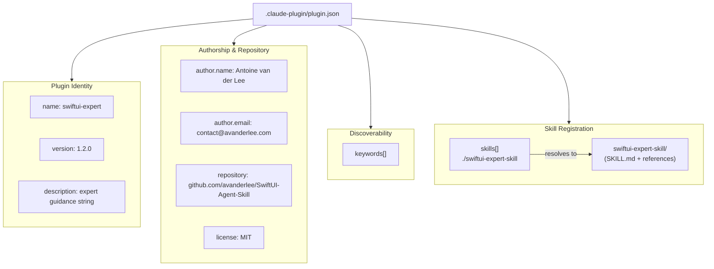
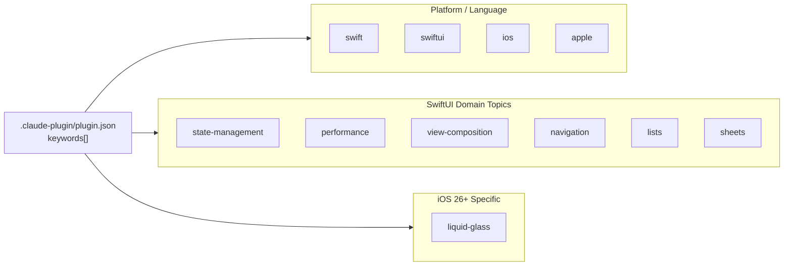
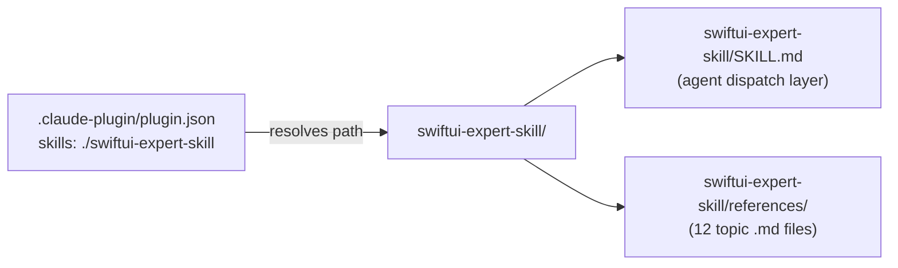

<!-- source: DeepWiki mcp.deepwiki.com · repo AvdLee/SwiftUI-Agent-Skill · page 4.2 Plugin Definition · fetched 2026-10-26 -->

# Plugin Definition

<details>
<summary>Relevant source files</summary>

The following files were used as context for generating this wiki page:

- [.claude-plugin/plugin.json](.claude-plugin/plugin.json)

</details>


This page documents every field in [`.claude-plugin/plugin.json`](.claude-plugin/plugin.json), the inner plugin descriptor that establishes the identity, authorship, discoverability metadata, and skill registration for the `swiftui-expert` plugin. For the outer wrapper that the Claude marketplace reads first, see the Marketplace Manifest ([4.1](#4.1)). For the skill implementation that `plugin.json` points to, see SwiftUI Reference Content ([3](#3)).

---

## File Role

`plugin.json` is the canonical plugin descriptor. The marketplace manifest ([`.claude-plugin/marketplace.json`](.claude-plugin/marketplace.json)) wraps it inside a `plugins[]` array, but `plugin.json` itself is the definition that carries identity, author contact, repository reference, keyword taxonomy, and the `skills[]` pointer.

**Plugin Definition Structural Overview**



Sources: [`.claude-plugin/plugin.json:1-27`]()

---

## Plugin Identity Fields

[`.claude-plugin/plugin.json:1-4`]()

| Field | Value | Purpose |
|---|---|---|
| `name` | `swiftui-expert` | Machine identifier used for installation and CLI invocation |
| `version` | `1.2.0` | Semantic version; kept in sync with `marketplace.json` by the release workflow (see [5.1](#5.1)) |
| `description` | `"Expert SwiftUI guidance for state management, view composition, performance, and iOS 26+ Liquid Glass adoption."` | Human-readable summary shown in marketplace listings |

The `name` value `swiftui-expert` is distinct from the skill directory name `swiftui-expert-skill`. The plugin name is the top-level identifier; the skill directory is one item registered under `skills[]`.

Sources: [`.claude-plugin/plugin.json:2-4`]()

---

## Author & Repository Metadata

[`.claude-plugin/plugin.json:5-9`]()

The `author` object is a nested structure with two sub-fields:

```
author.name  → "Antoine van der Lee"
author.email → "contact@avanderlee.com"
```

The `repository` field is a flat string pointing to the canonical GitHub URL. This is not nested under `author`; it is a sibling field at the top level of the JSON object.

| Field | Type | Value |
|---|---|---|
| `author.name` | string | `Antoine van der Lee` |
| `author.email` | string | `contact@avanderlee.com` |
| `repository` | string | `https://github.com/avanderlee/SwiftUI-Agent-Skill` |
| `license` | string | `MIT` |

Sources: [`.claude-plugin/plugin.json:5-10`]()

---

## Keyword Taxonomy

[`.claude-plugin/plugin.json:11-23`]()

The `keywords` array contains 11 strings. They serve two purposes: Claude marketplace indexing and surfacing the plugin when developers search for relevant topics.

**Keyword to Domain Mapping**



Each keyword maps to one or more reference files in the skill:

| Keyword | Corresponding Reference Topic |
|---|---|
| `state-management` | `swiftui-expert-skill/references/state-management.md` |
| `performance` | `swiftui-expert-skill/references/performance-patterns.md` |
| `view-composition` | `swiftui-expert-skill/references/view-structure.md`, `layout-best-practices.md` |
| `navigation` | `swiftui-expert-skill/references/sheet-navigation-patterns.md` |
| `lists` | `swiftui-expert-skill/references/list-patterns.md` |
| `sheets` | `swiftui-expert-skill/references/sheet-navigation-patterns.md` |
| `liquid-glass` | `swiftui-expert-skill/references/liquid-glass.md` |
| `swift`, `swiftui`, `ios`, `apple` | Platform-level indexing; no single file mapping |

Sources: [`.claude-plugin/plugin.json:11-23`]()

---

## Skills Array

[`.claude-plugin/plugin.json:24-26`]()

The `skills` field is an array of relative path strings. Currently it contains exactly one entry:

```
"skills": [
  "./swiftui-expert-skill"
]
```

This path resolves relative to the location of `plugin.json` itself, pointing to the `swiftui-expert-skill/` directory which contains `SKILL.md` and the `references/` subdirectory.

**Skills Pointer Resolution**



The `./` prefix makes the path relative. Because `plugin.json` lives in `.claude-plugin/`, the resolved path from the repository root is `swiftui-expert-skill/`. The skill implementation itself is documented in detail in [3.1](#3.1).

Sources: [`.claude-plugin/plugin.json:24-26`]()

---

## Relationship to marketplace.json

`plugin.json` does not reference `marketplace.json` directly. The dependency runs the other way: `marketplace.json` embeds the contents of `plugin.json` inside its `plugins[]` array. Both files carry a `version` field, and the release workflow ([5.1](#5.1)) updates both atomically via `jq` during a release. This ensures the version string is always identical across both files.

| Field | `plugin.json` | `marketplace.json` |
|---|---|---|
| `name` | `swiftui-expert` | `swiftui-expert-skill` (outer manifest name) |
| `version` | `1.2.0` | `1.2.0` (kept in sync) |
| `skills[]` | `./swiftui-expert-skill` | inherited via `plugins[]` wrapper |
| `$schema` | absent | present (Anthropics schema URL) |

Sources: [`.claude-plugin/plugin.json:1-27`]()

---

