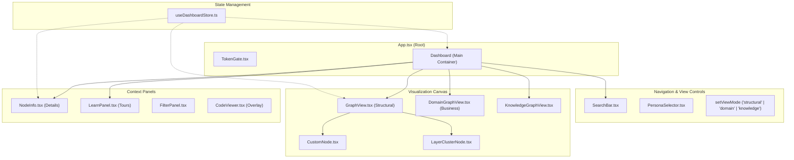
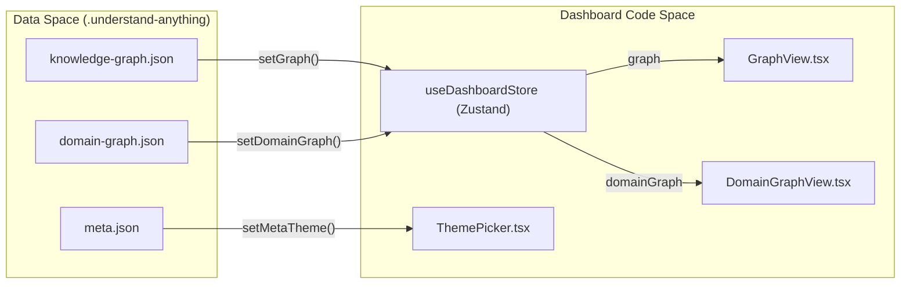

<!-- source: DeepWiki mcp.deepwiki.com · repo Lum1104/Understand-Anything · page 5 Interactive Dashboard · fetched 2026-10-26 -->

# Interactive Dashboard

Relevant source files

The following files were used as context for generating this wiki page:

- [homepage/package.json](homepage/package.json)
- [pnpm-lock.yaml](pnpm-lock.yaml)
- [understand-anything-plugin/packages/dashboard/package.json](understand-anything-plugin/packages/dashboard/package.json)
- [understand-anything-plugin/packages/dashboard/src/App.tsx](understand-anything-plugin/packages/dashboard/src/App.tsx)
- [understand-anything-plugin/packages/dashboard/src/components/CustomNode.tsx](understand-anything-plugin/packages/dashboard/src/components/CustomNode.tsx)
- [understand-anything-plugin/packages/dashboard/src/components/GraphView.tsx](understand-anything-plugin/packages/dashboard/src/components/GraphView.tsx)
- [understand-anything-plugin/packages/dashboard/src/components/NodeInfo.tsx](understand-anything-plugin/packages/dashboard/src/components/NodeInfo.tsx)
- [understand-anything-plugin/packages/dashboard/src/store.ts](understand-anything-plugin/packages/dashboard/src/store.ts)
- [understand-anything-plugin/packages/dashboard/src/utils/__tests__/smoke.test.ts](understand-anything-plugin/packages/dashboard/src/utils/__tests__/smoke.test.ts)
- [understand-anything-plugin/packages/dashboard/vite.config.ts](understand-anything-plugin/packages/dashboard/vite.config.ts)
- [understand-anything-plugin/skills/understand-dashboard/SKILL.md](understand-anything-plugin/skills/understand-dashboard/SKILL.md)

The Interactive Dashboard is a React 19 + Vite web application that visualizes knowledge graphs produced by the analysis pipeline. It provides an interactive graph-based interface for exploring codebases, featuring React Flow for graph visualization, Zustand for state management, and a persona-adaptive UI that adjusts complexity based on user expertise.

This document covers the dashboard implementation, component architecture, and visualization system. For information about how the knowledge graph is generated, see [Multi-Agent Pipeline](#7). For details on dashboard-specific skills, see [/understand-dashboard](#6.6).

## Purpose and Scope

The dashboard serves as the primary visualization interface for the Understand Anything system. Located at `understand-anything-plugin/packages/dashboard/`, it is a standalone React application that:

- Loads and validates `knowledge-graph.json` and `domain-graph.json` files using Zod schema validation. [understand-anything-plugin/packages/dashboard/src/App.tsx:2-6]()
- Renders interactive graph visualizations using React Flow with ELK layouts. [understand-anything-plugin/packages/dashboard/src/components/GraphView.tsx:3-45]()
- Provides adaptive UIs for three user personas: `non-technical`, `junior`, and `experienced`. [understand-anything-plugin/packages/dashboard/src/store.ts:12-12]()
- Implements fuzzy and semantic search for node discovery via `@understand-anything/core/search`. [understand-anything-plugin/packages/dashboard/src/store.ts:2-3]()
- Displays architectural layers as visual groupings and cluster nodes. [understand-anything-plugin/packages/dashboard/src/components/GraphView.tsx:57-62]()
- Shows guided tours for onboarding via the `LearnPanel`. [understand-anything-plugin/packages/dashboard/src/App.tsx:29-30]()
- Secures data access using a `TokenGate` and session tokens. [understand-anything-plugin/packages/dashboard/src/App.tsx:18-18](), [understand-anything-plugin/packages/dashboard/src/App.tsx:70-85]()

The dashboard is built as a private package (`@understand-anything/dashboard`) within the monorepo and depends on `@understand-anything/core` for schema validation, search engines, and type definitions. [understand-anything-plugin/packages/dashboard/package.json:1-5]()

## Architecture Overview

The dashboard follows a modern React architecture with functional components, hooks, and centralized state management. It utilizes a "Lens" navigation system that allows users to drill down from a high-level layer overview into specific file topologies.

### Technology Stack

| Technology | Version | Purpose |
|------------|---------|---------|
| React | 19.0.0 | UI framework [understand-anything-plugin/packages/dashboard/package.json:26]() |
| Vite | 6.4.2 | Build tool and dev server [understand-anything-plugin/packages/dashboard/package.json:40]() |
| Zustand | 5.0.0 | State management via `useDashboardStore` [understand-anything-plugin/packages/dashboard/package.json:29]() |
| React Flow | 12.0.0 | Graph visualization (@xyflow/react) [understand-anything-plugin/packages/dashboard/package.json:17]() |
| ELK | 0.9.3 | Graph layout algorithm (elkjs) [understand-anything-plugin/packages/dashboard/package.json:20]() |
| TailwindCSS | 4.0.0 | Styling framework [understand-anything-plugin/packages/dashboard/package.json:38]() |
| TypeScript | 5.7.0 | Type safety [understand-anything-plugin/packages/dashboard/package.json:39]() |

**Sources:** [understand-anything-plugin/packages/dashboard/package.json:14-42]()

### Dashboard Component Hierarchy

**Sources:** [understand-anything-plugin/packages/dashboard/src/App.tsx:5-19](), [understand-anything-plugin/packages/dashboard/src/components/GraphView.tsx:57-62]()

## Data Loading and Security

The dashboard loads knowledge graphs through a secure fetching mechanism that supports both local development and a hosted demo mode.

### Token-Based Access
To prevent unauthorized access to codebase metadata, the dashboard implements a `TokenGate`. The `resolveInitialToken` function extracts an access token from the URL query string, persists it to `sessionStorage`, and then strips it from the address bar for security. [understand-anything-plugin/packages/dashboard/src/App.tsx:70-85]()

### Data Resolution
The `dataUrl` helper resolves JSON asset paths. In `DEMO_MODE`, it pulls from environment-defined URLs (e.g., `VITE_GRAPH_URL`). In standard mode, it appends the security token to local paths (e.g., `/knowledge-graph.json?token=...`). [understand-anything-plugin/packages/dashboard/src/App.tsx:50-64]()

### System Mapping: Data to Code
The following diagram bridges the logical data entities to the specific React components and state variables that handle them.

**Sources:** [understand-anything-plugin/packages/dashboard/src/App.tsx:109-122](), [understand-anything-plugin/packages/dashboard/src/store.ts:157-172]()

## Key Features and Child Pages

The dashboard functionality is split across several specialized modules. For detailed technical documentation on these areas, refer to the following child pages:

### [Dashboard Components](#5.1)
Details the React component tree, including the `GraphView` canvas, `NodeInfo` sidebar, `LearnPanel` for tours, and the `CodeViewer` overlay. Explains the mapping of 21 `NodeType` values to specific badge colors and categories. [understand-anything-plugin/packages/dashboard/src/components/NodeInfo.tsx:7-29]()

### [State Management and Data Flow](#5.2)
Explains the **Zustand** store architecture (`useDashboardStore`). Covers navigation levels (`overview` vs `layer-detail`), node history tracking for the "Back" button, and the 1-hop neighborhood focus mode. [understand-anything-plugin/packages/dashboard/src/store.ts:13-17](), [understand-anything-plugin/packages/dashboard/src/store.ts:134-137]()

### [Graph Visualization](#5.3)
Details the integration with **React Flow** and the **ELK** layout engine. Explains `applyElkLayout`, edge aggregation between layers, and the `TourFitView` component that automatically pans the camera during guided tours. [understand-anything-plugin/packages/dashboard/src/components/GraphView.tsx:45-52](), [understand-anything-plugin/packages/dashboard/src/components/GraphView.tsx:95-179]()

### [Persona Modes and Adaptive UI](#5.4)
Explains the three persona modes (`non-technical`, `junior`, `experienced`) and how the UI adapts. This includes filtering graph nodes by complexity and changing the level of technical detail shown in the `NodeInfo` and `LearnPanel` components. [understand-anything-plugin/packages/dashboard/src/store.ts:12-12]()

### [Domain Graph View](#5.5)
Documents the business-centric `DomainGraphView`. It focuses on `domain`, `flow`, and `step` node types, allowing users to understand high-level business logic separately from technical file structures. [understand-anything-plugin/packages/dashboard/src/store.ts:14-14](), [understand-anything-plugin/packages/dashboard/src/components/NodeInfo.tsx:21-23]()

## Development and Build

The dashboard uses Vite for fast development and bundling.

### Build Pipeline
- **Build Command:** `pnpm --filter @understand-anything/dashboard build` [understand-anything-plugin/packages/dashboard/package.json:8]()
- **Demo Build:** A specialized `vite.config.demo.ts` exists for deploying the hosted demo version. [understand-anything-plugin/packages/dashboard/package.json:9]()

### Local Proxy and Security
The Vite dev server binds to `127.0.0.1` and generates a one-time `ACCESS_TOKEN` printed to the terminal to secure the local session. [understand-anything-plugin/packages/dashboard/vite.config.ts:12-12](), [understand-anything-plugin/packages/dashboard/vite.config.ts:187-191]()

**Sources:** [understand-anything-plugin/packages/dashboard/package.json:6-13](), [understand-anything-plugin/packages/dashboard/vite.config.ts:9-13]()

---

