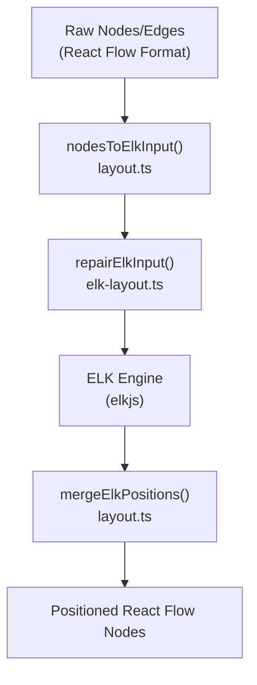
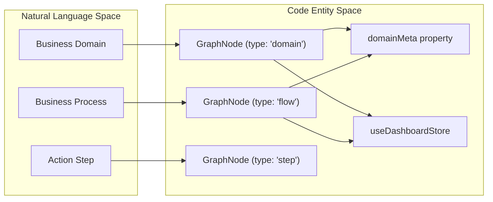

<!-- source: DeepWiki mcp.deepwiki.com · repo Lum1104/Understand-Anything · page 5.3 Graph Visualization · fetched 2026-10-26 -->

# Graph Visualization

Relevant source files

The following files were used as context for generating this wiki page:

- [understand-anything-plugin/packages/core/src/analyzer/layer-detector.ts](understand-anything-plugin/packages/core/src/analyzer/layer-detector.ts)
- [understand-anything-plugin/packages/dashboard/src/App.tsx](understand-anything-plugin/packages/dashboard/src/App.tsx)
- [understand-anything-plugin/packages/dashboard/src/components/Breadcrumb.tsx](understand-anything-plugin/packages/dashboard/src/components/Breadcrumb.tsx)
- [understand-anything-plugin/packages/dashboard/src/components/ContainerNode.tsx](understand-anything-plugin/packages/dashboard/src/components/ContainerNode.tsx)
- [understand-anything-plugin/packages/dashboard/src/components/CustomNode.tsx](understand-anything-plugin/packages/dashboard/src/components/CustomNode.tsx)
- [understand-anything-plugin/packages/dashboard/src/components/DomainClusterNode.tsx](understand-anything-plugin/packages/dashboard/src/components/DomainClusterNode.tsx)
- [understand-anything-plugin/packages/dashboard/src/components/DomainGraphView.tsx](understand-anything-plugin/packages/dashboard/src/components/DomainGraphView.tsx)
- [understand-anything-plugin/packages/dashboard/src/components/GraphView.tsx](understand-anything-plugin/packages/dashboard/src/components/GraphView.tsx)
- [understand-anything-plugin/packages/dashboard/src/components/LayerClusterNode.tsx](understand-anything-plugin/packages/dashboard/src/components/LayerClusterNode.tsx)
- [understand-anything-plugin/packages/dashboard/src/components/NodeInfo.tsx](understand-anything-plugin/packages/dashboard/src/components/NodeInfo.tsx)
- [understand-anything-plugin/packages/dashboard/src/components/PortalNode.tsx](understand-anything-plugin/packages/dashboard/src/components/PortalNode.tsx)
- [understand-anything-plugin/packages/dashboard/src/components/WarningBanner.tsx](understand-anything-plugin/packages/dashboard/src/components/WarningBanner.tsx)
- [understand-anything-plugin/packages/dashboard/src/store.ts](understand-anything-plugin/packages/dashboard/src/store.ts)
- [understand-anything-plugin/packages/dashboard/src/utils/__tests__/containers.test.ts](understand-anything-plugin/packages/dashboard/src/utils/__tests__/containers.test.ts)
- [understand-anything-plugin/packages/dashboard/src/utils/__tests__/edgeAggregation.test.ts](understand-anything-plugin/packages/dashboard/src/utils/__tests__/edgeAggregation.test.ts)
- [understand-anything-plugin/packages/dashboard/src/utils/__tests__/elk-layout.test.ts](understand-anything-plugin/packages/dashboard/src/utils/__tests__/elk-layout.test.ts)
- [understand-anything-plugin/packages/dashboard/src/utils/containers.ts](understand-anything-plugin/packages/dashboard/src/utils/containers.ts)
- [understand-anything-plugin/packages/dashboard/src/utils/edgeAggregation.ts](understand-anything-plugin/packages/dashboard/src/utils/edgeAggregation.ts)
- [understand-anything-plugin/packages/dashboard/src/utils/elk-layout.ts](understand-anything-plugin/packages/dashboard/src/utils/elk-layout.ts)
- [understand-anything-plugin/packages/dashboard/src/utils/layout.ts](understand-anything-plugin/packages/dashboard/src/utils/layout.ts)
- [understand-anything-plugin/packages/dashboard/src/utils/louvain.ts](understand-anything-plugin/packages/dashboard/src/utils/louvain.ts)

## Purpose and Scope

This document details the graph visualization system used in the dashboard to render knowledge graphs as interactive, hierarchical diagrams. It covers the React Flow integration, the transition to the ELK layout algorithm, community-based clustering, edge aggregation, and custom node rendering.

The visualization system is designed to handle varying levels of abstraction, from high-level architectural layers to detailed file-level dependency graphs and business domain flows.

---

## React Flow Integration

The graph visualization is built on [React Flow](https://reactflow.dev) (v12/xyflow) [packages/dashboard/src/components/GraphView.tsx:3-13](). The implementation configures React Flow with custom nodes, edges, and layout.

### Core React Flow Setup

The dashboard defines several custom node types to handle different levels of granularity:

| Node Type | Component | Purpose |
|-----------|-----------|---------|
| `custom` | `CustomNode` | Standard node for files, functions, and classes [packages/dashboard/src/components/GraphView.tsx:58](). |
| `layer-cluster` | `LayerClusterNode` | High-level architectural group used in the "Project Overview" [packages/dashboard/src/components/GraphView.tsx:59](). |
| `portal` | `PortalNode` | A "gateway" node representing connections to external layers [packages/dashboard/src/components/GraphView.tsx:60](). |
| `container` | `ContainerNode` | Represents a folder or community-detected cluster within a layer [packages/dashboard/src/components/GraphView.tsx:61](). |
| `domain-cluster` | `DomainClusterNode` | Top-level business domain group [packages/dashboard/src/components/DomainGraphView.tsx:26](). |
| `flow-node` | `FlowNode` | Represents a specific business process or flow [packages/dashboard/src/components/DomainGraphView.tsx:27](). |
| `step-node` | `StepNode` | Individual steps within a domain flow [packages/dashboard/src/components/DomainGraphView.tsx:28](). |

**Sources:** [packages/dashboard/src/components/GraphView.tsx:57-62](), [packages/dashboard/src/components/DomainGraphView.tsx:25-29](), [packages/dashboard/src/components/CustomNode.tsx:84-87](), [packages/dashboard/src/components/PortalNode.tsx:16-18]()

---

## Layout Algorithms

The system supports multiple layout strategies depending on the graph type and size.

### ELK Layout (`applyElkLayout`)
The dashboard has migrated its structural views to use the [Eclipse Layout Kernel (ELK)](https://github.com/kieler/elkjs). This algorithm provides superior hierarchical and orthogonal routing.

*   **Implementation:** The `applyElkLayout` function in `elk-layout.ts` wraps the asynchronous ELK call [packages/dashboard/src/utils/elk-layout.ts:225-228]().
*   **Repair Pipeline:** Before layout, `repairElkInput` performs surgical corrections, including ensuring node dimensions, deduping IDs, and dropping orphan edges or containment cycles [packages/dashboard/src/utils/elk-layout.ts:56-212]().
*   **Options:** Default options include `layered` algorithm, `ORTHOGONAL` edge routing, and `LAYER_SWEEP` crossing minimization [packages/dashboard/src/utils/layout.ts:195-204]().

### Force-Directed Layout (`applyForceLayout`)
Used for non-hierarchical knowledge graphs. It utilizes `d3-force` to simulate physical attraction and repulsion [packages/dashboard/src/utils/layout.ts:94-100]().
*   **Community Clustering:** If a `communityMap` is provided, the algorithm applies `clusterX` and `clusterY` forces to pull related nodes toward shared centers [packages/dashboard/src/utils/layout.ts:149-165]().
*   **Scaling:** Forces like `chargeStrength` and `linkDistance` scale automatically for graphs larger than 100 nodes [packages/dashboard/src/utils/layout.ts:127-129]().

### Dagre Layout (`applyDagreLayout`)
Previously the primary algorithm, now deprecated in favor of ELK but kept for backward compatibility and small graph fallbacks [packages/dashboard/src/utils/layout.ts:23-30]().

**Sources:** [packages/dashboard/src/utils/layout.ts:94-189](), [packages/dashboard/src/utils/elk-layout.ts:1-245](), [packages/dashboard/src/utils/elk-layout.ts:225-232]()

---

## Community Detection and Containers

To organize large layers, the system automatically groups nodes into "Containers" using two strategies: folder structure or the Louvain community detection algorithm.

### Container Derivation (`deriveContainers`)
The `deriveContainers` utility decides how to group nodes within a view [packages/dashboard/src/utils/containers.ts:91-94]():
1.  **Folder Strategy:** Groups nodes by the first directory segment after the Longest Common Prefix (LCP) [packages/dashboard/src/utils/containers.ts:52-75]().
2.  **Community Fallback:** If one folder contains >70% of nodes or there are too few folders, it falls back to the Louvain algorithm [packages/dashboard/src/utils/containers.ts:77-89]().

### Louvain Algorithm
The `detectCommunities` function uses `graphology-communities-louvain` to find clusters based on edge density [packages/dashboard/src/utils/louvain.ts:17-31](). It includes a defensive re-assignment loop to ensure disconnected nodes receive unique IDs [packages/dashboard/src/utils/louvain.ts:39-45]().

**Sources:** [packages/dashboard/src/utils/containers.ts:1-157](), [packages/dashboard/src/utils/louvain.ts:1-47](), [packages/dashboard/src/utils/__tests__/containers.test.ts:17-91]()

---

## Edge Aggregation and Portals

To simplify complex views, the system aggregates edges crossing high-level boundaries.

### Layer and Container Aggregation
*   **Layer Edges:** `aggregateLayerEdges` counts edges crossing between architectural layers, using a canonical key to merge bidirectional traffic into a single summary connection [packages/dashboard/src/utils/edgeAggregation.ts:21-48]().
*   **Container Edges:** `aggregateContainerEdges` buckets edges into `intraContainer` (preserved) and `interContainerAggregated` (merged by directed container pairs) [packages/dashboard/src/utils/edgeAggregation.ts:158-183]().

### Portal Nodes
In `layer-detail` views, `computePortals` identifies connections to external layers [packages/dashboard/src/utils/edgeAggregation.ts:77-106](). These are rendered as `PortalNode` components, allowing users to navigate between layers by following dependency links [packages/dashboard/src/components/PortalNode.tsx:29-29]().

**Sources:** [packages/dashboard/src/utils/edgeAggregation.ts:1-208](), [packages/dashboard/src/components/PortalNode.tsx:16-62](), [packages/dashboard/src/utils/__tests__/edgeAggregation.test.ts:13-79]()

---

## Domain Graph Visualization

The `DomainGraphView` provides a specialized visualization for business logic, moving from high-level domains to specific step-by-step flows.

### Overview vs. Detail
*   **Domain Overview:** Filters for nodes of type `domain` and displays them as `DomainClusterNode` clusters connected by `cross_domain` edges [packages/dashboard/src/components/DomainGraphView.tsx:40-87]().
*   **Domain Detail:** When a domain is selected, it renders `flow-node` and `step-node` entities. It builds a `stepOrderMap` using edge weights to maintain the logical sequence of the business process [packages/dashboard/src/components/DomainGraphView.tsx:89-164]().

**Sources:** [packages/dashboard/src/components/DomainGraphView.tsx:1-220]()

---

## Navigation and Breadcrumbs

The dashboard implements a hierarchical navigation system tracked via the `navigationLevel` and `activeLayerId` in the Zustand store [packages/dashboard/src/store.ts:116-117]().

The `Breadcrumb` component provides:
*   **Context:** Displays "Project Overview" or the current active layer name [packages/dashboard/src/components/Breadcrumb.tsx:13-30]().
*   **Navigation:** A clickable "Project" link to return to the root overview [packages/dashboard/src/components/Breadcrumb.tsx:21-26]().

**Sources:** [packages/dashboard/src/components/Breadcrumb.tsx:1-38](), [packages/dashboard/src/store.ts:100-165]()

---

## Code Entity and Data Mapping

The following diagrams illustrate the relationship between system concepts and the underlying code implementation.

### ELK Layout Pipeline
This diagram shows how raw node data is transformed and validated before being positioned by the ELK engine.

**Diagram:** ELK Layout Processing Pipeline

**Sources:** [packages/dashboard/src/utils/layout.ts:206-211](), [packages/dashboard/src/utils/elk-layout.ts:56-62](), [packages/dashboard/src/utils/elk-layout.ts:225-232]()

### Domain Space to Code Entity Mapping
This diagram bridges the Business Domain concepts to the graph node types and properties defined in the store and components.

**Diagram:** Domain Concept to Code Entity Mapping

**Sources:** [packages/dashboard/src/components/DomainGraphView.tsx:42-52](), [packages/dashboard/src/components/DomainGraphView.tsx:121-137](), [packages/dashboard/src/components/DomainGraphView.tsx:138-152](), [packages/dashboard/src/store.ts:14-17]()

---

## Visual Constants

The system uses fixed dimensions to ensure layout stability across different algorithms:

| Constant | Value | Source |
|----------|-------|--------|
| `NODE_WIDTH` | 280 | [packages/dashboard/src/utils/layout.ts:15]() |
| `NODE_HEIGHT` | 120 | [packages/dashboard/src/utils/layout.ts:16]() |
| `LAYER_CLUSTER_WIDTH` | 320 | [packages/dashboard/src/utils/layout.ts:17]() |
| `PORTAL_NODE_WIDTH` | 240 | [packages/dashboard/src/utils/layout.ts:19]() |

**Sources:** [packages/dashboard/src/utils/layout.ts:15-20]()

---

