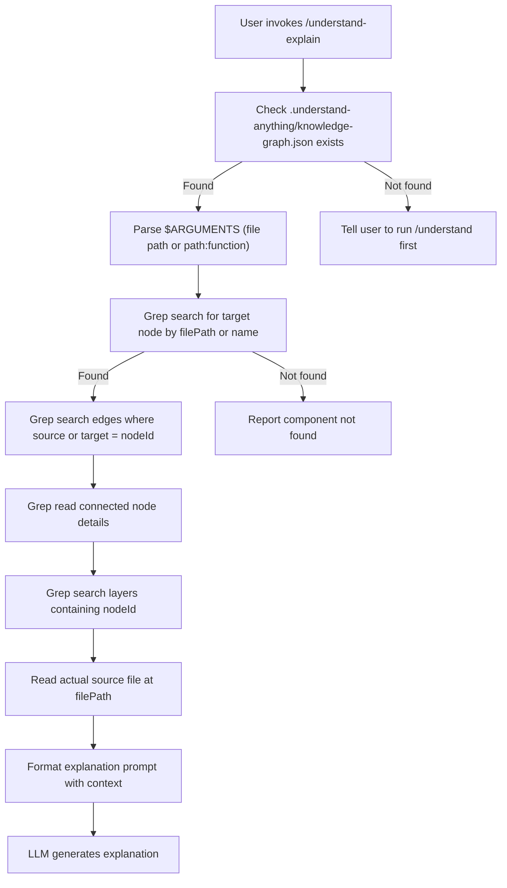
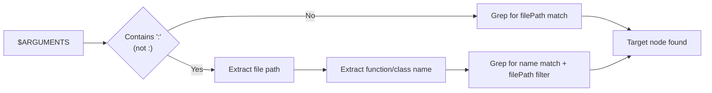
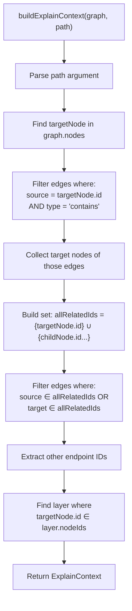
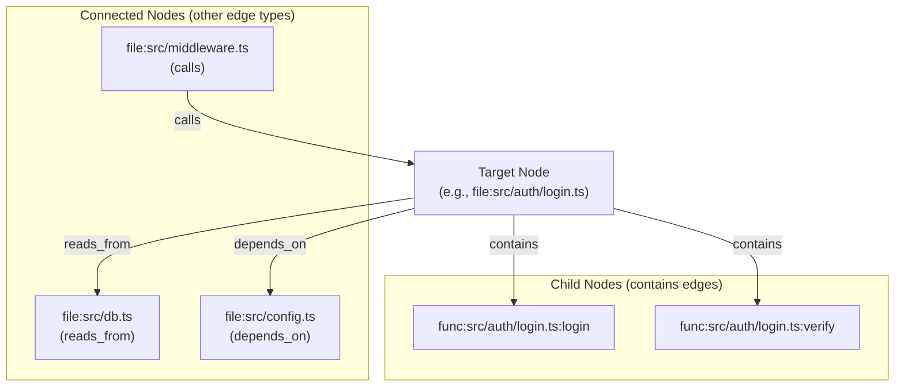

<!-- source: DeepWiki mcp.deepwiki.com · repo Lum1104/Understand-Anything · page 6.4 /understand-explain · fetched 2026-10-26 -->

# /understand-explain

<details>
<summary>Relevant source files</summary>

The following files were used as context for generating this wiki page:

- [understand-anything-plugin/packages/core/src/__tests__/language-lesson.test.ts](understand-anything-plugin/packages/core/src/__tests__/language-lesson.test.ts)
- [understand-anything-plugin/packages/core/src/analyzer/graph-builder.test.ts](understand-anything-plugin/packages/core/src/analyzer/graph-builder.test.ts)
- [understand-anything-plugin/packages/core/src/analyzer/graph-builder.ts](understand-anything-plugin/packages/core/src/analyzer/graph-builder.ts)
- [understand-anything-plugin/packages/dashboard/public/knowledge-graph.json](understand-anything-plugin/packages/dashboard/public/knowledge-graph.json)
- [understand-anything-plugin/skills/understand-chat/SKILL.md](understand-anything-plugin/skills/understand-chat/SKILL.md)
- [understand-anything-plugin/skills/understand-diff/SKILL.md](understand-anything-plugin/skills/understand-diff/SKILL.md)
- [understand-anything-plugin/skills/understand-explain/SKILL.md](understand-anything-plugin/skills/understand-explain/SKILL.md)
- [understand-anything-plugin/skills/understand-onboard/SKILL.md](understand-anything-plugin/skills/understand-onboard/SKILL.md)
- [understand-anything-plugin/skills/understand/frameworks/django.md](understand-anything-plugin/skills/understand/frameworks/django.md)
- [understand-anything-plugin/src/__tests__/explain-builder.test.ts](understand-anything-plugin/src/__tests__/explain-builder.test.ts)

</details>


This page documents the `/understand-explain` skill command, which provides deep-dive explanations of specific files, functions, or classes in a codebase using the knowledge graph. For information about other skill commands, see [Skills and Commands](#6). For the main analysis command that generates the knowledge graph, see [/understand Command](#6.1). For natural language Q&A, see [/understand-chat](#6.2).

## Purpose and Scope

The `/understand-explain` skill enables users to request detailed, contextual explanations of individual code components. Unlike `/understand-chat` which answers arbitrary questions, `/understand-explain` focuses on providing thorough explanations of a single component including its role in the architecture, internal structure, external connections, data flow, and notable patterns. The skill extracts relevant context from the knowledge graph and presents it in a format optimized for LLM explanation generation.

**Sources:** [understand-anything-plugin/skills/understand-explain/SKILL.md:1-57]()

## Command Syntax

```bash
/understand-explain [file-path]
/understand-explain [file-path:function-name]
```

**Examples:**
- `/understand-explain src/auth/login.ts` — Explain entire file
- `/understand-explain src/auth/login.ts:verifyToken` — Explain specific function

**Sources:** [understand-anything-plugin/skills/understand-explain/SKILL.md:4-5]()

## Execution Flow

### High-Level Process



**Key Design Decision:** The skill uses grep-based searches through the knowledge graph JSON rather than loading the entire file into context. This minimizes token usage and enables efficient querying of large graphs.

**Sources:** [understand-anything-plugin/skills/understand-explain/SKILL.md:23-28](), [understand-anything-plugin/skills/understand-explain/SKILL.md:30-57]()

### Target Node Resolution Strategy



**Supported Notation:**
- `src/auth/login.ts` → Matches `"filePath": "src/auth/login.ts"` [understand-anything-plugin/skills/understand-explain/SKILL.md:37]()
- `src/auth/login.ts:verifyToken` → Matches `"filePath": "src/auth/login.ts"` AND `"name": "verifyToken"` [understand-anything-plugin/skills/understand-explain/SKILL.md:38]()

**Sources:** [understand-anything-plugin/skills/understand-explain/SKILL.md:34-38]()

## Data Structures

### ExplainContext Interface

The `buildExplainContext` function produces an `ExplainContext` object containing all relevant information:

```typescript
interface ExplainContext {
  projectName: string;           // From graph.project.name
  path: string;                  // Original user input
  targetNode: GraphNode | null;  // The node being explained
  childNodes: GraphNode[];       // Nodes contained by target (via "contains" edges)
  connectedNodes: GraphNode[];   // 1-hop neighbors (via any edge type)
  relevantEdges: GraphEdge[];    // All edges involving target or children
  layer: Layer | null;           // Architectural layer containing target
}
```

**Sources:** [understand-anything-plugin/src/__tests__/explain-builder.test.ts:32-65]()

### Context Building Algorithm



**Sources:** [understand-anything-plugin/src/__tests__/explain-builder.test.ts:32-65]()

## Implementation Components

### Core Modules

| Module | Location | Purpose |
|--------|----------|---------|
| `explain-builder.ts` | `understand-anything-plugin/src/` | Context extraction logic |
| `explain-builder.test.ts` | `understand-anything-plugin/src/__tests__/` | Unit tests for context building |
| `SKILL.md` | `understand-anything-plugin/skills/understand-explain/` | Skill definition for Claude Code |

**Sources:** [understand-anything-plugin/src/__tests__/explain-builder.test.ts:1-3](), [understand-anything-plugin/skills/understand-explain/SKILL.md:1-5]()

### buildExplainContext Function

Located at `understand-anything-plugin/src/explain-builder.ts`, this function performs the core context extraction:

1. **Path Parsing** — Detects `path:function` notation by finding the colon. [understand-anything-plugin/src/__tests__/explain-builder.test.ts:61-64]()
2. **Target Resolution** — Searches `graph.nodes` for matching `filePath` and optionally `name`. [understand-anything-plugin/src/__tests__/explain-builder.test.ts:34-37]()
3. **Child Discovery** — Finds all nodes where `edge.type === "contains"` and `edge.source === targetNode.id`. [understand-anything-plugin/src/__tests__/explain-builder.test.ts:39-43]()
4. **Connection Analysis** — Builds 1-hop neighborhood by finding all edges touching target or children. [understand-anything-plugin/src/__tests__/explain-builder.test.ts:45-49]()
5. **Layer Identification** — Searches `graph.layers` for a layer containing `targetNode.id`. [understand-anything-plugin/src/__tests__/explain-builder.test.ts:51-54]()

**Returns:** `ExplainContext` object with all relevant nodes, edges, and metadata.

**Sources:** [understand-anything-plugin/src/__tests__/explain-builder.test.ts:33-65]()

### formatExplainPrompt Function

Located at `understand-anything-plugin/src/explain-builder.ts`, this function formats the context into a structured prompt:

**Prompt Structure:**
- **Header**: Name of the component.
- **Metadata**: Type, Complexity, File Path, and Line Ranges.
- **Summary**: High-level purpose from the graph.
- **Architectural Layer**: Context from the `layers` section.
- **Internal Components**: Children found via `contains` edges.
- **Connected Components**: Neighbors found via behavioral/data edges.
- **Relationships**: Explicit edge descriptions (source -> target).
- **Instructions**: Specific directives for the LLM to explain data flow, patterns, and gotchas.

**Sources:** [understand-anything-plugin/src/__tests__/explain-builder.test.ts:67-82](), [understand-anything-plugin/skills/understand-explain/SKILL.md:50-57]()

## Graph Query Patterns

### Grep-Based Search Strategy

The skill definition emphasizes using grep to search the knowledge graph JSON efficiently:

```bash
# Find target node by file path
grep '"filePath": "src/auth/login.ts"' .understand-anything/knowledge-graph.json

# Find edges involving a specific node
grep '"source": "file:src/auth/login.ts"' .understand-anything/knowledge-graph.json
grep '"target": "file:src/auth/login.ts"' .understand-anything/knowledge-graph.json

# Find layer containing node
grep '"nodeIds".*"file:src/auth/login.ts"' .understand-anything/knowledge-graph.json
```

**Rationale:** Loading the entire knowledge graph into LLM context is token-expensive. Grep enables targeted extraction of only the necessary context. [understand-anything-plugin/skills/understand-explain/SKILL.md:26-30]()

**Sources:** [understand-anything-plugin/skills/understand-explain/SKILL.md:23-28]()

### Edge Traversal for Context



**Sources:** [understand-anything-plugin/skills/understand-explain/SKILL.md:39-44](), [understand-anything-plugin/src/__tests__/explain-builder.test.ts:21-25]()

## Usage Patterns

### Explaining a File

**User Command:**
```bash
/understand-explain src/auth/login.ts
```

**Graph Query Sequence:**
1. Grep `"filePath": "src/auth/login.ts"` → Find `file:src/auth/login.ts` node. [understand-anything-plugin/skills/understand-explain/SKILL.md:37]()
2. Grep `"source": "file:src/auth/login.ts"` and `"type": "contains"` → Find child functions/classes. [understand-anything-plugin/skills/understand-explain/SKILL.md:41-43]()
3. Grep all edges where source or target is the file or its children → Find connections. [understand-anything-plugin/skills/understand-explain/SKILL.md:41-43]()
4. Grep layers array → Find architectural layer membership. [understand-anything-plugin/skills/understand-explain/SKILL.md:48]()
5. Read `src/auth/login.ts` from filesystem → Include source code. [understand-anything-plugin/skills/understand-explain/SKILL.md:50]()

**Sources:** [understand-anything-plugin/skills/understand-explain/SKILL.md:30-57]()

### Explaining a Specific Function

**User Command:**
```bash
/understand-explain src/auth/login.ts:verifyToken
```

**Graph Query Sequence:**
1. Parse `src/auth/login.ts` and `verifyToken` from argument. [understand-anything-plugin/skills/understand-explain/SKILL.md:38]()
2. Grep `"filePath": "src/auth/login.ts"` AND `"name": "verifyToken"` → Find `func:src/auth/login.ts:verifyToken` node. [understand-anything-plugin/skills/understand-explain/SKILL.md:38]()
3. Grep edges involving this function ID → Find what it calls, what calls it. [understand-anything-plugin/skills/understand-explain/SKILL.md:41-43]()
4. Read source lines from the file at the target path → Include function implementation. [understand-anything-plugin/skills/understand-explain/SKILL.md:50]()
5. Grep layer membership → Identify architectural context. [understand-anything-plugin/skills/understand-explain/SKILL.md:48]()

**Sources:** [understand-anything-plugin/skills/understand-explain/SKILL.md:34-38](), [understand-anything-plugin/src/__tests__/explain-builder.test.ts:61-64]()

## Error Handling

### Component Not Found

When the target path doesn't match any node in the knowledge graph, the `formatExplainPrompt` function produces a helpful message:

```markdown
# Component Not Found

The path "src/unknown.ts" was not found in the knowledge graph.

Possible reasons:
- The file hasn't been analyzed yet — try running /understand first
- The path may be different in the graph — check the exact file path
- The file may have been deleted or renamed since the last analysis
```

**Sources:** [understand-anything-plugin/src/__tests__/explain-builder.test.ts:76-80]()

### Knowledge Graph Missing

The skill definition instructs the LLM to check for the knowledge graph before proceeding:

```markdown
1. Check that `.understand-anything/knowledge-graph.json` exists. 
   If not, tell the user to run `/understand` first.
```

**Sources:** [understand-anything-plugin/skills/understand-explain/SKILL.md:32-34]()

## Integration with Knowledge Graph Schema

### Node Types Supported

The skill works with the node types defined in the knowledge graph schema:

| Node Type | ID Pattern | Example Use Case |
|-----------|-----------|------------------|
| `file` | `file:path` | Explain entire source file |
| `function` | `function:path:name` | Explain specific function or method |
| `class` | `class:path:name` | Explain class or interface definition |
| `module` | `module:path` | Explain logical module grouping |
| `concept` | `concept:name` | Explain abstract architectural concept |

**Sources:** [understand-anything-plugin/skills/understand-explain/SKILL.md:13-17](), [understand-anything-plugin/packages/core/src/analyzer/graph-builder.ts:39-58]()

### Edge Types Utilized

The skill considers various edge types when building connection context:

- **Structural**: `contains` (used to find children). [understand-anything-plugin/packages/core/src/analyzer/graph-builder.ts:148]()
- **Behavioral**: `calls`, `depends_on`. [understand-anything-plugin/packages/core/src/analyzer/graph-builder.ts:186,205]()
- **Data Flow**: `imports`, `reads_from`. [understand-anything-plugin/packages/core/src/analyzer/graph-builder.ts:186]()

**Sources:** [understand-anything-plugin/skills/understand-explain/SKILL.md:18-20](), [understand-anything-plugin/src/__tests__/explain-builder.test.ts:21-25](), [understand-anything-plugin/packages/core/src/analyzer/graph-builder.ts:130-208]()

## Testing

### Unit Test Coverage

Located at `understand-anything-plugin/src/__tests__/explain-builder.test.ts`, the test suite validates:

1. **Target Node Resolution**:
   - File path matching: `buildExplainContext` finds file node [understand-anything-plugin/src/__tests__/explain-builder.test.ts:34-37]().
   - Function notation: `buildExplainContext` finds function node via partial path match [understand-anything-plugin/src/__tests__/explain-builder.test.ts:61-64]().
2. **Child Node Discovery**:
   - Finds all functions contained by a file via `contains` edges [understand-anything-plugin/src/__tests__/explain-builder.test.ts:39-43]().
3. **Connection Analysis**:
   - Finds 1-hop neighbors via any edge type [understand-anything-plugin/src/__tests__/explain-builder.test.ts:45-49]().
4. **Layer Identification**:
   - Finds layer containing target node [understand-anything-plugin/src/__tests__/explain-builder.test.ts:51-54]().
5. **Prompt Formatting**:
   - Valid context produces structured markdown [understand-anything-plugin/src/__tests__/explain-builder.test.ts:68-74]().
   - Unknown path produces helpful error message [understand-anything-plugin/src/__tests__/explain-builder.test.ts:76-80]().

**Sources:** [understand-anything-plugin/src/__tests__/explain-builder.test.ts:32-82]()

---

