# Page: Overview

# Overview

<details>
<summary>Relevant source files</summary>

The following files were used as context for generating this wiki page:

- [.claude-plugin/marketplace.json](.claude-plugin/marketplace.json)
- [.claude-plugin/plugin.json](.claude-plugin/plugin.json)
- [.copilot-plugin/plugin.json](.copilot-plugin/plugin.json)
- [.cursor-plugin/plugin.json](.cursor-plugin/plugin.json)
- [README.md](README.md)
- [READMEs/README.es-ES.md](READMEs/README.es-ES.md)
- [READMEs/README.ja-JP.md](READMEs/README.ja-JP.md)
- [READMEs/README.ko-KR.md](READMEs/README.ko-KR.md)
- [READMEs/README.tr-TR.md](READMEs/README.tr-TR.md)
- [READMEs/README.zh-CN.md](READMEs/README.zh-CN.md)
- [READMEs/README.zh-TW.md](READMEs/README.zh-TW.md)
- [install.ps1](install.ps1)
- [install.sh](install.sh)
- [understand-anything-plugin/.claude-plugin/plugin.json](understand-anything-plugin/.claude-plugin/plugin.json)
- [understand-anything-plugin/package.json](understand-anything-plugin/package.json)

</details>


This document introduces the Understand Anything project, explaining what it does, its core value proposition, and the main components of the system. It provides a high-level map of how the codebase is organized and how data flows through the system during analysis and visualization.

**Sources:** [README.md:1-170](), [understand-anything-plugin/package.json:1-21]()

## What Understand Anything Does

Understand Anything is a multi-platform plugin (supporting [Claude Code](https://docs.anthropic.com/en/docs/claude-code), Cursor, Copilot, and more) that combines **LLM intelligence** with **static analysis** to turn any codebase or knowledge base into an interactive knowledge graph. The system extracts files, functions, classes, and their relationships, then presents them through a web-based dashboard with search, filtering, and natural language querying capabilities. [README.md:43-48](), [README.md:173-182]()

The plugin provides eight core skill commands:

| Command | Purpose | Primary Users |
|---------|---------|---------------|
| `/understand` | Generate knowledge graph via multi-agent analysis | All users (entry point) |
| `/understand-dashboard` | Launch interactive visualization | All users |
| `/understand-chat` | Natural language Q&A about codebase | PMs, junior developers |
| `/understand-diff` | Analyze change impact before commit | Experienced developers, code reviewers |
| `/understand-explain` | Deep-dive explanations of specific files/functions | Junior developers, onboarding |
| `/understand-onboard` | Generate onboarding guides | Team leads, documentation writers |
| `/understand-domain` | Extract business domain logic and flows | PMs, Architects |
| `/understand-knowledge` | Analyze Karpathy-pattern LLM wikis | Researchers, knowledge managers |

The system targets three user personas: **Junior Developers** (guided learning), **Product Managers & Designers** (high-level logic), and **AI-Assisted Developers** (deep context for reasoning). [README.md:82-89](), [README.md:141-159]()

**Sources:** [README.md:52-100](), [README.md:104-170](), [.cursor-plugin/plugin.json:12-14]()

## System Component Map

The following diagram maps the conceptual components of Understand Anything to their actual code locations in the repository.

**Diagram: Component to Code Entity Mapping**

```mermaid
graph TB
    subgraph "Plugin_Distribution"
        marketplace[".claude-plugin/marketplace.json<br/>version: 2.7.6"]
        pluginPkg["@understand-anything/skill<br/>understand-anything-plugin/package.json"]
        cursorPlugin[".cursor-plugin/plugin.json"]
        copilotPlugin[".copilot-plugin/plugin.json"]
    end
    
    subgraph "Analysis_Engine"
        corePkg["@understand-anything/core<br/>workspace dependency"]
        persistence["persistence module<br/>Graph I/O & Config"]
        registry["PluginRegistry<br/>Language support"]
    end
    
    subgraph "Multi-Agent_Pipeline"
        agentsDir["understand-anything-plugin/agents/<br/>Specialized Agents"]
        projectScanner["project-scanner"]
        fileAnalyzer["file-analyzer"]
        archAnalyzer["architecture-analyzer"]
        tourBuilder["tour-builder"]
        graphReviewer["graph-reviewer"]
        domainAnalyzer["domain-analyzer"]
        articleAnalyzer["article-analyzer"]
    end
    
    subgraph "Skill_Commands"
        skillsDir["understand-anything-plugin/skills/<br/>Skill Definitions"]
        understandSkill["understand.md"]
        dashboardSkill["understand-dashboard.md"]
        chatSkill["understand-chat.md"]
        diffSkill["understand-diff.md"]
        explainSkill["understand-explain.md"]
        onboardSkill["understand-onboard.md"]
        domainSkill["understand-domain.md"]
        knowledgeSkill["understand-knowledge.md"]
    end
    
    subgraph "Visualization_UI"
        dashboardPkg["@understand-anything/dashboard<br/>React Dashboard"]
        graphView["GraphView component"]
        domainView["DomainGraphView component"]
        store["useDashboardStore<br/>Zustand state"]
    end
    
    subgraph "Data_Artifacts"
        knowledgeGraph[".understand-anything/knowledge-graph.json"]
        domainGraph[".understand-anything/domain-graph.json"]
        intermediateDir[".understand-anything/intermediate/"]
    end
    
    marketplace --> pluginPkg
    pluginPkg --> corePkg
    pluginPkg --> dashboardPkg
    
    understandSkill --> agentsDir
    domainSkill --> domainAnalyzer
    knowledgeSkill --> articleAnalyzer
    
    projectScanner --> intermediateDir
    fileAnalyzer --> intermediateDir
    domainAnalyzer --> domainGraph
    graphReviewer --> knowledgeGraph
    
    corePkg --> persistence
    corePkg --> registry
    
    skillsDir --> understandSkill
    skillsDir --> dashboardSkill
    
    dashboardPkg --> graphView
    dashboardPkg --> domainView
    dashboardPkg --> store
    
    graphView --> store
    domainView --> store
```

**Sources:** [.claude-plugin/marketplace.json:1-15](), [understand-anything-plugin/package.json:1-21](), [.cursor-plugin/plugin.json:1-15](), [.copilot-plugin/plugin.json:1-14]()

## Core Data Flow

The system follows a generate-once, query-many pattern. The `/understand` command orchestrates agents to produce `knowledge-graph.json`, while `/understand-domain` produces `domain-graph.json`. Both are consumed by the dashboard and specific skills.

**Diagram: Data Flow Through the System**

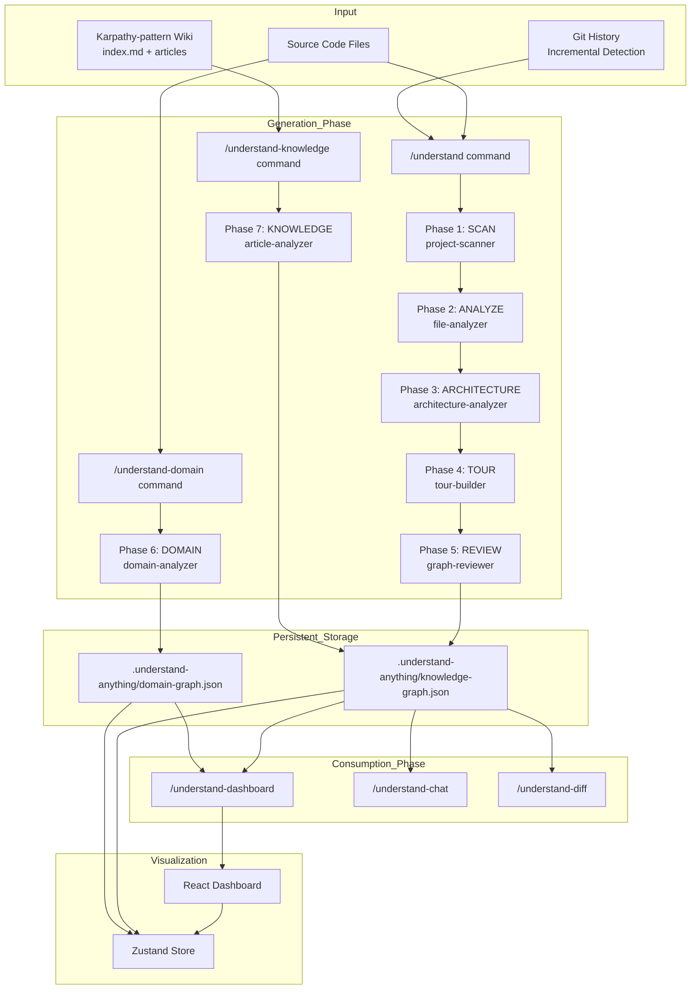

**Sources:** [README.md:113-169](), [README.md:62-67](), [README.md:137-145]()

## Knowledge Graph Structure

The central data artifact is `.understand-anything/knowledge-graph.json`. The graph is structured into:

| Component | Description |
|-----------|-------------|
| **Nodes** | 16 types including `file`, `function`, `class`, `module`, `concept`, `endpoint`, `service`, `table`, and `flow`. [README.md:57-59]() |
| **Edges** | 29 types representing imports, calls, inheritance, data flow, etc. |
| **Layers** | Architectural groupings (API, Service, Data, UI, Utility) with color-coding. [README.md:92-94]() |
| **Tours** | Auto-generated walkthroughs ordered by dependency ranking. [README.md:72-74]() |

The system also extracts business domain knowledge into `domain-graph.json`, mapping code logic to high-level business processes (Domains -> Flows -> Steps). [README.md:61-63]()

**Sources:** [README.md:57-99](), [README.md:113-136]()

## User Entry Points

Users interact with Understand Anything through specialized skill commands. The dashboard provides a multi-view layout:
1. **Structure View**: Visualizes the technical architecture (files/functions). [README.md:57-59]()
2. **Domain View**: Visualizes business logic flows. [README.md:61-63]()
3. **Knowledge View**: Visualizes community clustering in wikis. [README.md:65-67]()

The UI features a dark luxury theme and adapts based on three persona modes: **Junior**, **Experienced**, and **PM**. [README.md:86-89]()

**Sources:** [README.md:52-100](), [README.md:137-145]()

## Repository Structure

The codebase is organized as a pnpm monorepo:

- **`understand-anything-plugin/`**: The core workspace containing the plugin. [understand-anything-plugin/package.json:1-15]()
    - **`packages/core`**: Shared analysis engine (types, persistence, search, schema). [understand-anything-plugin/package.json:12-12]()
    - **`packages/dashboard`**: React + TypeScript web dashboard.
    - **`skills/`**: Markdown-based skill definitions for Claude Code and Cursor. [.cursor-plugin/plugin.json:13-13]()
    - **`agents/`**: JSON-based agent definitions for the analysis pipeline. [.cursor-plugin/plugin.json:14-14]()
- **`.claude-plugin/`**: Plugin manifest and marketplace metadata. [.claude-plugin/marketplace.json:1-15]()
- **`.cursor-plugin/`**: Auto-discovery configuration for Cursor. [.cursor-plugin/plugin.json:1-15]()
- **`.copilot-plugin/`**: Configuration for VS Code + GitHub Copilot. [.copilot-plugin/plugin.json:1-14]()

**Sources:** [README.md:173-212](), [understand-anything-plugin/package.json:1-21]()

## Key Implementation Details

1. **Multi-Agent Coordination**: The pipeline uses specialized agents (e.g., `project-scanner`, `file-analyzer`) that coordinate to build the graph. [README.md:113-119]()
2. **Deterministic Parsing**: The knowledge base analysis uses a deterministic parser for `index.md` before LLM agents extract implicit relationships. [README.md:65-67]()
3. **Cross-Platform Compatibility**: Supports native Claude Code installation as well as auto-discovery in Cursor, VS Code + GitHub Copilot, and various CLI environments via `install.sh`. [README.md:173-234]()
4. **Fuzzy & Semantic Search**: Combines traditional fuzzy search with semantic search for meaning-based queries. [README.md:76-78]()

**Sources:** [README.md:52-100](), [README.md:173-234](), [.claude-plugin/plugin.json:1-18]()

---

# Page: Getting Started

# Getting Started

<details>
<summary>Relevant source files</summary>

The following files were used as context for generating this wiki page:

- [.claude-plugin/marketplace.json](.claude-plugin/marketplace.json)
- [.claude-plugin/plugin.json](.claude-plugin/plugin.json)
- [.copilot-plugin/plugin.json](.copilot-plugin/plugin.json)
- [.cursor-plugin/plugin.json](.cursor-plugin/plugin.json)
- [.gitignore](.gitignore)
- [.npmrc](.npmrc)
- [README.md](README.md)
- [READMEs/README.es-ES.md](READMEs/README.es-ES.md)
- [READMEs/README.ja-JP.md](READMEs/README.ja-JP.md)
- [READMEs/README.ko-KR.md](READMEs/README.ko-KR.md)
- [READMEs/README.tr-TR.md](READMEs/README.tr-TR.md)
- [READMEs/README.zh-CN.md](READMEs/README.zh-CN.md)
- [READMEs/README.zh-TW.md](READMEs/README.zh-TW.md)
- [install.ps1](install.ps1)
- [install.sh](install.sh)
- [pnpm-workspace.yaml](pnpm-workspace.yaml)
- [tsconfig.json](tsconfig.json)
- [understand-anything-plugin/.claude-plugin/plugin.json](understand-anything-plugin/.claude-plugin/plugin.json)
- [understand-anything-plugin/package.json](understand-anything-plugin/package.json)

</details>


This page guides you through installing the Understand Anything plugin, analyzing your first codebase, and exploring the interactive dashboard. By the end, you'll understand how to use the core commands to generate and query knowledge graphs.

For detailed information about the system architecture, see **System Architecture**. For in-depth documentation of individual skills, see **Skills and Commands**.

---

## Prerequisites

Before installing Understand Anything, ensure you have:

| Requirement | Description |
|-------------|-------------|
| **AI Coding Platform** | Supports Claude Code (Native), Cursor, Codex, OpenCode, VS Code + GitHub Copilot, Gemini CLI, and others [README.md:6-7](), [README.md:224-245]() |
| **Node.js** | Required for running the dashboard and building core packages [understand-anything-plugin/package.json:17-18]() |
| **pnpm** | Required for workspace dependency management and package linking [understand-anything-plugin/package.json:12-12]() |
| **Git** | Required for repository cloning and incremental analysis [README.md:188-191]() |

The plugin analyzes codebases written in any language, with specialized support for 25+ languages and various frameworks like React, Next.js, and Express [README.md:101-103]().

**Sources:** [README.md:1-245](), [understand-anything-plugin/package.json:1-21]()

---

## Installation

### Claude Code (Native)
Execute the following commands in Claude Code to add and install the plugin from the marketplace:

```bash
/plugin marketplace add Lum1104/Understand-Anything
/plugin install understand-anything
```
This registers the plugin and makes the skill commands available [README.md:108-111](), [.claude-plugin/marketplace.json:1-15]().

### VS Code + GitHub Copilot
You can install the plugin for VS Code by cloning the repository. Copilot auto-discovers the plugin via `.copilot-plugin/plugin.json` [.copilot-plugin/plugin.json:1-14]().

1. **Clone the repo**: `git clone https://github.com/Lum1104/Understand-Anything.git`
2. **Open in VS Code**: Open the cloned folder.
3. **Verify**: The extension will be recognized automatically via the manifest [.copilot-plugin/plugin.json:1-14]().

### Other Platforms (Cursor, Codex, Gemini CLI, etc.)
Understand Anything supports a wide range of platforms via installation scripts:

*   **Cursor**: Auto-discovers the plugin via `.cursor-plugin/plugin.json` when the repo is opened [.cursor-plugin/plugin.json:1-15]().
*   **One-line Install**: Supports macOS/Linux and Windows for platforms like Codex and Gemini CLI [README.md:184-203]().

### Installation Data Flow

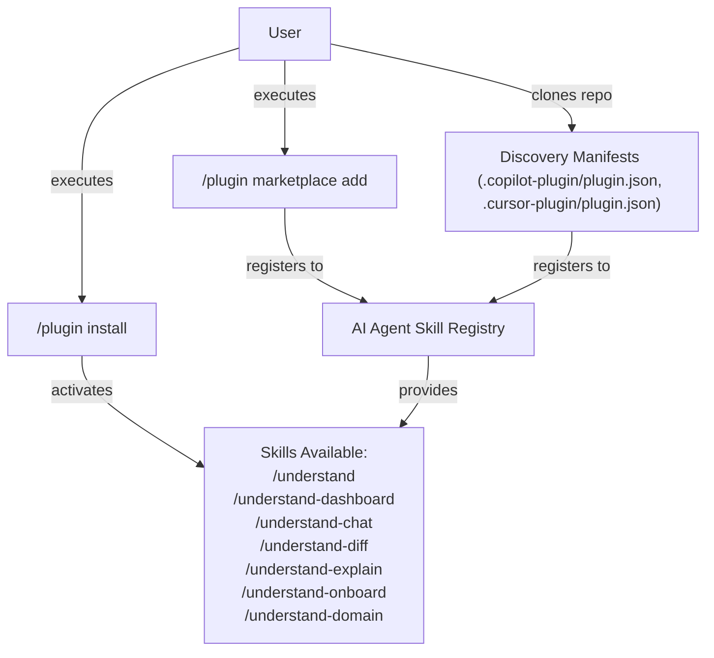

**Sources:** [README.md:173-234](), [.copilot-plugin/plugin.json:1-14](), [.cursor-plugin/plugin.json:1-15](), [.claude-plugin/marketplace.json:1-15]()

---

## Running Your First Analysis

The `/understand` command orchestrates a multi-agent pipeline to analyze your codebase.

### Basic Usage
Navigate to your project root and execute:

```bash
/understand
```

This initiates an analysis that extracts functions, classes, and dependencies, saving them to `.understand-anything/knowledge-graph.json` [README.md:116-119]().

### Localized Output
You can generate node descriptions and dashboard UI in specific languages using the `--language` flag:

```bash
/understand --language zh
```
Supported languages include `en`, `zh`, `zh-TW`, `ja`, `ko`, and `ru` [README.md:121-128]().

### Business Domain Extraction
To extract high-level business logic (domains, flows, and steps), run:

```bash
/understand-domain
```
This maps code to business processes visualized in the domain view [README.md:155-156]().

### The Multi-Agent Pipeline
The analysis is split across specialized agents defined in the `agents/` directory [understand-anything-plugin/package.json:13-14]() (as referenced in plugin manifests).

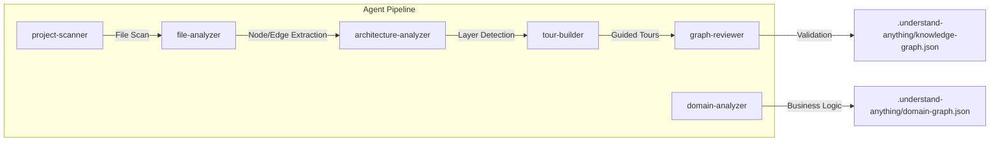

**Sources:** [README.md:113-169](), [.cursor-plugin/plugin.json:13-15]()

---

## Exploring the Dashboard

The `/understand-dashboard` command launches a React-based web application to visualize the results [README.md:139-140]().

### Startup Process
1.  **Verification**: Checks for the existence of the knowledge graph in `.understand-anything/` [README.md:119-119]().
2.  **Server**: Starts a local server (Vite-based) to host the dashboard interface [README.md:140-143]().
3.  **Token Security**: Uses TokenGate session security for the dashboard session to prevent unauthorized access.

### Dashboard Features
*   **Interactive Graph**: Visualize files, functions, and classes as nodes [README.md:57-59]().
*   **Layer Visualization**: Automatically groups components into API, Service, Data, and UI layers [README.md:92-93]().
*   **Persona Modes**: Adapts UI detail level for Junior, PM, or Experienced personas [README.md:86-88]().
*   **Search**: Supports Fuzzy and Semantic search for nodes [README.md:76-78]().

### Code Entity to Dashboard Mapping

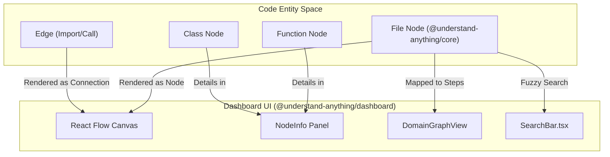

**Sources:** [README.md:52-100](), [.cursor-plugin/plugin.json:12-15]()

---

## Using Consumer Skills

Once analyzed, you can use specialized commands to query the knowledge graph.

| Command | Purpose |
|---------|---------|
| `/understand-chat` | Ask natural language questions about the codebase [README.md:143-144]() |
| `/understand-diff` | Analyze the impact of current changes on the architecture [README.md:146-147]() |
| `/understand-explain` | Get a deep-dive explanation of a specific file or function [README.md:149-150]() |
| `/understand-onboard` | Generate a structured guide for new team members [README.md:152-153]() |
| `/understand-knowledge` | Analyze a Karpathy-pattern LLM wiki knowledge base [README.md:158-159]() |

**Sources:** [README.md:143-169](), [.cursor-plugin/plugin.json:13-13]()

---

# Page: System Architecture

# System Architecture

<details>
<summary>Relevant source files</summary>

The following files were used as context for generating this wiki page:

- [.gitignore](.gitignore)
- [.npmrc](.npmrc)
- [CLAUDE.md](CLAUDE.md)
- [README.md](README.md)
- [READMEs/README.es-ES.md](READMEs/README.es-ES.md)
- [READMEs/README.ja-JP.md](READMEs/README.ja-JP.md)
- [READMEs/README.ko-KR.md](READMEs/README.ko-KR.md)
- [READMEs/README.tr-TR.md](READMEs/README.tr-TR.md)
- [READMEs/README.zh-CN.md](READMEs/README.zh-CN.md)
- [READMEs/README.zh-TW.md](READMEs/README.zh-TW.md)
- [install.ps1](install.ps1)
- [install.sh](install.sh)
- [pnpm-workspace.yaml](pnpm-workspace.yaml)
- [tsconfig.json](tsconfig.json)
- [understand-anything-plugin/agents/architecture-analyzer.md](understand-anything-plugin/agents/architecture-analyzer.md)
- [understand-anything-plugin/agents/article-analyzer.md](understand-anything-plugin/agents/article-analyzer.md)
- [understand-anything-plugin/agents/assemble-reviewer.md](understand-anything-plugin/agents/assemble-reviewer.md)
- [understand-anything-plugin/agents/domain-analyzer.md](understand-anything-plugin/agents/domain-analyzer.md)
- [understand-anything-plugin/agents/graph-reviewer.md](understand-anything-plugin/agents/graph-reviewer.md)
- [understand-anything-plugin/agents/knowledge-graph-guide.md](understand-anything-plugin/agents/knowledge-graph-guide.md)
- [understand-anything-plugin/agents/project-scanner.md](understand-anything-plugin/agents/project-scanner.md)
- [understand-anything-plugin/agents/tour-builder.md](understand-anything-plugin/agents/tour-builder.md)

</details>


This document explains the high-level architecture of Understand Anything, including the relationship between packages, the plugin structure, and how data flows through the system. For detailed information about the monorepo workspace configuration and package organization, see [Monorepo Structure](#3.1). For build pipeline and TypeScript compilation details, see [Build and TypeScript Configuration](#3.2).

## System Overview

Understand Anything is architected as a **Claude Code plugin** distributed via the Claude Code Marketplace. The system consists of three main software components organized as a pnpm monorepo using a workspace configuration [pnpm-workspace.yaml:1-5]().

| Component | Package Name | Purpose |
|-----------|--------------|---------|
| Analysis Engine | `@understand-anything/core` | Shared analysis engine (types, persistence, tree-sitter, search, schema, tours, plugins) [CLAUDE.md:13-13]() |
| Interactive Dashboard | `@understand-anything/dashboard` | React + TypeScript web application for graph visualization and exploration [CLAUDE.md:14-14]() |
| Plugin Package | `understand-anything-plugin` | Skill definitions and command implementations that orchestrate the other components [CLAUDE.md:12-12]() |

The system follows a **separation of concerns** between generation (analyzing codebases to produce knowledge graphs) and consumption (querying and visualizing existing graphs).

**Sources:** [pnpm-workspace.yaml:1-5](), [CLAUDE.md:10-18](), [README.md:44-47]()

## High-Level Component Architecture

The diagram below illustrates how user commands interact with the plugin runtime, specialized agents, and the local project filesystem.

Title: High-Level System Interactions
```mermaid
graph TB
    subgraph "Claude Code IDE"
        [User] --> [PluginRuntime]
    end
    
    subgraph "Understand Anything Plugin"
        subgraph "Skill Layer (understand-anything-plugin/src)"
            [UnderstandSkill]
            [ChatSkill]
            [DiffSkill]
            [ExplainSkill]
            [OnboardSkill]
            [DashboardSkill]
        end
        
        subgraph "Implementation Layer"
            [CorePackage]
            [DashboardPackage]
        end
        
        subgraph "Agent Layer"
            [Agents]
        end
    end
    
    subgraph "User's Project"
        [SourceCode]
        [UnderstandDir]
        [IntermediateDir]
    end
    
    subgraph "Runtime Environment"
        [ViteServer]
        [Browser]
    end
    
    [PluginRuntime] --> [UnderstandSkill]
    [PluginRuntime] --> [ChatSkill]
    [PluginRuntime] --> [DashboardSkill]
    
    [UnderstandSkill] --> [Agents]
    [UnderstandSkill] --> [CorePackage]
    
    [DashboardSkill] --> [ViteServer]
    [DashboardPackage] --> [CorePackage]
    
    [Agents] --> [SourceCode]
    [Agents] --> [IntermediateDir]
    [Agents] --> [UnderstandDir]
    
    [ViteServer] --> [DashboardPackage]
    [ViteServer] --> [UnderstandDir]
    [ViteServer] --> [Browser]
```

**Component Interaction Flow:**

1. **Plugin Registration**: The plugin is discovered via platform-specific manifests like `.claude-plugin/plugin.json` [CLAUDE.md:58-63]().
2. **Skill Execution**: User invokes a skill command (e.g., `/understand`, `/understand-chat`) implemented within the `understand-anything-plugin` package [CLAUDE.md:15-16]().
3. **Generation Path**: `/understand` orchestrates the multi-agent pipeline [CLAUDE.md:27-31](). Agents write intermediate results to `.understand-anything/intermediate/` before final assembly [CLAUDE.md:28-28]().
4. **Consumption Path**: Skills read the knowledge graph stored in the `.understand-anything/` directory [CLAUDE.md:47-47]().
5. **Visualization**: `/understand-dashboard` launches a Vite server that serves the `@understand-anything/dashboard` React application [CLAUDE.md:40-40]().

**Sources:** [CLAUDE.md:10-47](), [README.md:104-143](), [understand-anything-plugin/agents/project-scanner.md:51-60]()

## Package Architecture

The monorepo uses pnpm workspaces to manage internal dependencies [CLAUDE.md:11-11](). The root `tsconfig.json` provides base configurations, enforcing strict mode and ESM modules [CLAUDE.md:44-46]().

### Package Responsibilities

#### `@understand-anything/core`
The core package provides the foundational subsystems.
- **Analysis**: Uses `web-tree-sitter` (WASM) for structural analysis [CLAUDE.md:51-51]().
- **Search**: Implements fuzzy and semantic search engines [CLAUDE.md:13-13]().
- **Persistence**: Manages reading/writing the graph and metadata to the `.understand-anything/` directory [CLAUDE.md:47-47]().
- **Browser Safety**: Uses subpath exports (e.g., `./search`, `./schema`) to ensure the dashboard doesn't pull in Node.js modules [CLAUDE.md:48-48]().

#### `@understand-anything/dashboard`
A React application featuring a "dark luxury" theme [CLAUDE.md:20-20]().
- **Visualization**: Graph-first layout using React Flow [CLAUDE.md:21-21]().
- **State**: Managed via `zustand` [CLAUDE.md:14-14]().
- **Data Access**: Fetches code content via a gated `/file-content.json` endpoint on the dev server [CLAUDE.md:24-24]().

#### `understand-anything-plugin`
The main plugin package containing agent definitions and skill logic [CLAUDE.md:15-17]().

**Sources:** [CLAUDE.md:1-53](), [tsconfig.json:1-16]()

## Data Flow Architecture

The system follows a **write-once, read-many** data flow pattern centered around the local file system.

Title: Data Flow and Persistence
```mermaid
graph TB
    subgraph "Phase 1: Analysis"
        [Codebase] --> [UnderstandCmd]
        [UnderstandCmd] --> [AgentPipeline]
        [AgentPipeline] -->|"writes"| [IntermediateDir]
        [IntermediateDir] -->|"assembled into"| [KnowledgeGraph]
    end
    
    subgraph "Phase 2: Consumption"
        [KnowledgeGraph] -->|"read by"| [OtherSkills]
        [KnowledgeGraph] -->|"read by"| [DashboardCmd]
    end
    
    subgraph "Phase 3: Visualization"
        [DashboardCmd] --> [ViteServer]
        [ViteServer] --> [DashboardUI]
    end
```

**Sources:** [CLAUDE.md:27-31](), [CLAUDE.md:47-47](), [understand-anything-plugin/agents/project-scanner.md:51-82]()

## Component Dependency Graph

The following diagram maps high-level system commands to their underlying code implementations and data structures within the monorepo.

Title: Code Entity to System Mapping
```mermaid
graph LR
    subgraph "Core Logic (@understand-anything/core)"
        [Schema]
        [SearchEngine]
        [Persistence]
    end

    subgraph "System Commands (understand-anything-plugin)"
        [CmdUnderstand]
        [CmdDash]
    end

    subgraph "Dashboard UI (@understand-anything/dashboard)"
        [GraphView]
        [DashboardStore]
    end

    [CmdUnderstand] --> [Persistence]
    [CmdUnderstand] --> [Schema]
    [CmdDash] --> [GraphView]
    [GraphView] --> [DashboardStore]
    [DashboardStore] --> [SearchEngine]
```

**Sources:** [CLAUDE.md:10-53](), [pnpm-workspace.yaml:1-5](), [README.md:104-143]()

---

# Page: Monorepo Structure

# Monorepo Structure

<details>
<summary>Relevant source files</summary>

The following files were used as context for generating this wiki page:

- [.gitignore](.gitignore)
- [.npmrc](.npmrc)
- [pnpm-workspace.yaml](pnpm-workspace.yaml)
- [tsconfig.json](tsconfig.json)
- [understand-anything-plugin/packages/core/src/__tests__/domain-normalize.test.ts](understand-anything-plugin/packages/core/src/__tests__/domain-normalize.test.ts)
- [understand-anything-plugin/packages/core/src/__tests__/normalize-graph.test.ts](understand-anything-plugin/packages/core/src/__tests__/normalize-graph.test.ts)
- [understand-anything-plugin/packages/core/src/analyzer/normalize-graph.ts](understand-anything-plugin/packages/core/src/analyzer/normalize-graph.ts)
- [understand-anything-plugin/packages/core/src/index.ts](understand-anything-plugin/packages/core/src/index.ts)
- [understand-anything-plugin/packages/core/tsconfig.json](understand-anything-plugin/packages/core/tsconfig.json)
- [understand-anything-plugin/tsconfig.json](understand-anything-plugin/tsconfig.json)

</details>


This document details the pnpm workspace configuration, package organization, and dependency management strategy used in Understand Anything. For information about the build pipeline and TypeScript compilation, see [3.2 Build and TypeScript Configuration]().

The repository employs a monorepo architecture managed by pnpm workspaces. It organizes code into specialized packages for the analysis engine, the visualization dashboard, and the agentic plugin layer.

## Workspace Hierarchy

The repository uses a pnpm workspace to manage multiple packages within a single repository, facilitating shared dependencies and local cross-package linking.

### Directory Structure

The following diagram maps the logical system components to their physical code entities within the monorepo.

**System to Code Entity Mapping**
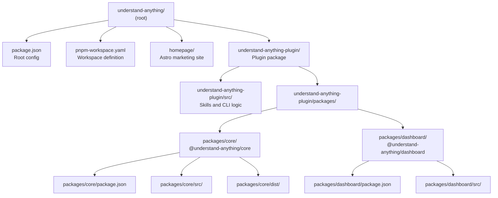

**Sources:** [pnpm-workspace.yaml:1-5](), [understand-anything-plugin/packages/core/package.json:1-5](), [understand-anything-plugin/tsconfig.json:15-17]()

### Dependency Resolution

The monorepo uses pnpm to manage versions across all internal packages. This ensures that `@understand-anything/core` and the dashboard use compatible versions of shared libraries.

| Scope | Key Shared Dependencies |
|-------|-------------------------|
| Development | `typescript`, `vitest` |
| Runtime (Core) | `zod`, `fuse.js`, `web-tree-sitter` |
| Runtime (Dashboard) | `react`, `@xyflow/react`, `zustand` |

The project enforces strict dependency management by disabling shameful hoisting by default in `.npmrc` [ .npmrc:1-3]().

**Sources:** [understand-anything-plugin/packages/core/package.json:39-55](), [.npmrc:1-3]()

## Package Organization

The repository contains primary internal packages that represent the "Code Entity Space" of the system's logic.

**Logic to Package Association**
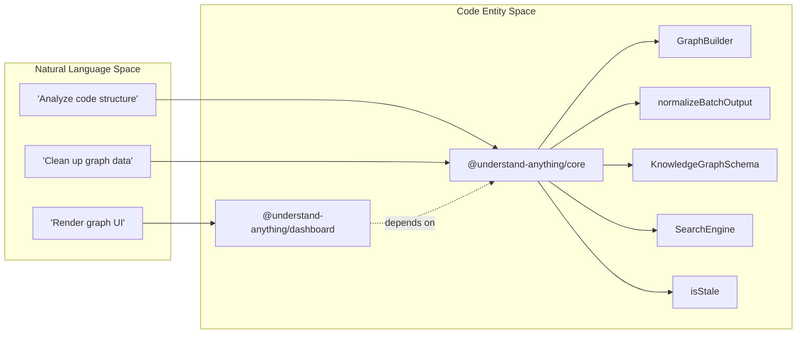

**Sources:** [understand-anything-plugin/packages/core/src/index.ts:1-125](), [understand-anything-plugin/packages/core/src/analyzer/normalize-graph.ts:202-212]()

### @understand-anything/core
Located in `understand-anything-plugin/packages/core/`, this is the foundational library exported via `index.ts` [understand-anything-plugin/packages/core/src/index.ts:1-125](). It is responsible for:
*   **Schema & Validation**: Defining the `KnowledgeGraphSchema` and providing `validateGraph` and `sanitizeGraph` functions [understand-anything-plugin/packages/core/src/index.ts:3-12]().
*   **Normalization**: The `normalizeBatchOutput` function and `normalizeNodeId` ensure that IDs from various agents follow the canonical `type:path` format [understand-anything-plugin/packages/core/src/analyzer/normalize-graph.ts:64-111]().
*   **Analysis Orchestration**: The `GraphBuilder` class handles the construction of the knowledge graph [understand-anything-plugin/packages/core/src/index.ts:16-16]().
*   **Search Engine**: Providing fuzzy search via `SearchEngine` and vector-based search via `SemanticSearchEngine` [understand-anything-plugin/packages/core/src/index.ts:32-83]().
*   **Staleness Detection**: Functions like `isStale` and `mergeGraphUpdate` manage incremental updates [understand-anything-plugin/packages/core/src/index.ts:33-38]().

### @understand-anything/dashboard
Located in `understand-anything-plugin/packages/dashboard/`, this is a Vite-powered React application. It consumes the knowledge graphs and metadata produced by the core engine. It utilizes the core's types and search utilities to provide an interactive visualization.

**Sources:** [understand-anything-plugin/packages/core/src/index.ts:1-125](), [understand-anything-plugin/packages/core/src/analyzer/normalize-graph.ts:1-111]()

## Dependency Management

Understand Anything uses pnpm's workspace protocols to link packages internally.

### Workspace Linking
The dashboard and the main plugin package depend on `@understand-anything/core`. This allows the UI and the CLI skills to share the same validation logic and data structures.

### Build Pipeline
The monorepo structure dictates a build order where the core library must be compiled to `dist/` before dependent packages can resolve its types and logic.
*   **Core Build**: Outputs to `understand-anything-plugin/packages/core/dist` [understand-anything-plugin/packages/core/tsconfig.json:15-15]().
*   **Plugin Build**: Outputs to `understand-anything-plugin/dist` [understand-anything-plugin/tsconfig.json:15-15]().

**Sources:** [understand-anything-plugin/packages/core/tsconfig.json:15-16](), [understand-anything-plugin/tsconfig.json:15-16]()

## TypeScript Configuration

The monorepo uses a base `tsconfig.json` at the root and specialized configurations in each package to ensure consistency while allowing package-specific overrides.

*   **Root Config**: Defines global compiler options like `target: ES2022`, `module: ESNext`, and `strict: true` [tsconfig.json:1-16]().
*   **Plugin Config**: Sets `rootDir` to `src` and `outDir` to `dist` for the main plugin package [understand-anything-plugin/tsconfig.json:15-17]().
*   **Core Config**: Inherits root settings and defines its own `src` and `dist` paths for the core library [understand-anything-plugin/packages/core/tsconfig.json:1-19]().

**Sources:** [tsconfig.json:1-16](), [understand-anything-plugin/tsconfig.json:1-19](), [understand-anything-plugin/packages/core/tsconfig.json:1-19]()

---

# Page: Build and TypeScript Configuration

# Build and TypeScript Configuration

<details>
<summary>Relevant source files</summary>

The following files were used as context for generating this wiki page:

- [.github/workflows/ci.yml](.github/workflows/ci.yml)
- [package.json](package.json)
- [understand-anything-plugin/packages/core/package.json](understand-anything-plugin/packages/core/package.json)
- [understand-anything-plugin/packages/core/tsconfig.json](understand-anything-plugin/packages/core/tsconfig.json)
- [understand-anything-plugin/pnpm-lock.yaml](understand-anything-plugin/pnpm-lock.yaml)
- [understand-anything-plugin/skills/understand/extract-structure.mjs](understand-anything-plugin/skills/understand/extract-structure.mjs)
- [understand-anything-plugin/src/__tests__/extract-structure.test.mjs](understand-anything-plugin/src/__tests__/extract-structure.test.mjs)
- [understand-anything-plugin/tsconfig.json](understand-anything-plugin/tsconfig.json)

</details>


This document explains the build pipeline, TypeScript configuration strategy, and compilation process for the Understand Anything monorepo. It covers how the packages are built in the correct dependency order, the shared TypeScript settings across packages, module resolution strategies, and the ESM-first architecture.

---

## Build Pipeline Overview

The Understand Anything build system uses a coordinated approach where the `@understand-anything/core` package must compile before other packages, since the `dashboard`, the skill components, and internal scripts like `extract-structure.mjs` depend on it. This dependency order is enforced through pnpm scripts at the root level.

### Build Script Hierarchy

The following diagram illustrates how the build process flows from installation to the final bundled assets.

**Build Execution Flow**
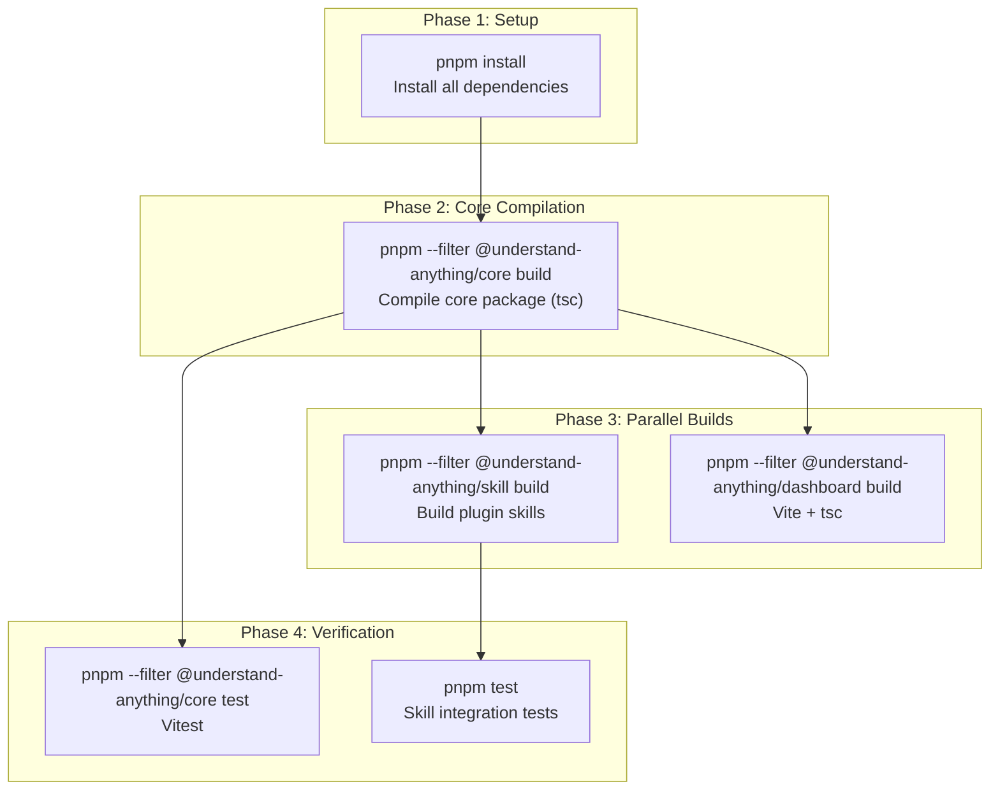

**Sources:** [package.json:29-32](), [.github/workflows/ci.yml:34-51]()

### Build Execution Order

| Step | Command | Purpose | Output Location |
|------|---------|---------|-----------------|
| 1 | `pnpm install` | Install dependencies and link workspace packages | `node_modules/` |
| 2 | `pnpm --filter @understand-anything/core build` | Build the core library first to satisfy dependencies | `packages/core/dist/` |
| 3 | `pnpm --filter @understand-anything/skill build` | Build the skill/plugin logic | `dist/` |
| 4 | `pnpm --filter @understand-anything/dashboard build` | Run `tsc` and `vite build` for the React UI | `packages/dashboard/dist/` |

**Sources:** [package.json:29-31](), [.github/workflows/ci.yml:41-44]()

---

## TypeScript Configuration Strategy

The project uses a hierarchical TypeScript configuration: package-specific configurations define local environments while adhering to a consistent set of modern standards (ES2022).

### Configuration Hierarchy

**TSConfig Inheritance**
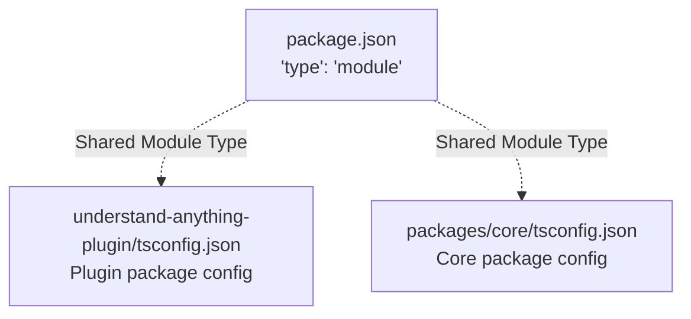

**Sources:** [package.json:4](), [understand-anything-plugin/tsconfig.json:1-19](), [understand-anything-plugin/packages/core/tsconfig.json:1-19]()

### Shared Compiler Options

All TypeScript packages in the monorepo share the following settings defined in their respective `tsconfig.json` files [understand-anything-plugin/tsconfig.json:2-17](), [understand-anything-plugin/packages/core/tsconfig.json:2-17]():

```json
{
  "compilerOptions": {
    "target": "ES2022",
    "module": "ESNext",
    "lib": ["ES2022"],
    "moduleResolution": "bundler",
    "strict": true,
    "esModuleInterop": true,
    "skipLibCheck": true,
    "forceConsistentCasingInFileNames": true,
    "resolveJsonModule": true,
    "declaration": true,
    "declarationMap": true,
    "sourceMap": true,
    "outDir": "dist",
    "rootDir": "src"
  }
}
```

### Key Configuration Decisions

| Setting | Value | Rationale |
|---------|-------|-----------|
| `"type": "module"` | ESM | The project uses native ESM for all packages to support modern features and dynamic imports [package.json:4]() |
| `target: "ES2022"` | Modern JS | Targets modern Node.js 22+ and browser environments [understand-anything-plugin/packages/core/tsconfig.json:3]() |
| `moduleResolution: "bundler"` | Bundler mode | Optimized for Vite and modern package entry points [understand-anything-plugin/packages/core/tsconfig.json:6]() |
| `strict: true` | Enabled | Enforces strict type checking across the entire monorepo [understand-anything-plugin/packages/core/tsconfig.json:7]() |
| `declaration: true` | Enabled | Generates `.d.ts` files for cross-package type safety [understand-anything-plugin/packages/core/tsconfig.json:12]() |

**Sources:** [package.json:4](), [understand-anything-plugin/packages/core/tsconfig.json:2-17]()

---

## Compilation and Module Resolution

The project exclusively uses ESM modules. Sub-packages declare `"type": "module"` in their `package.json`.

### Dynamic Resolution in Scripts

Internal scripts like `extract-structure.mjs` use dynamic `import()` to load the `@understand-anything/core` package. This requires handling file URL schemes specifically for cross-platform compatibility (Windows vs POSIX).

**Module Resolution Logic**
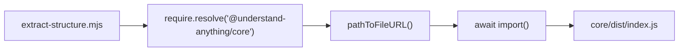

**Sources:** [understand-anything-plugin/skills/understand/extract-structure.mjs:32-42]()

### Package Exports

The `@understand-anything/core` package uses explicit exports in its `package.json` to define its public API surface, ensuring that consumers can import specific modules like `search` or `schema` with full type support.

```json
"exports": {
  ".": { "types": "./dist/index.d.ts", "default": "./dist/index.js" },
  "./search": { "types": "./dist/search.d.ts", "default": "./dist/search.js" },
  "./types": { "types": "./dist/types.d.ts", "default": "./dist/types.js" },
  "./schema": { "types": "./dist/schema.d.ts", "default": "./dist/schema.js" },
  "./languages": { "types": "./dist/languages/index.d.ts", "default": "./dist/languages/index.js" }
}
```

**Sources:** [understand-anything-plugin/packages/core/package.json:7-28]()

---

## Dependency Management

The project uses `pnpm` workspaces to manage internal dependencies. The `pnpm-lock.yaml` file maintains the link between the root and packages.

### Workspace Protocol

The root `package.json` and internal packages use the `workspace:*` protocol to refer to each other during development, which `pnpm` resolves to local symlinks.

| Consumer | Dependency | Version |
|----------|------------|---------|
| `understand-anything` (root) | `@understand-anything/core` | `workspace:*` |
| `@understand-anything/dashboard` | `@understand-anything/core` | `workspace:*` |

**Sources:** [understand-anything-plugin/pnpm-lock.yaml:11-13](), [understand-anything-plugin/pnpm-lock.yaml:91-93]()

### Native Dependencies

The project relies on several native `tree-sitter` parsers. These are explicitly allowed in the `pnpm.onlyBuiltDependencies` configuration to ensure they are correctly compiled during the installation phase.

**Sources:** [package.json:44-60]()

---

# Page: Knowledge Graph

# Knowledge Graph

<details>
<summary>Relevant source files</summary>

The following files were used as context for generating this wiki page:

- [understand-anything-plugin/packages/core/src/__tests__/domain-types.test.ts](understand-anything-plugin/packages/core/src/__tests__/domain-types.test.ts)
- [understand-anything-plugin/packages/core/src/__tests__/language-lesson.test.ts](understand-anything-plugin/packages/core/src/__tests__/language-lesson.test.ts)
- [understand-anything-plugin/packages/core/src/__tests__/plugin-discovery.test.ts](understand-anything-plugin/packages/core/src/__tests__/plugin-discovery.test.ts)
- [understand-anything-plugin/packages/core/src/__tests__/schema.test.ts](understand-anything-plugin/packages/core/src/__tests__/schema.test.ts)
- [understand-anything-plugin/packages/core/src/analyzer/graph-builder.test.ts](understand-anything-plugin/packages/core/src/analyzer/graph-builder.test.ts)
- [understand-anything-plugin/packages/core/src/analyzer/graph-builder.ts](understand-anything-plugin/packages/core/src/analyzer/graph-builder.ts)
- [understand-anything-plugin/packages/core/src/plugins/tree-sitter-plugin.ts](understand-anything-plugin/packages/core/src/plugins/tree-sitter-plugin.ts)
- [understand-anything-plugin/packages/core/src/schema.ts](understand-anything-plugin/packages/core/src/schema.ts)
- [understand-anything-plugin/packages/dashboard/public/knowledge-graph.json](understand-anything-plugin/packages/dashboard/public/knowledge-graph.json)
- [understand-anything-plugin/skills/understand-chat/SKILL.md](understand-anything-plugin/skills/understand-chat/SKILL.md)
- [understand-anything-plugin/skills/understand-diff/SKILL.md](understand-anything-plugin/skills/understand-diff/SKILL.md)
- [understand-anything-plugin/skills/understand-explain/SKILL.md](understand-anything-plugin/skills/understand-explain/SKILL.md)
- [understand-anything-plugin/skills/understand-onboard/SKILL.md](understand-anything-plugin/skills/understand-onboard/SKILL.md)
- [understand-anything-plugin/skills/understand/frameworks/django.md](understand-anything-plugin/skills/understand/frameworks/django.md)

</details>


The knowledge graph is the central data structure that represents an analyzed codebase as a typed, directed graph with metadata. It is serialized as `knowledge-graph.json` and serves as the persistent artifact that powers all downstream features including the interactive dashboard, skill commands, and chat Q&A.

For information about how the knowledge graph is generated by the multi-agent pipeline, see [Multi-Agent Pipeline](#7). For information about how it's visualized in the dashboard, see [Interactive Dashboard](#5).

---

## Overview

The knowledge graph represents a codebase's structure, relationships, and architecture in a machine-readable format. It consists of:

- **Project metadata**: name, languages, frameworks, Git commit hash [packages/core/src/types.ts:81-88]().
- **Nodes**: 16 primary types of entities including code (files, functions), non-code (configs, services), and domain (flows) [packages/core/src/types.ts:2-7]().
- **Edges**: 35 types of relationships between nodes across 8 categories [packages/core/src/schema.ts:3-14]().
- **Layers**: architectural groupings of related files [packages/core/src/types.ts:64-69]().
- **Tour**: guided walkthrough steps for learning the codebase [packages/core/src/types.ts:72-78]().

The graph is generated by the `/understand` command and persisted to `.understand-anything/knowledge-graph.json` at the project root. It is validated on load using Zod schemas to ensure type safety and referential integrity [packages/core/src/schema.ts:1-14]().

**Key characteristics:**

| Property | Value |
|----------|-------|
| Format | JSON |
| Location | `.understand-anything/knowledge-graph.json` |
| Validation | 4-tier pipeline (sanitize, normalize, auto-correct, fatal) [packages/core/src/schema.ts:148-220]() |
| Version | `"1.0.0"` (semver) [packages/core/src/types.ts:92]() |
| Staleness detection | Git commit hash + structural fingerprinting [packages/core/src/types.ts:108-111]() |

Sources: [packages/core/src/types.ts:1-115](), [packages/core/src/schema.ts:1-14]()

---

## Complete Schema Structure

The knowledge graph follows a fixed schema defined using Zod and TypeScript interfaces [packages/core/src/types.ts:91-99]().

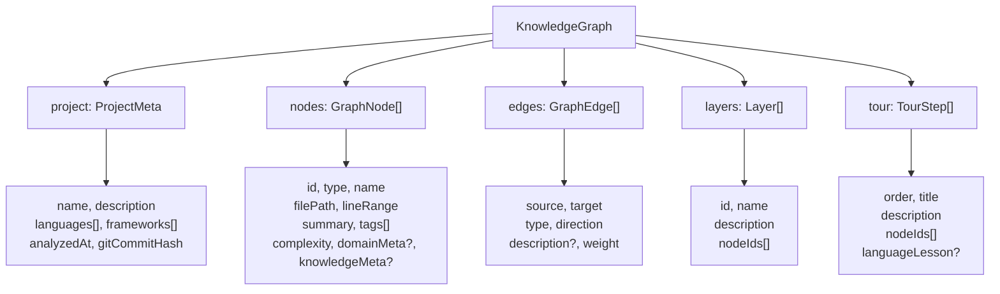

**Top-level structure:**
The `KnowledgeGraph` interface ensures that every generated graph includes project metadata and arrays for nodes, edges, architectural layers, and tour steps [packages/core/src/types.ts:91-99]().

For details, see [Schema and Validation](#4.1).

Sources: [packages/core/src/types.ts:39-99](), [packages/core/src/__tests__/schema.test.ts:12-59]()

---

## Node Types and ID Conventions

The graph supports 16 primary node types categorized into code, non-code, and domain entities [packages/core/src/types.ts:2-7](). To handle various LLM outputs, the system normalizes common aliases (e.g., `func` to `function`, `db` to `table`) [packages/core/src/schema.ts:17-75]().

### Node Type Taxonomy

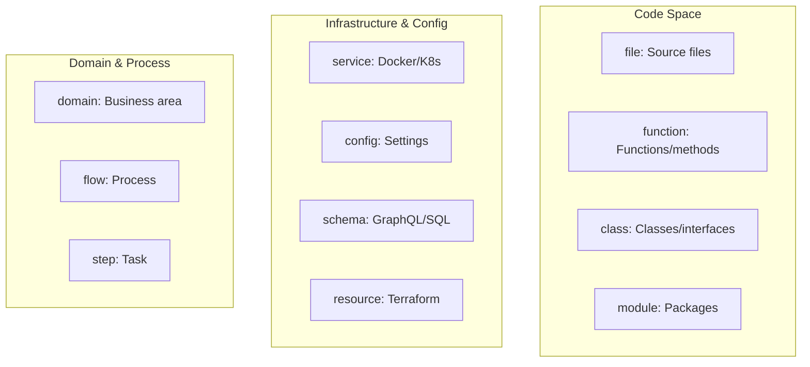

### Node Specifications

| Type | ID Convention | Example ID |
|------|---------------|------------|
| `file` | `file:<path>` | `file:packages/core/src/types.ts` [packages/core/src/analyzer/graph-builder.ts:92]() |
| `function` | `function:<path>:<name>` | `function:packages/core/src/schema.ts:validateGraph` [packages/core/src/analyzer/graph-builder.ts:132]() |
| `class` | `class:<path>:<name>` | `class:packages/core/src/search.ts:SearchEngine` [packages/core/src/analyzer/graph-builder.ts:156]() |
| `domain` | `domain:<kebab-name>` | `domain:order-management` [packages/core/src/__tests__/domain-types.test.ts:17]() |
| `flow` | `flow:<kebab-name>` | `flow:create-order` [packages/core/src/__tests__/domain-types.test.ts:25]() |

For details, see [Nodes and Edges](#4.2).

Sources: [packages/core/src/types.ts:2-7](), [packages/core/src/schema.ts:17-75](), [packages/core/src/analyzer/graph-builder.ts:92-167]()

---

## Edge Types and Relationship Semantics

Edges represent typed, directional relationships. The schema defines 35 canonical edge types across 8 categories [packages/core/src/schema.ts:3-14]().

### Edge Categories

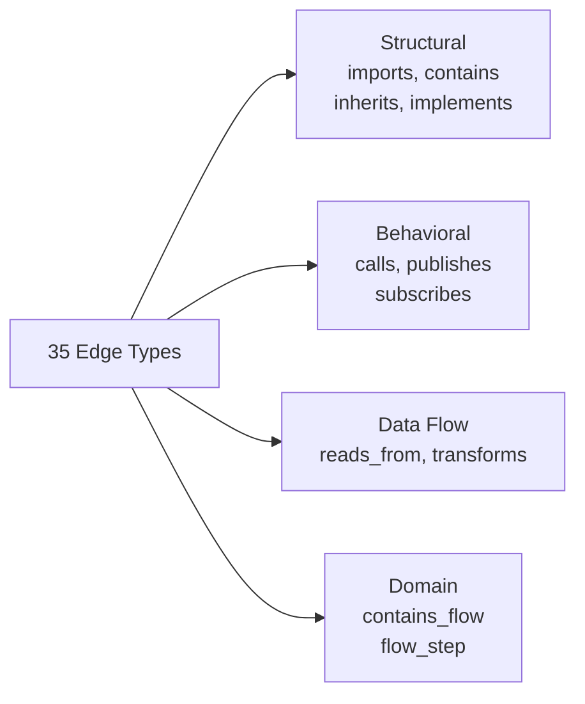

### Edge Semantics in Code
The `GraphBuilder` class provides helper methods to establish common relationships:
- `addImportEdge`: Creates an `imports` edge between files [packages/core/src/analyzer/graph-builder.ts:179-190]().
- `addCallEdge`: Creates a `calls` edge between functions [packages/core/src/analyzer/graph-builder.ts:192-208]().
- `addChildNode`: Creates a `contains` edge between a parent (file/class) and child (function/method) [packages/core/src/analyzer/graph-builder.ts:265-274]().

For details, see [Nodes and Edges](#4.2).

Sources: [packages/core/src/types.ts:10-19](), [packages/core/src/analyzer/graph-builder.ts:179-274]()

---

## Architectural Elements

### Layers
Layers group related nodes into architectural tiers (e.g., "API", "Service"). The `Layer` interface stores a list of `nodeIds` that belong to a specific logical grouping [packages/core/src/types.ts:64-69]().

### Tours
Tours provide guided learning paths. Each `TourStep` includes a title, description, and the `nodeIds` involved in that step [packages/core/src/types.ts:72-78](). Steps can also include a `languageLesson` which explains language-specific patterns (e.g., `async/await` in TypeScript) found in those nodes [packages/core/src/__tests__/language-lesson.test.ts:81-91]().

For details, see [Architectural Layers and Guided Tours](#4.4).

Sources: [packages/core/src/types.ts:64-78](), [packages/core/src/__tests__/language-lesson.test.ts:38-157]()

---

## Validation and Normalization

The system uses a multi-stage pipeline to ensure graph integrity, especially when processing LLM-generated content [packages/core/src/schema.ts:148-220]().

### Normalization and Auto-Fixing
- **Sanitization**: Lowercases enum strings (types, complexity, direction) and converts nulls to empty arrays for `tour` and `layers` [packages/core/src/schema.ts:148-194]().
- **Alias Mapping**: Maps common LLM terms (e.g., `func` -> `function`, `invokes` -> `calls`, `extends` -> `inherits`) to canonical values [packages/core/src/schema.ts:17-125]().
- **Auto-Correction**: Clamps out-of-range weights (must be 0-1) and provides defaults for missing fields like `type` or `complexity` [packages/core/src/schema.ts:196-220]().

### Validation Results
The `validateGraph` function returns a `ValidationResult` which indicates success and lists any `GraphIssue` objects categorized by level (`auto-corrected`, `dropped`, `fatal`) [packages/core/src/__tests__/schema.test.ts:61-130]().

For details, see [Schema and Validation](#4.1).

Sources: [packages/core/src/schema.ts:16-220](), [packages/core/src/__tests__/schema.test.ts:61-231]()

---

## Staleness and Updates

The system tracks codebase changes to enable incremental updates and detect when a graph no longer reflects the source code [packages/core/src/types.ts:108-112]().

- **Staleness Detection**: The system compares the `gitCommitHash` stored in the graph's `ProjectMeta` against the current Git HEAD [packages/core/src/types.ts:81-88]().
- **Incremental Updates**: Updates are performed using structural fingerprinting to determine the level of change (SKIP/PARTIAL/ARCHITECTURE/FULL) and then merging updates into the existing graph.

For details, see [Staleness Detection and Incremental Updates](#4.3).

Sources: [packages/core/src/types.ts:81-112]()

---

# Page: Schema and Validation

# Schema and Validation

<details>
<summary>Relevant source files</summary>

The following files were used as context for generating this wiki page:

- [understand-anything-plugin/packages/core/src/__tests__/domain-normalize.test.ts](understand-anything-plugin/packages/core/src/__tests__/domain-normalize.test.ts)
- [understand-anything-plugin/packages/core/src/__tests__/domain-types.test.ts](understand-anything-plugin/packages/core/src/__tests__/domain-types.test.ts)
- [understand-anything-plugin/packages/core/src/__tests__/normalize-graph.test.ts](understand-anything-plugin/packages/core/src/__tests__/normalize-graph.test.ts)
- [understand-anything-plugin/packages/core/src/__tests__/plugin-discovery.test.ts](understand-anything-plugin/packages/core/src/__tests__/plugin-discovery.test.ts)
- [understand-anything-plugin/packages/core/src/__tests__/schema.test.ts](understand-anything-plugin/packages/core/src/__tests__/schema.test.ts)
- [understand-anything-plugin/packages/core/src/analyzer/normalize-graph.ts](understand-anything-plugin/packages/core/src/analyzer/normalize-graph.ts)
- [understand-anything-plugin/packages/core/src/index.ts](understand-anything-plugin/packages/core/src/index.ts)
- [understand-anything-plugin/packages/core/src/plugins/tree-sitter-plugin.ts](understand-anything-plugin/packages/core/src/plugins/tree-sitter-plugin.ts)
- [understand-anything-plugin/packages/core/src/schema.ts](understand-anything-plugin/packages/core/src/schema.ts)

</details>


## Purpose and Scope

This document details the Zod-based schema validation system in the `@understand-anything/core` package that ensures knowledge graph integrity. It covers the schema definitions for all graph data structures, the four-tier validation pipeline (sanitize, normalize aliases, auto-correct, fatal), and the specialized `normalizeBatchOutput` process used during multi-agent analysis.

The validation layer sits between the file system/LLM outputs and the core analysis engine, ensuring that all data conforms to the `KnowledgeGraph` contract before processing.

**Sources:** [understand-anything-plugin/packages/core/src/schema.ts:1-194](), [understand-anything-plugin/packages/core/src/__tests__/schema.test.ts:12-59]()

---

## Overview

The validation system prevents corrupted or incompatible knowledge graph files from causing runtime errors. All graph data loaded from `.understand-anything/knowledge-graph.json` or generated by agents passes through a robust pipeline. This provides:

- **Type safety at runtime** beyond TypeScript's compile-time checks using Zod.
- **Alias Normalization**: Automatically maps common LLM synonyms (e.g., `func` to `function`, `business_process` to `flow`) to canonical types.
- **Auto-Correction**: Clamps out-of-range values (like edge weights) and fills missing required fields with defaults.
- **ID Canonicalization**: Ensures node IDs follow the `type:path` or `type:path:name` format to prevent duplicates and broken links.

**Sources:** [understand-anything-plugin/packages/core/src/schema.ts:17-125](), [understand-anything-plugin/packages/core/src/__tests__/schema.test.ts:123-230]()

---

## Schema Architecture

### Schema Hierarchy

The following diagram shows the Zod schema structure and how schemas compose into the root `KnowledgeGraph` type. Note the inclusion of domain and knowledge-specific types.

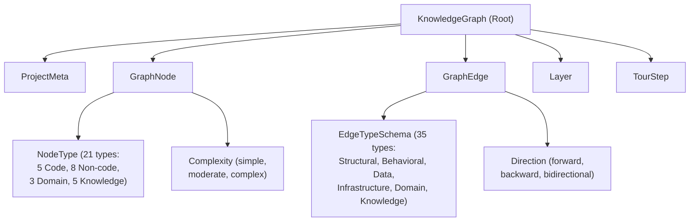

**Sources:** [understand-anything-plugin/packages/core/src/types.ts:2-99](), [understand-anything-plugin/packages/core/src/schema.ts:4-14]()

### Core Schema Definitions

| Schema / Interface | Purpose | Key Validations |
|--------------------|---------|----------------|
| `EdgeTypeSchema` | Validates relationship types | Enum of 35 types across 8 categories [understand-anything-plugin/packages/core/src/schema.ts:4-14]() |
| `GraphNode` | Validates node structure | 21 types, optional `domainMeta` and `knowledgeMeta` [understand-anything-plugin/packages/core/src/types.ts:39-51]() |
| `GraphEdge` | Validates edge connections | Source/target strings, weight 0-1, direction enum [understand-anything-plugin/packages/core/src/types.ts:54-61]() |
| `Layer` | Validates logical groupings | ID, name, description, array of node IDs [understand-anything-plugin/packages/core/src/types.ts:64-69]() |
| `TourStep` | Validates guided tours | Order, title, node IDs, optional `languageLesson` [understand-anything-plugin/packages/core/src/types.ts:72-78]() |
| `KnowledgeGraph` | Root structure | Composes all sub-structures with version field [understand-anything-plugin/packages/core/src/types.ts:91-99]() |

**Sources:** [understand-anything-plugin/packages/core/src/types.ts:1-99](), [understand-anything-plugin/packages/core/src/schema.ts:4-14]()

---

## The Four-Tier Validation Pipeline

The `validateGraph` function in `packages/core/src/schema.ts` executes a multi-stage pipeline to transform raw, potentially messy LLM output into a strictly valid graph.

### 1. Sanitize (`sanitizeGraph`)
This stage performs basic data cleanup:
- Converts `null` or `undefined` collections (tour, layers) to empty arrays `[]` [understand-anything-plugin/packages/core/src/schema.ts:152-153]().
- Removes `null` from optional fields like `filePath`, `lineRange`, or `languageNotes` [understand-anything-plugin/packages/core/src/schema.ts:161-163]().
- Lowercases enum-like strings (type, complexity, direction) [understand-anything-plugin/packages/core/src/schema.ts:165-178]().

### 2. Normalize Aliases (`normalizeGraph`)
LLMs often use synonyms. This stage maps them to canonical values:
- **Node Aliases (`NODE_TYPE_ALIASES`)**: `func`/`fn`/`method` → `function`, `interface`/`struct` → `class`, `db`/`database` → `table`, `business_flow` → `flow` [understand-anything-plugin/packages/core/src/schema.ts:17-75]().
- **Edge Aliases (`EDGE_TYPE_ALIASES`)**: `extends` → `inherits`, `invokes` → `calls`, `has_flow` → `contains_flow`, `next_step` → `flow_step` [understand-anything-plugin/packages/core/src/schema.ts:78-125]().
- **Complexity Aliases (`COMPLEXITY_ALIASES`)**: `low`/`easy` → `simple`, `high`/`hard` → `complex` [understand-anything-plugin/packages/core/src/schema.ts:128-136]().

### 3. Auto-Correct (`autoFixGraph`)
This stage attempts to fix invalid data without failing the whole process:
- **Clamping**: Weights > 1.0 are clamped to 1.0; < 0.0 are clamped to 0.0 [understand-anything-plugin/packages/core/src/__tests__/schema.test.ts:101-121]().
- **Defaults**: Missing `type` defaults to `file`; missing `complexity` defaults to `moderate` [understand-anything-plugin/packages/core/src/schema.ts:210-218]().
- **Dangling References**: The pipeline identifies issues where nodes or edges do not meet schema requirements and logs them as `auto-corrected` or `dropped` [understand-anything-plugin/packages/core/src/__tests__/schema.test.ts:84-98]().

### 4. Fatal Validation
If the graph has zero valid nodes after cleaning, or if critical fields in the `project` metadata are missing, the validation returns a fatal error [understand-anything-plugin/packages/core/src/__tests__/schema.test.ts:70-87]().

**Sources:** [understand-anything-plugin/packages/core/src/schema.ts:148-221](), [understand-anything-plugin/packages/core/src/__tests__/schema.test.ts:61-121]()

---

## Batch Normalization and ID Integrity

When processing large batches of LLM-generated nodes, the system uses `normalizeBatchOutput` to ensure ID consistency before final schema validation.

### ID Canonicalization (`normalizeNodeId`)
This function transforms various ID formats into the canonical `type:path` or `type:path:name` format:
- **Double Prefixes**: Strips redundant prefixes like `file:file:src/index.ts` [understand-anything-plugin/packages/core/src/analyzer/normalize-graph.ts:28-49]().
- **Project Prefixes**: Removes project-name prefixes often added by LLMs [understand-anything-plugin/packages/core/src/analyzer/normalize-graph.ts:34-54]().
- **Bare Paths**: Automatically adds the correct prefix based on node type (e.g., `src/main.ts` becomes `file:src/main.ts`) [understand-anything-plugin/packages/core/src/analyzer/normalize-graph.ts:89-108]().
- **Domain Discrimination**: For `step` nodes, it includes the `parentFlowSlug` in the ID to prevent collisions across different business flows [understand-anything-plugin/packages/core/src/analyzer/normalize-graph.ts:78-85]().

### Normalization Logic Flow

The following diagram illustrates how raw LLM data is transformed into a validated `KnowledgeGraph` entity, bridging the gap between Natural Language output and Code Entity space.

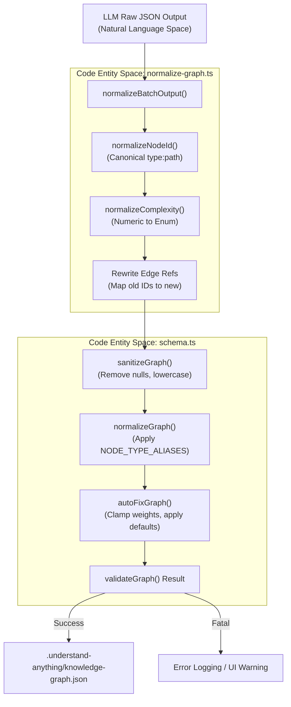

**Sources:** [understand-anything-plugin/packages/core/src/analyzer/normalize-graph.ts:202-218](), [understand-anything-plugin/packages/core/src/schema.ts:148-221](), [understand-anything-plugin/packages/core/src/__tests__/schema.test.ts:1-230]()

---

## ValidationResult and Integrity

The `validateGraph` function returns a `ValidationResult` object containing the success status, the cleaned data, and an array of `GraphIssue` objects.

### Integrity Checking Logic
The system distinguishes between "Dropped" items and "Fatal" errors:
- **Dropped Node**: An individual node has an invalid type that cannot be aliased. It is removed from the collection [understand-anything-plugin/packages/core/src/__tests__/schema.test.ts:77-87]().
- **Dropped Edge**: An edge has an invalid `EdgeType` or references a non-existent node. It is removed while the rest of the graph is preserved [understand-anything-plugin/packages/core/src/__tests__/schema.test.ts:89-99]().
- **Fatal**: If "No valid nodes" remain after filtering, or if the `project` metadata is fundamentally broken, the graph is considered unusable [understand-anything-plugin/packages/core/src/__tests__/schema.test.ts:81-83]().

**Sources:** [understand-anything-plugin/packages/core/src/__tests__/schema.test.ts:61-121](), [understand-anything-plugin/packages/core/src/schema.ts:196-221]()

---

## Testing and Verification

The validation logic is verified by a suite of tests in `packages/core/src/__tests__/`:
- `schema.test.ts`: Tests the four-tier pipeline, alias mapping for nodes/edges, and weight clamping [understand-anything-plugin/packages/core/src/__tests__/schema.test.ts:61-230]().
- `normalize-graph.test.ts`: Validates ID canonicalization, double-prefix stripping, and numeric complexity mapping [understand-anything-plugin/packages/core/src/__tests__/normalize-graph.test.ts:9-185]().
- `domain-types.test.ts`: Verifies domain-specific nodes (`domain`, `flow`, `step`) and their unique edge types (`contains_flow`, `flow_step`, `cross_domain`), ensuring `domainMeta` is preserved through the pipeline [understand-anything-plugin/packages/core/src/__tests__/domain-types.test.ts:67-141]().

**Sources:** [understand-anything-plugin/packages/core/src/__tests__/schema.test.ts:1-230](), [understand-anything-plugin/packages/core/src/__tests__/normalize-graph.test.ts:1-185](), [understand-anything-plugin/packages/core/src/__tests__/domain-types.test.ts:1-141]()

---

# Page: Nodes and Edges

# Nodes and Edges

<details>
<summary>Relevant source files</summary>

The following files were used as context for generating this wiki page:

- [understand-anything-plugin/packages/core/src/__tests__/domain-persistence.test.ts](understand-anything-plugin/packages/core/src/__tests__/domain-persistence.test.ts)
- [understand-anything-plugin/packages/core/src/__tests__/domain-types.test.ts](understand-anything-plugin/packages/core/src/__tests__/domain-types.test.ts)
- [understand-anything-plugin/packages/core/src/__tests__/language-lesson.test.ts](understand-anything-plugin/packages/core/src/__tests__/language-lesson.test.ts)
- [understand-anything-plugin/packages/core/src/__tests__/plugin-discovery.test.ts](understand-anything-plugin/packages/core/src/__tests__/plugin-discovery.test.ts)
- [understand-anything-plugin/packages/core/src/__tests__/schema.test.ts](understand-anything-plugin/packages/core/src/__tests__/schema.test.ts)
- [understand-anything-plugin/packages/core/src/analyzer/graph-builder.test.ts](understand-anything-plugin/packages/core/src/analyzer/graph-builder.test.ts)
- [understand-anything-plugin/packages/core/src/analyzer/graph-builder.ts](understand-anything-plugin/packages/core/src/analyzer/graph-builder.ts)
- [understand-anything-plugin/packages/core/src/persistence/index.ts](understand-anything-plugin/packages/core/src/persistence/index.ts)
- [understand-anything-plugin/packages/core/src/persistence/persistence.test.ts](understand-anything-plugin/packages/core/src/persistence/persistence.test.ts)
- [understand-anything-plugin/packages/core/src/plugins/tree-sitter-plugin.ts](understand-anything-plugin/packages/core/src/plugins/tree-sitter-plugin.ts)
- [understand-anything-plugin/packages/core/src/schema.ts](understand-anything-plugin/packages/core/src/schema.ts)
- [understand-anything-plugin/packages/core/src/types.test.ts](understand-anything-plugin/packages/core/src/types.test.ts)
- [understand-anything-plugin/packages/core/src/types.ts](understand-anything-plugin/packages/core/src/types.ts)
- [understand-anything-plugin/packages/dashboard/public/knowledge-graph.json](understand-anything-plugin/packages/dashboard/public/knowledge-graph.json)
- [understand-anything-plugin/skills/understand-chat/SKILL.md](understand-anything-plugin/skills/understand-chat/SKILL.md)
- [understand-anything-plugin/skills/understand-diff/SKILL.md](understand-anything-plugin/skills/understand-diff/SKILL.md)
- [understand-anything-plugin/skills/understand-explain/SKILL.md](understand-anything-plugin/skills/understand-explain/SKILL.md)
- [understand-anything-plugin/skills/understand-onboard/SKILL.md](understand-anything-plugin/skills/understand-onboard/SKILL.md)
- [understand-anything-plugin/skills/understand/frameworks/django.md](understand-anything-plugin/skills/understand/frameworks/django.md)

</details>


This page documents the node and edge structure of the knowledge graph, including the 21 node types, 35 edge types, ID conventions, and relationship semantics that enable rich representation of codebase structure, infrastructure, business domains, and general knowledge.

The graph structure is defined by TypeScript interfaces in `types.ts` and enforced via Zod schemas in `schema.ts` throughout the multi-agent analysis pipeline.

---

## Node Types

The knowledge graph represents entities as 21 distinct node types, capturing code, configuration, documentation, infrastructure, business logic, and research-based knowledge.

### Common Node Properties

All nodes conform to the `GraphNode` interface and include these properties:

| Property | Type | Required | Description |
|----------|------|----------|-------------|
| `id` | `string` | Yes | Unique identifier following `type:path` or `type:path:name` conventions |
| `type` | `NodeType` | Yes | One of the 21 valid types |
| `name` | `string` | Yes | Human-readable display name |
| `filePath` | `string` | No | Relative path from project root (for code/config nodes) |
| `lineRange` | `[number, number]` | No | Start and end line numbers |
| `summary` | `string` | Yes | Brief description of the node's purpose |
| `tags` | `string[]` | Yes | Keywords for categorization and search |
| `complexity` | `enum` | Yes | `simple`, `moderate`, or `complex` |
| `domainMeta` | `DomainMeta` | No | Metadata for domain/flow/step nodes (entry points, rules) |
| `knowledgeMeta`| `KnowledgeMeta`| No | Metadata for article/entity/claim nodes (wikilinks, content) |

**Sources:** [understand-anything-plugin/packages/core/src/types.ts:39-51](), [understand-anything-plugin/packages/core/src/schema.ts:155-170]()

### Categorized Node Types

The system bridges "Natural Language Space" to "Code Entity Space" by mapping detected structures to these specific types across four categories.

#### 1. Structural & Code Nodes (5 Types)
- `file`: Individual source code files.
- `function`: Functions, methods, or async handlers.
- `class`: Classes, interfaces, or structs.
- `module`: Logical packages, namespaces, or directories.
- `concept`: Abstract patterns (e.g., "Dependency Injection") spanning multiple files.

#### 2. Non-Code & Infrastructure Nodes (8 Types)
- `config`: Configuration files (e.g., `tsconfig.json`, `settings.py`).
- `document`: Documentation (e.g., `README.md`, architectural ADRs).
- `service`: Deployable units or external services (e.g., `Dockerfile`, Docker Compose services).
- `table`: Database tables, views, or indexes.
- `endpoint`: API routes (e.g., `GET /api/users`) or message queue listeners.
- `pipeline`: CI/CD workflows, jobs, or data processing stages.
- `schema`: Data definitions (e.g., Protobuf messages, GraphQL types, Enums).
- `resource`: Cloud infrastructure or hardware resources (e.g., Terraform/AWS resources).

#### 3. Domain Nodes (3 Types)
- `domain`: High-level business areas (e.g., "Order Management").
- `flow`: Specific business processes (e.g., "Create Order").
- `step`: Individual actions within a flow (e.g., "Validate Input").

#### 4. Knowledge Nodes (5 Types)
- `article`: Wiki pages or research notes.
- `entity`: Persons, organizations, or specific actors.
- `topic`: Tags, categories, or themes.
- `claim`: Assertions, decisions, or theses.
- `source`: Reference materials, papers, or raw data sources.

**Sources:** [understand-anything-plugin/packages/core/src/types.ts:2-7](), [understand-anything-plugin/packages/core/src/analyzer/graph-builder.ts:39-58]()

---

## Edge Types

Edges represent relationships between nodes. The knowledge graph supports 35 distinct edge types organized into 8 semantic categories.

### Edge Type Categories

| Category | Canonical Types |
|----------|-----------------|
| **Structural** | `imports`, `exports`, `contains`, `inherits`, `implements` |
| **Behavioral** | `calls`, `subscribes`, `publishes`, `middleware` |
| **Data Flow** | `reads_from`, `writes_to`, `transforms`, `validates` |
| **Dependencies**| `depends_on`, `tested_by`, `configures` |
| **Semantic** | `related`, `similar_to` |
| **Infrastructure**| `deploys`, `serves`, `provisions`, `triggers`, `migrates`, `documents`, `routes`, `defines_schema` |
| **Domain** | `contains_flow`, `flow_step`, `cross_domain` |
| **Knowledge** | `cites`, `contradicts`, `builds_on`, `exemplifies`, `categorized_under`, `authored_by` |

**Sources:** [understand-anything-plugin/packages/core/src/types.ts:10-19](), [understand-anything-plugin/packages/core/src/schema.ts:4-14]()

### Normalization and Aliases
The `autoFixGraph` and `sanitizeGraph` functions map common LLM synonyms to canonical types to ensure schema compliance.

| Original Alias | Canonical Type |
|----------------|----------------|
| `interface`, `struct` | `class` |
| `func`, `fn`, `method` | `function` |
| `extends` | `inherits` |
| `invokes`, `invoke` | `calls` |
| `uses`, `requires` | `depends_on` |
| `db`, `database`, `migration`| `table` |
| `next_step` | `flow_step` |

**Sources:** [understand-anything-plugin/packages/core/src/schema.ts:17-125](), [understand-anything-plugin/packages/core/src/__tests__/schema.test.ts:123-231]()

---

## ID Conventions and Construction

The `GraphBuilder` class enforces strict ID conventions to ensure referential integrity. IDs typically follow the format `type:filePath` or `type:filePath:name`.

### ID Prefix Mapping
The internal logic in `GraphBuilder` constructs IDs based on the entity type:

| Node Type | ID Construction Logic | Example ID |
|-----------|-----------|------------|
| `file` | `file:${filePath}` | `file:src/index.ts` |
| `function`| `function:${filePath}:${name}` | `function:src/utils.ts:formatDate` |
| `class` | `class:${filePath}:${name}` | `class:src/models.ts:User` |
| `table` | `${kind}:${filePath}:${name}` | `table:db/schema.sql:users` |
| `service` | `service:${filePath}:${name}` | `service:docker-compose.yml:web` |

**Sources:** [understand-anything-plugin/packages/core/src/analyzer/graph-builder.ts:92-132](), [understand-anything-plugin/packages/core/src/analyzer/graph-builder.ts:234-248]()

### Code to Graph Mapping Logic

The `GraphBuilder` bridges structural analysis results (from tree-sitter or LLMs) into the graph space.

Title: Code to Knowledge Graph Mapping
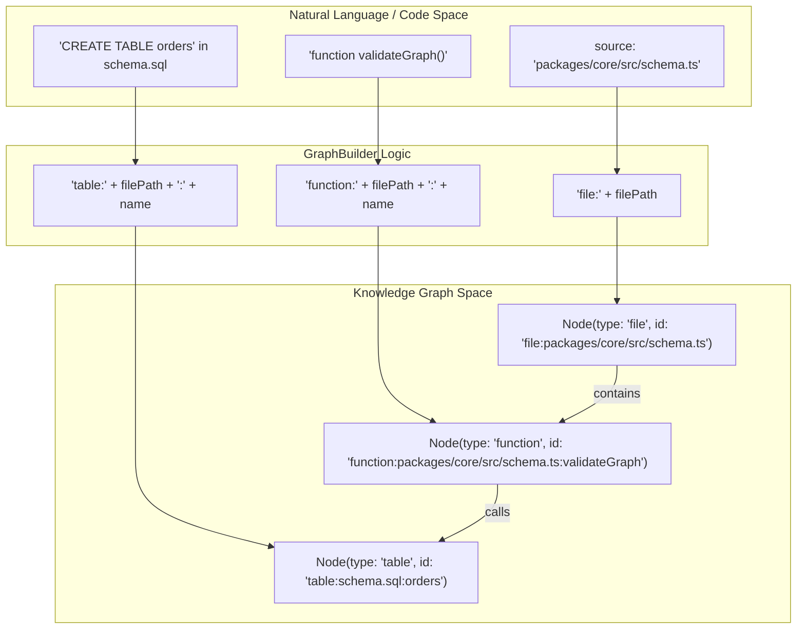

**Sources:** [understand-anything-plugin/packages/core/src/analyzer/graph-builder.ts:115-152](), [understand-anything-plugin/packages/core/src/analyzer/graph-builder.ts:39-58]()

---

## Relationship Semantics

### Domain-to-Code Mapping
Domain nodes (`domain`, `flow`, `step`) provide a business-logic overlay. `step` nodes often link directly to the code implementation via `filePath`.

Title: Domain Overlay to Code Entity Mapping
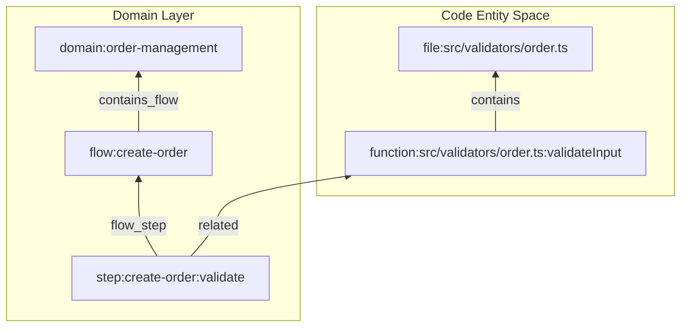

**Sources:** [understand-anything-plugin/packages/core/src/types.ts:29-36](), [understand-anything-plugin/packages/core/src/__tests__/domain-persistence.test.ts:20-29]()

### Framework-Specific Semantics
Framework addendums (e.g., Django) inject specific edge patterns during analysis to capture implicit relationships like URL routing or Signal wiring.

- **Django URLs**: `urls.py` --`routes`--> `views.py`
- **Django Signals**: `signals.py` --`subscribes`--> `models.py`
- **Django ORM**: `ModelA` --`depends_on`--> `ModelB` (via ForeignKey)

**Sources:** [understand-anything-plugin/skills/understand/frameworks/django.md:35-46]()

### Validation and Integrity
The `validateGraph` function performs deterministic checks:
1. **Referential Integrity:** Every edge `source` and `target` must exist as a node `id`.
2. **Schema Adherence:** Types must match the `NodeType` and `EdgeType` enums.
3. **Weight Constraints:** Weights are auto-corrected (clamped) between `0.0` and `1.0`.
4. **Required Fields:** Ensures `version`, `project`, `nodes`, and `edges` are present.

**Sources:** [understand-anything-plugin/packages/core/src/schema.ts:148-220](), [understand-anything-plugin/packages/core/src/__tests__/schema.test.ts:89-121]()

---

# Page: Staleness Detection and Incremental Updates

# Staleness Detection and Incremental Updates

<details>
<summary>Relevant source files</summary>

The following files were used as context for generating this wiki page:

- [eslint.config.mjs](eslint.config.mjs)
- [scripts/generate-large-graph.mjs](scripts/generate-large-graph.mjs)
- [understand-anything-plugin/hooks/auto-update-prompt.md](understand-anything-plugin/hooks/auto-update-prompt.md)
- [understand-anything-plugin/hooks/hooks.json](understand-anything-plugin/hooks/hooks.json)
- [understand-anything-plugin/packages/core/src/__tests__/change-classifier.test.ts](understand-anything-plugin/packages/core/src/__tests__/change-classifier.test.ts)
- [understand-anything-plugin/packages/core/src/__tests__/fingerprint.test.ts](understand-anything-plugin/packages/core/src/__tests__/fingerprint.test.ts)
- [understand-anything-plugin/packages/core/src/change-classifier.ts](understand-anything-plugin/packages/core/src/change-classifier.ts)
- [understand-anything-plugin/packages/core/src/fingerprint.ts](understand-anything-plugin/packages/core/src/fingerprint.ts)
- [understand-anything-plugin/packages/core/src/plugins/extractors/ruby-extractor.ts](understand-anything-plugin/packages/core/src/plugins/extractors/ruby-extractor.ts)
- [understand-anything-plugin/packages/core/src/plugins/parsers/graphql-parser.ts](understand-anything-plugin/packages/core/src/plugins/parsers/graphql-parser.ts)
- [understand-anything-plugin/packages/core/src/plugins/parsers/sql-parser.ts](understand-anything-plugin/packages/core/src/plugins/parsers/sql-parser.ts)
- [understand-anything-plugin/skills/understand/build-fingerprints.mjs](understand-anything-plugin/skills/understand/build-fingerprints.mjs)

</details>


## Purpose and Scope

This section documents how the system detects when a knowledge graph is outdated and performs surgical incremental updates. The system uses a multi-layered approach: Git commit tracking for initial triggers, structural fingerprinting to distinguish between cosmetic and functional changes, and a change classifier to decide the appropriate update strategy (`SKIP`, `PARTIAL_UPDATE`, `ARCHITECTURE_UPDATE`, or `FULL_UPDATE`). This process ensures that the knowledge graph remains synchronized with the code while minimizing LLM token consumption.

Sources: [understand-anything-plugin/packages/core/src/fingerprint.ts:124-130](), [understand-anything-plugin/packages/core/src/change-classifier.ts:15-20](), [understand-anything-plugin/hooks/auto-update-prompt.md:5-6]()

## Fingerprinting and Change Detection

The system uses `FileFingerprint` objects to track the structural state of every file. Unlike a simple file hash, a fingerprint captures the specific signatures of code entities that affect the graph topology.

### Structural Fingerprinting
The `extractFileFingerprint` function [understand-anything-plugin/packages/core/src/fingerprint.ts:79-122]() creates a summary of a file's impact on the knowledge graph:
*   **Content Hash**: A SHA-256 hash of the raw file content used for fast-path comparison [understand-anything-plugin/packages/core/src/fingerprint.ts:70-72]().
*   **Signatures**: Parameter lists, return types, and export status for functions (`FunctionFingerprint`) and classes (`ClassFingerprint`) [understand-anything-plugin/packages/core/src/fingerprint.ts:87-101]().
*   **Dependency Surface**: List of imports (`ImportFingerprint`) and their specific specifiers to track relationship changes [understand-anything-plugin/packages/core/src/fingerprint.ts:103-106]().
*   **Size Tracking**: `totalLines` and per-entity `lineCount` are tracked to detect significant implementation growth even if signatures remain stable [understand-anything-plugin/packages/core/src/fingerprint.ts:110-120]().

### Change Classification (ChangeLevel)
When comparing two fingerprints via `compareFingerprints` [understand-anything-plugin/packages/core/src/fingerprint.ts:131-134](), the system assigns one of three `ChangeLevel` values:

| Level | Description |
| :--- | :--- |
| `NONE` | Content hashes are identical; no changes occurred [understand-anything-plugin/packages/core/src/fingerprint.ts:138-140](). |
| `COSMETIC` | Content changed, but all signatures and imports remain identical (e.g., comment changes or internal logic refactors) [understand-anything-plugin/packages/core/src/fingerprint.ts:241-243](). |
| `STRUCTURAL` | Changes detected in exports, function parameters, class methods, imports, or significant size changes (>50%) [understand-anything-plugin/packages/core/src/fingerprint.ts:152-226](). |

Sources: [understand-anything-plugin/packages/core/src/fingerprint.ts:48-54](), [understand-anything-plugin/packages/core/src/fingerprint.ts:131-245]()

## The Update Decision Matrix

The `classifyUpdate` function [understand-anything-plugin/packages/core/src/change-classifier.ts:21-25]() processes the results of a `ChangeAnalysis` to determine the most efficient update path based on structural change counts and directory impacts.

**Diagram: Update Strategy Selection Logic**

```mermaid
graph TD
    "DecisionStart"["classifyUpdate()"] --> "CheckStructural"{"Any STRUCTURAL<br/>changes?"}
    "CheckStructural" -- "No" --> "SKIP"["Action: SKIP<br/>(Only COSMETIC or NONE)"]
    "CheckStructural" -- "Yes" --> "CheckThresholds"{"Change Count > 30<br/>OR > 50% Project?"}
    
    "CheckThresholds" -- "Yes" --> "FULL_UPDATE"["Action: FULL_UPDATE<br/>(Complete Rebuild)"]
    "CheckThresholds" -- "No" --> "CheckDir"{"New/Deleted<br/>Directories?"}
    
    "CheckDir" -- "Yes" --> "ARCH_UPDATE"["Action: ARCHITECTURE_UPDATE<br/>(Re-run Layer Analysis)"]
    "CheckDir" -- "No" --> "CheckCount"{"Structural Count > 10?"}
    
    "CheckCount" -- "Yes" --> "ARCH_UPDATE"
    "CheckCount" -- "No" --> "PARTIAL"["Action: PARTIAL_UPDATE<br/>(Surgical Merge)"]
```

Sources: [understand-anything-plugin/packages/core/src/change-classifier.ts:26-87]()

### Update Actions Defined
*   **SKIP**: No re-analysis. The system simply updates the `gitCommitHash` in `meta.json` [understand-anything-plugin/packages/core/src/change-classifier.ts:36-42]().
*   **PARTIAL_UPDATE**: Only specific changed files are re-analyzed by the `file-analyzer`. Architecture layers and tours are preserved [understand-anything-plugin/packages/core/src/change-classifier.ts:80-86]().
*   **ARCHITECTURE_UPDATE**: Changed files are re-analyzed, and the `architecture-analyzer` is re-run to update layer groupings and tours [understand-anything-plugin/packages/core/src/change-classifier.ts:67-76]().
*   **FULL_UPDATE**: Triggered when the codebase has changed so significantly (>30 files or >50% of the graph) that a fresh scan is recommended [understand-anything-plugin/packages/core/src/change-classifier.ts:48-61]().

Sources: [understand-anything-plugin/packages/core/src/change-classifier.ts:4-10]()

## Persistence and Baseline Generation

Staleness detection relies on a baseline generated during the initial `/understand` analysis.

### Baseline Creation
During Phase 7 of the main analysis pipeline, `build-fingerprints.mjs` is executed [understand-anything-plugin/skills/understand/build-fingerprints.mjs:5-13](). It initializes a `PluginRegistry` with `TreeSitterPlugin` and all built-in parsers (e.g., `SQLParser`, `GraphQLParser`) to extract structural signatures from every source file [understand-anything-plugin/skills/understand/build-fingerprints.mjs:75-82](). The resulting `FingerprintStore` is saved to `.understand-anything/fingerprints.json` [understand-anything-plugin/skills/understand/build-fingerprints.mjs:84]().

### Directory Layout
| File | Purpose |
| :--- | :--- |
| `meta.json` | Stores the `gitCommitHash` used to trigger staleness checks [understand-anything-plugin/hooks/hooks.json:19](). |
| `fingerprints.json` | Stores the `FingerprintStore` baseline [understand-anything-plugin/skills/understand/build-fingerprints.mjs:7](). |
| `config.json` | Stores `ProjectConfig` including the `autoUpdate` toggle [understand-anything-plugin/hooks/hooks.json:9](). |

Sources: [understand-anything-plugin/skills/understand/build-fingerprints.mjs:1-91](), [understand-anything-plugin/packages/core/src/fingerprint.ts:41-46]()

## Automated Update Hooks

The system integrates with the environment via Git hooks defined in `hooks.json` [understand-anything-plugin/hooks/hooks.json:1-26]().

1.  **PostToolUse**: Triggers when a `git commit`, `merge`, `cherry-pick`, or `rebase` command is executed, provided `autoUpdate` is true [understand-anything-plugin/hooks/hooks.json:3-12]().
2.  **SessionStart**: Triggers on plugin startup if the current `git rev-parse HEAD` does not match the hash in `meta.json` [understand-anything-plugin/hooks/hooks.json:14-23]().

**Diagram: Hook-to-Decision Data Flow**

```mermaid
sequenceDiagram
    participant "Git/Shell" as Shell
    participant "hooks.json" as Hook
    participant "meta.json" as Meta
    participant "fingerprint-check.mjs" as Script
    participant "LLM Agent" as Agent
    
    Shell->>Hook: git commit / session start
    Hook->>Meta: Read gitCommitHash
    Shell->>Shell: git rev-parse HEAD
    alt Hashes Mismatch & autoUpdate=true
        Hook->>Script: Execute Phase 1 (Zero Tokens)
        Script->>Script: compareFingerprints()
        Script->>Script: classifyUpdate()
        Script-->>Hook: change-analysis.json (Action)
        alt Action != SKIP
            Hook->>Agent: "Update graph based on analysis"
        else Action == SKIP
            Hook->>Meta: Update gitCommitHash
        end
    end
```

Sources: [understand-anything-plugin/hooks/hooks.json:9, 19](), [understand-anything-plugin/hooks/auto-update-prompt.md:9-122]()

## Surgical Graph Merging

When performing an incremental update, the system performs surgical operations to maintain graph integrity [understand-anything-plugin/hooks/auto-update-prompt.md:5-6]():

1.  **Exclusion Filtering**: Before checking fingerprints, the system runs `ignore-filter.mjs` to remove files matching `.understandignore` patterns, preventing spurious updates from vendored code or migrations [understand-anything-plugin/hooks/auto-update-prompt.md:40-79]().
2.  **Node Removal**: Nodes belonging to deleted files or files marked for re-analysis are purged from the existing graph.
3.  **Edge Purging**: Any edge where the `source` or `target` ID no longer exists (dangling references) is deleted.
4.  **Injection**: New nodes and edges from the fresh `file-analyzer` batch results are injected.
5.  **Deduplication**: Nodes are deduplicated by ID, and edges are deduplicated by the composite key of `source + target + type`.

Sources: [understand-anything-plugin/hooks/auto-update-prompt.md:40-122](), [understand-anything-plugin/packages/core/src/change-classifier.ts:80-86]()

---

# Page: Architectural Layers and Guided Tours

# Architectural Layers and Guided Tours

<details>
<summary>Relevant source files</summary>

The following files were used as context for generating this wiki page:

- [CLAUDE.md](CLAUDE.md)
- [understand-anything-plugin/agents/architecture-analyzer.md](understand-anything-plugin/agents/architecture-analyzer.md)
- [understand-anything-plugin/agents/article-analyzer.md](understand-anything-plugin/agents/article-analyzer.md)
- [understand-anything-plugin/agents/assemble-reviewer.md](understand-anything-plugin/agents/assemble-reviewer.md)
- [understand-anything-plugin/agents/domain-analyzer.md](understand-anything-plugin/agents/domain-analyzer.md)
- [understand-anything-plugin/agents/graph-reviewer.md](understand-anything-plugin/agents/graph-reviewer.md)
- [understand-anything-plugin/agents/knowledge-graph-guide.md](understand-anything-plugin/agents/knowledge-graph-guide.md)
- [understand-anything-plugin/agents/project-scanner.md](understand-anything-plugin/agents/project-scanner.md)
- [understand-anything-plugin/agents/tour-builder.md](understand-anything-plugin/agents/tour-builder.md)
- [understand-anything-plugin/packages/core/src/__tests__/language-lesson.test.ts](understand-anything-plugin/packages/core/src/__tests__/language-lesson.test.ts)
- [understand-anything-plugin/packages/core/src/analyzer/graph-builder.test.ts](understand-anything-plugin/packages/core/src/analyzer/graph-builder.test.ts)
- [understand-anything-plugin/packages/core/src/analyzer/graph-builder.ts](understand-anything-plugin/packages/core/src/analyzer/graph-builder.ts)
- [understand-anything-plugin/packages/core/src/analyzer/layer-detector.ts](understand-anything-plugin/packages/core/src/analyzer/layer-detector.ts)
- [understand-anything-plugin/packages/dashboard/public/knowledge-graph.json](understand-anything-plugin/packages/dashboard/public/knowledge-graph.json)
- [understand-anything-plugin/packages/dashboard/src/components/Breadcrumb.tsx](understand-anything-plugin/packages/dashboard/src/components/Breadcrumb.tsx)
- [understand-anything-plugin/packages/dashboard/src/components/LayerClusterNode.tsx](understand-anything-plugin/packages/dashboard/src/components/LayerClusterNode.tsx)
- [understand-anything-plugin/packages/dashboard/src/components/PortalNode.tsx](understand-anything-plugin/packages/dashboard/src/components/PortalNode.tsx)
- [understand-anything-plugin/packages/dashboard/src/utils/__tests__/edgeAggregation.test.ts](understand-anything-plugin/packages/dashboard/src/utils/__tests__/edgeAggregation.test.ts)
- [understand-anything-plugin/packages/dashboard/src/utils/edgeAggregation.ts](understand-anything-plugin/packages/dashboard/src/utils/edgeAggregation.ts)
- [understand-anything-plugin/skills/understand-chat/SKILL.md](understand-anything-plugin/skills/understand-chat/SKILL.md)
- [understand-anything-plugin/skills/understand-diff/SKILL.md](understand-anything-plugin/skills/understand-diff/SKILL.md)
- [understand-anything-plugin/skills/understand-explain/SKILL.md](understand-anything-plugin/skills/understand-explain/SKILL.md)
- [understand-anything-plugin/skills/understand-onboard/SKILL.md](understand-anything-plugin/skills/understand-onboard/SKILL.md)
- [understand-anything-plugin/skills/understand/frameworks/django.md](understand-anything-plugin/skills/understand/frameworks/django.md)

</details>


This page documents the systems for identifying architectural layers and generating pedagogical guided tours within the Understand Anything knowledge graph. These processes transform a raw structural graph of files and functions into a high-level conceptual map of a codebase.

## Architectural Layer Detection

Architectural layers group related components (files, configurations, infrastructure) into logical tiers (e.g., API, Service, Data, UI). Layer detection is performed using a combination of deterministic heuristic patterns and LLM-based semantic interpretation.

### Layer Structure
Each layer is defined by the `Layer` interface:
- `id`: A unique string generated by `toLayerId` (e.g., `layer:api-layer`). [understand-anything-plugin/packages/core/src/analyzer/layer-detector.ts:72-74]()
- `name`: Human-readable name (e.g., "API Layer").
- `description`: A brief summary of the layer's responsibility.
- `nodeIds`: An array of strings referencing the IDs of nodes belonging to this layer.

Sources: [understand-anything-plugin/packages/core/src/types.ts:1-50](), [understand-anything-plugin/packages/core/src/analyzer/layer-detector.ts:1-10]()

### Detection Mechanism
The system employs two primary strategies to categorize nodes into layers:

#### 1. Heuristic Pattern Matching (`LAYER_PATTERNS`)
The `architecture-analyzer` agent and `layer-detector.ts` utilize a comprehensive set of directory patterns to classify files. [understand-anything-plugin/agents/architecture-analyzer.md:105-145](). Key mappings include:
- `routes`, `api`, `controllers`, `endpoints` → **API Layer**
- `services`, `logic`, `usecase`, `domain` → **Service Layer**
- `models`, `db`, `data`, `persistence`, `repository` → **Data Layer**
- `components`, `views`, `pages`, `ui` → **UI Layer**
- `middleware`, `plugins`, `guards` → **Middleware Layer**
- `utils`, `helpers`, `common` → **Utility Layer**
- `infra`, `deploy`, `k8s`, `terraform` → **Infrastructure Layer**

#### 2. LLM-Based Layering
The `architecture-analyzer` agent performs semantic interpretation in Phase 2, using structural insights (like import frequency and intra-group density) to refine layer assignments. [understand-anything-plugin/agents/architecture-analyzer.md:23-103](). It ensures that even non-code files like `Dockerfile` (Infrastructure) or `README.md` (Documentation) are assigned to exactly one layer. [understand-anything-plugin/agents/architecture-analyzer.md:9-14]()

**Diagram: Architecture Analysis Data Flow**

```mermaid
graph TD
    subgraph "Code Entity Space"
        FileNodes["GraphNode (type: 'file')"]
        PathAttr["filePath: 'src/routes/user.ts'"]
        ImportEdge["GraphEdge (type: 'imports')"]
    end

    subgraph "Structural Analysis Script"
        Script["architecture-analyzer Phase 1"]
        DirGroup["Directory Grouping"]
        Density["Intra-Group Import Density"]
    end

    subgraph "Agent Logic"
        AA["architecture-analyzer.md"]
        Patterns["LAYER_PATTERNS"]
    end

    FileNodes --> PathAttr
    ImportEdge --> Script
    PathAttr --> Script
    Script --> DirGroup
    Script --> Density
    
    DirGroup --> AA
    Density --> AA
    Patterns --> AA

    AA --> Result["Layer[] (e.g. layer:api)"]
```

Sources: [understand-anything-plugin/agents/architecture-analyzer.md:16-145](), [understand-anything-plugin/packages/core/src/analyzer/layer-detector.ts:105-144]()

---

## Guided Tour Generation

Tours provide a sequential pedagogical walkthrough of the project. The `tour-builder` agent identifies key entry points and dependency chains to create a logical "reading order."

### TourStep Structure
A `TourStep` consists of:
- `order`: Sequential integer (1-based).
- `title`: Short, engaging title.
- `description`: Explanation of the step's significance.
- `nodeIds`: Array of 1-5 node IDs to highlight. [understand-anything-plugin/agents/knowledge-graph-guide.md:74-80]()
- `languageLesson`: (Optional) Educational note about language-specific patterns.

Sources: [understand-anything-plugin/packages/core/src/types.ts:315-325]()

### Generation Algorithms

#### 1. Importance and Entry Point Detection
The `tour-builder` Phase 1 script computes structural signals:
- **Fan-In Ranking:** Nodes with many incoming edges (e.g., a central `types.ts`) are core dependencies. [understand-anything-plugin/agents/tour-builder.md:55-57]()
- **Entry Point Candidates:** Scoring based on filename (e.g., `index.ts`, `main.go`), root proximity, and high fan-out. [understand-anything-plugin/agents/tour-builder.md:63-77]()

#### 2. BFS Traversal
Starting from the top code entry point, the system performs a Breadth-First Search following `imports` and `calls` edges to reveal the natural "reading order" of the codebase. [understand-anything-plugin/agents/tour-builder.md:79-87]()

**Diagram: Mapping Code Space to Tour Space**

```mermaid
graph LR
    subgraph "Code Entity Space"
        EntryPoint["file:src/main.ts<br/>(Entry Score: +7)"]
        CoreUtil["file:src/types.ts<br/>(High Fan-In)"]
        CallEdge["GraphEdge (type: 'calls')"]
    end

    subgraph "Tour Construction"
        TB["tour-builder.md"]
        BFS["BFS Traversal"]
    end

    subgraph "Natural Language Space (Dashboard)"
        Step1["TourStep 1: Application Entry<br/>'This file bootstraps...'"]
        LessonText["languageLesson: 'Uses decorators for...'"]
    end

    EntryPoint --> TB
    CallEdge --> BFS
    BFS --> TB
    TB --> Step1
    CoreUtil --> TB
    TB --> LessonText
    LessonText -.-> Step1
```

Sources: [understand-anything-plugin/agents/tour-builder.md:24-117](), [understand-anything-plugin/packages/core/src/analyzer/graph-builder.ts:192-208]()

---

## Language-Specific Lessons

The system generates `languageLesson` content by analyzing node metadata against language-specific configurations.

### Lesson Generation Logic
1.  **Detection:** The `tour-builder` identifies language-specific patterns like "generic", "closure", or "decorator" in the code. [understand-anything-plugin/agents/tour-builder.md:19-20]()
2.  **Synthesis:** The agent provides bilingual explanations (English term + local translation) for complex concepts to aid international developers. [understand-anything-plugin/agents/tour-builder.md:16-20]()

### Framework Addendums
Framework-specific patterns are injected into the analysis via markdown addendums (e.g., for Django, React, FastAPI), ensuring the tour correctly identifies framework-specific architectural roles. [understand-anything-plugin/agents/project-scanner.md:46-47]()

---

## Visualizing Layers in the Dashboard

The dashboard represents layers as `LayerClusterNode` components. [understand-anything-plugin/packages/dashboard/src/components/LayerClusterNode.tsx:25-40](). Navigation between layers is handled via `PortalNode` components. [understand-anything-plugin/packages/dashboard/src/components/PortalNode.tsx:16-30]()

### Edge Aggregation for Layers
To prevent visual clutter, edges between layers are aggregated using `aggregateLayerEdges`. [understand-anything-plugin/packages/dashboard/src/utils/edgeAggregation.ts:21-70](). 

- **Intra-container edges:** Edges within the same layer are preserved. [understand-anything-plugin/packages/dashboard/src/utils/edgeAggregation.ts:162-180]()
- **Inter-container edges:** Edges crossing layer boundaries are aggregated into single visual lines with a `count` and list of `edgeTypes`. [understand-anything-plugin/packages/dashboard/src/utils/edgeAggregation.ts:181-206]()

Sources: [understand-anything-plugin/packages/dashboard/src/utils/edgeAggregation.ts:158-208](), [understand-anything-plugin/packages/dashboard/src/components/Breadcrumb.tsx:19-35]()

---

# Page: Interactive Dashboard

# Interactive Dashboard

<details>
<summary>Relevant source files</summary>

The following files were used as context for generating this wiki page:

- [homepage/package.json](homepage/package.json)
- [pnpm-lock.yaml](pnpm-lock.yaml)
- [understand-anything-plugin/packages/dashboard/package.json](understand-anything-plugin/packages/dashboard/package.json)
- [understand-anything-plugin/packages/dashboard/src/App.tsx](understand-anything-plugin/packages/dashboard/src/App.tsx)
- [understand-anything-plugin/packages/dashboard/src/components/CustomNode.tsx](understand-anything-plugin/packages/dashboard/src/components/CustomNode.tsx)
- [understand-anything-plugin/packages/dashboard/src/components/GraphView.tsx](understand-anything-plugin/packages/dashboard/src/components/GraphView.tsx)
- [understand-anything-plugin/packages/dashboard/src/components/NodeInfo.tsx](understand-anything-plugin/packages/dashboard/src/components/NodeInfo.tsx)
- [understand-anything-plugin/packages/dashboard/src/store.ts](understand-anything-plugin/packages/dashboard/src/store.ts)
- [understand-anything-plugin/packages/dashboard/src/utils/__tests__/smoke.test.ts](understand-anything-plugin/packages/dashboard/src/utils/__tests__/smoke.test.ts)
- [understand-anything-plugin/packages/dashboard/vite.config.ts](understand-anything-plugin/packages/dashboard/vite.config.ts)
- [understand-anything-plugin/skills/understand-dashboard/SKILL.md](understand-anything-plugin/skills/understand-dashboard/SKILL.md)

</details>


The Interactive Dashboard is a React 19 + Vite web application that visualizes knowledge graphs produced by the analysis pipeline. It provides an interactive graph-based interface for exploring codebases, featuring React Flow for graph visualization, Zustand for state management, and a persona-adaptive UI that adjusts complexity based on user expertise.

This document covers the dashboard implementation, component architecture, and visualization system. For information about how the knowledge graph is generated, see [Multi-Agent Pipeline](#7). For details on dashboard-specific skills, see [/understand-dashboard](#6.6).

## Purpose and Scope

The dashboard serves as the primary visualization interface for the Understand Anything system. Located at `understand-anything-plugin/packages/dashboard/`, it is a standalone React application that:

- Loads and validates `knowledge-graph.json` and `domain-graph.json` files using Zod schema validation. [understand-anything-plugin/packages/dashboard/src/App.tsx:2-6]()
- Renders interactive graph visualizations using React Flow with ELK layouts. [understand-anything-plugin/packages/dashboard/src/components/GraphView.tsx:3-45]()
- Provides adaptive UIs for three user personas: `non-technical`, `junior`, and `experienced`. [understand-anything-plugin/packages/dashboard/src/store.ts:12-12]()
- Implements fuzzy and semantic search for node discovery via `@understand-anything/core/search`. [understand-anything-plugin/packages/dashboard/src/store.ts:2-3]()
- Displays architectural layers as visual groupings and cluster nodes. [understand-anything-plugin/packages/dashboard/src/components/GraphView.tsx:57-62]()
- Shows guided tours for onboarding via the `LearnPanel`. [understand-anything-plugin/packages/dashboard/src/App.tsx:29-30]()
- Secures data access using a `TokenGate` and session tokens. [understand-anything-plugin/packages/dashboard/src/App.tsx:18-18](), [understand-anything-plugin/packages/dashboard/src/App.tsx:70-85]()

The dashboard is built as a private package (`@understand-anything/dashboard`) within the monorepo and depends on `@understand-anything/core` for schema validation, search engines, and type definitions. [understand-anything-plugin/packages/dashboard/package.json:1-5]()

## Architecture Overview

The dashboard follows a modern React architecture with functional components, hooks, and centralized state management. It utilizes a "Lens" navigation system that allows users to drill down from a high-level layer overview into specific file topologies.

### Technology Stack

| Technology | Version | Purpose |
|------------|---------|---------|
| React | 19.0.0 | UI framework [understand-anything-plugin/packages/dashboard/package.json:26]() |
| Vite | 6.4.2 | Build tool and dev server [understand-anything-plugin/packages/dashboard/package.json:40]() |
| Zustand | 5.0.0 | State management via `useDashboardStore` [understand-anything-plugin/packages/dashboard/package.json:29]() |
| React Flow | 12.0.0 | Graph visualization (@xyflow/react) [understand-anything-plugin/packages/dashboard/package.json:17]() |
| ELK | 0.9.3 | Graph layout algorithm (elkjs) [understand-anything-plugin/packages/dashboard/package.json:20]() |
| TailwindCSS | 4.0.0 | Styling framework [understand-anything-plugin/packages/dashboard/package.json:38]() |
| TypeScript | 5.7.0 | Type safety [understand-anything-plugin/packages/dashboard/package.json:39]() |

**Sources:** [understand-anything-plugin/packages/dashboard/package.json:14-42]()

### Dashboard Component Hierarchy

```mermaid
graph TB
    subgraph "App.tsx (Root)"
        TokenGate["TokenGate.tsx"]
        Dashboard["Dashboard (Main Container)"]
    end
    
    subgraph "Navigation & View Controls"
        SearchBar["SearchBar.tsx"]
        PersonaSelector["PersonaSelector.tsx"]
        ViewToggle["setViewMode ('structural' | 'domain' | 'knowledge')"]
    end
    
    subgraph "Visualization Canvas"
        GraphView["GraphView.tsx (Structural)"]
        DomainGraphView["DomainGraphView.tsx (Business)"]
        KnowledgeGraphView["KnowledgeGraphView.tsx"]
        CustomNode["CustomNode.tsx"]
        LayerClusterNode["LayerClusterNode.tsx"]
    end
    
    subgraph "Context Panels"
        NodeInfo["NodeInfo.tsx (Details)"]
        LearnPanel["LearnPanel.tsx (Tours)"]
        FilterPanel["FilterPanel.tsx"]
        CodeViewer["CodeViewer.tsx (Overlay)"]
    end
    
    subgraph "State Management"
        Zustand["useDashboardStore.ts"]
    end

    Dashboard --> SearchBar
    Dashboard --> GraphView
    Dashboard --> DomainGraphView
    Dashboard --> KnowledgeGraphView
    Dashboard --> NodeInfo
    Dashboard --> LearnPanel
    
    GraphView --> CustomNode
    GraphView --> LayerClusterNode
    
    Zustand -.-> Dashboard
    Zustand -.-> GraphView
    Zustand -.-> NodeInfo
```

**Sources:** [understand-anything-plugin/packages/dashboard/src/App.tsx:5-19](), [understand-anything-plugin/packages/dashboard/src/components/GraphView.tsx:57-62]()

## Data Loading and Security

The dashboard loads knowledge graphs through a secure fetching mechanism that supports both local development and a hosted demo mode.

### Token-Based Access
To prevent unauthorized access to codebase metadata, the dashboard implements a `TokenGate`. The `resolveInitialToken` function extracts an access token from the URL query string, persists it to `sessionStorage`, and then strips it from the address bar for security. [understand-anything-plugin/packages/dashboard/src/App.tsx:70-85]()

### Data Resolution
The `dataUrl` helper resolves JSON asset paths. In `DEMO_MODE`, it pulls from environment-defined URLs (e.g., `VITE_GRAPH_URL`). In standard mode, it appends the security token to local paths (e.g., `/knowledge-graph.json?token=...`). [understand-anything-plugin/packages/dashboard/src/App.tsx:50-64]()

### System Mapping: Data to Code
The following diagram bridges the logical data entities to the specific React components and state variables that handle them.

```mermaid
graph LR
    subgraph "Data Space (.understand-anything)"
        KG["knowledge-graph.json"]
        DG["domain-graph.json"]
        Meta["meta.json"]
    end

    subgraph "Dashboard Code Space"
        Store["useDashboardStore (Zustand)"]
        GV["GraphView.tsx"]
        DGV["DomainGraphView.tsx"]
        TP["ThemePicker.tsx"]
    end

    KG -- "setGraph()" --> Store
    DG -- "setDomainGraph()" --> Store
    Meta -- "setMetaTheme()" --> TP

    Store -- "graph" --> GV
    Store -- "domainGraph" --> DGV
```

**Sources:** [understand-anything-plugin/packages/dashboard/src/App.tsx:109-122](), [understand-anything-plugin/packages/dashboard/src/store.ts:157-172]()

## Key Features and Child Pages

The dashboard functionality is split across several specialized modules. For detailed technical documentation on these areas, refer to the following child pages:

### [Dashboard Components](#5.1)
Details the React component tree, including the `GraphView` canvas, `NodeInfo` sidebar, `LearnPanel` for tours, and the `CodeViewer` overlay. Explains the mapping of 21 `NodeType` values to specific badge colors and categories. [understand-anything-plugin/packages/dashboard/src/components/NodeInfo.tsx:7-29]()

### [State Management and Data Flow](#5.2)
Explains the **Zustand** store architecture (`useDashboardStore`). Covers navigation levels (`overview` vs `layer-detail`), node history tracking for the "Back" button, and the 1-hop neighborhood focus mode. [understand-anything-plugin/packages/dashboard/src/store.ts:13-17](), [understand-anything-plugin/packages/dashboard/src/store.ts:134-137]()

### [Graph Visualization](#5.3)
Details the integration with **React Flow** and the **ELK** layout engine. Explains `applyElkLayout`, edge aggregation between layers, and the `TourFitView` component that automatically pans the camera during guided tours. [understand-anything-plugin/packages/dashboard/src/components/GraphView.tsx:45-52](), [understand-anything-plugin/packages/dashboard/src/components/GraphView.tsx:95-179]()

### [Persona Modes and Adaptive UI](#5.4)
Explains the three persona modes (`non-technical`, `junior`, `experienced`) and how the UI adapts. This includes filtering graph nodes by complexity and changing the level of technical detail shown in the `NodeInfo` and `LearnPanel` components. [understand-anything-plugin/packages/dashboard/src/store.ts:12-12]()

### [Domain Graph View](#5.5)
Documents the business-centric `DomainGraphView`. It focuses on `domain`, `flow`, and `step` node types, allowing users to understand high-level business logic separately from technical file structures. [understand-anything-plugin/packages/dashboard/src/store.ts:14-14](), [understand-anything-plugin/packages/dashboard/src/components/NodeInfo.tsx:21-23]()

## Development and Build

The dashboard uses Vite for fast development and bundling.

### Build Pipeline
- **Build Command:** `pnpm --filter @understand-anything/dashboard build` [understand-anything-plugin/packages/dashboard/package.json:8]()
- **Demo Build:** A specialized `vite.config.demo.ts` exists for deploying the hosted demo version. [understand-anything-plugin/packages/dashboard/package.json:9]()

### Local Proxy and Security
The Vite dev server binds to `127.0.0.1` and generates a one-time `ACCESS_TOKEN` printed to the terminal to secure the local session. [understand-anything-plugin/packages/dashboard/vite.config.ts:12-12](), [understand-anything-plugin/packages/dashboard/vite.config.ts:187-191]()

**Sources:** [understand-anything-plugin/packages/dashboard/package.json:6-13](), [understand-anything-plugin/packages/dashboard/vite.config.ts:9-13]()

---

# Page: Dashboard Components

# Dashboard Components

<details>
<summary>Relevant source files</summary>

The following files were used as context for generating this wiki page:

- [understand-anything-plugin/packages/dashboard/src/App.tsx](understand-anything-plugin/packages/dashboard/src/App.tsx)
- [understand-anything-plugin/packages/dashboard/src/components/CodeViewer.tsx](understand-anything-plugin/packages/dashboard/src/components/CodeViewer.tsx)
- [understand-anything-plugin/packages/dashboard/src/components/CustomNode.tsx](understand-anything-plugin/packages/dashboard/src/components/CustomNode.tsx)
- [understand-anything-plugin/packages/dashboard/src/components/FileExplorer.tsx](understand-anything-plugin/packages/dashboard/src/components/FileExplorer.tsx)
- [understand-anything-plugin/packages/dashboard/src/components/FilterPanel.tsx](understand-anything-plugin/packages/dashboard/src/components/FilterPanel.tsx)
- [understand-anything-plugin/packages/dashboard/src/components/GraphView.tsx](understand-anything-plugin/packages/dashboard/src/components/GraphView.tsx)
- [understand-anything-plugin/packages/dashboard/src/components/KeyboardShortcutsHelp.tsx](understand-anything-plugin/packages/dashboard/src/components/KeyboardShortcutsHelp.tsx)
- [understand-anything-plugin/packages/dashboard/src/components/LayerLegend.tsx](understand-anything-plugin/packages/dashboard/src/components/LayerLegend.tsx)
- [understand-anything-plugin/packages/dashboard/src/components/LearnPanel.tsx](understand-anything-plugin/packages/dashboard/src/components/LearnPanel.tsx)
- [understand-anything-plugin/packages/dashboard/src/components/MobileBottomNav.tsx](understand-anything-plugin/packages/dashboard/src/components/MobileBottomNav.tsx)
- [understand-anything-plugin/packages/dashboard/src/components/MobileDrawer.tsx](understand-anything-plugin/packages/dashboard/src/components/MobileDrawer.tsx)
- [understand-anything-plugin/packages/dashboard/src/components/MobileLayout.tsx](understand-anything-plugin/packages/dashboard/src/components/MobileLayout.tsx)
- [understand-anything-plugin/packages/dashboard/src/components/NodeInfo.tsx](understand-anything-plugin/packages/dashboard/src/components/NodeInfo.tsx)
- [understand-anything-plugin/packages/dashboard/src/components/NodeTooltip.tsx](understand-anything-plugin/packages/dashboard/src/components/NodeTooltip.tsx)
- [understand-anything-plugin/packages/dashboard/src/components/OnboardingOverlay.tsx](understand-anything-plugin/packages/dashboard/src/components/OnboardingOverlay.tsx)
- [understand-anything-plugin/packages/dashboard/src/components/PathFinderModal.tsx](understand-anything-plugin/packages/dashboard/src/components/PathFinderModal.tsx)
- [understand-anything-plugin/packages/dashboard/src/components/PersonaSelector.tsx](understand-anything-plugin/packages/dashboard/src/components/PersonaSelector.tsx)
- [understand-anything-plugin/packages/dashboard/src/components/ProjectOverview.tsx](understand-anything-plugin/packages/dashboard/src/components/ProjectOverview.tsx)
- [understand-anything-plugin/packages/dashboard/src/components/SearchBar.tsx](understand-anything-plugin/packages/dashboard/src/components/SearchBar.tsx)
- [understand-anything-plugin/packages/dashboard/src/contexts/I18nContext.tsx](understand-anything-plugin/packages/dashboard/src/contexts/I18nContext.tsx)
- [understand-anything-plugin/packages/dashboard/src/hooks/useKeyboardShortcuts.ts](understand-anything-plugin/packages/dashboard/src/hooks/useKeyboardShortcuts.ts)
- [understand-anything-plugin/packages/dashboard/src/index.css](understand-anything-plugin/packages/dashboard/src/index.css)
- [understand-anything-plugin/packages/dashboard/src/locales/en.ts](understand-anything-plugin/packages/dashboard/src/locales/en.ts)
- [understand-anything-plugin/packages/dashboard/src/locales/ja.ts](understand-anything-plugin/packages/dashboard/src/locales/ja.ts)
- [understand-anything-plugin/packages/dashboard/src/locales/ko.ts](understand-anything-plugin/packages/dashboard/src/locales/ko.ts)
- [understand-anything-plugin/packages/dashboard/src/locales/ru.ts](understand-anything-plugin/packages/dashboard/src/locales/ru.ts)
- [understand-anything-plugin/packages/dashboard/src/locales/zh-TW.ts](understand-anything-plugin/packages/dashboard/src/locales/zh-TW.ts)
- [understand-anything-plugin/packages/dashboard/src/locales/zh.ts](understand-anything-plugin/packages/dashboard/src/locales/zh.ts)
- [understand-anything-plugin/packages/dashboard/src/store.ts](understand-anything-plugin/packages/dashboard/src/store.ts)
- [understand-anything-plugin/packages/dashboard/src/themes/presets.ts](understand-anything-plugin/packages/dashboard/src/themes/presets.ts)
- [understand-anything-plugin/pnpm-workspace.yaml](understand-anything-plugin/pnpm-workspace.yaml)

</details>


This page documents the React components that make up the `@understand-anything/dashboard` web application. It details the implementation of the visualization layers, sidebar panels, and interactive utilities that form the "dark luxury" analytical interface.

## Overview

The dashboard is a React 19 application built with Vite and Tailwind CSS v4. It is designed as a graph-first exploration tool that bridges high-level architectural patterns with low-level code entities.

- **Main Layout**: A split-view architecture managed in `App.tsx` that coordinates the visualization area and a 360px sidebar [understand-anything-plugin/packages/dashboard/src/App.tsx:97-240]().
- **Graph Area**: Powered by `@xyflow/react`, utilizing `GraphView` for structural code analysis, `DomainGraphView` for business logic, and `KnowledgeGraphView` for research-based knowledge graphs [understand-anything-plugin/packages/dashboard/src/App.tsx:5-7]().
- **Sidebar**: A fixed container hosting contextual tabs: `Info` (defaulting to `ProjectOverview` or `NodeInfo`) and `Files` (the `FileExplorer` tree) [understand-anything-plugin/packages/dashboard/src/App.tsx:116-142]().
- **Interaction Layer**: Includes `SearchBar` (fuzzy/semantic), `FilterPanel`, `ExportMenu`, and `PathFinderModal`.

**Sources**: [understand-anything-plugin/packages/dashboard/src/App.tsx:1-33](), [understand-anything-plugin/packages/dashboard/src/store.ts:99-145]()

## Component Architecture

The following diagram maps the React component hierarchy to the underlying state and data flow logic.

### UI Component to Code Entity Mapping
```mermaid
graph TB
    App["App.tsx<br/>Root & TokenGate"]
    
    subgraph "Main Layout Container"
        direction TB
        TopNav["SearchBar.tsx<br/>Search & Mode Toggle"]
        
        subgraph "Visualization Area"
            GraphView["GraphView.tsx<br/>Structural React Flow"]
            DomainView["DomainGraphView.tsx<br/>Business Process Flow"]
            KnowledgeView["KnowledgeGraphView.tsx<br/>Research Graph"]
        end
        
        subgraph "Sidebar Navigation"
            ProjectOverview["ProjectOverview.tsx<br/>Stats & Breakdown"]
            NodeInfo["NodeInfo.tsx<br/>Metadata & Connections"]
            LearnPanel["LearnPanel.tsx<br/>Guided Tour Interface"]
            FileExplorer["FileExplorer.tsx<br/>Source Tree View"]
        end
        
        subgraph "Overlays"
            CodeViewer["CodeViewer.tsx<br/>Slide-up Source View"]
            PathFinder["PathFinderModal.tsx<br/>BFS Dependency Search"]
            FilterPanel["FilterPanel.tsx<br/>Type/Complexity Toggles"]
        end
    end
    
    Store["useDashboardStore<br/>(Zustand State)"]
    
    App --> TopNav
    App --> GraphView
    App --> DomainView
    App --> ProjectOverview
    App --> NodeInfo
    App --> LearnPanel
    App --> FileExplorer
    
    TopNav -.-> Store
    GraphView -.-> Store
    NodeInfo -.-> Store
    LearnPanel -.-> Store
    PathFinder -.-> Store
```

**Sources**: [understand-anything-plugin/packages/dashboard/src/App.tsx:97-250](), [understand-anything-plugin/packages/dashboard/src/components/GraphView.tsx:57-62](), [understand-anything-plugin/packages/dashboard/src/store.ts:149-180]()

## Core Visualization Components

### GraphView
The `GraphView` component handles the multi-level structural visualization. It switches between an "Overview" (layers as cluster nodes) and "Layer Detail" (individual files/functions) [understand-anything-plugin/packages/dashboard/src/components/GraphView.tsx:57-62]().
- **Node Types**: Maps specific React components to graph node categories: `custom` for standard entities, `layer-cluster` for architectural layers, `portal` for cross-layer links, and `container` for parent files [understand-anything-plugin/packages/dashboard/src/components/GraphView.tsx:57-62]().
- **Auto-Fit**: Includes `TourFitView` to pan/zoom to highlighted tour nodes and `SelectedNodeFitView` to center on search results [understand-anything-plugin/packages/dashboard/src/components/GraphView.tsx:95-179]().
- **Category Mapping**: Maps core `NodeType` (e.g., `file`, `endpoint`, `domain`) to UI filter categories like `code`, `infra`, or `data` [understand-anything-plugin/packages/dashboard/src/components/GraphView.tsx:70-78]().

### CustomNode
The primary visual building block for graph entities.
- **Styling**: Uses CSS variables defined in `index.css` (e.g., `--color-node-file`) to differentiate types [understand-anything-plugin/packages/dashboard/src/components/CustomNode.tsx:8-30]().
- **Visual Feedback**: Applies specialized rings for selection, search highlights, and tour steps [understand-anything-plugin/packages/dashboard/src/components/CustomNode.tsx:99-112]().
- **Diff Mode**: Composes additional styles for changed (`diff-changed-glow`) or affected (`diff-affected-glow`) nodes during impact analysis [understand-anything-plugin/packages/dashboard/src/components/CustomNode.tsx:115-121]().

### CodeViewer
A `prism-react-renderer` based source viewer that slides up from the bottom.
- **Source Fetching**: Requests file content from the local dev server via the `/file-content.json` endpoint, secured by the session `accessToken` [understand-anything-plugin/packages/dashboard/src/components/CodeViewer.tsx:25-28]().
- **Presentation**: Supports a "sidebar" slide-up view or a full-screen "modal" mode [understand-anything-plugin/packages/dashboard/src/components/CodeViewer.tsx:138-140]().
- **Line Highlighting**: Automatically scrolls to and highlights specific ranges if the node contains `lineRange` metadata [understand-anything-plugin/packages/dashboard/src/components/CodeViewer.tsx:122-125]().

**Sources**: [understand-anything-plugin/packages/dashboard/src/components/GraphView.tsx:1-62](), [understand-anything-plugin/packages/dashboard/src/components/CustomNode.tsx:1-138](), [understand-anything-plugin/packages/dashboard/src/components/CodeViewer.tsx:63-140]()

## Sidebar & Info Panels

### NodeInfo
Displays detailed metadata for the currently selected node.
- **Directional Edges**: Maps raw `EdgeType` values (e.g., `calls`, `inherits`) to human-readable labels like "called by" or "inherited by" using the `I18n` context `edgeLabels` [understand-anything-plugin/packages/dashboard/src/components/NodeInfo.tsx:37-44]().
- **Knowledge Meta**: For research graphs, it renders `wikilinks` (outgoing) and `backlinks` (incoming) based on `related` edge types [understand-anything-plugin/packages/dashboard/src/components/NodeInfo.tsx:51-62]().
- **Domain Meta**: Renders business rules, entities, and flow steps for domain-specific nodes [understand-anything-plugin/packages/dashboard/src/components/NodeInfo.tsx:142-160]().

### ProjectOverview
The default sidebar view providing high-level project metrics.
- **Stats**: Displays total counts for nodes, edges, layers, and unique node types [understand-anything-plugin/packages/dashboard/src/components/ProjectOverview.tsx:66-81]().
- **Category Breakdown**: Groups nodes into logical buckets (Code, Config, Docs, Infra, Data, Domain) for a high-level distribution view [understand-anything-plugin/packages/dashboard/src/components/ProjectOverview.tsx:47-55]().

**Sources**: [understand-anything-plugin/packages/dashboard/src/components/NodeInfo.tsx:1-160](), [understand-anything-plugin/packages/dashboard/src/components/ProjectOverview.tsx:1-156]()

## Utility & Mobile Components

### SearchBar
Unified search interface supporting fuzzy and semantic modes.
- **Fuzzy/Semantic**: Toggles between text-based matching and vector-similarity search [understand-anything-plugin/packages/dashboard/src/components/SearchBar.tsx:114-134]().
- **Dropdown**: Shows top 5 results with relevance scores and type badges [understand-anything-plugin/packages/dashboard/src/components/SearchBar.tsx:144-175]().

### OnboardingOverlay
A multi-step guide for first-time users.
- **Steps**: Controlled by `I18n` content, it walks users through the graph, search, and navigation [understand-anything-plugin/packages/dashboard/src/components/OnboardingOverlay.tsx:21-42]().
- **Persistence**: Reports dismissal to the parent `App.tsx` to store the state in `localStorage` [understand-anything-plugin/packages/dashboard/src/components/OnboardingOverlay.tsx:9-12]().

### Mobile Layout
The dashboard adapts to smaller screens via `MobileLayout`, `MobileDrawer`, and `MobileBottomNav`.
- **Navigation**: The bottom nav switches between "Graph", "Info", and "Files" views [understand-anything-plugin/packages/dashboard/src/locales/en.ts:85-89]().
- **Drawer**: Provides access to view toggles, persona selection, and tools on mobile [understand-anything-plugin/packages/dashboard/src/locales/en.ts:90-103]().

**Sources**: [understand-anything-plugin/packages/dashboard/src/components/SearchBar.tsx:1-175](), [understand-anything-plugin/packages/dashboard/src/components/OnboardingOverlay.tsx:1-130](), [understand-anything-plugin/packages/dashboard/src/locales/en.ts:85-103]()

## Data Flow & Interaction

The following diagram illustrates the interaction between the sidebar navigation and the visualization area.

### Interaction Flow: File Selection and Code Preview
```mermaid
sequenceDiagram
    participant U as User
    participant FE as FileExplorer.tsx
    participant S as useDashboardStore
    participant GV as GraphView.tsx
    participant CV as CodeViewer.tsx

    U->>FE: Double-click file entry
    FE->>S: navigateToNode(nodeId)
    FE->>S: openCodeViewer(nodeId)
    S-->>GV: Center view on nodeId
    S-->>CV: Fetch file-content.json?path=...
    CV-->>U: Slide up source panel with highlighting
```

**Sources**: [understand-anything-plugin/packages/dashboard/src/components/CodeViewer.tsx:100-115](), [understand-anything-plugin/packages/dashboard/src/components/GraphView.tsx:182-200]()

---

# Page: State Management and Data Flow

# State Management and Data Flow

<details>
<summary>Relevant source files</summary>

The following files were used as context for generating this wiki page:

- [understand-anything-plugin/packages/dashboard/src/App.tsx](understand-anything-plugin/packages/dashboard/src/App.tsx)
- [understand-anything-plugin/packages/dashboard/src/components/CustomNode.tsx](understand-anything-plugin/packages/dashboard/src/components/CustomNode.tsx)
- [understand-anything-plugin/packages/dashboard/src/components/GraphView.tsx](understand-anything-plugin/packages/dashboard/src/components/GraphView.tsx)
- [understand-anything-plugin/packages/dashboard/src/components/NodeInfo.tsx](understand-anything-plugin/packages/dashboard/src/components/NodeInfo.tsx)
- [understand-anything-plugin/packages/dashboard/src/components/OnboardingOverlay.tsx](understand-anything-plugin/packages/dashboard/src/components/OnboardingOverlay.tsx)
- [understand-anything-plugin/packages/dashboard/src/components/TokenGate.tsx](understand-anything-plugin/packages/dashboard/src/components/TokenGate.tsx)
- [understand-anything-plugin/packages/dashboard/src/locales/en.ts](understand-anything-plugin/packages/dashboard/src/locales/en.ts)
- [understand-anything-plugin/packages/dashboard/src/locales/index.ts](understand-anything-plugin/packages/dashboard/src/locales/index.ts)
- [understand-anything-plugin/packages/dashboard/src/locales/ja.ts](understand-anything-plugin/packages/dashboard/src/locales/ja.ts)
- [understand-anything-plugin/packages/dashboard/src/locales/ko.ts](understand-anything-plugin/packages/dashboard/src/locales/ko.ts)
- [understand-anything-plugin/packages/dashboard/src/locales/ru.ts](understand-anything-plugin/packages/dashboard/src/locales/ru.ts)
- [understand-anything-plugin/packages/dashboard/src/locales/zh-TW.ts](understand-anything-plugin/packages/dashboard/src/locales/zh-TW.ts)
- [understand-anything-plugin/packages/dashboard/src/locales/zh.ts](understand-anything-plugin/packages/dashboard/src/locales/zh.ts)
- [understand-anything-plugin/packages/dashboard/src/store.ts](understand-anything-plugin/packages/dashboard/src/store.ts)

</details>


This page documents the Zustand-based state management architecture in the `@understand-anything/dashboard` React application. It covers the centralized store structure, the data loading process with TokenGate security, how state flows to UI components, the localization system, and the navigation history system.

## Store Architecture

The dashboard uses **Zustand** as its state management library, providing a centralized store that all components subscribe to. The store is defined in `understand-anything-plugin/packages/dashboard/src/store.ts` and accessed via the `useDashboardStore` hook.

### Store Access Pattern

Components access state using selector functions to minimize re-renders. This pattern is visible in `App.tsx` and `GraphView.tsx`, where components subscribe to specific state slices:

```typescript
// App.tsx
const setGraph = useDashboardStore((s) => s.setGraph);
const setDomainGraph = useDashboardStore((s) => s.setDomainGraph);

// GraphView.tsx
const tourHighlightedNodeIds = useDashboardStore((s) => s.tourHighlightedNodeIds);
const selectedNodeId = useDashboardStore((s) => s.selectedNodeId);
```

**Sources:** [understand-anything-plugin/packages/dashboard/src/store.ts:1-10](), [understand-anything-plugin/packages/dashboard/src/App.tsx:109-111](), [understand-anything-plugin/packages/dashboard/src/components/GraphView.tsx:96-183]()

---

## State Structure

The `DashboardStore` interface defines the application's state and actions, encompassing graph data, navigation context, and UI mode toggles.

| State Slice | Type | Purpose |
|------------|------|---------|
| `graph` | `KnowledgeGraph \| null` | The primary structural knowledge graph. |
| `nodesById` | `Map<string, GraphNode>` | Optimized lookup for node details by ID. |
| `navigationLevel` | `"overview" \| "layer-detail"` | Controls macro (layer) vs micro (node) view depth. |
| `viewMode` | `"structural" \| "domain" \| "knowledge"` | Toggles between technical, business, or wiki views. |
| `persona` | `Persona` | Adapts UI for "non-technical", "junior", or "experienced" users. |
| `nodeHistory` | `string[]` | A stack of visited node IDs for "Back" navigation. |
| `nodeTypeFilters` | `Record<NodeCategory, boolean>` | Toggles visibility for groups like `code`, `infra`, or `data`. |

### State Flow Diagram: Natural Language to Code Entity

This diagram bridges the conceptual "Dashboard State" to the specific code entities in the `useDashboardStore`.

```mermaid
graph TB
    subgraph "Natural Language Space"
        User_Intent["User navigates to a specific file node"]
        User_Search["User searches for 'auth'"]
        User_Filter["User hides 'config' nodes"]
    end

    subgraph "Code Entity Space (useDashboardStore)"
        direction LR
        Action_SelectNode["selectNode(nodeId)"]
        Action_SetSearch["setSearchQuery(query)"]
        Action_ToggleFilter["toggleNodeTypeFilter(category)"]
        
        State_Selected["selectedNodeId: string"]
        State_History["nodeHistory: string[]"]
        State_Results["searchResults: SearchResult[]"]
        State_FilterMap["nodeTypeFilters: Record<NodeCategory, boolean>"]
    end

    User_Intent --> Action_SelectNode
    Action_SelectNode --> State_Selected
    Action_SelectNode --> State_History

    User_Search --> Action_SetSearch
    Action_SetSearch --> State_Results

    User_Filter --> Action_ToggleFilter
    Action_ToggleFilter --> State_FilterMap
```

**Sources:** [understand-anything-plugin/packages/dashboard/src/store.ts:100-172](), [understand-anything-plugin/packages/dashboard/src/store.ts:12-18]()

---

## Data Loading and Security

The dashboard loads data from JSON files generated during the analysis phase. Access is protected by a token-based security mechanism.

### TokenGate and Data Resolution
The `TokenGate` component prevents unauthorized access to the graph data. It validates the token by attempting a fetch of the graph files.

1. **Initial Token**: Resolved via `resolveInitialToken` from URL params (`?token=...`) or `sessionStorage`.
2. **Validation**: The `App` component checks if `accessToken` is null. If so, it renders `TokenGate`.
3. **Data URLs**: The `dataUrl` helper appends the valid token to all requests (e.g., `knowledge-graph.json?token=...`).
4. **Demo Mode**: If `VITE_DEMO_MODE` is true, the system skips token validation and uses environment-defined URLs.

```mermaid
sequenceDiagram
    participant U as User
    participant A as App.tsx
    participant TG as TokenGate.tsx
    participant ST as Zustand Store (store.ts)

    U->>A: Load Dashboard URL
    A->>A: resolveInitialToken()
    alt No Token Found
        A->>TG: Render TokenGate
        U->>TG: Enter Token
        TG->>A: onTokenValid(token)
    end
    A->>A: fetch(dataUrl("knowledge-graph.json", token))
    A->>ST: setGraph(data)
```

**Sources:** [understand-anything-plugin/packages/dashboard/src/App.tsx:37-85](), [understand-anything-plugin/packages/dashboard/src/App.tsx:87-106](), [understand-anything-plugin/packages/dashboard/src/App.tsx:132-163]()

---

## I18n and Localization System

The dashboard supports 6 locales: English (`en`), Chinese (`zh`), Traditional Chinese (`zh-TW`), Japanese (`ja`), Korean (`ko`), and Russian (`ru`).

### Implementation
- **Context**: Managed via `I18nContext.tsx`.
- **Provider**: Wrapped around the `Dashboard` in `App.tsx`.
- **Usage**: Components use the `useI18n` hook to access the `t` (translate) function.

### Localization Structure
The translation files provide a deeply nested structure for UI elements, edge labels, and onboarding steps.

| Locale | File Path |
|--------|-----------|
| English | `understand-anything-plugin/packages/dashboard/src/locales/en.ts` |
| Chinese | `understand-anything-plugin/packages/dashboard/src/locales/zh.ts` |
| Traditional Chinese | `understand-anything-plugin/packages/dashboard/src/locales/zh-TW.ts` |
| Japanese | `understand-anything-plugin/packages/dashboard/src/locales/ja.ts` |
| Korean | `understand-anything-plugin/packages/dashboard/src/locales/ko.ts` |
| Russian | `understand-anything-plugin/packages/dashboard/src/locales/ru.ts` |

**Sources:** [understand-anything-plugin/packages/dashboard/src/App.tsx:26](), [understand-anything-plugin/packages/dashboard/src/locales/en.ts:1-266](), [understand-anything-plugin/packages/dashboard/src/components/NodeInfo.tsx:37-44]()

---

## Core Logic Implementations

### Navigation and History
The store maintains a `nodeHistory` stack to support deep navigation.
- **`MAX_HISTORY`**: Limited to 50 entries.
- **`navigateToNode`**: Pushes the current node to the history stack before selecting the new node.
- **`buildGraphIndexes`**: Rebuilds the `nodesById` and `nodeIdToLayerId` maps whenever `setGraph` is called, ensuring $O(1)$ lookups for navigation.

**Sources:** [understand-anything-plugin/packages/dashboard/src/store.ts:74-98](), [understand-anything-plugin/packages/dashboard/src/store.ts:157-162]()

### Tour State Management
Guided tours use `tourHighlightedNodeIds` to focus attention.
- **`TourFitView`**: A component inside `GraphView` that monitors `tourHighlightedNodeIds`. It uses a RequestAnimationFrame (RAF) loop to wait for nodes to be measured by React Flow before calling `fitView` to center the camera.

**Sources:** [understand-anything-plugin/packages/dashboard/src/components/GraphView.tsx:95-178]()

### Visual Mapping Logic
The UI maps raw `NodeType` values to specific visual styles (colors, badges).
- **`typeColors`**: Maps types to CSS variables (e.g., `file` -> `var(--color-node-file)`).
- **`typeBadgeColors`**: Used in `NodeInfo` for consistent branding in the sidebar.

**Sources:** [understand-anything-plugin/packages/dashboard/src/components/CustomNode.tsx:8-30](), [understand-anything-plugin/packages/dashboard/src/components/NodeInfo.tsx:7-29]()

---

# Page: Graph Visualization

# Graph Visualization

<details>
<summary>Relevant source files</summary>

The following files were used as context for generating this wiki page:

- [understand-anything-plugin/packages/core/src/analyzer/layer-detector.ts](understand-anything-plugin/packages/core/src/analyzer/layer-detector.ts)
- [understand-anything-plugin/packages/dashboard/src/App.tsx](understand-anything-plugin/packages/dashboard/src/App.tsx)
- [understand-anything-plugin/packages/dashboard/src/components/Breadcrumb.tsx](understand-anything-plugin/packages/dashboard/src/components/Breadcrumb.tsx)
- [understand-anything-plugin/packages/dashboard/src/components/ContainerNode.tsx](understand-anything-plugin/packages/dashboard/src/components/ContainerNode.tsx)
- [understand-anything-plugin/packages/dashboard/src/components/CustomNode.tsx](understand-anything-plugin/packages/dashboard/src/components/CustomNode.tsx)
- [understand-anything-plugin/packages/dashboard/src/components/DomainClusterNode.tsx](understand-anything-plugin/packages/dashboard/src/components/DomainClusterNode.tsx)
- [understand-anything-plugin/packages/dashboard/src/components/DomainGraphView.tsx](understand-anything-plugin/packages/dashboard/src/components/DomainGraphView.tsx)
- [understand-anything-plugin/packages/dashboard/src/components/GraphView.tsx](understand-anything-plugin/packages/dashboard/src/components/GraphView.tsx)
- [understand-anything-plugin/packages/dashboard/src/components/LayerClusterNode.tsx](understand-anything-plugin/packages/dashboard/src/components/LayerClusterNode.tsx)
- [understand-anything-plugin/packages/dashboard/src/components/NodeInfo.tsx](understand-anything-plugin/packages/dashboard/src/components/NodeInfo.tsx)
- [understand-anything-plugin/packages/dashboard/src/components/PortalNode.tsx](understand-anything-plugin/packages/dashboard/src/components/PortalNode.tsx)
- [understand-anything-plugin/packages/dashboard/src/components/WarningBanner.tsx](understand-anything-plugin/packages/dashboard/src/components/WarningBanner.tsx)
- [understand-anything-plugin/packages/dashboard/src/store.ts](understand-anything-plugin/packages/dashboard/src/store.ts)
- [understand-anything-plugin/packages/dashboard/src/utils/__tests__/containers.test.ts](understand-anything-plugin/packages/dashboard/src/utils/__tests__/containers.test.ts)
- [understand-anything-plugin/packages/dashboard/src/utils/__tests__/edgeAggregation.test.ts](understand-anything-plugin/packages/dashboard/src/utils/__tests__/edgeAggregation.test.ts)
- [understand-anything-plugin/packages/dashboard/src/utils/__tests__/elk-layout.test.ts](understand-anything-plugin/packages/dashboard/src/utils/__tests__/elk-layout.test.ts)
- [understand-anything-plugin/packages/dashboard/src/utils/containers.ts](understand-anything-plugin/packages/dashboard/src/utils/containers.ts)
- [understand-anything-plugin/packages/dashboard/src/utils/edgeAggregation.ts](understand-anything-plugin/packages/dashboard/src/utils/edgeAggregation.ts)
- [understand-anything-plugin/packages/dashboard/src/utils/elk-layout.ts](understand-anything-plugin/packages/dashboard/src/utils/elk-layout.ts)
- [understand-anything-plugin/packages/dashboard/src/utils/layout.ts](understand-anything-plugin/packages/dashboard/src/utils/layout.ts)
- [understand-anything-plugin/packages/dashboard/src/utils/louvain.ts](understand-anything-plugin/packages/dashboard/src/utils/louvain.ts)

</details>


## Purpose and Scope

This document details the graph visualization system used in the dashboard to render knowledge graphs as interactive, hierarchical diagrams. It covers the React Flow integration, the transition to the ELK layout algorithm, community-based clustering, edge aggregation, and custom node rendering.

The visualization system is designed to handle varying levels of abstraction, from high-level architectural layers to detailed file-level dependency graphs and business domain flows.

---

## React Flow Integration

The graph visualization is built on [React Flow](https://reactflow.dev) (v12/xyflow) [packages/dashboard/src/components/GraphView.tsx:3-13](). The implementation configures React Flow with custom nodes, edges, and layout.

### Core React Flow Setup

The dashboard defines several custom node types to handle different levels of granularity:

| Node Type | Component | Purpose |
|-----------|-----------|---------|
| `custom` | `CustomNode` | Standard node for files, functions, and classes [packages/dashboard/src/components/GraphView.tsx:58](). |
| `layer-cluster` | `LayerClusterNode` | High-level architectural group used in the "Project Overview" [packages/dashboard/src/components/GraphView.tsx:59](). |
| `portal` | `PortalNode` | A "gateway" node representing connections to external layers [packages/dashboard/src/components/GraphView.tsx:60](). |
| `container` | `ContainerNode` | Represents a folder or community-detected cluster within a layer [packages/dashboard/src/components/GraphView.tsx:61](). |
| `domain-cluster` | `DomainClusterNode` | Top-level business domain group [packages/dashboard/src/components/DomainGraphView.tsx:26](). |
| `flow-node` | `FlowNode` | Represents a specific business process or flow [packages/dashboard/src/components/DomainGraphView.tsx:27](). |
| `step-node` | `StepNode` | Individual steps within a domain flow [packages/dashboard/src/components/DomainGraphView.tsx:28](). |

**Sources:** [packages/dashboard/src/components/GraphView.tsx:57-62](), [packages/dashboard/src/components/DomainGraphView.tsx:25-29](), [packages/dashboard/src/components/CustomNode.tsx:84-87](), [packages/dashboard/src/components/PortalNode.tsx:16-18]()

---

## Layout Algorithms

The system supports multiple layout strategies depending on the graph type and size.

### ELK Layout (`applyElkLayout`)
The dashboard has migrated its structural views to use the [Eclipse Layout Kernel (ELK)](https://github.com/kieler/elkjs). This algorithm provides superior hierarchical and orthogonal routing.

*   **Implementation:** The `applyElkLayout` function in `elk-layout.ts` wraps the asynchronous ELK call [packages/dashboard/src/utils/elk-layout.ts:225-228]().
*   **Repair Pipeline:** Before layout, `repairElkInput` performs surgical corrections, including ensuring node dimensions, deduping IDs, and dropping orphan edges or containment cycles [packages/dashboard/src/utils/elk-layout.ts:56-212]().
*   **Options:** Default options include `layered` algorithm, `ORTHOGONAL` edge routing, and `LAYER_SWEEP` crossing minimization [packages/dashboard/src/utils/layout.ts:195-204]().

### Force-Directed Layout (`applyForceLayout`)
Used for non-hierarchical knowledge graphs. It utilizes `d3-force` to simulate physical attraction and repulsion [packages/dashboard/src/utils/layout.ts:94-100]().
*   **Community Clustering:** If a `communityMap` is provided, the algorithm applies `clusterX` and `clusterY` forces to pull related nodes toward shared centers [packages/dashboard/src/utils/layout.ts:149-165]().
*   **Scaling:** Forces like `chargeStrength` and `linkDistance` scale automatically for graphs larger than 100 nodes [packages/dashboard/src/utils/layout.ts:127-129]().

### Dagre Layout (`applyDagreLayout`)
Previously the primary algorithm, now deprecated in favor of ELK but kept for backward compatibility and small graph fallbacks [packages/dashboard/src/utils/layout.ts:23-30]().

**Sources:** [packages/dashboard/src/utils/layout.ts:94-189](), [packages/dashboard/src/utils/elk-layout.ts:1-245](), [packages/dashboard/src/utils/elk-layout.ts:225-232]()

---

## Community Detection and Containers

To organize large layers, the system automatically groups nodes into "Containers" using two strategies: folder structure or the Louvain community detection algorithm.

### Container Derivation (`deriveContainers`)
The `deriveContainers` utility decides how to group nodes within a view [packages/dashboard/src/utils/containers.ts:91-94]():
1.  **Folder Strategy:** Groups nodes by the first directory segment after the Longest Common Prefix (LCP) [packages/dashboard/src/utils/containers.ts:52-75]().
2.  **Community Fallback:** If one folder contains >70% of nodes or there are too few folders, it falls back to the Louvain algorithm [packages/dashboard/src/utils/containers.ts:77-89]().

### Louvain Algorithm
The `detectCommunities` function uses `graphology-communities-louvain` to find clusters based on edge density [packages/dashboard/src/utils/louvain.ts:17-31](). It includes a defensive re-assignment loop to ensure disconnected nodes receive unique IDs [packages/dashboard/src/utils/louvain.ts:39-45]().

**Sources:** [packages/dashboard/src/utils/containers.ts:1-157](), [packages/dashboard/src/utils/louvain.ts:1-47](), [packages/dashboard/src/utils/__tests__/containers.test.ts:17-91]()

---

## Edge Aggregation and Portals

To simplify complex views, the system aggregates edges crossing high-level boundaries.

### Layer and Container Aggregation
*   **Layer Edges:** `aggregateLayerEdges` counts edges crossing between architectural layers, using a canonical key to merge bidirectional traffic into a single summary connection [packages/dashboard/src/utils/edgeAggregation.ts:21-48]().
*   **Container Edges:** `aggregateContainerEdges` buckets edges into `intraContainer` (preserved) and `interContainerAggregated` (merged by directed container pairs) [packages/dashboard/src/utils/edgeAggregation.ts:158-183]().

### Portal Nodes
In `layer-detail` views, `computePortals` identifies connections to external layers [packages/dashboard/src/utils/edgeAggregation.ts:77-106](). These are rendered as `PortalNode` components, allowing users to navigate between layers by following dependency links [packages/dashboard/src/components/PortalNode.tsx:29-29]().

**Sources:** [packages/dashboard/src/utils/edgeAggregation.ts:1-208](), [packages/dashboard/src/components/PortalNode.tsx:16-62](), [packages/dashboard/src/utils/__tests__/edgeAggregation.test.ts:13-79]()

---

## Domain Graph Visualization

The `DomainGraphView` provides a specialized visualization for business logic, moving from high-level domains to specific step-by-step flows.

### Overview vs. Detail
*   **Domain Overview:** Filters for nodes of type `domain` and displays them as `DomainClusterNode` clusters connected by `cross_domain` edges [packages/dashboard/src/components/DomainGraphView.tsx:40-87]().
*   **Domain Detail:** When a domain is selected, it renders `flow-node` and `step-node` entities. It builds a `stepOrderMap` using edge weights to maintain the logical sequence of the business process [packages/dashboard/src/components/DomainGraphView.tsx:89-164]().

**Sources:** [packages/dashboard/src/components/DomainGraphView.tsx:1-220]()

---

## Navigation and Breadcrumbs

The dashboard implements a hierarchical navigation system tracked via the `navigationLevel` and `activeLayerId` in the Zustand store [packages/dashboard/src/store.ts:116-117]().

The `Breadcrumb` component provides:
*   **Context:** Displays "Project Overview" or the current active layer name [packages/dashboard/src/components/Breadcrumb.tsx:13-30]().
*   **Navigation:** A clickable "Project" link to return to the root overview [packages/dashboard/src/components/Breadcrumb.tsx:21-26]().

**Sources:** [packages/dashboard/src/components/Breadcrumb.tsx:1-38](), [packages/dashboard/src/store.ts:100-165]()

---

## Code Entity and Data Mapping

The following diagrams illustrate the relationship between system concepts and the underlying code implementation.

### ELK Layout Pipeline
This diagram shows how raw node data is transformed and validated before being positioned by the ELK engine.

```mermaid
graph TD
    Input["Raw Nodes/Edges<br/>(React Flow Format)"]
    ToElk["nodesToElkInput()<br/>layout.ts"]
    Repair["repairElkInput()<br/>elk-layout.ts"]
    Engine["ELK Engine<br/>(elkjs)"]
    Merge["mergeElkPositions()<br/>layout.ts"]
    Output["Positioned React Flow Nodes"]

    Input --> ToElk
    ToElk --> Repair
    Repair --> Engine
    Engine --> Merge
    Merge --> Output
```

**Diagram:** ELK Layout Processing Pipeline

**Sources:** [packages/dashboard/src/utils/layout.ts:206-211](), [packages/dashboard/src/utils/elk-layout.ts:56-62](), [packages/dashboard/src/utils/elk-layout.ts:225-232]()

### Domain Space to Code Entity Mapping
This diagram bridges the Business Domain concepts to the graph node types and properties defined in the store and components.

```mermaid
graph LR
    subgraph "Natural Language Space"
        Biz["Business Domain"]
        Proc["Business Process"]
        Action["Action Step"]
    end

    subgraph "Code Entity Space"
        DN["GraphNode (type: 'domain')"]
        FN["GraphNode (type: 'flow')"]
        SN["GraphNode (type: 'step')"]
        DM["domainMeta property"]
        Store["useDashboardStore"]
    end

    Biz --> DN
    Proc --> FN
    Action --> SN
    DN --> DM
    FN --> DM
    DN --> Store
    FN --> Store
```

**Diagram:** Domain Concept to Code Entity Mapping

**Sources:** [packages/dashboard/src/components/DomainGraphView.tsx:42-52](), [packages/dashboard/src/components/DomainGraphView.tsx:121-137](), [packages/dashboard/src/components/DomainGraphView.tsx:138-152](), [packages/dashboard/src/store.ts:14-17]()

---

## Visual Constants

The system uses fixed dimensions to ensure layout stability across different algorithms:

| Constant | Value | Source |
|----------|-------|--------|
| `NODE_WIDTH` | 280 | [packages/dashboard/src/utils/layout.ts:15]() |
| `NODE_HEIGHT` | 120 | [packages/dashboard/src/utils/layout.ts:16]() |
| `LAYER_CLUSTER_WIDTH` | 320 | [packages/dashboard/src/utils/layout.ts:17]() |
| `PORTAL_NODE_WIDTH` | 240 | [packages/dashboard/src/utils/layout.ts:19]() |

**Sources:** [packages/dashboard/src/utils/layout.ts:15-20]()

---

# Page: Persona Modes and Adaptive UI

# Persona Modes and Adaptive UI

<details>
<summary>Relevant source files</summary>

The following files were used as context for generating this wiki page:

- [understand-anything-plugin/packages/dashboard/src/components/CodeViewer.tsx](understand-anything-plugin/packages/dashboard/src/components/CodeViewer.tsx)
- [understand-anything-plugin/packages/dashboard/src/components/FileExplorer.tsx](understand-anything-plugin/packages/dashboard/src/components/FileExplorer.tsx)
- [understand-anything-plugin/packages/dashboard/src/components/FilterPanel.tsx](understand-anything-plugin/packages/dashboard/src/components/FilterPanel.tsx)
- [understand-anything-plugin/packages/dashboard/src/components/KeyboardShortcutsHelp.tsx](understand-anything-plugin/packages/dashboard/src/components/KeyboardShortcutsHelp.tsx)
- [understand-anything-plugin/packages/dashboard/src/components/LayerLegend.tsx](understand-anything-plugin/packages/dashboard/src/components/LayerLegend.tsx)
- [understand-anything-plugin/packages/dashboard/src/components/LearnPanel.tsx](understand-anything-plugin/packages/dashboard/src/components/LearnPanel.tsx)
- [understand-anything-plugin/packages/dashboard/src/components/NodeTooltip.tsx](understand-anything-plugin/packages/dashboard/src/components/NodeTooltip.tsx)
- [understand-anything-plugin/packages/dashboard/src/components/PathFinderModal.tsx](understand-anything-plugin/packages/dashboard/src/components/PathFinderModal.tsx)
- [understand-anything-plugin/packages/dashboard/src/components/PersonaSelector.tsx](understand-anything-plugin/packages/dashboard/src/components/PersonaSelector.tsx)
- [understand-anything-plugin/packages/dashboard/src/components/ProjectOverview.tsx](understand-anything-plugin/packages/dashboard/src/components/ProjectOverview.tsx)
- [understand-anything-plugin/packages/dashboard/src/components/SearchBar.tsx](understand-anything-plugin/packages/dashboard/src/components/SearchBar.tsx)
- [understand-anything-plugin/packages/dashboard/src/contexts/I18nContext.tsx](understand-anything-plugin/packages/dashboard/src/contexts/I18nContext.tsx)
- [understand-anything-plugin/packages/dashboard/src/hooks/useKeyboardShortcuts.ts](understand-anything-plugin/packages/dashboard/src/hooks/useKeyboardShortcuts.ts)
- [understand-anything-plugin/packages/dashboard/src/index.css](understand-anything-plugin/packages/dashboard/src/index.css)
- [understand-anything-plugin/packages/dashboard/src/themes/presets.ts](understand-anything-plugin/packages/dashboard/src/themes/presets.ts)
- [understand-anything-plugin/pnpm-workspace.yaml](understand-anything-plugin/pnpm-workspace.yaml)

</details>


## Purpose and Scope

The Understand Anything dashboard implements three distinct **persona modes** that adapt the user interface to match the technical background and needs of different users. These modes dynamically adjust graph visibility, panel layout, information density, and feature prominence to optimize the learning experience for each user type.

The core logic for persona-based adaptation resides in the dashboard's layout engine and the central Zustand store, with the `PersonaSelector` providing the primary entry point for user control [understand-anything-plugin/packages/dashboard/src/components/PersonaSelector.tsx:5-8]().

---

## The Three Persona Modes

The system supports three mutually exclusive persona modes, selectable via the `PersonaSelector` component [understand-anything-plugin/packages/dashboard/src/components/PersonaSelector.tsx:10-26]():

| Persona | Label | Target User | Primary Goal | Key Features |
|---------|-------|-------------|--------------|--------------|
| `non-technical` | **Overview** | Product managers, stakeholders | High-level architecture | Simplified graph, focus on concepts and modules |
| `junior` | **Learn** | New team members, students | Guided learning | `LearnPanel` prominent, tour active by default, language lessons |
| `experienced` | **Deep Dive** | Senior developers, architects | Deep analysis | Code-focused, `CodeViewer` active, full graph visibility |

**Sources:** [understand-anything-plugin/packages/dashboard/src/components/PersonaSelector.tsx:10-26]()

---

## Persona Selection Architecture

The dashboard uses a reactive architecture where the persona state triggers UI re-renders across multiple components.

```mermaid
graph TB
    subgraph "UI_Layer"
        User["User Interaction"]
        PS["PersonaSelector.tsx"]
        LP["LearnPanel.tsx"]
        MD["MobileDrawer.tsx"]
        LL["LayerLegend.tsx"]
    end

    subgraph "State_Layer"
        Store["useDashboardStore<br/>(store.ts)"]
        PState["persona: Persona"]
    end

    User -->|"Clicks Mode"| PS
    User -->|"Mobile Menu"| MD
    MD --> PS
    PS -->|"setPersona()"| Store
    Store -->|"Updates"| PState
    PState -->|"Triggers Render"| LP
    PState -->|"Triggers Render"| LL
```

**Diagram: Persona Selection Data Flow**

The `PersonaSelector` component maps user clicks to the `setPersona` action in the global store [understand-anything-plugin/packages/dashboard/src/components/PersonaSelector.tsx:33](). The component renders as a toggle group with active states highlighted using the theme's accent color [understand-anything-plugin/packages/dashboard/src/components/PersonaSelector.tsx:29-45]().

**Sources:** [understand-anything-plugin/packages/dashboard/src/components/PersonaSelector.tsx:5-47](), [understand-anything-plugin/packages/dashboard/src/components/LearnPanel.tsx:7-16]()

---

## Adaptive UI Components

### LearnPanel and Guided Tours
The `LearnPanel` is the primary interface for the `junior` persona. It manages the lifecycle of a "Project Tour" generated during the analysis phase [understand-anything-plugin/packages/dashboard/src/components/LearnPanel.tsx:6-16]().

*   **Tour State Management**: Tracks `tourActive`, `currentTourStep`, and provides navigation via `nextTourStep()` and `prevTourStep()` [understand-anything-plugin/packages/dashboard/src/components/LearnPanel.tsx:8-14]().
*   **Content Rendering**: Uses `ReactMarkdown` to render step descriptions, supporting custom components for code blocks and lists [understand-anything-plugin/packages/dashboard/src/components/LearnPanel.tsx:121-154]().
*   **Language Lessons**: Displays context-specific educational content (e.g., explaining decorators in TypeScript or goroutines in Go) if `step.languageLesson` is present [understand-anything-plugin/packages/dashboard/src/components/LearnPanel.tsx:158-167]().
*   **Component Linking**: Provides "Referenced Component" pills that trigger `selectNode(nodeId)` to focus the graph view on specific code entities mentioned in the tour [understand-anything-plugin/packages/dashboard/src/components/LearnPanel.tsx:170-186]().

### LayerLegend
The `LayerLegend` adapts based on the current `navigationLevel` and `activeLayerId` [understand-anything-plugin/packages/dashboard/src/components/LayerLegend.tsx:19-22](). It uses a shared `LAYER_PALETTE` to ensure visual consistency between the legend and the graph clusters [understand-anything-plugin/packages/dashboard/src/components/LayerLegend.tsx:5-13]().

### Adaptive Visual Search
The `SearchBar` adapts its results based on the graph's complexity. It supports both `fuzzy` and `semantic` search modes [understand-anything-plugin/packages/dashboard/src/components/SearchBar.tsx:30-31](). Search results are color-coded using `typeBadgeColors` which correspond to the CSS variables defined for each node type [understand-anything-plugin/packages/dashboard/src/components/SearchBar.tsx:5-22]().

**Sources:** [understand-anything-plugin/packages/dashboard/src/components/LearnPanel.tsx:6-186](), [understand-anything-plugin/packages/dashboard/src/components/LayerLegend.tsx:19-72](), [understand-anything-plugin/packages/dashboard/src/components/SearchBar.tsx:5-32]()

---

## Visual System and Theme Adaptation

The UI uses a "Dark Luxury" theme by default, but supports multiple presets and dynamic accent colors [understand-anything-plugin/packages/dashboard/src/themes/presets.ts:25-31]().

```mermaid
graph LR
    subgraph "Theme_Engine"
        Presets["PRESETS<br/>(presets.ts)"]
        Styles["index.css"]
    end

    subgraph "Code_Entity_Tokens"
        File["--color-node-file"]
        Func["--color-node-function"]
        Class["--color-node-class"]
        Config["--color-node-config"]
    end

    Presets -->|"Defines Colors"| File
    Presets -->|"Defines Colors"| Func
    Presets -->|"Defines Colors"| Class
    Presets -->|"Defines Colors"| Config
    Styles -->|"Applies to UI"| File
    Styles -->|"Applies to UI"| Func
    Styles -->|"Applies to UI"| Class
    Styles -->|"Applies to UI"| Config
```

**Diagram: Visual Token Mapping**

### Visual Effects
*   **Noise Overlay**: A fixed SVG filter provides a tactile, luxury feel [understand-anything-plugin/packages/dashboard/src/index.css:104-115]().
*   **Glassmorphism**: Components use `.glass` and `.glass-heavy` classes with `backdrop-filter: blur(12px)` for depth [understand-anything-plugin/packages/dashboard/src/index.css:118-130]().
*   **Interactive Glows**: Nodes utilize `accentPulse` animations and `node-glow` shadows to indicate selection or focus [understand-anything-plugin/packages/dashboard/src/index.css:171-196]().

### Color Palette for Layers
Layers are assigned colors from a fixed `LAYER_PALETTE` to distinguish architectural boundaries:
*   **API (Blue)**: `rgba(74, 124, 155, 0.4)` [understand-anything-plugin/packages/dashboard/src/components/LayerLegend.tsx:6]()
*   **Data (Green)**: `rgba(90, 158, 111, 0.4)` [understand-anything-plugin/packages/dashboard/src/components/LayerLegend.tsx:7]()
*   **Service (Purple)**: `rgba(139, 111, 176, 0.4)` [understand-anything-plugin/packages/dashboard/src/components/LayerLegend.tsx:8]()
*   **Config (Gold)**: `rgba(201, 160, 108, 0.4)` [understand-anything-plugin/packages/dashboard/src/components/LayerLegend.tsx:9]()

**Sources:** [understand-anything-plugin/packages/dashboard/src/index.css:5-196](), [understand-anything-plugin/packages/dashboard/src/themes/presets.ts:3-171](), [understand-anything-plugin/packages/dashboard/src/components/LayerLegend.tsx:5-13]()

---

# Page: Domain Graph View

# Domain Graph View

<details>
<summary>Relevant source files</summary>

The following files were used as context for generating this wiki page:

- [understand-anything-plugin/packages/dashboard/src/components/DomainGraphView.tsx](understand-anything-plugin/packages/dashboard/src/components/DomainGraphView.tsx)
- [understand-anything-plugin/packages/dashboard/src/components/FlowNode.tsx](understand-anything-plugin/packages/dashboard/src/components/FlowNode.tsx)
- [understand-anything-plugin/packages/dashboard/src/components/StepNode.tsx](understand-anything-plugin/packages/dashboard/src/components/StepNode.tsx)
- [understand-anything-plugin/packages/dashboard/src/components/WarningBanner.tsx](understand-anything-plugin/packages/dashboard/src/components/WarningBanner.tsx)
- [understand-anything-plugin/packages/dashboard/src/utils/layout.ts](understand-anything-plugin/packages/dashboard/src/utils/layout.ts)

</details>


The `DomainGraphView` is a specialized visualization component within the Understand Anything dashboard designed to represent business logic and process flows rather than raw code structure. It implements a hierarchical drill-down pattern, allowing users to transition from a high-level "Domain Overview" to a granular "Flow Detail" view.

### Overview

The component consumes a specialized `domain-graph.json` file, which is generated by the `/understand-domain` skill. Unlike the standard technical knowledge graph, the domain graph focuses on three specific node types: `domain`, `flow`, and `step` [understand-anything-plugin/packages/dashboard/src/components/DomainGraphView.tsx:25-29](). 

The view is optimized for understanding "The Why" and "The How" of business processes, abstracting away file-system hierarchies in favor of logical domains.

### Data Consumption and Storage

The dashboard state manager (`useDashboardStore`) holds the `domainGraph` data and tracks the `activeDomainId` to determine the current drill-down level [understand-anything-plugin/packages/dashboard/src/components/DomainGraphView.tsx:168-170]().

| State Variable | Type | Purpose |
| :--- | :--- | :--- |
| `domainGraph` | `KnowledgeGraph \| null` | The parsed content of `domain-graph.json`. |
| `activeDomainId` | `string \| null` | The ID of the domain currently being inspected in detail. |
| `selectedNodeId` | `string \| null` | The ID of the node currently highlighted in the side panel. |

**Sources:**
- [understand-anything-plugin/packages/dashboard/src/components/DomainGraphView.tsx:168-170]()
- [understand-anything-plugin/packages/dashboard/src/components/StepNode.tsx:18-19]()
- [understand-anything-plugin/packages/dashboard/src/components/FlowNode.tsx:19-20]()

---

### Visualization Architecture

The view utilizes a "Drill-Down" pattern powered by React Flow. It switches between two rendering modes based on the presence of an `activeDomainId`.

#### 1. Domain Overview (Level 1)
This mode visualizes the entire business landscape.
- **Nodes**: `DomainClusterNode` represents broad business areas (e.g., "Authentication", "Order Processing").
- **Edges**: `cross_domain` edges show dependencies or data transfers between domains [understand-anything-plugin/packages/dashboard/src/components/DomainGraphView.tsx:73-85]().
- **Interactions**: Clicking a `DomainClusterNode` allows navigation into the detail view via the `navigateToDomain` store action.

#### 2. Flow Detail (Level 2)
This mode visualizes the internal mechanics of a specific domain.
- **Nodes**:
    - `FlowNode`: Represents a specific business process (e.g., "User Signup Flow") [understand-anything-plugin/packages/dashboard/src/components/FlowNode.tsx:17-50]().
    - `StepNode`: Represents an individual code-level step within a flow (e.g., "Validate Email", "Save to DB") [understand-anything-plugin/packages/dashboard/src/components/StepNode.tsx:16-51]().
- **Edges**: `flow_step` edges connect flows to their constituent steps in a sequential manner [understand-anything-plugin/packages/dashboard/src/components/DomainGraphView.tsx:102-104]().

#### Domain Logic Mapping
The following diagram illustrates how business concepts from the `domain-graph.json` map to the React components in the dashboard.

**Domain Concept to Component Mapping**
```mermaid
graph TD
    subgraph "Natural Language Space (domain-graph.json)"
        D["node.type == 'domain'"]
        F["node.type == 'flow'"]
        S["node.type == 'step'"]
    end

    subgraph "Code Entity Space (Dashboard Components)"
        DCN["DomainClusterNode.tsx"]
        FN["FlowNode.tsx"]
        SN["StepNode.tsx"]
        DGV["DomainGraphView.tsx"]
    end

    D -- "rendered by" --> DCN
    F -- "rendered by" --> FN
    S -- "rendered by" --> SN
    DCN -- "navigates via useDashboardStore" --> DGV
    FN -- "contained in" --> DGV
    SN -- "contained in" --> DGV
```

**Sources:**
- [understand-anything-plugin/packages/dashboard/src/components/DomainGraphView.tsx:25-29]()
- [understand-anything-plugin/packages/dashboard/src/components/FlowNode.tsx:17-50]()
- [understand-anything-plugin/packages/dashboard/src/components/StepNode.tsx:16-51]()

---

### Node Types and Implementation

#### DomainClusterNode
Displays high-level metadata including business rules and primary entities.
- **Data Structure**: Includes `entities`, `flowCount`, and `businessRules` [understand-anything-plugin/packages/dashboard/src/components/DomainGraphView.tsx:55-61]().
- **Logic**: It calculates the `flowCount` by filtering edges of type `contains_flow` where it is the source [understand-anything-plugin/packages/dashboard/src/components/DomainGraphView.tsx:46-51]().

#### FlowNode
Represents a specific entry point into the system.
- **Data Structure**: Includes `entryPoint` (e.g., an HTTP path like `/api/v1/login`) and `entryType` (e.g., "Express/Koa route") [understand-anything-plugin/packages/dashboard/src/components/FlowNode.tsx:6-13]().
- **Logic**: Renders with a specific `flowId` for state synchronization [understand-anything-plugin/packages/dashboard/src/components/FlowNode.tsx:17-30]().

#### StepNode
The most granular unit, linking business logic back to physical files.
- **Data Structure**: Includes `filePath` and `order` [understand-anything-plugin/packages/dashboard/src/components/StepNode.tsx:6-12]().
- **Logic**: The `order` is derived from the `weight` property of the `flow_step` edge and multiplied by 10 for display [understand-anything-plugin/packages/dashboard/src/components/DomainGraphView.tsx:150-150]().

**Sources:**
- [understand-anything-plugin/packages/dashboard/src/components/FlowNode.tsx:6-13]()
- [understand-anything-plugin/packages/dashboard/src/components/StepNode.tsx:6-12]()
- [understand-anything-plugin/packages/dashboard/src/components/DomainGraphView.tsx:46-61]()

---

### Layout and Flow Logic

The view uses the `applyElkLayout` utility to position nodes automatically. It defaults to a "Right" direction to emphasize process flow [understand-anything-plugin/packages/dashboard/src/components/DomainGraphView.tsx:197-199]().

**Domain Graph Data Flow**
```mermaid
sequenceDiagram
    participant J as domain-graph.json
    participant DS as useDashboardStore
    participant DGV as DomainGraphView.tsx
    participant ELK as applyElkLayout (elk-layout.ts)

    Note over J, DS: Dashboard loads domain-graph.json
    DS->>DGV: domainGraph data
    DGV->>DGV: buildDomainOverview() OR buildDomainDetail()
    DGV->>ELK: nodesToElkInput(nodes, edges, dims)
    ELK-->>DGV: positioned nodes
    DGV->>DGV: setLayout({ nodes, edges })
    Note over DGV: React Flow renders DomainClusterNode / FlowNode / StepNode
```

**Key Functions:**
- `buildDomainOverview`: Filters the graph for `domain` nodes and `cross_domain` edges [understand-anything-plugin/packages/dashboard/src/components/DomainGraphView.tsx:41-88]().
- `buildDomainDetail`: Identifies all `flow` nodes belonging to a domain via `contains_flow` edges, then finds all `step` nodes via `flow_step` edges [understand-anything-plugin/packages/dashboard/src/components/DomainGraphView.tsx:90-165]().
- `applyElkLayout`: Computes coordinates asynchronously using the ELK engine. It consumes `nodesToElkInput` to prepare the data [understand-anything-plugin/packages/dashboard/src/components/DomainGraphView.tsx:197-202]().
- `mergeElkPositions`: Recombines the calculated coordinates with the original React Flow node objects [understand-anything-plugin/packages/dashboard/src/components/DomainGraphView.tsx:208-208]().

**Layout Constants:**
The system uses fixed dimensions for different node types to ensure the ELK algorithm can calculate accurate spacing:
- `NODE_WIDTH`: 280 [understand-anything-plugin/packages/dashboard/src/utils/layout.ts:15]()
- `NODE_HEIGHT`: 120 [understand-anything-plugin/packages/dashboard/src/utils/layout.ts:16]()
- `LAYER_CLUSTER_WIDTH`: 320 [understand-anything-plugin/packages/dashboard/src/utils/layout.ts:17]()
- `LAYER_CLUSTER_HEIGHT`: 180 [understand-anything-plugin/packages/dashboard/src/utils/layout.ts:18]()

**Sources:**
- [understand-anything-plugin/packages/dashboard/src/components/DomainGraphView.tsx:41-208]()
- [understand-anything-plugin/packages/dashboard/src/utils/layout.ts:15-18]()
- [understand-anything-plugin/packages/dashboard/src/utils/layout.ts:195-223]()

---

# Page: Skills and Commands

# Skills and Commands

<details>
<summary>Relevant source files</summary>

The following files were used as context for generating this wiki page:

- [.claude-plugin/marketplace.json](.claude-plugin/marketplace.json)
- [.claude-plugin/plugin.json](.claude-plugin/plugin.json)
- [.copilot-plugin/plugin.json](.copilot-plugin/plugin.json)
- [.cursor-plugin/plugin.json](.cursor-plugin/plugin.json)
- [README.md](README.md)
- [READMEs/README.es-ES.md](READMEs/README.es-ES.md)
- [READMEs/README.ja-JP.md](READMEs/README.ja-JP.md)
- [READMEs/README.ko-KR.md](READMEs/README.ko-KR.md)
- [READMEs/README.tr-TR.md](READMEs/README.tr-TR.md)
- [READMEs/README.zh-CN.md](READMEs/README.zh-CN.md)
- [READMEs/README.zh-TW.md](READMEs/README.zh-TW.md)
- [install.ps1](install.ps1)
- [install.sh](install.sh)
- [understand-anything-plugin/.claude-plugin/plugin.json](understand-anything-plugin/.claude-plugin/plugin.json)
- [understand-anything-plugin/package.json](understand-anything-plugin/package.json)

</details>


This page documents the eight skill commands available in Understand Anything. Skills provide the primary user interface for analyzing, querying, and exploring codebases through Claude Code and other supported AI platforms like Codex, Cursor, and Copilot [README.md:104-169](). The `/understand`, `/understand-domain`, and `/understand-knowledge` commands generate knowledge graphs, while the consumer skills leverage that data for natural language interaction and visualization.

For documentation of the multi-agent pipeline orchestrated by these commands, see [Multi-Agent Pipeline](#7). For dashboard-specific functionality, see [Interactive Dashboard](#5).

---

## Skill System Architecture

The skill system follows a generator-consumer pattern where specific commands create structured data (knowledge graphs) and others leverage that data for different use cases.

### Generator vs Consumer Skills

The architecture ensures that complex analysis is performed once, with results stored on disk to enable fast, low-latency queries across different contexts.

| Diagram: Skill Data Flow |
| :--- |
```mermaid
graph TB
    User["User (Claude Code / Codex / Copilot)"]
    
    subgraph "Generator Skills"
        Understand["/understand<br/>Structural Analysis"]
        Domain["/understand-domain<br/>Business Logic"]
        Knowledge["/understand-knowledge<br/>Wiki Analysis"]
    end
    
    subgraph "Knowledge Storage [.understand-anything/]"
        KG["knowledge-graph.json<br/>(Nodes, Edges, Layers, Tours)"]
        DKG["domain-graph.json<br/>(Domains, Flows, Steps)"]
        KKG["knowledge-base-graph.json<br/>(Entities, Claims, Topics)"]
    end
    
    subgraph "Consumer Skills"
        Chat["/understand-chat<br/>Natural language Q&A"]
        Diff["/understand-diff<br/>Change impact analysis"]
        Explain["/understand-explain<br/>Deep-dive explanations"]
        Onboard["/understand-onboard<br/>Onboarding guide"]
        Dashboard["/understand-dashboard<br/>Visual exploration"]
    end
    
    User --> Understand
    User --> Domain
    User --> Knowledge
    
    Understand --> KG
    Domain --> DKG
    Knowledge --> KKG
    
    KG --> Chat
    KG --> Diff
    KG --> Explain
    KG --> Onboard
    KG --> Dashboard
    DKG --> Dashboard
    KKG --> Dashboard
```
**Sources:** [README.md:113-169](), [understand-anything-plugin/package.json:11-15]()

### Skill Implementation Overview

Skills are defined in the `understand-anything-plugin/skills/` directory [README.md:144-159](). Each skill provides the LLM with the context needed to execute the command, including graph structure references and efficient reading strategies.

| Skill | Implementation Strategy | Primary Data Source |
|-------|-------------------------|---------------------|
| `/understand` | Multi-agent Pipeline | Source Code Files |
| `/understand-chat` | Fuzzy/Semantic Search | `knowledge-graph.json` |
| `/understand-diff` | Git Diff + 1-hop Expansion | `knowledge-graph.json` |
| `/understand-explain` | Neighborhood Extraction | `knowledge-graph.json` + Source |
| `/understand-onboard` | Tour & Layer Synthesis | `knowledge-graph.json` |
| `/understand-dashboard` | Vite + TokenGate | All Graph JSONs |
| `/understand-domain` | Domain-Analyzer Agent | Entry Points & Code Patterns |
| `/understand-knowledge` | Karpathy-pattern Parser | `index.md` + Wiki Articles |

**Sources:** [README.md:113-169](), [.cursor-plugin/plugin.json:13-14](), [.copilot-plugin/plugin.json:12-13]()

---

## /understand Command

The primary command for structural code analysis. It orchestrates a pipeline of specialized agents to map files, functions, and dependencies [README.md:113-120]().

- **Incremental Analysis**: Detects changes and performs partial updates by default [README.md:161-162]().
- **Localized Output**: Supports `--language` (en, zh, ja, ko, etc.) for node summaries and dashboard UI [README.md:121-136]().
- **Automation**: Supports `--auto-update` to install post-commit hooks [README.md:165-166]().

For a detailed breakdown of the analysis pipeline, see [/understand Command](#6.1).

**Sources:** [README.md:113-136](), [README.md:161-169]()

---

## /understand-chat Command

Provides natural language Q&A about the codebase [README.md:143-144]().

- **Search**: Employs fuzzy and semantic search across the graph [README.md:76-78]().
- **Context**: Builds a localized context from the knowledge graph to answer questions like "How does the payment flow work?" [README.md:144-144]().

For details on context building and search patterns, see [/understand-chat](#6.2).

**Sources:** [README.md:76-78](), [README.md:143-144]()

---

## /understand-diff Command

Analyzes Git diffs to understand change impact and risks [README.md:82-84]().

- **Impact Analysis**: Visualizes which parts of the system are affected by current changes before committing [README.md:82-84]().
- **Ripple Effects**: Detects 1-hop neighbors and impacted edges in the structural graph [README.md:146-147]().

For details on diff processing and risk scoring, see [/understand-diff](#6.3).

**Sources:** [README.md:82-84](), [README.md:146-147]()

---

## /understand-explain Command

Provides deep-dive explanations for specific files or functions [README.md:149-150]().

- **Context Neighborhood**: Extracts a component's code and its relationships from the graph [README.md:138-139]().
- **Deep Insight**: Explains complex patterns like closures or generics in the context of the specific file [README.md:96-98]().

For details on the explanation builder, see [/understand-explain](#6.4).

**Sources:** [README.md:96-98](), [README.md:149-150]()

---

## /understand-onboard Command

Generates a comprehensive onboarding guide for new team members [README.md:152-153]().

- **Synthesis**: Combines project overview, architecture layers, and guided tours into structured markdown [README.md:72-73]().
- **Learning Path**: Orders components by dependency to teach the codebase in the correct order [README.md:72-73]().

For details on guide generation, see [/understand-onboard](#6.5).

**Sources:** [README.md:72-73](), [README.md:152-153]()

---

## /understand-dashboard Command

Launches the interactive visualization dashboard [README.md:139-142]().

- **Visual Discovery**: Provides a structural graph, domain view, and persona-adaptive UI [README.md:86-88]().
- **Security**: Secured via TokenGate session management [README.md:140-142]().

For details on the dashboard server and UI components, see [/understand-dashboard](#6.6).

**Sources:** [README.md:86-88](), [README.md:139-142]()

---

## /understand-domain Command

Extracts business domains, flows, and steps from the codebase to create a `domain-graph.json` [README.md:61-63]().

- **Mapping**: Maps technical code entities to real-world business processes [README.md:61-63]().
- **Visualization**: Surfaces a horizontal graph of business logic in the dashboard [README.md:155-156]().

For details on domain extraction agents and preprocessing, see [/understand-domain](#6.7).

**Sources:** [README.md:61-63](), [README.md:155-156]()

---

## /understand-knowledge Command

Analyzes Karpathy-pattern LLM wikis to create a navigable graph of ideas and claims [README.md:65-68]().

- **Clustering**: Uses community clustering to group related wiki articles [README.md:65-68]().
- **Extraction**: Discovers implicit relationships and surfaces claims from `index.md` and article content [README.md:158-159]().

For details on wiki analysis and entity extraction, see [/understand-knowledge](#6.8).

**Sources:** [README.md:65-68](), [README.md:158-159]()

---

# Page: /understand Command

# /understand Command

<details>
<summary>Relevant source files</summary>

The following files were used as context for generating this wiki page:

- [tests/skill/understand/test_extract_import_map.test.mjs](tests/skill/understand/test_extract_import_map.test.mjs)
- [understand-anything-plugin/agents/file-analyzer.md](understand-anything-plugin/agents/file-analyzer.md)
- [understand-anything-plugin/skills/understand/SKILL.md](understand-anything-plugin/skills/understand/SKILL.md)
- [understand-anything-plugin/skills/understand/build-fingerprints.mjs](understand-anything-plugin/skills/understand/build-fingerprints.mjs)
- [understand-anything-plugin/skills/understand/compute-batches.mjs](understand-anything-plugin/skills/understand/compute-batches.mjs)
- [understand-anything-plugin/skills/understand/extract-import-map.mjs](understand-anything-plugin/skills/understand/extract-import-map.mjs)
- [understand-anything-plugin/skills/understand/merge-batch-graphs.py](understand-anything-plugin/skills/understand/merge-batch-graphs.py)
- [understand-anything-plugin/skills/understand/merge-subdomain-graphs.py](understand-anything-plugin/skills/understand/merge-subdomain-graphs.py)
- [understand-anything-plugin/skills/understand/scan-project.mjs](understand-anything-plugin/skills/understand/scan-project.mjs)

</details>


The `/understand` command is the primary entry point for analyzing a codebase. It orchestrates a multi-agent pipeline that produces a comprehensive `knowledge-graph.json` file containing nodes, edges, architectural layers, and guided tours. This command supports both full analysis and incremental updates based on Git state and structural fingerprints.

---

## Command Invocation

The `/understand` command accepts optional arguments to control the scope and behavior of the analysis:

| Argument | Behavior |
|----------|----------|
| `--full` | Force a complete rebuild, ignoring existing graph and metadata [understand-anything-plugin/skills/understand/SKILL.md:14-14]() |
| `--auto-update` | Enable automatic graph updates on commit (writes `autoUpdate: true` to `config.json`) [understand-anything-plugin/skills/understand/SKILL.md:15-15]() |
| `--no-auto-update` | Disable automatic graph updates [understand-anything-plugin/skills/understand/SKILL.md:16-16]() |
| `--review` | Run full LLM `graph-reviewer` instead of inline deterministic validation [understand-anything-plugin/skills/understand/SKILL.md:17-17]() |
| `--language <lang>` | Generate all textual content (summaries, tags, lessons) in the specified ISO 639-1 language [understand-anything-plugin/skills/understand/SKILL.md:18-18]() |
| `<directory>` | Scope analysis to a specific subdirectory or external repository [understand-anything-plugin/skills/understand/SKILL.md:19-19]() |

**Examples:**
```bash
/understand                    # Automatic mode (incremental if possible)
/understand --full             # Force full rebuild
/understand --language zh      # Analyze and generate content in Chinese
/understand ../other-project   # Analyze a different directory
```

Sources: [understand-anything-plugin/skills/understand/SKILL.md:1-19]()

---

## Analysis Pipeline Overview

The `/understand` command executes up to seven phases. It uses disk-based intermediate storage in `.understand-anything/intermediate/` to coordinate between specialized agents and scripts.

### Pipeline Architecture

```mermaid
graph TB
    subgraph "Phase 0: PRE-FLIGHT"
        Decision["Decision Logic<br/>(classifyUpdate)"]
        Worktree["Worktree Redirect"]
        Build["Core Build Check"]
    end

    subgraph "Phase 1: SCAN"
        Scanner["scan-project.mjs"]
        ImportMap["extract-import-map.mjs"]
        Batches["compute-batches.mjs<br/>(Louvain Detection)"]
    end

    subgraph "Phase 2: ANALYZE"
        Extract["extract-structure.mjs<br/>(TreeSitterPlugin)"]
        Analyzer["file-analyzer agents<br/>(Parallel Workers)"]
    end

    subgraph "Phase 3: ASSEMBLE-REVIEW"
        MergeBatch["merge-batch-graphs.py"]
        AssembleReviewer["assemble-reviewer agent"]
    end

    subgraph "Phase 4: ARCHITECTURE"
        ArchAnalyzer["architecture-analyzer agent"]
    end

    subgraph "Phase 5: TOUR"
        TourBuilder["tour-builder agent"]
    end

    subgraph "Phase 6: VALIDATION"
        GraphReviewer["graph-reviewer agent"]
    end

    subgraph "Phase 7: SAVE"
        Finalize["Write knowledge-graph.json"]
        Fingerprint["build-fingerprints.mjs"]
    end

    Decision -->|FULL_UPDATE| Scanner
    Decision -->|PARTIAL_UPDATE| Analyzer
    Scanner --> ImportMap
    ImportMap --> Batches
    Batches --> Analyzer
    Analyzer --> MergeBatch
    MergeBatch --> AssembleReviewer
    AssembleReviewer --> ArchAnalyzer
    ArchAnalyzer --> TourBuilder
    TourBuilder --> GraphReviewer
    GraphReviewer --> Finalize
    Finalize --> Fingerprint
```

Sources: [understand-anything-plugin/skills/understand/SKILL.md:22-246](), [understand-anything-plugin/skills/understand/scan-project.mjs:1-49](), [understand-anything-plugin/skills/understand/compute-batches.mjs:1-13]()

---

## Phase 0 & 1: Pre-flight and Deterministic Scanning

### Pre-flight Logic
Phase 0 resolves the `PROJECT_ROOT` and handles Git worktrees. If a worktree is detected, the command redirects output to the main repository root to prevent data loss when ephemeral worktrees are destroyed [understand-anything-plugin/skills/understand/SKILL.md:52-70](). It also ensures `@understand-anything/core` is built [understand-anything-plugin/skills/understand/SKILL.md:116-119]().

### Deterministic Scanning
Phase 1 replaces LLM-based file discovery with high-performance scripts:
- **`scan-project.mjs`**: Enumerates files using `git ls-files`, detects languages, and assigns categories (`code`, `config`, `docs`, etc.) [understand-anything-plugin/skills/understand/scan-project.mjs:17-24]().
- **`extract-import-map.mjs`**: Uses `TreeSitterPlugin` to resolve imports, supporting `tsconfig.json` aliases and monorepo package boundaries [understand-anything-plugin/skills/understand/extract-import-map.mjs:5-13]().
- **`compute-batches.mjs`**: Runs Louvain community detection on the import graph to group related files into batches, maximizing local context for LLM agents [understand-anything-plugin/skills/understand/compute-batches.mjs:5-12]().

Sources: [understand-anything-plugin/skills/understand/SKILL.md:42-120](), [understand-anything-plugin/skills/understand/scan-project.mjs:1-49](), [understand-anything-plugin/skills/understand/extract-import-map.mjs:1-34](), [understand-anything-plugin/skills/understand/compute-batches.mjs:1-13]()

---

## Phase 2: ANALYZE — Semantic Analysis

Files are batched and processed by `file-analyzer` agents. Each agent performs a two-step analysis [understand-anything-plugin/agents/file-analyzer.md:13-15]():

1.  **Structural Extraction**: Runs `extract-structure.mjs` to get deterministic data on functions, classes, and calls [understand-anything-plugin/agents/file-analyzer.md:27-29]().
2.  **LLM Semantic Pass**: The agent uses the structural data to generate summaries, complexity ratings, and localized tags in the requested language [understand-anything-plugin/agents/file-analyzer.md:19-23]().

### Analysis Mapping

```mermaid
graph LR
    subgraph "Source Code (Code Space)"
        File["src/auth.ts"]
        Func["function login()"]
    end

    subgraph "Agent Logic (Natural Language Space)"
        FA["file-analyzer"]
        Summ["'Handles user authentication via JWT'"]
    end

    subgraph "Knowledge Graph (Entity Space)"
        NodeF["type: file<br/>id: file:src/auth.ts"]
        NodeFn["type: function<br/>id: function:src/auth.ts:login"]
    end

    File -->|extract-structure.mjs| FA
    FA -->|Generates| Summ
    FA -->|Emits| NodeF
    FA -->|Emits| NodeFn
    NodeFn -->|contains| NodeF
```

Sources: [understand-anything-plugin/agents/file-analyzer.md:1-130](), [understand-anything-plugin/skills/understand/extract-structure.mjs:1-133]()

---

## Phase 3: ASSEMBLE-REVIEW — Normalization

This phase unifies batch results into `assembled-graph.json` using `merge-batch-graphs.py`.

### ID Normalization
The script maps inconsistent LLM identifiers to a canonical space:
- **Double Prefixes**: `file:file:src/foo.ts` → `file:src/foo.ts` [understand-anything-plugin/skills/understand/merge-batch-graphs.py:182-187]().
- **Legacy Prefixes**: `func:` → `function:` [understand-anything-plugin/skills/understand/merge-batch-graphs.py:199-201]().
- **Bare Paths**: Automatically adds the `file:` prefix if missing [understand-anything-plugin/skills/understand/merge-batch-graphs.py:203-206]().

### Edge Cleaning
The merger performs "dangling-edge" removal, dropping any edge whose source or target node was not found in the combined node set [understand-anything-plugin/skills/understand/merge-batch-graphs.py:313-324]().

Sources: [understand-anything-plugin/skills/understand/merge-batch-graphs.py:1-350](), [understand-anything-plugin/skills/understand/SKILL.md:183-201]()

---

## Phase 7: SAVE & Fingerprinting

Once the graph is finalized, Phase 7 persists the results and creates a structural baseline for future incremental updates.

### Structural Fingerprints
The `build-fingerprints.mjs` script generates `.understand-anything/fingerprints.json` [understand-anything-plugin/skills/understand/build-fingerprints.mjs:5-7]().
- It uses the `TreeSitterPlugin` to calculate hashes of code structures (function signatures, class members) [understand-anything-plugin/skills/understand/build-fingerprints.mjs:75-83]().
- During subsequent runs, the system compares current structures against this baseline to detect if a file needs a `PARTIAL_UPDATE` or if changes were purely cosmetic (comments/whitespace) [understand-anything-plugin/skills/understand/SKILL.md:237-246]().

Sources: [understand-anything-plugin/skills/understand/build-fingerprints.mjs:1-91](), [understand-anything-plugin/skills/understand/SKILL.md:237-246]()

---

## Error Handling & Resilience

- **Subdomain Merging**: `merge-subdomain-graphs.py` allows combining graphs from different parts of a large project. It deduplicates by `(source, target, type)` and keeps the highest-weight edge [understand-anything-plugin/skills/understand/merge-subdomain-graphs.py:77-89]().
- **JSON Tolerance**: All Python and Node scripts include try-catch blocks for JSON parsing to ensure a single malformed batch does not crash the entire pipeline [understand-anything-plugin/skills/understand/merge-batch-graphs.py:134-149](), [understand-anything-plugin/skills/understand/merge-subdomain-graphs.py:36-49]().
- **Validation**: The `graph-reviewer` agent provides a final LLM-based sanity check, ensuring the graph "makes sense" for a human developer [understand-anything-plugin/skills/understand/SKILL.md:225-231]().

Sources: [understand-anything-plugin/skills/understand/merge-batch-graphs.py:134-149](), [understand-anything-plugin/skills/understand/merge-subdomain-graphs.py:1-105](), [understand-anything-plugin/skills/understand/SKILL.md:225-231]()

---

# Page: /understand-chat

# /understand-chat

<details>
<summary>Relevant source files</summary>

The following files were used as context for generating this wiki page:

- [understand-anything-plugin/packages/core/src/__tests__/language-lesson.test.ts](understand-anything-plugin/packages/core/src/__tests__/language-lesson.test.ts)
- [understand-anything-plugin/packages/core/src/analyzer/graph-builder.test.ts](understand-anything-plugin/packages/core/src/analyzer/graph-builder.test.ts)
- [understand-anything-plugin/packages/core/src/analyzer/graph-builder.ts](understand-anything-plugin/packages/core/src/analyzer/graph-builder.ts)
- [understand-anything-plugin/packages/dashboard/public/knowledge-graph.json](understand-anything-plugin/packages/dashboard/public/knowledge-graph.json)
- [understand-anything-plugin/skills/understand-chat/SKILL.md](understand-anything-plugin/skills/understand-chat/SKILL.md)
- [understand-anything-plugin/skills/understand-diff/SKILL.md](understand-anything-plugin/skills/understand-diff/SKILL.md)
- [understand-anything-plugin/skills/understand-explain/SKILL.md](understand-anything-plugin/skills/understand-explain/SKILL.md)
- [understand-anything-plugin/skills/understand-onboard/SKILL.md](understand-anything-plugin/skills/understand-onboard/SKILL.md)
- [understand-anything-plugin/skills/understand/frameworks/django.md](understand-anything-plugin/skills/understand/frameworks/django.md)

</details>


## Purpose and Scope

The `/understand-chat` skill provides natural language question-answering capabilities for codebases using the knowledge graph generated by `/understand`. This skill enables users to ask questions like "how does authentication work?" or "what components handle payment processing?" and receive answers grounded in the actual code structure, with references to specific files, functions, and their relationships.

For information about generating the knowledge graph that powers this skill, see [/understand Command (6.1)](). For interactive visual exploration of the knowledge graph, see [/understand-dashboard (6.6)]().

## Overview

`/understand-chat` is a query-focused skill that reads the persisted knowledge graph at `.understand-anything/knowledge-graph.json` [understand-anything-plugin/skills/understand-chat/SKILL.md:9-9]() and extracts relevant context to answer user questions. Unlike traditional code search, it understands relationships between components and provides architectural context by leveraging the graph's nodes, edges, and layer information [understand-anything-plugin/skills/understand-chat/SKILL.md:12-23]().

The skill employs an efficient grep-based strategy to avoid loading the entire knowledge graph into the LLM context window, making it suitable for large codebases [understand-anything-plugin/skills/understand-chat/SKILL.md:25-30]().

**Sources:** [understand-anything-plugin/skills/understand-chat/SKILL.md:1-56]()

## Query Processing Workflow

The skill follows a multi-phase workflow to extract relevant context from the knowledge graph:

### Workflow Diagram: Query to Answer Pipeline

```mermaid
graph TB
    UserQuery["User Query: 'how does auth work?'"]
    
    CheckGraph["Phase 1: Check Graph Exists<br/>.understand-anything/knowledge-graph.json"]
    
    ReadMeta["Phase 2: Read Project Metadata<br/>grep '\"project\"' | extract JSON"]
    
    SearchNodes["Phase 3: Search Nodes<br/>grep -i 'auth' in nodes[]<br/>Match name, summary, tags fields"]
    
    FindEdges["Phase 4: Find Connected Edges<br/>grep matched node IDs in edges[]<br/>Build 1-hop subgraph"]
    
    ReadLayers["Phase 5: Read Layer Context<br/>grep matched node IDs in layers[]"]
    
    FormatContext["Phase 6: Format Context<br/>Assemble subgraph into prompt"]
    
    LLMAnswer["Phase 7: Generate Answer<br/>Claude responds with context"]
    
    UserQuery --> CheckGraph
    CheckGraph -->|exists| ReadMeta
    CheckGraph -->|missing| ErrorMsg["Tell user to run /understand"]
    
    ReadMeta --> SearchNodes
    SearchNodes --> FindEdges
    FindEdges --> ReadLayers
    ReadLayers --> FormatContext
    FormatContext --> LLMAnswer
```

**Sources:** [understand-anything-plugin/skills/understand-chat/SKILL.md:32-56]()

### Phase Descriptions

| Phase | Operation | Purpose | Implementation Detail |
|-------|-----------|---------|----------------------|
| 1 | Graph Validation | Ensure knowledge graph exists | Check file at `.understand-anything/knowledge-graph.json` [understand-anything-plugin/skills/understand-chat/SKILL.md:34-34]() |
| 2 | Metadata Extraction | Get project context | Grep for `"project"` section: name, languages, frameworks [understand-anything-plugin/skills/understand-chat/SKILL.md:36-36]() |
| 3 | Node Search | Find relevant components | Grep for query keywords in `"name"`, `"summary"`, `"tags"` fields [understand-anything-plugin/skills/understand-chat/SKILL.md:38-42]() |
| 4 | Edge Traversal | Expand to connected nodes | Grep for matched node IDs in `edges` section (1-hop) [understand-anything-plugin/skills/understand-chat/SKILL.md:44-47]() |
| 5 | Layer Lookup | Identify architectural context | Grep for node IDs in `"layers"` section [understand-anything-plugin/skills/understand-chat/SKILL.md:49-49]() |
| 6 | Context Assembly | Format for LLM | Build structured prompt with nodes, edges, layers |
| 7 | Answer Generation | Respond to query | Claude processes context and generates answer [understand-anything-plugin/skills/understand-chat/SKILL.md:51-56]() |

**Sources:** [understand-anything-plugin/skills/understand-chat/SKILL.md:32-56]()

## Search Engines and Ranking

While the CLI skill uses `grep` for efficiency, the underlying core library provides sophisticated search engines used by the Dashboard and for advanced context building.

### Fuzzy Search (Fuse.js)
The `SearchEngine` class in `packages/core/src/search.ts` wraps `Fuse.js` to provide weighted field scoring [packages/dashboard/public/knowledge-graph.json:132-140]().
- **Weighted Fields**: Typically configured with `name`, `summary`, `tags`, and `filePath` [packages/dashboard/public/knowledge-graph.json:77-83]().
- **Tokenization**: Supports extended OR-query tokenization for flexible matching [packages/dashboard/public/knowledge-graph.json:132-140]().

### Semantic Search (Embeddings)
The `SemanticSearchEngine` in `packages/core/src/embedding-search.ts` provides vector-based search using `cosineSimilarity` [packages/dashboard/public/knowledge-graph.json:150-158]().
- **Ranking**: Computes similarity between numeric vectors in a single pass [packages/dashboard/public/knowledge-graph.json:167-175]().
- **Filtering**: Supports threshold-based filtering and node-type filtering [packages/dashboard/public/knowledge-graph.json:150-158]().

**Sources:** [packages/dashboard/public/knowledge-graph.json:73-85](), [packages/dashboard/public/knowledge-graph.json:101-113](), [packages/dashboard/public/knowledge-graph.json:132-148](), [packages/dashboard/public/knowledge-graph.json:150-165](), [packages/dashboard/public/knowledge-graph.json:167-182]()

## Efficient Graph Reading Strategy

The skill uses a **grep-first, read-minimal** strategy to avoid overwhelming the LLM context with unnecessary data. This is critical for large codebases where the full knowledge graph may contain hundreds or thousands of nodes.

### Reading Strategy: Grep-Based Queries

```mermaid
graph LR
    FullGraph["knowledge-graph.json<br/>500+ nodes, 1000+ edges"]
    
    GrepName["grep -i 'query' nodes[].name"]
    GrepSummary["grep -i 'query' nodes[].summary"]
    GrepTags["grep -i 'query' nodes[].tags"]
    
    MatchedIDs["Matched Node IDs<br/>file:src/auth/login.ts<br/>func:src/auth/login.ts:authenticate"]
    
    GrepEdges["grep 'file:src/auth/login.ts' edges[]"]
    
    Subgraph["Relevant Subgraph<br/>~10-15 nodes<br/>~5-10 edges"]
    
    LLMContext["LLM Context Window<br/>Only relevant subgraph"]
    
    FullGraph --> GrepName
    FullGraph --> GrepSummary
    FullGraph --> GrepTags
    
    GrepName --> MatchedIDs
    GrepSummary --> MatchedIDs
    GrepTags --> MatchedIDs
    
    MatchedIDs --> GrepEdges
    GrepEdges --> Subgraph
    Subgraph --> LLMContext
```

**Sources:** [understand-anything-plugin/skills/understand-chat/SKILL.md:25-30]()

### Key Optimization Techniques

1. **Grep-based filtering**: Search the JSON file using `grep` patterns before reading content into context [understand-anything-plugin/skills/understand-chat/SKILL.md:27-27]().
2. **Field-specific searches**: Target only relevant fields (`name`, `summary`, `tags`) rather than full text search [understand-anything-plugin/skills/understand-chat/SKILL.md:39-41]().
3. **1-hop expansion**: Include only directly connected nodes (upstream callers and downstream dependencies), not the entire dependency chain [understand-anything-plugin/skills/understand-chat/SKILL.md:44-47]().
4. **Lazy layer reading**: Only read layer information after node matches are found [understand-anything-plugin/skills/understand-chat/SKILL.md:49-49]().

**Sources:** [understand-anything-plugin/skills/understand-chat/SKILL.md:25-30](), [understand-anything-plugin/skills/understand-chat/SKILL.md:32-56]()

## Knowledge Graph Structure Reference

The skill expects the knowledge graph to follow this structure [understand-anything-plugin/skills/understand-chat/SKILL.md:11-23]():

| Section | Content | Fields |
| :--- | :--- | :--- |
| `project` | Metadata | `name`, `description`, `languages`, `frameworks`, `analyzedAt`, `gitCommitHash` |
| `nodes[]` | Entities | `id`, `type`, `name`, `filePath`, `summary`, `tags[]`, `complexity`, `languageNotes?` |
| `edges[]` | Relationships | `source`, `target`, `type`, `direction`, `weight` |
| `layers[]` | Architecture | `id`, `name`, `description`, `nodeIds[]` |
| `tour[]` | Walkthrough | `order`, `title`, `description`, `nodeIds[]` |

### Node Types and ID Conventions

The knowledge graph utilizes standardized ID formats generated by the `GraphBuilder` class to ensure consistent lookup [understand-anything-plugin/packages/core/src/analyzer/graph-builder.ts:60-60]().

| Node Type | Description | ID Convention | Example |
|-----------|-------------|---------------|---------|
| `file` | Source file | `file:<relative-path>` | `file:src/auth/login.ts` [understand-anything-plugin/packages/core/src/analyzer/graph-builder.ts:92-92]() |
| `function` | Function or method | `function:<relative-path>:<name>` | `function:src/auth/login.ts:authenticate` [understand-anything-plugin/packages/core/src/analyzer/graph-builder.ts:132-132]() |
| `class` | Class or interface | `class:<relative-path>:<name>` | `class:src/models/User.ts:User` [understand-anything-plugin/packages/core/src/analyzer/graph-builder.ts:156-156]() |

**Sources:** [understand-anything-plugin/packages/core/src/analyzer/graph-builder.ts:92-156](), [understand-anything-plugin/skills/understand-chat/SKILL.md:14-19]()

### Edge Types for Relationship Traversal

The skill uses edge types to understand how components connect [understand-anything-plugin/skills/understand-chat/SKILL.md:20-21]():

*   **imports**: Module level dependency [understand-anything-plugin/packages/core/src/analyzer/graph-builder.ts:186-186]().
*   **contains**: Structural containment (e.g., file contains function) [understand-anything-plugin/packages/core/src/analyzer/graph-builder.ts:148-148]().
*   **calls**: Execution flow (function calling another function) [understand-anything-plugin/packages/core/src/analyzer/graph-builder.ts:204-204]().
*   **depends_on**: General logical dependency.

**Sources:** [understand-anything-plugin/packages/core/src/analyzer/graph-builder.ts:145-208](), [understand-anything-plugin/skills/understand-chat/SKILL.md:20-21]()

## Skill Definition and Orchestration

### Skill Definition File

The skill is defined in a Claude Code-compatible markdown file at `understand-anything-plugin/skills/understand-chat/SKILL.md`. This file serves as the system prompt and instruction set for the `/understand-chat` command.

```markdown
---
name: understand-chat
description: Use when you need to ask questions about a codebase or understand code using a knowledge graph
argument-hint: [query]
---
```

**Sources:** [understand-anything-plugin/skills/understand-chat/SKILL.md:1-5]()

### Execution Instructions

The skill definition specifies the following execution workflow for the LLM:

1.  **Validate graph existence** at `.understand-anything/knowledge-graph.json` [understand-anything-plugin/skills/understand-chat/SKILL.md:34-34]().
2.  **Read project metadata** using grep or line-limited read [understand-anything-plugin/skills/understand-chat/SKILL.md:36-36]().
3.  **Search for relevant nodes** using grep on query keywords in name, summary, tags [understand-anything-plugin/skills/understand-chat/SKILL.md:38-42]().
4.  **Find connected edges** by grepping for matched node IDs in edges section [understand-anything-plugin/skills/understand-chat/SKILL.md:44-47]().
5.  **Read layer context** by grepping for node IDs in layers section [understand-anything-plugin/skills/understand-chat/SKILL.md:49-49]().
6.  **Answer the query** using the relevant subgraph, referencing specific files and relationships [understand-anything-plugin/skills/understand-chat/SKILL.md:51-56]().

**Sources:** [understand-anything-plugin/skills/understand-chat/SKILL.md:32-56]()

## Integration with Other Skills

The `/understand-chat` skill is part of a suite of specialized analysis skills:

*   **[/understand-explain (6.4)]()**: Shares the same grep-based node lookup logic but adds source code reading for deep-dives [understand-anything-plugin/skills/understand-explain/SKILL.md:36-50]().
*   **[/understand-diff (6.3)]()**: Uses the graph to find "affected components" by following edges from changed files [understand-anything-plugin/skills/understand-diff/SKILL.md:47-50]().
*   **[/understand-onboard (6.5)]()**: Aggregates layer and tour information to build high-level guides [understand-anything-plugin/skills/understand-onboard/SKILL.md:37-39]().

**Sources:** [understand-anything-plugin/skills/understand-chat/SKILL.md:1-56](), [understand-anything-plugin/skills/understand-explain/SKILL.md:1-59](), [understand-anything-plugin/skills/understand-diff/SKILL.md:1-73](), [understand-anything-plugin/skills/understand-onboard/SKILL.md:1-56]()

---

# Page: /understand-diff

# /understand-diff

<details>
<summary>Relevant source files</summary>

The following files were used as context for generating this wiki page:

- [understand-anything-plugin/packages/core/src/__tests__/language-lesson.test.ts](understand-anything-plugin/packages/core/src/__tests__/language-lesson.test.ts)
- [understand-anything-plugin/packages/core/src/analyzer/graph-builder.test.ts](understand-anything-plugin/packages/core/src/analyzer/graph-builder.test.ts)
- [understand-anything-plugin/packages/core/src/analyzer/graph-builder.ts](understand-anything-plugin/packages/core/src/analyzer/graph-builder.ts)
- [understand-anything-plugin/packages/dashboard/public/knowledge-graph.json](understand-anything-plugin/packages/dashboard/public/knowledge-graph.json)
- [understand-anything-plugin/skills/understand-chat/SKILL.md](understand-anything-plugin/skills/understand-chat/SKILL.md)
- [understand-anything-plugin/skills/understand-diff/SKILL.md](understand-anything-plugin/skills/understand-diff/SKILL.md)
- [understand-anything-plugin/skills/understand-explain/SKILL.md](understand-anything-plugin/skills/understand-explain/SKILL.md)
- [understand-anything-plugin/skills/understand-onboard/SKILL.md](understand-anything-plugin/skills/understand-onboard/SKILL.md)
- [understand-anything-plugin/skills/understand/frameworks/django.md](understand-anything-plugin/skills/understand/frameworks/django.md)
- [understand-anything-plugin/src/__tests__/diff-analyzer.test.ts](understand-anything-plugin/src/__tests__/diff-analyzer.test.ts)

</details>


## Purpose and Scope

The `/understand-diff` skill analyzes Git diffs and pull requests to identify code changes, affected components, and potential risks. It maps changed files to nodes in the knowledge graph, identifies downstream impact through edge traversal, and produces a structured analysis report with risk assessment. This skill is designed for pre-commit review and impact analysis workflows. [understand-anything-plugin/skills/understand-diff/SKILL.md:1-4]()

For running the initial codebase analysis that produces the knowledge graph, see [/understand](6.1). For natural language Q&A about the codebase, see [/understand-chat](6.2). For deep-dive explanations of specific files, see [/understand-explain](6.4).

---

## Overview

The `/understand-diff` skill performs change impact analysis by:

1.  **Retrieving changed files** from Git (uncommitted changes, feature branches, or specific PRs) [understand-anything-plugin/skills/understand-diff/SKILL.md:35-39]().
2.  **Mapping files to graph nodes** using the knowledge graph [understand-anything-plugin/skills/understand-diff/SKILL.md:42-46]().
3.  **Identifying affected components** through 1-hop edge traversal [understand-anything-plugin/skills/understand-diff/SKILL.md:47-51]().
4.  **Detecting layer impact** across architectural boundaries [understand-anything-plugin/skills/understand-diff/SKILL.md:52-52]().
5.  **Assessing risk** based on complexity, cross-layer changes, and blast radius [understand-anything-plugin/skills/understand-diff/SKILL.md:58-59]().
6.  **Generating a Diff Overlay** for visual representation in the dashboard [understand-anything-plugin/skills/understand-diff/SKILL.md:61-73]().

The skill uses grep-based queries against the knowledge graph JSON file to minimize token usage, only loading the relevant subgraph needed for impact analysis [understand-anything-plugin/skills/understand-diff/SKILL.md:25-27]().

**Sources:** [understand-anything-plugin/skills/understand-diff/SKILL.md:1-73]()

---

## Architecture

### Diff Analysis Data Flow

The following diagram illustrates how Git diff data is processed against the knowledge graph entities defined in `@understand-anything/core`.

| Entity | Code Identifier |
| :--- | :--- |
| Knowledge Graph | `KnowledgeGraph` [understand-anything-plugin/src/__tests__/diff-analyzer.test.ts:3]() |
| Change Context | `DiffContext` [understand-anything-plugin/src/__tests__/diff-analyzer.test.ts:39]() |
| Processing Logic | `buildDiffContext` [understand-anything-plugin/src/__tests__/diff-analyzer.test.ts:2]() |
| Output Formatter | `formatDiffAnalysis` [understand-anything-plugin/src/__tests__/diff-analyzer.test.ts:2]() |

**Sources:** [understand-anything-plugin/src/__tests__/diff-analyzer.test.ts:1-6]()

```mermaid
graph TB
    subgraph "InputSpace"
        GitDiff["git diff --name-only"]
        KG["knowledge-graph.json"]
    end
    
    subgraph "Logic:buildDiffContext"
        MapNodes["Map filePath to nodes"]
        FindChildren["Include contains edges"]
        TraverseEdges["Traverse 1-hop neighbors"]
        FindLayers["Filter layers by nodeIds"]
    end
    
    subgraph "DataStructure:DiffContext"
        CN["changedNodes"]
        AN["affectedNodes"]
        AL["affectedLayers"]
        UF["unmappedFiles"]
    end
    
    subgraph "OutputSpace"
        AnalysisReport["formatDiffAnalysis -> Markdown"]
        Overlay["diff-overlay.json"]
    end
    
    GitDiff --> MapNodes
    KG --> MapNodes
    MapNodes --> FindChildren
    FindChildren --> TraverseEdges
    TraverseEdges --> FindLayers
    
    FindLayers --> CN
    FindLayers --> AN
    FindLayers --> AL
    FindLayers --> UF
    
    CN & AN & AL & UF --> AnalysisReport
    CN & AN & UF --> Overlay
```

**Sources:** [understand-anything-plugin/src/__tests__/diff-analyzer.test.ts:37-83](), [understand-anything-plugin/skills/understand-diff/SKILL.md:33-73]()

---

## Core Logic and Data Structures

### DiffContext Analysis

The `buildDiffContext` function populates a context object that tracks the relationship between the physical Git diff and the logical Knowledge Graph nodes.

| Property | Description | Source |
| :--- | :--- | :--- |
| `changedNodes` | Nodes matching `filePath` or contained by changed files | [understand-anything-plugin/src/__tests__/diff-analyzer.test.ts:38-46]() |
| `affectedNodes` | Nodes connected via edges (1-hop) but not directly changed | [understand-anything-plugin/src/__tests__/diff-analyzer.test.ts:48-52]() |
| `affectedLayers` | Layers from the graph that contain any impacted nodes | [understand-anything-plugin/src/__tests__/diff-analyzer.test.ts:54-57]() |
| `unmappedFiles` | Files in the Git diff that do not exist in the graph | [understand-anything-plugin/src/__tests__/diff-analyzer.test.ts:64-68]() |

**Sources:** [understand-anything-plugin/src/__tests__/diff-analyzer.test.ts:36-83]()

### Node Mapping and Traversal

The mapping process follows specific conventions for IDs and relationships:

1.  **Direct Match**: Matches `filePath` in the graph (e.g., `file:src/index.ts`) [understand-anything-plugin/src/__tests__/diff-analyzer.test.ts:16-16]().
2.  **Containment**: Includes nodes like functions or classes defined within those files (e.g., `function:src/service.ts:process`) [understand-anything-plugin/src/__tests__/diff-analyzer.test.ts:19-19]().
3.  **Ripple Effect**: Uses edge types like `calls`, `imports`, and `depends_on` to find neighbors [understand-anything-plugin/skills/understand-diff/SKILL.md:20-21]().

```mermaid
graph LR
    subgraph "ChangedFile:src/service.ts"
        N1["file:src/service.ts"]
        N2["function:src/service.ts:process"]
    end
    
    subgraph "AffectedviaEdges"
        E1["file:src/routes.ts"]
        E2["file:src/db.ts"]
    end
    
    N1 -- "contains" --> N2
    E1 -- "calls" --> N1
    N1 -- "reads_from" --> E2
```

**Sources:** [understand-anything-plugin/src/__tests__/diff-analyzer.test.ts:15-32](), [understand-anything-plugin/packages/core/src/analyzer/graph-builder.ts:145-151]()

---

## Analysis Output

### Markdown Report (`formatDiffAnalysis`)

The skill generates a structured report designed for technical review:

*   **Changed Components**: Directly modified files/functions with summaries and complexity levels [understand-anything-plugin/skills/understand-diff/SKILL.md:55-55]().
*   **Affected Components**: Downstream impacts discovered via edge traversal [understand-anything-plugin/skills/understand-diff/SKILL.md:56-56]().
*   **Affected Layers**: Architectural layers touched (e.g., "API Layer", "Data Layer") [understand-anything-plugin/skills/understand-diff/SKILL.md:57-57]().
*   **Risk Assessment**: A calculated score based on node `complexity` (simple/moderate/complex) and the number of affected components [understand-anything-plugin/skills/understand-diff/SKILL.md:58-59]().

**Sources:** [understand-anything-plugin/src/__tests__/diff-analyzer.test.ts:85-105](), [understand-anything-plugin/skills/understand-diff/SKILL.md:54-59]()

### Dashboard Diff Overlay

To support visual analysis, the skill writes to `.understand-anything/diff-overlay.json`. This file allows the React-based dashboard to highlight specific nodes in the graph view. [understand-anything-plugin/skills/understand-diff/SKILL.md:61-73]()

```json
{
  "version": "1.0.0",
  "baseBranch": "<the base branch used>",
  "generatedAt": "<ISO timestamp>",
  "changedFiles": ["<list of changed file paths>"],
  "changedNodeIds": ["<node IDs mapped from changed files>"],
  "affectedNodeIds": ["<neighbor node IDs from 1-hop traversal>"]
}
```

**Sources:** [understand-anything-plugin/skills/understand-diff/SKILL.md:62-71]()

---

## Implementation Details

### Efficient Graph Querying

Because knowledge graphs can be large, the skill avoids loading the entire JSON into the LLM context. Instead, it uses `grep` for targeted extraction:

*   **Metadata Extraction**: Extracts only the `project` object [understand-anything-plugin/skills/understand-diff/SKILL.md:40-40]().
*   **Node Lookup**: Greps for specific `filePath` strings to find node IDs [understand-anything-plugin/skills/understand-diff/SKILL.md:42-45]().
*   **Edge Lookup**: Greps for node IDs within the `edges` array to find connections [understand-anything-plugin/skills/understand-diff/SKILL.md:47-51]().

**Sources:** [understand-anything-plugin/skills/understand-diff/SKILL.md:26-30]()

### Risk Calculation Logic

Risk is determined by evaluating:
1.  **Complexity**: High-complexity nodes (`complexity: "complex"`) being changed [understand-anything-plugin/skills/understand-diff/SKILL.md:58-58]().
2.  **Blast Radius**: The sheer number of `affectedNodes` found via 1-hop traversal [understand-anything-plugin/skills/understand-diff/SKILL.md:58-58]().
3.  **Cross-Layer Impact**: Whether changes span multiple architectural `layers` [understand-anything-plugin/skills/understand-diff/SKILL.md:58-58]().

**Sources:** [understand-anything-plugin/src/__tests__/diff-analyzer.test.ts:94-98](), [understand-anything-plugin/skills/understand-diff/SKILL.md:58-59]()

---

# Page: /understand-explain

# /understand-explain

<details>
<summary>Relevant source files</summary>

The following files were used as context for generating this wiki page:

- [understand-anything-plugin/packages/core/src/__tests__/language-lesson.test.ts](understand-anything-plugin/packages/core/src/__tests__/language-lesson.test.ts)
- [understand-anything-plugin/packages/core/src/analyzer/graph-builder.test.ts](understand-anything-plugin/packages/core/src/analyzer/graph-builder.test.ts)
- [understand-anything-plugin/packages/core/src/analyzer/graph-builder.ts](understand-anything-plugin/packages/core/src/analyzer/graph-builder.ts)
- [understand-anything-plugin/packages/dashboard/public/knowledge-graph.json](understand-anything-plugin/packages/dashboard/public/knowledge-graph.json)
- [understand-anything-plugin/skills/understand-chat/SKILL.md](understand-anything-plugin/skills/understand-chat/SKILL.md)
- [understand-anything-plugin/skills/understand-diff/SKILL.md](understand-anything-plugin/skills/understand-diff/SKILL.md)
- [understand-anything-plugin/skills/understand-explain/SKILL.md](understand-anything-plugin/skills/understand-explain/SKILL.md)
- [understand-anything-plugin/skills/understand-onboard/SKILL.md](understand-anything-plugin/skills/understand-onboard/SKILL.md)
- [understand-anything-plugin/skills/understand/frameworks/django.md](understand-anything-plugin/skills/understand/frameworks/django.md)
- [understand-anything-plugin/src/__tests__/explain-builder.test.ts](understand-anything-plugin/src/__tests__/explain-builder.test.ts)

</details>


This page documents the `/understand-explain` skill command, which provides deep-dive explanations of specific files, functions, or classes in a codebase using the knowledge graph. For information about other skill commands, see [Skills and Commands](#6). For the main analysis command that generates the knowledge graph, see [/understand Command](#6.1). For natural language Q&A, see [/understand-chat](#6.2).

## Purpose and Scope

The `/understand-explain` skill enables users to request detailed, contextual explanations of individual code components. Unlike `/understand-chat` which answers arbitrary questions, `/understand-explain` focuses on providing thorough explanations of a single component including its role in the architecture, internal structure, external connections, data flow, and notable patterns. The skill extracts relevant context from the knowledge graph and presents it in a format optimized for LLM explanation generation.

**Sources:** [understand-anything-plugin/skills/understand-explain/SKILL.md:1-57]()

## Command Syntax

```bash
/understand-explain [file-path]
/understand-explain [file-path:function-name]
```

**Examples:**
- `/understand-explain src/auth/login.ts` — Explain entire file
- `/understand-explain src/auth/login.ts:verifyToken` — Explain specific function

**Sources:** [understand-anything-plugin/skills/understand-explain/SKILL.md:4-5]()

## Execution Flow

### High-Level Process

```mermaid
graph TB
    Start["User invokes /understand-explain"]
    CheckGraph["Check .understand-anything/knowledge-graph.json exists"]
    ParseArg["Parse $ARGUMENTS (file path or path:function)"]
    FindNode["Grep search for target node by filePath or name"]
    FindEdges["Grep search edges where source or target = nodeId"]
    ReadConnected["Grep read connected node details"]
    FindLayer["Grep search layers containing nodeId"]
    ReadSource["Read actual source file at filePath"]
    Format["Format explanation prompt with context"]
    Output["LLM generates explanation"]
    
    Start --> CheckGraph
    CheckGraph -->|Not found| Error["Tell user to run /understand first"]
    CheckGraph -->|Found| ParseArg
    ParseArg --> FindNode
    FindNode -->|Not found| NotFoundMsg["Report component not found"]
    FindNode -->|Found| FindEdges
    FindEdges --> ReadConnected
    ReadConnected --> FindLayer
    FindLayer --> ReadSource
    ReadSource --> Format
    Format --> Output
```

**Key Design Decision:** The skill uses grep-based searches through the knowledge graph JSON rather than loading the entire file into context. This minimizes token usage and enables efficient querying of large graphs.

**Sources:** [understand-anything-plugin/skills/understand-explain/SKILL.md:23-28](), [understand-anything-plugin/skills/understand-explain/SKILL.md:30-57]()

### Target Node Resolution Strategy

```mermaid
graph LR
    Input["$ARGUMENTS"]
    CheckColon{"Contains ':' <br/>(not :)"}
    FilePath["Extract file path"]
    FuncName["Extract function/class name"]
    GrepFile["Grep for filePath match"]
    GrepFunc["Grep for name match + filePath filter"]
    Result["Target node found"]
    
    Input --> CheckColon
    CheckColon -->|Yes| FilePath
    CheckColon -->|No| GrepFile
    FilePath --> FuncName
    FuncName --> GrepFunc
    GrepFile --> Result
    GrepFunc --> Result
```

**Supported Notation:**
- `src/auth/login.ts` → Matches `"filePath": "src/auth/login.ts"` [understand-anything-plugin/skills/understand-explain/SKILL.md:37]()
- `src/auth/login.ts:verifyToken` → Matches `"filePath": "src/auth/login.ts"` AND `"name": "verifyToken"` [understand-anything-plugin/skills/understand-explain/SKILL.md:38]()

**Sources:** [understand-anything-plugin/skills/understand-explain/SKILL.md:34-38]()

## Data Structures

### ExplainContext Interface

The `buildExplainContext` function produces an `ExplainContext` object containing all relevant information:

```typescript
interface ExplainContext {
  projectName: string;           // From graph.project.name
  path: string;                  // Original user input
  targetNode: GraphNode | null;  // The node being explained
  childNodes: GraphNode[];       // Nodes contained by target (via "contains" edges)
  connectedNodes: GraphNode[];   // 1-hop neighbors (via any edge type)
  relevantEdges: GraphEdge[];    // All edges involving target or children
  layer: Layer | null;           // Architectural layer containing target
}
```

**Sources:** [understand-anything-plugin/src/__tests__/explain-builder.test.ts:32-65]()

### Context Building Algorithm

```mermaid
graph TB
    Start["buildExplainContext(graph, path)"]
    Parse["Parse path argument"]
    FindTarget["Find targetNode in graph.nodes"]
    
    FindChildren["Filter edges where:<br/>source = targetNode.id<br/>AND type = 'contains'"]
    CollectChildren["Collect target nodes of those edges"]
    
    BuildRelatedSet["Build set: allRelatedIds = <br/>{targetNode.id} ∪ {childNode.id...}"]
    
    FindConnected["Filter edges where:<br/>source ∈ allRelatedIds OR<br/>target ∈ allRelatedIds"]
    ExtractConnected["Extract other endpoint IDs"]
    
    FindLayer["Find layer where<br/>targetNode.id ∈ layer.nodeIds"]
    
    Return["Return ExplainContext"]
    
    Start --> Parse
    Parse --> FindTarget
    FindTarget --> FindChildren
    FindChildren --> CollectChildren
    CollectChildren --> BuildRelatedSet
    BuildRelatedSet --> FindConnected
    FindConnected --> ExtractConnected
    ExtractConnected --> FindLayer
    FindLayer --> Return
```

**Sources:** [understand-anything-plugin/src/__tests__/explain-builder.test.ts:32-65]()

## Implementation Components

### Core Modules

| Module | Location | Purpose |
|--------|----------|---------|
| `explain-builder.ts` | `understand-anything-plugin/src/` | Context extraction logic |
| `explain-builder.test.ts` | `understand-anything-plugin/src/__tests__/` | Unit tests for context building |
| `SKILL.md` | `understand-anything-plugin/skills/understand-explain/` | Skill definition for Claude Code |

**Sources:** [understand-anything-plugin/src/__tests__/explain-builder.test.ts:1-3](), [understand-anything-plugin/skills/understand-explain/SKILL.md:1-5]()

### buildExplainContext Function

Located at `understand-anything-plugin/src/explain-builder.ts`, this function performs the core context extraction:

1. **Path Parsing** — Detects `path:function` notation by finding the colon. [understand-anything-plugin/src/__tests__/explain-builder.test.ts:61-64]()
2. **Target Resolution** — Searches `graph.nodes` for matching `filePath` and optionally `name`. [understand-anything-plugin/src/__tests__/explain-builder.test.ts:34-37]()
3. **Child Discovery** — Finds all nodes where `edge.type === "contains"` and `edge.source === targetNode.id`. [understand-anything-plugin/src/__tests__/explain-builder.test.ts:39-43]()
4. **Connection Analysis** — Builds 1-hop neighborhood by finding all edges touching target or children. [understand-anything-plugin/src/__tests__/explain-builder.test.ts:45-49]()
5. **Layer Identification** — Searches `graph.layers` for a layer containing `targetNode.id`. [understand-anything-plugin/src/__tests__/explain-builder.test.ts:51-54]()

**Returns:** `ExplainContext` object with all relevant nodes, edges, and metadata.

**Sources:** [understand-anything-plugin/src/__tests__/explain-builder.test.ts:33-65]()

### formatExplainPrompt Function

Located at `understand-anything-plugin/src/explain-builder.ts`, this function formats the context into a structured prompt:

**Prompt Structure:**
- **Header**: Name of the component.
- **Metadata**: Type, Complexity, File Path, and Line Ranges.
- **Summary**: High-level purpose from the graph.
- **Architectural Layer**: Context from the `layers` section.
- **Internal Components**: Children found via `contains` edges.
- **Connected Components**: Neighbors found via behavioral/data edges.
- **Relationships**: Explicit edge descriptions (source -> target).
- **Instructions**: Specific directives for the LLM to explain data flow, patterns, and gotchas.

**Sources:** [understand-anything-plugin/src/__tests__/explain-builder.test.ts:67-82](), [understand-anything-plugin/skills/understand-explain/SKILL.md:50-57]()

## Graph Query Patterns

### Grep-Based Search Strategy

The skill definition emphasizes using grep to search the knowledge graph JSON efficiently:

```bash
# Find target node by file path
grep '"filePath": "src/auth/login.ts"' .understand-anything/knowledge-graph.json

# Find edges involving a specific node
grep '"source": "file:src/auth/login.ts"' .understand-anything/knowledge-graph.json
grep '"target": "file:src/auth/login.ts"' .understand-anything/knowledge-graph.json

# Find layer containing node
grep '"nodeIds".*"file:src/auth/login.ts"' .understand-anything/knowledge-graph.json
```

**Rationale:** Loading the entire knowledge graph into LLM context is token-expensive. Grep enables targeted extraction of only the necessary context. [understand-anything-plugin/skills/understand-explain/SKILL.md:26-30]()

**Sources:** [understand-anything-plugin/skills/understand-explain/SKILL.md:23-28]()

### Edge Traversal for Context

```mermaid
graph TB
    TargetNode["Target Node<br/>(e.g., file:src/auth/login.ts)"]
    
    subgraph "Child Nodes (contains edges)"
        Child1["func:src/auth/login.ts:login"]
        Child2["func:src/auth/login.ts:verify"]
    end
    
    subgraph "Connected Nodes (other edge types)"
        Conn1["file:src/db.ts<br/>(reads_from)"]
        Conn2["file:src/middleware.ts<br/>(calls)"]
        Conn3["file:src/config.ts<br/>(depends_on)"]
    end
    
    TargetNode -->|"contains"| Child1
    TargetNode -->|"contains"| Child2
    TargetNode -->|"reads_from"| Conn1
    Conn2 -->|"calls"| TargetNode
    TargetNode -->|"depends_on"| Conn3
```

**Sources:** [understand-anything-plugin/skills/understand-explain/SKILL.md:39-44](), [understand-anything-plugin/src/__tests__/explain-builder.test.ts:21-25]()

## Usage Patterns

### Explaining a File

**User Command:**
```bash
/understand-explain src/auth/login.ts
```

**Graph Query Sequence:**
1. Grep `"filePath": "src/auth/login.ts"` → Find `file:src/auth/login.ts` node. [understand-anything-plugin/skills/understand-explain/SKILL.md:37]()
2. Grep `"source": "file:src/auth/login.ts"` and `"type": "contains"` → Find child functions/classes. [understand-anything-plugin/skills/understand-explain/SKILL.md:41-43]()
3. Grep all edges where source or target is the file or its children → Find connections. [understand-anything-plugin/skills/understand-explain/SKILL.md:41-43]()
4. Grep layers array → Find architectural layer membership. [understand-anything-plugin/skills/understand-explain/SKILL.md:48]()
5. Read `src/auth/login.ts` from filesystem → Include source code. [understand-anything-plugin/skills/understand-explain/SKILL.md:50]()

**Sources:** [understand-anything-plugin/skills/understand-explain/SKILL.md:30-57]()

### Explaining a Specific Function

**User Command:**
```bash
/understand-explain src/auth/login.ts:verifyToken
```

**Graph Query Sequence:**
1. Parse `src/auth/login.ts` and `verifyToken` from argument. [understand-anything-plugin/skills/understand-explain/SKILL.md:38]()
2. Grep `"filePath": "src/auth/login.ts"` AND `"name": "verifyToken"` → Find `func:src/auth/login.ts:verifyToken` node. [understand-anything-plugin/skills/understand-explain/SKILL.md:38]()
3. Grep edges involving this function ID → Find what it calls, what calls it. [understand-anything-plugin/skills/understand-explain/SKILL.md:41-43]()
4. Read source lines from the file at the target path → Include function implementation. [understand-anything-plugin/skills/understand-explain/SKILL.md:50]()
5. Grep layer membership → Identify architectural context. [understand-anything-plugin/skills/understand-explain/SKILL.md:48]()

**Sources:** [understand-anything-plugin/skills/understand-explain/SKILL.md:34-38](), [understand-anything-plugin/src/__tests__/explain-builder.test.ts:61-64]()

## Error Handling

### Component Not Found

When the target path doesn't match any node in the knowledge graph, the `formatExplainPrompt` function produces a helpful message:

```markdown
# Component Not Found

The path "src/unknown.ts" was not found in the knowledge graph.

Possible reasons:
- The file hasn't been analyzed yet — try running /understand first
- The path may be different in the graph — check the exact file path
- The file may have been deleted or renamed since the last analysis
```

**Sources:** [understand-anything-plugin/src/__tests__/explain-builder.test.ts:76-80]()

### Knowledge Graph Missing

The skill definition instructs the LLM to check for the knowledge graph before proceeding:

```markdown
1. Check that `.understand-anything/knowledge-graph.json` exists. 
   If not, tell the user to run `/understand` first.
```

**Sources:** [understand-anything-plugin/skills/understand-explain/SKILL.md:32-34]()

## Integration with Knowledge Graph Schema

### Node Types Supported

The skill works with the node types defined in the knowledge graph schema:

| Node Type | ID Pattern | Example Use Case |
|-----------|-----------|------------------|
| `file` | `file:path` | Explain entire source file |
| `function` | `function:path:name` | Explain specific function or method |
| `class` | `class:path:name` | Explain class or interface definition |
| `module` | `module:path` | Explain logical module grouping |
| `concept` | `concept:name` | Explain abstract architectural concept |

**Sources:** [understand-anything-plugin/skills/understand-explain/SKILL.md:13-17](), [understand-anything-plugin/packages/core/src/analyzer/graph-builder.ts:39-58]()

### Edge Types Utilized

The skill considers various edge types when building connection context:

- **Structural**: `contains` (used to find children). [understand-anything-plugin/packages/core/src/analyzer/graph-builder.ts:148]()
- **Behavioral**: `calls`, `depends_on`. [understand-anything-plugin/packages/core/src/analyzer/graph-builder.ts:186,205]()
- **Data Flow**: `imports`, `reads_from`. [understand-anything-plugin/packages/core/src/analyzer/graph-builder.ts:186]()

**Sources:** [understand-anything-plugin/skills/understand-explain/SKILL.md:18-20](), [understand-anything-plugin/src/__tests__/explain-builder.test.ts:21-25](), [understand-anything-plugin/packages/core/src/analyzer/graph-builder.ts:130-208]()

## Testing

### Unit Test Coverage

Located at `understand-anything-plugin/src/__tests__/explain-builder.test.ts`, the test suite validates:

1. **Target Node Resolution**:
   - File path matching: `buildExplainContext` finds file node [understand-anything-plugin/src/__tests__/explain-builder.test.ts:34-37]().
   - Function notation: `buildExplainContext` finds function node via partial path match [understand-anything-plugin/src/__tests__/explain-builder.test.ts:61-64]().
2. **Child Node Discovery**:
   - Finds all functions contained by a file via `contains` edges [understand-anything-plugin/src/__tests__/explain-builder.test.ts:39-43]().
3. **Connection Analysis**:
   - Finds 1-hop neighbors via any edge type [understand-anything-plugin/src/__tests__/explain-builder.test.ts:45-49]().
4. **Layer Identification**:
   - Finds layer containing target node [understand-anything-plugin/src/__tests__/explain-builder.test.ts:51-54]().
5. **Prompt Formatting**:
   - Valid context produces structured markdown [understand-anything-plugin/src/__tests__/explain-builder.test.ts:68-74]().
   - Unknown path produces helpful error message [understand-anything-plugin/src/__tests__/explain-builder.test.ts:76-80]().

**Sources:** [understand-anything-plugin/src/__tests__/explain-builder.test.ts:32-82]()

---

# Page: /understand-onboard

# /understand-onboard

<details>
<summary>Relevant source files</summary>

The following files were used as context for generating this wiki page:

- [understand-anything-plugin/packages/core/src/__tests__/language-lesson.test.ts](understand-anything-plugin/packages/core/src/__tests__/language-lesson.test.ts)
- [understand-anything-plugin/packages/core/src/analyzer/graph-builder.test.ts](understand-anything-plugin/packages/core/src/analyzer/graph-builder.test.ts)
- [understand-anything-plugin/packages/core/src/analyzer/graph-builder.ts](understand-anything-plugin/packages/core/src/analyzer/graph-builder.ts)
- [understand-anything-plugin/packages/dashboard/public/knowledge-graph.json](understand-anything-plugin/packages/dashboard/public/knowledge-graph.json)
- [understand-anything-plugin/skills/understand-chat/SKILL.md](understand-anything-plugin/skills/understand-chat/SKILL.md)
- [understand-anything-plugin/skills/understand-diff/SKILL.md](understand-anything-plugin/skills/understand-diff/SKILL.md)
- [understand-anything-plugin/skills/understand-explain/SKILL.md](understand-anything-plugin/skills/understand-explain/SKILL.md)
- [understand-anything-plugin/skills/understand-onboard/SKILL.md](understand-anything-plugin/skills/understand-onboard/SKILL.md)
- [understand-anything-plugin/skills/understand/frameworks/django.md](understand-anything-plugin/skills/understand/frameworks/django.md)
- [understand-anything-plugin/src/onboard-builder.ts](understand-anything-plugin/src/onboard-builder.ts)

</details>


## Purpose and Scope

The `/understand-onboard` skill command generates comprehensive onboarding documentation for new team members by synthesizing information from the project's knowledge graph. This page covers the skill's architecture, execution flow, graph query strategy, and the implementation of the guide generation logic.

For information about generating the knowledge graph itself, see [6.1 /understand Command](). For the knowledge graph data structure, see [4. Knowledge Graph]().

---

## Overview

`/understand-onboard` is a consumer skill that reads an existing knowledge graph and produces a structured markdown onboarding guide. Unlike the `/understand` command which analyzes source code to build the graph, this skill extracts high-level patterns from the completed analysis to help new developers understand the project quickly.

The skill operates in Claude Code's IDE context, using grep-based queries to efficiently extract relevant information without loading the entire graph into the LLM context window. The output is a standalone markdown document suitable for committing to a repository's `docs/` directory.

**Sources:** [understand-anything-plugin/skills/understand-onboard/SKILL.md:1-54]()

---

## System Architecture

### Component Interaction Diagram

This diagram shows how the `understand-onboard` skill bridges the **Code Entity Space** (the physical `knowledge-graph.json` and its nodes) with the **Natural Language Space** (the generated Markdown guide).

```mermaid
graph TB
    User["User executes<br/>/understand-onboard"]
    
    subgraph "Skill Orchestration (Natural Language Space)"
        SkillDef["understand-onboard/SKILL.md<br/>Skill Definition"]
        Claude["Claude Code<br/>LLM Session"]
        OnboardBuilder["onboard-builder.ts<br/>buildOnboardingGuide()"]
    end
    
    subgraph "Data Sources (Code Entity Space)"
        KG["knowledge-graph.json<br/>Project Metadata + Nodes + Edges + Layers + Tour"]
        GraphNode["GraphNode (file/function/class)"]
        GraphEdge["GraphEdge (imports/calls/contains)"]
    end
    
    subgraph "Query Operations (Grep-based)"
        GrepProject["Grep: 'project' section<br/>Extract metadata"]
        GrepLayers["Grep: 'layers' section<br/>Extract layer definitions"]
        GrepTour["Grep: 'tour' section<br/>Extract guided walkthrough"]
        GrepFiles["Grep: 'type': 'file' nodes<br/>File-level summaries only"]
        FilterComplex["Filter by complexity<br/>Identify hotspots"]
    end
    
    subgraph "Output (Natural Language Space)"
        Guide["Markdown Onboarding Guide<br/>Project Overview<br/>Architecture Layers<br/>Key Concepts<br/>Guided Tour<br/>File Map<br/>Complexity Hotspots"]
        Commit["Suggested: docs/ONBOARDING.md"]
    end
    
    User --> SkillDef
    SkillDef --> Claude
    Claude --> OnboardBuilder
    
    Claude --> GrepProject
    Claude --> GrepLayers
    Claude --> GrepTour
    Claude --> GrepFiles
    Claude --> FilterComplex
    
    GrepProject --> KG
    GrepLayers --> KG
    GrepTour --> KG
    GrepFiles --> GraphNode
    FilterComplex --> GraphNode
    
    GrepProject --> Guide
    GrepLayers --> Guide
    GrepTour --> Guide
    GrepFiles --> Guide
    FilterComplex --> Guide
    
    Guide --> Commit
```

**Skill Implementation Details**

The skill is defined in [understand-anything-plugin/skills/understand-onboard/SKILL.md](). It leverages the standard `knowledge-graph.json` structure which is programmatically built using the `GraphBuilder` class [understand-anything-plugin/packages/core/src/analyzer/graph-builder.ts:60-74](). The transformation from graph data to Markdown is handled by `buildOnboardingGuide` [understand-anything-plugin/src/onboard-builder.ts:7-124]().

**Sources:** [understand-anything-plugin/skills/understand-onboard/SKILL.md:1-54](), [understand-anything-plugin/src/onboard-builder.ts:7-124]()

---

## Execution Flow

The flow moves from raw data extraction to structured synthesis.

```mermaid
sequenceDiagram
    participant User
    participant ClaudeCode as "Claude Code IDE"
    participant Builder as "onboard-builder.ts"
    participant KG as ".understand-anything/knowledge-graph.json"
    participant Output as "Generated Guide"
    
    User->>ClaudeCode: /understand-onboard
    
    ClaudeCode->>KG: Check existence
    alt Graph not found
        ClaudeCode->>User: Error: Run /understand first
    else Graph exists
        ClaudeCode->>KG: Grep "project" section
        Note over ClaudeCode,KG: Extract name, languages,<br/>frameworks, description
        
        ClaudeCode->>KG: Grep "layers" section
        Note over ClaudeCode,KG: Extract layer definitions<br/>and member nodeIds
        
        ClaudeCode->>KG: Grep "tour" section
        Note over ClaudeCode,KG: Extract guided walkthrough<br/>steps
        
        ClaudeCode->>KG: Grep "type": "file" nodes
        Note over ClaudeCode,KG: Skip function/class nodes,<br/>keep high-level only
        
        ClaudeCode->>KG: Filter by complexity
        Note over ClaudeCode,KG: Find nodes with<br/>high complexity values
        
        ClaudeCode->>Builder: buildOnboardingGuide(graph)
        Builder->>Output: Generate markdown sections
        Note over Output: Project Overview<br/>Architecture Layers<br/>Key Concepts<br/>Guided Tour<br/>File Map<br/>Complexity Hotspots
        
        Output->>User: Display guide
        ClaudeCode->>User: Offer to save to docs/ONBOARDING.md
        ClaudeCode->>User: Suggest committing to repo
    end
```

**Sources:** [understand-anything-plugin/skills/understand-onboard/SKILL.md:31-56](), [understand-anything-plugin/src/onboard-builder.ts:7-124]()

---

## Efficient Graph Query Strategy

The skill uses grep-based queries to minimize context window usage, a critical optimization for large knowledge graphs.

### Query Pattern

| Query Target | Grep Pattern | Purpose |
|-------------|--------------|---------|
| Project Metadata | `"project"` | Extract name, languages, frameworks, description [understand-anything-plugin/skills/understand-onboard/SKILL.md:35-36]() |
| Layers | `"layers"` | Get architectural layer definitions [understand-anything-plugin/skills/understand-onboard/SKILL.md:37-37]() |
| Tour Steps | `"tour"` | Extract guided learning path [understand-anything-plugin/skills/understand-onboard/SKILL.md:39-39]() |
| File Nodes | `"type": "file"` | Get file-level summaries only [understand-anything-plugin/skills/understand-onboard/SKILL.md:41-41]() |
| Complexity Hotspots | `"complexity"` | Identify high-complexity areas [understand-anything-plugin/skills/understand-onboard/SKILL.md:43-43]() |

### Why Grep-Based?

The knowledge graph can contain thousands of nodes. Loading the entire JSON into context would exceed token limits and slow down processing. By using grep to extract only the needed sections, the skill stays within token budgets and focuses on architectural patterns [understand-anything-plugin/skills/understand-onboard/SKILL.md:25-30]().

---

## Guide Generation Logic

The `buildOnboardingGuide` function in `onboard-builder.ts` performs the final synthesis.

### Data Synthesis Table

| Section | Logic / Filter | Content |
|---------|-------------|---------|
| **Project Overview** | Direct access to `project` object | Name, languages, frameworks, node/edge counts [understand-anything-plugin/src/onboard-builder.ts:12-22]() |
| **Architecture** | Iterates `layers[]`, maps `nodeIds` to names | Layer description + key components [understand-anything-plugin/src/onboard-builder.ts:25-44]() |
| **Key Concepts** | `nodes.filter(n => n.type === "concept")` | Architectural/domain pattern summaries [understand-anything-plugin/src/onboard-builder.ts:47-59]() |
| **Guided Tour** | Iterates `tour[]`, finds nodes for each step | Ordered steps, file paths, and language tips [understand-anything-plugin/src/onboard-builder.ts:62-89]() |
| **File Map** | `nodes.filter(n => n.type === "file")` | Table of file paths, purposes, and complexity [understand-anything-plugin/src/onboard-builder.ts:92-102]() |
| **Complexity Hotspots**| `nodes.filter(n => n.complexity === "complex")` | Bulleted list of high-risk components [understand-anything-plugin/src/onboard-builder.ts:105-115]() |

**Sources:** [understand-anything-plugin/src/onboard-builder.ts:7-124]()

---

## Integration with Knowledge Graph

### Data Flow Dependencies

The onboarding skill depends on the successful execution of the analysis pipeline. The `knowledge-graph.json` must contain specific keys for the skill to function correctly.

**Required Graph Components:**

| Component | Key in JSON | Purpose |
|-----------|-------------|---------|
| **Project Meta** | `project` | Basic project identity [understand-anything-plugin/skills/understand-onboard/SKILL.md:13-13]() |
| **Layers** | `layers` | Defines architectural structure [understand-anything-plugin/skills/understand-onboard/SKILL.md:21-21]() |
| **Tour Steps** | `tour` | Provides the learning sequence [understand-anything-plugin/skills/understand-onboard/SKILL.md:22-22]() |
| **Nodes** | `nodes` | Provides summaries and complexity [understand-anything-plugin/skills/understand-onboard/SKILL.md:14-14]() |

**Graceful Degradation:**
If the `.understand-anything/knowledge-graph.json` does not exist, the skill instructs the user to run `/understand` first [understand-anything-plugin/skills/understand-onboard/SKILL.md:33-33]().

---

## Usage Patterns

### Typical Workflow

1. **Initial Analysis**: User runs `/understand` to build the `knowledge-graph.json`.
2. **Guide Generation**: User runs `/understand-onboard`.
3. **Synthesis**: Claude Code greps the graph and calls `buildOnboardingGuide` to build the guide sections [understand-anything-plugin/skills/understand-onboard/SKILL.md:35-50]().
4. **Persistence**: The skill offers to save the result to `docs/ONBOARDING.md` [understand-anything-plugin/skills/understand-onboard/SKILL.md:54-54]().
5. **Team Sharing**: User commits the markdown file to the repository [understand-anything-plugin/skills/understand-onboard/SKILL.md:55-55]().

### Comparison with Other Skills

| Skill | Primary Input | Primary Output | Scope |
|-------|---------------|----------------|-------|
| `/understand-onboard` | Full Graph | Markdown Guide | High-level Project |
| `/understand-chat` | Query Keywords | Q&A Response | Targeted Search [understand-anything-plugin/skills/understand-chat/SKILL.md:38-42]() |
| `/understand-explain` | Component Path | Deep-dive Analysis | Single Component [understand-anything-plugin/skills/understand-explain/SKILL.md:36-39]() |
| `/understand-diff` | Git Diff + Graph | Risk Assessment | Change Impact [understand-anything-plugin/skills/understand-diff/SKILL.md:54-59]() |

**Sources:** [understand-anything-plugin/skills/understand-onboard/SKILL.md:1-56](), [understand-anything-plugin/src/onboard-builder.ts:7-124](), [understand-anything-plugin/skills/understand-chat/SKILL.md:1-56](), [understand-anything-plugin/skills/understand-explain/SKILL.md:1-59](), [understand-anything-plugin/skills/understand-diff/SKILL.md:1-73]()

---

# Page: /understand-dashboard

# /understand-dashboard

<details>
<summary>Relevant source files</summary>

The following files were used as context for generating this wiki page:

- [homepage/package.json](homepage/package.json)
- [pnpm-lock.yaml](pnpm-lock.yaml)
- [understand-anything-plugin/packages/dashboard/package.json](understand-anything-plugin/packages/dashboard/package.json)
- [understand-anything-plugin/packages/dashboard/src/components/TokenGate.tsx](understand-anything-plugin/packages/dashboard/src/components/TokenGate.tsx)
- [understand-anything-plugin/packages/dashboard/src/utils/__tests__/smoke.test.ts](understand-anything-plugin/packages/dashboard/src/utils/__tests__/smoke.test.ts)
- [understand-anything-plugin/packages/dashboard/vite.config.ts](understand-anything-plugin/packages/dashboard/vite.config.ts)
- [understand-anything-plugin/skills/understand-dashboard/SKILL.md](understand-anything-plugin/skills/understand-dashboard/SKILL.md)

</details>


The `/understand-dashboard` skill launches a local Vite development server to visualize an existing knowledge graph in the browser. This command serves as the entry point to the interactive React dashboard, automatically locating and serving the `knowledge-graph.json` file from a project's `.understand-anything/` directory.

For information about the dashboard application itself (UI components, state management, graph visualization), see **5. Interactive Dashboard**. For details about generating the knowledge graph that the dashboard visualizes, see **6.1. /understand Command**.

---

## Purpose and Scope

The `/understand-dashboard` skill performs the following tasks:

1.  **Validation**: Verifies that a knowledge graph exists in the target project [understand-anything-plugin/skills/understand-dashboard/SKILL.md:17-20]().
2.  **Discovery**: Locates the dashboard package within the plugin installation using a tiered search strategy involving `CLAUDE_PLUGIN_ROOT` and universal symlinks [understand-anything-plugin/skills/understand-dashboard/SKILL.md:22-69]().
3.  **Dependency Management**: Installs dashboard dependencies and builds the `@understand-anything/core` package if necessary [understand-anything-plugin/skills/understand-dashboard/SKILL.md:71-78]().
4.  **Server Launch**: Starts a Vite development server with the `GRAPH_DIR` environment variable pointing to the project's knowledge graph [understand-anything-plugin/skills/understand-dashboard/SKILL.md:80-84]().
5.  **Security**: Generates a one-time `ACCESS_TOKEN` and enforces `TokenGate` session security on all data endpoints [understand-anything-plugin/packages/dashboard/vite.config.ts:9-12]().

**Sources:** [understand-anything-plugin/skills/understand-dashboard/SKILL.md:1-106](), [understand-anything-plugin/packages/dashboard/vite.config.ts:9-12]()

---

## TokenGate Session Security

To prevent unauthorized access to sensitive codebase metadata, the dashboard implements a security mechanism within the Vite configuration and a React-based entry gate.

1.  **Token Generation**: A cryptographically secure 16-byte hex token (`ACCESS_TOKEN`) is generated when the Vite process starts [understand-anything-plugin/packages/dashboard/vite.config.ts:12]().
2.  **Local Binding**: The server is explicitly bound to `127.0.0.1` to block access from other devices on the same network [understand-anything-plugin/packages/dashboard/vite.config.ts:187-191]().
3.  **Endpoint Protection**: Middleware intercepts requests to data files and source code previews [understand-anything-plugin/packages/dashboard/vite.config.ts:246-261]().
4.  **Validation**: Requests without a matching `?token=` query parameter are rejected with a `403 Forbidden` status [understand-anything-plugin/packages/dashboard/vite.config.ts:252-257]().
5.  **Frontend Gate**: The `TokenGate.tsx` component provides a UI for users to manually enter the token if the URL parameter is missing, validating it against `/knowledge-graph.json` before granting access to the store [understand-anything-plugin/packages/dashboard/src/components/TokenGate.tsx:21-28]().

**Diagram: Dashboard Data Flow and Security Gate**

```mermaid
sequenceDiagram
    participant B as "Browser (TokenGate.tsx)"
    participant V as "Vite Config (configureServer)"
    participant FS as "File System (.understand-anything)"

    Note over B, FS: User runs /understand-dashboard
    V->>V: "ACCESS_TOKEN = crypto.randomBytes(16)"
    Note right of V: "URL: http://127.0.0.1:5173?token=ACCESS_TOKEN"

    B->>V: "GET /knowledge-graph.json?token=XYZ"
    alt "Token Valid"
        V->>FS: "findGraphFile('knowledge-graph.json')"
        FS-->>V: "Raw JSON Data"
        V->>V: "normalizeGraphPath() (Sanitization)"
        V-->>B: "200 OK (Sanitized JSON)"
    else "Token Missing/Invalid"
        V-->>B: "403 Forbidden"
        B->>B: "Show TokenGate input form"
    end
```

**Sources:** [understand-anything-plugin/packages/dashboard/vite.config.ts:9-12](), [understand-anything-plugin/packages/dashboard/vite.config.ts:187-191](), [understand-anything-plugin/packages/dashboard/vite.config.ts:246-261](), [understand-anything-plugin/packages/dashboard/src/components/TokenGate.tsx:7-79]()

---

## Vite Server Configuration

The dashboard uses a custom Vite configuration to bridge the dashboard application with the project's local data [understand-anything-plugin/packages/dashboard/vite.config.ts:179-286]().

### Path Sanitization and Safety
To prevent leaking absolute local directory structures or accessing unauthorized files:
- **`normalizeGraphPath`**: Converts absolute paths into relative paths anchored to the `projectRoot` [understand-anything-plugin/packages/dashboard/vite.config.ts:34-53]().
- **`graphFilePathSet`**: Reads the graph to build a whitelist of files that are allowed to be previewed [understand-anything-plugin/packages/dashboard/vite.config.ts:55-70]().
- **`readSourceFile`**: Enforces safety checks: prevents path traversal (`..`), limits file size to 1MB (`MAX_SOURCE_FILE_BYTES`), and blocks binary files [understand-anything-plugin/packages/dashboard/vite.config.ts:114-177]().

### Data Resolution Logic
The server searches for data files (like `knowledge-graph.json`) using `graphFileCandidates` in prioritized locations:
1.  The path provided via the `GRAPH_DIR` environment variable [understand-anything-plugin/packages/dashboard/vite.config.ts:16-20]().
2.  The current working directory (`process.cwd()`) [understand-anything-plugin/packages/dashboard/vite.config.ts:21]().
3.  Three levels up from the current directory (fallback for monorepo development) [understand-anything-plugin/packages/dashboard/vite.config.ts:22]().

**Sources:** [understand-anything-plugin/packages/dashboard/vite.config.ts:15-28](), [understand-anything-plugin/packages/dashboard/vite.config.ts:34-70](), [understand-anything-plugin/packages/dashboard/vite.config.ts:114-177]()

---

## Implementation Details

### Project Directory Resolution
The skill determines the target project directory using the following logic:
1. If `$ARGUMENTS` contains a path, use that as the project directory [understand-anything-plugin/skills/understand-dashboard/SKILL.md:14]().
2. Otherwise, use the current working directory [understand-anything-plugin/skills/understand-dashboard/SKILL.md:15]().

### Dashboard Package Discovery
The skill uses a tiered search to find the `packages/dashboard` directory, checking environment variables like `CLAUDE_PLUGIN_ROOT` and common installation paths [understand-anything-plugin/skills/understand-dashboard/SKILL.md:40-53]().

### Dependency Management
Before launching, the skill ensures the environment is ready:
- Runs `pnpm install` in the dashboard directory [understand-anything-plugin/skills/understand-dashboard/SKILL.md:73]().
- Explicitly builds the core package using `pnpm --filter @understand-anything/core build` [understand-anything-plugin/skills/understand-dashboard/SKILL.md:77]().

**Sources:** [understand-anything-plugin/skills/understand-dashboard/SKILL.md:13-78](), [understand-anything-plugin/packages/dashboard/package.json:6-13]()

---

## Supported Data Endpoints

The dashboard server handles several specific virtual endpoints to serve data from the `.understand-anything/` directory:

| Endpoint | Local File | Purpose |
| :--- | :--- | :--- |
| `/knowledge-graph.json` | `knowledge-graph.json` | Primary code relationship graph [understand-anything-plugin/packages/dashboard/vite.config.ts:271]() |
| `/domain-graph.json` | `domain-graph.json` | High-level business domain and flow mapping [understand-anything-plugin/packages/dashboard/vite.config.ts:269]() |
| `/diff-overlay.json` | `diff-overlay.json` | Change impact analysis data [understand-anything-plugin/packages/dashboard/vite.config.ts:265]() |
| `/meta.json` | `meta.json` | Project metadata and staleness fingerprints [understand-anything-plugin/packages/dashboard/vite.config.ts:267]() |
| `/api/source` | (Dynamic) | Serves file content for the `CodeViewer` component [understand-anything-plugin/packages/dashboard/vite.config.ts:273]() |

**Diagram: Code Entity Space to Server Routes**

```mermaid
graph TD
    subgraph "Natural Language Space"
        User["User runs /understand-dashboard"]
    end

    subgraph "Code Entity Space"
        SKILL["SKILL.md (understand-dashboard)"]
        VITE_CFG["vite.config.ts"]
        MW["server.middlewares"]
        RSF["readSourceFile()"]
        FGF["findGraphFile()"]
        TG["TokenGate.tsx"]
    end

    User --> SKILL
    SKILL -->|"starts"| VITE_CFG
    VITE_CFG --> MW
    MW -->|"GET /api/source"| RSF
    MW -->|"GET /knowledge-graph.json"| FGF
    FGF --"403"--> TG
    TG --"retry with token"--> FGF
    RSF -->|"returns"| JSON["{ content, language, lineCount }"]
```

**Sources:** [understand-anything-plugin/packages/dashboard/vite.config.ts:264-284](), [understand-anything-plugin/packages/dashboard/vite.config.ts:114-177](), [understand-anything-plugin/skills/understand-dashboard/SKILL.md:80-84](), [understand-anything-plugin/packages/dashboard/src/components/TokenGate.tsx:21-28]()

---

# Page: /understand-domain

# /understand-domain

<details>
<summary>Relevant source files</summary>

The following files were used as context for generating this wiki page:

- [CLAUDE.md](CLAUDE.md)
- [understand-anything-plugin/agents/architecture-analyzer.md](understand-anything-plugin/agents/architecture-analyzer.md)
- [understand-anything-plugin/agents/article-analyzer.md](understand-anything-plugin/agents/article-analyzer.md)
- [understand-anything-plugin/agents/assemble-reviewer.md](understand-anything-plugin/agents/assemble-reviewer.md)
- [understand-anything-plugin/agents/domain-analyzer.md](understand-anything-plugin/agents/domain-analyzer.md)
- [understand-anything-plugin/agents/graph-reviewer.md](understand-anything-plugin/agents/graph-reviewer.md)
- [understand-anything-plugin/agents/knowledge-graph-guide.md](understand-anything-plugin/agents/knowledge-graph-guide.md)
- [understand-anything-plugin/agents/project-scanner.md](understand-anything-plugin/agents/project-scanner.md)
- [understand-anything-plugin/agents/tour-builder.md](understand-anything-plugin/agents/tour-builder.md)
- [understand-anything-plugin/skills/understand-domain/SKILL.md](understand-anything-plugin/skills/understand-domain/SKILL.md)
- [understand-anything-plugin/skills/understand-domain/extract-domain-context.py](understand-anything-plugin/skills/understand-domain/extract-domain-context.py)
- [understand-anything-plugin/src/__tests__/worktree-redirect.test.mjs](understand-anything-plugin/src/__tests__/worktree-redirect.test.mjs)

</details>


The `/understand-domain` command is a specialized skill designed to extract high-level business logic, domain boundaries, and process flows from a codebase. Unlike the structural analysis performed by `/understand`, which focuses on code entities like classes and functions, `/understand-domain` synthesizes these technical details into a **Business Domain Graph**.

## Overview

The domain extraction process identifies how technical components map to business value. It produces a `domain-graph.json` file that powers the **Domain Graph View** in the interactive dashboard, allowing users to visualize the system as a series of interconnected business processes rather than just a file tree.

### Key Capabilities
*   **Domain Discovery**: Identifying logical business areas (e.g., "Order Management", "User Authentication").
*   **Flow Extraction**: Mapping end-to-end business processes (e.g., "Create Order").
*   **Step Sequencing**: Ordering specific code execution steps within a flow.
*   **Entry Point Detection**: Automatically finding HTTP routes, CLI commands, and event handlers that trigger business logic.

---

## Technical Architecture

The skill operates via two distinct execution paths depending on the availability of existing analysis data.

### Data Flow Diagram

The following diagram illustrates how the system transitions from raw code to a structured domain graph, bridging the gap between physical file structures and logical business domains.

**Domain Extraction Pipeline**
```mermaid
graph TD
    subgraph "Natural Language Space (LLM)"
        DA["domain-analyzer agent"]
        DA_PROMPT["agents/domain-analyzer.md"]
    end

    subgraph "Code Entity Space (Filesystem)"
        ROOT["Project Root"]
        PY_SCAN["extract-domain-context.py"]
        KG_JSON[".understand-anything/knowledge-graph.json"]
        CTX_JSON[".understand-anything/intermediate/domain-context.json"]
        ANALYSIS_JSON[".understand-anything/intermediate/domain-analysis.json"]
        FINAL_GRAPH[".understand-anything/domain-graph.json"]
    end

    ROOT -->|Path A: Lightweight Scan| PY_SCAN
    PY_SCAN -->|Produces| CTX_JSON
    KG_JSON -->|Path B: Derive| DA
    
    DA_PROMPT --> DA
    CTX_JSON --> DA
    DA -->|Writes| ANALYSIS_JSON
    ANALYSIS_JSON -->|Validation| FINAL_GRAPH
```
Sources: [understand-anything-plugin/skills/understand-domain/SKILL.md:9-131](), [understand-anything-plugin/skills/understand-domain/extract-domain-context.py:1-13]()

---

## Implementation Details

### 1. Preprocessing: `extract-domain-context.py`
When no knowledge graph exists (or `--full` is passed), a Python-based scanner performs a "cheap" pass to gather raw material for the LLM. This prevents the agent from wasting tool calls on manual exploration [understand-anything-plugin/skills/understand-domain/SKILL.md:97-108]().

**Key Detection Patterns:**
The script uses regex patterns defined in `ENTRY_POINT_PATTERNS` [understand-anything-plugin/skills/understand-domain/extract-domain-context.py:70-114]() to find:
*   **HTTP Routes**: Express/Koa routes, Decorator routes (Flask/FastAPI/NestJS), and Next.js/Remix route handlers [understand-anything-plugin/skills/understand-domain/extract-domain-context.py:72-82]().
*   **CLI Commands**: Argparse sub-parsers and common CLI library patterns [understand-anything-plugin/skills/understand-domain/extract-domain-context.py:84-89]().
*   **Events/Cron**: Event listeners, subscriber decorators, and scheduled tasks/crontabs [understand-anything-plugin/skills/understand-domain/extract-domain-context.py:91-101]().
*   **GraphQL/gRPC**: Resolvers and service definitions [understand-anything-plugin/skills/understand-domain/extract-domain-context.py:102-109]().

**Output Structure (`domain-context.json`):**
*   **File Tree**: A flat list of relative file paths, filtered by `.gitignore` and `SKIP_DIRS` [understand-anything-plugin/skills/understand-domain/extract-domain-context.py:151-192]().
*   **Signatures**: Exports and imports per file [understand-anything-plugin/skills/understand-domain/SKILL.md:106-106]().
*   **Snippets**: The first few lines of detected entry points to provide implementation context [understand-anything-plugin/skills/understand-domain/SKILL.md:107-107]().

### 2. The Domain Analyzer Agent
The `domain-analyzer` agent consumes either the `domain-context.json` (Option A) or the full `knowledge-graph.json` (Option B) [understand-anything-plugin/agents/domain-analyzer.md:15-21](). It is tasked with creating a three-level hierarchy [understand-anything-plugin/agents/domain-analyzer.md:27-32]():
1.  **Business Domain**: High-level areas (e.g., "Payment Processing").
2.  **Business Flow**: Specific processes (e.g., "Process Refund").
3.  **Business Step**: Individual actions (e.g., "Validate input").

### 3. Output: `domain-graph.json`
The final output uses a specialized subset of the Knowledge Graph schema, specifically leveraging three node types [understand-anything-plugin/agents/domain-analyzer.md:48-84]():
*   `domain`: Includes `domainMeta` for entities and business rules.
*   `flow`: Includes `entryPoint` and `entryType` (http, cli, etc.).
*   `step`: Includes `filePath` and `lineRange` for code mapping.

The validation pipeline ensures these nodes conform to the expected schema before saving to `.understand-anything/domain-graph.json` [understand-anything-plugin/skills/understand-domain/SKILL.md:132-134]().

---

## Dashboard Visualization

The dashboard consumes `domain-graph.json` via specialized components. It implements a drill-down pattern: **Overview** (Domains) $\rightarrow$ **Detail** (Flows & Steps).

### Domain Mapping Logic
The dashboard uses specific edge types to reconstruct the hierarchy:
*   `contains_flow`: Links a `domain` node to its constituent `flow` nodes [understand-anything-plugin/agents/domain-analyzer.md:86-86]().
*   `flow_step`: Links a `flow` node to its `step` nodes. The `weight` property (0.1, 0.2, etc.) encodes the execution order [understand-anything-plugin/agents/domain-analyzer.md:87-87](), [understand-anything-plugin/agents/domain-analyzer.md:99-99]().
*   `cross_domain`: Represents dependencies or interactions between different business domains [understand-anything-plugin/agents/domain-analyzer.md:88-88]().

### Component Architecture
The following diagram maps the dashboard components to the domain data structures they render.

**Domain Graph Rendering System**
```mermaid
graph BT
    subgraph "UI Components (@understand-anything/dashboard)"
        DGV["DomainGraphView"]
        DCN["DomainClusterNode"]
        FN["FlowNode"]
        SN["StepNode"]
    end

    subgraph "Data & Layout"
        STORE["useDashboardStore"]
        ELK["elk-layout.ts"]
        JSON["domain-graph.json"]
    end

    DGV --> DCN
    DGV --> FN
    DGV --> SN
    DGV --> STORE
    DGV -->|Horizontal Layout| ELK
    STORE -->|Consumes| JSON
```
Sources: [understand-anything-plugin/agents/domain-analyzer.md:33-93](), [understand-anything-plugin/skills/understand-domain/SKILL.md:9-15]()

### Visual Representation
*   **Domain Overview**: Shows domains as large clusters with summaries, entity counts, and business rules [understand-anything-plugin/agents/domain-analyzer.md:56-60]().
*   **Flow Detail**: When a domain is selected, the view transitions to show the sequence of steps. Steps are positioned left-to-right based on their `weight` value [understand-anything-plugin/agents/domain-analyzer.md:99-99]().

Sources:
- [understand-anything-plugin/skills/understand-domain/SKILL.md:1-140]()
- [understand-anything-plugin/agents/domain-analyzer.md:1-125]()
- [understand-anything-plugin/skills/understand-domain/extract-domain-context.py:1-114]()
- [understand-anything-plugin/agents/knowledge-graph-guide.md:81-88]()

---

# Page: /understand-knowledge

# /understand-knowledge

<details>
<summary>Relevant source files</summary>

The following files were used as context for generating this wiki page:

- [understand-anything-plugin/packages/dashboard/src/components/KnowledgeGraphView.tsx](understand-anything-plugin/packages/dashboard/src/components/KnowledgeGraphView.tsx)
- [understand-anything-plugin/skills/understand-knowledge/SKILL.md](understand-anything-plugin/skills/understand-knowledge/SKILL.md)
- [understand-anything-plugin/skills/understand-knowledge/merge-knowledge-graph.py](understand-anything-plugin/skills/understand-knowledge/merge-knowledge-graph.py)
- [understand-anything-plugin/skills/understand-knowledge/parse-knowledge-base.py](understand-anything-plugin/skills/understand-knowledge/parse-knowledge-base.py)

</details>


The `/understand-knowledge` skill implements a specialized analysis pipeline for **Karpathy-pattern LLM wikis**. Unlike standard codebase analysis, this skill focuses on extracting structured knowledge from a three-layer documentation system consisting of raw sources, markdown articles with wikilinks, and organizational schema files.

## Overview

The Karpathy LLM wiki pattern (inspired by Andrej Karpathy's workflow) is characterized by a specific directory structure and syntax:
*   **Raw Sources**: Immutable documents (PDFs, papers, raw data) stored in a `raw/` directory.
*   **Wiki Articles**: LLM-generated or human-curated markdown files using `[[wikilink]]` syntax for cross-referencing.
*   **Schema**: High-level configuration files (e.g., `CLAUDE.md`, `AGENTS.md`) defining the "soul" or operating procedures of the knowledge base.
*   **Structural Files**: An `index.md` for categorization and a `log.md` for chronological operations.

Sources: `[understand-anything-plugin/skills/understand-knowledge/SKILL.md:13-20]()`

## System Architecture and Data Flow

The analysis follows a multi-phase pipeline that transitions from deterministic parsing to LLM-driven inference.

### Knowledge Extraction Pipeline

Title: "Knowledge Analysis Data Flow"
```mermaid
graph TD
    subgraph "Deterministic Phase (Python)"
        A["Wiki Directory"] --> B["parse-knowledge-base.py"]
        B --> C["scan-manifest.json"]
        B -- "Extracts" --> D["Wikilinks & Frontmatter"]
        B -- "Extracts" --> E["Index Categories"]
    end

    subgraph "Inference Phase (LLM)"
        C --> F["article-analyzer Agent"]
        F -- "Implicit Analysis" --> G["analysis-batch-N.json"]
    end

    subgraph "Assembly Phase (Python)"
        C & G --> H["merge-knowledge-graph.py"]
        H --> I["assembled-graph.json"]
        H -- "Builds" --> J["Layers & Tours"]
    end

    I --> K["/understand-dashboard"]
```
Sources: `[understand-anything-plugin/skills/understand-knowledge/SKILL.md:24-125]()`, `[understand-anything-plugin/skills/understand-knowledge/merge-knowledge-graph.py:12-16]()`

### 1. Deterministic Parser (`parse-knowledge-base.py`)
The parser identifies the wiki root by looking for `index.md` and `log.md` signals `[understand-anything-plugin/skills/understand-knowledge/parse-knowledge-base.py:38-69]()`. It performs the following tasks without LLM intervention:
*   **Wikilink Resolution**: Extracts `[[target|display]]` patterns and creates `related` edges `[understand-anything-plugin/skills/understand-knowledge/parse-knowledge-base.py:89-97]()`.
*   **Category Extraction**: Parses `##` headings in `index.md` to define topic clusters and `categorized_under` relationships `[understand-anything-plugin/skills/understand-knowledge/parse-knowledge-base.py:170-194]()`.
*   **Structural Analysis**: Extracts YAML frontmatter, H1 titles, and the first descriptive paragraph as node summaries `[understand-anything-plugin/skills/understand-knowledge/parse-knowledge-base.py:113-163]()`.

### 2. Article Analyzer Agent
The `article-analyzer` agent is dispatched to find **implicit** knowledge that isn't captured by explicit wikilinks. It operates on batches of 10-15 articles `[understand-anything-plugin/skills/understand-knowledge/SKILL.md:58-64]()`.

Key extraction targets:
*   **Entities**: People, tools, or organizations mentioned in text but lacking their own wiki pages.
*   **Claims**: Specific assertions, architectural decisions, or theses found within the prose.
*   **Implicit Relationships**: High-confidence relationships like `builds_on`, `contradicts`, and `exemplifies`.

Sources: `[understand-anything-plugin/skills/understand-knowledge/SKILL.md:52-71]()`

### 3. Knowledge Graph Assembly (`merge-knowledge-graph.py`)
The merge script consolidates the manifest and LLM batches into the final `knowledge-graph.json`.

*   **Entity Deduplication**: Normalizes entity names (case-insensitive) via `normalize_entity_name` to prevent duplicate nodes for the same person or tool `[understand-anything-plugin/skills/understand-knowledge/merge-knowledge-graph.py:83-87]()`.
*   **Type Normalization**: Maps various LLM outputs to canonical types (e.g., "note" -> "article", "assertion" -> "claim") using `NODE_TYPE_ALIASES` and `EDGE_TYPE_ALIASES` `[understand-anything-plugin/skills/understand-knowledge/merge-knowledge-graph.py:50-66]()`.
*   **Structural Assembly**: Builds layers from `index.md` categories and generates a guided tour based on the section ordering in the index `[understand-anything-plugin/skills/understand-knowledge/merge-knowledge-graph.py:8-9]()`.

## Node and Edge Schema

The knowledge graph generated by this skill uses a specialized subset of types tailored for documentation.

### Specialized Node Types
| Type | Description | Source |
| :--- | :--- | :--- |
| `article` | A markdown file in the wiki. | `index.md` or file scan |
| `source` | A raw document in the `raw/` directory. | File scan |
| `entity` | A named person, tool, or organization. | LLM Inference |
| `claim` | A specific assertion or decision. | LLM Inference |
| `topic` | A category or theme. | `index.md` headings |

Sources: `[understand-anything-plugin/skills/understand-knowledge/merge-knowledge-graph.py:29-35]()`

### Knowledge Edge Styles
The dashboard applies specific visual styles to knowledge-centric edges via the `EDGE_STYLES` constant:
| Edge Type | Visual Style | Semantics |
| :--- | :--- | :--- |
| `cites` | Dashed, Source Color | Article references a raw source. |
| `contradicts` | Red, Thick | Direct conflict between two articles/claims. |
| `builds_on` | Claim Color | Refinement or extension of an idea. |
| `exemplifies` | Dotted, Entity Color | Concrete example of a concept. |
| `related` | Thin, Low Opacity | Standard wikilink association. |

Sources: `[understand-anything-plugin/packages/dashboard/src/components/KnowledgeGraphView.tsx:24-34]()`

## Dashboard Visualization

When a graph is flagged with `kind: "knowledge"`, the dashboard prioritizes a force-directed layout over hierarchical trees to better represent the web-like nature of wikis `[understand-anything-plugin/skills/understand-knowledge/SKILL.md:131-131]()`.

Title: "Knowledge Graph UI Architecture"
```mermaid
classDiagram
    class KnowledgeGraphView {
        +computeLayout(graph: KnowledgeGraph)
        +filteredGraph: KnowledgeGraph
        +positionMap: Map
    }
    class CustomNode {
        +data: CustomNodeData
        +onNodeClick(nodeId: string)
    }
    class LayoutUtils {
        +applyForceLayout()
        +getNodeDimensions(edgeCount: number)
    }
    class DashboardStore {
        +graph: KnowledgeGraph
        +nodeTypeFilters: object
    }

    KnowledgeGraphView --> LayoutUtils : "uses for computeLayout"
    KnowledgeGraphView --> CustomNode : "renders via ReactFlow"
    KnowledgeGraphView ..> DashboardStore : "subscribes to graph/filters"
```

The layout engine scales node dimensions based on connection density (degree centrality) using `getNodeDimensions`, making highly-referenced articles visually prominent `[understand-anything-plugin/packages/dashboard/src/components/KnowledgeGraphView.tsx:37-45]()`. The `KnowledgeGraphView` component also filters nodes based on the `knowledge` category in the `nodeTypeFilters` `[understand-anything-plugin/packages/dashboard/src/components/KnowledgeGraphView.tsx:124-129]()`.

Sources: `[understand-anything-plugin/packages/dashboard/src/components/KnowledgeGraphView.tsx:51-94]()`, `[understand-anything-plugin/packages/dashboard/src/components/KnowledgeGraphView.tsx:121-137]()`

---

# Page: Multi-Agent Pipeline

# Multi-Agent Pipeline

<details>
<summary>Relevant source files</summary>

The following files were used as context for generating this wiki page:

- [CLAUDE.md](CLAUDE.md)
- [understand-anything-plugin/agents/architecture-analyzer.md](understand-anything-plugin/agents/architecture-analyzer.md)
- [understand-anything-plugin/agents/article-analyzer.md](understand-anything-plugin/agents/article-analyzer.md)
- [understand-anything-plugin/agents/assemble-reviewer.md](understand-anything-plugin/agents/assemble-reviewer.md)
- [understand-anything-plugin/agents/domain-analyzer.md](understand-anything-plugin/agents/domain-analyzer.md)
- [understand-anything-plugin/agents/file-analyzer.md](understand-anything-plugin/agents/file-analyzer.md)
- [understand-anything-plugin/agents/graph-reviewer.md](understand-anything-plugin/agents/graph-reviewer.md)
- [understand-anything-plugin/agents/knowledge-graph-guide.md](understand-anything-plugin/agents/knowledge-graph-guide.md)
- [understand-anything-plugin/agents/project-scanner.md](understand-anything-plugin/agents/project-scanner.md)
- [understand-anything-plugin/agents/tour-builder.md](understand-anything-plugin/agents/tour-builder.md)
- [understand-anything-plugin/skills/understand/SKILL.md](understand-anything-plugin/skills/understand/SKILL.md)
- [understand-anything-plugin/skills/understand/merge-batch-graphs.py](understand-anything-plugin/skills/understand/merge-batch-graphs.py)
- [understand-anything-plugin/skills/understand/merge-subdomain-graphs.py](understand-anything-plugin/skills/understand/merge-subdomain-graphs.py)

</details>


The multi-agent pipeline is the core analysis system that transforms source code into a knowledge graph. It orchestrates specialized AI agents through a seven-phase process, using disk-based intermediate storage and deterministic scripts to manage complex multi-stage analysis without overwhelming context windows.

**Scope**: This page covers the pipeline architecture, phase sequencing, and coordination patterns. For implementation details of the orchestration logic, see [Agent Orchestration](#7.1). For specifications of individual agents, see [Individual Agents](#7.2). For the knowledge graph output format, see [Knowledge Graph](#4).

---

## Architecture Overview

The multi-agent design solves two key problems:

1. **Context window management**: Instead of returning large analysis results to the orchestrating skill's context, agents write JSON outputs to disk at `.understand-anything/intermediate/`. This enables processing of large codebases without hitting token limits [CLAUDE.md:28-31]().
2. **Deterministic Grounding**: Every agent follows a two-phase pattern: first, it writes and executes a **discovery/extraction script** (Node.js or Python) to gather hard facts from the disk; second, it performs LLM semantic analysis on those facts [understand-anything-plugin/agents/project-scanner.md:14-17](), [understand-anything-plugin/agents/file-analyzer.md:13-15]().

**Agent Coordination Space**

```mermaid
graph LR
    subgraph "Skill Orchestrator (/understand)"
        ORCH["SKILL.md Logic"]
    end
    
    subgraph "Intermediate Storage (.understand-anything/intermediate)"
        SR["ua-scan-files.json"]
        BR["batch-*.json"]
        AG["assembled-graph.json"]
        LR["layers.json"]
        TR["tour.json"]
    end
    
    subgraph "Specialized Agents"
        PS["project-scanner"]
        FA["file-analyzer"]
        AA["architecture-analyzer"]
        TB["tour-builder"]
        AR["assemble-reviewer"]
        GR["graph-reviewer"]
    end
    
    ORCH --> PS
    PS --> SR
    ORCH --> FA
    FA --> BR
    ORCH --> AA
    AA --> LR
    ORCH --> TB
    TB --> TR
    ORCH --> AR
    AR --> AG
```

Sources: [understand-anything-plugin/skills/understand/SKILL.md:23-40](), [understand-anything-plugin/agents/project-scanner.md:56-60](), [understand-anything-plugin/agents/file-analyzer.md:71-74]()

---

## Seven-Phase Pipeline

The `/understand` skill implements a seven-phase pipeline that progresses from discovery to final assembly [understand-anything-plugin/skills/understand/SKILL.md:27-39]():

```mermaid
graph TB
    Phase0["Phase 0: Pre-flight<br/>Decide full vs incremental"]
    Phase1["Phase 1: SCAN<br/>project-scanner<br/>→ ua-scan-files.json"]
    Phase2["Phase 2: ANALYZE<br/>file-analyzer x5 parallel<br/>→ batch-N.json"]
    Phase3["Phase 3: ASSEMBLE-REVIEW<br/>merge-batch-graphs.py<br/>assemble-reviewer"]
    Phase4["Phase 4: ARCHITECTURE<br/>architecture-analyzer<br/>→ layers.json"]
    Phase5["Phase 5: TOUR<br/>tour-builder<br/>→ tour.json"]
    Phase6["Phase 6: REVIEW<br/>graph-reviewer<br/>→ review.json"]
    Phase7["Phase 7: SAVE<br/>Final knowledge-graph.json"]
    
    Phase0 -->|"Full analysis"| Phase1
    Phase0 -->|"Incremental"| Phase2
    Phase1 --> Phase2
    Phase2 --> Phase3
    Phase3 --> Phase4
    Phase4 --> Phase5
    Phase5 --> Phase6
    Phase6 --> Phase7
```

**Phase Summary**

| Phase | Agent / Tool | Responsibility |
|-------|--------------|----------------|
| 1: SCAN | `project-scanner` | Inventory files using `scan-project.mjs`, detect languages/frameworks, and extract narrative metadata [understand-anything-plugin/agents/project-scanner.md:23-50](). |
| 2: ANALYZE | `file-analyzer` | Extract structural nodes (functions, classes) using `extract-structure.mjs` and semantic edges from file batches [understand-anything-plugin/agents/file-analyzer.md:27-82](). |
| 3: ASSEMBLE | `merge-batch-graphs.py` & `assemble-reviewer` | Merge batches, normalize IDs, and fix cross-batch edge gaps [understand-anything-plugin/skills/understand/merge-batch-graphs.py:2-9](), [understand-anything-plugin/agents/assemble-reviewer.md:10-23](). |
| 4: ARCHITECTURE | `architecture-analyzer` | Identify logical layers (e.g., API, Service, Data) based on directory patterns and imports [understand-anything-plugin/agents/architecture-analyzer.md:10-14](). |
| 5: TOUR | `tour-builder` | Design 5-15 pedagogical steps using BFS traversal and fan-in importance [understand-anything-plugin/agents/tour-builder.md:10-14](). |
| 6: REVIEW | `graph-reviewer` | Perform final schema validation and referential integrity checks [understand-anything-plugin/agents/graph-reviewer.md:10-14](). |

Sources: [understand-anything-plugin/skills/understand/SKILL.md:27-39](), [understand-anything-plugin/agents/assemble-reviewer.md:10-23]()

---

## Phase 2: ANALYZE — Parallel Execution

This phase is the most resource-intensive. The orchestrator batches the file list and dispatches subagents to analyze them.

### Batching Logic
- **Concurrency**: The system manages parallel workers to process batches simultaneously [understand-anything-plugin/skills/understand/SKILL.md:32-33]().
- **Extraction Script**: Agents use the bundled `extract-structure.mjs` script to gather tree-sitter data for `code` files and specialized metrics for `config`, `docs`, and `infra` [understand-anything-plugin/agents/file-analyzer.md:66-74]().
- **Neighbor Map**: Agents receive a `neighborMap` containing symbols from other batches to improve the confidence of cross-batch edges [understand-anything-plugin/agents/file-analyzer.md:54-62]().

Sources: [understand-anything-plugin/skills/understand/SKILL.md:32-33](), [understand-anything-plugin/agents/file-analyzer.md:54-74]()

---

## Phase 3: ASSEMBLE — Merging and Review

Because agents analyze batches in isolation, Phase 3 is critical for stitching the global graph together.

1. **`merge-batch-graphs.py`**: A deterministic Python script that merges all `batch-*.json` files. It normalizes node IDs (e.g., stripping double prefixes) and maps complexity values to the canonical `simple`, `moderate`, `complex` set [understand-anything-plugin/skills/understand/merge-batch-graphs.py:32-78](), [understand-anything-plugin/skills/understand/merge-batch-graphs.py:178-200]().
2. **`assemble-reviewer`**: An LLM agent that reviews the merge script's "Could not fix" report. It recovers dropped nodes and, crucially, adds **cross-batch edges** by comparing the assembled graph against the original `$IMPORT_MAP` [understand-anything-plugin/agents/assemble-reviewer.md:36-68]().

Sources: [understand-anything-plugin/skills/understand/merge-batch-graphs.py:2-9](), [understand-anything-plugin/agents/assemble-reviewer.md:36-68]()

---

## Domain and Knowledge Pipelines

Specialized agents extend the multi-agent architecture for non-structural analysis:

- **Domain Analysis**: The `domain-analyzer` identifies a hierarchy of **Domains** → **Flows** → **Steps**. It uses `flow_step` edge weights to encode sequential order [understand-anything-plugin/agents/domain-analyzer.md:27-32](), [understand-anything-plugin/agents/domain-analyzer.md:99-102]().
- **Knowledge Base Analysis**: The `article-analyzer` processes Karpathy-pattern wikis, extracting entities, claims, and topics from Markdown articles [understand-anything-plugin/skills/understand/merge-batch-graphs.py:60-65]().

Sources: [understand-anything-plugin/agents/domain-analyzer.md:27-102](), [understand-anything-plugin/skills/understand/merge-batch-graphs.py:60-65]()

---

## Data Flow: Code to Graph Entities

The following diagram illustrates how raw code concepts are mapped to the Knowledge Graph schema by the `file-analyzer` and `architecture-analyzer`.

```mermaid
graph TD
    subgraph "Code Entity Space"
        Func["function main()"]
        Cls["class AuthService"]
        Imp["import { db } from './db'"]
        Dir["src/services/"]
    end

    subgraph "Knowledge Graph Space"
        NodeF["Node: function:src/main.ts:main"]
        NodeC["Node: class:src/auth.ts:AuthService"]
        EdgeI["Edge: imports (forward)"]
        LayerS["Layer: service (id: layer:service)"]
    end

    Func -.->|"Extracted by extract-structure.mjs"| NodeF
    Cls -.->|"Extracted by extract-structure.mjs"| NodeC
    Imp -.->|"Mapped to Edge by file-analyzer"| EdgeI
    Dir -.->|"Mapped to Layer by architecture-analyzer"| LayerS
    
    NodeC -->|"member of"| LayerS
```

Sources: [understand-anything-plugin/agents/file-analyzer.md:82-115](), [understand-anything-plugin/agents/architecture-analyzer.md:107-145]()

---

## Technical Coordination Details

### Intermediate File Storage
All agents communicate via the `.understand-anything/intermediate/` directory. This directory is purged after graph assembly to save disk space [CLAUDE.md:28-31]().

### Script Execution Environment
Agents are required to write and execute scripts in Node.js or Python to ensure data is grounded in file system reality rather than LLM hallucination [understand-anything-plugin/agents/file-analyzer.md:27-29](), [understand-anything-plugin/agents/graph-reviewer.md:18-20](), [understand-anything-plugin/agents/architecture-analyzer.md:23-25]().

Sources: [CLAUDE.md:28-31](), [understand-anything-plugin/agents/file-analyzer.md:27-29](), [understand-anything-plugin/agents/graph-reviewer.md:18-20]()

---

# Page: Agent Orchestration

# Agent Orchestration

<details>
<summary>Relevant source files</summary>

The following files were used as context for generating this wiki page:

- [tests/skill/understand/test_extract_import_map.test.mjs](tests/skill/understand/test_extract_import_map.test.mjs)
- [understand-anything-plugin/agents/file-analyzer.md](understand-anything-plugin/agents/file-analyzer.md)
- [understand-anything-plugin/hooks/auto-update-prompt.md](understand-anything-plugin/hooks/auto-update-prompt.md)
- [understand-anything-plugin/hooks/hooks.json](understand-anything-plugin/hooks/hooks.json)
- [understand-anything-plugin/packages/core/src/__tests__/change-classifier.test.ts](understand-anything-plugin/packages/core/src/__tests__/change-classifier.test.ts)
- [understand-anything-plugin/packages/core/src/__tests__/fingerprint.test.ts](understand-anything-plugin/packages/core/src/__tests__/fingerprint.test.ts)
- [understand-anything-plugin/packages/core/src/fingerprint.ts](understand-anything-plugin/packages/core/src/fingerprint.ts)
- [understand-anything-plugin/skills/understand/SKILL.md](understand-anything-plugin/skills/understand/SKILL.md)
- [understand-anything-plugin/skills/understand/compute-batches.mjs](understand-anything-plugin/skills/understand/compute-batches.mjs)
- [understand-anything-plugin/skills/understand/extract-import-map.mjs](understand-anything-plugin/skills/understand/extract-import-map.mjs)
- [understand-anything-plugin/skills/understand/merge-batch-graphs.py](understand-anything-plugin/skills/understand/merge-batch-graphs.py)
- [understand-anything-plugin/skills/understand/merge-subdomain-graphs.py](understand-anything-plugin/skills/understand/merge-subdomain-graphs.py)

</details>


This document details how the `/understand` skill orchestrates the multi-agent analysis pipeline, manages concurrency, and coordinates intermediate file storage. For documentation of the individual agents (project-scanner, file-analyzer, architecture-analyzer, tour-builder, graph-reviewer, domain-analyzer, assemble-reviewer), see section 7.2.

## Purpose and Scope

The `/understand` skill implements a sophisticated orchestration system that coordinates specialized agents across a multi-phase pipeline. The orchestrator:

- Decides between full analysis, incremental update, or review-only paths based on Git history and existing graph state [understand-anything-plugin/skills/understand/SKILL.md:42-44]().
- Manages high-concurrency batching (5 parallel workers, 20-30 files per batch) [understand-anything-plugin/agents/file-analyzer.md:33-35]().
- Coordinates intermediate file storage on disk using the `.understand-anything/intermediate/` and `.understand-anything/tmp/` directories [understand-anything-plugin/agents/file-analyzer.md:33-43](), [understand-anything-plugin/skills/understand/merge-batch-graphs.py:12-18]().
- Implements a deterministic auto-update hook system to keep graphs in sync with Git commits using structural fingerprinting [understand-anything-plugin/hooks/hooks.json:1-25](), [understand-anything-plugin/hooks/auto-update-prompt.md:94-122]().
- Merges subdomain graphs and batch results using specialized scripts [understand-anything-plugin/skills/understand/merge-subdomain-graphs.py:1-11](), [understand-anything-plugin/skills/understand/merge-batch-graphs.py:1-9]().

**Sources:** [understand-anything-plugin/skills/understand/SKILL.md:42-114](), [understand-anything-plugin/agents/file-analyzer.md:33-52](), [understand-anything-plugin/hooks/hooks.json:1-25](), [understand-anything-plugin/skills/understand/merge-batch-graphs.py:1-19]()

## Pipeline Architecture

The orchestrator manages a pipeline where each phase depends on the outputs of previous phases, utilizing disk-based storage for coordination.

Title: Multi-Agent Orchestration Flow
```mermaid
graph TB
    subgraph "Input Space"
        ProjectRoot["PROJECT_ROOT"]
        GitHistory["Git Diff / Hash"]
        SubdomainGraphs["*knowledge-graph*.json"]
    end
    
    subgraph "Phase 0: Pre-flight"
        MergeSub["merge-subdomain-graphs.py"]
        Decision{"Decision Logic"}
    end
    
    subgraph "Phase 1: SCAN"
        Scanner["project-scanner agent"]
        ImportMapper["extract-import-map.mjs"]
        ScanResult["scan-result.json"]
    end
    
    subgraph "Phase 2: ANALYZE"
        Batcher["compute-batches.mjs<br/>(Louvain Communities)"]
        ParallelAgents["file-analyzer agents<br/>(5 concurrent)"]
        BatchResults["batch-N.json"]
    end
    
    subgraph "Phase 3: ASSEMBLE"
        MergeBatch["merge-batch-graphs.py"]
        AssembledGraph["assembled-graph.json"]
        AssembleReviewer["assemble-reviewer agent"]
    end
    
    subgraph "Phase 4-7: Finalization"
        ArchAgent["architecture-analyzer"]
        TourAgent["tour-builder"]
        Save["knowledge-graph.json"]
    end
    
    ProjectRoot --> MergeSub
    SubdomainGraphs --> MergeSub
    MergeSub --> Decision
    GitHistory --> Decision
    
    Decision -->|"Full Analysis"| Scanner
    Scanner --> ImportMapper
    ImportMapper --> ScanResult
    ScanResult --> Batcher
    
    Decision -->|"Incremental"| Batcher
    
    Batcher --> ParallelAgents
    ParallelAgents --> BatchResults
    BatchResults --> MergeBatch
    
    MergeBatch --> AssembledGraph
    AssembledGraph --> AssembleReviewer
    AssembleReviewer --> ArchAgent
    ArchAgent --> TourAgent
    TourAgent --> Save
```

**Sources:** [understand-anything-plugin/skills/understand/SKILL.md:42-120](), [understand-anything-plugin/skills/understand/extract-import-map.mjs:1-34](), [understand-anything-plugin/skills/understand/compute-batches.mjs:1-13](), [understand-anything-plugin/skills/understand/merge-batch-graphs.py:1-19](), [understand-anything-plugin/skills/understand/merge-subdomain-graphs.py:1-19]()

## Concurrency and Batching Strategy

To handle large codebases, the orchestrator employs an aggressive batching strategy in the analysis phase.

- **Community Detection:** The orchestrator uses `compute-batches.mjs` which applies Louvain community detection to the import graph to group related files together in the same batch [understand-anything-plugin/skills/understand/compute-batches.mjs:5-12]().
- **Batch Size:** Typically 20-30 files per batch to balance LLM context windows and processing speed.
- **Parallelism:** Up to 5 `file-analyzer` subagents run concurrently.
- **Collision Prevention:** Agents use a `batchIndex` in all temporary file paths (e.g., `ua-file-analyzer-input-<batchIndex>.json`) to avoid overwriting each other's data [understand-anything-plugin/agents/file-analyzer.md:33-35]().
- **Structural Extraction:** Each agent executes a bundled `extract-structure.mjs` script locally to provide deterministic structural data (functions, classes, call graphs) before performing semantic analysis [understand-anything-plugin/agents/file-analyzer.md:27-30](), [understand-anything-plugin/agents/file-analyzer.md:66-74]().

**Sources:** [understand-anything-plugin/skills/understand/compute-batches.mjs:5-12](), [understand-anything-plugin/agents/file-analyzer.md:33-74]()

## Intermediate Data Merging

The system uses specialized scripts to normalize and merge data produced by different agents or batches.

### merge-batch-graphs.py
This script combines `batch-*.json` files into `assembled-graph.json`. It performs mechanical normalization:
- **ID Normalization:** Strips double prefixes (e.g., `file:file:`) and project-name prefixes (e.g., `my-project:file:`) [understand-anything-plugin/skills/understand/merge-batch-graphs.py:182-197]().
- **Complexity Mapping:** Normalizes values like "easy", "hard", or numeric values to `simple`, `moderate`, or `complex` [understand-anything-plugin/skills/understand/merge-batch-graphs.py:68-78]().
- **Edge Deduplication:** Deduplicates edges by `(source, target, type)`, keeping the one with the higher weight [understand-anything-plugin/skills/understand/merge-batch-graphs.py:77-89]().
- **Direction Normalization:** Canonicalizes direction values to `forward`, `backward`, or `bidirectional` [understand-anything-plugin/skills/understand/merge-batch-graphs.py:115-121]().

### merge-subdomain-graphs.py
Handles merging of pre-existing `*knowledge-graph*.json` files. It deduplicates nodes by ID (later occurrence wins) and edges by source/target/type (higher weight wins) [understand-anything-graph-plugin/skills/understand/merge-subdomain-graphs.py:64-89](). It also performs union operations on layer `nodeIds` and merges tour steps with identical titles [understand-anything-plugin/skills/understand/merge-subdomain-graphs.py:106-146]().

**Sources:** [understand-anything-plugin/skills/understand/merge-batch-graphs.py:1-193](), [understand-anything-plugin/skills/understand/merge-subdomain-graphs.py:1-160]()

## Auto-Update Hook System

The system maintains graph freshness through Git hooks (`PostToolUse`) and session start triggers defined in `hooks.json` [understand-anything-plugin/hooks/hooks.json:1-25]().

Title: Auto-Update Logic Flow
```mermaid
sequenceDiagram
    participant Git as Git (Commit/Merge)
    participant Hook as PostToolUse / SessionStart
    participant Fingerprint as fingerprint-check.mjs
    participant Agent as file-analyzer
    participant Graph as knowledge-graph.json

    Git->>Hook: Trigger (commit detected)
    Hook->>Hook: Check config.json (autoUpdate: true)
    Hook->>Fingerprint: Execute (Zero LLM Tokens)
    Fingerprint->>Fingerprint: Compare Structural Fingerprints
    
    alt ChangeLevel: SKIP
        Fingerprint->>Hook: Action: SKIP
        Hook->>Graph: Update meta.json hash
    else ChangeLevel: PARTIAL_UPDATE
        Fingerprint->>Hook: Action: PARTIAL_UPDATE
        Hook->>Agent: Dispatch Targeted Analysis
        Agent->>Graph: Merge fresh nodes/edges
    end
```

### Structural Fingerprinting
The `fingerprint-check.mjs` script (Phase 1 of auto-update) computes SHA-256 hashes and extracts structural elements (functions, classes, imports, exports) via regex [understand-anything-plugin/hooks/auto-update-prompt.md:94-122](). 
- **COSMETIC:** Internal logic changed, but signatures match. No LLM tokens spent [understand-anything-plugin/hooks/auto-update-prompt.md:117-117](), [understand-anything-plugin/packages/core/src/fingerprint.ts:128-130]().
- **STRUCTURAL:** New/removed functions, classes, or imports. Triggers targeted LLM re-analysis [understand-anything-plugin/hooks/auto-update-prompt.md:118-118](), [understand-anything-plugin/packages/core/src/fingerprint.ts:129-129]().

**Sources:** [understand-anything-plugin/hooks/hooks.json:1-25](), [understand-anything-plugin/hooks/auto-update-prompt.md:1-145](), [understand-anything-plugin/packages/core/src/fingerprint.ts:124-134]()

## Intermediate Storage Layout

All intermediate state is stored in `.understand-anything/intermediate/` and `tmp/` to maintain a clean workspace and allow for phase coordination.

| File | Producer | Consumer |
| :--- | :--- | :--- |
| `ua-file-analyzer-input-<N>.json` | Orchestrator | `extract-structure.mjs` [understand-anything-plugin/agents/file-analyzer.md:33-43]() |
| `ua-file-extract-results-<N>.json` | `extract-structure.mjs` | `file-analyzer` agent [understand-anything-plugin/agents/file-analyzer.md:71-74]() |
| `batch-N.json` | `file-analyzer` | `merge-batch-graphs.py` [understand-anything-plugin/skills/understand/merge-batch-graphs.py:15-18]() |
| `assembled-graph.json` | `merge-batch-graphs.py` | `assemble-reviewer` [understand-anything-plugin/skills/understand/merge-batch-graphs.py:18-19]() |
| `change-analysis.json` | `fingerprint-check.mjs` | Auto-update orchestrator [understand-anything-plugin/hooks/auto-update-prompt.md:121-122]() |

**Sources:** [understand-anything-plugin/agents/file-analyzer.md:33-74](), [understand-anything-plugin/skills/understand/merge-batch-graphs.py:12-19](), [understand-anything-plugin/hooks/auto-update-prompt.md:121-122]()

---

# Page: Individual Agents

# Individual Agents

<details>
<summary>Relevant source files</summary>

The following files were used as context for generating this wiki page:

- [CLAUDE.md](CLAUDE.md)
- [understand-anything-plugin/agents/architecture-analyzer.md](understand-anything-plugin/agents/architecture-analyzer.md)
- [understand-anything-plugin/agents/article-analyzer.md](understand-anything-plugin/agents/article-analyzer.md)
- [understand-anything-plugin/agents/assemble-reviewer.md](understand-anything-plugin/agents/assemble-reviewer.md)
- [understand-anything-plugin/agents/domain-analyzer.md](understand-anything-plugin/agents/domain-analyzer.md)
- [understand-anything-plugin/agents/file-analyzer.md](understand-anything-plugin/agents/file-analyzer.md)
- [understand-anything-plugin/agents/graph-reviewer.md](understand-anything-plugin/agents/graph-reviewer.md)
- [understand-anything-plugin/agents/knowledge-graph-guide.md](understand-anything-plugin/agents/knowledge-graph-guide.md)
- [understand-anything-plugin/agents/project-scanner.md](understand-anything-plugin/agents/project-scanner.md)
- [understand-anything-plugin/agents/tour-builder.md](understand-anything-plugin/agents/tour-builder.md)
- [understand-anything-plugin/skills/understand/SKILL.md](understand-anything-plugin/skills/understand/SKILL.md)
- [understand-anything-plugin/skills/understand/merge-batch-graphs.py](understand-anything-plugin/skills/understand/merge-batch-graphs.py)
- [understand-anything-plugin/skills/understand/merge-subdomain-graphs.py](understand-anything-plugin/skills/understand/merge-subdomain-graphs.py)

</details>


This page documents the specialized agents that comprise the analysis pipeline: `project-scanner`, `file-analyzer`, `architecture-analyzer`, `tour-builder`, `graph-reviewer`, `domain-analyzer`, `assemble-reviewer`, and `article-analyzer`. Each agent is designed for a specific analysis task and coordinates through disk-based intermediate results stored in `.understand-anything/intermediate/` [[CLAUDE.md:28-31]]().

---

## Agent Overview

The system employs eight specialized agents, each responsible for a distinct phase of knowledge graph construction. These agents are implemented as AI agent definitions that execute analysis tasks and persist results to disk.

### Agent Roster

| Agent | Phase | Model | Primary Responsibility |
|-------|-------|-------|------------------------|
| `project-scanner` | 1 | `inherit` | Discover files, detect languages/frameworks via shell scripts [[understand-anything-plugin/agents/project-scanner.md:2-5]]() |
| `file-analyzer` | 2 | `inherit` | Extract functions, classes, imports; produce graph nodes/edges [[understand-anything-plugin/agents/file-analyzer.md:2-6]]() |
| `assemble-reviewer` | 3 | `inherit` | Recovers dropped nodes/edges and fills cross-batch gaps [[understand-anything-plugin/agents/assemble-reviewer.md:2-6]]() |
| `architecture-analyzer` | 4 | `inherit` | Identify architectural layers using structural scripts [[understand-anything-plugin/agents/architecture-analyzer.md:3-6]]() |
| `tour-builder` | 5 | `inherit` | Generate guided learning tours using graph topology scripts [[understand-anything-plugin/agents/tour-builder.md:3-6]]() |
| `graph-reviewer` | 6 | `inherit` | Validates knowledge graphs for correctness and quality [[understand-anything-plugin/agents/graph-reviewer.md:3-6]]() |
| `domain-analyzer` | Optional | `inherit` | Extracts business domains, flows, and process steps [[understand-anything-plugin/agents/domain-analyzer.md:3-5]]() |
| `article-analyzer` | Optional | `inherit` | Extracts entities, claims, and implicit relationships from markdown [[understand-anything-plugin/agents/article-analyzer.md:3-5]]() |

**Sources:** [[CLAUDE.md:27-32]](), [[understand-anything-plugin/agents/project-scanner.md:2-7]](), [[understand-anything-plugin/agents/graph-reviewer.md:2-7]](), [[understand-anything-plugin/agents/file-analyzer.md:2-8]](), [[understand-anything-plugin/agents/tour-builder.md:2-7]](), [[understand-anything-plugin/agents/architecture-analyzer.md:2-7]](), [[understand-anything-plugin/agents/domain-analyzer.md:2-6]](), [[understand-anything-plugin/agents/article-analyzer.md:2-6]](), [[understand-anything-plugin/agents/assemble-reviewer.md:2-6]]()

### Model Selection Strategy

All agents use the `inherit` model setting [[CLAUDE.md:29-29]](). This ensures cross-platform compatibility across different LLM providers (Claude Code, Cursor, OpenCode) while allowing the orchestrator to determine the optimal model for the task [[CLAUDE.md:27-31]]().

---

## Agent Execution Model: The Scripting Pattern

Unlike traditional LLM agents that perform analysis entirely in-context, these agents follow a **Two-Phase Execution Pattern**:
1.  **Phase 1 (Deterministic):** The agent writes and executes a specialized Node.js or Python script to perform heavy lifting (graph traversal, regex matching, file counting) [[understand-anything-plugin/agents/file-analyzer.md:22-26]](), [[understand-anything-plugin/agents/architecture-analyzer.md:23-27]]().
2.  **Phase 2 (Semantic):** The agent reads the JSON output of its own script and applies high-level reasoning to produce the final knowledge graph components [[understand-anything-plugin/agents/project-scanner.md:13-16]](), [[understand-anything-plugin/agents/tour-builder.md:13-17]]().

### Agent-to-File Mapping

```mermaid
graph LR
    subgraph "Phase 1: SCAN"
        ["project-scanner agent"] -->|runs| ["scan-project.mjs"]
        ["scan-project.mjs"] -->|outputs| ["ua-scan-files.json"]
    end
    
    subgraph "Phase 2: ANALYZE"
        ["file-analyzer agent"] -->|runs| ["extract-structure.mjs"]
        ["extract-structure.mjs"] -->|outputs| ["ua-file-extract-results-N.json"]
    end
    
    subgraph "Phase 3: ASSEMBLE"
        ["merge-batch-graphs.py"] -->|outputs| ["assembled-graph.json"]
        ["assemble-reviewer agent"] -->|reviews| ["assembled-graph.json"]
    end
    
    subgraph "Phase 4: ARCHITECTURE"
        ["architecture-analyzer agent"] -->|runs| ["arch_analyze.js"]
        ["arch_analyze.js"] -->|outputs| ["arch_results.json"]
    end
    
    subgraph "Phase 5: TOUR"
        ["tour-builder agent"] -->|runs| ["topology_analyze.js"]
        ["topology_analyze.js"] -->|outputs| ["tour_results.json"]
    end
```

**Sources:** [[understand-anything-plugin/agents/project-scanner.md:51-60]](), [[understand-anything-plugin/agents/file-analyzer.md:66-74]](), [[understand-anything-plugin/agents/architecture-analyzer.md:23-49]](), [[understand-anything-plugin/agents/tour-builder.md:24-51]](), [[understand-anything-plugin/skills/understand/merge-batch-graphs.py:1-19]](), [[understand-anything-plugin/agents/assemble-reviewer.md:9-11]]()

---

## project-scanner Agent

The `project-scanner` agent performs initial project discovery. It identifies all source code files while filtering out noise (dependencies, build artifacts) [[understand-anything-plugin/agents/project-scanner.md:9-11]]().

### Responsibilities
- **File Discovery:** Uses `scan-project.mjs` which prefers `git ls-files` or falls back to recursive walks [[understand-anything-plugin/agents/project-scanner.md:51-60]]().
- **Exclusion Filtering:** Applies `.understandignore` filtering and default exclusions for directories like `node_modules/` or `.git/` [[understand-anything-plugin/agents/project-scanner.md:53-54]]().
- **Language Detection:** Maps extensions to identifiers like `typescript`, `python`, `go`, etc. [[understand-anything-plugin/agents/project-scanner.md:79-80]]().
- **File Category Detection:** Assigns a `fileCategory` (e.g., `code`, `config`, `docs`, `infra`, `data`, `script`, `markup`) [[understand-anything-plugin/agents/project-scanner.md:68-71]]().
- **Framework Detection:** Analyzes manifests like `package.json`, `Cargo.toml`, and `go.mod` to identify frameworks like `react`, `django`, or `spring-boot` [[understand-anything-plugin/agents/project-scanner.md:46-46]]().

**Sources:** [[understand-anything-plugin/agents/project-scanner.md:13-139]]()

---

## file-analyzer Agent

The `file-analyzer` agent extracts deep code entities (functions, classes) and their relationships [[understand-anything-plugin/agents/file-analyzer.md:10-12]]().

### Responsibilities
- **Structural Extraction Script:** Executes the bundled `extract-structure.mjs` script using Tree-sitter for deterministic extraction [[understand-anything-plugin/agents/file-analyzer.md:66-74]]().
- **Entity Extraction:** Identifies functions, methods, classes, and properties from the script's output [[understand-anything-plugin/agents/file-analyzer.md:96-101]]().
- **Category-Specific Analysis:** Maps non-code files to specific node types like `service` (Dockerfile), `endpoint` (OpenAPI), `step` (CI/CD), or `resource` (Terraform) [[understand-anything-plugin/agents/file-analyzer.md:121-128]]().
- **Relationship Extraction:** Identifies semantic edges such as `calls`, `inherits`, `implements`, `deploys`, and `configures` [[understand-anything-plugin/agents/file-analyzer.md:58-60]]().
- **Neighbor Context:** Uses a `neighborMap` to boost confidence for cross-batch edges pointing to symbols in other files [[understand-anything-plugin/agents/file-analyzer.md:54-62]]().

**Sources:** [[understand-anything-plugin/agents/file-analyzer.md:10-130]]()

---

## architecture-analyzer Agent

The `architecture-analyzer` uses graph theory and pattern matching to group files into logical layers [[understand-anything-plugin/agents/architecture-analyzer.md:9-11]]().

### Structural Analysis Script
The agent writes a script to compute:
- **Directory Grouping:** Groups nodes by their top-level directory segments [[understand-anything-plugin/agents/architecture-analyzer.md:54-60]]().
- **Import Adjacency Matrix:** Calculates fan-out (imports) and fan-in (imported by) and inter-group import frequency [[understand-anything-plugin/agents/architecture-analyzer.md:69-74]](), [[understand-anything-plugin/agents/architecture-analyzer.md:89-97]]().
- **Cross-Category Dependency Analysis:** Identifies relationships between different node type groups (e.g., `config` -> `file` via `configures`) [[understand-anything-plugin/agents/architecture-analyzer.md:75-87]]().
- **Pattern Matching:** Matches directories against architectural patterns (e.g., `routes` -> `api`, `models` -> `data`) [[understand-anything-plugin/agents/architecture-analyzer.md:107-144]]().

**Sources:** [[understand-anything-plugin/agents/architecture-analyzer.md:48-144]]()

---

## tour-builder Agent

The `tour-builder` designs a pedagogical path through the codebase, ensuring newcomers learn foundational concepts in a logical order [[understand-anything-plugin/agents/tour-builder.md:9-11]]().

### Graph Topology Script
The agent analyzes the graph structure to identify the "narrative":
- **Fan-In Ranking:** Identifies "important" nodes that many others depend on [[understand-anything-plugin/agents/tour-builder.md:55-57]]().
- **Entry Point Candidates:** Scores files based on names (e.g., `index.ts`, `main.py`) and topology signals [[understand-anything-plugin/agents/tour-builder.md:63-77]]().
- **BFS Traversal:** Performs a Breadth-First Search from entry points to determine a natural "reading order" [[understand-anything-plugin/agents/tour-builder.md:79-86]]().
- **Tightly Coupled Clusters:** Groups nodes with high mutual connectivity to be explained together [[understand-anything-plugin/agents/tour-builder.md:98-104]]().

**Sources:** [[understand-anything-plugin/agents/tour-builder.md:48-117]]()

---

## graph-reviewer Agent

The `graph-reviewer` acts as a quality gate, ensuring the final knowledge graph is valid and consistent [[understand-anything-plugin/agents/graph-reviewer.md:9-11]]().

### Validation Checks
- **Schema Validation:** Verifies nodes have required fields (`id`, `type`, `name`, `summary`, `tags`, `complexity`) and edges have correct references and types [[understand-anything-plugin/agents/graph-reviewer.md:31-62]]().
- **Referential Integrity:** Ensures every edge `source` and `target` references an existing node ID [[understand-anything-plugin/agents/graph-reviewer.md:63-70]]().
- **Layer Coverage:** Verifies every file-level node appears in exactly one layer [[understand-anything-plugin/agents/graph-reviewer.md:80-86]]().
- **Tour Validation:** Checks sequential `order` values and appropriate step counts (5-15 steps) [[understand-anything-plugin/agents/graph-reviewer.md:91-97]]().

**Sources:** [[understand-anything-plugin/agents/graph-reviewer.md:30-125]]()

---

## assemble-reviewer Agent

The `assemble-reviewer` handles semantic issues that the mechanical `merge-batch-graphs.py` script cannot resolve [[understand-anything-plugin/agents/assemble-reviewer.md:9-11]]().

### Responsibilities
- **Node Recovery:** Reconstructs nodes that were malformed or missing IDs in the batch analysis phase [[understand-anything-plugin/agents/assemble-reviewer.md:40-44]]().
- **Type/Complexity Remapping:** Maps unknown node types or complexity values to valid schema members [[understand-anything-plugin/agents/assemble-reviewer.md:45-53]]().
- **Cross-Batch Edge Gaps:** Uses the `$IMPORT_MAP` to restore missing `imports` edges between files that were analyzed in different batches [[understand-anything-plugin/agents/assemble-reviewer.md:61-68]]().

**Sources:** [[understand-anything-plugin/agents/assemble-reviewer.md:10-70]]()

---

## domain-analyzer Agent

The `domain-analyzer` extracts high-level business logic, producing a `domain-graph.json` [[understand-anything-plugin/agents/domain-analyzer.md:3-5]]().

### Three-Level Hierarchy
1.  **Business Domain:** High-level areas (e.g., "Order Management") [[understand-anything-plugin/agents/domain-analyzer.md:29-29]]().
2.  **Business Flow:** Specific processes within a domain (e.g., "Create Order") [[understand-anything-plugin/agents/domain-analyzer.md:30-30]]().
3.  **Business Step:** Individual actions within a flow (e.g., "Validate input") [[understand-anything-plugin/agents/domain-analyzer.md:31-31]]().

**Sources:** [[understand-anything-plugin/agents/domain-analyzer.md:28-118]]()

---

## article-analyzer Agent

The `article-analyzer` specializes in extracting implicit knowledge from markdown articles, identifying entities and claims [[understand-anything-plugin/agents/article-analyzer.md:3-5]]().

### Responsibilities
- **Entity Extraction:** Identifies named entities (people, tools, papers) and creates `entity` nodes [[understand-anything-plugin/agents/article-analyzer.md:28-37]]().
- **Claim Extraction:** Extracts specific assertions or architectural decisions as `claim` nodes [[understand-anything-plugin/agents/article-analyzer.md:39-48]]().
- **Implicit Relationship Detection:** Creates edges like `builds_on`, `contradicts`, or `cites` based on textual evidence [[understand-anything-plugin/agents/article-analyzer.md:50-66]]().

**Sources:** [[understand-anything-plugin/agents/article-analyzer.md:9-90]]()

---

## Mapping: Natural Language Space to Code Entities

The following diagram illustrates how the agents bridge high-level concepts to specific code symbols and files.

```mermaid
graph TD
    subgraph "Natural Language Space"
        ["'Business Process'"]
        ["'Infrastructure Layer'"]
        ["'LLM Architecture Article'"]
    end

    subgraph "Code Entity Space"
        ["GraphNode (file:src/auth.ts)"]
        ["GraphNode (function:src/auth.ts:login)"]
        ["Layer (layer:infrastructure)"]
        ["DomainNode (domain:payments)"]
        ["ArticleNode (article:llm-architecture)"]
        ["EntityNode (entity:karpathy)"]
    end

    ["project-scanner"] -- "Identifies" --> ["GraphNode (file:src/auth.ts)"]
    ["file-analyzer"] -- "Extracts" --> ["GraphNode (function:src/auth.ts:login)"]
    ["architecture-analyzer"] -- "Groups" --> ["Layer (layer:infrastructure)"]
    ["domain-analyzer"] -- "Maps to" --> ["DomainNode (domain:payments)"]
    ["article-analyzer"] -- "Extracts" --> ["EntityNode (entity:karpathy)"]

    ["'Business Process'"] -. "Resolved via" .-> ["DomainNode (domain:payments)"]
    ["'Infrastructure Layer'"] -. "Maps to" .-> ["Layer (layer:infrastructure)"]
    ["'LLM Architecture Article'"] -. "Analyzed as" .-> ["ArticleNode (article:llm-architecture)"]
```

**Sources:** [[understand-anything-plugin/agents/architecture-analyzer.md:137-144]](), [[understand-anything-plugin/agents/domain-analyzer.md:49-85]](), [[understand-anything-plugin/agents/knowledge-graph-guide.md:36-55]](), [[understand-anything-plugin/agents/article-analyzer.md:28-66]]()

### Code-to-Logic Association

| System Name | Code Entity / Pattern | Agent Responsible |
|-------------|-----------------------|-------------------|
| Entry Point | `main.go`, `index.ts`, `app.py` | `project-scanner` [[understand-anything-plugin/agents/tour-builder.md:68-68]]() |
| Dependency | `imports`, `calls`, `depends_on` | `file-analyzer` [[understand-anything-plugin/agents/file-analyzer.md:58-60]]() |
| Importance | High Fan-In (In-degree) | `tour-builder` [[understand-anything-plugin/agents/tour-builder.md:55-57]]() |
| Layer | Directory patterns (e.g., `/api/`) | `architecture-analyzer` [[understand-anything-plugin/agents/architecture-analyzer.md:111-144]]() |
| Flow Step | Sequential actions in a process | `domain-analyzer` [[understand-anything-plugin/agents/domain-analyzer.md:31-31]]() |

**Sources:** [[understand-anything-plugin/agents/project-scanner.md:61-98]](), [[understand-anything-plugin/agents/architecture-analyzer.md:101-144]](), [[understand-anything-plugin/agents/tour-builder.md:50-72]](), [[understand-anything-plugin/agents/domain-analyzer.md:28-33]]()

---

# Page: Core Library (@understand-anything/core)

# Core Library (@understand-anything/core)

<details>
<summary>Relevant source files</summary>

The following files were used as context for generating this wiki page:

- [understand-anything-plugin/packages/core/src/__tests__/domain-normalize.test.ts](understand-anything-plugin/packages/core/src/__tests__/domain-normalize.test.ts)
- [understand-anything-plugin/packages/core/src/__tests__/domain-persistence.test.ts](understand-anything-plugin/packages/core/src/__tests__/domain-persistence.test.ts)
- [understand-anything-plugin/packages/core/src/__tests__/normalize-graph.test.ts](understand-anything-plugin/packages/core/src/__tests__/normalize-graph.test.ts)
- [understand-anything-plugin/packages/core/src/analyzer/normalize-graph.ts](understand-anything-plugin/packages/core/src/analyzer/normalize-graph.ts)
- [understand-anything-plugin/packages/core/src/index.ts](understand-anything-plugin/packages/core/src/index.ts)
- [understand-anything-plugin/packages/core/src/persistence/index.ts](understand-anything-plugin/packages/core/src/persistence/index.ts)
- [understand-anything-plugin/packages/core/src/persistence/persistence.test.ts](understand-anything-plugin/packages/core/src/persistence/persistence.test.ts)
- [understand-anything-plugin/packages/core/src/types.test.ts](understand-anything-plugin/packages/core/src/types.test.ts)
- [understand-anything-plugin/packages/core/src/types.ts](understand-anything-plugin/packages/core/src/types.ts)

</details>


The `@understand-anything/core` package serves as the engine of the Understand Anything ecosystem. It provides the fundamental TypeScript APIs for analyzing source code, building and validating knowledge graphs, performing semantic searches, and managing project persistence. It is designed to be platform-agnostic, allowing it to be used within the CLI plugin, the dashboard, or third-party integrations.

## Public API Surface

The core library exports a comprehensive suite of utilities for graph manipulation, LLM interaction, and file system operations [understand-anything-plugin/packages/core/src/index.ts:1-125]().

| Category | Key Exports |
| :--- | :--- |
| **Analysis** | `GraphBuilder`, `LLMFileAnalysis`, `buildFileAnalysisPrompt`, `detectLayers` |
| **Graph Schema** | `KnowledgeGraphSchema`, `validateGraph`, `sanitizeGraph`, `autoFixGraph`, `normalizeNodeId` |
| **Search** | `SearchEngine` (Fuzzy), `SemanticSearchEngine` (Embeddings) |
| **Persistence** | `saveGraph`, `loadGraph`, `saveMeta`, `loadMeta`, `ProjectConfig` |
| **Plugins** | `PluginRegistry`, `LanguageRegistry`, `TreeSitterPlugin`, `registerAllParsers` |

Sources: [understand-anything-plugin/packages/core/src/index.ts:1-125]()

## System Subsystems

The core library is organized into several major subsystems that coordinate to transform raw source code into a structured, searchable knowledge graph.

### Graph Construction and Normalization
The `GraphBuilder` coordinates the extraction of entities from code [understand-anything-plugin/packages/core/src/index.ts:16-16](). A critical phase of this process is **Normalization**, handled by `normalizeBatchOutput`, which ensures that node IDs follow a canonical `type:path` format and that metadata like complexity is standardized [understand-anything-plugin/packages/core/src/analyzer/normalize-graph.ts:202-205](). The system supports 21 node types across code, non-code, domain, and knowledge categories [understand-anything-plugin/packages/core/src/types.ts:1-7]().

For details, see [Graph Builder and LLM Analyzer](#8.1).

### Search and Discovery
The library provides dual-engine search capabilities. The `SearchEngine` utilizes `fuse.js` for weighted fuzzy matching across node names and summaries [understand-anything-plugin/packages/core/src/index.ts:32-32](). The `SemanticSearchEngine` provides vector-based similarity searches using `cosineSimilarity` on embeddings [understand-anything-plugin/packages/core/src/index.ts:80-83]().

For details, see [Search Engines](#8.2).

### Persistence and Fingerprinting
The persistence layer manages the `.understand-anything/` directory, handling the serialization of the knowledge graph (`knowledge-graph.json`), domain graph (`domain-graph.json`), and project metadata (`meta.json`) [understand-anything-plugin/packages/core/src/persistence/index.ts:7-11](). It includes `sanitiseFilePaths` to ensure absolute paths from the developer's machine are converted to project-relative paths before storage [understand-anything-plugin/packages/core/src/persistence/index.ts:38-67](). It also includes a fingerprinting system (via `buildFingerprintStore`) that generates structural hashes to detect changes and enable incremental updates [understand-anything-plugin/packages/core/src/index.ts:85-98]().

For details, see [Persistence Layer](#8.3).

### Plugin and Language Registry
The core is extensible via a plugin architecture. The `PluginRegistry` manages specialized analyzers [understand-anything-plugin/packages/core/src/index.ts:57-57](), while the `LanguageRegistry` and `FrameworkRegistry` provide configurations for over 25 languages and various web frameworks [understand-anything-plugin/packages/core/src/index.ts:59-65]().

For details, see [Plugin System](#9).

## Data Flow: Code to Graph Entity

The following diagram illustrates how the core library maps natural language concepts and raw file paths into standardized code entities within the Knowledge Graph.

**Entity Normalization Flow**
```mermaid
graph TD
    subgraph "Natural Language Space"
        A["'low' complexity"]
        B["'Order Management' domain"]
        C["'src/utils.ts' bare path"]
    end

    subgraph "Core Library Logic"
        D["normalizeComplexity()"]
        E["normalizeNodeId()"]
        F["TYPE_TO_PREFIX mapping"]
    end

    subgraph "Code Entity Space"
        G["complexity: 'simple'"]
        H["id: 'domain:order-management'"]
        I["id: 'file:src/utils.ts'"]
    end

    A --> D
    D --> G
    B --> E
    E --> H
    C --> F
    F --> I
```
Sources: [understand-anything-plugin/packages/core/src/analyzer/normalize-graph.ts:8-25](), [understand-anything-plugin/packages/core/src/analyzer/normalize-graph.ts:115-128](), [understand-anything-plugin/packages/core/src/analyzer/normalize-graph.ts:134-152]()

## Architectural Relationship

The core library sits at the center of the workspace, providing the types and logic consumed by both the CLI and the Dashboard.

**Core Library Integration**
```mermaid
graph LR
    subgraph "External Consumers"
        CLI["@understand-anything/plugin (CLI)"]
        DB["@understand-anything/dashboard (UI)"]
    end

    subgraph "@understand-anything/core"
        direction TB
        PB["Persistence (saveGraph/loadGraph)"]
        VA["Schema Validation (validateGraph)"]
        SE["Search Engines (SearchEngine)"]
        GB["GraphBuilder"]
    end

    CLI --> GB
    CLI --> PB
    DB --> SE
    DB --> VA
    GB --> VA
```
Sources: [understand-anything-plugin/packages/core/src/index.ts:1-125](), [understand-anything-plugin/packages/core/src/analyzer/normalize-graph.ts:202-205](), [understand-anything-plugin/packages/core/src/persistence/index.ts:69-105]()

## Normalization Logic

The library implements rigorous normalization to prevent ID collisions and data inconsistency. For example, `step` nodes are uniquely identified by incorporating their parent flow slug and file path to distinguish between similar steps in different business processes [understand-anything-plugin/packages/core/src/analyzer/normalize-graph.ts:78-85]().

**ID Normalization Examples**
| Input ID | Node Type | Normalized Output ID |
| :--- | :--- | :--- |
| `my-project:file:src/foo.ts` | `file` | `file:src/foo.ts` |
| `formatDate` (in `src/utils.ts`) | `function` | `func:src/utils.ts:formatDate` |
| `validate` (in `create-order` flow) | `step` | `step:create-order:src/validators/order.ts:validate` |
| `high` | N/A (Complexity) | `complex` |

Sources: [understand-anything-plugin/packages/core/src/analyzer/normalize-graph.ts:64-111](), [understand-anything-plugin/packages/core/src/__tests__/normalize-graph.test.ts:28-60](), [understand-anything-plugin/packages/core/src/__tests__/domain-normalize.test.ts:21-28]()

---

# Page: Graph Builder and LLM Analyzer

# Graph Builder and LLM Analyzer

<details>
<summary>Relevant source files</summary>

The following files were used as context for generating this wiki page:

- [understand-anything-plugin/packages/core/src/__tests__/domain-normalize.test.ts](understand-anything-plugin/packages/core/src/__tests__/domain-normalize.test.ts)
- [understand-anything-plugin/packages/core/src/__tests__/language-lesson.test.ts](understand-anything-plugin/packages/core/src/__tests__/language-lesson.test.ts)
- [understand-anything-plugin/packages/core/src/__tests__/normalize-graph.test.ts](understand-anything-plugin/packages/core/src/__tests__/normalize-graph.test.ts)
- [understand-anything-plugin/packages/core/src/analyzer/graph-builder.test.ts](understand-anything-plugin/packages/core/src/analyzer/graph-builder.test.ts)
- [understand-anything-plugin/packages/core/src/analyzer/graph-builder.ts](understand-anything-plugin/packages/core/src/analyzer/graph-builder.ts)
- [understand-anything-plugin/packages/core/src/analyzer/normalize-graph.ts](understand-anything-plugin/packages/core/src/analyzer/normalize-graph.ts)
- [understand-anything-plugin/packages/core/src/index.ts](understand-anything-plugin/packages/core/src/index.ts)
- [understand-anything-plugin/packages/dashboard/public/knowledge-graph.json](understand-anything-plugin/packages/dashboard/public/knowledge-graph.json)
- [understand-anything-plugin/skills/understand-chat/SKILL.md](understand-anything-plugin/skills/understand-chat/SKILL.md)
- [understand-anything-plugin/skills/understand-diff/SKILL.md](understand-anything-plugin/skills/understand-diff/SKILL.md)
- [understand-anything-plugin/skills/understand-explain/SKILL.md](understand-anything-plugin/skills/understand-explain/SKILL.md)
- [understand-anything-plugin/skills/understand-onboard/SKILL.md](understand-anything-plugin/skills/understand-onboard/SKILL.md)
- [understand-anything-plugin/skills/understand/frameworks/django.md](understand-anything-plugin/skills/understand/frameworks/django.md)

</details>


The `GraphBuilder` class and the LLM analysis suite form the bridge between raw source code, structural metadata, and the final `KnowledgeGraph` data structure. This system handles language detection, structural-to-graph mapping, and the orchestration of LLM prompts to generate semantic summaries of code entities.

## GraphBuilder Class

The `GraphBuilder` is a stateful utility class responsible for assembling the `KnowledgeGraph` by creating nodes and edges from both code and non-code files [understand-anything-plugin/packages/core/src/analyzer/graph-builder.ts:60-74](). It manages project metadata, such as the Git commit hash and detected languages, ensuring the graph remains consistent with the analyzed source state [understand-anything-plugin/packages/core/src/analyzer/graph-builder.ts:66-73]().

### Key Functions

| Function | Purpose |
| :--- | :--- |
| `addFile` | Adds a basic file node with summary, tags, and complexity [understand-anything-plugin/packages/core/src/analyzer/graph-builder.ts:84-103](). |
| `addFileWithAnalysis` | Creates a file node plus child `function` and `class` nodes based on `StructuralAnalysis` [understand-anything-plugin/packages/core/src/analyzer/graph-builder.ts:105-177](). |
| `addImportEdge` | Creates an `imports` type edge between two file nodes [understand-anything-plugin/packages/core/src/analyzer/graph-builder.ts:179-190](). |
| `addCallEdge` | Creates a `calls` type edge between two function nodes [understand-anything-plugin/packages/core/src/analyzer/graph-builder.ts:192-208](). |
| `addNonCodeFileWithAnalysis` | Handles non-code files (SQL, YAML, Docker) and maps their definitions to specialized node types [understand-anything-plugin/packages/core/src/analyzer/graph-builder.ts:228-260](). |
| `build` | Finalizes the graph, calculates unique languages, and returns a `KnowledgeGraph` object [understand-anything-plugin/packages/core/src/analyzer/graph-builder.ts:290-307](). |

### Structural to Graph Mapping
When `addFileWithAnalysis` is called, the builder automatically generates `contains` edges to link the parent file to its constituent classes and functions [understand-anything-plugin/packages/core/src/analyzer/graph-builder.ts:145-151](). For non-code files, it uses a mapping table `KIND_TO_NODE_TYPE` to convert domain-specific definitions (like `table`, `service`, or `route`) into the appropriate graph node types [understand-anything-plugin/packages/core/src/analyzer/graph-builder.ts:39-58]().

**Graph Construction Flow**

```mermaid
graph TD
    subgraph "Code Entity Space"
        SA["StructuralAnalysis"]
        SA -->|contains| FN["functions[]"]
        SA -->|contains| CL["classes[]"]
    end

    subgraph "Graph Node Space"
        Builder["GraphBuilder"]
        FileNode["GraphNode (type: file)"]
        FuncNode["GraphNode (type: function)"]
        ClassNode["GraphNode (type: class)"]
    end

    SA -->|addFileWithAnalysis| Builder
    Builder -->|creates| FileNode
    Builder -->|creates| FuncNode
    Builder -->|creates| ClassNode
    
    FileNode -->|"edge (type: contains)"| FuncNode
    FileNode -->|"edge (type: contains)"| ClassNode
```
Sources: [understand-anything-plugin/packages/core/src/analyzer/graph-builder.ts:105-177](), [understand-anything-plugin/packages/core/src/analyzer/graph-builder.test.ts:41-93]()

## LLM Analysis and Prompting

The LLM Analyzer subsystem generates the semantic layer of the graph. It uses specialized prompts to transform raw code into high-level summaries and architectural insights.

### Language Detection and Context
The system uses the `LanguageRegistry` to map file paths to language identifiers [understand-anything-plugin/packages/core/src/analyzer/graph-builder.ts:76-78](). This registry is used during node creation to track the project's language composition [understand-anything-plugin/packages/core/src/analyzer/graph-builder.ts:110-113]().

### Prompt Building and Parsing
Prompts are dynamically constructed based on the file content and framework context.
*   **Analysis Prompts**: `buildFileAnalysisPrompt` and `buildProjectSummaryPrompt` are used to generate the core content of the graph [understand-anything-plugin/packages/core/src/index.ts:18-19]().
*   **Language Lessons**: The system generates `languageNotes` and `concepts` for specific nodes to help users understand language-specific patterns (e.g., `async/await` in TypeScript) [understand-anything-plugin/packages/core/src/__tests__/language-lesson.test.ts:39-77]().
*   **Response Parsing**: Responses from the LLM are expected in JSON format. The `parseFileAnalysisResponse` and `parseLanguageLessonResponse` functions handle extraction even when the JSON is wrapped in markdown code blocks [understand-anything-plugin/packages/core/src/index.ts:20-21](), [understand-anything-plugin/packages/core/src/__tests__/language-lesson.test.ts:101-115]().
*   **Framework Addendums**: When a framework like **Django** is detected, the prompt is extended with framework-specific rules for identifying "Canonical File Roles" (e.g., `models.py` as `data-model`) and specific edge patterns like "Signal wiring" [understand-anything-plugin/skills/understand/frameworks/django.md:1-46]().

### Normalization Pipeline
Before the graph is finalized, `normalizeBatchOutput` is called to fix malformed IDs, handle numeric complexity scales, and rewrite edge references [understand-anything-plugin/packages/core/src/analyzer/normalize-graph.ts:195-201]().
*   **ID Normalization**: `normalizeNodeId` ensures IDs follow the `type:path` format, handling double-prefixes or bare paths [understand-anything-plugin/packages/core/src/analyzer/normalize-graph.ts:64-111]().
*   **Complexity Normalization**: `normalizeComplexity` maps various string aliases (e.g., "low", "hard") or numeric scales (1-10) to the canonical "simple", "moderate", or "complex" values [understand-anything-plugin/packages/core/src/analyzer/normalize-graph.ts:134-152]().

**Semantic Enrichment Flow**

```mermaid
graph LR
    subgraph "Natural Language Space"
        Prompt["buildFileAnalysisPrompt"]
        LLM["LLM (Claude/GPT)"]
        Response["JSON Response"]
    end

    subgraph "Code Entity Space"
        Source["Source Code (e.g., src/analyzer/graph-builder.ts)"]
        FileNode["GraphNode (id: file:src/analyzer/graph-builder.ts)"]
    end

    Source --> Prompt
    Prompt --> LLM
    LLM --> Response
    Response -->|parseFileAnalysisResponse| FileNode
    FileNode -->|enriched with| Summary["summary: 'Handles graph node and edge creation'"]
```
Sources: [understand-anything-plugin/packages/core/src/analyzer/graph-builder.ts:21-24](), [understand-anything-plugin/packages/core/src/index.ts:18-23](), [understand-anything-plugin/packages/core/src/__tests__/language-lesson.test.ts:79-121]()

## Project Integration

The `GraphBuilder` ensures that the final output includes comprehensive project metadata, including the version, name, Git hash, and the full list of detected languages [understand-anything-plugin/packages/core/src/analyzer/graph-builder.ts:290-307]().

This metadata is crucial for the dashboard to display the project overview and for the staleness detection system to determine if the graph needs an update. Skills like `/understand-diff` use this metadata to compare current file states against the last analyzed commit [understand-anything-plugin/skills/understand-diff/SKILL.md:13-23]().

Sources: [understand-anything-plugin/packages/core/src/analyzer/graph-builder.ts:290-307](), [understand-anything-plugin/packages/core/src/analyzer/graph-builder.test.ts:180-203](), [understand-anything-plugin/skills/understand-diff/SKILL.md:35-40]()

---

# Page: Search Engines

# Search Engines

<details>
<summary>Relevant source files</summary>

The following files were used as context for generating this wiki page:

- [understand-anything-plugin/packages/core/src/__tests__/domain-normalize.test.ts](understand-anything-plugin/packages/core/src/__tests__/domain-normalize.test.ts)
- [understand-anything-plugin/packages/core/src/__tests__/domain-persistence.test.ts](understand-anything-plugin/packages/core/src/__tests__/domain-persistence.test.ts)
- [understand-anything-plugin/packages/core/src/__tests__/normalize-graph.test.ts](understand-anything-plugin/packages/core/src/__tests__/normalize-graph.test.ts)
- [understand-anything-plugin/packages/core/src/analyzer/normalize-graph.ts](understand-anything-plugin/packages/core/src/analyzer/normalize-graph.ts)
- [understand-anything-plugin/packages/core/src/index.ts](understand-anything-plugin/packages/core/src/index.ts)
- [understand-anything-plugin/packages/core/src/persistence/index.ts](understand-anything-plugin/packages/core/src/persistence/index.ts)
- [understand-anything-plugin/packages/core/src/persistence/persistence.test.ts](understand-anything-plugin/packages/core/src/persistence/persistence.test.ts)
- [understand-anything-plugin/packages/core/src/types.test.ts](understand-anything-plugin/packages/core/src/types.test.ts)
- [understand-anything-plugin/packages/core/src/types.ts](understand-anything-plugin/packages/core/src/types.ts)

</details>


The Understand Anything platform employs a dual-engine search architecture to facilitate rapid discovery and semantic understanding of the codebase. This system combines traditional fuzzy string matching for precise identifier lookup with semantic vector search for conceptual queries.

## Overview

Search capabilities are integrated across the dashboard (via the `SearchBar` component) and the chat skill (`/understand-chat`). The system reconciles 21 distinct node types (including code, non-code, domain, and knowledge nodes) and 35 edge types to provide a unified search interface [understand-anything-plugin/packages/core/src/types.ts:2-19]().

### Search Engine Types

| Engine | Implementation | Primary Use Case |
| :--- | :--- | :--- |
| **SearchEngine** | Fuse.js (Fuzzy) | Finding specific files, functions, or classes by name/path. |
| **SemanticSearchEngine** | Cosine Similarity | Answering "How does X work?" or "Where is auth handled?". |

Sources: [understand-anything-plugin/packages/core/src/index.ts:32-32](), [understand-anything-plugin/packages/core/src/index.ts:79-83](), [understand-anything-plugin/packages/core/src/types.ts:2-7]()

---

## Fuzzy Search Engine (`SearchEngine`)

The `SearchEngine` provides high-performance fuzzy matching using the `Fuse.js` library. It is optimized for structural entities like files and functions where the user likely knows a fragment of the name.

### Weighted Field Configuration
To ensure relevant results appear first, fields in the `GraphNode` are weighted differently:
- **Name/ID**: Highest weight (Primary identifier).
- **FilePath**: Medium weight (Contextual location).
- **Summary/Tags**: Lower weight (Conceptual context).

### Implementation Flow
The engine indexes the `KnowledgeGraph` nodes and returns a `SearchResult` interface containing the node ID and its match score [understand-anything-plugin/packages/core/src/index.ts:32-32](). The `SearchOptions` allow for filtering by node type or limiting result counts.

Sources: [understand-anything-plugin/packages/core/src/index.ts:32-32](), [understand-anything-plugin/packages/core/src/types.ts:39-51]()

---

## Semantic Search Engine (`SemanticSearchEngine`)

The `SemanticSearchEngine` operates in "Natural Language Space," allowing users to query the codebase using intent rather than specific syntax.

### Vector Embeddings and Similarity
1. **Context Building**: For every node, a text representation is generated using the `summary`, `tags`, and `knowledgeMeta` or `domainMeta` fields [understand-anything-plugin/packages/core/src/types.ts:45-50]().
2. **Retrieval**: When a query is received, the engine calculates the `cosineSimilarity` [understand-anything-plugin/packages/core/src/index.ts:81-81]() between the query embedding and the node embeddings.
3. **Options**: The engine supports `SemanticSearchOptions` to tune result thresholds and limits [understand-anything-plugin/packages/core/src/index.ts:82-82]().

### Extended Node Support
The engine specifically handles expanded node types introduced in recent versions, including:
- **Domain Nodes**: `domain`, `flow`, `step` [understand-anything-plugin/packages/core/src/types.ts:6-6]().
- **Knowledge Nodes**: `article`, `entity`, `topic`, `claim`, `source` [understand-anything-plugin/packages/core/src/types.ts:7-7]().

Sources: [understand-anything-plugin/packages/core/src/index.ts:79-83](), [understand-anything-plugin/packages/core/src/types.ts:2-7]()

---

## Data Structures

### SearchResult Interface
Both engines return results conforming to a standard structure.

```typescript
export interface SearchResult {
  nodeId: string;
  score: number;      // 0 to 1 (lower is better for Fuse.js, higher for Semantic)
}
```

### Node ID Normalization
Search reliability depends on canonical node IDs. The `normalizeNodeId` function ensures that IDs generated by different agents follow the `type:path` or `type:path:name` format [understand-anything-plugin/packages/core/src/analyzer/normalize-graph.ts:64-67]().

| Type | Canonical Format |
| :--- | :--- |
| `file` | `file:src/index.ts` |
| `function` | `func:src/utils.ts:calculate` |
| `step` | `step:flow-slug:path:step-slug` |

The system uses `TYPE_TO_PREFIX` to map internal types like `function` to short ID prefixes like `func` [understand-anything-plugin/packages/core/src/analyzer/normalize-graph.ts:8-25]().

Sources: [understand-anything-plugin/packages/core/src/index.ts:32-32](), [understand-anything-plugin/packages/core/src/analyzer/normalize-graph.ts:8-25](), [understand-anything-plugin/packages/core/src/analyzer/normalize-graph.ts:78-86]()

---

## Architectural Diagrams

### Search Flow: Natural Language to Code Entity
This diagram illustrates how a user query traverses from a conceptual request to a specific code entity in the `KnowledgeGraph`.

**Query Resolution Pipeline**
```mermaid
graph TD
    subgraph "Natural Language Space"
        UserQuery["User Query: 'How is order validation handled?'"]
    end

    subgraph "Search Engine Logic"
        direction TB
        SSE["SemanticSearchEngine"]
        FE["SearchEngine (Fuse.js)"]
        
        UserQuery --> SSE
        UserQuery --> FE
    end

    subgraph "Code Entity Space (KnowledgeGraph)"
        direction LR
        Node1["domain:order-management"]
        Node2["step:create-order:src/validators/order.ts:validate"]
        Node3["func:src/validators/order.ts:checkFields"]
    end

    SSE -- "Cosine Similarity" --> Node1
    SSE -- "Cosine Similarity" --> Node2
    FE -- "Fuzzy Match 'validate'" --> Node2
    Node2 -- "calls" --> Node3
```
Sources: [understand-anything-plugin/packages/core/src/index.ts:32-32](), [understand-anything-plugin/packages/core/src/index.ts:79-81](), [understand-anything-plugin/packages/core/src/analyzer/normalize-graph.ts:8-25](), [understand-anything-plugin/packages/core/src/__tests__/domain-normalize.test.ts:22-27]()

### ID Normalization and Validation
Before nodes are indexed for search, they pass through `normalizeBatchOutput` to fix malformed IDs and ensure consistency across the graph.

**Data Normalization Pipeline**
```mermaid
graph LR
    subgraph "Raw LLM/Agent Output"
        RawNode["GraphNode { type: 'function', id: 'calculate' }"]
    end

    subgraph "normalize-graph.ts Logic"
        direction TB
        Strip["stripToValidPrefix()"]
        NormID["normalizeNodeId()"]
        Batch["normalizeBatchOutput()"]
    end

    subgraph "Searchable KnowledgeGraph"
        ValidNode["GraphNode { id: 'func:src/math.ts:calculate' }"]
    end

    RawNode --> Batch
    Batch --> Strip
    Strip --> NormID
    NormID --> ValidNode
```
Sources: [understand-anything-plugin/packages/core/src/analyzer/normalize-graph.ts:31-31](), [understand-anything-plugin/packages/core/src/analyzer/normalize-graph.ts:64-64](), [understand-anything-plugin/packages/core/src/analyzer/normalize-graph.ts:202-214](), [understand-anything-plugin/packages/core/src/types.ts:39-42]()

---

## Usage in Skills

### /understand-chat
The chat skill uses search engines to build context for the LLM. It performs a search to find "seed" nodes and then expands the context by following graph relationships (1-hop expansion).

### Persistence and Search
Search engines operate on graphs loaded via the persistence layer. The `loadGraph` function retrieves the `knowledge-graph.json` from the `.understand-anything` directory, optionally validating it against the `KnowledgeGraphSchema` before indexing [understand-anything-plugin/packages/core/src/persistence/index.ts:85-102]().

Sources: [understand-anything-plugin/packages/core/src/persistence/index.ts:85-102](), [understand-anything-plugin/packages/core/src/index.ts:32-32]()

---

# Page: Persistence Layer

# Persistence Layer

<details>
<summary>Relevant source files</summary>

The following files were used as context for generating this wiki page:

- [understand-anything-plugin/packages/core/src/__tests__/domain-persistence.test.ts](understand-anything-plugin/packages/core/src/__tests__/domain-persistence.test.ts)
- [understand-anything-plugin/packages/core/src/__tests__/ignore-filter.test.ts](understand-anything-plugin/packages/core/src/__tests__/ignore-filter.test.ts)
- [understand-anything-plugin/packages/core/src/__tests__/ignore-generator.test.ts](understand-anything-plugin/packages/core/src/__tests__/ignore-generator.test.ts)
- [understand-anything-plugin/packages/core/src/ignore-filter.ts](understand-anything-plugin/packages/core/src/ignore-filter.ts)
- [understand-anything-plugin/packages/core/src/ignore-generator.ts](understand-anything-plugin/packages/core/src/ignore-generator.ts)
- [understand-anything-plugin/packages/core/src/persistence/index.ts](understand-anything-plugin/packages/core/src/persistence/index.ts)
- [understand-anything-plugin/packages/core/src/persistence/persistence.test.ts](understand-anything-plugin/packages/core/src/persistence/persistence.test.ts)
- [understand-anything-plugin/packages/core/src/types.test.ts](understand-anything-plugin/packages/core/src/types.test.ts)
- [understand-anything-plugin/packages/core/src/types.ts](understand-anything-plugin/packages/core/src/types.ts)

</details>


The Persistence Layer is responsible for the serialization and deserialization of the knowledge graph and its associated metadata to the local file system. It ensures that analysis results are preserved across sessions, manages directory structures, and implements critical security measures by sanitizing file paths to prevent leaking sensitive local environment information. It also encompasses the project's ignore system, which filters out irrelevant files from the analysis pipeline.

## Directory Layout

All persistent data is stored within a hidden directory named `.understand-anything` at the root of the analyzed project [understand-anything-plugin/packages/core/src/persistence/index.ts:7-7](). The `ensureDir` function handles the creation of this directory if it does not exist [understand-anything-plugin/packages/core/src/persistence/index.ts:13-19]().

| File | Constant | Purpose |
| :--- | :--- | :--- |
| `.understand-anything/knowledge-graph.json` | `GRAPH_FILE` | The primary structural knowledge graph containing nodes, edges, and layers [understand-anything-plugin/packages/core/src/persistence/index.ts:8-8](). |
| `.understand-anything/domain-graph.json` | `DOMAIN_GRAPH_FILE` | The business-logic oriented graph containing domains, flows, and steps [understand-anything-plugin/packages/core/src/persistence/index.ts:150-150](). |
| `.understand-anything/meta.json` | `META_FILE` | High-level analysis statistics and versioning information [understand-anything-plugin/packages/core/src/persistence/index.ts:9-9](). |
| `.understand-anything/fingerprints.json` | `FINGERPRINT_FILE` | Structural hashes used for incremental update detection [understand-anything-plugin/packages/core/src/persistence/index.ts:10-10](). |
| `.understand-anything/config.json` | `CONFIG_FILE` | Project-specific settings (e.g., auto-update and language preferences) [understand-anything-plugin/packages/core/src/persistence/index.ts:11-11](). |
| `.understand-anything/.understandignore` | - | Project-local ignore patterns (Layer 2) [understand-anything-plugin/packages/core/src/ignore-filter.ts:92-93](). |

**Sources:** [understand-anything-plugin/packages/core/src/persistence/index.ts:7-11](), [understand-anything-plugin/packages/core/src/persistence/index.ts:150-150](), [understand-anything-plugin/packages/core/src/ignore-filter.ts:92-93]()

## Data Flow and Sanitization

A critical feature of the persistence layer is `sanitiseFilePaths`. During analysis, agents often work with absolute paths. Before writing to disk, the persistence module converts these into project-relative paths [understand-anything-plugin/packages/core/src/persistence/index.ts:38-67](). This prevents the leakage of developer-specific information (like usernames or home directory structures) into the shared `knowledge-graph.json` [understand-anything-plugin/packages/core/src/persistence/index.ts:72-76]().

### Path Sanitization Logic
1.  **Relative Paths:** Left untouched [understand-anything-plugin/packages/core/src/persistence/index.ts:51-54]().
2.  **Inside Project Root:** Converted to relative paths using `relative()` from `node:path` [understand-anything-plugin/packages/core/src/persistence/index.ts:56-59]().
3.  **Outside Project Root:** Reduced to the base filename only using `basename()` to minimize exposure [understand-anything-plugin/packages/core/src/persistence/index.ts:61-63]().

### Persistence Operations Diagram
This diagram illustrates how the core functions bridge the gap between in-memory Code Entities and the local File System.

```mermaid
graph TD
    subgraph "Code Entity Space (Memory)"
        KG["KnowledgeGraph Object"]
        FM["FingerprintStore"]
        PC["ProjectConfig"]
    end

    subgraph "Persistence Module (persistence/index.ts)"
        SG["saveGraph()"]
        LG["loadGraph()"]
        SF["saveFingerprints()"]
        SC["saveConfig()"]
        SFP["sanitiseFilePaths()"]
    end

    subgraph "File System (.understand-anything)"
        G_JSON["knowledge-graph.json"]
        F_JSON["fingerprints.json"]
        C_JSON["config.json"]
    end

    KG --> SG
    SG --> SFP
    SFP --> G_JSON
    G_JSON -- "validateGraph()" --> LG
    LG --> KG

    FM --> SF
    SF --> F_JSON
    
    PC --> SC
    SC --> C_JSON
```
**Sources:** [understand-anything-plugin/packages/core/src/persistence/index.ts:38-148](), [understand-anything-plugin/packages/core/src/persistence/index.ts:152-160]()

## Ignore System

The ignore system prevents the analyzer from processing irrelevant files such as build artifacts, dependency directories, and binary assets. It uses the `ignore` package to support standard `.gitignore` syntax [understand-anything-plugin/packages/core/src/ignore-filter.ts:1-1]().

### Ignore Filter Layers
The `createIgnoreFilter` function merges three layers of patterns, where later layers can override earlier ones using the `!` negation prefix [understand-anything-plugin/packages/core/src/ignore-filter.ts:77-85]():

1.  **Layer 1: Hardcoded Defaults:** A robust list of 70+ patterns including `node_modules/`, `.git/`, `dist/`, and binary extensions like `*.png`, `*.pdf`, and `*.zip` [understand-anything-plugin/packages/core/src/ignore-filter.ts:9-70]().
2.  **Layer 2: Local Ignore:** Patterns found in `.understand-anything/.understandignore` [understand-anything-plugin/packages/core/src/ignore-filter.ts:92-97]().
3.  **Layer 3: Root Ignore:** Patterns found in `.understandignore` at the project root [understand-anything-plugin/packages/core/src/ignore-filter.ts:99-104]().

### Ignore Generator
The `generateStarterIgnoreFile` function assists users by creating a template `.understandignore`. It scans the project for common directories (e.g., `__tests__`, `docs`, `scripts`) and extracts unique patterns from the existing `.gitignore` that are not already covered by built-in defaults [understand-anything-plugin/packages/core/src/ignore-generator.ts:61-102]().

```mermaid
graph TD
    subgraph "Ignore System (ignore-filter.ts)"
        CIF["createIgnoreFilter()"]
        DIP["DEFAULT_IGNORE_PATTERNS"]
        IF["IgnoreFilter.isIgnored()"]
    end

    subgraph "Generator (ignore-generator.ts)"
        GSIF["generateStarterIgnoreFile()"]
        PGP["parseGitignorePatterns()"]
    end

    subgraph "File System"
        GIT_IGN[".gitignore"]
        UA_IGN[".understandignore"]
    end

    GIT_IGN --> PGP
    PGP --> GSIF
    UA_IGN --> CIF
    DIP --> CIF
    CIF --> IF
```
**Sources:** [understand-anything-plugin/packages/core/src/ignore-filter.ts:86-111](), [understand-anything-plugin/packages/core/src/ignore-generator.ts:37-102]()

## Key Functions

### Graph Management
*   **`saveGraph(projectRoot, graph)`**: Sanitizes paths and writes the `KnowledgeGraph` to `knowledge-graph.json` [understand-anything-plugin/packages/core/src/persistence/index.ts:69-83]().
*   **`loadGraph(projectRoot, options)`**: Reads the graph and, by default, runs it through `validateGraph` to ensure schema integrity [understand-anything-plugin/packages/core/src/persistence/index.ts:85-105]().
*   **`saveDomainGraph` / `loadDomainGraph`**: Specialized versions for the business domain graph, using the same `sanitiseFilePaths` logic but targeting `domain-graph.json` [understand-anything-plugin/packages/core/src/persistence/index.ts:152-182]().

### Metadata and Configuration
*   **`saveMeta` / `loadMeta`**: Persists `AnalysisMeta` containing `lastAnalyzedAt`, `gitCommitHash`, and the number of `analyzedFiles` [understand-anything-plugin/packages/core/src/persistence/index.ts:107-116]().
*   **`saveFingerprints` / `loadFingerprints`**: Manages the `FingerprintStore`. If the JSON is corrupted, `loadFingerprints` returns `null` to trigger a fresh scan [understand-anything-plugin/packages/core/src/persistence/index.ts:118-131]().
*   **`loadConfig`**: Returns a `DEFAULT_CONFIG` (`{ autoUpdate: false, outputLanguage: "en" }`) if the configuration file is missing or corrupted [understand-anything-plugin/packages/core/src/persistence/index.ts:140-148]().

**Sources:** [understand-anything-plugin/packages/core/src/persistence/index.ts:69-182](), [understand-anything-plugin/packages/core/src/types.ts:108-114]()

## ProjectConfig

The `ProjectConfig` interface manages user preferences for the specific repository [understand-anything-plugin/packages/core/src/types.ts:117-120]().

| Property | Type | Default | Description |
| :--- | :--- | :--- | :--- |
| `autoUpdate` | `boolean` | `false` | Whether the system should automatically trigger re-analysis when structural changes are detected. |
| `outputLanguage` | `string` | `"en"` | The preferred language for analysis summaries and generated documentation. |

**Sources:** [understand-anything-plugin/packages/core/src/persistence/index.ts:133-133](), [understand-anything-plugin/packages/core/src/types.ts:117-120]()

---

# Page: Plugin System

# Plugin System

<details>
<summary>Relevant source files</summary>

The following files were used as context for generating this wiki page:

- [understand-anything-plugin/packages/core/src/__tests__/domain-types.test.ts](understand-anything-plugin/packages/core/src/__tests__/domain-types.test.ts)
- [understand-anything-plugin/packages/core/src/__tests__/plugin-discovery.test.ts](understand-anything-plugin/packages/core/src/__tests__/plugin-discovery.test.ts)
- [understand-anything-plugin/packages/core/src/__tests__/plugin-registry.test.ts](understand-anything-plugin/packages/core/src/__tests__/plugin-registry.test.ts)
- [understand-anything-plugin/packages/core/src/__tests__/schema.test.ts](understand-anything-plugin/packages/core/src/__tests__/schema.test.ts)
- [understand-anything-plugin/packages/core/src/analyzer/language-lesson.ts](understand-anything-plugin/packages/core/src/analyzer/language-lesson.ts)
- [understand-anything-plugin/packages/core/src/plugins/discovery.ts](understand-anything-plugin/packages/core/src/plugins/discovery.ts)
- [understand-anything-plugin/packages/core/src/plugins/registry.ts](understand-anything-plugin/packages/core/src/plugins/registry.ts)
- [understand-anything-plugin/packages/core/src/plugins/tree-sitter-plugin.test.ts](understand-anything-plugin/packages/core/src/plugins/tree-sitter-plugin.test.ts)
- [understand-anything-plugin/packages/core/src/plugins/tree-sitter-plugin.ts](understand-anything-plugin/packages/core/src/plugins/tree-sitter-plugin.ts)
- [understand-anything-plugin/packages/core/src/schema.ts](understand-anything-plugin/packages/core/src/schema.ts)

</details>


The plugin system provides an extensible architecture for adding language-specific code analysis capabilities to Understand Anything. It defines a common interface for analyzing source files across different programming languages and manages the registration, discovery, and dispatch of analyzer plugins through a centralized registry.

For information about the file analysis process that uses these plugins, see [Multi-Agent Pipeline](#7). For details on the knowledge graph structure that plugins populate, see [Knowledge Graph](#4).

## Overview

The plugin system consists of three main components:

1.  **AnalyzerPlugin Interface** — Defines the contract that all language analyzers must implement, including methods for file analysis (`analyzeFile`), import resolution (`resolveImports`), and call graph extraction (`extractCallGraph`) [understand-anything-plugin/packages/core/src/plugins/registry.ts:56-72]().
2.  **PluginRegistry** — Manages plugin registration, language detection via `LanguageRegistry`, and plugin dispatch [understand-anything-plugin/packages/core/src/plugins/registry.ts:11-18]().
3.  **TreeSitterPlugin** — A powerful, config-driven plugin that uses WASM grammars to provide deep structural analysis for 10+ major programming languages [understand-anything-plugin/packages/core/src/plugins/tree-sitter-plugin.ts:21-32]().

This architecture allows the system to support a vast array of programming languages and configuration formats without modifying core analysis logic. Each plugin is responsible for parsing source files and extracting structural information such as functions, classes, imports, and exports.

**Sources:** [understand-anything-plugin/packages/core/src/plugins/registry.ts:11-18](), [understand-anything-plugin/packages/core/src/plugins/tree-sitter-plugin.ts:21-32](), [understand-anything-plugin/packages/core/src/__tests__/plugin-registry.test.ts:13-20]()

## System Architecture

### Plugin System Integration

The `PluginRegistry` acts as the primary entry point for the `file-analyzer` agent, delegating tasks to specific plugins based on file types. It uses `LanguageRegistry` to resolve the correct language ID before dispatching to a registered `AnalyzerPlugin` [understand-anything-plugin/packages/core/src/plugins/registry.ts:43-60]().

```mermaid
graph TB
    FileAnalyzer["file-analyzer agent"]
    
    Registry["PluginRegistry"]
    subgraph "Registered Plugins"
        TreeSitter["TreeSitterPlugin"]
        MDParser["MarkdownParser"]
        YAMLParser["YAMLConfigParser"]
        SQLParser["SQLParser"]
    end
    
    LangReg["LanguageRegistry"]
    
    FileAnalyzer -->|"analyzeFile(path, content)"| Registry
    Registry -->|"getForFile(path)"| LangReg
    
    Registry -->|"dispatches to"| TreeSitter
    Registry -->|"dispatches to"| MDParser
    Registry -->|"dispatches to"| YAMLParser
    Registry -->|"dispatches to"| SQLParser
    
    TreeSitter -.->|"implements"| AP["AnalyzerPlugin"]
    MDParser -.->|"implements"| AP
```

**Sources:** [understand-anything-plugin/packages/core/src/plugins/registry.ts:43-60](), [understand-anything-plugin/packages/core/src/plugins/tree-sitter-plugin.ts:32-34]()

### Code Entity Mapping

The following diagram bridges Natural Language concepts to the specific TypeScript interfaces and classes used in the plugin system.

```mermaid
graph LR
    subgraph "Natural Language Space"
        Analysis["Structural Analysis"]
        Lang["Language Support"]
        Discovery["Plugin Discovery"]
        CallGraph["Call Graph"]
    end

    subgraph "Code Entity Space"
        SA["interface StructuralAnalysis"]
        AP["interface AnalyzerPlugin"]
        PR["class PluginRegistry"]
        PC["interface PluginConfig"]
        CG["interface CallGraphEntry"]
    end

    Analysis --> SA
    Lang --> AP
    Discovery --> PC
    CallGraph --> CG
    PR --"manages"--> AP
    AP --"extractCallGraph()"--> CG
    AP --"analyzeFile()"--> SA
```

**Sources:** [understand-anything-plugin/packages/core/src/plugins/registry.ts:11-14](), [understand-anything-plugin/packages/core/src/plugins/discovery.ts:3-12](), [understand-anything-plugin/packages/core/src/__tests__/plugin-registry.test.ts:6-11]()

## Plugin Registry and Discovery

The `PluginRegistry` (detailed in [Plugin Registry and Language Registry](#9.1)) is the central dispatcher. It uses the `LanguageRegistry` to map file extensions to standardized language IDs and routes files to the appropriate implementation [understand-anything-plugin/packages/core/src/plugins/registry.ts:43-47]().

### Plugin Configuration
The system supports dynamic discovery and configuration of plugins via a `PluginConfig` object, allowing plugins to be enabled or disabled and passed custom options [understand-anything-plugin/packages/core/src/plugins/discovery.ts:3-12](). The `DEFAULT_PLUGIN_CONFIG` enables the `tree-sitter` plugin for all supported languages [understand-anything-plugin/packages/core/src/plugins/discovery.ts:14-24]().

| Feature | Description |
| :--- | :--- |
| **Language Mapping** | Maps extensions like `.ts` or `.py` to internal language IDs via `LanguageRegistry` [understand-anything-plugin/packages/core/src/plugins/registry.ts:52-54]() |
| **Priority** | Later registrations for the same language take priority over earlier ones [understand-anything-plugin/packages/core/src/__tests__/plugin-registry.test.ts:85-92]() |
| **Discovery** | Parses JSON configurations to initialize available plugins [understand-anything-plugin/packages/core/src/plugins/discovery.ts:30-61]() |

For more details on dispatch logic and the discovery system, see [Plugin Registry and Language Registry](#9.1).

## Built-in Analyzers

The system relies heavily on the `TreeSitterPlugin` for high-fidelity code analysis.

### Tree-Sitter Support
The `TreeSitterPlugin` provides deep structural analysis for primary programming languages (TypeScript, JavaScript, Python, Go, Rust, Java, etc.) [understand-anything-plugin/packages/core/src/plugins/tree-sitter-plugin.ts:23-27](). It uses language-specific `LanguageExtractor` implementations to traverse ASTs [understand-anything-plugin/packages/core/src/plugins/tree-sitter-plugin.ts:105-109]().
- **Functions**: Extracts names, parameters, and return types [understand-anything-plugin/packages/core/src/plugins/tree-sitter-plugin.test.ts:13-34]().
- **Classes**: Identifies methods and properties [understand-anything-plugin/packages/core/src/plugins/tree-sitter-plugin.test.ts:52-82]().
- **Call Graphs**: Maps function calls to callers with line numbers [understand-anything-plugin/packages/core/src/plugins/registry.ts:68-72]().
- **Imports/Exports**: Maps dependency relationships and API surfaces [understand-anything-plugin/packages/core/src/plugins/tree-sitter-plugin.test.ts:84-107]().

### Language Lessons
The system can generate language-specific lessons for code components by detecting patterns like `async/await`, `middleware`, or `generics` using `detectLanguageConcepts` [understand-anything-plugin/packages/core/src/analyzer/language-lesson.ts:69-93](). These lessons are derived from `BASE_CONCEPT_PATTERNS` and language-specific configs [understand-anything-plugin/packages/core/src/analyzer/language-lesson.ts:13-42]().

**Sources:** [understand-anything-plugin/packages/core/src/plugins/tree-sitter-plugin.ts:21-34](), [understand-anything-plugin/packages/core/src/analyzer/language-lesson.ts:13-42](), [understand-anything-plugin/packages/core/src/plugins/tree-sitter-plugin.test.ts:13-130]()

## Creating Custom Plugins

Developers can extend the system by implementing the `AnalyzerPlugin` interface. This is useful for supporting proprietary languages or adding specialized analysis into the knowledge graph generation.

For a step-by-step guide, see [Creating Custom Plugins](#9.2).

### StructuralAnalysis Interface
Custom plugins must return a `StructuralAnalysis` object, which serves as the intermediate representation for the Knowledge Graph [understand-anything-plugin/packages/core/src/__tests__/plugin-registry.test.ts:6-11]():

```typescript
export interface StructuralAnalysis {
  functions: Array<{
    name: string;
    lineRange: [number, number];
    params: string[];
    returnType?: string;
  }>;
  classes: Array<{
    name: string;
    lineRange: [number, number];
    methods: string[];
    properties?: string[];
  }>;
  imports: Array<{
    source: string;
    specifiers: string[];
    lineNumber?: number;
  }>;
  exports: Array<{
    name: string;
    lineNumber?: number;
  }>;
}
```

**Sources:** [understand-anything-plugin/packages/core/src/__tests__/plugin-registry.test.ts:6-11](), [understand-anything-plugin/packages/core/src/plugins/tree-sitter-plugin.test.ts:13-130]()

---

# Page: Plugin Registry and Language Registry

# Plugin Registry and Language Registry

<details>
<summary>Relevant source files</summary>

The following files were used as context for generating this wiki page:

- [understand-anything-plugin/packages/core/src/__tests__/language-registry.test.ts](understand-anything-plugin/packages/core/src/__tests__/language-registry.test.ts)
- [understand-anything-plugin/packages/core/src/__tests__/plugin-registry.test.ts](understand-anything-plugin/packages/core/src/__tests__/plugin-registry.test.ts)
- [understand-anything-plugin/packages/core/src/analyzer/language-lesson.ts](understand-anything-plugin/packages/core/src/analyzer/language-lesson.ts)
- [understand-anything-plugin/packages/core/src/languages/configs/cpp.ts](understand-anything-plugin/packages/core/src/languages/configs/cpp.ts)
- [understand-anything-plugin/packages/core/src/languages/configs/index.ts](understand-anything-plugin/packages/core/src/languages/configs/index.ts)
- [understand-anything-plugin/packages/core/src/languages/language-registry.ts](understand-anything-plugin/packages/core/src/languages/language-registry.ts)
- [understand-anything-plugin/packages/core/src/languages/types.ts](understand-anything-plugin/packages/core/src/languages/types.ts)
- [understand-anything-plugin/packages/core/src/plugins/discovery.ts](understand-anything-plugin/packages/core/src/plugins/discovery.ts)
- [understand-anything-plugin/packages/core/src/plugins/registry.ts](understand-anything-plugin/packages/core/src/plugins/registry.ts)
- [understand-anything-plugin/packages/core/src/plugins/tree-sitter-plugin.test.ts](understand-anything-plugin/packages/core/src/plugins/tree-sitter-plugin.test.ts)

</details>


## Purpose and Scope

The Plugin Registry and Language Registry form the backbone of the system's multi-language analysis capabilities. The `PluginRegistry` manages `AnalyzerPlugin` implementations [understand-anything-plugin/packages/core/src/plugins/registry.ts:11-12](), while the `LanguageRegistry` handles the identification of files by extension, filename, or ID [understand-anything-plugin/packages/core/src/languages/language-registry.ts:9-12](). Together, they provide a unified dispatch logic that allows the analysis pipeline to process diverse codebases without hardcoded logic for every file type.

The system supports 40 built-in language configurations [understand-anything-plugin/packages/core/src/__tests__/language-registry.test.ts:55](), ranging from primary programming languages (TypeScript, Go, Python) [understand-anything-plugin/packages/core/src/languages/configs/index.ts:46-49]() to configuration formats and non-code types (YAML, Dockerfile, SQL, CSV) [understand-anything-plugin/packages/core/src/languages/configs/index.ts:61-86]().

Sources: [understand-anything-plugin/packages/core/src/plugins/registry.ts:4-18](), [understand-anything-plugin/packages/core/src/languages/language-registry.ts:1-13](), [understand-anything-plugin/packages/core/src/languages/configs/index.ts:44-87]()

---

## Language Registry

The `LanguageRegistry` is responsible for mapping file metadata to `LanguageConfig` objects. It maintains internal maps for lookup by unique ID (`byId`), file extension (`byExtension`), or exact filename (`byFilename`) [understand-anything-plugin/packages/core/src/languages/language-registry.ts:10-12]().

### Language Detection Logic

The registry uses a tiered lookup strategy in the `getForFile(filePath)` method [understand-anything-plugin/packages/core/src/languages/language-registry.ts:38-48]():
1.  **Filename Match**: Checks if the basename (e.g., `Dockerfile`, `Makefile`, or `docker-compose.yml`) matches a known entry in the `byFilename` map [understand-anything-plugin/packages/core/src/languages/language-registry.ts:40-42](). This handles files without extensions or files where the full name is the primary identifier [understand-anything-plugin/packages/core/src/__tests__/language-registry.test.ts:124-138]().
2.  **Extension Match**: Falls back to checking the file extension (e.g., `.ts`, `.py`, `.cpp`). The registry normalizes extensions by ensuring a leading dot and lowercase comparison for consistency [understand-anything-plugin/packages/core/src/languages/language-registry.ts:17-21](), [understand-anything-plugin/packages/core/src/languages/language-registry.ts:34-36]().

### Language Configuration Schema
Every language is defined by a `LanguageConfig` [understand-anything-plugin/packages/core/src/languages/types.ts:26-34](), which includes:
- **`id`**: Unique identifier (e.g., "cpp") [understand-anything-plugin/packages/core/src/languages/configs/cpp.ts:4]().
- **`extensions`**: Array of associated extensions (e.g., `[".cpp", ".cc", ".hpp"]`) [understand-anything-plugin/packages/core/src/languages/configs/cpp.ts:6]().
- **`treeSitter`**: Optional configuration for WASM-based parsing, specifying the `wasmPackage` and `wasmFile` [understand-anything-plugin/packages/core/src/languages/configs/cpp.ts:7-10]().
- **`concepts`**: A list of language-specific idioms (e.g., "RAII", "smart pointers", "templates") used to detect patterns and generate learning lessons [understand-anything-plugin/packages/core/src/languages/configs/cpp.ts:11-22]().
- **`filePatterns`**: Categorization of files into `entryPoints`, `barrels`, `tests`, and `config` [understand-anything-plugin/packages/core/src/languages/configs/cpp.ts:23-28]().

Sources: [understand-anything-plugin/packages/core/src/languages/language-registry.ts:14-48](), [understand-anything-plugin/packages/core/src/languages/types.ts:26-36](), [understand-anything-plugin/packages/core/src/languages/configs/cpp.ts:3-29]()

---

## Plugin Registry Architecture

The `PluginRegistry` class coordinates between the detected language and the specific `AnalyzerPlugin` that can parse it. It provides a unified interface for `analyzeFile`, `resolveImports`, and `extractCallGraph` [understand-anything-plugin/packages/core/src/plugins/registry.ts:56-72]().

### Analysis Dispatch Flow

This diagram illustrates how a request to analyze a file (Natural Language Space/Intent) is resolved to specific code entities (Code Entity Space).

```mermaid
graph TB
    subgraph "Natural Language Space: Analysis Intent"
        InputFile["filePath: 'src/main.cpp'"]
        InputContent["content: 'int main() { return 0; }'"]
    end

    subgraph "Code Entity Space: Registry Logic"
        Registry["PluginRegistry<br/>(packages/core/src/plugins/registry.ts)"]
        LangReg["LanguageRegistry<br/>(packages/core/src/languages/language-registry.ts)"]
        CPPConfig["cppConfig<br/>(packages/core/src/languages/configs/cpp.ts)"]
        
        Registry -- "calls getForFile()" --> LangReg
        LangReg -- "matches .cpp" --> CPPConfig
        CPPConfig -- "returns id: 'cpp'" --> Registry
    end

    subgraph "Code Entity Space: Plugin Execution"
        PluginMap["languageMap: Map<string, AnalyzerPlugin>"]
        TSPlugin["TreeSitterPlugin<br/>(packages/core/src/plugins/tree-sitter-plugin.ts)"]
        
        Registry -- "lookup 'cpp'" --> PluginMap
        PluginMap -- "executes analyzeFile()" --> TSPlugin
    end

    InputFile --> Registry
    InputContent --> TSPlugin
```

Sources: [understand-anything-plugin/packages/core/src/plugins/registry.ts:43-60](), [understand-anything-plugin/packages/core/src/languages/language-registry.ts:38-48](), [understand-anything-plugin/packages/core/src/languages/configs/cpp.ts:3-6]()

### Registry Structure

```mermaid
classDiagram
    class PluginRegistry {
        -plugins: AnalyzerPlugin[]
        -languageMap: Map~string, AnalyzerPlugin~
        -languageRegistry: LanguageRegistry
        +register(plugin: AnalyzerPlugin)
        +unregister(name: string)
        +getPluginForFile(filePath: string): AnalyzerPlugin | null
        +getLanguageForFile(filePath: string): string | null
        +analyzeFile(filePath: string, content: string): StructuralAnalysis | null
        +resolveImports(filePath: string, content: string): ImportResolution[] | null
        +extractCallGraph(filePath: string, content: string): CallGraphEntry[] | null
    }

    class LanguageRegistry {
        -byId: Map~string, LanguageConfig~
        -byExtension: Map~string, LanguageConfig~
        -byFilename: Map~string, LanguageConfig~
        +getForFile(filePath: string): LanguageConfig | null
        +getById(id: string): LanguageConfig | null
        +register(config: LanguageConfig)
        +static createDefault(): LanguageRegistry
    }

    class AnalyzerPlugin {
        <<interface>>
        +name: string
        +languages: string[]
        +analyzeFile(path, content)
        +resolveImports(path, content)
        +extractCallGraph(path, content)
    }

    PluginRegistry "1" o-- "1" LanguageRegistry : uses
    PluginRegistry "1" o-- "*" AnalyzerPlugin : manages
```

Sources: [understand-anything-plugin/packages/core/src/plugins/registry.ts:11-81](), [understand-anything-plugin/packages/core/src/languages/language-registry.ts:9-64]()

---

## Plugin Discovery and Configuration

The system supports a discovery mechanism via `PluginConfig`, allowing the system to enable or disable specific plugins and provide custom options.

### Configuration Schema
Plugins are configured using a JSON structure defined in `discovery.ts`. By default, the `tree-sitter` plugin is enabled for all built-in languages that have a `treeSitter` configuration defined [understand-anything-plugin/packages/core/src/plugins/discovery.ts:14-24]().

- **`PluginEntry`**: Defines a plugin's `name`, `enabled` status, supported `languages`, and optional `options` [understand-anything-plugin/packages/core/src/plugins/discovery.ts:3-8]().
- **`parsePluginConfig`**: A robust parser that handles invalid JSON or missing fields by falling back to the `DEFAULT_PLUGIN_CONFIG` [understand-anything-plugin/packages/core/src/plugins/discovery.ts:30-61]().
- **`serializePluginConfig`**: Converts a `PluginConfig` object back to a JSON string for persistence [understand-anything-plugin/packages/core/src/plugins/discovery.ts:66-68]().

Sources: [understand-anything-plugin/packages/core/src/plugins/discovery.ts:1-69](), [understand-anything-plugin/packages/core/src/__tests__/plugin-registry.test.ts:23-92]()

---

## Language Lessons and Concept Detection

The system leverages `LanguageConfig` to bridge the gap between raw code analysis and educational insights. The `detectLanguageConcepts` function scans file summaries and tags against both `BASE_CONCEPT_PATTERNS` and language-specific concepts defined in the registry [understand-anything-plugin/packages/core/src/analyzer/language-lesson.ts:69-93]().

### Concept Mapping

| Entity | Role in System | Source |
|:-------|:---------------|:-------|
| `BASE_CONCEPT_PATTERNS` | Global patterns like "middleware", "singleton", or "async/await" [understand-anything-plugin/packages/core/src/analyzer/language-lesson.ts:13-42](). |
| `buildConceptPatterns` | Merges global patterns with `LanguageConfig.concepts` [understand-anything-plugin/packages/core/src/analyzer/language-lesson.ts:48-63](). |
| `buildLanguageLessonPrompt` | Orchestrates LLM requests to generate beginner-friendly explanations of detected patterns [understand-anything-plugin/packages/core/src/analyzer/language-lesson.ts:112-156](). |

Sources: [understand-anything-plugin/packages/core/src/analyzer/language-lesson.ts:13-156]()

---

## API Reference

### `PluginRegistry` Key Methods

| Method | Description | Source |
|:-------|:------------|:-------|
| `register(plugin)` | Adds a plugin and maps its supported languages to the plugin instance. | [registry.ts:20-25]() |
| `unregister(name)` | Removes a plugin and rebuilds the language map. | [registry.ts:27-37]() |
| `getPluginForFile(path)`| Delegates to `LanguageRegistry` to find the language, then returns the mapped plugin. | [registry.ts:43-47]() |
| `analyzeFile(path, content)` | Dispatches analysis to the appropriate plugin for the file type. | [registry.ts:56-60]() |
| `resolveImports(path, content)` | Dispatches import resolution to the plugin, if supported. | [registry.ts:62-66]() |

### `LanguageRegistry` Key Methods

| Method | Description | Source |
|:-------|:------------|:-------|
| `register(config)` | Validates and indexes a language config by ID, extension, and filename. | [language-registry.ts:14-27]() |
| `getForFile(path)` | Implements the tiered lookup logic (Filename -> Extension). | [language-registry.ts:38-48]() |
| `createDefault()` | Static factory returning a registry pre-populated with 40 built-in configs. | [language-registry.ts:57-63]() |

Sources: [understand-anything-plugin/packages/core/src/plugins/registry.ts:11-81](), [understand-anything-plugin/packages/core/src/languages/language-registry.ts:9-64]()

---

# Page: Creating Custom Plugins

# Creating Custom Plugins

<details>
<summary>Relevant source files</summary>

The following files were used as context for generating this wiki page:

- [understand-anything-plugin/packages/core/src/__tests__/domain-types.test.ts](understand-anything-plugin/packages/core/src/__tests__/domain-types.test.ts)
- [understand-anything-plugin/packages/core/src/__tests__/parsers.test.ts](understand-anything-plugin/packages/core/src/__tests__/parsers.test.ts)
- [understand-anything-plugin/packages/core/src/__tests__/plugin-discovery.test.ts](understand-anything-plugin/packages/core/src/__tests__/plugin-discovery.test.ts)
- [understand-anything-plugin/packages/core/src/__tests__/schema.test.ts](understand-anything-plugin/packages/core/src/__tests__/schema.test.ts)
- [understand-anything-plugin/packages/core/src/plugins/extractors/base-extractor.ts](understand-anything-plugin/packages/core/src/plugins/extractors/base-extractor.ts)
- [understand-anything-plugin/packages/core/src/plugins/extractors/types.ts](understand-anything-plugin/packages/core/src/plugins/extractors/types.ts)
- [understand-anything-plugin/packages/core/src/plugins/parsers/dockerfile-parser.ts](understand-anything-plugin/packages/core/src/plugins/parsers/dockerfile-parser.ts)
- [understand-anything-plugin/packages/core/src/plugins/parsers/env-parser.ts](understand-anything-plugin/packages/core/src/plugins/parsers/env-parser.ts)
- [understand-anything-plugin/packages/core/src/plugins/parsers/json-parser.ts](understand-anything-plugin/packages/core/src/plugins/parsers/json-parser.ts)
- [understand-anything-plugin/packages/core/src/plugins/parsers/makefile-parser.ts](understand-anything-plugin/packages/core/src/plugins/parsers/makefile-parser.ts)
- [understand-anything-plugin/packages/core/src/plugins/parsers/markdown-parser.ts](understand-anything-plugin/packages/core/src/plugins/parsers/markdown-parser.ts)
- [understand-anything-plugin/packages/core/src/plugins/parsers/protobuf-parser.ts](understand-anything-plugin/packages/core/src/plugins/parsers/protobuf-parser.ts)
- [understand-anything-plugin/packages/core/src/plugins/parsers/shell-parser.ts](understand-anything-plugin/packages/core/src/plugins/parsers/shell-parser.ts)
- [understand-anything-plugin/packages/core/src/plugins/parsers/terraform-parser.ts](understand-anything-plugin/packages/core/src/plugins/parsers/terraform-parser.ts)
- [understand-anything-plugin/packages/core/src/plugins/parsers/yaml-parser.ts](understand-anything-plugin/packages/core/src/plugins/parsers/yaml-parser.ts)
- [understand-anything-plugin/packages/core/src/plugins/tree-sitter-plugin.ts](understand-anything-plugin/packages/core/src/plugins/tree-sitter-plugin.ts)
- [understand-anything-plugin/packages/core/src/schema.ts](understand-anything-plugin/packages/core/src/schema.ts)

</details>


This document guides developers through implementing custom language analyzer plugins and non-code parsers for the Understand Anything system. Custom plugins extend the system's ability to extract structural information from source code, configuration files, and documentation.

---

## Plugin System Overview

The `PluginRegistry` manages a collection of `AnalyzerPlugin` implementations. It maps file extensions and language IDs to specific plugins, providing a unified interface for the `file-analyzer` agent to process diverse file types.

### Core Plugin Interface
Every plugin must implement the `AnalyzerPlugin` interface defined in `packages/core/src/types.ts`.

| Method | Description | Requirement |
| :--- | :--- | :--- |
| `analyzeFile` | Extracts structural entities (functions, classes, sections, etc.) from content. | Mandatory |
| `resolveImports` | Resolves string-based imports to actual file paths. | Optional |
| `extractReferences` | Identifies links between files (e.g., Markdown links, SQL table refs, $ref). | Optional |
| `extractCallGraph` | Maps function calls within the file for behavioral analysis. | Optional |

**Sources:** [understand-anything-plugin/packages/core/src/plugins/registry.ts:11-18](), [understand-anything-plugin/packages/core/src/plugins/tree-sitter-plugin.ts:31-33](), [understand-anything-plugin/packages/core/src/plugins/parsers/shell-parser.ts:8-12]()

---

## Architecture: From File Content to Knowledge Graph

This diagram illustrates how the `PluginRegistry` dispatches analysis tasks to specific implementations, bridging the gap between raw file data and the "Code Entity Space".

```mermaid
graph TD
    subgraph "Natural Language & File Space"
        File[".py, .sql, .md, .jsonc, .sh"]
        Content["Raw File Content"]
    end

    subgraph "PluginRegistry (registry.ts)"
        Lookup["getPluginForFile(filePath)"]
        Dispatch["plugin.analyzeFile(path, content)"]
    end

    subgraph "Code Entity Space (Specialized Parsers)"
        TS["TreeSitterPlugin"]
        SQL["SQLParser"]
        JSON["JSONConfigParser"]
        MD["MarkdownParser"]
        Shell["ShellParser"]
    end

    subgraph "Output (StructuralAnalysis)"
        Entities["functions, classes, sections, imports"]
    end

    File --> Lookup
    Content --> Dispatch
    Lookup --> TS
    Lookup --> SQL
    Lookup --> JSON
    Lookup --> MD
    Lookup --> Shell
    TS & SQL & JSON & MD & Shell --> Entities
```

**Sources:** [understand-anything-plugin/packages/core/src/plugins/registry.ts:56-66](), [understand-anything-plugin/packages/core/src/plugins/tree-sitter-plugin.ts:203-210](), [understand-anything-plugin/packages/core/src/plugins/parsers/json-parser.ts:76-85]()

---

## Deep Structural Analysis with Tree-sitter

The `TreeSitterPlugin` provides high-fidelity analysis for code-heavy languages. It uses WASM-based grammars to generate Abstract Syntax Trees (ASTs) which are then processed by specialized `LanguageExtractor` implementations.

### Built-in Extractors
The system includes `LanguageExtractor` classes that map AST nodes to common structural types:
*   **WASM Loading**: The plugin initializes by loading `.wasm` grammars from packages like `tree-sitter-typescript` using `LanguageCls.load()` [understand-anything-plugin/packages/core/src/plugins/tree-sitter-plugin.ts:141-150]().
*   **Structural Mapping**: Extractors implement `extractStructure(rootNode)` to identify `functions`, `classes`, `imports`, and `exports` [understand-anything-plugin/packages/core/src/plugins/extractors/types.ts:10-15]().
*   **AST Traversal**: A `traverse` utility recursively visits nodes, while helpers like `findChild` and `getStringValue` simplify data extraction from the AST [understand-anything-plugin/packages/core/src/plugins/extractors/base-extractor.ts:4-33]().

**Sources:** [understand-anything-plugin/packages/core/src/plugins/tree-sitter-plugin.ts:124-160](), [understand-anything-plugin/packages/core/src/plugins/extractors/types.ts:10-19](), [understand-anything-plugin/packages/core/src/plugins/extractors/base-extractor.ts:4-52]()

---

## Implementing Non-Code Parsers

For configuration and documentation formats, specialized parsers extract sections and references without full AST generation.

### 1. Configuration Parsers (JSON/YAML)
These plugins leverage standard libraries but add logic to compute line ranges for top-level keys.

*   **JSONConfigParser**: Supports JSONC (JSON with comments) by stripping comments before parsing [understand-anything-parser/packages/core/src/plugins/parsers/json-parser.ts:11-59](). It extracts top-level keys as `SectionInfo` and identifies `$ref` pointers as `ReferenceResolution` [understand-anything-plugin/packages/core/src/plugins/parsers/json-parser.ts:87-103]().
*   **YAMLConfigParser**: Handles standard YAML and flavored formats like `docker-compose` and `github-actions` [understand-anything-plugin/packages/core/src/plugins/parsers/yaml-parser.ts:14-22](). It supports array-root documents by naming sections based on `name`, `id`, or `kind` fields [understand-anything-plugin/packages/core/src/plugins/parsers/yaml-parser.ts:61-80]().

### 2. Documentation and Shell Parsers
*   **MarkdownParser**: Identifies ATX-style headings (#) while ignoring those inside fenced code blocks [understand-anything-plugin/packages/core/src/plugins/parsers/markdown-parser.ts:41-70](). It extracts local file and image links while skipping external URLs [understand-anything-plugin/packages/core/src/plugins/parsers/markdown-parser.ts:23-39]().
*   **ShellParser**: Detects function definitions (both `name() {` and `function name {` styles) and extracts file references from `source` or `.` commands [understand-anything-plugin/packages/core/src/plugins/parsers/shell-parser.ts:24-40]().

---

## Reference Extraction Flow

The following diagram shows how the system identifies cross-file relationships that are not formal language imports, such as documentation links or shell sourcing.

```mermaid
sequenceDiagram
    participant PR as PluginRegistry
    participant SP as ShellParser
    participant MP as MarkdownParser

    Note over PR: Processing script.sh
    PR->>SP: extractReferences(path, content)
    SP->>SP: Match ^(source|.) [path]
    SP-->>PR: [{target: "lib.sh", referenceType: "file", line: 5}]

    Note over PR: Processing README.md
    PR->>MP: extractReferences(path, content)
    MP->>MP: Match [text](local-path)
    MP-->>PR: [{target: "./docs/api.md", referenceType: "file", line: 12}]
```

**Sources:** [understand-anything-plugin/packages/core/src/plugins/parsers/shell-parser.ts:24-40](), [understand-anything-plugin/packages/core/src/plugins/parsers/markdown-parser.ts:23-39]()

---

## Integrating a New Plugin

To integrate a new language analyzer:

1.  **Define the Plugin**: Create a class implementing `AnalyzerPlugin`.
2.  **Declare Support**: Populate the `languages` array with IDs matching the `LanguageRegistry` [understand-anything-plugin/packages/core/src/plugins/parsers/shell-parser.ts:12]().
3.  **Implement analyzeFile**: Return a `StructuralAnalysis` containing entities with valid `lineRange` [understand-anything-plugin/packages/core/src/plugins/parsers/shell-parser.ts:14-22]().
4.  **Discovery Config**: Plugins can be enabled/disabled via `PluginConfig`. The system defaults to enabling `tree-sitter` [understand-anything-plugin/packages/core/src/plugins/discovery.ts:6-7]().

```typescript
// Example Implementation Structure
export class MyCustomParser implements AnalyzerPlugin {
  name = "my-custom-parser";
  languages = ["my-lang"];

  analyzeFile(filePath: string, content: string): StructuralAnalysis {
    // 1. Parse content
    // 2. Extract functions/classes/sections
    // 3. Return StructuralAnalysis object
  }
}
```

**Sources:** [understand-anything-plugin/packages/core/src/plugins/registry.ts:20-25](), [understand-anything-plugin/packages/core/src/plugins/discovery.ts:11-22]()

---

## Testing and Validation

All custom plugins should include unit tests to ensure correct extraction and normalization.

*   **Schema Compliance**: Use `validateGraph` to ensure extracted nodes (like `domain`, `flow`, `step`) and edges (like `contains_flow`) meet the Zod schema requirements [understand-anything-plugin/packages/core/src/__tests__/domain-types.test.ts:68-85]().
*   **Normalization**: Verify that plugins or the schema layer correctly normalize aliases (e.g., `func` -> `function`, `pkg` -> `module`) [understand-anything-plugin/packages/core/src/__tests__/schema.test.ts:122-138]().
*   **Parser Accuracy**: Verify `MarkdownParser` ignores headings inside code fences and `JSONConfigParser` handles comments correctly [understand-anything-plugin/packages/core/src/__tests__/parsers.test.ts:55-74](), [understand-anything-plugin/packages/core/src/__tests__/parsers.test.ts:162-171]().

**Sources:** [understand-anything-plugin/packages/core/src/__tests__/schema.test.ts:122-147](), [understand-anything-plugin/packages/core/src/__tests__/domain-types.test.ts:110-130](), [understand-anything-plugin/packages/core/src/__tests__/parsers.test.ts:17-86]()

---

# Page: Language and Framework Support

# Language and Framework Support

<details>
<summary>Relevant source files</summary>

The following files were used as context for generating this wiki page:

- [understand-anything-plugin/packages/core/src/__tests__/framework-registry.test.ts](understand-anything-plugin/packages/core/src/__tests__/framework-registry.test.ts)
- [understand-anything-plugin/packages/core/src/languages/configs/csharp.ts](understand-anything-plugin/packages/core/src/languages/configs/csharp.ts)
- [understand-anything-plugin/packages/core/src/languages/configs/go.ts](understand-anything-plugin/packages/core/src/languages/configs/go.ts)
- [understand-anything-plugin/packages/core/src/languages/configs/java.ts](understand-anything-plugin/packages/core/src/languages/configs/java.ts)
- [understand-anything-plugin/packages/core/src/languages/configs/javascript.ts](understand-anything-plugin/packages/core/src/languages/configs/javascript.ts)
- [understand-anything-plugin/packages/core/src/languages/configs/php.ts](understand-anything-plugin/packages/core/src/languages/configs/php.ts)
- [understand-anything-plugin/packages/core/src/languages/configs/python.ts](understand-anything-plugin/packages/core/src/languages/configs/python.ts)
- [understand-anything-plugin/packages/core/src/languages/configs/ruby.ts](understand-anything-plugin/packages/core/src/languages/configs/ruby.ts)
- [understand-anything-plugin/packages/core/src/languages/configs/rust.ts](understand-anything-plugin/packages/core/src/languages/configs/rust.ts)
- [understand-anything-plugin/packages/core/src/languages/configs/typescript.ts](understand-anything-plugin/packages/core/src/languages/configs/typescript.ts)
- [understand-anything-plugin/packages/core/src/languages/framework-registry.ts](understand-anything-plugin/packages/core/src/languages/framework-registry.ts)
- [understand-anything-plugin/packages/core/src/languages/frameworks/django.ts](understand-anything-plugin/packages/core/src/languages/frameworks/django.ts)
- [understand-anything-plugin/packages/core/src/languages/frameworks/express.ts](understand-anything-plugin/packages/core/src/languages/frameworks/express.ts)
- [understand-anything-plugin/packages/core/src/languages/frameworks/fastapi.ts](understand-anything-plugin/packages/core/src/languages/frameworks/fastapi.ts)
- [understand-anything-plugin/packages/core/src/languages/frameworks/flask.ts](understand-anything-plugin/packages/core/src/languages/frameworks/flask.ts)
- [understand-anything-plugin/packages/core/src/languages/frameworks/gin.ts](understand-anything-plugin/packages/core/src/languages/frameworks/gin.ts)
- [understand-anything-plugin/packages/core/src/languages/frameworks/nextjs.ts](understand-anything-plugin/packages/core/src/languages/frameworks/nextjs.ts)
- [understand-anything-plugin/packages/core/src/languages/frameworks/rails.ts](understand-anything-plugin/packages/core/src/languages/frameworks/rails.ts)

</details>


The Understand Anything system is designed to provide deep, context-aware analysis across a wide variety of programming languages and web frameworks. This is achieved through a modular registry system that injects language-specific concepts, file patterns, and framework-specific heuristics into the analysis pipeline.

By combining structural analysis (AST-based) with LLM-driven semantic understanding, the system can explain not just *what* code does, but how it utilizes specific language idioms and framework patterns.

### Language and Framework Registries

The core of the multi-language system resides in two primary registries: the `LanguageRegistry` and the `FrameworkRegistry`. These registries manage configurations that guide the `file-analyzer` and `architecture-analyzer` agents.

*   **LanguageRegistry**: Maps file extensions and filenames to language IDs and configurations. It handles normalization and provides lookup methods like `getForFile` and `getByExtension` [understand-anything-plugin/packages/core/src/languages/language-registry.ts:9-53](). It currently supports 40 built-in language configs.
*   **FrameworkRegistry**: Detects frameworks by scanning manifest files (like `package.json`, `requirements.txt`, or `Gemfile`) for specific keywords [understand-anything-plugin/packages/core/src/languages/framework-registry.ts:9-86](). It allows registration of `FrameworkConfig` objects that map framework components to architectural layers [understand-anything-plugin/packages/core/src/languages/frameworks/django.ts:23-35]().

### Language-Specific Context Injection

When the system analyzes a component, it doesn't just treat it as generic code. It uses the `LanguageConfig` to detect specific concepts and injects these into the LLM prompts to generate "Language Lessons".

#### Concept Detection Flow

```mermaid
graph TD
    subgraph "NaturalLanguageSpace"["Natural Language Space"]
        A["LLM Prompt Snippet"]
        B["Language Lesson (JSON)"]
        C["User Dashboard LearnPanel"]
    end

    subgraph "CodeEntitySpace"["Code Entity Space"]
        D["GraphNode (e.g. AuthService.ts)"]
        E["LanguageConfig (e.g. typescriptConfig)"]
        F["BaseConceptPatterns"]
    end

    D -->|"tags/summary"| G["detectLanguageConcepts()"]
    E -->|"concepts"| G
    F --> G
    G -->|"detected concepts"| A
    A -->|"buildLanguageLessonPrompt()"| B
    B -->|"languageNotes"| C
```
Sources: [understand-anything-plugin/packages/core/src/analyzer/language-lesson.ts:69-93](), [understand-anything-plugin/packages/core/src/analyzer/language-lesson.ts:112-155]()

### Supported Languages

The system includes extensive language configurations. Each configuration defines:
1.  **Extensions**: Which files belong to the language (e.g., `.rb` and `.rake` for Ruby) [understand-anything-plugin/packages/core/src/languages/configs/ruby.ts:6-6]().
2.  **Concepts**: Language-specific idioms like "Ownership" for Rust, "Goroutines" for Go, or "Dunder methods" for Python [understand-anything-plugin/packages/core/src/languages/configs/rust.ts:11-24](), [understand-anything-plugin/packages/core/src/languages/configs/go.ts:11-21](), [understand-anything-plugin/packages/core/src/languages/configs/python.ts:11-23]().
3.  **File Patterns**: Heuristics for identifying entry points (e.g., `main.go` for Go), tests, and configuration files [understand-anything-plugin/packages/core/src/languages/configs/go.ts:22-27]().

| Category | Supported Languages (Partial List) |
| :--- | :--- |
| **Mainstream Code** | TypeScript, JavaScript, Python, Go, Rust, Java, C++, C#, Ruby, PHP, Swift, Kotlin |
| **System & Scripting** | C, Lua, Shell, PowerShell, Batch, Makefile |
| **Data & Config** | JSON, YAML, TOML, XML, CSV, SQL, GraphQL, Protobuf |
| **DevOps & Infrastructure** | Dockerfile, Docker Compose, Kubernetes, Terraform, GitHub Actions |

For a detailed breakdown of each language's configuration, including `treeSitter` WASM mappings, see **[Language Configurations](#10.1)**.

### Framework Support

Framework support extends the base language analysis by identifying architectural patterns specific to web and application frameworks. The `FrameworkRegistry` uses `detectFrameworks` to match manifest content against known `detectionKeywords` [understand-anything-plugin/packages/core/src/languages/framework-registry.ts:45-74]().

#### Framework Detection Architecture

```mermaid
graph LR
    subgraph "ProjectManifests"["Project Manifests"]
        P1["package.json"]
        P2["requirements.txt"]
        P3["Gemfile"]
        P4["go.mod"]
    end

    subgraph "FrameworkRegistry"["FrameworkRegistry"]
        FR["detectFrameworks()"]
        BC["FrameworkRegistry.createDefault()"]
    end

    P1 & P2 & P3 & P4 --> FR
    BC --> FR
    FR -->|"Matches"| D["Detected Frameworks (e.g. Rails, FastAPI)"]
    D -->|"Addendums"| LA["LLM Analysis Pipeline"]
```
Sources: [understand-anything-plugin/packages/core/src/languages/framework-registry.ts:45-74](), [understand-anything-plugin/packages/core/src/__tests__/framework-registry.test.ts:108-112]()

The system maps framework-specific directories to architectural layers via `layerHints`. For example, in **Django**, `serializers` are mapped to the `api` layer, while `migrations` are mapped to `data` [understand-anything-plugin/packages/core/src/languages/frameworks/django.ts:23-35](). Similarly, **Express** maps `middleware` to the `middleware` layer [understand-anything-plugin/packages/core/src/languages/frameworks/express.ts:18-25]().

For details on how framework-specific prompts are constructed and which frameworks are supported, see **[Framework Addendums](#10.2)**.

### Plugin Integration

The `PluginRegistry` bridges the gap between language configurations and the actual analysis logic. It selects the appropriate `AnalyzerPlugin` (such as the `TreeSitterPlugin`) based on the language detected for a given file [understand-anything-plugin/packages/core/src/plugins/registry.ts:43-47]().

*   **Structural Analysis**: Uses Tree-sitter to extract functions, classes, and imports. Many configs specify their specific Tree-sitter WASM package (e.g., `tree-sitter-php` for PHP) [understand-anything-plugin/packages/core/src/languages/configs/php.ts:7-10]().
*   **Non-Code Support**: Specialized configs handle non-code file types like `Dockerfile`, `Jenkinsfile`, or `.env` variants through filename matching rather than just extensions.

Sources: [understand-anything-plugin/packages/core/src/plugins/registry.ts:11-75](), [understand-anything-plugin/packages/core/src/languages/language-registry.ts:9-53](), [understand-anything-plugin/packages/core/src/languages/framework-registry.ts:88-100]()

---

# Page: Language Configurations

# Language Configurations

<details>
<summary>Relevant source files</summary>

The following files were used as context for generating this wiki page:

- [understand-anything-plugin/packages/core/src/__tests__/language-registry.test.ts](understand-anything-plugin/packages/core/src/__tests__/language-registry.test.ts)
- [understand-anything-plugin/packages/core/src/languages/configs/batch.ts](understand-anything-plugin/packages/core/src/languages/configs/batch.ts)
- [understand-anything-plugin/packages/core/src/languages/configs/cpp.ts](understand-anything-plugin/packages/core/src/languages/configs/cpp.ts)
- [understand-anything-plugin/packages/core/src/languages/configs/csharp.ts](understand-anything-plugin/packages/core/src/languages/configs/csharp.ts)
- [understand-anything-plugin/packages/core/src/languages/configs/css.ts](understand-anything-plugin/packages/core/src/languages/configs/css.ts)
- [understand-anything-plugin/packages/core/src/languages/configs/csv.ts](understand-anything-plugin/packages/core/src/languages/configs/csv.ts)
- [understand-anything-plugin/packages/core/src/languages/configs/docker-compose.ts](understand-anything-plugin/packages/core/src/languages/configs/docker-compose.ts)
- [understand-anything-plugin/packages/core/src/languages/configs/dockerfile.ts](understand-anything-plugin/packages/core/src/languages/configs/dockerfile.ts)
- [understand-anything-plugin/packages/core/src/languages/configs/env.ts](understand-anything-plugin/packages/core/src/languages/configs/env.ts)
- [understand-anything-plugin/packages/core/src/languages/configs/github-actions.ts](understand-anything-plugin/packages/core/src/languages/configs/github-actions.ts)
- [understand-anything-plugin/packages/core/src/languages/configs/go.ts](understand-anything-plugin/packages/core/src/languages/configs/go.ts)
- [understand-anything-plugin/packages/core/src/languages/configs/graphql.ts](understand-anything-plugin/packages/core/src/languages/configs/graphql.ts)
- [understand-anything-plugin/packages/core/src/languages/configs/html.ts](understand-anything-plugin/packages/core/src/languages/configs/html.ts)
- [understand-anything-plugin/packages/core/src/languages/configs/index.ts](understand-anything-plugin/packages/core/src/languages/configs/index.ts)
- [understand-anything-plugin/packages/core/src/languages/configs/java.ts](understand-anything-plugin/packages/core/src/languages/configs/java.ts)
- [understand-anything-plugin/packages/core/src/languages/configs/jenkinsfile.ts](understand-anything-plugin/packages/core/src/languages/configs/jenkinsfile.ts)
- [understand-anything-plugin/packages/core/src/languages/configs/json-schema.ts](understand-anything-plugin/packages/core/src/languages/configs/json-schema.ts)
- [understand-anything-plugin/packages/core/src/languages/configs/kubernetes.ts](understand-anything-plugin/packages/core/src/languages/configs/kubernetes.ts)
- [understand-anything-plugin/packages/core/src/languages/configs/openapi.ts](understand-anything-plugin/packages/core/src/languages/configs/openapi.ts)
- [understand-anything-plugin/packages/core/src/languages/configs/php.ts](understand-anything-plugin/packages/core/src/languages/configs/php.ts)
- [understand-anything-plugin/packages/core/src/languages/configs/python.ts](understand-anything-plugin/packages/core/src/languages/configs/python.ts)
- [understand-anything-plugin/packages/core/src/languages/configs/ruby.ts](understand-anything-plugin/packages/core/src/languages/configs/ruby.ts)
- [understand-anything-plugin/packages/core/src/languages/configs/rust.ts](understand-anything-plugin/packages/core/src/languages/configs/rust.ts)
- [understand-anything-plugin/skills/understand/languages/css.md](understand-anything-plugin/skills/understand/languages/css.md)
- [understand-anything-plugin/skills/understand/languages/dockerfile.md](understand-anything-plugin/skills/understand/languages/dockerfile.md)
- [understand-anything-plugin/skills/understand/languages/graphql.md](understand-anything-plugin/skills/understand/languages/graphql.md)
- [understand-anything-plugin/skills/understand/languages/html.md](understand-anything-plugin/skills/understand/languages/html.md)
- [understand-anything-plugin/skills/understand/languages/json.md](understand-anything-plugin/skills/understand/languages/json.md)
- [understand-anything-plugin/skills/understand/languages/markdown.md](understand-anything-plugin/skills/understand/languages/markdown.md)
- [understand-anything-plugin/skills/understand/languages/protobuf.md](understand-anything-plugin/skills/understand/languages/protobuf.md)
- [understand-anything-plugin/skills/understand/languages/shell.md](understand-anything-plugin/skills/understand/languages/shell.md)
- [understand-anything-plugin/skills/understand/languages/sql.md](understand-anything-plugin/skills/understand/languages/sql.md)
- [understand-anything-plugin/skills/understand/languages/terraform.md](understand-anything-plugin/skills/understand/languages/terraform.md)
- [understand-anything-plugin/skills/understand/languages/yaml.md](understand-anything-plugin/skills/understand/languages/yaml.md)

</details>


The `Language Configurations` system provides a structured way for the **Understand Anything** engine to recognize, parse, and categorize source code across different programming environments. These configurations define the "rules of engagement" for the `file-analyzer` agent, specifying everything from file extensions and entry point patterns to core language concepts that should be highlighted during analysis.

## 1. Configuration Schema

All language configurations are governed by a strict Zod schema to ensure consistency across the monorepo. This schema defines how the system identifies files, which Tree-sitter grammars to load, and what architectural patterns to look for.

### LanguageConfig Definition
The `LanguageConfig` type is defined in [understand-anything-plugin/packages/core/src/languages/types.ts:26-34](). It consists of:
*   **`id`**: A unique string identifier (e.g., "typescript") [understand-anything-plugin/packages/core/src/languages/types.ts:27-27]().
*   **`displayName`**: The human-readable name used in the Dashboard [understand-anything-plugin/packages/core/src/languages/types.ts:28-28]().
*   **`extensions`**: An array of file extensions associated with the language [understand-anything-plugin/packages/core/src/languages/types.ts:29-29]().
*   **`filenames`**: Optional specific filenames (e.g., `Dockerfile`, `Jenkinsfile`) [understand-anything-plugin/packages/core/src/languages/types.ts:30-30]().
*   **`treeSitter`**: Optional configuration for loading WebAssembly (WASM) grammars [understand-anything-plugin/packages/core/src/languages/types.ts:31-31]().
*   **`concepts`**: A list of language-specific features (e.g., "RAII", "Goroutines") used to guide the LLM during explanation generation [understand-anything-plugin/packages/core/src/languages/types.ts:32-32]().
*   **`filePatterns`**: A set of standard naming conventions for entry points, barrels, tests, and configuration files [understand-anything-plugin/packages/core/src/languages/types.ts:33-33]().

### Tree-Sitter Integration
For languages with active AST parsing support, the `treeSitter` block specifies the WASM package and file to be loaded. For example, the C++ configuration points to `tree-sitter-cpp` [understand-anything-plugin/packages/core/src/languages/configs/cpp.ts:7-10](), while C# uses `tree-sitter-c-sharp` [understand-anything-plugin/packages/core/src/languages/configs/csharp.ts:7-10]().

**Sources:**
* [understand-anything-plugin/packages/core/src/languages/types.ts:1-50]()
* [understand-anything-plugin/packages/core/src/languages/configs/cpp.ts:1-30]()
* [understand-anything-plugin/packages/core/src/languages/configs/csharp.ts:1-30]()

---

## 2. Supported Languages and Patterns

The system includes pre-defined configurations for 40 built-in languages and formats [understand-anything-plugin/packages/core/src/__tests__/language-registry.test.ts:55-56](). Each configuration tailors the analysis behavior to specific idioms.

### Major Programming Languages
The registry handles diverse languages from systems programming to high-level scripting.

| Language | Extensions | Key Concepts | Notable Patterns |
| :--- | :--- | :--- | :--- |
| **Python** | `.py`, `.pyi` | Decorators, Dunder methods, Dataclasses [understand-anything-plugin/packages/core/src/languages/configs/python.ts:11-23]() | `manage.py`, `__init__.py` [understand-anything-plugin/packages/core/src/languages/configs/python.ts:27-34]() |
| **Go** | `.go` | Goroutines, Channels, Defer/Panic [understand-anything-plugin/packages/core/src/languages/configs/go.ts:11-21]() | `main.go`, `go.mod` [understand-anything-plugin/packages/core/src/languages/configs/go.ts:23-26]() |
| **Rust** | `.rs` | Ownership, Lifetimes, Traits [understand-anything-plugin/packages/core/src/languages/configs/rust.ts:11-24]() | `Cargo.toml`, `mod.rs` [understand-anything-plugin/packages/core/src/languages/configs/rust.ts:27-29]() |
| **Java** | `.java` | Generics, Annotations, Streams [understand-anything-plugin/packages/core/src/languages/configs/java.ts:11-22]() | `pom.xml`, `build.gradle` [understand-anything-plugin/packages/core/src/languages/configs/java.ts:31-31]() |
| **C++** | `.cpp`, `.cc`, `.hpp` | RAII, Smart pointers, Templates [understand-anything-plugin/packages/core/src/languages/configs/cpp.ts:6-22]() | `CMakeLists.txt`, `Makefile` [understand-anything-plugin/packages/core/src/languages/configs/cpp.ts:27-27]() |
| **Ruby** | `.rb`, `.rake` | Mixins, Metaprogramming, DSLs [understand-anything-plugin/packages/core/src/languages/configs/ruby.ts:6-21]() | `Gemfile`, `Rakefile`, `config.ru` [understand-anything-plugin/packages/core/src/languages/configs/ruby.ts:23-27]() |
| **PHP** | `.php` | Traits, Attributes, Magic methods [understand-anything-plugin/packages/core/src/languages/configs/php.ts:6-22]() | `composer.json`, `artisan` [understand-anything-plugin/packages/core/src/languages/configs/php.ts:24-28]() |

### Non-Code and Infrastructure
Configurations for non-code files allow the system to detect environment variables, container logic, and build pipelines [understand-anything-plugin/packages/core/src/__tests__/language-registry.test.ts:96-117]().

*   **Dockerfile**: Matches `Dockerfile` or `.dockerignore` [understand-anything-plugin/packages/core/src/__tests__/language-registry.test.ts:126-126]().
*   **Env**: Matches `.env`, `.env.local`, and `.env.production` [understand-anything-plugin/packages/core/src/__tests__/language-registry.test.ts:142-145]().
*   **Docker Compose**: Matches `docker-compose.yml`, `docker-compose.yaml`, and `compose.yml` [understand-anything-plugin/packages/core/src/__tests__/language-registry.test.ts:135-138]().
*   **CSS**: Key concepts include Box Model, Flexbox, and Grid [understand-anything-plugin/skills/understand/languages/css.md:7-9]().
*   **Shell**: Key concepts include Shebang Line, Pipes, and Exit Codes [understand-anything-plugin/skills/understand/languages/shell.md:5-11]().

**Sources:**
* [understand-anything-plugin/packages/core/src/languages/configs/index.ts:44-87]()
* [understand-anything-plugin/packages/core/src/languages/configs/python.ts:1-45]()
* [understand-anything-plugin/packages/core/src/languages/configs/rust.ts:1-32]()
* [understand-anything-plugin/packages/core/src/__tests__/language-registry.test.ts:51-146]()
* [understand-anything-plugin/skills/understand/languages/css.md:1-15]()
* [understand-anything-plugin/skills/understand/languages/shell.md:1-15]()

---

## 3. Data Flow: From Files to Entities

The `LanguageRegistry` is responsible for mapping file paths to their corresponding `LanguageConfig` [understand-anything-plugin/packages/core/src/languages/language-registry.ts:2-2](). This resolution enables the analyzer to apply the correct extraction rules.

### Language Configuration Resolution Flow
Title: Resolution of Code Entities via Language Configs
```mermaid
graph TD
    subgraph "Natural Language Space (File System)"
        F1["main.py"]
        F2["Cargo.toml"]
        F3["user_test.go"]
        F4["Dockerfile"]
    end

    subgraph "LanguageRegistry Logic"
        LR["LanguageRegistry.getForFile()"]
        LC_PY["pythonConfig"]
        LC_RS["rustConfig"]
        LC_GO["goConfig"]
        LC_DF["dockerfileConfig"]
    end

    subgraph "Code Entity Space (Knowledge Graph)"
        E1["EntryPoint Node (Python)"]
        E2["Config Node (Rust)"]
        E3["Test Node (Go)"]
        E4["Resource Node (Docker)"]
    end

    F1 --> LR
    F2 --> LR
    F3 --> LR
    F4 --> LR

    LR --> LC_PY
    LR --> LC_RS
    LR --> LC_GO
    LR --> LC_DF

    LC_PY -->|"Matches entryPoints"| E1
    LC_RS -->|"Matches config patterns"| E2
    LC_GO -->|"Matches test patterns"| E3
    LC_DF -->|"Matches filename"| E4
```
**Sources:**
* [understand-anything-plugin/packages/core/src/__tests__/language-registry.test.ts:21-27]()
* [understand-anything-plugin/packages/core/src/languages/configs/python.ts:24-43]()
* [understand-anything-plugin/packages/core/src/languages/configs/go.ts:22-27]()
* [understand-anything-plugin/packages/core/src/languages/configs/rust.ts:25-30]()

---

## 4. Framework Detection and Registry

Beyond base languages, the system uses a `FrameworkRegistry` to detect specific frameworks (e.g., React, Django) by scanning manifest files and keywords [understand-anything-plugin/packages/core/src/languages/types.ts:51-60]().

### FrameworkRegistry Logic
1.  **Detection**: The `detectFrameworks` method scans files like `package.json` or `requirements.txt` for `detectionKeywords` [understand-anything-plugin/packages/core/src/languages/types.ts:55-56]().
2.  **Prompt Injection**: Detected frameworks provide a `promptSnippetPath`, which the `file-analyzer` uses to inject framework-specific context into LLM prompts [understand-anything-plugin/packages/core/src/languages/types.ts:57-57]().
3.  **Layer Hints**: Frameworks can provide `layerHints` to help the `architecture-analyzer` categorize files into layers like "UI", "API", or "Data" [understand-anything-plugin/packages/core/src/languages/types.ts:59-59]().

### Framework to Code Entity Mapping
Title: Framework Context Injection into Entity Space
```mermaid
graph LR
    subgraph "Project Manifests"
        REQ["requirements.txt"]
        PKG["package.json"]
    end

    subgraph "FrameworkRegistry"
        FR["FrameworkRegistry.detect()"]
        DJ["FrameworkConfig: django"]
        RE["FrameworkConfig: react"]
    end

    subgraph "Knowledge Graph Context"
        L_HINT["layerHints (e.g., 'serializers' -> 'Data Layer')"]
        SNIP["promptSnippetPath (markdown prompt)"]
    end

    REQ -->|"contains 'django'"| FR
    PKG -->|"contains 'react'"| FR
    FR --> DJ
    FR --> RE
    DJ -->|"Provides"| L_HINT
    RE -->|"Provides"| SNIP
```

**Sources:**
* [understand-anything-plugin/packages/core/src/languages/types.ts:51-63]()
* [understand-anything-plugin/packages/core/src/__tests__/language-registry.test.ts:1-50]()

---

# Page: Framework Addendums

# Framework Addendums

<details>
<summary>Relevant source files</summary>

The following files were used as context for generating this wiki page:

- [understand-anything-plugin/packages/core/src/__tests__/framework-registry.test.ts](understand-anything-plugin/packages/core/src/__tests__/framework-registry.test.ts)
- [understand-anything-plugin/packages/core/src/__tests__/language-lesson.test.ts](understand-anything-plugin/packages/core/src/__tests__/language-lesson.test.ts)
- [understand-anything-plugin/packages/core/src/analyzer/graph-builder.test.ts](understand-anything-plugin/packages/core/src/analyzer/graph-builder.test.ts)
- [understand-anything-plugin/packages/core/src/analyzer/graph-builder.ts](understand-anything-plugin/packages/core/src/analyzer/graph-builder.ts)
- [understand-anything-plugin/packages/core/src/languages/configs/javascript.ts](understand-anything-plugin/packages/core/src/languages/configs/javascript.ts)
- [understand-anything-plugin/packages/core/src/languages/configs/typescript.ts](understand-anything-plugin/packages/core/src/languages/configs/typescript.ts)
- [understand-anything-plugin/packages/core/src/languages/framework-registry.ts](understand-anything-plugin/packages/core/src/languages/framework-registry.ts)
- [understand-anything-plugin/packages/core/src/languages/frameworks/django.ts](understand-anything-plugin/packages/core/src/languages/frameworks/django.ts)
- [understand-anything-plugin/packages/core/src/languages/frameworks/express.ts](understand-anything-plugin/packages/core/src/languages/frameworks/express.ts)
- [understand-anything-plugin/packages/core/src/languages/frameworks/fastapi.ts](understand-anything-plugin/packages/core/src/languages/frameworks/fastapi.ts)
- [understand-anything-plugin/packages/core/src/languages/frameworks/flask.ts](understand-anything-plugin/packages/core/src/languages/frameworks/flask.ts)
- [understand-anything-plugin/packages/core/src/languages/frameworks/gin.ts](understand-anything-plugin/packages/core/src/languages/frameworks/gin.ts)
- [understand-anything-plugin/packages/core/src/languages/frameworks/nextjs.ts](understand-anything-plugin/packages/core/src/languages/frameworks/nextjs.ts)
- [understand-anything-plugin/packages/core/src/languages/frameworks/rails.ts](understand-anything-plugin/packages/core/src/languages/frameworks/rails.ts)
- [understand-anything-plugin/packages/dashboard/public/knowledge-graph.json](understand-anything-plugin/packages/dashboard/public/knowledge-graph.json)
- [understand-anything-plugin/skills/understand-chat/SKILL.md](understand-anything-plugin/skills/understand-chat/SKILL.md)
- [understand-anything-plugin/skills/understand-diff/SKILL.md](understand-anything-plugin/skills/understand-diff/SKILL.md)
- [understand-anything-plugin/skills/understand-explain/SKILL.md](understand-anything-plugin/skills/understand-explain/SKILL.md)
- [understand-anything-plugin/skills/understand-onboard/SKILL.md](understand-anything-plugin/skills/understand-onboard/SKILL.md)
- [understand-anything-plugin/skills/understand/frameworks/django.md](understand-anything-plugin/skills/understand/frameworks/django.md)

</details>


Framework Addendums are specialized configuration objects and prompt extensions that augment the core analysis engine's ability to understand codebase-specific patterns. While the base language analyzers handle syntax and generic imports, Framework Addendums provide the semantic "glue" needed to correctly categorize files into architectural layers, identify entry points, and guide the LLM's pedagogical narrative during tour generation.

## Framework Configuration Schema

Each framework is defined by a `FrameworkConfig` object. These configurations are used by the `FrameworkRegistry` to detect the presence of specific technologies from manifest files and by the `Architecture Analyzer` to map directory structures to logical layers.

### Key Configuration Properties
- **`id` & `displayName`**: Unique identifiers and human-readable names for the framework (e.g., `id: "rails"`, `displayName: "Ruby on Rails"`) [[understand-anything-plugin/packages/core/src/languages/frameworks/rails.ts:4-5]]().
- **`languages`**: An array of language IDs supported by the framework (e.g., `["javascript", "typescript"]` for Express) [[understand-anything-plugin/packages/core/src/languages/frameworks/express.ts:6]]().
- **`detectionKeywords`**: Strings searched within manifest files to confirm framework usage (e.g., `"django"` for Django or `"flask"` for Flask) [[understand-anything-plugin/packages/core/src/languages/frameworks/django.ts:7]](), [[understand-anything-plugin/packages/core/src/languages/frameworks/flask.ts:8]]().
- **`manifestFiles`**: The specific project files where the registry should look for dependencies (e.g., `Gemfile`, `go.mod`, `package.json`, `requirements.txt`) [[understand-anything-plugin/packages/core/src/languages/frameworks/rails.ts:14]](), [[understand-anything-plugin/packages/core/src/languages/frameworks/fastapi.ts:14]]().
- **`layerHints`**: A mapping of directory/filename patterns to architectural layer labels (e.g., mapping `blueprints` to `api` in Flask) [[understand-anything-plugin/packages/core/src/languages/frameworks/flask.ts:23-30]]().
- **`entryPoints`**: Common filenames that serve as the start of execution for that specific framework (e.g., `app.py`, `run.py` for Flask) [[understand-anything-plugin/packages/core/src/languages/frameworks/flask.ts:22]]().

**Sources:** [[understand-anything-plugin/packages/core/src/languages/frameworks/rails.ts:3-28]](), [[understand-anything-plugin/packages/core/src/languages/frameworks/flask.ts:3-31]](), [[understand-anything-plugin/packages/core/src/languages/frameworks/django.ts:3-36]]()

---

## Framework Registry Implementation

The `FrameworkRegistry` class manages the lifecycle of framework configurations. It provides methods for registration, lookup, and automated detection based on file contents.

### Core Methods
- **`register(config)`**: Adds a framework to the internal maps, preventing duplicates [[understand-anything-plugin/packages/core/src/__tests__/framework-registry.test.ts:9]]().
- **`detectFrameworks(manifests)`**: Iterates through registered frameworks and checks if any `detectionKeywords` exist within the provided `manifests` (a map of filename to content) [[understand-anything-plugin/packages/core/src/__tests__/framework-registry.test.ts:28-34]]().
- **`getForLanguage(langId)`**: Returns all frameworks associated with a specific language (e.g., returning `django`, `flask`, and `fastapi` for `python`) [[understand-anything-plugin/packages/core/src/__tests__/framework-registry.test.ts:17-19]]().
- **`createDefault()`**: Static factory method that initializes a registry with built-in frameworks including React, Next.js, Vue, Express, Django, FastAPI, Flask, Gin, Rails, and Spring [[understand-anything-plugin/packages/core/src/__tests__/framework-registry.test.ts:109-111]]().

**Sources:** [[understand-anything-plugin/packages/core/src/__tests__/framework-registry.test.ts:1-124]](), [[understand-anything-plugin/packages/core/src/languages/frameworks/express.ts:1-26]](), [[understand-anything-plugin/packages/core/src/languages/frameworks/nextjs.ts:1-23]]()

---

## Detection and Layer Mapping

The framework addendums bridge the gap between raw file paths and the "Code Entity Space" by providing heuristics that the analysis agents use to build the Knowledge Graph.

### Framework-to-Layer Mapping Table

| Framework | Directory/Pattern | Assigned Layer | Source |
| :--- | :--- | :--- | :--- |
| **Django** | `views`, `serializers`, `urls` | `api` | [[django.ts:24-27]]() |
| **Django** | `models`, `migrations` | `data` | [[django.ts:25-29]]() |
| **Next.js** | `app`, `pages`, `components` | `ui` | [[nextjs.ts:16-19]]() |
| **FastAPI** | `routers`, `api` | `api` | [[fastapi.ts:18-23]]() |
| **Flask** | `blueprints`, `views` | `api` | [[flask.ts:24-25]]() |
| **Rails** | `controllers` | `api` | [[rails.ts:18]]() |
| **Express** | `routes` | `api` | [[express.ts:19]]() |
| **Express** | `db`, `models` | `data` | [[express.ts:21-24]]() |

### Data Flow: Discovery to Layering

The following diagram illustrates how framework definitions inform the transition from raw disk files to structured architectural layers.

**Framework Detection and Layering Flow**
```mermaid
graph TD
    subgraph "Natural Language Space (Project Metadata)"
        A["Manifest File (e.g., package.json)"] -- "FrameworkRegistry.detectFrameworks" --> B["Detected Frameworks (e.g., Express)"]
    end

    subgraph "Code Entity Space (Knowledge Graph)"
        B -- "frameworkConfig.layerHints" --> C["Architecture Analyzer Agent"]
        D["File: src/routes/user.js"] -- "Regex/Path Match" --> C
        E["File: src/models/profile.js"] -- "Regex/Path Match" --> C
        
        C -- "Assign Layer" --> F["Layer: API (api)"]
        C -- "Assign Layer" --> G["Layer: Data (data)"]
        
        F --> H["Node: file:src/routes/user.js"]
        G --> I["Node: file:src/models/profile.js"]
    end
```
**Sources:** [[understand-anything-plugin/packages/core/src/languages/frameworks/express.ts:18-25]](), [[understand-anything-plugin/packages/core/src/languages/frameworks/django.ts:23-35]]()

---

## Structural Signals and Entry Points

Framework addendums provide the analysis pipeline with "Entry Point Candidates." These are critical for determining the starting point of the BFS (Breadth-First Search) traversal that defines the reading order of the codebase.

### Entry Point Identification
The `FrameworkConfig` explicitly lists standard entry points for each ecosystem:
- **FastAPI**: `main.py`, `app.py` [[understand-anything-plugin/packages/core/src/languages/frameworks/fastapi.ts:16]]().
- **Flask**: `app.py`, `run.py`, `wsgi.py` [[understand-anything-plugin/packages/core/src/languages/frameworks/flask.ts:22]]().
- **Rails**: `config.ru`, `bin/rails` [[understand-anything-plugin/packages/core/src/languages/frameworks/rails.ts:16]]().
- **Next.js**: `src/app/layout.tsx`, `pages/_app.tsx` [[understand-anything-plugin/packages/core/src/languages/frameworks/nextjs.ts:11-12]]().

**Entry Point Resolution Diagram**
```mermaid
graph LR
    subgraph "System Inputs"
        A["fastapiConfig.entryPoints"]
        B["flaskConfig.entryPoints"]
        C["railsConfig.entryPoints"]
    end

    subgraph "Analysis Logic"
        D["FrameworkRegistry"]
        E["Tour Builder Agent"]
        
        A & B & C --> D
        D -- "Identify" --> F["Entry Point Candidates"]
        F --> E
        E -- "BFS Traversal" --> G["Pedagogical Reading Order"]
    end

    subgraph "Code Entities"
        F -- "Matches" --> H["file:main.py (FastAPI)"]
        F -- "Matches" --> I["file:app.py (Flask)"]
    end
```
**Sources:** [[understand-anything-plugin/packages/core/src/languages/frameworks/fastapi.ts:16]](), [[understand-anything-plugin/packages/core/src/languages/frameworks/flask.ts:22]](), [[understand-anything-plugin/packages/core/src/languages/frameworks/rails.ts:16]]()

---

## Prompt Snippets

Every framework configuration includes a `promptSnippetPath` [[understand-anything-plugin/packages/core/src/languages/frameworks/flask.ts:21]](). This path points to a Markdown file containing framework-specific instructions for the LLM agents.

### Django Case Study: `django.md`
The `django.md` addendum [[understand-anything-plugin/skills/understand/frameworks/django.md:1-68]]() instructs the LLM to:
- **Identify Canonical Roles**: Maps `serializers.py` to `serialization` tags and `models.py` to `data-model` [[understand-anything-plugin/skills/understand/frameworks/django.md:18-19]]().
- **Detect Implicit Edges**: Create `calls` edges from `urls.py` to views, and `subscribes`/`publishes` edges for Django Signals [[understand-anything-plugin/skills/understand/frameworks/django.md:37-41]]().
- **Apply Specialized Layers**: Specifically defines `layer:api`, `layer:data`, `layer:service`, and `layer:middleware` for the Django ecosystem [[understand-anything-plugin/skills/understand/frameworks/django.md:51-58]]().
- **Capture Language Lessons**: Explains concepts like "Fat models vs. thin views" and "Django ORM lazy evaluation" [[understand-anything-plugin/skills/understand/frameworks/django.md:63-64]]().

These snippets help the LLM recognize framework-specific decorators (like `@receiver` for signals) and understand how a `Serializer` connects to a `Model` via the `Meta` class even without explicit function calls in the source code [[understand-anything-plugin/skills/understand/frameworks/django.md:39-45]]().

**Sources:** [[understand-anything-plugin/packages/core/src/languages/frameworks/flask.ts:21]](), [[understand-anything-plugin/skills/understand/frameworks/django.md:1-68]](), [[understand-anything-plugin/packages/core/src/languages/frameworks/django.ts:21]]()

---

# Page: Design and Visual System

# Design and Visual System

<details>
<summary>Relevant source files</summary>

The following files were used as context for generating this wiki page:

- [homepage/src/components/Features.astro](homepage/src/components/Features.astro)
- [homepage/src/components/Footer.astro](homepage/src/components/Footer.astro)
- [homepage/src/components/Hero.astro](homepage/src/components/Hero.astro)
- [homepage/src/components/Install.astro](homepage/src/components/Install.astro)
- [homepage/src/components/Problem.astro](homepage/src/components/Problem.astro)
- [understand-anything-plugin/packages/dashboard/src/components/CodeViewer.tsx](understand-anything-plugin/packages/dashboard/src/components/CodeViewer.tsx)
- [understand-anything-plugin/packages/dashboard/src/components/KeyboardShortcutsHelp.tsx](understand-anything-plugin/packages/dashboard/src/components/KeyboardShortcutsHelp.tsx)
- [understand-anything-plugin/packages/dashboard/src/components/LayerLegend.tsx](understand-anything-plugin/packages/dashboard/src/components/LayerLegend.tsx)
- [understand-anything-plugin/packages/dashboard/src/components/LearnPanel.tsx](understand-anything-plugin/packages/dashboard/src/components/LearnPanel.tsx)
- [understand-anything-plugin/packages/dashboard/src/components/SearchBar.tsx](understand-anything-plugin/packages/dashboard/src/components/SearchBar.tsx)
- [understand-anything-plugin/packages/dashboard/src/hooks/useKeyboardShortcuts.ts](understand-anything-plugin/packages/dashboard/src/hooks/useKeyboardShortcuts.ts)
- [understand-anything-plugin/packages/dashboard/src/index.css](understand-anything-plugin/packages/dashboard/src/index.css)
- [understand-anything-plugin/packages/dashboard/src/themes/presets.ts](understand-anything-plugin/packages/dashboard/src/themes/presets.ts)
- [understand-anything-plugin/pnpm-workspace.yaml](understand-anything-plugin/pnpm-workspace.yaml)

</details>


**Purpose**: This document describes the visual design system used across Understand Anything's user-facing components. It covers the dark luxury theme, color palette, typography, theme engine, and visual consistency across the interactive dashboard and the marketing homepage.

For detailed technical implementation of these systems, see the following child pages:
- [Dashboard Visual Design](#11.1) — Document the dark luxury theme tokens, `ThemePreset`/`AccentSwatch` system, `theme-engine.ts`, `ThemePicker` component, TailwindCSS v4 configuration, and component styling.
- [Homepage Design](#11.2) — Document the Astro-based marketing homepage, its components (`Hero`, `Features`, `Install`), CSS design tokens, self-hosted fonts, and scroll-reveal animations.

---

## Overview

Understand Anything implements a cohesive "dark luxury" design language characterized by deep blacks (`#0a0a0a`), warm gold accents (`#d4a574`), and sophisticated typography. The system is designed to be adaptive, supporting multiple color presets and accent swatches while maintaining a consistent structural feel.

| Application | Technology | Style Implementation |
|------------|------------|---------------------|
| **Dashboard** | React + Vite | TailwindCSS v4 with CSS variables in `index.css` [understand-anything-plugin/packages/dashboard/src/index.css:1-86]() |
| **Homepage** | Astro static site | CSS custom properties + scoped component styles [homepage/src/components/Hero.astro:89-122]() |

The dashboard uses a dedicated theme engine to dynamically inject CSS variables into the document root based on user selection or project metadata, allowing for real-time accent color shifts [understand-anything-plugin/packages/dashboard/src/themes/presets.ts:173-184]().

**Sources**: [understand-anything-plugin/packages/dashboard/src/index.css:1-86](), [homepage/src/components/Hero.astro:89-122](), [understand-anything-plugin/packages/dashboard/src/themes/presets.ts:173-184]()

---

## Color Palette and Theme Presets

### Core Color System
The design system defines a hierarchical color palette. In the dashboard, these are implemented using TailwindCSS v4 `@theme` tokens [understand-anything-plugin/packages/dashboard/src/index.css:5-20]().

```mermaid
graph TB
    subgraph "Theme Configuration Space"
        Config["ThemeConfig (presetId, accentId)"]
        Preset["ThemePreset (isDark, colors)"]
        Swatch["AccentSwatch (accent, accentDim)"]
    end

    subgraph "CSS Variable Space (index.css)"
        Root["--color-root<br/>#0a0a0a"]
        Surface["--color-surface<br/>#111111"]
        Panel["--color-panel<br/>#141414"]
        Accent["--color-accent<br/>(Dynamic)"]
    end

    Config -->|lookup| Preset
    Config -->|lookup| Swatch
    Preset -->|applyTheme()| Root
    Preset -->|applyTheme()| Surface
    Swatch -->|applyTheme()| Accent
```

**Sources**: [understand-anything-plugin/packages/dashboard/src/themes/presets.ts:25-54](), [understand-anything-plugin/packages/dashboard/src/index.css:5-20]()

### Theme Presets
The system includes several built-in presets defined in `presets.ts` [understand-anything-plugin/packages/dashboard/src/themes/presets.ts:25-171]():
- **Dark Gold**: The signature luxury theme with `#0a0a0a` root.
- **Dark Ocean**: A deep blue-tinted dark mode (`#0a0e14`).
- **Dark Forest**: A deep green-tinted dark mode (`#0a100a`).
- **Dark Rose**: A deep red-tinted dark mode (`#100a0a`).
- **Light Minimal**: A clean, paper-like light mode (`#f5f3f0`).

### Semantic Colors
- **Node Types**: Specific colors are assigned to graph entities, such as `file` (`--color-node-file`), `function` (`--color-node-function`), and `class` (`--color-node-class`) [understand-anything-plugin/packages/dashboard/src/index.css:26-40]().
- **Knowledge Types**: Specialized colors for knowledge-base entities like `article` (`--color-node-article`) and `claim` (`--color-node-claim`) [understand-anything-plugin/packages/dashboard/src/index.css:41-46]().
- **Layers**: The `LAYER_PALETTE` provides a distinct set of 7 colors for architectural layer visualization, used by `LayerLegend` and cluster nodes [understand-anything-plugin/packages/dashboard/src/components/LayerLegend.tsx:5-13]().

---

## Typography System

The system uses a three-tier font stack to balance elegance with technical clarity.

| Tier | Font Family | Usage |
|------|-------------|-------|
| **Headings** | `DM Serif Display` | Project titles and section headers [understand-anything-plugin/packages/dashboard/src/index.css:82]() |
| **Body** | `Inter` | Primary UI text and descriptions [understand-anything-plugin/packages/dashboard/src/index.css:84]() |
| **Technical** | `JetBrains Mono` | Code snippets and keyboard shortcuts [understand-anything-plugin/packages/dashboard/src/index.css:83]() |

**Sources**: [understand-anything-plugin/packages/dashboard/src/index.css:82-86]()

---

## Visual Effects and Interactivity

### Atmosphere and Texture
- **Noise Overlay**: A persistent, low-opacity (3%) SVG turbulence filter applied via the `.noise-overlay` utility to add organic texture [understand-anything-plugin/packages/dashboard/src/index.css:104-115]().
- **Glassmorphism**: `.glass` and `.glass-heavy` utility classes provide backdrop-blur effects for floating panels like the `SearchBar` dropdown and `KeyboardShortcutsHelp` [understand-anything-plugin/packages/dashboard/src/index.css:118-130]().

### Animations
The system includes specialized animations for guiding user attention:
- **accentPulse**: An infinite pulse effect used to highlight nodes in active tour steps [understand-anything-plugin/packages/dashboard/src/index.css:171-178]().
- **fadeSlideIn**: Used for entry animations of dashboard panels [understand-anything-plugin/packages/dashboard/src/index.css:151-160]().

### Visual Feedback in UI
The dashboard components map internal state to CSS classes for visual feedback:

```mermaid
graph LR
    subgraph "Visual State Mapping"
        NodeState["Node Data State"]
        Selected["isSelected"]
        InDiff["isDiffChanged / isDiffAffected"]
        Tour["isTourHighlighted"]
    end

    subgraph "CSS Implementation (index.css)"
        Glow[".node-glow"]
        DiffGlow[".diff-changed-glow"]
        Pulse[".animate-accent-pulse"]
        Faded[".diff-faded"]
    end

    Selected -->|apply| Glow
    InDiff -->|apply| DiffGlow
    Tour -->|apply| Pulse
    NodeState -->|isSelectionFaded| Faded
```

**Sources**: [understand-anything-plugin/packages/dashboard/src/index.css:181-212]()

---

## Component Styling Patterns

The system emphasizes a "Panel-based" layout. Components like `LearnPanel` and `CodeViewer` share common styling traits:
- **Borders**: Subtle borders using `var(--color-border-subtle)` or `var(--glass-border)` [understand-anything-plugin/packages/dashboard/src/index.css:23, 57]().
- **Headers**: Small, uppercase, tracked-out typography for section labels, often colored with `var(--color-accent)` or `var(--color-text-muted)` [understand-anything-plugin/packages/dashboard/src/components/CodeViewer.tsx:148-157](), [understand-anything-plugin/packages/dashboard/src/components/LearnPanel.tsx:160-162]().
- **Keyboard Shortcuts**: Standardized `.kbd` styling for shortcut keys, supporting both Mac (⌘) and PC (Ctrl) symbols [understand-anything-plugin/packages/dashboard/src/hooks/useKeyboardShortcuts.ts:52-71](), [understand-anything-plugin/packages/dashboard/src/index.css:133-148]().
- **Scrollbars**: Custom-themed thin scrollbars that match the dark luxury palette [understand-anything-plugin/packages/dashboard/src/index.css:224-237]().

For details on how these patterns are applied to specific dashboard features, see [Dashboard Visual Design](#11.1).

**Sources**: [understand-anything-plugin/packages/dashboard/src/components/CodeViewer.tsx:148-157](), [understand-anything-plugin/packages/dashboard/src/index.css:224-237](), [understand-anything-plugin/packages/dashboard/src/hooks/useKeyboardShortcuts.ts:52-71]()

---

# Page: Dashboard Visual Design

# Dashboard Visual Design

<details>
<summary>Relevant source files</summary>

The following files were used as context for generating this wiki page:

- [understand-anything-plugin/packages/dashboard/src/components/CodeViewer.tsx](understand-anything-plugin/packages/dashboard/src/components/CodeViewer.tsx)
- [understand-anything-plugin/packages/dashboard/src/components/KeyboardShortcutsHelp.tsx](understand-anything-plugin/packages/dashboard/src/components/KeyboardShortcutsHelp.tsx)
- [understand-anything-plugin/packages/dashboard/src/components/LayerLegend.tsx](understand-anything-plugin/packages/dashboard/src/components/LayerLegend.tsx)
- [understand-anything-plugin/packages/dashboard/src/components/LearnPanel.tsx](understand-anything-plugin/packages/dashboard/src/components/LearnPanel.tsx)
- [understand-anything-plugin/packages/dashboard/src/components/SearchBar.tsx](understand-anything-plugin/packages/dashboard/src/components/SearchBar.tsx)
- [understand-anything-plugin/packages/dashboard/src/components/ThemePicker.tsx](understand-anything-plugin/packages/dashboard/src/components/ThemePicker.tsx)
- [understand-anything-plugin/packages/dashboard/src/hooks/useKeyboardShortcuts.ts](understand-anything-plugin/packages/dashboard/src/hooks/useKeyboardShortcuts.ts)
- [understand-anything-plugin/packages/dashboard/src/index.css](understand-anything-plugin/packages/dashboard/src/index.css)
- [understand-anything-plugin/packages/dashboard/src/themes/ThemeContext.tsx](understand-anything-plugin/packages/dashboard/src/themes/ThemeContext.tsx)
- [understand-anything-plugin/packages/dashboard/src/themes/index.ts](understand-anything-plugin/packages/dashboard/src/themes/index.ts)
- [understand-anything-plugin/packages/dashboard/src/themes/presets.ts](understand-anything-plugin/packages/dashboard/src/themes/presets.ts)
- [understand-anything-plugin/packages/dashboard/src/themes/theme-engine.ts](understand-anything-plugin/packages/dashboard/src/themes/theme-engine.ts)
- [understand-anything-plugin/packages/dashboard/src/themes/types.ts](understand-anything-plugin/packages/dashboard/src/themes/types.ts)
- [understand-anything-plugin/pnpm-workspace.yaml](understand-anything-plugin/pnpm-workspace.yaml)

</details>


This page documents the visual identity and implementation of the Understand Anything dashboard. The dashboard utilizes a "dark luxury" aesthetic characterized by a deep charcoal and gold palette, sophisticated typography, and glassmorphism effects. The design is implemented using TailwindCSS v4 with a custom theme engine that supports dynamic presets and accent swatches.

## Theme Configuration and Design Tokens

The visual system is built on a custom theme defined within the TailwindCSS v4 `@theme` block. This configuration establishes the base color hierarchy, typography, and node-specific coloring used across all React components.

### Color Palette
The palette is divided into functional groups to maintain semantic consistency across the UI. Base tokens are defined in `index.css` and overridden dynamically by the theme engine.

| Token | Default Hex/Value | Purpose |
| :--- | :--- | :--- |
| `--color-root` | `#0a0a0a` | Primary background of the application [understand-anything-plugin/packages/dashboard/src/index.css:7-7]() |
| `--color-surface` | `#111111` | Secondary background for headers and sidebars [understand-anything-plugin/packages/dashboard/src/index.css:8-8]() |
| `--color-elevated` | `#1a1a1a` | Background for hovered items and cards [understand-anything-plugin/packages/dashboard/src/index.css:9-9]() |
| `--color-accent` | `#d4a574` | Primary accent color (default: Gold) [understand-anything-plugin/packages/dashboard/src/index.css:13-13]() |
| `--color-text-primary` | `#f5f0eb` | Main content text [understand-anything-plugin/packages/dashboard/src/index.css:18-18]() |
| `--color-text-muted` | `#6b5f53` | Low-priority labels and hints [understand-anything-plugin/packages/dashboard/src/index.css:20-20]() |

### Typography
The system uses a tri-font strategy to balance readability with a premium feel:
*   **Serif**: `DM Serif Display` is used for headings and branding [understand-anything-plugin/packages/dashboard/src/index.css:82-82]().
*   **Sans**: `Inter` is the default font for UI elements and body text [understand-anything-plugin/packages/dashboard/src/index.css:84-84]().
*   **Mono**: `JetBrains Mono` is used for code snippets and keyboard shortcut indicators [understand-anything-plugin/packages/dashboard/src/index.css:83-83]().

Sources: [understand-anything-plugin/packages/dashboard/src/index.css:5-86](), [understand-anything-plugin/packages/dashboard/src/themes/presets.ts:32-53]()

## Theme Engine and Presets

The dashboard features a sophisticated theme engine that allows users to switch between presets and customize accent colors via the `ThemePicker` component [understand-anything-plugin/packages/dashboard/src/components/ThemePicker.tsx:6-40]().

### Preset System
Presets are defined as `ThemePreset` objects containing base colors and a collection of `AccentSwatch` options [understand-anything-plugin/packages/dashboard/src/themes/types.ts:16-23](). 

*   **Dark Gold**: The signature luxury theme [understand-anything-plugin/packages/dashboard/src/themes/presets.ts:25-54]().
*   **Dark Ocean/Forest/Rose**: Dark variations with themed backgrounds [understand-anything-plugin/packages/dashboard/src/themes/presets.ts:55-141]().
*   **Light Minimal**: A high-contrast light mode for bright environments [understand-anything-plugin/packages/dashboard/src/themes/presets.ts:143-171]().

### Dynamic Theme Application
The `applyTheme` function injects CSS variables directly into the document root. It derives secondary values (like glass backgrounds and glow effects) from the chosen accent color [understand-anything-plugin/packages/dashboard/src/themes/theme-engine.ts:10-31](). The `ThemeProvider` manages the lifecycle of these changes and persists them to `localStorage` [understand-anything-plugin/packages/dashboard/src/themes/ThemeContext.tsx:62-69]().

Title: Theme Data Flow
```mermaid
graph TD
  subgraph "Code Entity Space"
    TP["ThemePicker.tsx"] -->|"setPreset / setAccent"| TC["ThemeContext.tsx"]
    TC -->|"applyTheme(config)"| TE["theme-engine.ts"]
    TE -->|"style.setProperty"| DOM[":root CSS Variables"]
    DOM -->|"@theme"| TW["TailwindCSS v4"]
  end

  subgraph "Natural Language Space"
    TP -->|"User Interaction"| UI["Theme Selection UI"]
    TW -->|"Visual Output"| DASH["Dashboard UI Appearance"]
  end
```
Sources: [understand-anything-plugin/packages/dashboard/src/themes/theme-engine.ts:1-56](), [understand-anything-plugin/packages/dashboard/src/themes/ThemeContext.tsx:1-106](), [understand-anything-plugin/packages/dashboard/src/components/ThemePicker.tsx:1-180]()

## Visual Effects and Utilities

To enhance the "luxury" feel, the dashboard employs several advanced CSS techniques including noise overlays and glassmorphism.

### Glassmorphism and Noise
*   **Noise Overlay**: A subtle SVG-based noise texture is applied globally via `.noise-overlay` to provide tactile depth [understand-anything-plugin/packages/dashboard/src/index.css:104-115]().
*   **.glass / .glass-heavy**: Utility classes providing backdrop blur (12px-16px) and semi-transparent borders [understand-anything-plugin/packages/dashboard/src/index.css:118-130]().

### Custom Scrollbars and Keyboards
*   **Scrollbars**: Customized with low-opacity accent colors for the thumb [understand-anything-plugin/packages/dashboard/src/index.css:224-237]().
*   **Keyboard Shortcuts**: Styled via the `.kbd` class using JetBrains Mono and accent borders [understand-anything-plugin/packages/dashboard/src/index.css:133-148](). The `KeyboardShortcutsHelp` component uses these to display available actions [understand-anything-plugin/packages/dashboard/src/components/KeyboardShortcutsHelp.tsx:80-91]().

## Component Styling Logic

### Node and Edge Visualization
Graph nodes are styled based on their type using specific color tokens defined in the theme [understand-anything-plugin/packages/dashboard/src/index.css:26-46]().
*   **File**: Blue-grey (`--color-node-file`) [understand-anything-plugin/packages/dashboard/src/index.css:27-27]()
*   **Function**: Green (`--color-node-function`) [understand-anything-plugin/packages/dashboard/src/index.css:28-28]()
*   **Class**: Purple (`--color-node-class`) [understand-anything-plugin/packages/dashboard/src/index.css:29-29]()

The `SearchBar` component maps these types to specific Tailwind classes for result badges [understand-anything-plugin/packages/dashboard/src/components/SearchBar.tsx:5-22]().

### Architectural Layers
The `LAYER_PALETTE` provides a distinct set of colors for architectural grouping, used by `LayerLegend` and cluster nodes to visually separate system domains [understand-anything-plugin/packages/dashboard/src/components/LayerLegend.tsx:5-13]().

### Diff Overlay Styling
When change analysis is active, specific glow effects highlight impact:
*   **Changed**: Red glow (`.diff-changed-glow`) [understand-anything-plugin/packages/dashboard/src/index.css:199-201]().
*   **Affected**: Amber glow (`.diff-affected-glow`) [understand-anything-plugin/packages/dashboard/src/index.css:203-205]().
*   **Unrelated**: Dimmed via `.diff-faded` [understand-anything-plugin/packages/dashboard/src/index.css:208-212]().

### Animation System
*   `fadeSlideIn`: Used for content appearing in panels [understand-anything-plugin/packages/dashboard/src/index.css:151-160]().
*   `accentPulse`: Periodic glow for active tour steps [understand-anything-plugin/packages/dashboard/src/index.css:171-178]().

Title: Dashboard Component Styling Mapping
```mermaid
graph TD
  subgraph "Code Entity Space"
    STORE["useDashboardStore"] -->|"tourActive"| LP["LearnPanel.tsx"]
    LP -->|".tour-markdown"| CSS["index.css"]
    CV["CodeViewer.tsx"] -->|"language badge"| CSS
    SB["SearchBar.tsx"] -->|"typeBadgeColors"| CSS
    CSS -->|".node-glow"| DASH["Visual Dashboard"]
  end

  subgraph "Natural Language Space"
    LP -->|"Guided Walkthrough"| VIEW["User Experience"]
    CV -->|"Source Preview"| VIEW
    SB -->|"Search Results"| VIEW
  end
```
Sources: [understand-anything-plugin/packages/dashboard/src/components/LearnPanel.tsx:120-155](), [understand-anything-plugin/packages/dashboard/src/components/CodeViewer.tsx:147-157](), [understand-anything-plugin/packages/dashboard/src/components/SearchBar.tsx:144-170](), [understand-anything-plugin/packages/dashboard/src/index.css:181-212]()

---

# Page: Homepage Design

# Homepage Design

<details>
<summary>Relevant source files</summary>

The following files were used as context for generating this wiki page:

- [READMEs/README.ru-RU.md](READMEs/README.ru-RU.md)
- [homepage/astro.config.mjs](homepage/astro.config.mjs)
- [homepage/public/CNAME](homepage/public/CNAME)
- [homepage/src/components/CommunityVideo.astro](homepage/src/components/CommunityVideo.astro)
- [homepage/src/components/Features.astro](homepage/src/components/Features.astro)
- [homepage/src/components/Footer.astro](homepage/src/components/Footer.astro)
- [homepage/src/components/Hero.astro](homepage/src/components/Hero.astro)
- [homepage/src/components/Install.astro](homepage/src/components/Install.astro)
- [homepage/src/components/Nav.astro](homepage/src/components/Nav.astro)
- [homepage/src/components/Problem.astro](homepage/src/components/Problem.astro)
- [homepage/src/components/Showcase.astro](homepage/src/components/Showcase.astro)
- [homepage/src/layouts/Layout.astro](homepage/src/layouts/Layout.astro)
- [homepage/src/pages/index.astro](homepage/src/pages/index.astro)
- [homepage/src/styles/global.css](homepage/src/styles/global.css)
- [understand-anything-plugin/packages/dashboard/vite.config.demo.ts](understand-anything-plugin/packages/dashboard/vite.config.demo.ts)

</details>


The **Understand Anything** project includes a cinematic, scroll-driven marketing homepage designed to attract new users and provide a high-level overview of the system's capabilities. Built using **Astro**, the site is optimized for performance with zero-JS framework overhead, utilizing vanilla JavaScript for scroll-triggered animations and self-hosted assets to ensure accessibility and reliability across different regions [homepage/src/layouts/Layout.astro:9-21](), [homepage/src/styles/global.css:1-32]().

## Architecture and Deployment

The homepage is structured as a Static Site Generated (SSG) project located within the `homepage/` directory of the monorepo. It serves as the entry point for the project's web presence and hosts the live demo of the dashboard [homepage/astro.config.mjs:5-7](), [homepage/src/components/Hero.astro:34-34]().

### Build and Deployment Pipeline
The deployment is automated via a GitHub Actions workflow that triggers on pushes to the `main` branch when changes are detected in the `homepage/`, `packages/dashboard/`, or `packages/core/` paths.

| Stage | Description |
| :--- | :--- |
| **Install** | Sets up Node.js 22 and pnpm, installing workspace dependencies. |
| **Build Core** | Compiles `@understand-anything/core` to ensure the dashboard has access to updated schemas and types. |
| **Build Demo** | Runs `build:demo` for the dashboard, using `vite.config.demo.ts` to inject `VITE_DEMO_MODE` and set the base path to `/demo/` [understand-anything-plugin/packages/dashboard/vite.config.demo.ts:7-19](). |
| **Build Home** | Executes `pnpm build` within the `homepage` directory. |
| **Merge** | Copies the dashboard's `dist` folder into `homepage/dist/demo` to create a unified deployment artifact. |
| **Deploy** | Uploads the merged artifact to GitHub Pages. |

**Sources:** [understand-anything-plugin/packages/dashboard/vite.config.demo.ts:1-49](), [homepage/astro.config.mjs:1-7]()

## Visual Design System

The homepage adopts a "Dark Luxury" aesthetic that mirrors the dashboard's visual identity. This is achieved through a consistent set of CSS design tokens and custom typography defined in a global stylesheet [homepage/src/styles/global.css:34-53]().

### Design Tokens
The system uses CSS custom properties to manage the color palette and typography, ensuring a consistent look across the hero, features, and install sections [homepage/src/styles/global.css:35-53]().

| Token | Typical Value | Description |
| :--- | :--- | :--- |
| `--bg` | `#0a0a0a` | Deep black background [homepage/src/styles/global.css:36-36](). |
| `--surface` | `#141414` | Card and component surface color [homepage/src/styles/global.css:37-37](). |
| `--accent` | `#d4a574` | Gold primary accent used for CTAs and icons [homepage/src/styles/global.css:39-39](). |
| `--text` | `#e8e2d8` | Warm white primary text [homepage/src/styles/global.css:41-41](). |
| `--font-heading`| `DM Serif Display` | Cinematic serif for headlines [homepage/src/styles/global.css:50-50](). |
| `--gradient` | `linear-gradient(...)` | Rose gold to gold sweep [homepage/src/styles/global.css:45-48](). |

### Self-Hosted Assets
To ensure performance and reliability, the site utilizes self-hosted images and fonts. The Hero section uses a background image `hero.jpg` with a gradient overlay to maintain text readability [homepage/src/components/Hero.astro:7-10](). Fonts like **DM Serif Display**, **Inter**, and **JetBrains Mono** are served directly from the `/fonts/` directory [homepage/src/styles/global.css:2-32]().

**Sources:** [homepage/src/styles/global.css:1-127](), [homepage/src/components/Hero.astro:100-122]()

## Page Structure and Components

The homepage is organized into sequential Astro components designed to lead the user from value proposition to installation [homepage/src/pages/index.astro:13-21]().

### 1. Hero Section (`Hero.astro`)
The entry point presents the core value proposition: "Understand Anything" [homepage/src/components/Hero.astro:15-17](). It provides immediate links to the installation section, the live demo, and social channels like Discord and GitHub [homepage/src/components/Hero.astro:32-45](). It also includes an enterprise contact link and a Substack subscription toggle [homepage/src/components/Hero.astro:51-84]().

### 2. Feature Cards (`Features.astro`)
A grid highlighting six key capabilities of the system using a `features` data array [homepage/src/components/Features.astro:2-33]():
- **Interactive Knowledge Graph**: Hierarchical drill-down and clustering.
- **Beyond Code Analysis**: Support for 26+ file types.
- **Smart Filtering & Search**: Fuzzy and semantic search.
- **Export & Share**: PNG, SVG, or JSON exports.
- **Dependency Path Finder**: Shortest path between components.
- **Guided Tours**: AI-generated walkthroughs.

### 3. Showcase & Community Video (`Showcase.astro`, `CommunityVideo.astro`)
- **Showcase**: Embeds the live demo of the dashboard within a macOS-style frame [homepage/src/components/Showcase.astro:18-33](). It uses an `iframe` to load the dashboard built via the `build:demo` command [homepage/src/components/Showcase.astro:26-32]().
- **Community Video**: Features a walkthrough video tour by Better Stack, embedded from YouTube [homepage/src/components/CommunityVideo.astro:7-37]().

### 4. Install Section (`Install.astro`)
Provides a terminal-style code block demonstrating installation via the Claude Code marketplace [homepage/src/components/Install.astro:4-19](). It includes a client-side script for copying the installation snippet to the clipboard [homepage/src/components/Install.astro:24-38]().

### 5. Footer (`Footer.astro`)
Contains repository links, license information, and the project tagline: "Graphs that teach. Built for AI coding assistants." [homepage/src/components/Footer.astro:7-23]().

**Sources:** [homepage/src/components/Hero.astro:1-86](), [homepage/src/components/Features.astro:1-48](), [homepage/src/components/Showcase.astro:1-44](), [homepage/src/components/CommunityVideo.astro:1-37](), [homepage/src/components/Install.astro:1-22](), [homepage/src/components/Footer.astro:1-23]()

## Interactions and Animations

The homepage utilizes a "Reveal" effect and noise textures to create a premium feel.

### Scroll-Reveal Implementation
Components use the `.reveal` class in conjunction with a CSS animation `fadeSlideUp` [homepage/src/styles/global.css:87-104](). An `IntersectionObserver` in the main index file triggers the `visible` class when elements enter the viewport [homepage/src/pages/index.astro:25-37](). The features grid specifically uses a modulo-based delay logic `reveal-delay-${(i % 2) + 1}` to stagger the appearance of cards [homepage/src/components/Features.astro:39-39]().

### Noise Texture
A fixed SVG turbulence filter is applied to the `body::before` pseudo-element to provide a subtle grain/noise texture across the entire site [homepage/src/styles/global.css:76-84]().

### Visual and Logical Mapping

The following diagram illustrates how the homepage components relate to the underlying codebase and the build process.

**Homepage Visual Pipeline**
```mermaid
graph TD
    subgraph "Astro Components"
        H["Hero.astro"]
        S["Showcase.astro"]
        F["Features.astro"]
        I["Install.astro"]
    end

    subgraph "Build Process"
        PB["astro build (homepage)"]
        BD["vite build (packages/dashboard)"]
        CP["Merge artifacts to /dist"]
    end

    subgraph "Output Artifact"
        INDEX["homepage/dist/index.html"]
        DEMO["homepage/dist/demo/index.html"]
    end

    H --> PB
    S --> PB
    F --> PB
    I --> PB
    BD --> CP
    PB --> INDEX
    CP --> DEMO
```
**Sources:** [homepage/src/components/Showcase.astro:2-4](), [homepage/src/pages/index.astro:1-22](), [understand-anything-plugin/packages/dashboard/vite.config.demo.ts:1-7]()

### Component Directory Mapping
This diagram maps the logical homepage sections to their physical file locations and their relationship with the dashboard demo.

**Homepage Component Mapping**
```mermaid
graph LR
    subgraph "Astro Source"
        Hero["src/components/Hero.astro"]
        Feat["src/components/Features.astro"]
        Show["src/components/Showcase.astro"]
        Inst["src/components/Install.astro"]
    end

    subgraph "Styles & Assets"
        GLO["src/styles/global.css"]
        FNT["public/fonts/"]
    end

    subgraph "Dashboard Demo"
        VCD["vite.config.demo.ts"]
        DM["VITE_DEMO_MODE"]
    end

    Hero -- "uses tokens from" --> GLO
    GLO -- "loads" --> FNT
    Show -- "iframes" --> VCD
    VCD -- "defines" --> DM
```
**Sources:** [homepage/src/styles/global.css:1-53](), [homepage/src/components/Showcase.astro:26-32](), [understand-anything-plugin/packages/dashboard/vite.config.demo.ts:17-19](), [homepage/src/components/Hero.astro:135-145]()

---

# Page: Development Guide

# Development Guide

<details>
<summary>Relevant source files</summary>

The following files were used as context for generating this wiki page:

- [.github/workflows/ci.yml](.github/workflows/ci.yml)
- [README.md](README.md)
- [READMEs/README.es-ES.md](READMEs/README.es-ES.md)
- [READMEs/README.ja-JP.md](READMEs/README.ja-JP.md)
- [READMEs/README.ko-KR.md](READMEs/README.ko-KR.md)
- [READMEs/README.tr-TR.md](READMEs/README.tr-TR.md)
- [READMEs/README.zh-CN.md](READMEs/README.zh-CN.md)
- [READMEs/README.zh-TW.md](READMEs/README.zh-TW.md)
- [install.ps1](install.ps1)
- [install.sh](install.sh)
- [package.json](package.json)

</details>


This document provides guidance for developers working on the Understand Anything codebase itself. It covers the development environment setup, build processes, testing infrastructure, and coding conventions used throughout the project.

For information about using the plugin to analyze codebases, see [Getting Started](#2). For architectural details about how the system works, see [System Architecture](#3).

## Overview

The Understand Anything codebase is organized as a **pnpm monorepo** [package.json:28](). The root workspace coordinates builds and testing across all packages, while the `understand-anything-plugin/` directory contains the core analysis engine, dashboard application, and plugin implementations for platforms like Claude Code and Cursor [README.md:46-47]().

Development requires familiarity with:
- **TypeScript 5.7+** in strict mode with ESM modules [package.json:4-40]()
- **pnpm workspaces** for dependency management and build orchestration [package.json:28-31]()
- **Vitest** for unit and integration testing [package.json:32-42]()
- **Multi-agent pipelines** using specialized agents for scanning and analysis [README.md:119]()
- **Tree-sitter** for multi-language static analysis [package.json:48-58]()

Title: Workspace Structure and Package Flow
```mermaid
graph TB
    subgraph "Root_Workspace" ["Root Workspace (pnpm)"]
        RootPkg["package.json (root)"]
        InstallSh["install.sh"]
    end
    
    subgraph "Plugin_Workspace" ["Plugin Workspace: understand-anything-plugin/"]
        subgraph "Internal_Packages" ["packages/"]
            Core["core/ (@understand-anything/core)"]
            Dashboard["dashboard/ (@understand-anything/dashboard)"]
        end
        
        Skills["skills/ (Command Definitions)"]
        Agents["agents/ (Multi-agent logic)"]
    end
    
    RootPkg -->|"scripts"| CoreBuild["pnpm --filter @understand-anything/core build"]
    RootPkg -->|"scripts"| DashDev["pnpm dev:dashboard"]
    
    Core -->|"exports"| Schema["Zod Schema"]
    Core -->|"exports"| Persistence["Persistence Layer"]
    
    Dashboard -->|"imports"| Core
    Skills -->|"orchestrates"| Agents
    Agents -->|"use"| Core
    
    InstallSh -->|"links"| Skills
```
Sources: [package.json:28-35](), [install.sh:25-43](), [README.md:119]()

## Prerequisites

Before starting development, ensure you have the following tools installed:

| Tool | Version | Purpose |
|------|---------|---------|
| Node.js | ≥ 22 | Runtime environment [package.json:30-32] (CI uses v22) |
| pnpm | ≥ 10.6.2 | Package manager (pinned via packageManager) [package.json:28]() |
| TypeScript | ^5.7.0 | Type checking and compilation [package.json:40]() |
| Git | Any recent | Version control and staleness detection [README.md:119]() |

The project enforces ESM modules and strict type checking across all packages [package.json:4]().

Sources: [package.json:4-42](), [.github/workflows/ci.yml:30-35]()

## Development Environment Layout

The codebase follows a structure where the root manages shared dev-dependencies and orchestration, while logic is encapsulated in the plugin sub-tree:

```
understand-anything/                    # Root workspace
├── package.json                        # Root build/test scripts [package.json:29-35]
├── install.sh / install.ps1            # Cross-platform installation scripts [install.sh:1-10]
├── .github/workflows/                  # CI/CD pipelines [ci.yml:1-20]
├── understand-anything-plugin/         # Main plugin workspace
│   ├── packages/
│   │   ├── core/                       # @understand-anything/core (Analyzer, Search, Schema)
│   │   └── dashboard/                  # @understand-anything/dashboard (React/Vite UI)
│   ├── agents/                         # Agent definitions (project-scanner, etc.)
│   └── skills/                         # Skill command definitions (/understand, etc.)
```

Sources: [package.json:1-61](), [install.sh:1-20](), [.github/workflows/ci.yml:1-51]()

## Code Entity to Visual Space Mapping

A critical part of development is ensuring that the data produced by the multi-agent pipeline in the "Code Entity Space" is correctly visualized in the dashboard.

Title: Data Flow from Analysis to Visualization
```mermaid
graph LR
    subgraph "Code_Entity_Space" ["Code Entity Space (Node.js/CLI)"]
        Scanner["project-scanner (Agent)"]
        GraphJSON[".understand-anything/knowledge-graph.json"]
        Fingerprints[".understand-anything/fingerprints.json"]
    end

    subgraph "Natural_Language_Space" ["Natural Language Space (LLM/UI)"]
        Summarizer["file-analyzer (Agent)"]
        NodeInfo["NodeInfo Component (UI)"]
        ChatPanel["ChatPanel Component (UI)"]
    end

    Scanner -->|"detects"| Fingerprints
    Summarizer -->|"generates"| GraphJSON
    GraphJSON -->|"hydrates"| NodeInfo
    GraphJSON -->|"context for"| ChatPanel
```
Sources: [README.md:116-119](), [README.md:130-136](), [package.json:17-25]()

## Common Development Commands

The root `package.json` provides scripts to manage the entire monorepo.

| Command | Action |
|---------|--------|
| `pnpm install` | Install all dependencies across the monorepo [package.json:35] |
| `pnpm build` | Build all packages in the correct order [package.json:31] |
| `pnpm test` | Run all Vitest tests [package.json:32] |
| `pnpm dev:dashboard` | Start the dashboard development server [package.json:33] |
| `pnpm lint` | Run ESLint across the project [package.json:34] |

Sources: [package.json:29-35](), [.github/workflows/ci.yml:34-51]()

## Testing and CI

### Testing Infrastructure
The project uses **Vitest** for testing core logic, search engines, and schema validation [package.json:32](). The CI pipeline ensures that both `@understand-anything/core` and the broader skill logic are tested on every push to `main` or pull request [.github/workflows/ci.yml:46-51]().

### Continuous Integration
The GitHub Actions workflow performs the following steps to ensure code quality:
1. Installs dependencies using `pnpm install` [.github/workflows/ci.yml:35]()
2. Lints the codebase [.github/workflows/ci.yml:38]()
3. Builds the core package [.github/workflows/ci.yml:41]()
4. Runs tests for both core and skills [.github/workflows/ci.yml:46-51]()

Sources: [.github/workflows/ci.yml:1-51](), [package.json:32]()

## Next Steps

For detailed instructions on specific development tasks, refer to the following child pages:

- **[Development Setup](#12.1)** — Guide to cloning the repo, installing dependencies with pnpm, and setting up the environment.
- **[Build Process](#12.2)** — Explanation of build scripts, TypeScript compilation order, and Vite configurations.
- **[Testing](#12.3)** — Documentation for the Vitest infrastructure and test patterns across packages.
- **[Code Conventions](#12.4)** — TypeScript strict mode, ESM module standards, and project-wide coding guidelines.

---

# Page: Development Setup

# Development Setup

<details>
<summary>Relevant source files</summary>

The following files were used as context for generating this wiki page:

- [.github/workflows/ci.yml](.github/workflows/ci.yml)
- [.gitignore](.gitignore)
- [.npmrc](.npmrc)
- [package.json](package.json)
- [pnpm-workspace.yaml](pnpm-workspace.yaml)
- [tsconfig.json](tsconfig.json)

</details>


This page provides instructions for setting up a local development environment to work on the Understand Anything codebase. It covers cloning the repository, installing dependencies, understanding the monorepo structure, and running the dashboard locally.

---

## Prerequisites

Before beginning, ensure you have the following tools installed:

| Tool | Minimum Version | Purpose |
|------|----------------|---------|
| **Node.js** | 22.x | JavaScript runtime [tsconfig.json:3]() [.github/workflows/ci.yml:30]() |
| **pnpm** | 10.6.2 | Package manager pinned via `packageManager` [package.json:28]() |
| **Git** | Any recent version | Version control |

The project uses modern TypeScript features targeting `ES2022` with `ESNext` modules and strict type checking [tsconfig.json:3-7]().

**Sources:** [package.json:28](), [tsconfig.json:3-7](), [.github/workflows/ci.yml:30]()

---

## Cloning the Repository

Clone the repository from GitHub:

```bash
git clone https://github.com/Lum1104/Understand-Anything.git
cd Understand-Anything
```

The repository uses a monorepo structure with `pnpm` workspaces [pnpm-workspace.yaml:1-5]().

---

## Repository Structure

### Directory Layout

The following diagram shows the complete directory structure and key configuration files, mapping the logical components to their physical locations.

**Code Entity Mapping: Repository Layout**
```mermaid
graph TB
    subgraph "Root_Workspace [Understand-Anything/]"
        rootTs["tsconfig.json<br/>Base ES2022 config"]
        rootWS["pnpm-workspace.yaml<br/>Defines: plugin, homepage"]
        rootPkg["package.json<br/>Scripts: dev:dashboard, build"]
        
        rootWS --> pluginDir["understand-anything-plugin/"]
        rootWS --> homeDir["homepage/"]
    end
    
    subgraph "Plugin_Package [understand-anything-plugin/]"
        pluginWS["pnpm-workspace.yaml<br/>Defines: packages/*"]
        
        pluginWS --> corePkgDir["packages/core/"]
        pluginWS --> dashPkgDir["packages/dashboard/"]
    end
    
    subgraph "Core_Package [@understand-anything/core]"
        corePkgDir --> coreTsConfig["tsconfig.json<br/>outDir: dist"]
        corePkgDir --> coreSrc["src/<br/>GraphBuilder, SearchEngine"]
    end

    subgraph "Dashboard_Package [@understand-anything/dashboard]"
        dashPkg["package.json<br/>React + Tailwind v4"]
        dashPkgDir --> dashPkg
    end

    pluginDir -.->|"Internal Deps"| corePkgDir
    dashPkg -.->|"Import Subpaths"| corePkgDir
```

**Sources:** [pnpm-workspace.yaml:1-5](), [package.json:1-11](), [tsconfig.json:1-16]()

### Package Overview

| Package | Location | Purpose |
|---------|----------|---------|
| `@understand-anything/core` | `understand-anything-plugin/packages/core/` | Shared analysis engine, Zod schemas, persistence, and search. |
| `@understand-anything/dashboard` | `understand-anything-plugin/packages/dashboard/` | React web dashboard for graph visualization. |
| `understand-anything-plugin` | `understand-anything-plugin/` | The main plugin containing skills and agents. |
| `homepage` | `homepage/` | Astro-based marketing and documentation site [pnpm-workspace.yaml:4](). |

**Sources:** [pnpm-workspace.yaml:1-5](), [package.json:30-33]()

---

## Installing Dependencies

From the repository root, run:

```bash
pnpm install
```

This command performs the following operations:
1. **Workspace Resolution**: Identifies packages in the workspace hierarchy [pnpm-workspace.yaml:1-5]().
2. **Dependency Linking**: Links internal packages like `@understand-anything/core` to dependents.
3. **Binary Handling**: Manages built dependencies like `tree-sitter` parsers for various languages [package.json:44-60]().

**Sources:** [package.json:28, 44-60](), [pnpm-workspace.yaml:1-5]()

---

## Development Workflow

### Build Sequence

The project requires a specific build order because the dashboard and skills depend on the core library. The `prepare` script in the root ensures core is built first [package.json:30]().

**Code Entity Mapping: Build Pipeline**
```mermaid
graph LR
    subgraph "Step_1_Core"
        C1["@understand-anything/core"]
        C2["pnpm build<br/>(tsc)"]
        C1 --> C2
    end
    
    subgraph "Step_2_Dependents"
        D1["@understand-anything/dashboard"]
        D2["pnpm build<br/>(vite)"]
        D1 --> D2
    end
    
    C2 -->|"dist/"| D2
```

1. **Build Core**: `pnpm --filter @understand-anything/core build` [package.json:30]()
2. **Build All**: `pnpm build` (runs recursively across all packages) [package.json:31]()

**Sources:** [package.json:30-31](), [.github/workflows/ci.yml:40-45]()

### Running the Dashboard Locally

To start the dashboard in development mode with hot-reloading:

```bash
pnpm dev:dashboard
```

This command starts the Vite development server for the dashboard package [package.json:33]().

**Sources:** [package.json:33]()

---

## Testing and Verification

### Running Tests
Execute the test suite using Vitest. The CI pipeline runs tests for both the core and skill components [.github/workflows/ci.yml:46-50]().

```bash
pnpm test
```

**Sources:** [package.json:32](), [.github/workflows/ci.yml:46-50]()

---

## IDE Configuration

### TypeScript Settings
The project enforces strict mode across all packages [tsconfig.json:7](). Key settings include:
- `target: "ES2022"`: For modern runtime features [tsconfig.json:3]().
- `moduleResolution: "bundler"`: For modern package resolution [tsconfig.json:6]().
- `declaration: true`: Generates `.d.ts` files for workspace linking [tsconfig.json:12]().
- `strict: true`: Mandatory type safety [tsconfig.json:7]().

**Sources:** [tsconfig.json:1-15]()

### Git Configuration
The project ignores build artifacts, local environment files, and the `.understand-anything` data directory [.gitignore:1-7]().

**Sources:** [.gitignore:1-20]()

---

# Page: Build Process

# Build Process

<details>
<summary>Relevant source files</summary>

The following files were used as context for generating this wiki page:

- [homepage/astro.config.mjs](homepage/astro.config.mjs)
- [homepage/package.json](homepage/package.json)
- [homepage/public/CNAME](homepage/public/CNAME)
- [homepage/src/components/Nav.astro](homepage/src/components/Nav.astro)
- [homepage/src/components/Showcase.astro](homepage/src/components/Showcase.astro)
- [homepage/src/layouts/Layout.astro](homepage/src/layouts/Layout.astro)
- [homepage/src/styles/global.css](homepage/src/styles/global.css)
- [pnpm-lock.yaml](pnpm-lock.yaml)
- [understand-anything-plugin/packages/core/tsconfig.json](understand-anything-plugin/packages/core/tsconfig.json)
- [understand-anything-plugin/packages/dashboard/package.json](understand-anything-plugin/packages/dashboard/package.json)
- [understand-anything-plugin/packages/dashboard/src/utils/__tests__/smoke.test.ts](understand-anything-plugin/packages/dashboard/src/utils/__tests__/smoke.test.ts)
- [understand-anything-plugin/packages/dashboard/vite.config.demo.ts](understand-anything-plugin/packages/dashboard/vite.config.demo.ts)
- [understand-anything-plugin/packages/dashboard/vite.config.ts](understand-anything-plugin/packages/dashboard/vite.config.ts)
- [understand-anything-plugin/skills/understand-dashboard/SKILL.md](understand-anything-plugin/skills/understand-dashboard/SKILL.md)
- [understand-anything-plugin/tsconfig.json](understand-anything-plugin/tsconfig.json)

</details>


This document explains the build pipeline for the Understand Anything monorepo, including package compilation order, TypeScript configuration, build scripts, Vite configurations for the dashboard, and the automated demo build process.

## Build Pipeline Overview

The Understand Anything monorepo uses a coordinated multi-package build system managed by pnpm workspaces. The build process respects strict dependency ordering to ensure that shared packages are compiled before their consumers.

### Build Dependency Flow

```mermaid
graph TB
    subgraph "Build_Initialization"
        [pnpm_install] --> [prepare_hook]
    end
    
    subgraph "Package_Builds"
        [core_build] --> [core_dist]
        [dashboard_build] --> [dashboard_dist]
        [demo_build] --> [homepage_demo_dist]
    end
    
    [core_dist] -.->|"workspace:* dependency"| [dashboard_build]
    [core_dist] -.->|"workspace:* dependency"| [demo_build]

    [pnpm_install]["pnpm install"]
    [prepare_hook]["pnpm --filter @understand-anything/core build"]
    [core_build]["@understand-anything/core (tsc)"]
    [core_dist]["packages/core/dist/*.js"]
    [dashboard_build]["@understand-anything/dashboard (tsc -b && vite build)"]
    [dashboard_dist]["packages/dashboard/dist/"]
    [demo_build]["Dashboard Demo Build (vite.config.demo.ts)"]
    [homepage_demo_dist]["homepage/dist/demo/"]
```

**Sources**: [understand-anything-plugin/packages/dashboard/package.json:8-16](), [pnpm-lock.yaml:38-40](), [pnpm-lock.yaml:124-126]()

### Key Build Scripts

The `package.json` files across the workspace define coordinating scripts:

| Package | Script | Command | Purpose |
|---------|--------|---------|---------|
| `@understand-anything/dashboard` | `build` | `tsc -b && vite build` | Standard dashboard build for plugin use [understand-anything-plugin/packages/dashboard/package.json:8]() |
| `@understand-anything/dashboard` | `build:demo` | `tsc -b && vite build --config vite.config.demo.ts` | Specialized build for the web-hosted live demo [understand-anything-plugin/packages/dashboard/package.json:9]() |
| `homepage` | `build` | `astro build` | Compiles the Astro marketing site [homepage/package.json:10]() |

**Sources**: [understand-anything-plugin/packages/dashboard/package.json:6-13](), [homepage/package.json:8-13]()

## TypeScript Compilation Configuration

All packages share a consistent TypeScript configuration targeting modern JavaScript with strict type checking.

### Shared Compiler Options

The project uses modern ESM standards to ensure compatibility with Vite and modern Node.js runtimes.

| Option | Value | Purpose |
|--------|-------|---------|
| `type` | `module` | Enable ESM module system [understand-anything-plugin/packages/dashboard/package.json:5]() |
| `target` | Modern ES | Optimized for modern browsers and Node 22+ [homepage/package.json:6]() |

### Package-Specific Compilation

**Dashboard Package** ([understand-anything-plugin/packages/dashboard/package.json]()):
Uses `tsc -b` (Build Mode) before running Vite [understand-anything-plugin/packages/dashboard/package.json:8](). This ensures that the local dependency `@understand-anything/core` is correctly referenced and type-checked via the pnpm workspace link [pnpm-lock.yaml:124-126]().

**Sources**: [understand-anything-plugin/packages/dashboard/package.json:1-13](), [pnpm-lock.yaml:119-129]()

## Vite Configurations

The dashboard utilizes two distinct Vite configurations depending on the deployment target (local plugin vs. web demo).

### 1. Standard Config (`vite.config.ts`)
Used for local development and the Claude Code plugin. It includes a security layer and local file system access.

- **Token Security**: Generates a one-time `ACCESS_TOKEN` using `crypto.randomBytes(16)` on server start [understand-anything-plugin/packages/dashboard/vite.config.ts:12](). This token must be present in the URL query string to access graph data [understand-anything-plugin/packages/dashboard/vite.config.ts:190]().
- **Source File Preview**: Implements a `readSourceFile` utility that allows the dashboard to display code from the user's project [understand-anything-plugin/packages/dashboard/vite.config.ts:114-177](). It enforces strict path normalization and size limits defined by `MAX_SOURCE_FILE_BYTES` (1MB) [understand-anything-plugin/packages/dashboard/vite.config.ts:13-14]().
- **Alias Resolution**: Maps core modules to their compiled distribution files [understand-anything-plugin/packages/dashboard/vite.config.ts:193-199]().
- **Chunk Splitting**: Separates large dependencies like `elkjs`, `graphology`, and `react-vendor` into dedicated manual chunks to optimize load times [understand-anything-plugin/packages/dashboard/vite.config.ts:204-219]().

### 2. Demo Config (`vite.config.demo.ts`)
Used for the live demo hosted on GitHub Pages.

- **Base Path**: Sets `base: "/demo/"` for correct routing under the marketing domain [understand-anything-plugin/packages/dashboard/vite.config.demo.ts:7]().
- **Demo Mode Flag**: Defines `import.meta.env.VITE_DEMO_MODE` as `"true"` [understand-anything-plugin/packages/dashboard/vite.config.demo.ts:18](). This informs the frontend to disable features that require a local Node.js server.
- **Manual Chunks**: Includes specialized grouping for `markdown` related libraries like `remark` and `rehype` [understand-anything-plugin/packages/dashboard/vite.config.demo.ts:37-42]().

**Sources**: [understand-anything-plugin/packages/dashboard/vite.config.ts:9-219](), [understand-anything-plugin/packages/dashboard/vite.config.demo.ts:1-50]()

## Demo Build and Deployment

The demo build merges the React-based dashboard application into the Astro-based marketing homepage.

### Build Entity Mapping (Natural Language to Code)

```mermaid
graph TD
    subgraph "Natural_Language_Inputs"
        [Dash_UI]["Dashboard UI (React)"]
        [Home_UI]["Marketing Site (Astro)"]
        [Demo_Data]["Sample Graph Data"]
    end

    subgraph "Code_Entity_Process"
        [Build_Demo_Cmd]["npm run build:demo"]
        [Vite_Demo_Config]["vite.config.demo.ts"]
        [Astro_Config]["astro.config.mjs"]
    end

    subgraph "Build_Outputs"
        [Dash_Dist]["packages/dashboard/dist/"]
        [Home_Dist]["homepage/dist/"]
        [Final_Demo]["homepage/dist/demo/"]
    end

    [Dash_UI] --> [Build_Demo_Cmd]
    [Build_Demo_Cmd] --> [Vite_Demo_Config]
    [Vite_Demo_Config] --> [Dash_Dist]
    
    [Home_UI] --> [Astro_Config]
    [Astro_Config] --> [Home_Dist]
    
    [Dash_Dist] -->|"Merged during CI"| [Final_Demo]
    [Demo_Data] -.->|"Embedded via iframe"| [Final_Demo]
```

**Sources**: [understand-anything-plugin/packages/dashboard/vite.config.demo.ts:6-19](), [homepage/astro.config.mjs:5-7](), [homepage/src/components/Showcase.astro:25-33]()

### Integration via Showcase Component
The marketing site integrates the build artifact using an `<iframe>` in the `Showcase.astro` component. It dynamically resolves the `demoUrl` based on the environment's `BASE_URL` [homepage/src/components/Showcase.astro:2-3](). This allows the same codebase to serve both the main landing page and the interactive demo seamlessly [homepage/src/components/Showcase.astro:25-33]().

**Sources**: [homepage/src/components/Showcase.astro:1-44](), [homepage/astro.config.mjs:1-8]()

---

# Page: Testing

# Testing

<details>
<summary>Relevant source files</summary>

The following files were used as context for generating this wiki page:

- [tests/skill/understand/test_compute_batches.test.mjs](tests/skill/understand/test_compute_batches.test.mjs)
- [tests/skill/understand/test_extract_import_map.test.mjs](tests/skill/understand/test_extract_import_map.test.mjs)
- [tests/skill/understand/test_merge_batch_graphs.py](tests/skill/understand/test_merge_batch_graphs.py)
- [tests/skill/understand/test_scan_project.test.mjs](tests/skill/understand/test_scan_project.test.mjs)
- [understand-anything-plugin/packages/core/vitest.config.ts](understand-anything-plugin/packages/core/vitest.config.ts)
- [understand-anything-plugin/skills/understand/compute-batches.mjs](understand-anything-plugin/skills/understand/compute-batches.mjs)
- [understand-anything-plugin/skills/understand/extract-import-map.mjs](understand-anything-plugin/skills/understand/extract-import-map.mjs)

</details>


The Understand Anything project utilizes a robust testing infrastructure centered around **Vitest**. The test suite is distributed across `packages/core/__tests__` for library logic and `tests/skill/` for end-to-end integration tests of the CLI skills. These tests ensure the reliability of the multi-agent pipeline, deterministic path resolution, and graph integrity.

## Test Infrastructure and Organization

The testing environment is configured for ESM-first development. Tests are organized into two primary tiers:

1.  **Core Library Tests**: Located in `packages/core/src/__tests__`, focusing on schema validation, persistence, and the plugin registry.
2.  **Skill Integration Tests**: Located in `tests/skill/understand/`, these use `spawnSync` to execute the CLI scripts (e.g., `scan-project.mjs`, `compute-batches.mjs`) against temporary file trees to verify end-to-end behavior.

| Test File | Focus Area | Key Symbols Tested |
| :--- | :--- | :--- |
| `test_scan_project.test.mjs` | Language detection & file walking | `scan-project.mjs` |
| `test_extract_import_map.test.mjs` | Import resolution & tsconfig aliases | `extract-import-map.mjs` |
| `test_compute_batches.test.mjs` | Louvain clustering & symbol extraction | `compute-batches.mjs` |
| `test_merge_batch_graphs.py` | Test-to-production file linking | `is_test_path`, `production_candidates` |
| `plugin-registry.test.ts` | Analyzer dispatching logic | `PluginRegistry`, `analyzeFile` |

**Sources:** [understand-anything-plugin/packages/core/vitest.config.ts:1-7](), [tests/skill/understand/test_scan_project.test.mjs:16-20](), [tests/skill/understand/test_extract_import_map.test.mjs:8-9]()

---

## Skill-Level Integration Testing

The `/understand` command is tested by orchestrating its constituent scripts against real-world directory structures created in `tmpdir()`.

### Project Scanning and Language Detection
Tests in `test_scan_project.test.mjs` verify that `scan-project.mjs` correctly identifies file categories (code, docs, config) and maps extensions to language IDs [tests/skill/understand/test_scan_project.test.mjs:107-162](). It specifically validates the fallback from `git ls-files` to a manual directory walker when Git is unavailable [tests/skill/understand/test_scan_project.test.mjs:28-44]().

### Import Resolution and Alias Mapping
The `extract-import-map.mjs` script is tested for its ability to resolve complex pathing logic without an LLM.

**Import Resolution Data Flow**
```mermaid
graph TD
    subgraph "Natural Language Space (Input Config)"
        A["tsconfig.json"]
        B["Import Statement: '@/utils'"]
    end

    subgraph "Code Entity Space (extract-import-map.mjs)"
        C["parseTsConfigText()"]
        D["resolveRelative()"]
        E["PluginRegistry.analyzeFile()"]
        F["Resolved POSIX Path"]
        
        A --> C
        B --> E
        C --> D
        E --> D
        D --> F
    end
```
**Sources:** [understand-anything-plugin/skills/understand/extract-import-map.mjs:149-177](), [tests/skill/understand/test_extract_import_map.test.mjs:94-125]()

### Batching and Community Detection
Tests in `test_compute_batches.test.mjs` ensure that `compute-batches.mjs` produces deterministic batches using the Louvain algorithm [tests/skill/understand/test_compute_batches.test.mjs:64-80](). It also verifies the "Group A-E" logic for non-code files, ensuring Dockerfiles and CI configs are clustered semantically [understand-anything-plugin/skills/understand/compute-batches.mjs:131-180]().

---

## Schema Validation and Normalization

The system employs a multi-stage validation pipeline to handle the inherent noise of LLM-generated JSON. Tests in `schema.test.ts` verify that the system can recover from common structural errors or "hallucinated" types.

### Validation Pipeline Flow
The following diagram illustrates how raw LLM output is transformed into a valid `KnowledgeGraph` entity.

**LLM Output to Validated Entity Flow**
```mermaid
graph TD
    subgraph "Natural Language Space (LLM Output)"
        A["Raw JSON Response"]
    end

    subgraph "Code Entity Space (@understand-anything/core)"
        B["sanitizeGraph()"]
        C["autoFixGraph()"]
        D["validateGraph()"]
        E["KnowledgeGraph Object"]
        
        A --> B
        B --> C
        C --> D
        D -- "Success" --> E
        D -- "Fatal Error" --> F["Error Notification"]
    end
```
**Sources:** [understand-anything-plugin/packages/core/src/schema.ts:148-194](), [understand-anything-plugin/packages/core/src/__tests__/schema.test.ts:61-110]()

---

## Persistence and Path Sanitization

Tests in `persistence.test.ts` ensure that sensitive local environment data is never persisted and that different graph types are stored in their respective files within `.understand-anything/`.

### Persistence Data Flow
This diagram shows how the `Persistence` layer bridges the local file system with the internal graph representation.

**File System to Persistence Layer Mapping**
```mermaid
graph LR
    subgraph "Local File System (.understand-anything)"
        FS1["knowledge-graph.json"]
        FS2["domain-graph.json"]
        FS3["meta.json"]
        FS4["fingerprints.json"]
    end

    subgraph "Code Entity Space"
        P["persistence/index.ts"]
        KG["KnowledgeGraph Interface"]
        AM["AnalysisMeta Interface"]
        FPS["FingerprintStore Interface"]

        P -- "loadGraph()" --> KG
        P -- "loadDomainGraph()" --> KG
        P -- "loadMeta()" --> AM
        P -- "loadFingerprints()" --> FPS
        
        KG -- "saveGraph()" --> P
        AM -- "saveMeta()" --> P
        FPS -- "saveFingerprints()" --> P
    end

    P <--> FS1
    P <--> FS2
    P <--> FS3
    P <--> FS4
```
**Sources:** [understand-anything-plugin/packages/core/src/persistence/index.ts:7-11](), [understand-anything-plugin/packages/core/src/persistence/persistence.test.ts:77-115]()

---

## Test-to-Production Linking

The `merge-batch-graphs.py` script contains a deterministic linker to associate test files with their production counterparts. This is tested in `test_merge_batch_graphs.py`.

### Path Classification Rules
The `is_test_path` function is tested against various language conventions [tests/skill/understand/test_merge_batch_graphs.py:65-148]():
*   **JS/TS**: Detects `.test.ts`, `.spec.tsx`, and files within `__tests__`.
*   **Go**: Detects `_test.go` suffixes.
*   **Python**: Detects `test_*.py` and `*_test.py`.
*   **Java/Kotlin**: Detects `*Test.java` and `*IT.java` in `src/test/`.

### Candidate Resolution
The `production_candidates` function is tested to ensure it correctly "guesses" the production file by stripping test infixes or walking out of test directories [tests/skill/understand/test_merge_batch_graphs.py:151-188](). For example, `src/foo/__tests__/X.test.ts` should resolve to `src/foo/X.ts`.

**Sources:** [tests/skill/understand/test_merge_batch_graphs.py:33-43](), [tests/skill/understand/test_merge_batch_graphs.py:151-188]()

---

## Plugin and Language Registry

Tests in `plugin-registry.test.ts` verify the orchestration of different analyzer plugins.
*   **Priority:** Confirms that later plugin registrations for the same language take priority [understand-anything-plugin/packages/core/src/__tests__/plugin-registry.test.ts:85-92]().
*   **Delegation:** Ensures `analyzeFile` and `resolveImports` are correctly delegated to the plugin associated with the file's extension [understand-anything-plugin/packages/core/src/__tests__/plugin-registry.test.ts:94-106]().
*   **Language Detection:** Validates that `getLanguageForFile` correctly maps extensions (e.g., `.tsx` to `typescript`) using the `LanguageRegistry` [understand-anything-plugin/packages/core/src/__tests__/plugin-registry.test.ts:143-149]().

**Sources:** [understand-anything-plugin/packages/core/src/plugins/registry.ts:11-37](), [understand-anything-plugin/packages/core/src/__tests__/plugin-registry.test.ts:22-60]()

---

# Page: Code Conventions

# Code Conventions

<details>
<summary>Relevant source files</summary>

The following files were used as context for generating this wiki page:

- [.github/ISSUE_TEMPLATE/bug_report.yml](.github/ISSUE_TEMPLATE/bug_report.yml)
- [.github/ISSUE_TEMPLATE/config.yml](.github/ISSUE_TEMPLATE/config.yml)
- [.github/ISSUE_TEMPLATE/feature_request.yml](.github/ISSUE_TEMPLATE/feature_request.yml)
- [.github/ISSUE_TEMPLATE/question.yml](.github/ISSUE_TEMPLATE/question.yml)
- [.github/PULL_REQUEST_TEMPLATE.md](.github/PULL_REQUEST_TEMPLATE.md)
- [.github/workflows/ci.yml](.github/workflows/ci.yml)
- [.github/workflows/deploy-homepage.yml](.github/workflows/deploy-homepage.yml)
- [CODE_OF_CONDUCT.md](CODE_OF_CONDUCT.md)
- [CONTRIBUTING.md](CONTRIBUTING.md)
- [SECURITY.md](SECURITY.md)
- [docs/superpowers/plans/2026-03-14-phase1-implementation.md](docs/superpowers/plans/2026-03-14-phase1-implementation.md)
- [docs/superpowers/plans/2026-03-14-phase2-implementation.md](docs/superpowers/plans/2026-03-14-phase2-implementation.md)
- [docs/superpowers/plans/2026-03-14-phase3-implementation.md](docs/superpowers/plans/2026-03-14-phase3-implementation.md)
- [docs/superpowers/plans/2026-03-14-phase4-implementation.md](docs/superpowers/plans/2026-03-14-phase4-implementation.md)
- [docs/superpowers/plans/2026-03-18-multi-platform-simple-implementation.md](docs/superpowers/plans/2026-03-18-multi-platform-simple-implementation.md)
- [docs/superpowers/plans/2026-03-21-language-agnostic-plan.md](docs/superpowers/plans/2026-03-21-language-agnostic-plan.md)
- [docs/superpowers/plans/2026-03-25-dashboard-robustness-impl.md](docs/superpowers/plans/2026-03-25-dashboard-robustness-impl.md)
- [docs/superpowers/plans/2026-03-25-dashboard-robustness-plan.md](docs/superpowers/plans/2026-03-25-dashboard-robustness-plan.md)
- [docs/superpowers/plans/2026-03-26-theme-system-implementation.md](docs/superpowers/plans/2026-03-26-theme-system-implementation.md)
- [docs/superpowers/plans/2026-03-27-token-reduction-impl.md](docs/superpowers/plans/2026-03-27-token-reduction-impl.md)
- [homepage/public/images/overview-domain.gif](homepage/public/images/overview-domain.gif)
- [homepage/public/images/overview-structural.gif](homepage/public/images/overview-structural.gif)
- [package.json](package.json)

</details>


This document outlines the TypeScript conventions, module system standards, naming patterns, and coding practices enforced across all packages in the Understand Anything codebase. These conventions ensure consistency, type safety, and maintainability throughout the monorepo.

---

## TypeScript and Module Configuration

All packages in the monorepo share a common TypeScript configuration that enforces strict type checking and modern ECMAScript standards.

### ESM-Only Architecture
The project is built exclusively using ECMAScript modules (ESM). This is enforced by `"type": "module"` settings in the root `package.json` [package.json:4]() and inherited by packages in the monorepo.

**Key constraints include:**
- **Node.js Environment**: Native ESM support in Node.js >= 22 is required for development and execution [CONTRIBUTING.md:17]().
- **Dependency Management**: The project uses `pnpm` workspaces to manage cross-package dependencies while maintaining ESM isolation [package.json:28]().
- **Build Pipeline**: Compilation must follow a specific order where `@understand-anything/core` is built before dependent packages like the dashboard or skill implementation [package.json:30](), [.github/workflows/ci.yml:40-44]().

### Strict Type Safety
TypeScript strict mode is enabled globally via the project's `tsconfig.json` (referenced in [package.json:40]()). Guidelines from `CONTRIBUTING.md` reinforce this:
- **No `any`**: Use `unknown` if a type is truly indeterminate [CONTRIBUTING.md:157]().
- **Explicit Types**: Define types for all function parameters and return values [CONTRIBUTING.md:156]().
- **Interfaces vs Types**: Use interfaces for object shapes and type aliases for unions or complex types [CONTRIBUTING.md:158-159]().

**Sources:** [package.json:4-40](), [CONTRIBUTING.md:17-159](), [.github/workflows/ci.yml:40-44]()

---

## Project Conventions and Naming

### File and Directory Naming
The project follows strict casing rules to maintain a clean filesystem hierarchy.

| Entity Type | Convention | Example |
|-------------|------------|---------|
| Core Logic / Skills | `kebab-case.ts` | `file-analyzer.ts` |
| React Components | `PascalCase.tsx` | `DomainGraphView.tsx` |
| Development Scripts | `kebab-case.mjs` | `generate-large-graph.mjs` |
| Style/Config | `kebab-case.css` | `tailwind.config.ts` |

[CONTRIBUTING.md:182-196](), [package.json:27]()

### Code Entity Naming Standards

Title: Code Entity Naming to Code Space Mapping
```mermaid
graph LR
    subgraph "Naming Patterns"
        Pascal["PascalCase"]
        Camel["camelCase"]
        Upper["UPPER_SNAKE_CASE"]
    end

    subgraph "Code Entities"
        Class["Components / Interfaces / Classes"]
        Func["Functions / Hooks / Variables"]
        Const["Global Constants / Enums"]
    end

    Pascal --- Class
    Camel --- Func
    Upper --- Const

    subgraph "Examples (Code Space)"
        Ex1["GraphBuilder / DomainClusterNode"]
        Ex2["useDashboardStore / analyzeFile"]
        Ex3["LAYER_PATTERNS / CHANGE_LEVEL"]
    end

    Class --- Ex1
    Func --- Ex2
    Const --- Ex3
```

**Sources:** [CONTRIBUTING.md:153-174](), [package.json:1-35]()

---

## Design Specs and Implementation Plans

The project utilizes a structured approach for planning major features through the `docs/superpowers/` directory. This ensures that "Natural Language Space" (intent) is mapped to "Code Entity Space" (implementation) before coding begins.

### Plan Format
New features are documented in `docs/superpowers/plans/` using a specific format:
- **Phase-based approach**: Implementation is broken down into manageable phases (e.g., `phase1-implementation.md`, `phase2-implementation.md`) [docs/superpowers/plans/2026-03-14-phase1-implementation.md:1]().
- **Component Mapping**: Plans explicitly list which files in `packages/core` or `packages/dashboard` will be modified.
- **Verification**: Each plan includes specific criteria for success.

**Sources:** [docs/superpowers/plans/2026-03-14-phase1-implementation.md:1](), [docs/superpowers/plans/2026-03-25-dashboard-robustness-plan.md:1]()

---

## Development Utilities

### Large Graph Generator
The `generate-large-graph.mjs` utility (referenced in section 12.4) is a critical development tool for stress-testing the visualization engine. It allows developers to simulate complex codebases without needing a real large-scale project.

Title: Testing Utility Data Flow
```mermaid
graph TD
    subgraph "Development Utility"
        GLG["generate-large-graph.mjs"]
    end

    subgraph "Execution Context"
        P["pnpm dev:dashboard"]
    end

    subgraph "Output Artifact"
        KG["knowledge-graph.json"]
    end

    subgraph "System Consumption"
        CORE["@understand-anything/core"]
        DASH["@understand-anything/dashboard"]
    end

    P --> GLG
    GLG -->| "Generates Mock" | KG
    KG -->| "Validated by" | CORE
    KG -->| "Rendered by" | DASH
```

**Sources:** [package.json:33](), [CONTRIBUTING.md:45-48]()

---

## Contribution and Workflow

### Commit Conventions
Contributors must use structured commit messages to facilitate automated changelog generation and clear history [CONTRIBUTING.md:90-98]():
- `feat:` New features.
- `fix:` Bug fixes.
- `docs:` Documentation.
- `style:` Formatting changes.
- `refactor:` Code restructuring.
- `test:` Testing updates.
- `chore:` Maintenance.

### Pull Request Requirements
Before submission, PRs must pass a checklist including:
- **Linting**: `pnpm lint` [package.json:34](), [CONTRIBUTING.md:76]().
- **Testing**: `pnpm test` covering both core and skill logic [package.json:32](), [CONTRIBUTING.md:71-73]().
- **Build**: Successful compilation of all workspace packages [package.json:31](), [CONTRIBUTING.md:79]().

### CI/CD Integration
The project uses GitHub Actions for Continuous Integration. Every push to `main` and every pull request triggers the CI pipeline which executes linting, building, and testing across the monorepo [.github/workflows/ci.yml:5-10]().

**Sources:** [CONTRIBUTING.md:90-109](), [package.json:29-35](), [.github/workflows/ci.yml:1-51]()

---

# Page: Deployment and Distribution

# Deployment and Distribution

<details>
<summary>Relevant source files</summary>

The following files were used as context for generating this wiki page:

- [.claude-plugin/marketplace.json](.claude-plugin/marketplace.json)
- [.claude-plugin/plugin.json](.claude-plugin/plugin.json)
- [.copilot-plugin/plugin.json](.copilot-plugin/plugin.json)
- [.cursor-plugin/plugin.json](.cursor-plugin/plugin.json)
- [.github/workflows/deploy-homepage.yml](.github/workflows/deploy-homepage.yml)
- [CONTRIBUTING.md](CONTRIBUTING.md)
- [homepage/public/images/overview-domain.gif](homepage/public/images/overview-domain.gif)
- [homepage/public/images/overview-structural.gif](homepage/public/images/overview-structural.gif)
- [understand-anything-plugin/.claude-plugin/plugin.json](understand-anything-plugin/.claude-plugin/plugin.json)
- [understand-anything-plugin/package.json](understand-anything-plugin/package.json)

</details>


This document explains how the Understand Anything plugin is packaged, versioned, and distributed to users through the Claude Code Marketplace, Cursor, and other platforms. It also documents the automated deployment of the promotional homepage and live demo to GitHub Pages.

---

## Overview

The Understand Anything system utilizes a multi-platform distribution strategy to reach developers across different AI-assisted IDEs and environments.

| Component | Distribution Method | Target Audience |
|-----------|-------------------|-----------------|
| **Plugin Package** | Claude Marketplace / Cursor Registry | End users installing the tool via AI CLI or IDE |
| **Installer Scripts** | Platform-specific linking | Users on Gemini, Codex, OpenCode, Pi, etc. |
| **Homepage** | GitHub Pages (`Lum1104.github.io`) | New users discovering the project |
| **Live Demo** | GitHub Pages Subdirectory (`/demo/`) | Users wanting to try the UI without installation |

**Sources**: [.claude-plugin/marketplace.json:1-15](), [.cursor-plugin/plugin.json:1-15](), [.github/workflows/deploy-homepage.yml:60-69]()

---

## Plugin Distribution Architecture

The plugin is distributed as a set of skills and agents. While the source resides in a monorepo, the distribution focuses on the `understand-anything-plugin` directory and the universal `plugin.json` manifests.

### Code-to-System Mapping

```mermaid
graph TB
    subgraph "Registry_Space" ["Registry Space"]
        ClaudeMkt["Claude Marketplace (.claude-plugin/marketplace.json)"]
        ClaudePlg["Claude Plugin Manifest (.claude-plugin/plugin.json)"]
        CursorPlg["Cursor Plugin (.cursor-plugin/plugin.json)"]
        CopilotPlg["Copilot Plugin (.copilot-plugin/plugin.json)"]
    end

    subgraph "Code_Entity_Space" ["Code Entity Space"]
        SkillPkg["@understand-anything/skill (understand-anything-plugin/package.json)"]
        CorePkg["@understand-anything/core"]
        SkillDir["understand-anything-plugin/skills/"]
        AgentDir["understand-anything-plugin/agents/"]
    end

    subgraph "Runtime_Environment" ["Runtime Environment"]
        ClaudeCode["Claude Code CLI"]
        CursorIDE["Cursor IDE"]
        GitHubCopilot["GitHub Copilot"]
    end

    ClaudeMkt -->|"Points to source"| SkillPkg
    ClaudePlg -->|"Metadata for"| SkillPkg
    CursorPlg -->|"Defines skills path"| SkillDir
    CursorPlg -->|"Defines agents path"| AgentDir
    CopilotPlg -->|"Defines skills path"| SkillDir
    
    SkillPkg -->|"Depends on"| CorePkg
    
    ClaudeCode -->|"Installs via"| ClaudeMkt
    CursorIDE -->|"Loads via"| CursorPlg
    GitHubCopilot -->|"Loads via"| CopilotPlg
```

**Distribution Architecture Diagram**: This bridges the marketplace metadata files to the internal package structure. The `marketplace.json` file [1-15]() and platform-specific `plugin.json` files [1-18]() act as the entry points for external platforms to locate the `@understand-anything/skill` package [2-3]() and its associated `skills/` and `agents/` directories [13-14]().

**Sources**: [.claude-plugin/marketplace.json:1-15](), [.claude-plugin/plugin.json:1-18](), [.cursor-plugin/plugin.json:1-15](), [.copilot-plugin/plugin.json:1-14](), [understand-anything-plugin/package.json:1-13]()

---

## Version Management

Version synchronization is critical because multiple platform-specific manifests must match the underlying NPM package version to prevent installation failures or update loops. The current production version is `2.7.6`.

For details, see [Version Management](#13.1).

### Version Synchronization Requirements

| File Path | Role | Key Field |
|-----------|------|-----------|
| `understand-anything-plugin/package.json` | Primary NPM Package | `"version": "2.7.6"` |
| `.claude-plugin/plugin.json` | Claude Metadata | `"version": "2.7.6"` |
| `.cursor-plugin/plugin.json` | Cursor Metadata | `"version": "2.7.6"` |
| `.copilot-plugin/plugin.json` | Copilot Metadata | `"version": "2.7.6"` |

**Sources**: [understand-anything-plugin/package.json:3](), [.claude-plugin/plugin.json:4](), [.cursor-plugin/plugin.json:5](), [.copilot-plugin/plugin.json:4]()

---

## Homepage and Demo Deployment

The project maintains a high-visibility presence through an Astro-based homepage and a live interactive demo of the dashboard. This is managed via a unified GitHub Actions pipeline that builds the `core` library before assembling the `dashboard` in demo mode.

For details, see [Homepage Deployment](#13.2).

### Deployment Pipeline Flow

```mermaid
graph LR
    subgraph "Build_Pipeline" ["Build Pipeline"]
        Astro["Build Astro Homepage (pnpm build)"]
        Core["Build @understand-anything/core"]
        Demo["Build @understand-anything/dashboard (build:demo)"]
    end

    subgraph "Artifact_Assembly" ["Artifact Assembly"]
        Merge["Merge Demo into homepage/dist/demo (cp -r)"]
    end

    subgraph "Distribution" ["Distribution"]
        GHPages["GitHub Pages Deployment (actions/deploy-pages)"]
    end

    Astro --> Merge
    Core --> Demo
    Demo --> Merge
    Merge --> GHPages
```

**CI/CD Pipeline Diagram**: The build process ensures that the `dashboard` package is compiled with specialized configurations for the web demo, distinct from the local plugin server mode. The workflow uses environment variables for demo data URLs [49-51]().

**Sources**: [.github/workflows/deploy-homepage.yml:39-55](), [understand-anything-plugin/package.json:7-10](), [CONTRIBUTING.md:34-48]()

---

## Build Artifacts and Structure

The distribution consists of the compiled outputs from the pnpm workspace. The `understand-anything-plugin` directory acts as the root for the Claude Code plugin distribution.

### Plugin Structure
When installed, the plugin directory contains:
- **`dist/`**: Compiled TypeScript from the `@understand-anything/skill` package [understand-anything-plugin/package.json:5]().
- **`skills/`**: Command definitions (e.g., `/understand`, `/understand-chat`) [.cursor-plugin/plugin.json:13]().
- **`agents/`**: Multi-agent pipeline definitions [.cursor-plugin/plugin.json:14]().
- **`node_modules/`**: Dependencies, including the local `@understand-anything/core` workspace link [understand-anything-plugin/package.json:12]().

### Build Commands
Before distribution, artifacts must be generated:
- **Skill**: `pnpm build` (runs `tsc`) [understand-anything-plugin/package.json:8]().
- **Core**: `pnpm --filter @understand-anything/core build` [CONTRIBUTING.md:34-37]().
- **Testing**: `pnpm test` (runs `vitest`) [understand-anything-plugin/package.json:9]().

**Sources**: [understand-anything-plugin/package.json:1-21](), [.cursor-plugin/plugin.json:13-14](), [CONTRIBUTING.md:34-43](), [.github/workflows/deploy-homepage.yml:43-47]()

---

# Page: Version Management

# Version Management

<details>
<summary>Relevant source files</summary>

The following files were used as context for generating this wiki page:

- [.claude-plugin/marketplace.json](.claude-plugin/marketplace.json)
- [.claude-plugin/plugin.json](.claude-plugin/plugin.json)
- [.copilot-plugin/plugin.json](.copilot-plugin/plugin.json)
- [.cursor-plugin/plugin.json](.cursor-plugin/plugin.json)
- [README.md](README.md)
- [READMEs/README.es-ES.md](READMEs/README.es-ES.md)
- [READMEs/README.ja-JP.md](READMEs/README.ja-JP.md)
- [READMEs/README.ko-KR.md](READMEs/README.ko-KR.md)
- [READMEs/README.tr-TR.md](READMEs/README.tr-TR.md)
- [READMEs/README.zh-CN.md](READMEs/README.zh-CN.md)
- [READMEs/README.zh-TW.md](READMEs/README.zh-TW.md)
- [install.ps1](install.ps1)
- [install.sh](install.sh)
- [understand-anything-plugin/.claude-plugin/plugin.json](understand-anything-plugin/.claude-plugin/plugin.json)
- [understand-anything-plugin/package.json](understand-anything-plugin/package.json)

</details>


## Purpose and Scope

This document explains the version synchronization requirements and multi-platform distribution strategy for the Understand Anything project. To ensure consistent behavior across AI platforms (Claude, Cursor, Copilot, OpenCode, Codex, Gemini, and Pi), the plugin's versioning metadata must be kept in sync across multiple configuration files. This page details the implementation of these metadata files and the data flow between the core packages and platform-specific plugin definitions.

---

## Version Synchronization Requirement

The Understand Anything project utilizes a monorepo structure where the core logic resides in `@understand-anything/core` and the platform-specific skills reside in `understand-anything-plugin`. Strict version alignment (currently `2.7.6`) is required across the following files to ensure marketplace compatibility and correct dependency resolution.

### Core Versioned Files

| File Path | Field | Purpose |
|:---|:---|:---|
| `understand-anything-plugin/package.json` | `version` | Defines the NPM version for the skill package. [understand-anything-plugin/package.json:3]() |
| `.claude-plugin/plugin.json` | `version` | Metadata for the Claude Code platform. [.claude-plugin/plugin.json:4]() |
| `.cursor-plugin/plugin.json` | `version` | Metadata for the Cursor platform. [.cursor-plugin/plugin.json:5]() |
| `.copilot-plugin/plugin.json` | `version` | Metadata for GitHub Copilot. [.copilot-plugin/plugin.json:4]() |
| `understand-anything-plugin/.claude-plugin/plugin.json` | `version` | Internal manifest for Claude within the plugin subdirectory. [understand-anything-plugin/.claude-plugin/plugin.json:4]() |

**Sources**: [understand-anything-plugin/package.json:1-3](), [.claude-plugin/plugin.json:1-4](), [.cursor-plugin/plugin.json:1-5](), [.copilot-plugin/plugin.json:1-4](), [understand-anything-plugin/.claude-plugin/plugin.json:1-4]()

---

## Multi-Platform Distribution Architecture

Understand Anything is distributed as a set of "skills" and "agents" that can be consumed by various LLM-based development tools. While Claude, Cursor, and Copilot use specific `plugin.json` manifests, other platforms like OpenCode, Codex, Gemini, and Pi rely on standardized symlink structures created by the installer.

### Platform Metadata Mapping

The following diagram illustrates how the project bridges the "Natural Language Space" of platform requirements to the "Code Entity Space" of specific configuration files.

**Diagram: Platform Metadata Mapping**

```mermaid
graph TD
    subgraph "Code Entity Space (Files)"
        CLAUDE_META[".claude-plugin/plugin.json"]
        CURSOR_META[".cursor-plugin/plugin.json"]
        COPILOT_META[".copilot-plugin/plugin.json"]
        MKT_JSON[".claude-plugin/marketplace.json"]
        PKG_JSON["understand-anything-plugin/package.json"]
    end

    subgraph "Natural Language Space (Platform Requirements)"
        CLAUDE_PLAT["Claude Code Platform"]
        CURSOR_PLAT["Cursor IDE"]
        COPILOT_PLAT["GitHub Copilot"]
        GENERIC_AGENTS["OpenCode / Codex / Gemini / Pi"]
    end

    CLAUDE_META -- "provides metadata to" --> CLAUDE_PLAT
    CURSOR_META -- "provides metadata to" --> CURSOR_PLAT
    COPILOT_META -- "provides metadata to" --> COPILOT_PLAT
    PKG_JSON -- "defines version for" --> GENERIC_AGENTS
    MKT_JSON -- "registers source path for" --> CLAUDE_PLAT
    
    subgraph "Shared Attributes"
        VER["version: 2.7.6"]
        DESC["description: AI-powered codebase understanding"]
    end

    CLAUDE_META --- VER
    CURSOR_META --- VER
    COPILOT_META --- VER
    PKG_JSON --- VER
```

**Sources**: [.claude-plugin/plugin.json:1-4](), [.cursor-plugin/plugin.json:1-5](), [.copilot-plugin/plugin.json:1-4](), [understand-anything-plugin/package.json:1-3](), [.claude-plugin/marketplace.json:1-15]()

---

## Implementation Details

### Claude, Cursor, and Copilot Manifests
These platforms require a `plugin.json` file, but with slightly different schemas and capabilities:
*   **Claude**: Uses `.claude-plugin/plugin.json` for general metadata and `.claude-plugin/marketplace.json` to define the owner and source directory (`./understand-anything-plugin`). [.claude-plugin/plugin.json:1-18](), [.claude-plugin/marketplace.json:1-15]()
*   **Cursor**: Uses `.cursor-plugin/plugin.json` which explicitly defines the paths for `skills` and `agents`. [.cursor-plugin/plugin.json:13-14]()
*   **Copilot**: Uses `.copilot-plugin/plugin.json` with a structure similar to Cursor, pointing to the plugin sub-directories. [.copilot-plugin/plugin.json:12-13]()

### Universal Distribution (OpenCode, Codex, Gemini, Pi)
For platforms without a centralized manifest-driven marketplace, the project uses the `install.sh` (macOS/Linux) and `install.ps1` (Windows) scripts. These scripts automate the discovery mechanism:

1.  **Cloning**: The repository is cloned to a default directory at `$HOME/.understand-anything/repo`. [READMEs/README.zh-CN.md:198]()
2.  **Symlinking**: The installation scripts create symbolic links for specific platforms (e.g., `gemini`, `codex`, `opencode`, `pi`, `vscode`). [READMEs/README.zh-CN.md:200]()
3.  **Discovery**: Platforms like Cursor and VS Code with GitHub Copilot automatically discover the plugin via the presence of `.cursor-plugin/plugin.json` or `.copilot-plugin/plugin.json` when the repository is opened. [READMEs/README.zh-CN.md:206-212]()

**Diagram: Universal Skill Discovery Flow**

```mermaid
flowchart LR
    subgraph "Installation Directory (REPO_DIR)"
        REPO["$HOME/.understand-anything/repo/"]
        PLUGIN_DIR["understand-anything-plugin/"]
        SKILLS_DIR["skills/"]
        AGENTS_DIR["agents/"]
    end

    subgraph "System Discovery Paths"
        CURSOR_DISC[".cursor-plugin/plugin.json"]
        COPILOT_DISC[".copilot-plugin/plugin.json"]
        CLAUDE_MKT[".claude-plugin/marketplace.json"]
    end

    PLUGIN_DIR -- "referenced by" --> CURSOR_DISC
    PLUGIN_DIR -- "referenced by" --> COPILOT_DISC
    PLUGIN_DIR -- "source path in" --> CLAUDE_MKT

    subgraph "Skill Execution"
        CORE_PKG["@understand-anything/core"]
    end

    PLUGIN_DIR -- "depends on" --> CORE_PKG
```

**Sources**: [.cursor-plugin/plugin.json:13-14](), [.copilot-plugin/plugin.json:12-13](), [.claude-plugin/marketplace.json:12](), [understand-anything-plugin/package.json:12]()

---

## Package and Workspace Management

The `understand-anything-plugin` package manages its dependencies through the `pnpm` workspace.

*   **Dependency Linking**: The plugin depends on the core package via the `workspace:*` protocol, ensuring it always uses the local compiled version of `@understand-anything/core`. [understand-anything-plugin/package.json:12]()
*   **Build Order**: The plugin's build script runs `tsc` to compile TypeScript definitions and source code into the `dist/` directory. [understand-anything-plugin/package.json:7-8]()

### Versioning Summary Table

| Platform | Manifest File | Version Source | Discovery Method |
|:---|:---|:---|:---|
| **Claude Code** | `.claude-plugin/plugin.json` | `2.7.6` | Marketplace / Local Source |
| **Cursor** | `.cursor-plugin/plugin.json` | `2.7.6` | Local Plugin Directory |
| **Copilot** | `.copilot-plugin/plugin.json` | `2.7.6` | `.copilot-plugin` discovery |
| **Gemini / Codex** | N/A | `package.json` | `install.sh` platform link |
| **OpenCode / Pi** | N/A | `package.json` | `install.sh` platform link |

**Sources**: [understand-anything-plugin/package.json:1-21](), [.claude-plugin/plugin.json:1-18](), [.cursor-plugin/plugin.json:1-15](), [.copilot-plugin/plugin.json:1-14](), [READMEs/README.zh-CN.md:173-234]()

---

# Page: Homepage Deployment

# Homepage Deployment

<details>
<summary>Relevant source files</summary>

The following files were used as context for generating this wiki page:

- [.github/workflows/ci.yml](.github/workflows/ci.yml)
- [.github/workflows/deploy-homepage.yml](.github/workflows/deploy-homepage.yml)
- [CONTRIBUTING.md](CONTRIBUTING.md)
- [homepage/astro.config.mjs](homepage/astro.config.mjs)
- [homepage/public/CNAME](homepage/public/CNAME)
- [homepage/public/images/overview-domain.gif](homepage/public/images/overview-domain.gif)
- [homepage/public/images/overview-structural.gif](homepage/public/images/overview-structural.gif)
- [homepage/src/components/Nav.astro](homepage/src/components/Nav.astro)
- [homepage/src/components/Showcase.astro](homepage/src/components/Showcase.astro)
- [homepage/src/layouts/Layout.astro](homepage/src/layouts/Layout.astro)
- [homepage/src/styles/global.css](homepage/src/styles/global.css)
- [package.json](package.json)
- [understand-anything-plugin/packages/dashboard/vite.config.demo.ts](understand-anything-plugin/packages/dashboard/vite.config.demo.ts)

</details>


This document describes the automated deployment pipeline for the Understand Anything homepage and its integrated demo dashboard. The homepage is an Astro-based static site, while the demo dashboard is a specialized build of the React application, both hosted together on GitHub Pages at `understand-anything.com`.

---

## Overview

The deployment infrastructure manages two distinct web entities within the monorepo:
1.  **Marketing Homepage**: An Astro-powered site located in the `homepage/` directory, utilizing a "Dark Luxury" design system with self-hosted fonts and scroll-reveal animations [homepage/src/styles/global.css:1-108]().
2.  **Live Demo Dashboard**: A specialized build of `@understand-anything/dashboard` that consumes static JSON data from remote URLs. This is embedded via an `iframe` in the homepage [homepage/src/components/Showcase.astro:26-32]().

The deployment is handled by the `deploy-homepage.yml` GitHub Actions workflow which synchronizes the builds of the core library, the dashboard, and the Astro frontend [.github/workflows/deploy-homepage.yml:1-11]().

---

## Deployment Architecture

The following diagram illustrates the data flow and build process that bridges the source code to the live GitHub Pages environment.

### Pipeline Data Flow

```mermaid
graph TD
    subgraph "Source Code (Monorepo)"
        Workflow[".github/workflows/deploy-homepage.yml"]
        CorePkg["understand-anything-plugin/packages/core/"]
        DashPkg["understand-anything-plugin/packages/dashboard/"]
        HomePkg["homepage/"]
    end

    subgraph "Build Pipeline (GitHub Actions)"
        BuildCore["pnpm --filter @understand-anything/core build"]
        BuildDemo["pnpm --filter @understand-anything/dashboard build:demo"]
        BuildHome["pnpm build (Astro)"]
        MergeStep["cp -r dashboard/dist homepage/dist/demo"]
    end

    subgraph "External Data (Action Vars)"
        GraphURL["VITE_GRAPH_URL"]
        DomainURL["VITE_DOMAIN_GRAPH_URL"]
        MetaURL["VITE_META_URL"]
    end

    Workflow --> BuildCore
    BuildCore --> BuildDemo
    GraphURL -.-> BuildDemo
    DomainURL -.-> BuildDemo
    MetaURL -.-> BuildDemo
    BuildDemo --> MergeStep
    BuildHome --> MergeStep
    MergeStep --> Artifact["homepage/dist/ (Full Site)"]
    Artifact --> GHPages["GitHub Pages Deployment"]
```

**Implementation Details:**
- **Core Dependency**: The dashboard depends on the compiled output of `@understand-anything/core`. The CI builds core first [.github/workflows/deploy-homepage.yml:43-44]() to ensure aliases in `vite.config.demo.ts` resolve correctly to `../core/dist/` [understand-anything-plugin/packages/dashboard/vite.config.demo.ts:11-13]().
- **Demo Build**: The dashboard uses `vite.config.demo.ts` which sets the base path to `/demo/` [understand-anything-plugin/packages/dashboard/vite.config.demo.ts:7-7]() and enables `VITE_DEMO_MODE` [understand-anything-plugin/packages/dashboard/vite.config.demo.ts:18-18]().
- **Integration**: The compiled dashboard is moved into the Astro output directory at `homepage/dist/demo` [.github/workflows/deploy-homepage.yml:54-54](). The Astro `Showcase` component calculates the `demoUrl` based on the environment base URL to point to this location [homepage/src/components/Showcase.astro:2-3]().

**Sources:** [.github/workflows/deploy-homepage.yml:39-55](), [understand-anything-plugin/packages/dashboard/vite.config.demo.ts:1-19](), [homepage/src/components/Showcase.astro:1-33]()

---

## CI/CD Pipeline Configuration

### Trigger Conditions
The workflow triggers on pushes to `main` that affect the website or core logic, or via manual dispatch [.github/workflows/deploy-homepage.yml:3-11](). A separate CI workflow runs on pull requests to validate builds and run Vitest suites for `core` and `skill` packages [.github/workflows/ci.yml:1-51]().

### Demo Dashboard Build Strategy
The `vite.config.demo.ts` configuration is optimized for a standalone web deployment:

- **Environment Injection**: It consumes `DEMO_GRAPH_URL`, `DEMO_DOMAIN_GRAPH_URL`, and `DEMO_META_URL` from GitHub Action variables [.github/workflows/deploy-homepage.yml:48-51]().
- **Manual Chunking**: To optimize loading, it splits the bundle into `react-vendor`, `xyflow`, `graph-layout` (dagre/d3), and `markdown` chunks [understand-anything-plugin/packages/dashboard/vite.config.demo.ts:24-43]().

**Sources:** [understand-anything-plugin/packages/dashboard/vite.config.demo.ts:21-46](), [.github/workflows/deploy-homepage.yml:46-52](), [.github/workflows/ci.yml:1-51]()

---

## Homepage Visual System Implementation

The homepage is built with Astro and styled via `global.css`, implementing a "Dark Luxury" aesthetic that mirrors the dashboard's design language.

### Design Tokens and Assets
- **Typography**: Uses self-hosted fonts (`DM Serif Display`, `Inter`, `JetBrains Mono`) to eliminate external CDN dependencies [homepage/src/styles/global.css:1-32]().
- **Color Palette**: Defined via CSS variables including `--bg: #0a0a0a`, `--accent: #d4a574` (Gold), and a rose-gold gradient sweep [homepage/src/styles/global.css:35-48]().
- **Interactive Elements**: Includes a noise texture overlay and a `fadeSlideUp` animation for elements marked with the `.reveal` class [homepage/src/styles/global.css:76-104]().

### Code Entity to UI Mapping

```mermaid
graph LR
    subgraph "Astro Components"
        Layout["Layout.astro"]
        Nav["Nav.astro"]
        Showcase["Showcase.astro"]
    end

    subgraph "Code Entities & Assets"
        GlobalCSS["global.css"]
        DemoConfig["vite.config.demo.ts"]
        StructuralGIF["overview-structural.gif"]
        DomainGIF["overview-domain.gif"]
    end

    Layout -- imports --> GlobalCSS
    Nav -- uses --> Layout
    Showcase -- embeds --> DemoConfig
    Showcase -- displays --> StructuralGIF
    Showcase -- displays --> DomainGIF
```

**Sources:** [homepage/src/layouts/Layout.astro:23-25](), [homepage/src/styles/global.css:35-53](), [homepage/src/components/Showcase.astro:7-44]()

---

## Security and Permissions

The deployment uses GitHub's OIDC for secure deployment to GitHub Pages environment.

- **Permissions**: Requires `contents: read`, `pages: write`, and `id-token: write` [.github/workflows/deploy-homepage.yml:13-16]().
- **Concurrency**: The `group: pages` concurrency setting with `cancel-in-progress: true` ensures only the latest commit is deployed if multiple pushes occur rapidly [.github/workflows/deploy-homepage.yml:18-20]().
- **Custom Domain**: The project uses a `CNAME` file to point `understand-anything.com` to the GitHub Pages server [homepage/public/CNAME:1-1](), and the Astro config specifies the site URL [homepage/astro.config.mjs:5-7]().

**Sources:** [.github/workflows/deploy-homepage.yml:13-20](), [homepage/public/CNAME:1-1](), [homepage/astro.config.mjs:5-7]()

---

# Page: Glossary

# Glossary

<details>
<summary>Relevant source files</summary>

The following files were used as context for generating this wiki page:

- [CLAUDE.md](CLAUDE.md)
- [README.md](README.md)
- [READMEs/README.es-ES.md](READMEs/README.es-ES.md)
- [READMEs/README.ja-JP.md](READMEs/README.ja-JP.md)
- [READMEs/README.ko-KR.md](READMEs/README.ko-KR.md)
- [READMEs/README.tr-TR.md](READMEs/README.tr-TR.md)
- [READMEs/README.zh-CN.md](READMEs/README.zh-CN.md)
- [READMEs/README.zh-TW.md](READMEs/README.zh-TW.md)
- [eslint.config.mjs](eslint.config.mjs)
- [install.ps1](install.ps1)
- [install.sh](install.sh)
- [scripts/generate-large-graph.mjs](scripts/generate-large-graph.mjs)
- [understand-anything-plugin/agents/architecture-analyzer.md](understand-anything-plugin/agents/architecture-analyzer.md)
- [understand-anything-plugin/agents/article-analyzer.md](understand-anything-plugin/agents/article-analyzer.md)
- [understand-anything-plugin/agents/assemble-reviewer.md](understand-anything-plugin/agents/assemble-reviewer.md)
- [understand-anything-plugin/agents/domain-analyzer.md](understand-anything-plugin/agents/domain-analyzer.md)
- [understand-anything-plugin/agents/graph-reviewer.md](understand-anything-plugin/agents/graph-reviewer.md)
- [understand-anything-plugin/agents/knowledge-graph-guide.md](understand-anything-plugin/agents/knowledge-graph-guide.md)
- [understand-anything-plugin/agents/project-scanner.md](understand-anything-plugin/agents/project-scanner.md)
- [understand-anything-plugin/agents/tour-builder.md](understand-anything-plugin/agents/tour-builder.md)
- [understand-anything-plugin/packages/core/src/__tests__/domain-types.test.ts](understand-anything-plugin/packages/core/src/__tests__/domain-types.test.ts)
- [understand-anything-plugin/packages/core/src/__tests__/plugin-discovery.test.ts](understand-anything-plugin/packages/core/src/__tests__/plugin-discovery.test.ts)
- [understand-anything-plugin/packages/core/src/__tests__/schema.test.ts](understand-anything-plugin/packages/core/src/__tests__/schema.test.ts)
- [understand-anything-plugin/packages/core/src/change-classifier.ts](understand-anything-plugin/packages/core/src/change-classifier.ts)
- [understand-anything-plugin/packages/core/src/plugins/extractors/ruby-extractor.ts](understand-anything-plugin/packages/core/src/plugins/extractors/ruby-extractor.ts)
- [understand-anything-plugin/packages/core/src/plugins/parsers/graphql-parser.ts](understand-anything-plugin/packages/core/src/plugins/parsers/graphql-parser.ts)
- [understand-anything-plugin/packages/core/src/plugins/parsers/sql-parser.ts](understand-anything-plugin/packages/core/src/plugins/parsers/sql-parser.ts)
- [understand-anything-plugin/packages/core/src/plugins/tree-sitter-plugin.ts](understand-anything-plugin/packages/core/src/plugins/tree-sitter-plugin.ts)
- [understand-anything-plugin/packages/core/src/schema.ts](understand-anything-plugin/packages/core/src/schema.ts)
- [understand-anything-plugin/packages/dashboard/src/App.tsx](understand-anything-plugin/packages/dashboard/src/App.tsx)
- [understand-anything-plugin/packages/dashboard/src/components/CustomNode.tsx](understand-anything-plugin/packages/dashboard/src/components/CustomNode.tsx)
- [understand-anything-plugin/packages/dashboard/src/components/GraphView.tsx](understand-anything-plugin/packages/dashboard/src/components/GraphView.tsx)
- [understand-anything-plugin/packages/dashboard/src/components/NodeInfo.tsx](understand-anything-plugin/packages/dashboard/src/components/NodeInfo.tsx)
- [understand-anything-plugin/packages/dashboard/src/store.ts](understand-anything-plugin/packages/dashboard/src/store.ts)

</details>


This page provides definitions for codebase-specific terminology, architectural concepts, and technical jargon used throughout the Understand Anything project. It serves as a reference for onboarding engineers to understand the mental model and implementation details of the system.

## Core Concepts

### Knowledge Graph
The central data structure of the project, representing a codebase as a directed graph of entities and their relationships. It is persisted as a JSON file and validated against a strict Zod schema defined in `@understand-anything/core` [understand-anything-plugin/packages/core/src/schema.ts:1-14]().

### Multi-Agent Pipeline
The orchestration of specialized AI agents (Project Scanner, File Analyzer, Architecture Analyzer, Tour Builder, Graph Reviewer, and Domain Analyzer) that collaborate to transform raw source code into a structured Knowledge Graph. These agents communicate by writing intermediate JSON results to the `.understand-anything/intermediate/` directory [understand-anything-plugin/agents/project-scanner.md:56-60]().

### Skill
A command-line capability exposed to the user (e.g., `/understand`, `/understand-chat`, `/understand-domain`). Skills are the primary entry points for user interaction within the Claude Code or Copilot environment [README.md:104-150]().

### Domain Graph
A specialized view of the knowledge graph that extracts business logic, processes, and steps rather than just code structure. It maps "Domains" to "Flows" and "Flows" to "Steps" [understand-anything-plugin/packages/dashboard/src/store.ts:14-17]().

---

## Technical Terms & Jargon

| Term | Definition | Code Pointer |
|:---|:---|:---|
| **Node ID Convention** | Canonical `type:path` or `type:path:name` strings identifying entities uniquely. The system ensures idempotency through strict ID generation | [understand-anything-plugin/packages/dashboard/src/store.ts:74-95]() |
| **Edge Category** | High-level groupings of supported edge types (Structural, Behavioral, Data Flow, Dependencies, Semantic, Infrastructure, Domain, Knowledge) | [understand-anything-plugin/packages/dashboard/src/store.ts:31-40]() |
| **Complexity** | A qualitative metric (`simple`, `moderate`, `complex`) assigned to nodes based on structural density or LLM assessment | [understand-anything-plugin/packages/dashboard/src/store.ts:15-15]() |
| **Layer** | A logical grouping of nodes representing an architectural tier (e.g., "API", "Database"), detected via directory patterns or LLM | [understand-anything-plugin/packages/dashboard/src/store.ts:104-107]() |
| **Tour Step** | A single entry in a guided walkthrough, containing an `order`, `title`, and associated `nodeIds` for highlighting | [understand-anything-plugin/packages/core/src/types.ts:8-9]() |
| **Persona** | A UI state (`non-technical`, `junior`, `experienced`) that filters the level of detail shown in the dashboard | [understand-anything-plugin/packages/dashboard/src/store.ts:12-12]() |
| **Token Gate** | A security mechanism requiring a session token to access local graph data via the dashboard Vite server | [understand-anything-plugin/packages/dashboard/src/App.tsx:70-85]() |
| **Node Category** | High-level UI groupings for filtering (`code`, `config`, `docs`, `infra`, `data`, `domain`, `knowledge`) | [understand-anything-plugin/packages/dashboard/src/store.ts:51-52]() |

**Sources:** [understand-anything-plugin/packages/core/src/schema.ts:1-14](), [understand-anything-plugin/packages/dashboard/src/store.ts:1-95](), [understand-anything-plugin/packages/dashboard/src/App.tsx:70-85]()

---

## Agent Definitions

The system utilizes specialized agents, each with a specific responsibility in the `/understand` pipeline [README.md:116-120]().

### 1. Project Scanner
Scans the directory tree to detect languages and frameworks, providing the foundation for the analysis phase. It uses `scan-project.mjs` for deterministic file enumeration [understand-anything-plugin/agents/project-scanner.md:8-53]().

### 2. File Analyzer
Extracts code structure (functions, classes, and imports) using language-specific extractors to generate the primary nodes and edges of the graph.

### 3. Architecture Analyzer
Identifies high-level patterns and assigns nodes to architectural **Layers** to help users navigate by tier [understand-anything-plugin/agents/architecture-analyzer.md:1-5]().

### 4. Tour Builder
Synthesizes the graph into a linear "Guided Tour" by ranking nodes based on importance (Fan-In/Fan-Out) and logical flow [understand-anything-plugin/agents/tour-builder.md:1-5]().

### 5. Graph Reviewer
A QA agent that validates the final JSON against schema rules and referential integrity [understand-anything-plugin/agents/graph-reviewer.md:1-5]().

### 6. Domain Analyzer
Extracts business-centric entities (Domains, Flows, Steps) to create a logic-first view of the system [understand-anything-plugin/agents/domain-analyzer.md:1-5]().

**Sources:** [understand-anything-plugin/agents/project-scanner.md:1-82](), [README.md:113-158]()

---

## Data Flow: Code to Entity Space

The following diagram illustrates how raw code symbols are transformed into Knowledge Graph entities through the scanning and analysis pipeline.

### Code Extraction to Graph Schema
"This diagram bridges the gap between source code patterns and the formal `KnowledgeGraph` entities used by the dashboard."

```mermaid
graph TD
    subgraph "Natural Language & Code Space"
        A["source_code.ts"] -- "scan-project.mjs" --> B["Inventory: fileCategory='code'"]
        A -- "LanguageExtractor" --> C["Symbol: class AuthService"]
        A -- "LanguageExtractor" --> D["Symbol: function login()"]
    end

    subgraph "Intermediate Result (Agent Space)"
        E["intermediate/ua-scan-files.json"]
        F["intermediate/file-analysis-N.json"]
        B --> E
        C --> F
        D --> F
    end

    subgraph "Code Entity Space (Core Schema)"
        G["GraphNode (type: 'file')"]
        H["GraphNode (type: 'class')"]
        I["GraphNode (type: 'function')"]
        
        E -- "assemble-reviewer agent" --> J["validateGraph()"]
        F -- "assemble-reviewer agent" --> J
        J -- "KnowledgeGraphSchema" --> G
        J -- "KnowledgeGraphSchema" --> H
        J -- "KnowledgeGraphSchema" --> I
    end
```

**Sources:** [understand-anything-plugin/agents/project-scanner.md:51-82](), [understand-anything-plugin/packages/core/src/schema.ts:1-14](), [understand-anything-plugin/packages/dashboard/src/App.tsx:132-158]()

---

## Dashboard Visualization: Graph State

The dashboard uses React Flow to render the `KnowledgeGraph` data, mapping core types to visual components.

### UI Component Mapping
"Mapping between Knowledge Graph data structures and Dashboard React components."

```mermaid
graph LR
    subgraph "Data Space (KnowledgeGraph)"
        N["GraphNode"]
        E["GraphEdge"]
        L["Layer"]
        T["TourStep"]
    end

    subgraph "Code Space (Dashboard UI)"
        CN["CustomNode.tsx"]
        LC["LayerClusterNode.tsx"]
        GV["GraphView.tsx"]
        NI["NodeInfo.tsx"]
        LP["LearnPanel.tsx"]
    end

    N --> CN
    N --> NI
    E --> GV
    L --> LC
    T --> LP

    GV -- "useDashboardStore" --> CN
    GV -- "useDashboardStore" --> LC
    GV -- "useDashboardStore" --> NI
```

**Sources:** [understand-anything-plugin/packages/dashboard/src/components/GraphView.tsx:57-62](), [understand-anything-plugin/packages/dashboard/src/store.ts:100-110](), [understand-anything-plugin/packages/dashboard/src/components/CustomNode.tsx:84-138]()

---

## Abbreviations

| Abbreviation | Full Name | Description |
|:---|:---|:---|
| **KG** | Knowledge Graph | The `.understand-anything/knowledge-graph.json` file containing the project model. |
| **AST** | Abstract Syntax Tree | Structural representation of code used for parsing (via Tree-Sitter) [understand-anything-plugin/packages/core/src/plugins/tree-sitter-plugin.ts:1-10](). |
| **LLM** | Large Language Model | The intelligence layer (e.g., Claude) used for generating summaries and explanations [README.md:64-67](). |
| **Zod** | Zod Schema | The TypeScript-first schema declaration and validation library used for KG integrity [understand-anything-plugin/packages/core/src/schema.ts:1-5](). |
| **ELK** | Eclipse Layout Kernel | The layout algorithm used to arrange nodes in the graph visualization [understand-anything-plugin/packages/dashboard/src/components/GraphView.tsx:41-45](). |

**Sources:** [README.md:1-158](), [understand-anything-plugin/packages/core/src/schema.ts:1-14](), [understand-anything-plugin/packages/dashboard/src/components/GraphView.tsx:1-62]()