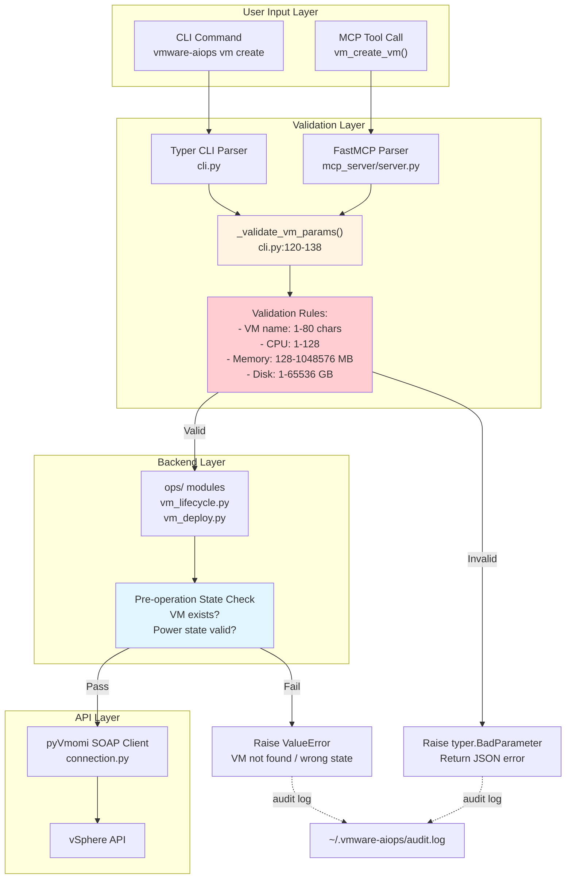
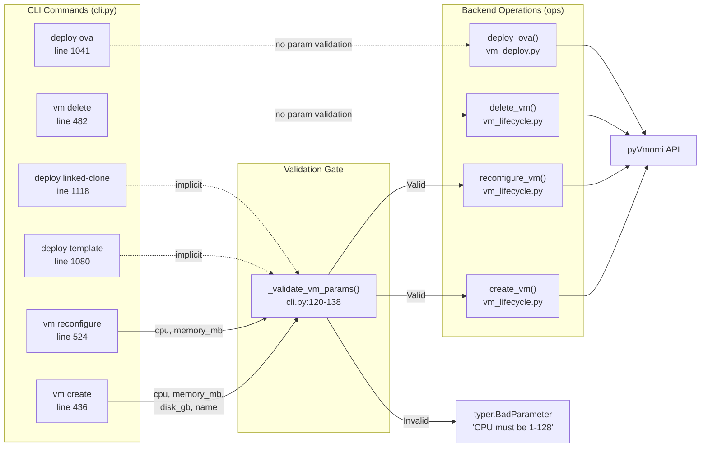
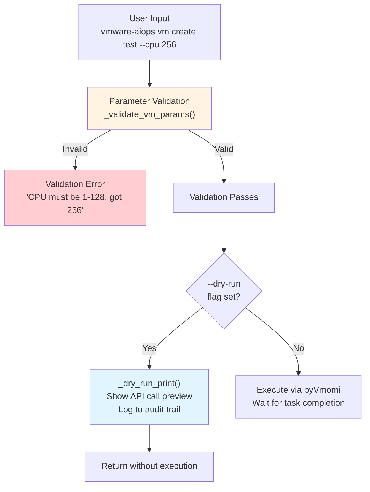
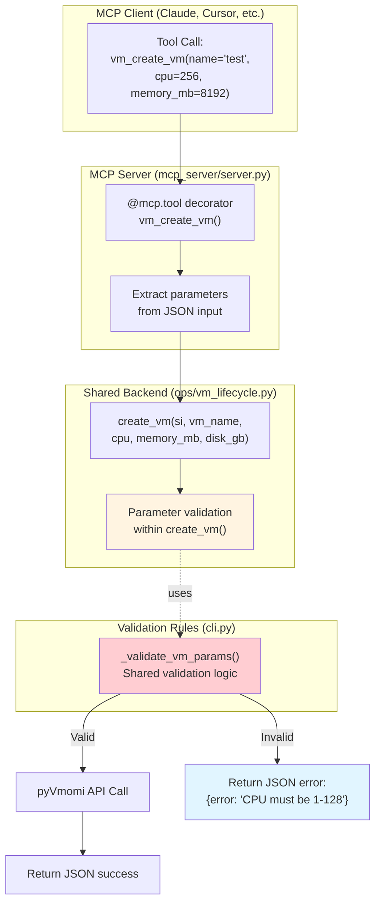

<!-- source: DeepWiki mcp.deepwiki.com · repo zw008/VMware-AIops · page 10.3 Input Validation and Safety Rules · fetched 2026-10-26 -->

# Input Validation and Safety Rules

<details>
<summary>Relevant source files</summary>

The following files were used as context for generating this wiki page:

- [README.md](README.md)
- [skills/vmware-aiops/SKILL.md](skills/vmware-aiops/SKILL.md)
- [vmware_aiops/cli.py](vmware_aiops/cli.py)

</details>


This document describes the input validation rules and safety constraints enforced by VMware AIops to prevent invalid API calls, protect infrastructure integrity, and ensure operation predictability. Input validation occurs **before** vSphere API calls are made, providing a first line of defense against configuration errors.

For information about the broader safety architecture (double confirmation, audit logging, dry-run mode), see [Safety Features](#3.3). For details on how these rules are enforced in MCP mode, see [MCP Tools Reference](#5.2).

---

## Overview

VMware AIops enforces input validation at two levels:

1. **Parameter Range Validation**: Ensures values fall within vSphere API limits and operational best practices
2. **Format and Naming Validation**: Ensures resource names and identifiers conform to VMware conventions and avoid special characters that could cause API errors

All validation occurs **before** pyVmomi API calls are made. Invalid inputs are rejected immediately with descriptive error messages. Both CLI and MCP modes enforce identical validation rules through shared backend code.

---

## Validation Architecture



**Title**: Input Validation and Pre-Operation State Check Flow

**Sources**: [vmware_aiops/cli.py:120-138](), [README.md:207](), [skills/vmware-aiops/SKILL.md:313]()

---

## Parameter Validation Rules

### VM Creation and Reconfiguration Parameters

The `_validate_vm_params()` function enforces the following constraints:

| Parameter | Validation Rule | vSphere API Limit | Error Raised |
|-----------|----------------|-------------------|--------------|
| `name` | 1-80 characters, not starting with `-` or `.` | 80 chars (vSphere limit) | `typer.BadParameter` |
| `cpu` | Integer, 1-128 | vSphere supports up to 768 vCPUs, but 128 is a practical safety limit | `typer.BadParameter` |
| `memory_mb` | Integer, 128-1048576 MB (0.125 GB - 1 TB) | vSphere supports up to 24 TB, but 1 TB is a practical limit | `typer.BadParameter` |
| `disk_gb` | Integer, 1-65536 GB (1 GB - 64 TB) | VMDK max size is 62 TB, 64 TB is the validation ceiling | `typer.BadParameter` |

**Validation Implementation**:

```
Function: _validate_vm_params()
Location: vmware_aiops/cli.py:120-138

Enforcement Points:
- vm create (cli.py:451)
- vm reconfigure (cli.py:535)
- deploy template (validation implicit via ops/vm_deploy.py)
- deploy linked-clone (validation implicit via ops/vm_deploy.py)
```

### VM Name Format Rules

VM names must satisfy:

1. **Length**: 1-80 characters (strict enforcement at [cli.py:129-130]())
2. **Forbidden Prefixes**: Cannot start with `-` (hyphen) or `.` (dot) ([cli.py:131-132]())
3. **Implicit Character Set**: While not explicitly validated, VMware best practices suggest ASCII alphanumerics, hyphens, and underscores

**Rationale**: These rules prevent:
- Empty names or names that exceed vSphere's internal limits
- Command-line parsing issues (names starting with `-` are interpreted as flags)
- Hidden files in datastore browsers (names starting with `.`)
- Special characters that may cause SOAP XML parsing errors

**Sources**: [vmware_aiops/cli.py:120-138](), [README.md:207]()

---

## Validation Enforcement Points



**Title**: Validation Enforcement at CLI Command Level

**Sources**: [vmware_aiops/cli.py:436-479](), [vmware_aiops/cli.py:524-578]()

---

## Pre-Operation State Validation

Beyond parameter validation, VMware AIops performs **pre-operation state checks** to ensure the target resource exists and is in a valid state for the requested operation:

| Operation | Pre-Operation Check | Checked In | Error If Invalid |
|-----------|---------------------|-----------|------------------|
| Power Off | VM must exist and be powered on | `power_off_vm()` | `ValueError: VM not found` |
| Delete | VM must exist | `delete_vm()` | `ValueError: VM not found` |
| Reconfigure | VM must exist | `reconfigure_vm()` | `ValueError: VM not found` |
| Snapshot Revert | VM and snapshot must exist | `revert_to_snapshot()` | `ValueError: Snapshot not found` |
| Clone | Source VM must exist | `clone_vm()` | `ValueError: Source VM not found` |
| Migrate | VM and target host must exist | `migrate_vm()` | `ValueError: Target host not found` |
| Guest Exec | VM must be powered on, VMware Tools running | `guest_exec()` | `ValueError: VMware Tools not running` |

**State Preview Before Destructive Operations**:

The `_show_state_preview()` function ([cli.py:107-117]()) displays current VM state before operations like:
- Power off ([cli.py:420]())
- Delete ([cli.py:505]())
- Reconfigure ([cli.py:550]())
- Snapshot revert ([cli.py:653]())
- Clone ([cli.py:721]())
- Migrate ([cli.py:758]())
- Clean slate ([cli.py:854]())

This ensures the user can verify the current state before confirming a destructive change.

**Sources**: [vmware_aiops/cli.py:107-117](), [vmware_aiops/cli.py:398-433]()

---

## Validation Rules Table

### Complete Parameter Constraints

| Resource Type | Parameter | Type | Min | Max | Default | Validated At |
|--------------|-----------|------|-----|-----|---------|--------------|
| VM | `name` | string | 1 char | 80 chars | — | [cli.py:129]() |
| VM | `cpu` | int | 1 | 128 | 2 | [cli.py:133]() |
| VM | `memory_mb` | int | 128 | 1048576 | 4096 | [cli.py:135]() |
| VM | `disk_gb` | int | 1 | 65536 | 40 | [cli.py:137]() |
| Snapshot | `snap_name` | string | 1 char | — | — | Implicit (pyVmomi) |
| iSCSI Target | `address` | string | Valid IP/FQDN | — | — | Implicit (pyVmomi) |
| iSCSI Target | `port` | int | 1 | 65535 | 3260 | Implicit (pyVmomi) |
| TTL | `minutes` | int | > 0 | — | — | Backend validation |

**Notes**:
- **128 vCPUs**: Conservative limit to prevent accidental over-provisioning. vSphere 8.0 supports up to 768 vCPUs per VM, but 128 is the validation ceiling.
- **1 TB RAM**: Maximum validated memory. vSphere 8.0 supports up to 24 TB, but 1 TB is the practical limit enforced here.
- **64 TB Disk**: Aligns with VMDK maximum file size (62 TB) with 2 TB headroom.

**Sources**: [vmware_aiops/cli.py:120-138](), [README.md:207]()

---

## Validation Error Messages

When validation fails, VMware AIops raises descriptive errors:

```python
# Example validation error messages from cli.py:129-138

VM name validation:
  "VM name must be 1-80 characters, got 0."
  "VM name must be 1-80 characters, got 100."
  "VM name must not start with '-' or '.'."

CPU validation:
  "CPU count must be 1-128, got 0."
  "CPU count must be 1-128, got 256."

Memory validation:
  "Memory must be 128-1048576 MB, got 64."
  "Memory must be 128-1048576 MB, got 2000000."

Disk validation:
  "Disk size must be 1-65536 GB, got 0."
  "Disk size must be 1-65536 GB, got 100000."
```

These errors are:
- **Logged to audit trail**: Even validation failures are recorded ([cli.py:82-89]())
- **Returned immediately**: No API call is attempted
- **User-friendly**: Include the invalid value and valid range

**Sources**: [vmware_aiops/cli.py:128-138]()

---

## Dry-Run Mode and Validation

The `--dry-run` flag ([cli.py:52-54]()) allows users to preview operations **after** validation passes but **before** API execution:



**Title**: Validation Occurs Before Dry-Run Preview

**Key Insight**: Invalid parameters are rejected **before** dry-run mode is evaluated. Dry-run mode only previews **valid** operations.

**Example**:
```bash
# This will fail at validation, no dry-run preview shown
vmware-aiops vm create test --cpu 256 --dry-run
# Error: CPU count must be 1-128, got 256.

# This will pass validation and show dry-run preview
vmware-aiops vm create test --cpu 8 --memory 8192 --disk 100 --dry-run
# [DRY-RUN] No changes will be made.
#   Target:    default
#   VM:        test
#   Operation: create_vm
#   API Call:  vim.Folder.CreateVM_Task()
#   Param:     cpu = 8
#   Param:     memory_mb = 8192
#   Param:     disk_gb = 100
```

**Sources**: [vmware_aiops/cli.py:52-89](), [vmware_aiops/cli.py:446-459]()

---

## MCP Mode Validation

The MCP server enforces identical validation rules through shared backend code:



**Title**: MCP Mode Uses Shared Validation Backend

**Key Differences**:
- **CLI Mode**: Validation in `cli.py` via `_validate_vm_params()` → raises `typer.BadParameter`
- **MCP Mode**: Validation in `ops/` modules → raises `ValueError` → MCP server converts to JSON error response
- **Shared Rules**: Both modes enforce identical ranges and constraints

**Sources**: [mcp_server/server.py](), [vmware_aiops/ops/vm_lifecycle.py]()

---

## Integration with Safety Features

Input validation works as the **first layer** in VMware AIops' defense-in-depth safety architecture:

| Layer | Mechanism | Purpose | Enforced Where |
|-------|-----------|---------|----------------|
| **1. Input Validation** | Parameter range checks, format validation | Prevent invalid API calls | [cli.py:120-138]() |
| **2. Pre-Operation State Check** | Verify resource exists, correct power state | Prevent operations on wrong targets | ops/ modules |
| **3. State Preview** | Display current resource state | User verification before destructive ops | [cli.py:107-117]() |
| **4. Double Confirmation** | Two sequential prompts, no bypass | Prevent accidental destructive ops | [cli.py:141-162]() |
| **5. Dry-Run Mode** | Preview without execution | Test operations safely | [cli.py:57-89]() |
| **6. Audit Logging** | Log all operations and rejections | Compliance and forensics | [notify/audit.py]() |

**Validation Complements Safety Features**:
- **Before Double Confirmation**: Invalid parameters are caught before the user is prompted for confirmation
- **Before State Preview**: Only valid operations reach the state preview step
- **In Dry-Run Mode**: Even dry-run operations must pass validation
- **Audit Trail**: Both validation failures and successful operations are logged

**Sources**: [vmware_aiops/cli.py:120-162](), [README.md:199-214]()

---

## Validation Bypass: None

VMware AIops **does not provide any mechanism to bypass validation**:

- No `--force-invalid-params` flag exists
- No environment variable to disable validation
- No configuration option to relax constraints
- No "expert mode" that skips checks

**Rationale**:
1. **vSphere API Limits**: The validation ranges align with vSphere API capabilities. Bypassing validation would result in API errors anyway.
2. **Infrastructure Protection**: Preventing over-provisioning (e.g., 1000 vCPUs to a VM) avoids resource exhaustion.
3. **Consistent Behavior**: All users and AI agents experience identical validation, ensuring predictable behavior.

If you need to exceed these limits for legitimate use cases, modify `_validate_vm_params()` in the source code and rebuild the package.

**Sources**: [vmware_aiops/cli.py:120-138](), [README.md:313]()

---

## Validation Implementation Details

### Code Structure

```
vmware_aiops/
├── cli.py
│   ├── _validate_vm_params()        # Main validation function (lines 120-138)
│   ├── _dry_run_print()              # Dry-run preview (lines 57-89)
│   ├── _show_state_preview()         # State display (lines 107-117)
│   └── CLI commands                  # Call validation before ops
│
├── ops/
│   ├── vm_lifecycle.py               # Pre-operation state checks
│   ├── vm_deploy.py                  # Implicit validation via create_vm()
│   ├── cluster_mgmt.py               # Cluster-specific validation
│   └── iscsi_config.py               # iSCSI parameter validation
│
├── mcp_server/
│   └── server.py                     # MCP tools call ops/ directly
│
└── notify/
    └── audit.py                      # Log validation failures
```

### Validation Function Signature

```python
# vmware_aiops/cli.py:120-138

def _validate_vm_params(
    *,
    name: str | None = None,
    cpu: int | None = None,
    memory_mb: int | None = None,
    disk_gb: int | None = None,
) -> None:
    """Validate VM parameter ranges. Raises typer.BadParameter on invalid input."""
    
    # Name validation: 1-80 chars, no leading '-' or '.'
    # CPU validation: 1-128
    # Memory validation: 128-1048576 MB
    # Disk validation: 1-65536 GB
```

**Parameters**: All optional (validate only what's provided)  
**Returns**: `None` (raises exception on validation failure)  
**Raises**: `typer.BadParameter` with descriptive message

**Sources**: [vmware_aiops/cli.py:120-138]()

---

## Special Case: Guest Operations Validation

Guest operations (exec, upload, download) have additional runtime validation:

| Check | Validated At | Error If Invalid |
|-------|-------------|------------------|
| VM powered on | `guest_exec()` entry | `ValueError: VM must be powered on` |
| VMware Tools running | `guest_exec()` entry | `ValueError: VMware Tools not running` |
| Guest credentials valid | First API call | `vim.fault.InvalidGuestLogin` |
| File path exists (download) | `guest_download()` | `vim.fault.FileNotFound` |

These checks occur **after** parameter validation but **before** file transfer operations begin.

**Sources**: [vmware_aiops/ops/guest_ops.py](), [skills/vmware-aiops/SKILL.md:201-203]()

---

## Validation Test Examples

### Valid Input Examples

```bash
# Minimum values
vmware-aiops vm create tiny --cpu 1 --memory 128 --disk 1

# Maximum values
vmware-aiops vm create huge --cpu 128 --memory 1048576 --disk 65536

# Typical values
vmware-aiops vm create web-server --cpu 4 --memory 8192 --disk 100
```

### Invalid Input Examples

```bash
# CPU out of range
vmware-aiops vm create test --cpu 0
# Error: CPU count must be 1-128, got 0.

vmware-aiops vm create test --cpu 256
# Error: CPU count must be 1-128, got 256.

# Memory out of range
vmware-aiops vm create test --cpu 4 --memory 64
# Error: Memory must be 128-1048576 MB, got 64.

vmware-aiops vm create test --cpu 4 --memory 2000000
# Error: Memory must be 128-1048576 MB, got 2000000.

# Invalid VM name
vmware-aiops vm create "-test"
# Error: VM name must not start with '-' or '.'.

vmware-aiops vm create "$(python -c 'print("a" * 100)')"
# Error: VM name must be 1-80 characters, got 100.
```

**Sources**: [vmware_aiops/cli.py:128-138]()

---

## Summary

Input validation in VMware AIops:

1. **Enforces vSphere-compatible parameter ranges** before any API calls are made
2. **Prevents common configuration errors** (over-provisioning, invalid names, impossible values)
3. **Works identically in CLI and MCP modes** through shared backend code
4. **Integrates with safety features** (double confirmation, dry-run, audit logging)
5. **Cannot be bypassed** by flags, environment variables, or configuration
6. **Fails fast with descriptive errors** including the invalid value and valid range

All validation occurs in `_validate_vm_params()` ([cli.py:120-138]()), called before operations reach the pyVmomi API layer. Validation failures are logged to the audit trail ([cli.py:82-89]()) for security review.

**Sources**: [vmware_aiops/cli.py:120-138](), [README.md:199-214](), [skills/vmware-aiops/SKILL.md:306-318]()

---

