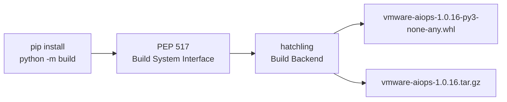
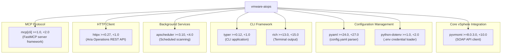
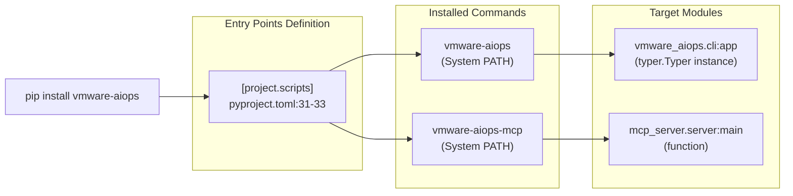
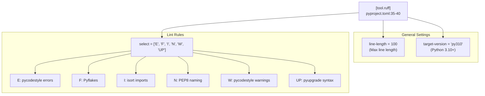
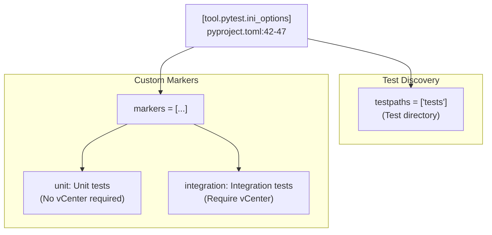
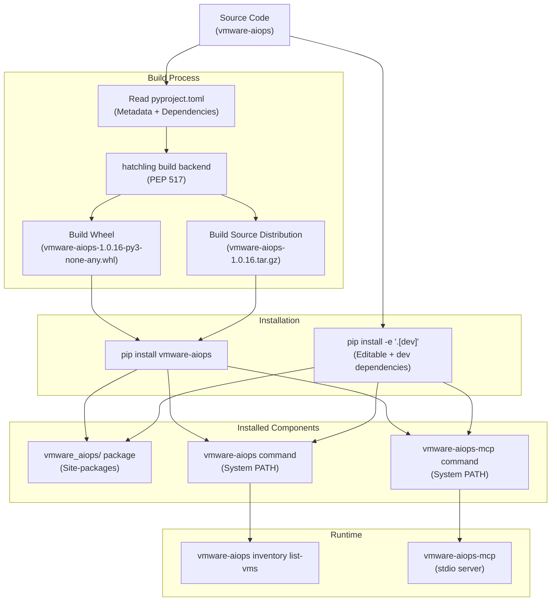

<!-- source: DeepWiki mcp.deepwiki.com · repo zw008/VMware-AIops · page 12.1 Package Structure and Build System · fetched 2026-10-26 -->

# Package Structure and Build System

<details>
<summary>Relevant source files</summary>

The following files were used as context for generating this wiki page:

- [pyproject.toml](pyproject.toml)
- [vmware_aiops/__init__.py](vmware_aiops/__init__.py)

</details>


## Purpose and Scope

This document describes the VMware AIops package structure, build system configuration, dependency management, and development tooling. It covers the technical details of how the Python package is organized, built, and published, including the pyproject.toml configuration, dependency specifications, entry point definitions, and development tool settings.

For installation instructions, see [Installation](#2.1). For testing practices, see [Testing Strategy](#12.2). For using the built package, see [CLI Mode Usage](#4) and [MCP Mode Usage](#5).

---

## Package Structure Overview

The VMware AIops project is structured as a standard Python package using modern PEP 517/518 build standards with `hatchling` as the build backend.

### Directory Layout

```mermaid
graph TB
    Root["vmware-aiops/"]
    PyProject["pyproject.toml<br/>(Build configuration)"]
    README["README.md<br/>(Package description)"]
    
    MainPkg["vmware_aiops/<br/>(Main package)"]
    Init["__init__.py<br/>(Version: 1.0.16)"]
    CLI["cli.py<br/>(Entry: vmware-aiops)"]
    Config["config.py"]
    Connection["connection.py"]
    
    OpsDir["ops/<br/>(Operations modules)"]
    OpsModules["inventory.py<br/>health.py<br/>vm_lifecycle.py<br/>vm_deploy.py<br/>cluster_mgmt.py<br/>..."]
    
    MCPDir["mcp_server/<br/>(MCP server package)"]
    MCPServer["server.py<br/>(Entry: vmware-aiops-mcp)"]
    MCPTools["tools.py"]
    
    NotifyDir["notify/<br/>(Notification subsystem)"]
    Audit["audit.py"]
    Notifier["notifier.py"]
    
    ScannerDir["scanner/<br/>(Background daemon)"]
    Scanner["scanner.py"]
    
    TestsDir["tests/<br/>(Test suite)"]
    TestModules["test_*.py"]
    
    PluginsDir["plugins/<br/>(AI platform integrations)"]
    ClaudePlugin["claude-code/plugin.json<br/>SKILL.md"]
    GeminiExt["gemini-extension/GEMINI.md"]
    CodexSkill["codex-skill/AGENTS.md"]
    
    Root --> PyProject
    Root --> README
    Root --> MainPkg
    Root --> MCPDir
    Root --> TestsDir
    Root --> PluginsDir
    
    MainPkg --> Init
    MainPkg --> CLI
    MainPkg --> Config
    MainPkg --> Connection
    MainPkg --> OpsDir
    MainPkg --> NotifyDir
    MainPkg --> ScannerDir
    
    OpsDir --> OpsModules
    MCPDir --> MCPServer
    MCPDir --> MCPTools
    NotifyDir --> Audit
    NotifyDir --> Notifier
    ScannerDir --> Scanner
    TestsDir --> TestModules
    PluginsDir --> ClaudePlugin
    PluginsDir --> GeminiExt
    PluginsDir --> CodexSkill
```



**Sources:** [pyproject.toml:1-48](), [vmware_aiops/__init__.py:1-4]()

---

## Build System Configuration

VMware AIops uses the PEP 517 build system with `hatchling` as the build backend, configured entirely through `pyproject.toml`.

### Build Backend



The build system is declared in [pyproject.toml:1-3]():

```toml
[build-system]
requires = ["hatchling"]
build-backend = "hatchling.build"
```

This configuration means:
- **No setup.py required**: All build configuration is declarative in pyproject.toml
- **Isolated builds**: Build dependencies are installed in isolated environments
- **Standard interface**: Any PEP 517-compliant tool can build the package

**Sources:** [pyproject.toml:1-3]()

---

## Project Metadata

The package metadata is defined in the `[project]` section of pyproject.toml.

| Field | Value | Description |
|-------|-------|-------------|
| **name** | `vmware-aiops` | PyPI package name (installable via `pip install vmware-aiops`) |
| **version** | `1.0.16` | Current package version (also in [vmware_aiops/__init__.py:3]()) |
| **description** | VMware vCenter/ESXi AI-powered monitoring and operations tool | Short package description |
| **readme** | `README.md` | Long description source file |
| **license** | `MIT` | Open source license |
| **requires-python** | `>=3.10` | Minimum Python version requirement |
| **authors** | Wei Zhou / 周崴 | Package maintainer |

**Sources:** [pyproject.toml:5-12]()

### Version Synchronization

The version is declared in two locations:
- [pyproject.toml:7]() - Authoritative version for package metadata
- [vmware_aiops/__init__.py:3]() - Version accessible at runtime via `__version__`

Both must be kept in sync manually when releasing new versions.

**Sources:** [pyproject.toml:7](), [vmware_aiops/__init__.py:3]()

---

## Dependency Management

Dependencies are divided into runtime dependencies (required for package operation) and optional development dependencies.

### Runtime Dependencies



All dependencies use **conservative version constraints** with upper bounds to prevent breaking changes. The dependency specifications in [pyproject.toml:13-22]() are:

| Dependency | Version Constraint | Purpose |
|------------|-------------------|---------|
| **pyvmomi** | `>=8.0.3.0,<10.0` | VMware vSphere SOAP API client library |
| **pyaml** | `>=24.0,<27.0` | YAML configuration file parsing |
| **typer** | `>=0.12,<1.0` | CLI framework with automatic help generation |
| **rich** | `>=13.0,<15.0` | Rich terminal output with tables and syntax highlighting |
| **apscheduler** | `>=3.10,<4.0` | Background job scheduling for scanner daemon |
| **httpx** | `>=0.27,<1.0` | Async HTTP client for Aria Operations REST API |
| **python-dotenv** | `>=1.0,<2.0` | Environment variable loading from .env files |
| **mcp[cli]** | `>=1.0,<2.0` | Model Context Protocol server framework with CLI extras |

**Sources:** [pyproject.toml:13-22]()

### Development Dependencies

Development dependencies are declared as optional extras in [pyproject.toml:24-29]():

```toml
[project.optional-dependencies]
dev = [
    "pytest>=8.0,<10.0",
    "pytest-cov>=5.0,<8.0",
    "ruff>=0.5,<1.0",
]
```

Install development dependencies with:
```bash
pip install -e ".[dev]"
```

| Dependency | Version Constraint | Purpose |
|------------|-------------------|---------|
| **pytest** | `>=8.0,<10.0` | Test framework and runner |
| **pytest-cov** | `>=5.0,<8.0` | Code coverage reporting for pytest |
| **ruff** | `>=0.5,<1.0` | Fast Python linter and formatter |

**Sources:** [pyproject.toml:24-29]()

---

## Entry Points

The package defines two console script entry points that are installed as executable commands when the package is installed.



The entry points are defined in [pyproject.toml:31-33]():

```toml
[project.scripts]
vmware-aiops = "vmware_aiops.cli:app"
vmware-aiops-mcp = "mcp_server.server:main"
```

### Entry Point Details

| Command | Module Path | Callable | Description |
|---------|-------------|----------|-------------|
| `vmware-aiops` | `vmware_aiops.cli` | `app` | Typer CLI application instance (~2K token mode) |
| `vmware-aiops-mcp` | `mcp_server.server` | `main` | FastMCP server entry point (~10K token mode) |

**Invocation Examples:**

```bash
# CLI mode - directly callable after installation
vmware-aiops inventory list-vms --target production

# MCP mode - run as stdio server
vmware-aiops-mcp
```

For detailed usage of each mode, see [CLI Mode Usage](#4) and [MCP Mode Usage](#5).

**Sources:** [pyproject.toml:31-33]()

---

## Development Tools Configuration

Development tools are configured in the `[tool.*]` sections of pyproject.toml.

### Ruff Configuration

Ruff is a fast Python linter and formatter configured in [pyproject.toml:35-40]():



Configuration details:

| Setting | Value | Purpose |
|---------|-------|---------|
| **line-length** | `100` | Maximum characters per line (slightly more permissive than PEP 8's 79) |
| **target-version** | `py310` | Minimum Python version for syntax rules |
| **select** | `["E", "F", "I", "N", "W", "UP"]` | Enabled rule categories |

**Rule Categories:**
- **E**: pycodestyle error checks (PEP 8 violations)
- **F**: Pyflakes checks (undefined names, unused imports)
- **I**: isort import ordering
- **N**: PEP 8 naming conventions
- **W**: pycodestyle warnings
- **UP**: pyupgrade syntax modernization (use newer Python syntax)

**Usage:**
```bash
# Lint the codebase
ruff check .

# Format code
ruff format .

# Lint and fix auto-fixable issues
ruff check --fix .
```

**Sources:** [pyproject.toml:35-40]()

### Pytest Configuration

Pytest is configured in [pyproject.toml:42-47]():



Configuration details:

| Setting | Value | Purpose |
|---------|-------|---------|
| **testpaths** | `["tests"]` | Directory containing test modules |
| **markers** | `["unit", "integration"]` | Custom test markers for selective execution |

**Test Markers:**

```python
# Mark unit tests (fast, no external dependencies)
@pytest.mark.unit
def test_config_parsing():
    ...

# Mark integration tests (require vCenter connection)
@pytest.mark.integration
def test_vm_creation():
    ...
```

**Selective Test Execution:**

```bash
# Run only unit tests
pytest -m unit

# Run only integration tests
pytest -m integration

# Run with coverage
pytest --cov=vmware_aiops --cov-report=html
```

For detailed testing strategy, see [Testing Strategy](#12.2).

**Sources:** [pyproject.toml:42-47]()

---

## Build and Installation Workflow

The complete workflow from source to installed package:



**Build Commands:**

```bash
# Build wheel and sdist (requires build tool)
python -m build

# Install from wheel
pip install dist/vmware-aiops-1.0.16-py3-none-any.whl

# Install in editable mode for development
pip install -e .

# Install with dev dependencies
pip install -e ".[dev]"
```

**Sources:** [pyproject.toml:1-48]()

---

## Package Distribution Structure

When built, the package produces the following distribution artifacts:

### Wheel Contents (`vmware-aiops-1.0.16-py3-none-any.whl`)

```
vmware_aiops/
├── __init__.py              # Version: 1.0.16
├── cli.py                   # CLI entry point
├── config.py
├── connection.py
├── ops/
│   ├── inventory.py
│   ├── health.py
│   ├── vm_lifecycle.py
│   ├── vm_deploy.py
│   └── ...
├── notify/
│   ├── audit.py
│   └── notifier.py
└── scanner/
    └── scanner.py

mcp_server/
├── server.py                # MCP entry point
└── tools.py

vmware_aiops-1.0.16.dist-info/
├── METADATA                 # Package metadata from pyproject.toml
├── WHEEL                    # Wheel metadata
├── entry_points.txt         # Console scripts
├── top_level.txt           # Top-level packages
└── RECORD                   # File checksums
```

The wheel is a **pure Python wheel** (`py3-none-any`) meaning:
- **py3**: Compatible with Python 3.x
- **none**: No ABI dependencies
- **any**: Works on any platform (Linux, macOS, Windows)

**Sources:** [pyproject.toml:1-48](), [vmware_aiops/__init__.py:1-4]()

---

## Version Management

Version updates require changes in two locations:

1. **pyproject.toml** [line 7]() - Package metadata version
2. **vmware_aiops/__init__.py** [line 3]() - Runtime `__version__` variable

### Version Update Checklist

When releasing a new version:

1. Update version in [pyproject.toml:7]()
2. Update version in [vmware_aiops/__init__.py:3]()
3. Update CHANGELOG.md (if present)
4. Commit changes: `git commit -m "Bump version to X.Y.Z"`
5. Tag release: `git tag vX.Y.Z`
6. Build distributions: `python -m build`
7. Upload to PyPI: `python -m twine upload dist/*`

**Version Scheme:** The package follows semantic versioning (MAJOR.MINOR.PATCH):
- **MAJOR**: Incompatible API changes
- **MINOR**: Backward-compatible functionality additions
- **PATCH**: Backward-compatible bug fixes

**Sources:** [pyproject.toml:7](), [vmware_aiops/__init__.py:3]()

---

## Summary

The VMware AIops package structure follows modern Python packaging standards:

- **Build System**: PEP 517 with hatchling backend (no setup.py required)
- **Dependencies**: Conservative version constraints with clear separation of runtime and dev dependencies
- **Entry Points**: Two console scripts (`vmware-aiops` CLI, `vmware-aiops-mcp` server)
- **Development Tools**: Ruff for linting/formatting, pytest for testing with custom markers
- **Distribution**: Pure Python wheel compatible with Python 3.10+ on all platforms

For installation instructions, see [Installation](#2.1). For development practices including testing, see [Testing Strategy](#12.2).

**Sources:** [pyproject.toml:1-48](), [vmware_aiops/__init__.py:1-4]()

---

