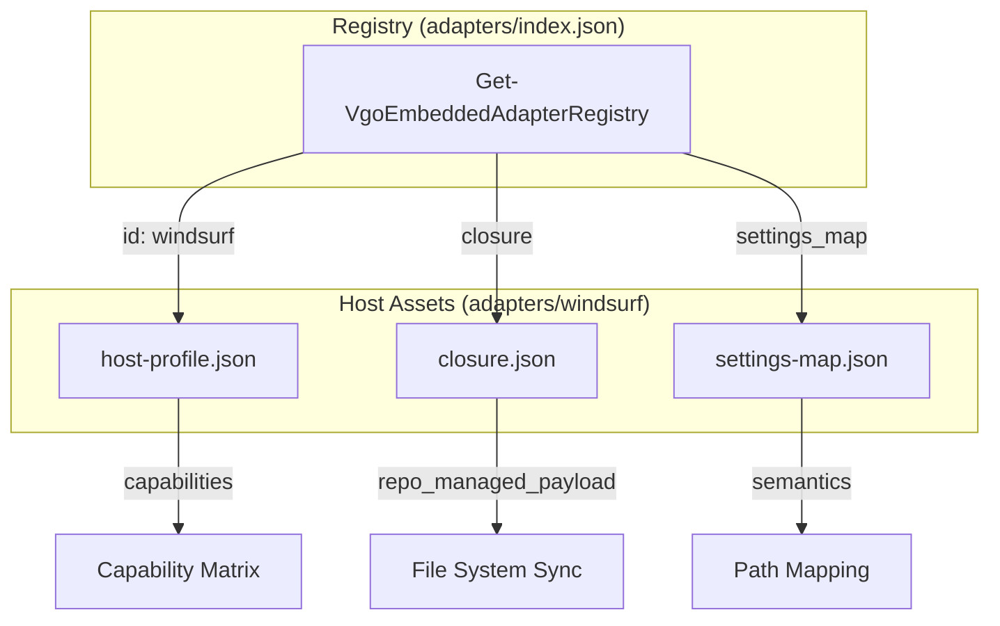
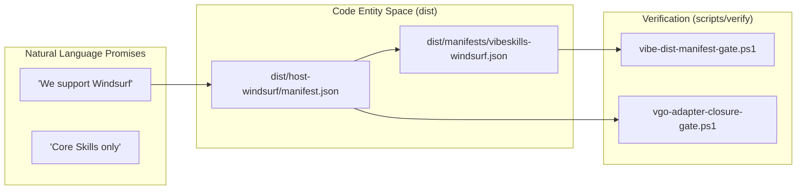

<!-- source: DeepWiki mcp.deepwiki.com · repo foryourhealth111-pixel/Vibe-Skills · page 3.2 Host Adapters and Distribution Lanes · fetched 2026-10-26 -->

# Host Adapters and Distribution Lanes

Relevant source files

The following files were used as context for generating this wiki page:

- [adapters/README.md](adapters/README.md)
- [adapters/claude-code/closure.json](adapters/claude-code/closure.json)
- [adapters/claude-code/host-profile.json](adapters/claude-code/host-profile.json)
- [adapters/cursor/closure.json](adapters/cursor/closure.json)
- [adapters/cursor/host-profile.json](adapters/cursor/host-profile.json)
- [adapters/cursor/platform-linux.json](adapters/cursor/platform-linux.json)
- [adapters/cursor/platform-macos.json](adapters/cursor/platform-macos.json)
- [adapters/cursor/platform-windows.json](adapters/cursor/platform-windows.json)
- [adapters/cursor/settings-map.json](adapters/cursor/settings-map.json)
- [adapters/windsurf/closure.json](adapters/windsurf/closure.json)
- [adapters/windsurf/host-profile.json](adapters/windsurf/host-profile.json)
- [adapters/windsurf/platform-linux.json](adapters/windsurf/platform-linux.json)
- [adapters/windsurf/platform-macos.json](adapters/windsurf/platform-macos.json)
- [adapters/windsurf/platform-windows.json](adapters/windsurf/platform-windows.json)
- [adapters/windsurf/settings-map.json](adapters/windsurf/settings-map.json)
- [dist/host-claude-code/manifest.json](dist/host-claude-code/manifest.json)
- [dist/host-cursor/manifest.json](dist/host-cursor/manifest.json)
- [dist/host-opencode/manifest.json](dist/host-opencode/manifest.json)
- [dist/host-windsurf/manifest.json](dist/host-windsurf/manifest.json)
- [dist/manifests/vibeskills-windsurf.json](dist/manifests/vibeskills-windsurf.json)
- [docs/universalization/distribution-lanes.md](docs/universalization/distribution-lanes.md)
- [docs/universalization/install-matrix.md](docs/universalization/install-matrix.md)
- [scripts/bootstrap/scaffold-claude-preview.ps1](scripts/bootstrap/scaffold-claude-preview.ps1)
- [scripts/bootstrap/scaffold-claude-preview.sh](scripts/bootstrap/scaffold-claude-preview.sh)
- [scripts/common/Resolve-VgoAdapter.ps1](scripts/common/Resolve-VgoAdapter.ps1)
- [scripts/common/resolve_vgo_adapter.py](scripts/common/resolve_vgo_adapter.py)

This page explains the mechanism by which VibeSkills universalizes its core capabilities across different AI host environments (Codex, Claude Code, Cursor, Windsurf, OpenCode). It details the adapter registry, the per-host profile definitions, and the distribution lanes that govern what the repository can truthfully claim about its support level for any given environment.

## 1. The Adapter Registry

The adapter system is anchored by a central registry that maps host identifiers to their respective configuration assets. This registry is resolved dynamically by the orchestrator to determine how to interact with a specific host.

### Registry Resolution
The registry is managed via two primary scripts:
*   **PowerShell**: `Resolve-VgoAdapter.ps1` [scripts/common/Resolve-VgoAdapter.ps1:3-127]()
*   **Python**: `resolve_vgo_adapter.py` [scripts/common/resolve_vgo_adapter.py:71-103]()

These scripts look for an `adapters/index.json` file. If not found, they fall back to an **Embedded Registry** defined within the scripts themselves to ensure bootstrap stability [scripts/common/Resolve-VgoAdapter.ps1:23-97]().

### Registry Structure
The registry defines the following for each host:
*   **`id`**: The unique string identifying the host (e.g., `windsurf`, `claude-code`).
*   **`install_mode` / `check_mode`**: Determines the execution logic used during setup (e.g., `governed`, `preview-guidance`, `runtime-core`).
*   **`default_target_root`**: The environment variable and relative path where the host typically resides (e.g., `WINDSURF_HOME` -> `.codeium/windsurf`) [scripts/common/Resolve-VgoAdapter.ps1:85-89]().
*   **Asset Pointers**: Paths to the `host_profile`, `settings_map`, `closure`, and `manifest` files.

**Sources:** [scripts/common/Resolve-VgoAdapter.ps1](), [scripts/common/resolve_vgo_adapter.py]()

---

## 2. Host Profiles and Closure Contracts

Each supported host has a dedicated directory in `adapters/` containing a "Truth Stack" that defines exactly what the VibeSkills repo manages versus what the host manages.

### Data Flow: From Registry to Host Profile
"Registry to Entity Mapping"

**Sources:** [scripts/common/Resolve-VgoAdapter.ps1:80-94](), [adapters/windsurf/host-profile.json](), [adapters/windsurf/closure.json]()

### Key Components of a Host Profile
Using **Windsurf** as a reference:
1.  **`host-profile.json`**: Defines the `runtime_role` (e.g., `official-runtime-adapter`) and the `capabilities` matrix (e.g., `mcp.client: supported-with-constraints`) [adapters/windsurf/host-profile.json:5-35]().
2.  **`closure.json`**: Explicitly lists `repo_managed_payload` (what VibeSkills writes) vs. `host_managed_boundaries` (what VibeSkills *cannot* touch, such as login state or provider credentials) [adapters/windsurf/closure.json:7-29]().
3.  **`settings-map.json`**: Maps internal VCO variables to host-specific paths, such as mapping `vco.skill_root` to `~/.codeium/windsurf/skills` [adapters/windsurf/settings-map.json:5-11]().

**Sources:** [adapters/windsurf/host-profile.json](), [adapters/windsurf/closure.json](), [adapters/windsurf/settings-map.json]()

---

## 3. Install Modes and Closure Levels

VibeSkills enforces strict boundaries on how much "control" it takes over a host's filesystem. These are categorized into **Install Modes** and **Closure Levels**.

| Mode / Level | Meaning | Target Root |
| :--- | :--- | :--- |
| **`governed`** | Full Tier-1 support; repo manages setup and health checks. | Host Home |
| **`preview-guidance`** | Repo provides scaffolds but does not claim full closure. | Host Home |
| **`runtime-core-preview`** | Repo installs core payloads into a documented host root. | Host Home |
| **`runtime-core-only`** | Repo installs payloads into a neutral directory only. | Neutral Root |

**Sources:** [docs/universalization/distribution-lanes.md:28-36](), [docs/universalization/install-matrix.md:16-24]()

---

## 4. Distribution Lanes (`dist/`)

The `dist/` directory serves as the **Distribution Surface**. It contains manifests that describe the "Capability Promise" for each host. This prevents "overclaiming" support before it is technically proven via proof bundles.

### Distribution Lane Truth Boundary
"Natural Language Space to Code Entity Space"

**Sources:** [dist/host-windsurf/manifest.json](), [docs/universalization/distribution-lanes.md:73-77]()

### Lane Definitions
*   **`official-runtime`**: The reference implementation (Codex).
*   **`host-windsurf`**: Preview adapter using shared `runtime-core` installers [dist/host-windsurf/manifest.json:11-15]().
*   **`generic`**: Neutral contract consumer; no host-native claims.

### Verification Gates
Distribution lanes are protected by specific gates to ensure manifests do not conflict with documentation:
*   `vibe-dist-manifest-gate.ps1`: Validates the integrity of `dist/**/manifest.json`.
*   `vgo-adapter-target-root-guard-gate.ps1`: Ensures `runtime-core-only` lanes do not attempt to write to host-native directories [docs/universalization/distribution-lanes.md:73-77]().

**Sources:** [docs/universalization/distribution-lanes.md](), [dist/host-windsurf/manifest.json]()

---

## 5. Platform Parity and Promotion

Support for a host is further granularized by OS platform (Windows, Linux, macOS). A host adapter is not considered "supported" until a **Proof Bundle** is generated for that specific platform.

### Platform Status
Using Windsurf as an example:
*   **Linux**: Status is `preview`; evidence exists for `adapter-skeleton-implemented` [adapters/windsurf/platform-linux.json:4-24]().
*   **Windows/macOS**: Status is `not-yet-proven`; requirements include `fresh-machine install proof` [adapters/windsurf/platform-windows.json:4-25](), [adapters/windsurf/platform-macos.json:4-25]().

### Promotion Requirements
To move from `preview` to `supported-with-constraints`, an adapter must satisfy the `promotion_requirements` defined in its platform JSON, such as providing "shell install and check proof" [adapters/windsurf/platform-linux.json:25-29]().

**Sources:** [adapters/windsurf/platform-linux.json](), [adapters/windsurf/platform-windows.json](), [adapters/windsurf/platform-macos.json]()

---

