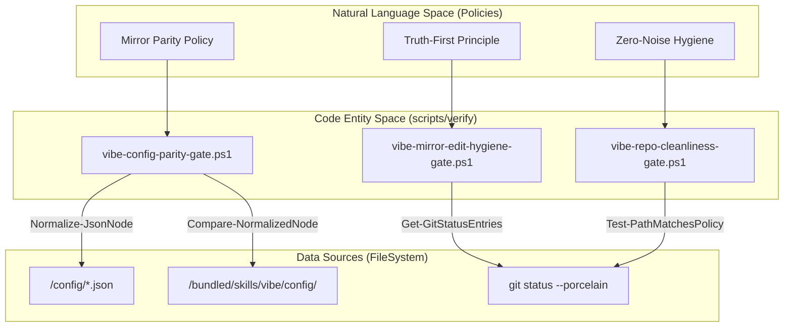
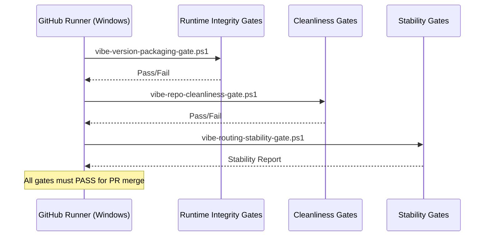

<!-- source: DeepWiki mcp.deepwiki.com · repo foryourhealth111-pixel/Vibe-Skills · page 4.2 Verification Gates · fetched 2026-10-26 -->

# Verification Gates

Relevant source files

The following files were used as context for generating this wiki page:

- [bundled/skills/report-generator/SKILL.md](bundled/skills/report-generator/SKILL.md)
- [bundled/skills/vibe/bundled/skills/vibe/config/skills-lock.json](bundled/skills/vibe/bundled/skills/vibe/config/skills-lock.json)
- [bundled/skills/vibe/bundled/skills/vibe/docs/document-asset-cleanup-governance.md](bundled/skills/vibe/bundled/skills/vibe/docs/document-asset-cleanup-governance.md)
- [bundled/skills/vibe/bundled/skills/vibe/docs/proof/document-safety-remediation-proof-plan.md](bundled/skills/vibe/bundled/skills/vibe/docs/proof/document-safety-remediation-proof-plan.md)
- [bundled/skills/vibe/bundled/skills/vibe/scripts/common/ProtectedDocumentCleanup.ps1](bundled/skills/vibe/bundled/skills/vibe/scripts/common/ProtectedDocumentCleanup.ps1)
- [bundled/skills/vibe/bundled/skills/vibe/scripts/verify/fixtures/document-cleanup-safety/README.md](bundled/skills/vibe/bundled/skills/vibe/scripts/verify/fixtures/document-cleanup-safety/README.md)
- [bundled/skills/vibe/bundled/skills/vibe/scripts/verify/fixtures/document-cleanup-safety/ambiguous-cn-set/metadata.json](bundled/skills/vibe/bundled/skills/vibe/scripts/verify/fixtures/document-cleanup-safety/ambiguous-cn-set/metadata.json)
- [bundled/skills/vibe/bundled/skills/vibe/scripts/verify/fixtures/document-cleanup-safety/mixed-office-assets/metadata.json](bundled/skills/vibe/bundled/skills/vibe/scripts/verify/fixtures/document-cleanup-safety/mixed-office-assets/metadata.json)
- [bundled/skills/vibe/bundled/skills/vibe/scripts/verify/fixtures/document-cleanup-safety/mixed-office-assets/source/docs/reference-manual.pdf](bundled/skills/vibe/bundled/skills/vibe/scripts/verify/fixtures/document-cleanup-safety/mixed-office-assets/source/docs/reference-manual.pdf)
- [bundled/skills/vibe/bundled/skills/vibe/scripts/verify/fixtures/document-cleanup-safety/non-protected-control/metadata.json](bundled/skills/vibe/bundled/skills/vibe/scripts/verify/fixtures/document-cleanup-safety/non-protected-control/metadata.json)
- [bundled/skills/vibe/bundled/skills/vibe/scripts/verify/vibe-document-asset-safety-gate.ps1](bundled/skills/vibe/bundled/skills/vibe/scripts/verify/vibe-document-asset-safety-gate.ps1)
- [bundled/skills/vibe/bundled/skills/vibe/scripts/verify/vibe-generate-skills-lock.ps1](bundled/skills/vibe/bundled/skills/vibe/scripts/verify/vibe-generate-skills-lock.ps1)
- [bundled/skills/vibe/bundled/skills/vibe/scripts/verify/vibe-governed-runtime-contract-gate.ps1](bundled/skills/vibe/bundled/skills/vibe/scripts/verify/vibe-governed-runtime-contract-gate.ps1)
- [bundled/skills/vibe/bundled/skills/vibe/scripts/verify/vibe-offline-skills-gate.ps1](bundled/skills/vibe/bundled/skills/vibe/scripts/verify/vibe-offline-skills-gate.ps1)
- [bundled/skills/vibe/bundled/skills/vibe/scripts/verify/vibe-runtime-boundary-gate.ps1](bundled/skills/vibe/bundled/skills/vibe/scripts/verify/vibe-runtime-boundary-gate.ps1)
- [bundled/skills/vibe/bundled/skills/vibe/scripts/verify/vibe-version-packaging-gate.ps1](bundled/skills/vibe/bundled/skills/vibe/scripts/verify/vibe-version-packaging-gate.ps1)
- [bundled/skills/vibe/config/skills-lock.json](bundled/skills/vibe/config/skills-lock.json)
- [bundled/skills/vibe/references/index.md](bundled/skills/vibe/references/index.md)
- [bundled/skills/vibe/scripts/verify/vibe-generate-skills-lock.ps1](bundled/skills/vibe/scripts/verify/vibe-generate-skills-lock.ps1)
- [bundled/skills/vibe/scripts/verify/vibe-governed-runtime-contract-gate.ps1](bundled/skills/vibe/scripts/verify/vibe-governed-runtime-contract-gate.ps1)
- [bundled/skills/vibe/scripts/verify/vibe-mirror-edit-hygiene-gate.ps1](bundled/skills/vibe/scripts/verify/vibe-mirror-edit-hygiene-gate.ps1)
- [bundled/skills/vibe/scripts/verify/vibe-offline-skills-gate.ps1](bundled/skills/vibe/scripts/verify/vibe-offline-skills-gate.ps1)
- [bundled/skills/vibe/scripts/verify/vibe-repo-cleanliness-gate.ps1](bundled/skills/vibe/scripts/verify/vibe-repo-cleanliness-gate.ps1)
- [bundled/skills/vibe/scripts/verify/vibe-version-packaging-gate.ps1](bundled/skills/vibe/scripts/verify/vibe-version-packaging-gate.ps1)
- [config/skills-lock.json](config/skills-lock.json)
- [docs/document-asset-cleanup-governance.md](docs/document-asset-cleanup-governance.md)
- [docs/proof/document-safety-remediation-proof-plan.md](docs/proof/document-safety-remediation-proof-plan.md)
- [references/index.md](references/index.md)
- [scripts/common/ProtectedDocumentCleanup.ps1](scripts/common/ProtectedDocumentCleanup.ps1)
- [scripts/router/resolve-pack-route.ps1](scripts/router/resolve-pack-route.ps1)
- [scripts/verify/README.md](scripts/verify/README.md)
- [scripts/verify/fixtures/document-cleanup-safety/README.md](scripts/verify/fixtures/document-cleanup-safety/README.md)
- [scripts/verify/fixtures/document-cleanup-safety/ambiguous-cn-set/metadata.json](scripts/verify/fixtures/document-cleanup-safety/ambiguous-cn-set/metadata.json)
- [scripts/verify/fixtures/document-cleanup-safety/mixed-office-assets/metadata.json](scripts/verify/fixtures/document-cleanup-safety/mixed-office-assets/metadata.json)
- [scripts/verify/fixtures/document-cleanup-safety/mixed-office-assets/source/docs/reference-manual.pdf](scripts/verify/fixtures/document-cleanup-safety/mixed-office-assets/source/docs/reference-manual.pdf)
- [scripts/verify/fixtures/document-cleanup-safety/non-protected-control/metadata.json](scripts/verify/fixtures/document-cleanup-safety/non-protected-control/metadata.json)
- [scripts/verify/vibe-config-parity-gate.ps1](scripts/verify/vibe-config-parity-gate.ps1)
- [scripts/verify/vibe-document-asset-safety-gate.ps1](scripts/verify/vibe-document-asset-safety-gate.ps1)
- [scripts/verify/vibe-generate-skills-lock.ps1](scripts/verify/vibe-generate-skills-lock.ps1)
- [scripts/verify/vibe-governed-runtime-contract-gate.ps1](scripts/verify/vibe-governed-runtime-contract-gate.ps1)
- [scripts/verify/vibe-mirror-edit-hygiene-gate.ps1](scripts/verify/vibe-mirror-edit-hygiene-gate.ps1)
- [scripts/verify/vibe-offline-skills-gate.ps1](scripts/verify/vibe-offline-skills-gate.ps1)
- [scripts/verify/vibe-repo-cleanliness-gate.ps1](scripts/verify/vibe-repo-cleanliness-gate.ps1)
- [scripts/verify/vibe-runtime-boundary-gate.ps1](scripts/verify/vibe-runtime-boundary-gate.ps1)
- [scripts/verify/vibe-version-packaging-gate.ps1](scripts/verify/vibe-version-packaging-gate.ps1)

Verification gates are automated governance scripts located in `scripts/verify/` designed to enforce repository invariants, configuration parity, and routing stability across the VibeSkills ecosystem. These gates serve as the primary defensive layer for the **Vibe Core Orchestrator (VCO)**, ensuring that changes to the canonical source of truth are correctly mirrored and that the runtime remains deterministic [scripts/verify/README.md:1-4]().

## Gate Execution Lifecycle

Gates are organized into "Families" based on their governance domain. The execution order is governed by the **Cleanup-First Canonical Run Order** [scripts/verify/README.md:28-33]().

1.  **Runtime Integrity / Packaging**: Validated first when touching versions or frontmatter.
2.  **Cleanliness / Mirror Hygiene**: Executed after every canonical batch to ensure no local noise or mirror drift.
3.  **Domain-Specific Gates**: Overlay, Plane, or Capability gates run based on the specific area of change.
4.  **Closure Gates**: Executed only during planning board or release evidence changes.

### Minimal Phase-End Sequence
For clean phase closure, the wrapper `scripts/governance/phase-end-cleanup.ps1` executes a fixed sequence: purge `.tmp/`, refresh excludes, and run the cleanliness, boundary, and node audit gates [scripts/verify/README.md:35-51]().

---

## Configuration and Mirror Gates

### Config Parity Gate
`vibe-config-parity-gate.ps1` ensures structural and value-level synchronization between the main `config/` directory and the `bundled/skills/vibe/config/` mirror [scripts/verify/vibe-config-parity-gate.ps1:184-195]().

*   **Implementation**: Uses `Normalize-JsonNode` to strip ignored keys (like `updated`) and sort properties before performing a deep comparison [scripts/verify/vibe-config-parity-gate.ps1:24-56]().
*   **Data Flow**: It loads pairs of JSON files, generates SHA256 hashes of the normalized content, and reports specific `DiffPaths` where mismatches occur [scripts/verify/vibe-config-parity-gate.ps1:63-150]().

### Mirror Edit Hygiene Gate
`vibe-mirror-edit-hygiene-gate.ps1` prevents "shadow edits" where changes are made directly to bundled mirrors instead of the canonical source [scripts/verify/vibe-mirror-edit-hygiene-gate.ps1:166-191]().

*   **Logic**: It classifies `git status` entries into `mirror_only_edits`, `paired_mirror_edits` (valid), and `reconciled_mirror_edits` [scripts/verify/vibe-mirror-edit-hygiene-gate.ps1:173-182]().
*   **Enforcement**: If a file in `bundled/` is changed without a corresponding change in the canonical root, the gate fails to maintain the "Truth-First" principle [scripts/verify/vibe-mirror-edit-hygiene-gate.ps1:112-123]().

### System Entity Mapping: Mirror Topology
The following diagram illustrates how the verification gates bridge the physical file structure to the governance "Truth" model.

**Sources**: [scripts/verify/vibe-config-parity-gate.ps1:24-45](), [scripts/verify/vibe-mirror-edit-hygiene-gate.ps1:22-51](), [scripts/verify/vibe-repo-cleanliness-gate.ps1:176-204]().

---

## Routing and Skill Gates

### Routing Stability Gate
`vibe-routing-stability-gate.ps1` monitors the health of the `resolve-pack-route.ps1` logic [scripts/verify/README.md:90](). It tracks:
*   **route_stability**: Consistency of routing across synonym groups.
*   **top1_top2_gap**: The confidence margin between the primary and secondary skill candidates.
*   **misroute_rate**: Frequency of incorrect skill selection against golden targets.

### Offline Skills Gate
`vibe-offline-skills-gate.ps1` validates the `skills-lock.json` manifest. It ensures that the skill library (340+ skills) matches the recorded hashes and byte counts, preventing silent corruption of the skill library [config/skills-lock.json:1-7]().

---

## Maintenance and Safety Gates

### Repo Cleanliness Gate
`vibe-repo-cleanliness-gate.ps1` classifies the working tree to block local noise while allowing managed worksets [scripts/verify/vibe-repo-cleanliness-gate.ps1:168-174]().

| Category | Description | Policy Source |
| :--- | :--- | :--- |
| **Local Noise** | Temporary IDE files, logs, and user-local artifacts. | `local_noise_paths` |
| **Runtime Generated** | Artifacts produced by VCO during execution (e.g., `outputs/`). | `runtime_generated_roots` |
| **Managed Workset** | Valid pending changes in governed directories. | `managed_workset_roots` |
| **High-Risk Managed** | Changes to mirrors or core orchestration logic. | `high_risk_managed_roots` |

**Sources**: [scripts/verify/vibe-repo-cleanliness-gate.ps1:176-204](), [scripts/verify/README.md:95]().

### Node Zombie Gate
`vibe-node-zombie-gate.ps1` manages the lifecycle of VCO-managed Node.js processes. It identifies "zombie" processes that are no longer attached to an active orchestrator session and enforces cleanup boundaries to ensure it never targets external or unknown processes [scripts/verify/README.md:69, 91]().

### Document Asset Safety Gate
`vibe-document-asset-safety-gate.ps1` works with `ProtectedDocumentCleanup.ps1` to prevent the accidental deletion or corruption of sensitive document assets during phase-end cleanup [scripts/verify/README.md:104](). It uses a fixture-based taxonomy to validate safety boundaries [scripts/verify/README.md:77-82]().

---

## CI Workflow (vco-gates.yml)

The GitHub Actions workflow `vco-gates.yml` orchestrates the execution of these gates on every Pull Request and push to the `main` branch.

### Execution Flow

**Sources**: [scripts/verify/README.md:28-33](), [scripts/verify/README.md:58-66]().

### Version Packaging Gate
A critical CI gate, `vibe-version-packaging-gate.ps1`, validates that the version metadata in `config/version-governance.json` is consistent with the maintenance markers and release ledger [scripts/verify/README.md:93-94](). It ensures that the `bundled/skills/vibe` mirror exactly matches the source-of-truth version defined at the root.

**Sources**:
- `scripts/verify/README.md`
- `scripts/verify/vibe-config-parity-gate.ps1`
- `scripts/verify/vibe-mirror-edit-hygiene-gate.ps1`
- `scripts/verify/vibe-repo-cleanliness-gate.ps1`
- `config/skills-lock.json`
- `scripts/router/resolve-pack-route.ps1`

---

