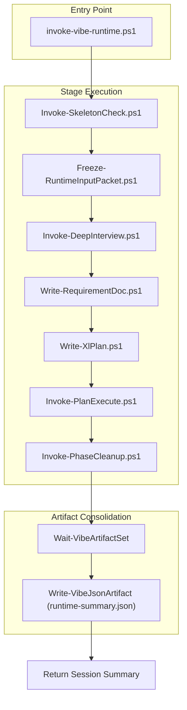
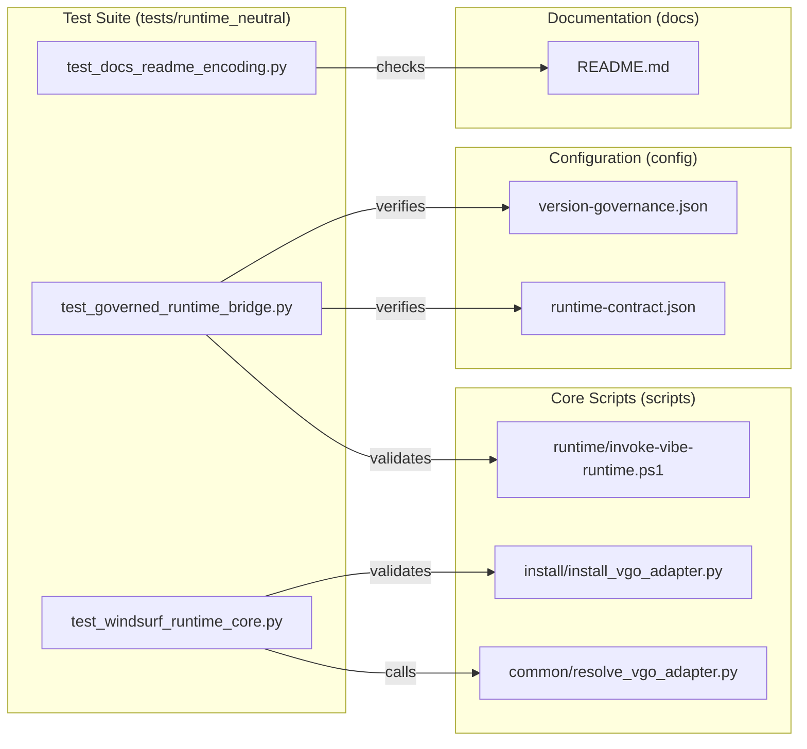

<!-- source: DeepWiki mcp.deepwiki.com · repo foryourhealth111-pixel/Vibe-Skills · page 6.1 Runtime-Neutral Tests · fetched 2026-10-26 -->

# Runtime-Neutral Tests

Relevant source files

The following files were used as context for generating this wiki page:

- [bundled/skills/vibe/bundled/skills/vibe/scripts/runtime/invoke-vibe-runtime.ps1](bundled/skills/vibe/bundled/skills/vibe/scripts/runtime/invoke-vibe-runtime.ps1)
- [bundled/skills/vibe/docs/README.md](bundled/skills/vibe/docs/README.md)
- [bundled/skills/vibe/scripts/runtime/invoke-vibe-runtime.ps1](bundled/skills/vibe/scripts/runtime/invoke-vibe-runtime.ps1)
- [docs/README.md](docs/README.md)
- [scripts/runtime/invoke-vibe-runtime.ps1](scripts/runtime/invoke-vibe-runtime.ps1)
- [tests/runtime_neutral/test_docs_readme_encoding.py](tests/runtime_neutral/test_docs_readme_encoding.py)
- [tests/runtime_neutral/test_governed_runtime_bridge.py](tests/runtime_neutral/test_governed_runtime_bridge.py)
- [tests/runtime_neutral/test_windsurf_runtime_core.py](tests/runtime_neutral/test_windsurf_runtime_core.py)

The `tests/runtime_neutral/` suite provides a set of host-agnostic Python tests designed to validate the core logic, state machine transitions, and installation procedures of the Vibe Core Orchestrator (VCO). Unlike replay tests which rely on specific LLM traces, these tests verify the structural integrity and protocol compliance of the system across different environments.

## 6-Stage Governed Runtime Validation

The `test_governed_runtime_bridge.py` script validates the structural and execution integrity of the VCO state machine. It ensures that the runtime adheres to the `runtime-contract.json` and successfully transitions through all six stages of the governed lifecycle.

### State Machine Lifecycle
The runtime is required to produce artifacts for the following sequence:
1.  **`skeleton_check`**: Initial validation of the task and environment.
2.  **`deep_interview`**: Intent extraction and contract formation.
3.  **`requirement_doc`**: Formalization of the task requirements.
4.  **`xl_plan`**: Generation of the execution plan.
5.  **`plan_execute`**: Execution of the plan steps.
6.  **`phase_cleanup`**: Final state synchronization and resource release.

### Implementation Details
- **Bridge Validation**: The test checks that `version-governance.json` correctly maps the directories (`templates`, `protocols`, `scripts`) required for the mirror topology [tests/runtime_neutral/test_governed_runtime_bridge.py:84-91]().
- **Required Markers**: It verifies the presence of critical runtime markers such as `VibeRuntime.Common.ps1` and `invoke-vibe-runtime.ps1` [tests/runtime_neutral/test_governed_runtime_bridge.py:93-104]().
- **Closure Verification**: It executes `invoke-vibe-runtime.ps1` in `benchmark_autonomous` mode and verifies that a `runtime-summary.json` is generated containing relative paths to all stage receipts [tests/runtime_neutral/test_governed_runtime_bridge.py:124-175]().

### Data Flow: Governed Runtime Execution
The following diagram illustrates how `invoke-vibe-runtime.ps1` orchestrates the stage transitions and artifact generation.

Title: Governed Runtime State Machine Flow

Sources: [scripts/runtime/invoke-vibe-runtime.ps1:72-78](), [scripts/runtime/invoke-vibe-runtime.ps1:144-145](), [tests/runtime_neutral/test_governed_runtime_bridge.py:14-21]()

---

## Windsurf Runtime Core Tests

The `test_windsurf_runtime_core.py` suite validates the "runtime-core" installation mode specifically for the Windsurf host. This mode is designed to be lightweight, providing skill logic without full host state management.

### Key Verifications
- **Registry Mapping**: Ensures that `resolve_vgo_adapter.py` correctly identifies Windsurf as a `runtime-core` mode host with a default target root of `.codeium/windsurf` [tests/runtime_neutral/test_windsurf_runtime_core.py:17-36]().
- **Installation Parity**: Validates that both the Python installer (`install_vgo_adapter.py`) and the shell installer (`install.sh`) deploy the `vibe` and `brainstorming` skills without creating unnecessary Codex-specific configuration files like `settings.json` [tests/runtime_neutral/test_windsurf_runtime_core.py:38-66](), [tests/runtime_neutral/test_windsurf_runtime_core.py:68-90]().
- **Health Check**: Confirms that `check.sh` passes on a Windsurf installation by correctly identifying the host and omitting failures for missing host-specific files [tests/runtime_neutral/test_windsurf_runtime_core.py:92-108]().

Sources: [tests/runtime_neutral/test_windsurf_runtime_core.py:12-13](), [tests/runtime_neutral/test_windsurf_runtime_core.py:34-36]()

---

## Documentation and Encoding Tests

The `test_docs_readme_encoding.py` ensures that the documentation remains human-readable and correctly encoded, particularly for multi-language content.

- **Encoding Integrity**: It specifically checks `docs/README.md` to ensure that UTF-8 characters (such as Chinese descriptions for the one-click installer) are not corrupted by incorrect encoding transformations [tests/runtime_neutral/test_docs_readme_encoding.py:12-30]().
- **Human Readability**: Validates that specific strings like "面向普通用户的一键安装发布文案" are present in the text and haven't been replaced by mojibake [tests/runtime_neutral/test_docs_readme_encoding.py:15-18]().

Sources: [docs/README.md:1-25](), [tests/runtime_neutral/test_docs_readme_encoding.py:8-13]()

---

## Runtime Component Mapping

The following diagram bridges the high-level test concepts to the specific code entities they validate within the repository.

Title: Runtime Test to Code Entity Mapping

Sources: [tests/runtime_neutral/test_governed_runtime_bridge.py:83-88](), [tests/runtime_neutral/test_windsurf_runtime_core.py:11-13](), [tests/runtime_neutral/test_docs_readme_encoding.py:7-8]()

---

## Summary of Additional Tests

| Test File | Purpose | Key Functionality |
| :--- | :--- | :--- |
| `test_bootstrap_doctor.py` | Validates one-shot setup | Checks the deep health check sequence and HostId selection. |
| `test_freshness_gate.py` | Verifies install freshness | Ensures the freshness receipt is correctly generated after install. |
| `test_coherence_gate.py` | Checks config parity | Validates that the installed runtime matches the canonical truth. |
| `test_router_bridge.py` | Validates routing logic | Verifies the modular routing pipeline and pack scoring. |
| `test_installed_runtime_scripts.py` | Validates script paths | Ensures all scripts in `scripts/runtime/` are executable and path-consistent. |

Sources: [docs/README.md:44-52](), [tests/runtime_neutral/test_governed_runtime_bridge.py:93-104]()

---

