# Page: VibeSkills Overview

# VibeSkills Overview

<details>
<summary>Relevant source files</summary>

The following files were used as context for generating this wiki page:

- [README.en.md](README.en.md)
- [README.md](README.md)
- [SKILL.md](SKILL.md)
- [bundled/skills/vibe/SKILL.md](bundled/skills/vibe/SKILL.md)
- [bundled/skills/vibe/references/changelog.md](bundled/skills/vibe/references/changelog.md)
- [docs/cold-start-install-paths.en.md](docs/cold-start-install-paths.en.md)
- [docs/cold-start-install-paths.md](docs/cold-start-install-paths.md)
- [docs/install/manual-copy-install.en.md](docs/install/manual-copy-install.en.md)
- [docs/install/manual-copy-install.md](docs/install/manual-copy-install.md)
- [docs/install/one-click-install-release-copy.en.md](docs/install/one-click-install-release-copy.en.md)
- [docs/install/one-click-install-release-copy.md](docs/install/one-click-install-release-copy.md)
- [docs/install/recommended-full-path.en.md](docs/install/recommended-full-path.en.md)
- [docs/install/recommended-full-path.md](docs/install/recommended-full-path.md)
- [docs/manifesto.en.md](docs/manifesto.en.md)
- [docs/manifesto.md](docs/manifesto.md)
- [docs/plans/2026-03-19-public-docs-entrypoint-restructure-plan.md](docs/plans/2026-03-19-public-docs-entrypoint-restructure-plan.md)
- [docs/quick-start.en.md](docs/quick-start.en.md)
- [docs/quick-start.md](docs/quick-start.md)
- [docs/requirements/2026-03-19-public-docs-entrypoint-restructure.md](docs/requirements/2026-03-19-public-docs-entrypoint-restructure.md)
- [references/changelog.md](references/changelog.md)

</details>


VibeSkills is an industrial-grade runtime framework designed to transform AI interactions from simple "code patching" into a structured, reliable, and governed "AI Operating System." It integrates over 340 specialized skills, Model Context Protocol (MCP) entry points, and a comprehensive governance engine known as the **VCO (Vibe Core Orchestrator)**.

The project addresses the core failure modes of modern AI agents—such as "skill sleep" (where models forget available tools), "black-box sprinting" (execution without requirement clarification), and workspace clutter—by enforcing a fixed, multi-stage execution protocol.

### High-Level System Concept

VibeSkills bridges the gap between a user's natural language intent and a deterministic execution path through the **Canonical Router**.

| Feature | Description |
| :--- | :--- |
| **Super-Capability Network** | 340+ skills covering planning, engineering, life sciences, and more. [README.md:104-116]() |
| **VCO Runtime** | The underlying engine that enforces stability and traceability. [README.md:42-42]() |
| **Execution Grades** | Automatic scaling between M (Single-agent), L (Multi-stage), and XL (Multi-agent) modes. [README.md:202-214]() |
| **Governance** | 129 configuration-based policies to prevent drift and protect workspaces. [README.en.md:58-60]() |

**Sources:** [README.md:19-21](), [README.md:104-116](), [README.en.md:35-37]()

---

### System Architecture: Intent to Execution

The following diagram illustrates how a user's natural language request is processed by the system's code entities to reach a governed state.

**Intent Routing and Governance Flow**
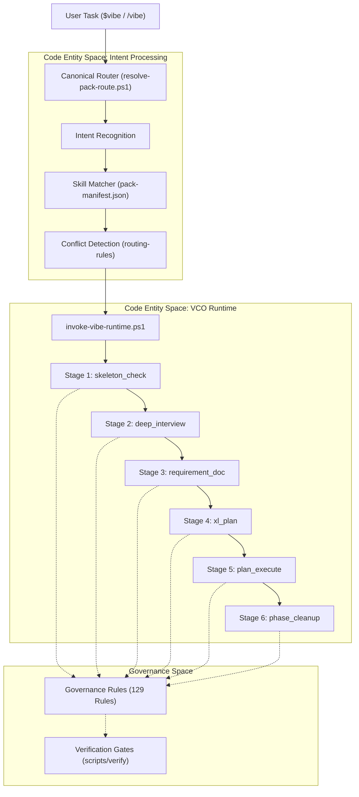
**Sources:** [README.md:155-168](), [README.md:170-176](), [references/changelog.md:54-60]()

---

### Core Subsystems

#### 1. The Canonical Router
The `Canonical Router` serves as the central decision hub. Instead of letting an AI model "hallucinate" which tool to use, the router analyzes intent keywords and context to trigger specific skill packs while enforcing priority and exclusivity rules.
*   **For details, see [The Canonical Router](#2.1)**

#### 2. Governed Runtime (VCO)
VibeSkills enforces a "Truth-First" design. Every complex task follows a 6-stage state machine (from `skeleton_check` to `phase_cleanup`). This ensures that requirements are documented and plans are approved before the AI begins destructive file operations.
*   **For details, see [The 6-Stage Governed Runtime](#2.2)**

#### 3. Skill Library and Packs
The repository contains 340+ skills organized into "Packs" (e.g., `orchestration-core`, `scientific-computing`). These are indexed via `pack-manifest.json` to allow the router to load only necessary context, preventing "token explosion."
*   **For details, see [Skill Library and Pack Manifest](#2.5)**

#### 4. Host Adapters and Deployment
VibeSkills is designed to be host-agnostic but provides deep integration for specific "Hosts" via `one-shot-setup.ps1`. Currently supported hosts include `codex`, `claude-code`, `cursor`, and `windsurf`.

**Host Support Matrix**
| Host | Mode | Default Root | Integration Level |
| :--- | :--- | :--- | :--- |
| `codex` | Governed | `~/.codex` | Full Runtime + Settings |
| `windsurf` | Runtime-Core | `~/.codeium/windsurf` | Adapter + Global Workflows |
| `claude-code` | Preview | `~/.claude` | Guidance Payload |
| `cursor` | Preview | `~/.cursor` | Guidance Payload |

**Sources:** [docs/install/one-click-install-release-copy.md:22-30](), [docs/cold-start-install-paths.md:7-21]()

---

### Repository Mirror Topology

The repository maintains a strict boundary between "Canonical" source code and "Bundled" distribution files. This ensures that the runtime can be deployed to a host environment (like `~/.cursor`) without bringing unnecessary development overhead.

**Directory Mapping and Mirroring**
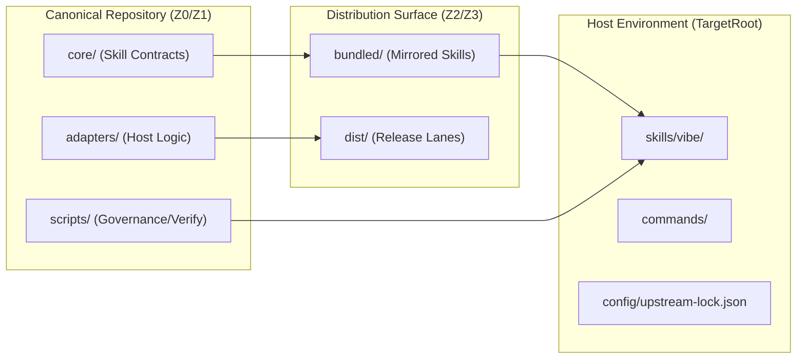
**Sources:** [docs/install/manual-copy-install.md:12-20](), [references/changelog.md:3-9]()

---

### Child Pages

For deeper technical exploration, refer to the following sections:

*   **[Project Manifesto and Philosophy](#1.1)**: The "Why" behind the architecture—solving agent failure modes and the capability-first principle.
*   **[Repository Structure and Key Directories](#1.2)**: Detailed breakdown of the directory layout and the mirror topology between canonical and bundled assets.

---
**Sources:** [README.md:79-87](), [docs/install/one-click-install-release-copy.md:50-62]()

---

# Page: Project Manifesto and Philosophy

# Project Manifesto and Philosophy

<details>
<summary>Relevant source files</summary>

The following files were used as context for generating this wiki page:

- [README.en.md](README.en.md)
- [README.md](README.md)
- [docs/cold-start-install-paths.en.md](docs/cold-start-install-paths.en.md)
- [docs/cold-start-install-paths.md](docs/cold-start-install-paths.md)
- [docs/install/manual-copy-install.en.md](docs/install/manual-copy-install.en.md)
- [docs/install/manual-copy-install.md](docs/install/manual-copy-install.md)
- [docs/install/one-click-install-release-copy.en.md](docs/install/one-click-install-release-copy.en.md)
- [docs/install/one-click-install-release-copy.md](docs/install/one-click-install-release-copy.md)
- [docs/install/recommended-full-path.en.md](docs/install/recommended-full-path.en.md)
- [docs/install/recommended-full-path.md](docs/install/recommended-full-path.md)
- [docs/manifesto.en.md](docs/manifesto.en.md)
- [docs/manifesto.md](docs/manifesto.md)
- [docs/plans/2026-03-19-public-docs-entrypoint-restructure-plan.md](docs/plans/2026-03-19-public-docs-entrypoint-restructure-plan.md)
- [docs/quick-start.en.md](docs/quick-start.en.md)
- [docs/quick-start.md](docs/quick-start.md)
- [docs/requirements/2026-03-19-public-docs-entrypoint-restructure.md](docs/requirements/2026-03-19-public-docs-entrypoint-restructure.md)

</details>


This page outlines the foundational motivation and design principles behind VibeSkills. It explains how the project addresses systemic AI agent failure modes through a capability-first architecture and a "truth-first" governance model.

## 1. The Motivation: Solving AI Agent Failure Modes

VibeSkills was created to move beyond simple "prompt libraries" and address the core pain points experienced by heavy AI users in production environments. Traditional AI interactions often suffer from several critical failure modes that VibeSkills is architected to solve.

### Key Failure Modes Addressed

| Failure Mode | Description | VibeSkills Solution |
| :--- | :--- | :--- |
| **Skill Sleep** | AI ignores available tools/skills in its context, leading to low activation rates. | **Intelligent Routing**: Automated discovery and activation via the Canonical Router. |
| **Black-Box Sprinting** | AI starts execution without clarifying requirements, leading to goal drift. | **Governed Workflow**: Mandatory `clarify → plan → execute → verify` sequence. |
| **Workspace Clutter** | Lack of standardized file structures makes it difficult for new agents to pick up context. | **Semantic Directory Governance**: Fixed architecture for storing plans, requirements, and logs. |
| **Conflicting Execution** | Multiple plugins or sub-agents fighting for control or creating infinite loops. | **Global Governance**: 129+ contract rules and mutual exclusion logic. |
| **Silent Failures** | AI deletes files or makes "fixes" without explicit warnings or backups. | **Built-in Protections**: Prohibition of bulk deletes and mandatory explicit warnings. |

Sources: [README.md:122-141](), [README.en.md:64-73](), [docs/manifesto.en.md:10-20]()

---

## 2. Capability-First Philosophy

VibeSkills treats AI not as a simple chat interface, but as a **Super-Capability Network** integrated into a personal AI Operating System (VCO Runtime).

### The Three Pillars of the Ecosystem
1.  **Skill Modules (340+)**: Industrial-grade skills covering the full lifecycle from life sciences to software engineering.
2.  **Ecosystem Integration (19+)**: Absorption of high-value upstream open-source projects into a unified interface.
3.  **Governance Rules (129+)**: Configuration-based policies that ensure execution remains stable and traceable.

Sources: [README.md:104-116](), [README.en.md:54-61]()

### Execution Grades (M/L/XL)
To manage complexity, the system categorizes tasks into three execution grades, ensuring the right amount of "compute" and "governance" is applied to each intent.

*   **M (Medium)**: Narrow scope, single-agent, fast response.
*   **L (Large)**: Multi-stage tasks requiring explicit design and review.
*   **XL (Extra Large)**: Complex, long-running flows involving multi-agent coordination and parallel execution.

Sources: [README.md:202-214](), [README.en.md:118-130]()

---

## 3. Truth-First Design Principle

The "Truth-First" principle is the cornerstone of VibeSkills governance. It mandates that the system must be honest about its state, boundaries, and dependencies rather than "hallucinating" readiness.

### Core Truth-First Tenets
*   **Explicit Boundaries**: The system clearly distinguishes between "Installed Locally" and "Online-Ready". If an API key or MCP server is missing, it must report the gap plainly.
*   **Evidence Trails**: Every execution must leave a trail (plans in `docs/plans/`, requirements in `docs/requirements/`) to ensure long-term maintainability.
*   **No "Prompt Magic"**: Reliability is achieved through structured protocols and verification gates, not just clever prompting.
*   **Host Neutrality**: While supporting specific hosts (Codex, Windsurf, etc.), the core logic remains decoupled to prevent vendor lock-in.

Sources: [docs/manifesto.en.md:39-64](), [docs/install/one-click-install-release-copy.md:43-49](), [docs/cold-start-install-paths.md:101-107]()

---

## 4. Technical Data Flow: Natural Language to Code Entity

The following diagrams illustrate how VibeSkills bridges the gap between a user's natural language intent and the specific code entities that govern execution.

### Intent Resolution Pipeline
This diagram shows how a user's "Vibe" request is transformed into a governed execution state.

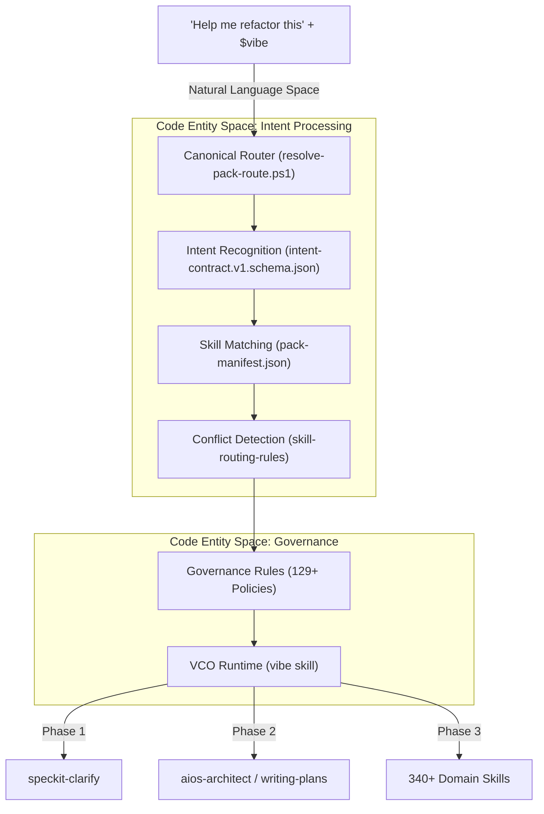
Sources: [README.md:151-168](), [README.en.md:144-162](), [docs/install/manual-copy-install.md:12-20]()

### Host-to-Runtime Mapping
This diagram maps the different host environments to their respective "Truth Boundaries" and local directory structures.

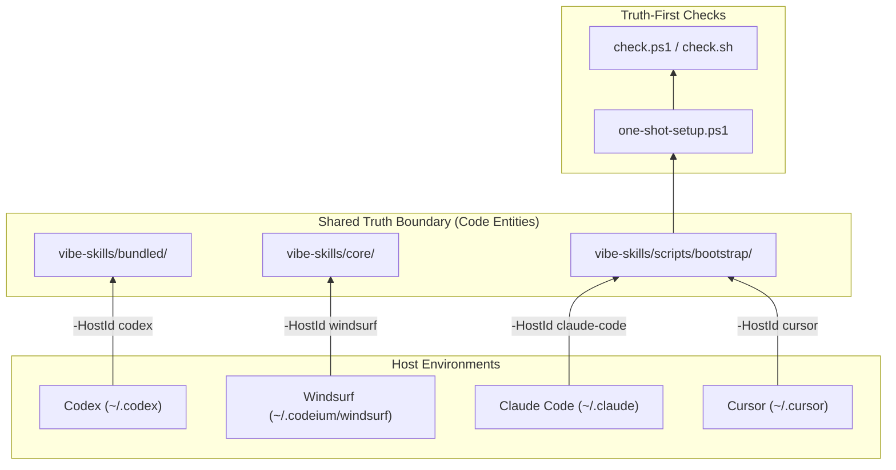
Sources: [docs/install/one-click-install-release-copy.md:23-30](), [docs/install/recommended-full-path.md:10-18](), [docs/cold-start-install-paths.md:7-21]()

---

# Page: Repository Structure and Key Directories

# Repository Structure and Key Directories

<details>
<summary>Relevant source files</summary>

The following files were used as context for generating this wiki page:

- [README.en.md](README.en.md)
- [README.md](README.md)
- [bundled/skills/vibe/bundled/skills/vibe/config/version-governance.json](bundled/skills/vibe/bundled/skills/vibe/config/version-governance.json)
- [bundled/skills/vibe/bundled/skills/vibe/references/changelog.md](bundled/skills/vibe/bundled/skills/vibe/references/changelog.md)
- [bundled/skills/vibe/bundled/skills/vibe/references/release-ledger.jsonl](bundled/skills/vibe/bundled/skills/vibe/references/release-ledger.jsonl)
- [bundled/skills/vibe/config/version-governance.json](bundled/skills/vibe/config/version-governance.json)
- [bundled/skills/vibe/docs/releases/README.md](bundled/skills/vibe/docs/releases/README.md)
- [bundled/skills/vibe/references/release-ledger.jsonl](bundled/skills/vibe/references/release-ledger.jsonl)
- [config/version-governance.json](config/version-governance.json)
- [docs/cold-start-install-paths.en.md](docs/cold-start-install-paths.en.md)
- [docs/cold-start-install-paths.md](docs/cold-start-install-paths.md)
- [docs/install/manual-copy-install.en.md](docs/install/manual-copy-install.en.md)
- [docs/install/manual-copy-install.md](docs/install/manual-copy-install.md)
- [docs/install/one-click-install-release-copy.en.md](docs/install/one-click-install-release-copy.en.md)
- [docs/install/one-click-install-release-copy.md](docs/install/one-click-install-release-copy.md)
- [docs/install/recommended-full-path.en.md](docs/install/recommended-full-path.en.md)
- [docs/install/recommended-full-path.md](docs/install/recommended-full-path.md)
- [docs/releases/README.md](docs/releases/README.md)
- [docs/universalization/distribution-lanes.md](docs/universalization/distribution-lanes.md)
- [docs/universalization/install-matrix.md](docs/universalization/install-matrix.md)
- [references/release-ledger.jsonl](references/release-ledger.jsonl)

</details>


This page maps the top-level directory layout of the VibeSkills repository. VibeSkills is an industrial-grade runtime framework (VCO) that integrates over 340 skills, MCP entry points, and governance rules [README.md:19-21](). The repository employs a specific "mirror topology" to ensure that the core orchestration logic (the `vibe` skill) remains consistent whether it is accessed from the root or from within the bundled skill library [config/version-governance.json:14-46]().

## Top-Level Directory Map

The repository is organized into functional zones that separate the skill library, core orchestration logic, host adapters, and governance infrastructure.

| Directory | Purpose | Key Contents |
| :--- | :--- | :--- |
| `bundled/` | The library of 340+ skills and the mirrored orchestration core. | `bundled/skills/`, `bundled/skills/vibe/` |
| `config/` | System-wide configuration, governance policies, and versioning. | `version-governance.json`, `runtime-contract.json` |
| `core/` | Host-neutral skill contracts and universalization definitions. | Skill contract schemas and logic. |
| `scripts/` | Automation for routing, governance, verification, and setup. | `scripts/router/`, `scripts/verify/`, `scripts/bootstrap/` |
| `docs/` | Comprehensive documentation, requirements, and release notes. | `docs/install/`, `docs/releases/`, `docs/plans/` |
| `adapters/` | Host-specific integration logic for different AI environments. | `adapters/index.json` |
| `dist/` | Distribution artifacts and lane-specific build outputs. | Lane definitions and truth boundaries. |
| `protocols/` | Multi-agent coordination and execution stage protocols. | `think.md`, `do.md`, `review.md`, `retro.md` |
| `rules/` | Guardrails and coding standards for agents and humans. | `coding-style.md`, `security.md`, `agent-rules.md` |
| `schemas/` | JSON schemas for validating contracts and manifests. | `skill.schema.json`, `router-provider.schema.json` |
| `templates/` | Scaffolding for new skills, plans, and requirements. | `SKILL.md` template, `requirement-doc` template. |
| `tests/` | Runtime-neutral and replay-based testing suites. | `tests/runtime_neutral/`, `tests/replay/` |

**Sources:** [README.md:104-116](), [config/version-governance.json:62-80](), [docs/install/one-click-install-release-copy.md:22-29]()

---

## Mirror Topology: Canonical vs. Bundled

VibeSkills utilizes a `mirror_topology` defined in the governance configuration [config/version-governance.json:14-17](). This ensures that the `vibe` orchestration skill (the "Vibe Core Orchestrator" or VCO) is identical across three levels of nesting.

### Topology Definition
1.  **Canonical Root (`.`):** The authoritative source of truth for the entire repository [config/version-governance.json:19-26]().
2.  **Bundled Root (`bundled/skills/vibe`):** A full mirror of the core logic located within the skill library [config/version-governance.json:28-35]().
3.  **Nested Bundled Root (`bundled/skills/vibe/bundled/skills/vibe`):** A recursive mirror used for deep-nesting compatibility [config/version-governance.json:37-44]().

### Natural Language to Code Entity: Mirroring Logic
The following diagram bridges the conceptual "Source of Truth" to the physical file paths and the governance scripts that enforce parity.

**Mirror Parity Enforcement**
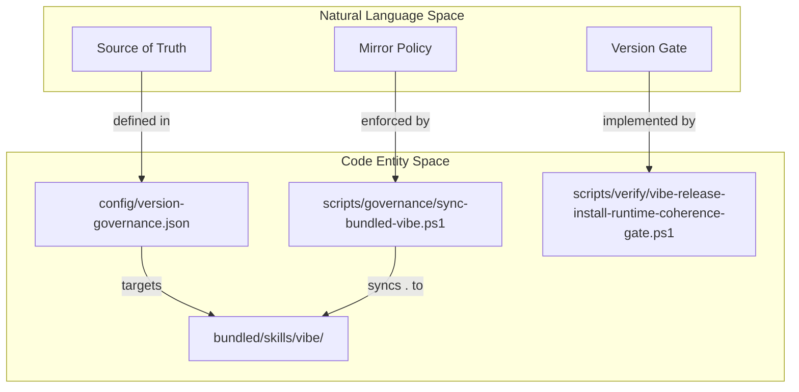
**Sources:** [config/version-governance.json:9-13](), [config/version-governance.json:95-110]()

---

## Key Directories and Data Flow

### 1. `scripts/router/` (The Canonical Router)
This is the "brain" of the system. The `resolve-pack-route.ps1` script acts as the entry point for all user intents [README.md:153-164](). It processes the context and selects the appropriate skill from the `bundled/skills/` library.

### 2. `scripts/verify/` (Verification Gates)
These scripts are "gates" that must pass before a release or execution.
*   **Freshness Gate:** `vibe-installed-runtime-freshness-gate.ps1` checks if the installed payload matches the expected version [config/version-governance.json:93]().
*   **BOM Gate:** `vibe-bom-frontmatter-gate.ps1` validates the Bill of Materials in skill files [config/version-governance.json:94]().

### 3. `docs/install/` (Host Adapters)
VibeSkills supports four primary hosts, each with a specific `HostId` and installation root [docs/install/one-click-install-release-copy.md:22-29]():
*   **Codex:** `~/.codex` (Governed mode)
*   **Claude Code:** `~/.claude` (Preview guidance)
*   **Cursor:** `~/.cursor` (Preview guidance)
*   **Windsurf:** `~/.codeium/windsurf` (Runtime adapter mode)

### Installation Data Flow
The installation process maps repository assets to host-specific directories.

**Asset Deployment Flow**
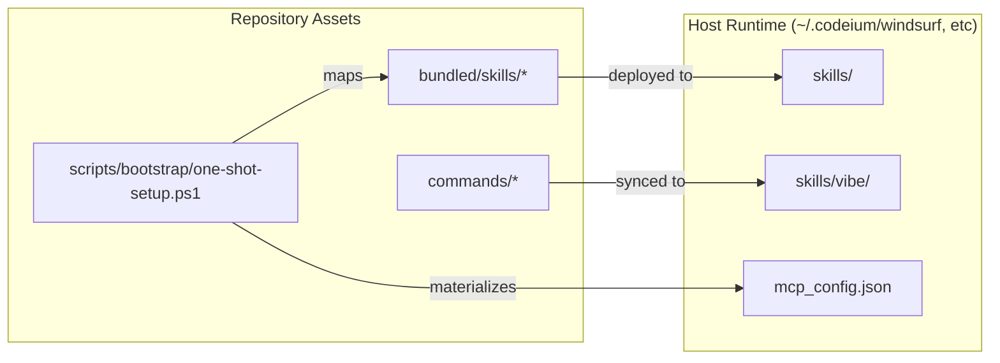
**Sources:** [docs/install/manual-copy-install.md:12-32](), [docs/install/recommended-full-path.md:12-17](), [config/version-governance.json:90-92]()

---

## Governance and Packaging Policies

The `packaging` section of the governance config defines which files are allowed to exist only in the bundled mirror and which must be synced [config/version-governance.json:62-88]().

*   **Mirror Files:** Core scripts like `check.ps1`, `install.ps1`, and directories like `protocols/` and `templates/` are strictly mirrored [config/version-governance.json:64-80]().
*   **Execution Context Policy:** The system enforces that scripts are not executed directly from a mirror root to prevent configuration drift [config/version-governance.json:47-50]().
*   **Runtime Markers:** A set of 25+ files (e.g., `Invoke-PlanExecute.ps1`, `resolve-pack-route.ps1`) are required for a runtime to be considered valid [config/version-governance.json:98-125]().

**Sources:** [config/version-governance.json:47-50](), [config/version-governance.json:62-80](), [config/version-governance.json:98-125]()

---

# Page: Core Architecture

# Core Architecture

<details>
<summary>Relevant source files</summary>

The following files were used as context for generating this wiki page:

- [SKILL.md](SKILL.md)
- [bundled/skills/vibe/SKILL.md](bundled/skills/vibe/SKILL.md)
- [bundled/skills/vibe/references/changelog.md](bundled/skills/vibe/references/changelog.md)
- [bundled/skills/vibe/references/index.md](bundled/skills/vibe/references/index.md)
- [references/changelog.md](references/changelog.md)
- [references/index.md](references/index.md)
- [scripts/router/resolve-pack-route.ps1](scripts/router/resolve-pack-route.ps1)
- [scripts/verify/README.md](scripts/verify/README.md)
- [scripts/verify/vibe-config-parity-gate.ps1](scripts/verify/vibe-config-parity-gate.ps1)

</details>


The Vibe Core Orchestrator (VCO) architecture is a governed runtime designed to eliminate AI agent failure modes such as workspace clutter and conflicting execution. It enforces a strict boundary between **Route Authority** (selecting the right tool) and **Runtime Authority** (executing the task under governance) [SKILL.md:154-160]().

The architecture is built upon a modular routing pipeline, a fixed 6-stage state machine, and a tiered execution model that scales from simple edits to complex multi-agent orchestration.

### System Overview Diagram
This diagram illustrates the flow from a user prompt through the Canonical Router to the Governed Runtime.

**VCO Logical Flow: Natural Language to Execution**
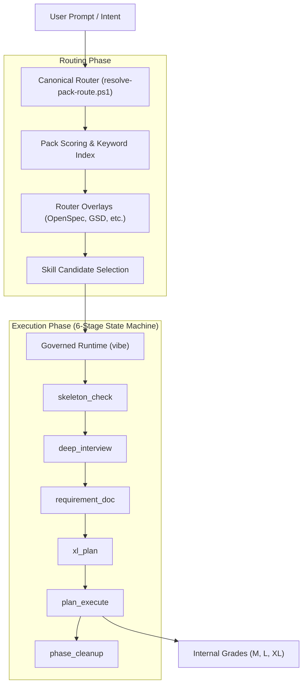
Sources: [SKILL.md:44-57](), [scripts/router/resolve-pack-route.ps1:18-50]()

---

### The Canonical Router
The **Canonical Router**, implemented in `resolve-pack-route.ps1`, is the central authority for all skill selection [SKILL.md:156-157](). It uses a modular pipeline of 49+ modules to evaluate prompts against the skill library [scripts/router/resolve-pack-route.ps1:19-50]().

Key responsibilities include:
*   **Pack Scoring:** Matching intents against the `skill-keyword-index.json` [scripts/router/resolve-pack-route.ps1:65]().
*   **Overlay Refinement:** Applying advisory layers like `OpenSpec` or `GSD-Lite` to adjust routing logic without replacing it [scripts/router/resolve-pack-route.ps1:29-30]().
*   **Route Modes:** Supporting `confirm_required` for human-in-the-loop and `unattended` for autonomous flows [scripts/router/resolve-pack-route.ps1:14-15]().

For details, see [The Canonical Router](#2.1).

---

### The 6-Stage Governed Runtime
The `vibe` skill enforces a mandatory 6-stage state machine for any non-trivial task [SKILL.md:27-37](). This ensures that requirements are frozen and plans are verified before any code is modified.

| Stage | Code Entity / Artifact | Purpose |
| :--- | :--- | :--- |
| **1. skeleton_check** | `skeleton_check` | Validates repo shape and prerequisites [SKILL.md:98-100](). |
| **2. deep_interview** | `deep_interview` | Produces a structured intent contract [SKILL.md:102-115](). |
| **3. requirement_doc** | `docs/requirements/` | Freezes intent to prevent goal drift [SKILL.md:117-122](). |
| **4. xl_plan** | `docs/plans/` | Defines waves, batches, and verification [SKILL.md:123-135](). |
| **5. plan_execute** | `plan_execute` | Executes the plan using M/L/XL grades [SKILL.md:136-142](). |
| **6. phase_cleanup** | `phase_cleanup` | Mandatory removal of temp artifacts [SKILL.md:143-153](). |

For details, see [The 6-Stage Governed Runtime](#2.2).

---

### Execution Grades and Protocols
While the user only interacts with the `vibe` entry point, the system internally selects an **Execution Grade** based on task complexity [SKILL.md:73-81]().

*   **M (Medium):** Narrow, single-agent execution.
*   **L (Large):** Staged planning with mandatory user approval and two-stage review.
*   **XL (Extra Large):** Multi-agent coordination using the `team.md` protocol [SKILL.md:94-95]().

**Code Entity Mapping: Protocols and State**
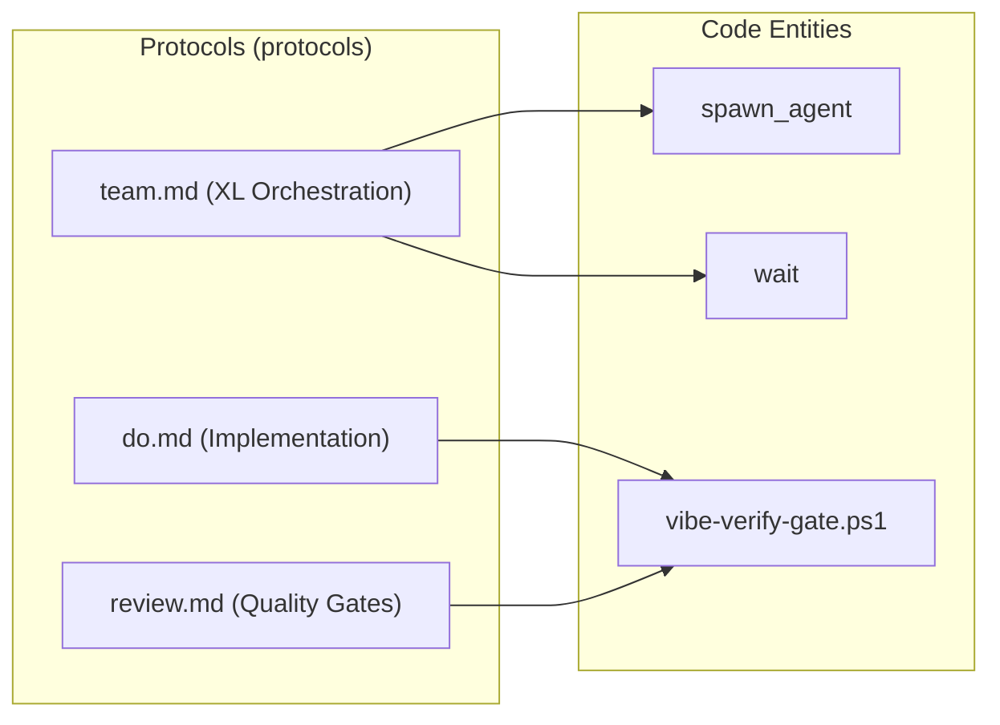
Sources: [SKILL.md:90-95](), [SKILL.md:187-196]()

For details, see [Execution Grades and Multi-Agent Protocols](#2.3).

---

### Router Overlays and Acceleration
Overlays are modular advisory layers that inject specific domain logic into the routing process [scripts/router/resolve-pack-route.ps1:29-49]().

*   **Logic Overlays:** `OpenSpec` for specification adherence and `GSD-Lite` for "Get Stuff Done" efficiency.
*   **Technical Overlays:** `Data Scale`, `Memory Governance`, and `CUDA Kernel` specific routing [scripts/router/resolve-pack-route.ps1:32-39]().
*   **LLM Acceleration:** Integration for advanced models (e.g., GPT-5.2) using committee sampling and vector diffs [scripts/router/resolve-pack-route.ps1:48]().

For details, see [Router Overlays and LLM Acceleration](#2.4).

---

### Skill Library and Pack Manifest
The system manages 340+ skills organized into **Packs** [SKILL.md:2.5](). This taxonomy is governed by the `pack-manifest.json`, which defines the structural boundaries between core orchestration and domain-specific capabilities [scripts/router/resolve-pack-route.ps1:62]().

*   **Bundled Skills:** Located in `bundled/skills/`, these are the authoritative versions of core skills like `vibe` [references/index.md:13]().
*   **Parity Enforcement:** The `vibe-config-parity-gate.ps1` ensures that configuration remains consistent between the repository root and the bundled skill distributions [scripts/verify/vibe-config-parity-gate.ps1:184-195]().

For details, see [Skill Library and Pack Manifest](#2.5).

---

# Page: The Canonical Router

# The Canonical Router

<details>
<summary>Relevant source files</summary>

The following files were used as context for generating this wiki page:

- [bundled/skills/vibe/bundled/skills/vibe/docs/prompt-asset-boost-integration.md](bundled/skills/vibe/bundled/skills/vibe/docs/prompt-asset-boost-integration.md)
- [bundled/skills/vibe/bundled/skills/vibe/docs/router-modularization-governance.md](bundled/skills/vibe/bundled/skills/vibe/docs/router-modularization-governance.md)
- [bundled/skills/vibe/bundled/skills/vibe/scripts/router/modules/11-route-probe.ps1](bundled/skills/vibe/bundled/skills/vibe/scripts/router/modules/11-route-probe.ps1)
- [bundled/skills/vibe/bundled/skills/vibe/scripts/router/resolve-pack-route.ps1](bundled/skills/vibe/bundled/skills/vibe/scripts/router/resolve-pack-route.ps1)
- [bundled/skills/vibe/bundled/skills/vibe/scripts/verify/fixtures/prompt-asset-boost.mock.json](bundled/skills/vibe/bundled/skills/vibe/scripts/verify/fixtures/prompt-asset-boost.mock.json)
- [bundled/skills/vibe/config/pack-manifest.json](bundled/skills/vibe/config/pack-manifest.json)
- [bundled/skills/vibe/config/router-thresholds.json](bundled/skills/vibe/config/router-thresholds.json)
- [bundled/skills/vibe/config/skill-keyword-index.json](bundled/skills/vibe/config/skill-keyword-index.json)
- [bundled/skills/vibe/config/skill-routing-rules.json](bundled/skills/vibe/config/skill-routing-rules.json)
- [bundled/skills/vibe/references/index.md](bundled/skills/vibe/references/index.md)
- [bundled/skills/vibe/scripts/router/resolve-pack-route.ps1](bundled/skills/vibe/scripts/router/resolve-pack-route.ps1)
- [config/pack-manifest.json](config/pack-manifest.json)
- [config/router-thresholds.json](config/router-thresholds.json)
- [config/skill-keyword-index.json](config/skill-keyword-index.json)
- [config/skill-routing-rules.json](config/skill-routing-rules.json)
- [references/index.md](references/index.md)
- [scripts/router/modules/00-core-utils.ps1](scripts/router/modules/00-core-utils.ps1)
- [scripts/router/modules/10-observability.ps1](scripts/router/modules/10-observability.ps1)
- [scripts/router/modules/11-route-probe.ps1](scripts/router/modules/11-route-probe.ps1)
- [scripts/router/modules/22-intent-contract.ps1](scripts/router/modules/22-intent-contract.ps1)
- [scripts/router/resolve-pack-route.ps1](scripts/router/resolve-pack-route.ps1)
- [scripts/verify/README.md](scripts/verify/README.md)
- [scripts/verify/vibe-config-parity-gate.ps1](scripts/verify/vibe-config-parity-gate.ps1)
- [scripts/verify/vibe-pack-regression-matrix.ps1](scripts/verify/vibe-pack-regression-matrix.ps1)
- [scripts/verify/vibe-pack-routing-smoke.ps1](scripts/verify/vibe-pack-routing-smoke.ps1)

</details>


The Canonical Router, implemented in `resolve-pack-route.ps1`, is the central decision engine of the Vibe Core Orchestrator (VCO). It transforms raw user intent into a structured execution plan by selecting the most appropriate skill packs and refining them through a multi-layered overlay pipeline.

## Purpose and Scope

The router's primary responsibility is to resolve a "route" — a combination of a target skill, an execution grade (M/L/XL), and a set of advisory overlays — based on the user's prompt and task type [scripts/router/resolve-pack-route.ps1:1-15](). It replaces static tool mapping with a dynamic, scoring-based selection process that accounts for task-specific defaults and keyword precision [config/skill-keyword-index.json:4-10]().

## The Modular Routing Pipeline

The router uses a modular architecture where distinct logic units are loaded from the `modules/` directory [scripts/router/resolve-pack-route.ps1:18-50](). This allows the system to separate core utility functions from complex AI-driven re-ranking and domain-specific overlays.

### Execution Flow
1.  **Normalization**: The raw prompt is cleaned of control tokens (e.g., `$vibe`, `/vibe`) to prevent routing pollution while preserving user intent [scripts/router/modules/00-core-utils.ps1:19-61]().
2.  **Pack Scoring**: The router iterates through all packs defined in `pack-manifest.json`, calculating a score based on `trigger_keywords` [scripts/router/modules/00-core-utils.ps1:159-166]().
3.  **Candidate Selection**: Within the winning pack, individual skills are scored using a weighted mix of keyword matches (85%) and name matches (15%) [config/skill-keyword-index.json:4-10]().
4.  **Overlay Refinement**: Advisory layers (OpenSpec, GSD, Memory, etc.) are applied to the selected route to inject additional constraints or context [scripts/router/resolve-pack-route.ps1:29-49]().

### Natural Language to Code Entity Mapping (Routing)

The following diagram illustrates how natural language inputs are processed by specific code entities to produce a resolved route.

**Diagram: Intent Resolution Pipeline**
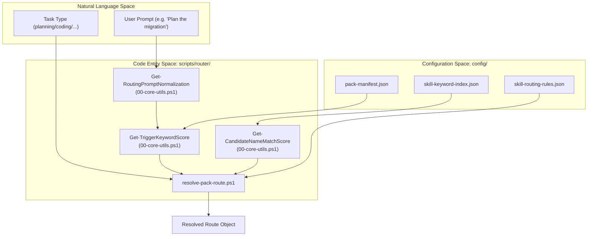
Sources: [scripts/router/resolve-pack-route.ps1:59-96](), [scripts/router/modules/00-core-utils.ps1:19-61](), [scripts/router/modules/00-core-utils.ps1:159-234]().

## Pack Scoring and Skill Selection

The router uses a hierarchical selection process. It first identifies the correct "Pack" (a logical grouping of skills) before selecting a specific "Skill Candidate" within that pack.

### Scoring Logic
| Component | Logic Entity | Description |
| :--- | :--- | :--- |
| **Pack Score** | `Get-TriggerKeywordScore` | Calculates a ratio of matched keywords in the prompt against the pack's `trigger_keywords` [scripts/router/modules/00-core-utils.ps1:159-166](). |
| **Intent Score** | `Get-IntentScore` | Boosts scores if pack ID tokens or specific candidate names appear in the prompt [scripts/router/modules/00-core-utils.ps1:168-190](). |
| **Skill Match** | `Get-CandidateNameMatchScore` | Performs boundary-aware matching for skill identifiers [scripts/router/modules/00-core-utils.ps1:213-234](). |

### Selection Thresholds
The router utilizes `config/router-thresholds.json` to determine if a match is strong enough to proceed or if it should fall back to a default [config/skill-keyword-index.json:9-10](). If no pack exceeds the threshold, the system can engage `legacy_matrix_fallback` if enabled in the manifest [config/pack-manifest.json:4]().

Sources: [scripts/router/modules/00-core-utils.ps1:159-234](), [config/pack-manifest.json:1-10](), [config/skill-keyword-index.json:1-10]().

## Route Modes and Overlays

The router supports several operational modes that dictate how the final tool is presented to the user or host.

### Route Modes
*   **pack_overlay**: The standard mode where the resolved skill is augmented with advisory overlays like `OpenSpec` or `GSD-Lite` [scripts/router/resolve-pack-route.ps1:29-31]().
*   **confirm_required**: Triggered when routing confidence is low or when the `dialectic-team-gate` determines a human-in-the-loop check is necessary [scripts/router/resolve-pack-route.ps1:44-46]().
*   **legacy_fallback**: Used when the modular router cannot find a suitable match, reverting to the original Vibe routing matrix [config/pack-manifest.json:4]().

### Overlay Pipeline (Code Entity Space)
The overlay system provides a non-destructive way to enhance the execution context.

**Diagram: Overlay Refinement Flow**
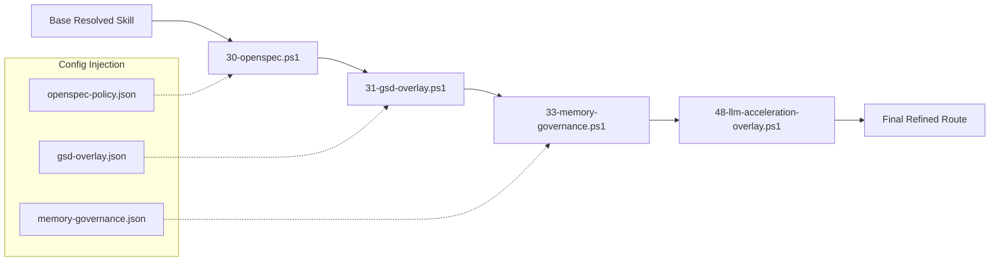
Sources: [scripts/router/resolve-pack-route.ps1:18-50](), [scripts/router/resolve-pack-route.ps1:67-96]().

## The Intent Contract Lifecycle

The "Intent Contract" is the final artifact produced by the router. It is a structured JSON object that encapsulates the resolved skill, the execution grade, and all active overlays [scripts/router/modules/22-intent-contract.ps1]().

### Lifecycle Stages
1.  **Interview**: If a skill requires more information, `21-capability-interview.ps1` is invoked to ask the user clarifying questions [scripts/router/resolve-pack-route.ps1:27]().
2.  **Contract Materialization**: The router assembles the `IntentContract` including the `TaskType`, `Grade`, and `Skill` [scripts/router/resolve-pack-route.ps1:1-15]().
3.  **Observability**: The routing decision, including scores for all candidates, is logged via `10-observability.ps1` for later regression testing [scripts/router/resolve-pack-route.ps1:23]().
4.  **Verification**: The `vibe-pack-routing-smoke.ps1` gate ensures that the configuration files (manifests, indices) are structurally sound and free of keyword collisions [scripts/verify/vibe-pack-routing-smoke.ps1:74-91]().

Sources: [scripts/router/resolve-pack-route.ps1:18-50](), [scripts/router/modules/22-intent-contract.ps1](), [scripts/verify/vibe-pack-routing-smoke.ps1:74-91]().

---

# Page: The 6-Stage Governed Runtime

# The 6-Stage Governed Runtime

<details>
<summary>Relevant source files</summary>

The following files were used as context for generating this wiki page:

- [SKILL.md](SKILL.md)
- [bundled/skills/vibe/SKILL.md](bundled/skills/vibe/SKILL.md)
- [bundled/skills/vibe/bundled/skills/vibe/scripts/runtime/Freeze-RuntimeInputPacket.ps1](bundled/skills/vibe/bundled/skills/vibe/scripts/runtime/Freeze-RuntimeInputPacket.ps1)
- [bundled/skills/vibe/bundled/skills/vibe/scripts/runtime/Invoke-PhaseCleanup.ps1](bundled/skills/vibe/bundled/skills/vibe/scripts/runtime/Invoke-PhaseCleanup.ps1)
- [bundled/skills/vibe/bundled/skills/vibe/scripts/runtime/VibeRuntime.Common.ps1](bundled/skills/vibe/bundled/skills/vibe/scripts/runtime/VibeRuntime.Common.ps1)
- [bundled/skills/vibe/bundled/skills/vibe/scripts/runtime/invoke-vibe-runtime.ps1](bundled/skills/vibe/bundled/skills/vibe/scripts/runtime/invoke-vibe-runtime.ps1)
- [bundled/skills/vibe/bundled/skills/vibe/scripts/verify/vibe-benchmark-autonomous-proof-gate.ps1](bundled/skills/vibe/bundled/skills/vibe/scripts/verify/vibe-benchmark-autonomous-proof-gate.ps1)
- [bundled/skills/vibe/config/phase-cleanup-policy.json](bundled/skills/vibe/config/phase-cleanup-policy.json)
- [bundled/skills/vibe/protocols/do.md](bundled/skills/vibe/protocols/do.md)
- [bundled/skills/vibe/protocols/retro.md](bundled/skills/vibe/protocols/retro.md)
- [bundled/skills/vibe/protocols/review.md](bundled/skills/vibe/protocols/review.md)
- [bundled/skills/vibe/protocols/runtime.md](bundled/skills/vibe/protocols/runtime.md)
- [bundled/skills/vibe/protocols/think.md](bundled/skills/vibe/protocols/think.md)
- [bundled/skills/vibe/references/changelog.md](bundled/skills/vibe/references/changelog.md)
- [bundled/skills/vibe/scripts/governance/phase-end-cleanup.ps1](bundled/skills/vibe/scripts/governance/phase-end-cleanup.ps1)
- [bundled/skills/vibe/scripts/runtime/Freeze-RuntimeInputPacket.ps1](bundled/skills/vibe/scripts/runtime/Freeze-RuntimeInputPacket.ps1)
- [bundled/skills/vibe/scripts/runtime/Invoke-PhaseCleanup.ps1](bundled/skills/vibe/scripts/runtime/Invoke-PhaseCleanup.ps1)
- [bundled/skills/vibe/scripts/runtime/VibeRuntime.Common.ps1](bundled/skills/vibe/scripts/runtime/VibeRuntime.Common.ps1)
- [bundled/skills/vibe/scripts/runtime/invoke-vibe-runtime.ps1](bundled/skills/vibe/scripts/runtime/invoke-vibe-runtime.ps1)
- [bundled/skills/vibe/scripts/verify/fixtures/README.md](bundled/skills/vibe/scripts/verify/fixtures/README.md)
- [config/phase-cleanup-policy.json](config/phase-cleanup-policy.json)
- [protocols/runtime.md](protocols/runtime.md)
- [references/changelog.md](references/changelog.md)
- [scripts/governance/phase-end-cleanup.ps1](scripts/governance/phase-end-cleanup.ps1)
- [scripts/runtime/invoke-vibe-runtime.ps1](scripts/runtime/invoke-vibe-runtime.ps1)
- [scripts/verify/fixtures/README.md](scripts/verify/fixtures/README.md)
- [tests/runtime_neutral/test_governed_runtime_bridge.py](tests/runtime_neutral/test_governed_runtime_bridge.py)

</details>


The **Vibe Governed Runtime** is the official execution engine of the Vibe Code Orchestrator (VCO). It enforces a fixed, six-stage state machine for all tasks that require more than trivial edits. By freezing requirements and planning execution before a single line of code is written, the runtime prevents "skill sleep," conflicting executions, and workspace clutter.

## Purpose and Scope

The governed runtime provides a unified entry point (`vibe`) that abstracts internal execution grades (M, L, XL) into a consistent user experience. It ensures that every task follows a rigorous lifecycle of inspection, documentation, execution, and cleanup [SKILL.md:12-26]().

Key capabilities include:
*   **Requirement Clarification:** Mandatory intent freezing before building.
*   **Autonomous Execution:** Bounded execution with retained governance.
*   **Multi-Agent Coordination:** Native support for XL-grade orchestration.
*   **Mandatory Cleanup:** Automatic removal of temporary artifacts and node residue [SKILL.md:14-20]().

---

## The 6-Stage State Machine

Every `vibe` invocation transitions through six mandatory stages. While these stages may become "lighter" for simpler tasks, they are never skipped by policy [SKILL.md:46-56]().

### 1. `skeleton_check`
Inspects the repository shape, active branch, and existing plan/requirement artifacts. It ensures the environment is ready for the task before any state is modified [SKILL.md:98-100]().

### 2. `deep_interview`
Produces a structured **Intent Contract**. In interactive modes, this involves asking the user clarifying questions. In autonomous modes, assumptions are inferred and recorded [SKILL.md:102-115]().
*   **Outputs:** Goal, Deliverables, Constraints, Acceptance Criteria, and Inferred Assumptions.

### 3. `requirement_doc`
Freezes the Intent Contract into a formal document located in `docs/requirements/`. Once this file is written, all subsequent execution must trace back to this document rather than the raw chat history [SKILL.md:117-122]().

### 4. `xl_plan`
Generates an execution plan in `docs/plans/`. This plan determines the internal execution grade (M, L, or XL) and defines the wave/batch structure for implementation [SKILL.md:124-135]().

### 5. `plan_execute`
Carries out the approved plan. For complex tasks, this stage utilizes XL multi-agent orchestration (`spawn_agent`, `send_input`). All spawned subagents are required to end their prompts with `$vibe` to maintain the governed context [SKILL.md:137-142]().

### 6. `phase_cleanup`
The final stage performs a mandatory audit. It removes temporary files and generates a `cleanup-receipt.json` [SKILL.md:144-153]().

### Runtime Data Flow
The following diagram illustrates the transition from Natural Language intent to the Code Entity Space of artifacts and scripts.

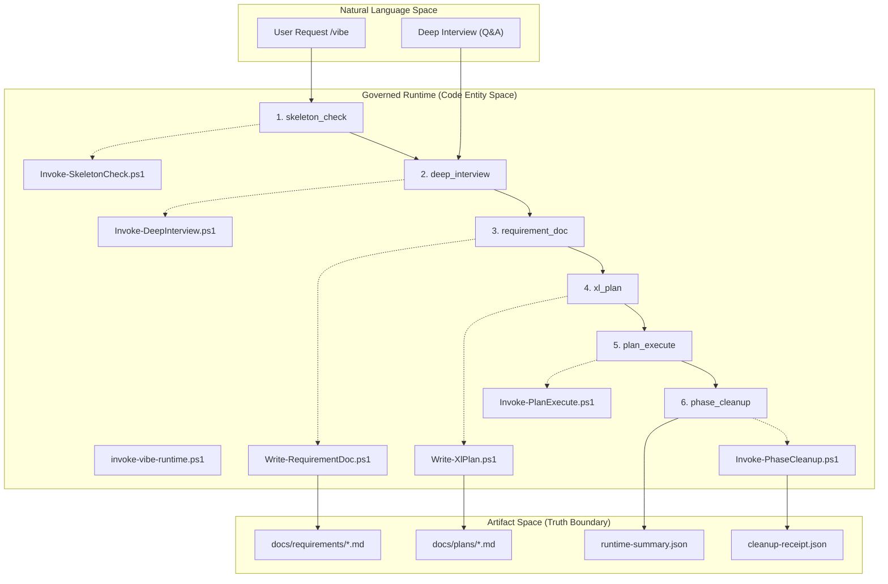
**Sources:** [SKILL.md:46-54](), [scripts/runtime/invoke-vibe-runtime.ps1:72-78](), [protocols/think.md:10-17]()

---

## Runtime Modes

The runtime operates in two primary modes, though they have been normalized to ensure a single control path.

| Mode | Description | Behavior |
| :--- | :--- | :--- |
| `interactive_governed` | **Default Mode.** | Pauses for user confirmation at plan boundaries and asks high-value questions during interview [SKILL.md:60-65](). |
| `benchmark_autonomous` | **Legacy/Compatibility.** | Silently normalized to `interactive_governed`. It ensures that unattended execution still produces the same artifacts (plans/requirements) [SKILL.md:67-72](). |

**Sources:** [SKILL.md:58-72](), [references/changelog.md:14-17]()

---

## Implementation Details

### The Runtime Bridge
The runtime is orchestrated by `invoke-vibe-runtime.ps1`. This script is responsible for:
1.  **Context Resolution:** Loading common functions via `VibeRuntime.Common.ps1` [scripts/runtime/invoke-vibe-runtime.ps1:13]().
2.  **Sequence Enforcement:** Calling the stage scripts in the exact order defined by the state machine [scripts/runtime/invoke-vibe-runtime.ps1:72-78]().
3.  **Artifact Durability:** Waiting for critical files (receipts, manifests, plans) to become durable on disk before returning control [scripts/runtime/invoke-vibe-runtime.ps1:80-96]().

### Internal Execution Grades
While the user only sees `vibe`, the runtime selects an internal grade after the `deep_interview` [SKILL.md:81]():
*   **M (Single-Agent):** Narrow, tightly scoped edits.
*   **L (Staged):** Coordination work requiring design → plan → approval.
*   **XL (Team):** Parallelizable work using `protocols/team.md` [SKILL.md:75-80]().

### Runtime Protocol Mapping
The runtime maps specific stages to specialized protocols:
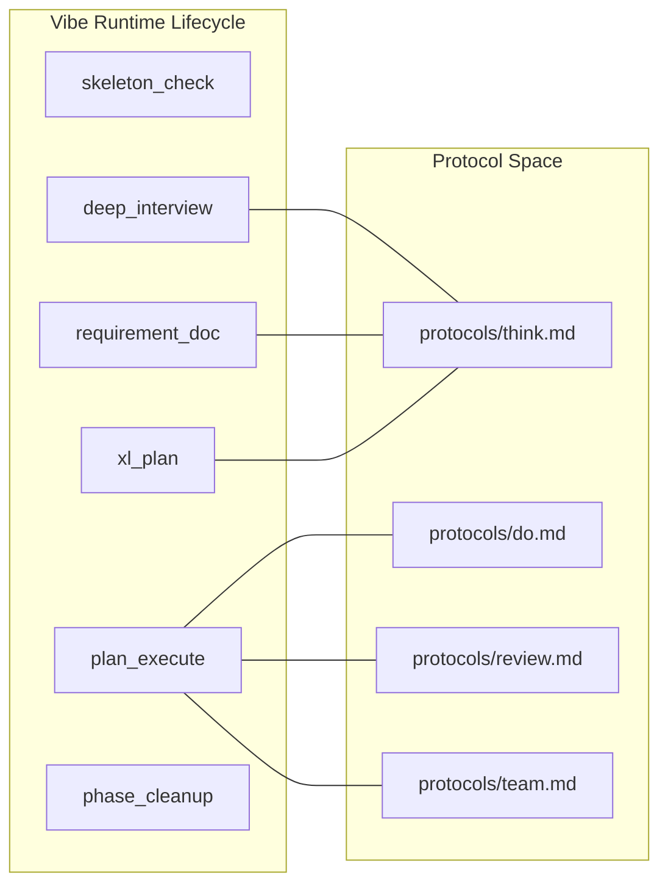
**Sources:** [SKILL.md:186-196](), [protocols/think.md:19-24]()

---

## Governance and Cleanup

### Phase Cleanup Policy
Cleanup is an integral part of the runtime, governed by `config/phase-cleanup-policy.json`. The policy mandates:
*   **Protected Documents:** Extensions like `.docx`, `.pdf`, and `.xlsx` are snapshotted or quarantined before any destructive actions [config/phase-cleanup-policy.json:25-32]().
*   **Node Audit:** Running `Invoke-NodeProcessAudit.ps1` to identify and clean up "zombie" processes left by agents [config/phase-cleanup-policy.json:52-53]().

### Verification Gates
The integrity of the 6-stage runtime is verified by the `vibe-governed-runtime-contract-gate.ps1`. This gate ensures that:
1.  The `runtime-contract.json` matches the implemented stages [tests/runtime_neutral/test_governed_runtime_bridge.py:97-98]().
2.  Execution produces a full artifact closure in the `vibe-sessions` directory [tests/runtime_neutral/test_governed_runtime_bridge.py:124-126]().

**Sources:** [config/phase-cleanup-policy.json:1-57](), [SKILL.md:218-224](), [tests/runtime_neutral/test_governed_runtime_bridge.py:83-126]()

---

# Page: Execution Grades and Multi-Agent Protocols

# Execution Grades and Multi-Agent Protocols

<details>
<summary>Relevant source files</summary>

The following files were used as context for generating this wiki page:

- [bundled/skills/vibe/config/phase-cleanup-policy.json](bundled/skills/vibe/config/phase-cleanup-policy.json)
- [bundled/skills/vibe/protocols/do.md](bundled/skills/vibe/protocols/do.md)
- [bundled/skills/vibe/protocols/retro.md](bundled/skills/vibe/protocols/retro.md)
- [bundled/skills/vibe/protocols/review.md](bundled/skills/vibe/protocols/review.md)
- [bundled/skills/vibe/protocols/runtime.md](bundled/skills/vibe/protocols/runtime.md)
- [bundled/skills/vibe/protocols/team.md](bundled/skills/vibe/protocols/team.md)
- [bundled/skills/vibe/protocols/think.md](bundled/skills/vibe/protocols/think.md)
- [bundled/skills/vibe/references/team-templates.md](bundled/skills/vibe/references/team-templates.md)
- [bundled/skills/vibe/scripts/governance/phase-end-cleanup.ps1](bundled/skills/vibe/scripts/governance/phase-end-cleanup.ps1)
- [bundled/skills/vibe/scripts/verify/README.md](bundled/skills/vibe/scripts/verify/README.md)
- [bundled/skills/vibe/scripts/verify/fixtures/README.md](bundled/skills/vibe/scripts/verify/fixtures/README.md)
- [bundled/skills/vibe/scripts/verify/vibe-keyword-precision-audit.ps1](bundled/skills/vibe/scripts/verify/vibe-keyword-precision-audit.ps1)
- [bundled/skills/vibe/scripts/verify/vibe-pack-routing-smoke.ps1](bundled/skills/vibe/scripts/verify/vibe-pack-routing-smoke.ps1)
- [bundled/skills/vibe/scripts/verify/vibe-trigger-keyword-hygiene-gate.ps1](bundled/skills/vibe/scripts/verify/vibe-trigger-keyword-hygiene-gate.ps1)
- [protocols/do.md](protocols/do.md)
- [protocols/retro.md](protocols/retro.md)
- [protocols/review.md](protocols/review.md)
- [protocols/team.md](protocols/team.md)
- [protocols/think.md](protocols/think.md)
- [references/conflict-rules.md](references/conflict-rules.md)
- [references/extending-vco.md](references/extending-vco.md)
- [references/team-templates.md](references/team-templates.md)

</details>


This page defines the technical standards for task execution within the Vibe Core Orchestrator (VCO). It details the classification of tasks into M, L, and XL execution grades, the multi-agent coordination protocols for high-complexity tasks, and the governing protocol files (`think`, `do`, `review`, `retro`) that ensure consistent agent behavior and anti-drift guardrails.

## Execution Grades (M, L, XL)

VCO classifies tasks into three grades based on complexity and coordination requirements. These grades determine the toolsets and protocols used during the `plan_execute` stage of the governed runtime [protocols/think.md:107-132]().

| Grade | Description | Primary Orchestration | Key Tools/Protocols |
| :--- | :--- | :--- | :--- |
| **M** | Medium complexity; single-agent focus. | Claude native reasoning | `tdd-guide`, `think-harder` [protocols/do.md:82-90]() |
| **L** | Large complexity; requires structured planning. | Subagent-driven development | `writing-plans`, `subagent-driven-development` [protocols/do.md:91-99]() |
| **XL** | Extra-Large; multi-agent coordination. | Codex Native Team + `ruflo` | `vibe-team` protocol, `spawn_agent` [protocols/team.md:1-42]() |

**Sources:** [protocols/think.md:107-132](), [protocols/do.md:82-103](), [protocols/team.md:1-42]()

## Multi-Agent Protocols (XL Team)

The `vibe-team` protocol is the execution topology for XL-grade tasks requiring parallel work, swarm coordination, or long-running iterative workflows [protocols/team.md:21-27](). It activates exclusively during runtime stage 5, `plan_execute`, after the requirement and plan artifacts are frozen [protocols/team.md:7-19]().

### Team Lifecycle Primitives
VCO utilizes Codex native APIs as the primary path for agent lifecycle management, supplemented by `ruflo` for workflow and memory enhancements [protocols/team.md:30-31]().

*   **`spawn_agent`**: Initializes subagents with specific roles and prompts [protocols/team.md:39]().
*   **`send_input`**: Assigns tasks and provides follow-up instructions [protocols/team.md:40]().
*   **`wait`**: Synchronizes agents at defined milestones (fan-in) [protocols/team.md:41]().
*   **`close_agent`**: Terminates agent sessions upon task completion [protocols/team.md:42]().

### Hybrid Architecture Data Flow
The following diagram illustrates the interaction between the Lead Agent, Native Codex Primitives, and the `ruflo` collaboration layer.

**XL Multi-Agent Coordination Flow**
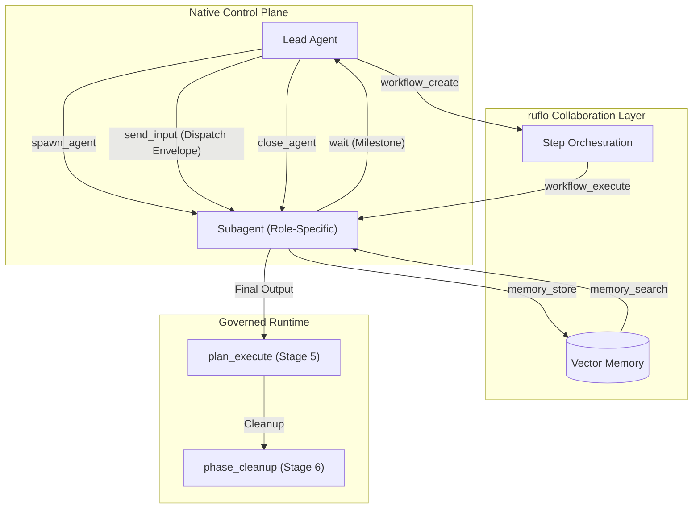
**Sources:** [protocols/team.md:30-47](), [protocols/team.md:65-74](), [protocols/team.md:119-122]()

### Team Templates
VCO provides predefined compositions in `references/team-templates.md` to standardize common XL scenarios [references/team-templates.md:1-5]():
*   **feature-team**: Lead, Planner, Implementers (Frontend/Backend), and Reviewer [references/team-templates.md:6-16]().
*   **debug-team**: Lead, Investigators (Module-specific), and Fixer [references/team-templates.md:20-29]().
*   **dialectic-design**: A specialized 4-agent team using isolated groups (Group A vs Group B) to analyze designs from opposing perspectives (e.g., Top-down vs Bottom-up) [references/team-templates.md:114-130]().

**Sources:** [references/team-templates.md:1-130]()

## Protocol Files and Stages

The governed runtime is driven by a set of protocol files that define behavior across different task types and lifecycle stages.

### Think/Do/Review/Retro Lifecycle
1.  **`vibe-think`**: Owns stages 2-4 (`deep_interview`, `requirement_doc`, `xl_plan`). It enforces a "Closure-First Preflight" consisting of 2 probes (glob/rg) and 1 verification before finalizing plans [protocols/think.md:19-24](), [protocols/think.md:62-76]().
2.  **`vibe-do`**: The execution surface for stage 5 (`plan_execute`). It requires a "minimal closed loop" within the first 3 actions to avoid "dead-air" [protocols/do.md:7-17](), [protocols/do.md:58-72]().
3.  **`vibe-review`**: Provides multi-perspective audits (Security, Quality, Architecture) [references/team-templates.md:46-57]().
4.  **`vibe-retro`**: A post-execution surface for error pattern detection and workflow optimization. It utilizes a 5-phase architecture: GATHER -> ANALYZE -> DISCUSS -> DECIDE -> ACT [protocols/retro.md:18-28](), [protocols/retro.md:79-81]().

**Sources:** [protocols/think.md:19-76](), [protocols/do.md:7-72](), [protocols/retro.md:18-81]()

### Anti-Proxy-Goal-Drift Guardrails
To prevent agents from optimizing for "proxy signals" (like implementation convenience) over primary objectives, the protocols enforce specific guardrails [protocols/think.md:48-57]():
*   **Objective Freeze**: The primary objective must be frozen before discussing implementation [protocols/think.md:53]().
*   **Honest Completion**: Bounded specializations must be preserved and not flattened into false generalized claims [protocols/team.md:61](), [protocols/retro.md:50]().
*   **Validation Isolation**: Validation materials (tests/examples) must remain distinct from the "product truth" [protocols/do.md:44]().

**Sources:** [protocols/think.md:48-57](), [protocols/do.md:40-50](), [protocols/team.md:48-62](), [protocols/retro.md:33-51]()

## Implementation and Data Flow

Coordination is maintained through structured "Dispatch Envelopes" and "Task Contracts" to ensure subagent reliability [protocols/team.md:134-137]().

### The Dispatch Envelope
When the Lead Agent uses `send_input`, the subtask is wrapped in a YAML envelope [protocols/team.md:138-150]():
*   `run_id`: Shared identifier for the XL execution.
*   `phase`: Current stage (plan, investigate, implement, verify).
*   `memory`: Keys for `private_key` (agent-specific) and `shared_key` (the `<agents_memory>` for the team).

### Task Contract (DoD)
The subtask interface defines the "Definition of Done" (DoD) to prevent drift [protocols/team.md:156-179]():
*   **Goal**: One-sentence testable outcome.
*   **Scope**: Explicit "in" and "out" boundaries.
*   **Verification**: Copy-paste runnable commands to validate the work.

**Sources:** [protocols/team.md:134-179](), [references/team-templates.md:85-112]()

### Mapping Protocols to Code Entities
The following diagram bridges the protocol definitions to the physical scripts and configuration files that enforce them.

**Protocol-to-Code Mapping**
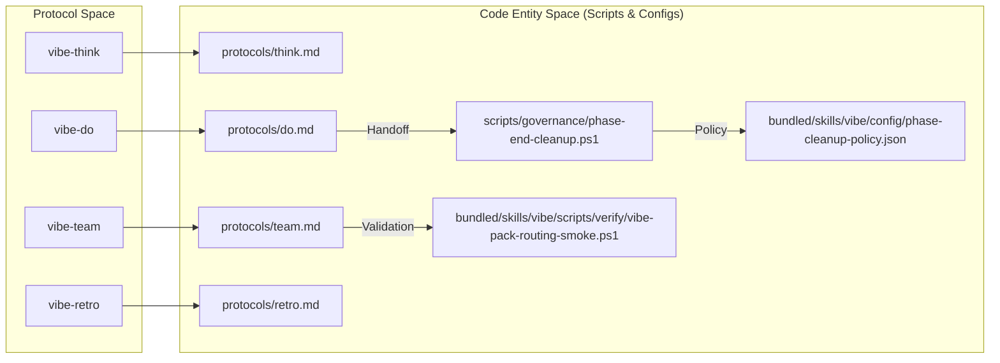
**Sources:** [protocols/think.md:1-10](), [protocols/do.md:1-10](), [protocols/team.md:1-10](), [protocols/retro.md:1-10](), [bundled/skills/vibe/config/phase-cleanup-policy.json:1-57](), [bundled/skills/vibe/scripts/verify/vibe-pack-routing-smoke.ps1:74-91]()

---

# Page: Router Overlays and LLM Acceleration

# Router Overlays and LLM Acceleration

<details>
<summary>Relevant source files</summary>

The following files were used as context for generating this wiki page:

- [bundled/skills/vibe/bundled/skills/vibe/config/gitnexus-overlays.json](bundled/skills/vibe/bundled/skills/vibe/config/gitnexus-overlays.json)
- [bundled/skills/vibe/bundled/skills/vibe/docs/plans/2026-03-04-turbomax-vector-context-design.md](bundled/skills/vibe/bundled/skills/vibe/docs/plans/2026-03-04-turbomax-vector-context-design.md)
- [bundled/skills/vibe/config/agency-overlays.json](bundled/skills/vibe/config/agency-overlays.json)
- [bundled/skills/vibe/config/cuda-kernel-overlay.json](bundled/skills/vibe/config/cuda-kernel-overlay.json)
- [bundled/skills/vibe/config/data-scale-overlay.json](bundled/skills/vibe/config/data-scale-overlay.json)
- [bundled/skills/vibe/config/deep-discovery-policy.json](bundled/skills/vibe/config/deep-discovery-policy.json)
- [bundled/skills/vibe/config/framework-interop-overlay.json](bundled/skills/vibe/config/framework-interop-overlay.json)
- [bundled/skills/vibe/config/gitnexus-overlays.json](bundled/skills/vibe/config/gitnexus-overlays.json)
- [bundled/skills/vibe/config/memory-governance.json](bundled/skills/vibe/config/memory-governance.json)
- [bundled/skills/vibe/config/ml-lifecycle-overlay.json](bundled/skills/vibe/config/ml-lifecycle-overlay.json)
- [bundled/skills/vibe/config/openspec-policy.json](bundled/skills/vibe/config/openspec-policy.json)
- [bundled/skills/vibe/config/skill-alias-map.json](bundled/skills/vibe/config/skill-alias-map.json)
- [bundled/skills/vibe/docs/blackbox-probe-and-enhancement-playbook.md](bundled/skills/vibe/docs/blackbox-probe-and-enhancement-playbook.md)
- [bundled/skills/vibe/docs/deep-discovery-mode-design.md](bundled/skills/vibe/docs/deep-discovery-mode-design.md)
- [bundled/skills/vibe/docs/plans/2026-03-04-turbomax-vector-context-design.md](bundled/skills/vibe/docs/plans/2026-03-04-turbomax-vector-context-design.md)
- [bundled/skills/vibe/scripts/governance/invoke-openspec-governance.ps1](bundled/skills/vibe/scripts/governance/invoke-openspec-governance.ps1)
- [bundled/skills/vibe/scripts/router/modules/30-openspec.ps1](bundled/skills/vibe/scripts/router/modules/30-openspec.ps1)
- [bundled/skills/vibe/scripts/verify/vibe-openspec-governance-gate.ps1](bundled/skills/vibe/scripts/verify/vibe-openspec-governance-gate.ps1)
- [config/gitnexus-overlays.json](config/gitnexus-overlays.json)
- [docs/blackbox-probe-and-enhancement-playbook.md](docs/blackbox-probe-and-enhancement-playbook.md)
- [docs/deep-discovery-mode-design.md](docs/deep-discovery-mode-design.md)
- [docs/plans/2026-03-04-turbomax-vector-context-design.md](docs/plans/2026-03-04-turbomax-vector-context-design.md)
- [scripts/governance/invoke-openspec-governance.ps1](scripts/governance/invoke-openspec-governance.ps1)
- [scripts/router/modules/30-openspec.ps1](scripts/router/modules/30-openspec.ps1)
- [scripts/verify/vibe-openspec-governance-gate.ps1](scripts/verify/vibe-openspec-governance-gate.ps1)

</details>


The Router Overlay system provides a modular layer of advisory logic that sits atop the Canonical Router. Unlike the core routing logic which selects specific skill packs, overlays provide "soft" guidance, governance requirements, and performance accelerations without replacing the underlying skill selection. This allows VibeSkills to enforce project-specific standards (OpenSpec), provide deep domain context (GitNexus), and leverage advanced LLM capabilities (TurboMax) while maintaining a stable routing backbone.

## The Overlay System Architecture

Overlays are triggered during the routing pipeline to inject additional context or requirements into the final route object. They are primarily defined via JSON configurations in the `config/` directory and executed by specialized PowerShell modules.

### Data Flow and Integration
The router integrates overlays at different stages of the `resolve-pack-route.ps1` lifecycle. For example, OpenSpec governance is typically applied as a post-route check to ensure the selected path meets documentation standards.

Title: Router Overlay Integration Flow
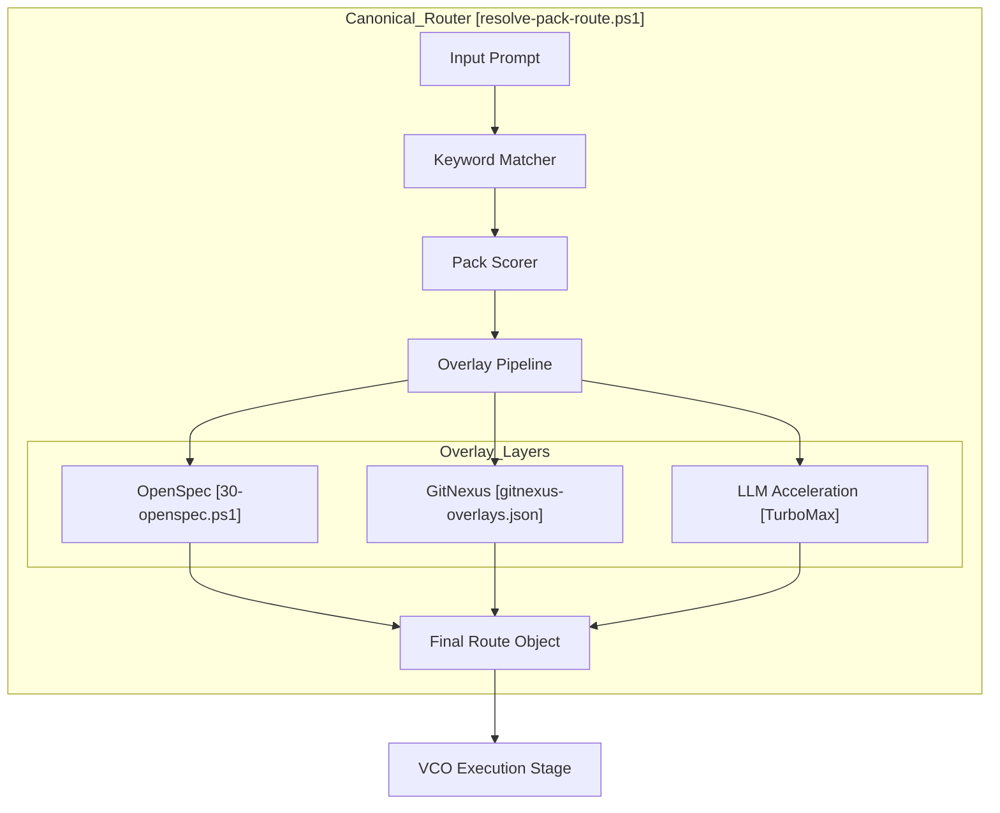
**Sources:** [scripts/router/modules/30-openspec.ps1:25-48](), [scripts/verify/vibe-openspec-governance-gate.ps1:46-66]()

---

## OpenSpec Governance Overlay

OpenSpec is the primary governance overlay, enforcing documentation requirements based on the execution grade (M/L/XL) and task type. It ensures that complex plans (L/XL) are backed by formal requirement documents or "Lite Cards" for smaller tasks.

### Enforcement Modes
OpenSpec operates in several modes defined in `config/openspec-policy.json`:
*   **Strict**: Documentation is `required` before execution [bundled/skills/vibe/config/openspec-policy.json:92-92]().
*   **Soft**: Triggers `confirm_required` if within the defined scope (e.g., planning tasks for L/XL grades) [bundled/skills/vibe/config/openspec-policy.json:45-53]().
*   **Advisory**: Provides a `recommended_artifact` path but does not block execution [bundled/skills/vibe/config/openspec-policy.json:89-90]().

### Key Entities
*   **Lite Card**: A lightweight markdown file for M-grade tasks containing goals, scope, and risks [scripts/governance/invoke-openspec-governance.ps1:30-46]().
*   **Full Skeleton**: A directory-based requirement set for L/XL tasks, including `change.md`, `tasks.md`, `progress.md`, and `handoff.md` [scripts/governance/invoke-openspec-governance.ps1:74-108]().

**Sources:** [scripts/router/modules/30-openspec.ps1:180-195](), [bundled/skills/vibe/config/openspec-policy.json:4-10]()

---

## GitNexus Context Overlay

The GitNexus overlay serves as a "Code Understanding Foundation." It maps user prompts to specific code-aware artifacts like architecture maps, impact analysis, and dependency graphs.

| Overlay ID | Purpose | Preferred Stages |
| :--- | :--- | :--- |
| `gitnexus-foundation` | Base evidence source for code understanding | All (think, do, review, etc.) |
| `gitnexus-impact` | Blast radius and risk assessment | think, do, review |
| `gitnexus-architecture-map` | Generates Mermaid diagrams of module clusters | think, team, retro |
| `gitnexus-detect-changes` | Maps diffs to call chains during PR review | review, do, retro |

**Sources:** [config/gitnexus-overlays.json:18-167]()

---

## LLM Acceleration (TurboMax)

TurboMax is a specialized overlay designed to trade higher API consumption for faster task closure. It is explicitly enabled via the `/vibe` or `$vibe` commands [docs/plans/2026-03-04-turbomax-vector-context-design.md:7-7]().

### Vector-First Context
To prevent "context rot" in long conversations, TurboMax uses a three-layer context strategy:
1.  **State Store**: Stable session progress and execution manifests [docs/plans/2026-03-04-turbomax-vector-context-design.md:30-31]().
2.  **Short-term Vector Cache (Ruflo)**: Stores "Evidence Cards" for immediate recall [docs/plans/2026-03-04-turbomax-vector-context-design.md:33-34]().
3.  **Vector-Selected Diffs**: Instead of injecting full file diffs, it chunks the git diff and uses embeddings (e.g., Volcengine Ark) to select the Top-K relevant segments [docs/plans/2026-03-04-turbomax-vector-context-design.md:38-44]().

### Acceleration Enhancements
*   **Committee Sampling**: Uses multiple LLM calls with different temperatures/focuses to resolve ambiguous routing or high-risk planning [docs/plans/2026-03-04-turbomax-vector-context-design.md:72-75]().
*   **Diff Digest**: Generates a small summary of large diffs to reduce noise before primary reasoning [docs/plans/2026-03-04-turbomax-vector-context-design.md:68-71]().
*   **Shadow/Soft/Strict Modes**: Controls whether the acceleration advice is merely logged (shadow), requires confirmation (soft), or is automatically applied (strict) [docs/plans/2026-03-04-turbomax-vector-context-design.md:90-91]().

Title: TurboMax Vector Context Selection
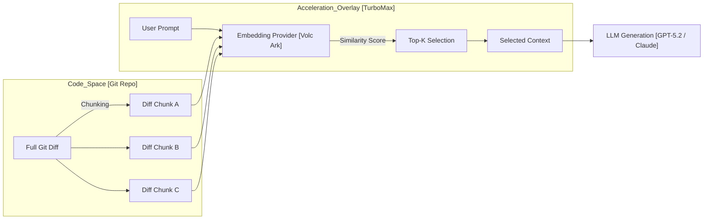
**Sources:** [docs/plans/2026-03-04-turbomax-vector-context-design.md:38-57](), [docs/plans/2026-03-04-turbomax-vector-context-design.md:90-95]()

---

## Implementation Reference

### Key Functions
*   `Get-OpenSpecGovernanceAdvice`: Calculates enforcement levels based on `openspec-policy.json` [scripts/router/modules/30-openspec.ps1:25-32]().
*   `Get-OpenSpecTaskId`: Generates a unique 12-character SHA1 hash for task tracking [scripts/router/modules/30-openspec.ps1:3-23]().
*   `Invoke-OpenSpec-Governance.ps1`: Orchestrates the creation of governance artifacts like Lite Cards or Full Skeletons [scripts/governance/invoke-openspec-governance.ps1:1-12]().

### Configuration Schemas
Overlays are governed by policies that define triggers and bypasses:
*   **Exemptions**: Trivial prompts (e.g., "typo", "small fix") can bypass governance requirements [bundled/skills/vibe/config/openspec-policy.json:80-86]().
*   **Skill Whitelist**: Certain skills like `brainstorming` or `writing-plans` are pre-approved to bypass standard routing governance [bundled/skills/vibe/config/openspec-policy.json:75-79]().

**Sources:** [scripts/router/modules/30-openspec.ps1:124-132](), [scripts/router/modules/30-openspec.ps1:173-175](), [scripts/governance/invoke-openspec-governance.ps1:166-196]()

---

# Page: Skill Library and Pack Manifest

# Skill Library and Pack Manifest

<details>
<summary>Relevant source files</summary>

The following files were used as context for generating this wiki page:

- [bundled/skills/report-generator/SKILL.md](bundled/skills/report-generator/SKILL.md)
- [bundled/skills/vibe/bundled/skills/vibe/config/skills-lock.json](bundled/skills/vibe/bundled/skills/vibe/config/skills-lock.json)
- [bundled/skills/vibe/bundled/skills/vibe/scripts/verify/vibe-generate-skills-lock.ps1](bundled/skills/vibe/bundled/skills/vibe/scripts/verify/vibe-generate-skills-lock.ps1)
- [bundled/skills/vibe/bundled/skills/vibe/scripts/verify/vibe-offline-skills-gate.ps1](bundled/skills/vibe/bundled/skills/vibe/scripts/verify/vibe-offline-skills-gate.ps1)
- [bundled/skills/vibe/bundled/skills/vibe/scripts/verify/vibe-version-packaging-gate.ps1](bundled/skills/vibe/bundled/skills/vibe/scripts/verify/vibe-version-packaging-gate.ps1)
- [bundled/skills/vibe/config/pack-manifest.json](bundled/skills/vibe/config/pack-manifest.json)
- [bundled/skills/vibe/config/skill-keyword-index.json](bundled/skills/vibe/config/skill-keyword-index.json)
- [bundled/skills/vibe/config/skill-routing-rules.json](bundled/skills/vibe/config/skill-routing-rules.json)
- [bundled/skills/vibe/config/skills-lock.json](bundled/skills/vibe/config/skills-lock.json)
- [bundled/skills/vibe/references/fallback-chains.md](bundled/skills/vibe/references/fallback-chains.md)
- [bundled/skills/vibe/references/tool-registry.md](bundled/skills/vibe/references/tool-registry.md)
- [bundled/skills/vibe/scripts/verify/vibe-generate-skills-lock.ps1](bundled/skills/vibe/scripts/verify/vibe-generate-skills-lock.ps1)
- [bundled/skills/vibe/scripts/verify/vibe-offline-skills-gate.ps1](bundled/skills/vibe/scripts/verify/vibe-offline-skills-gate.ps1)
- [bundled/skills/vibe/scripts/verify/vibe-version-packaging-gate.ps1](bundled/skills/vibe/scripts/verify/vibe-version-packaging-gate.ps1)
- [config/pack-manifest.json](config/pack-manifest.json)
- [config/plugins-manifest.codex.json](config/plugins-manifest.codex.json)
- [config/skill-keyword-index.json](config/skill-keyword-index.json)
- [config/skill-routing-rules.json](config/skill-routing-rules.json)
- [config/skills-lock.json](config/skills-lock.json)
- [config/upstream-lock.json](config/upstream-lock.json)
- [references/fallback-chains.md](references/fallback-chains.md)
- [references/tool-registry.md](references/tool-registry.md)
- [scripts/verify/vibe-generate-skills-lock.ps1](scripts/verify/vibe-generate-skills-lock.ps1)
- [scripts/verify/vibe-offline-skills-gate.ps1](scripts/verify/vibe-offline-skills-gate.ps1)
- [scripts/verify/vibe-pack-regression-matrix.ps1](scripts/verify/vibe-pack-regression-matrix.ps1)
- [scripts/verify/vibe-version-packaging-gate.ps1](scripts/verify/vibe-version-packaging-gate.ps1)

</details>


This section describes the organization and governance of the Vibe-Skills library, which contains over 340 specialized skills. These skills are grouped into functional "Packs" and managed through a rigorous manifest system to ensure routing stability and execution reliability across different host environments.

## Skill Library Taxonomy

The skill library is stored in the `bundled/skills/` directory. It follows a modular structure where each skill is a self-contained directory containing a `SKILL.md` (or equivalent) definition and supporting logic.

### Core Pack Categories
The library is organized into logical packs defined in the manifest system [bundled/skills/vibe/config/pack-manifest.json:5-135]():

| Pack ID | Priority | Primary Focus | Key Skills |
| :--- | :--- | :--- | :--- |
| `orchestration-core` | 100 | Vibe runtime and multi-agent coordination | `vibe`, `writing-plans`, `subagent-driven-development` |
| `aios-core` | 96 | Agentic Agile and PRD management | `aios-pm`, `aios-sm`, `aios-po`, `aios-dev` |
| `life-sciences` | 80 | Bioinformatics and molecular biology | `scanpy`, `biopython`, `alphafold-database` |
| `scientific-computing` | 85 | Data science and ML engineering | `scikit-learn`, `shap`, `ml-data-leakage-guard` |
| `web-scraping` | 90 | Targeted data extraction | `scrapling`, `playwright` |

**Sources:** [bundled/skills/vibe/config/pack-manifest.json:5-135](), [config/pack-manifest.json:5-135]()

## Pack Manifest Structure

The `pack-manifest.json` file is the central authority for how the Canonical Router groups skills and assigns priorities.

### Data Schema
Each pack entry in the manifest includes:
*   **id**: Unique identifier for the pack.
*   **priority**: Integer used by the router to resolve overlapping keyword matches.
*   **grade_allow**: List of execution grades (M, L, XL) supported by the pack [bundled/skills/vibe/config/pack-manifest.json:9-13]().
*   **task_allow**: Functional tasks (planning, coding, review, etc.) the pack can handle [bundled/skills/vibe/config/pack-manifest.json:14-20]().
*   **trigger_keywords**: A list of Natural Language strings that trigger pack selection [bundled/skills/vibe/config/pack-manifest.json:21-49]().
*   **skill_candidates**: The specific skills within the library that belong to this pack [bundled/skills/vibe/config/pack-manifest.json:50-78]().
*   **defaults_by_task**: The preferred skill to use for a specific task if no more specific match is found [bundled/skills/vibe/config/pack-manifest.json:79-85]().

**Sources:** [bundled/skills/vibe/config/pack-manifest.json:1-86]()

## Skill Keyword Index and Routing Rules

The `skill-keyword-index.json` provides a fine-grained mapping between natural language intent and specific code entities.

### Scoring Logic
The index uses weighted matching to select the best skill candidate [config/skill-keyword-index.json:4-10]():
*   **keyword_match**: 0.85 weight.
*   **name_match**: 0.15 weight.
*   **fallback_threshold**: 0.15 (scores below this revert to the first candidate or legacy matrix).

### Routing Flow: Intent to Code Entity
The following diagram illustrates how a user's natural language request is transformed into a specific skill execution.

**Diagram: Intent-to-Skill Resolution Pipeline**
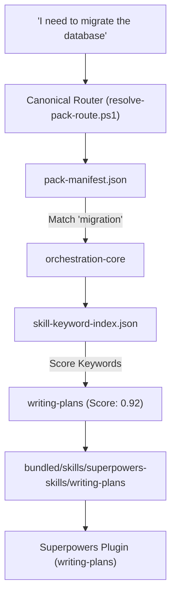
**Sources:** [config/skill-keyword-index.json:1-20](), [bundled/skills/vibe/config/pack-manifest.json:21-30]()

## Skill-Lock Mechanism

To ensure the integrity of the 340+ skill library, Vibe-Skills employs a `skills-lock.json` mechanism. This acts as a Bill of Materials (BOM) for the library.

### Lock Content
The lock file records the state of every skill in the repository [config/skills-lock.json:7-31]():
*   **relative_path**: Location within the `bundled/skills/` taxonomy.
*   **skill_md_hash**: SHA-256 hash of the `SKILL.md` file to detect unauthorized logic changes.
*   **dir_hash**: Recursive hash of the entire skill directory to ensure asset integrity.
*   **file_count / bytes**: Physical footprint verification.

### Verification Gates
The lock is enforced by `vibe-generate-skills-lock.ps1` and checked during CI by `vibe-offline-skills-gate.ps1`. Any modification to a skill without updating the lock results in a governance failure.

**Sources:** [config/skills-lock.json:1-31](), [scripts/verify/vibe-generate-skills-lock.ps1]()

## Tool Registry and Fallback Chains

Skills often depend on external tools or plugins. The `tool-registry.md` tracks the status and capabilities of these integrations.

### Fallback Hierarchy
When a primary skill or tool fails (e.g., an MCP server is offline), the system follows a defined degradation path [references/fallback-chains.md:8-16]():

| Task Type | Grade | Primary Tool | Fallback Tool |
| :--- | :--- | :--- | :--- |
| Planning | L | `superpowers:brainstorming` | `sc:brainstorm` |
| Coding | M | `everything-claude-code:tdd-guide` | `superpowers:test-driven-development` |
| Debugging | M | `superpowers:systematic-debugging` | `error-resolver` |

**Diagram: Tool Capability and Fallback Mapping**
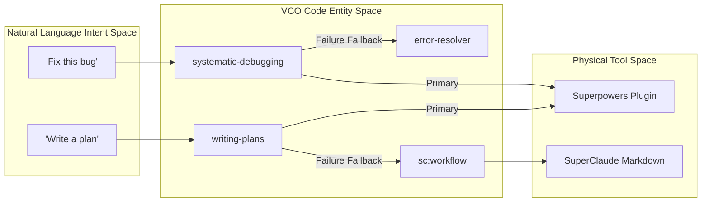

**Sources:** [references/tool-registry.md:1-56](), [references/fallback-chains.md:1-62]()

---

# Page: Installation and Deployment

# Installation and Deployment

<details>
<summary>Relevant source files</summary>

The following files were used as context for generating this wiki page:

- [adapters/index.json](adapters/index.json)
- [check.ps1](check.ps1)
- [check.sh](check.sh)
- [docs/deployment.md](docs/deployment.md)
- [docs/install/README.md](docs/install/README.md)
- [docs/install/custom-skill-governance-rules.md](docs/install/custom-skill-governance-rules.md)
- [docs/install/custom-workflow-onboarding.md](docs/install/custom-workflow-onboarding.md)
- [docs/install/host-plugin-policy.en.md](docs/install/host-plugin-policy.en.md)
- [docs/install/host-plugin-policy.md](docs/install/host-plugin-policy.md)
- [docs/one-shot-setup.md](docs/one-shot-setup.md)
- [install.ps1](install.ps1)
- [install.sh](install.sh)
- [scripts/bootstrap/one-shot-setup.ps1](scripts/bootstrap/one-shot-setup.ps1)
- [scripts/bootstrap/one-shot-setup.sh](scripts/bootstrap/one-shot-setup.sh)
- [scripts/common/vibe-governance-helpers.ps1](scripts/common/vibe-governance-helpers.ps1)
- [scripts/install/Install-VgoAdapter.ps1](scripts/install/Install-VgoAdapter.ps1)
- [scripts/install/install_vgo_adapter.py](scripts/install/install_vgo_adapter.py)

</details>


VibeSkills is designed for high-portability across diverse AI agent environments. The installation system uses a "truth-first" approach where a central canonical repository governs the deployment of payloads into specific host directories. This ensures that while different agents (like Cursor or Claude Code) have different directory structures, the core VibeSkills logic remains consistent and verifiable.

### System Overview

The deployment lifecycle transitions from a raw repository state to a "Host-Governed" state through a multi-stage process involving environment detection, adapter selection, and payload materialization.

#### Core Deployment Concepts
- **One-Shot Setup**: A bootstrap process that handles environment preparation and initial installation.
- **Host Adapters**: Metadata and logic that map the VibeSkills payload to host-specific paths (e.g., `~/.codeium/windsurf`).
- **Distribution Lanes**: Profile-based installation modes (`minimal` vs `full`) that determine the depth of the skill library deployed.
- **Truth Boundaries**: Strict separation between official repo-managed files and user-local configurations (API keys, custom workflows).

### Deployment Flow: Repository to Host

The following diagram illustrates how the installation scripts move logic from the `Vibe-Skills` repository into the active agent environment.

**VibeSkills Deployment Architecture**
```mermaid
graph TD
    subgraph "Source Space (Repository)"
        [one-shot-setup.ps1] --> [install.ps1]
        [install.ps1] --> [adapters/index.json]
        [install.ps1] --> [bundled/skills]
    end

    subgraph "Adapter Logic"
        [Resolve-VgoAdapter.ps1] --> [HostId_Resolution]
        [HostId_Resolution] --> |"codex"| D1[".codex/"]
        [HostId_Resolution] --> |"claude-code"| D2[".claude/"]
        [HostId_Resolution] --> |"windsurf"| D3[".codeium/windsurf/"]
        [HostId_Resolution] --> |"cursor"| D4[".cursor/"]
    end

    subgraph "Target Space (Host Runtime)"
        D1 --> [TargetRoot/skills/vibe]
        D2 --> [TargetRoot/skills/vibe]
        D3 --> [TargetRoot/skills/vibe]
        D4 --> [TargetRoot/skills/vibe]
        [TargetRoot/skills/vibe] --> [check.ps1]
    end

    [check.ps1] -.-> |"Verification"| [runtime-freshness-receipt.json]
```
Sources: [scripts/bootstrap/one-shot-setup.ps1:138-140](), [install.ps1:180-185](), [check.ps1:132-136](), [docs/deployment.md:46-55]()

---

### One-Shot Setup and Bootstrap Scripts
The entry point for most users is the "one-shot" bootstrap script. These scripts (`one-shot-setup.ps1` for Windows/pwsh and `one-shot-setup.sh` for Linux/macOS) automate the detection of the `HostId`, resolve the `TargetRoot`, and invoke the underlying `install` and `check` routines. 

The bootstrap also handles "API Key Seeding" for the Codex environment, persisting keys into the host's `settings.json` to ensure immediate online readiness.

For details, see [One-Shot Setup and Bootstrap Scripts](#3.1).

Sources: [scripts/bootstrap/one-shot-setup.ps1:1-13](), [scripts/bootstrap/one-shot-setup.sh:37-50](), [docs/install/README.md:18-23]()

---

### Host Adapters and Distribution Lanes
VibeSkills identifies hosts using a `HostId` (e.g., `codex`, `claude-code`, `cursor`, `windsurf`). Each host has an associated adapter defined in `adapters/index.json` that dictates the `bootstrap_mode` (e.g., `governed` for Codex vs `runtime-core` for Windsurf).

Installation is further governed by **Profiles**:
| Profile | Description |
| :--- | :--- |
| `minimal` | Deploys the governance foundation and core router only. |
| `full` | Deploys the full 340+ skill library and optional workflow extras. |

For details, see [Host Adapters and Distribution Lanes](#3.2).

Sources: [install.ps1:2-5](), [docs/install/README.md:25-37](), [docs/install/host-plugin-policy.en.md:24-50]()

---

### Custom Workflow and Skill Onboarding
To maintain the "Truth-First" principle, user-added skills are not placed directly into the official `skills/vibe` directory. Instead, they are onboarded via a `custom-workflows.json` manifest located in the host's `config/` directory. This allows the `Canonical Router` to discover user skills without them being overwritten during a VibeSkills update.

For details, see [Custom Workflow and Skill Onboarding](#3.3).

Sources: [docs/install/custom-workflow-onboarding.md:14-26](), [docs/install/custom-workflow-onboarding.md:108-115]()

---

### MCP (Model Context Protocol) Integration
VibeSkills leverages MCP to extend agent capabilities. During installation, the system can materialize host-specific MCP configurations (like `mcp_config.json` for Windsurf or `servers.active.json` for Codex). This process maps repository templates to active host profiles, enabling tools like GitHub integration or advanced web scraping.

For details, see [MCP (Model Context Protocol) Integration](#3.4).

Sources: [scripts/bootstrap/one-shot-setup.ps1:105-108](), [docs/install/host-plugin-policy.en.md:48-49]()

---

### Verification and Health Checks
Post-installation, the `check.ps1` (or `check.sh`) script performs a "Deep Health Check". It verifies the `runtime-freshness-receipt.json` to ensure the deployed payload matches the expected version and profile.

**Installation Verification Sequence**
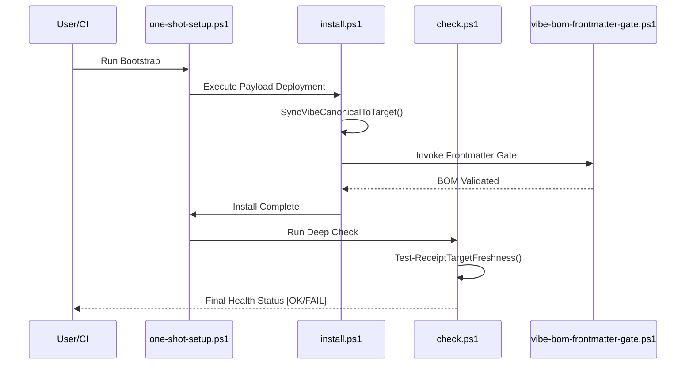
Sources: [install.ps1:72-123](), [check.ps1:132-192](), [scripts/common/vibe-governance-helpers.ps1:151-167]()

---

### Recommended Deployment Commands

#### Windows (PowerShell)
```powershell
# Full installation for Codex
pwsh -File .\scripts\bootstrap\one-shot-setup.ps1 -HostId codex -Profile full
# Deep health check
pwsh -File .\check.ps1 -HostId codex -Profile full -Deep
```

#### Linux / macOS (Bash)
```bash
# Full installation for Windsurf
bash ./scripts/bootstrap/one-shot-setup.sh --host windsurf --profile full
# Deep health check
bash ./check.sh --host windsurf --profile full --deep
```
Sources: [docs/deployment.md:18-44]()

---

# Page: One-Shot Setup and Bootstrap Scripts

# One-Shot Setup and Bootstrap Scripts

<details>
<summary>Relevant source files</summary>

The following files were used as context for generating this wiki page:

- [adapters/index.json](adapters/index.json)
- [check.ps1](check.ps1)
- [check.sh](check.sh)
- [docs/deployment.md](docs/deployment.md)
- [docs/install/README.en.md](docs/install/README.en.md)
- [docs/install/configuration-guide.en.md](docs/install/configuration-guide.en.md)
- [docs/install/full-featured-install-prompts.en.md](docs/install/full-featured-install-prompts.en.md)
- [docs/install/full-featured-install-prompts.md](docs/install/full-featured-install-prompts.md)
- [docs/install/host-plugin-policy.en.md](docs/install/host-plugin-policy.en.md)
- [docs/install/host-plugin-policy.md](docs/install/host-plugin-policy.md)
- [docs/install/installation-rules.en.md](docs/install/installation-rules.en.md)
- [docs/install/installation-rules.md](docs/install/installation-rules.md)
- [docs/install/prompts/framework-only-install.en.md](docs/install/prompts/framework-only-install.en.md)
- [docs/install/prompts/framework-only-install.md](docs/install/prompts/framework-only-install.md)
- [docs/install/prompts/framework-only-update.en.md](docs/install/prompts/framework-only-update.en.md)
- [docs/install/prompts/framework-only-update.md](docs/install/prompts/framework-only-update.md)
- [docs/install/prompts/full-version-install.en.md](docs/install/prompts/full-version-install.en.md)
- [docs/install/prompts/full-version-install.md](docs/install/prompts/full-version-install.md)
- [docs/install/prompts/full-version-update.en.md](docs/install/prompts/full-version-update.en.md)
- [docs/install/prompts/full-version-update.md](docs/install/prompts/full-version-update.md)
- [docs/one-shot-setup.md](docs/one-shot-setup.md)
- [install.ps1](install.ps1)
- [install.sh](install.sh)
- [scripts/bootstrap/one-shot-setup.ps1](scripts/bootstrap/one-shot-setup.ps1)
- [scripts/bootstrap/one-shot-setup.sh](scripts/bootstrap/one-shot-setup.sh)
- [scripts/common/vibe-governance-helpers.ps1](scripts/common/vibe-governance-helpers.ps1)
- [scripts/install/Install-VgoAdapter.ps1](scripts/install/Install-VgoAdapter.ps1)
- [scripts/install/install_vgo_adapter.py](scripts/install/install_vgo_adapter.py)

</details>


The VibeSkills repository provides a "one-shot" bootstrap mechanism designed to automate the transition from a fresh clone to a fully governed execution environment. This process handles host identification, payload deployment, and environmental seeding across Windows and Linux platforms with strict parity.

## Bootstrap Overview

The bootstrap sequence is managed by two primary entry points: `one-shot-setup.ps1` for Windows/PowerShell environments and `one-shot-setup.sh` for Linux/Bash environments. These scripts coordinate the deployment of the Vibe Core Orchestrator (VCO) into specific AI agent "Host Roots" (e.g., `.codex`, `.claude`, `.cursor`).

### Key Parameters
- **Profile**: `minimal` (governance only) or `full` (includes 340+ skills and workflows) [scripts/bootstrap/one-shot-setup.ps1:2-3]().
- **HostId**: Target agent selection (`codex`, `claude-code`, `cursor`, `windsurf`) [scripts/bootstrap/one-shot-setup.ps1:4]().
- **TargetRoot**: Custom filesystem path for the agent's home directory [scripts/bootstrap/one-shot-setup.ps1:5]().
- **Seeding Keys**: Optional parameters for `OpenAIApiKey` and `ArkApiKey` to prepopulate agent settings [scripts/bootstrap/one-shot-setup.ps1:10-12]().

### Cross-Platform Parity
While the codebase is PowerShell-first, the `one-shot-setup.sh` script provides a high-fidelity bridge for Linux users. It detects the presence of `pwsh` to determine if the system can enter the "authoritative full-featured lane" or must remain in a "degraded-but-supported" state [docs/install/full-featured-install-prompts.en.md:34-39]().

## Logic Flow: From Natural Language to Code Execution

The following diagram maps the conceptual bootstrap stages to the specific code entities that implement them.

### Bootstrap Logic Mapping
```mermaid
graph TD
    subgraph "Natural Language Space"
        A["'Install VibeSkills for Codex'"]
        B["'Use full profile'"]
        C["'Seed my API keys'"]
    end

    subgraph "Code Entity Space (Scripts & Functions)"
        direction TB
        OSS_PS["one-shot-setup.ps1"]
        OSS_SH["one-shot-setup.sh"]
        
        RVH["Resolve-VgoHostId"]
        RVT["Resolve-VgoTargetRoot"]
        AVT["Assert-VgoTargetRootMatchesHostIntent"]
        
        INST["install.ps1 / install.sh"]
        PERSIST["persist-codex-openai-env.ps1"]
        MAT["materialize-codex-mcp-profile.ps1"]
        CHECK["check.ps1 / check.sh"]
    end

    A --> OSS_PS
    A --> OSS_SH
    OSS_PS --> RVH
    OSS_PS --> RVT
    RVT --> AVT
    
    B --> INST
    C --> PERSIST
    
    INST --> MAT
    MAT --> CHECK
```
**Sources:** [scripts/bootstrap/one-shot-setup.ps1:55-70](), [scripts/bootstrap/one-shot-setup.sh:37-50](), [scripts/bootstrap/one-shot-setup.ps1:143-150]().

## Implementation Details

### 1. Host and Target Resolution
The bootstrap process begins by resolving the `HostId` and ensuring the `TargetRoot` is valid for that host.
- `Resolve-VgoHostId`: Normalizes inputs like "claude" to the canonical `claude-code` [scripts/common/vibe-governance-helpers.ps1:211-230]().
- `Assert-VgoTargetRootMatchesHostIntent`: A safety gate that prevents installing `codex` payloads into a `.cursor` directory [scripts/bootstrap/one-shot-setup.sh:105-168]().

### 2. Payload Deployment
The `install.ps1` (or `.sh`) script is invoked to perform the heavy lifting:
- **Vibe Core Sync**: Copies the canonical `skills/vibe` core into the target [install.ps1:180-187]().
- **Skill Materialization**: Depending on the profile, it ensures required skills are present, potentially using external fallbacks if configured [install.ps1:139-179]().
- **Adapter Logic**: Invokes `Install-VgoAdapter.ps1` to configure the specific host-runtime bridge [install.ps1:15-19]().

### 3. MCP and Environment Seeding
For `governed` hosts (primarily `codex`), the bootstrap script performs "One-Shot Seeding":
- **API Keys**: Injects `OPENAI_API_KEY` and `ARK_API_KEY` into the host's `settings.json` via `persist-codex-openai-env.ps1` [scripts/bootstrap/one-shot-setup.ps1:143-164]().
- **MCP Materialization**: Automatically creates the `servers.active.json` profile to enable Model Context Protocol tools [scripts/bootstrap/one-shot-setup.ps1:105]().

## The Deep Health Check Sequence

Post-installation, the system runs `check.ps1` (or `check.sh`) with the `-Deep` flag to verify the integrity of the deployment.

### Health Check Execution Flow
```mermaid
sequenceDiagram
    participant U as User/Agent
    participant C as check.ps1
    participant G as version-governance.json
    participant F as Freshness Gate
    participant B as BOM Gate

    U->>C: Invoke -Deep
    C->>G: Load Get-CheckGovernance
    C->>C: Get-InstalledRuntimeConfig
    C->>F: Invoke-InstalledRuntimeFreshnessGate
    Note over F: Validates runtime-freshness-receipt.json
    F-->>C: PASS/FAIL
    C->>B: Invoke-VgoBomFrontmatterGate
    Note over B: Validates SKILL.md checksums
    B-->>C: PASS/FAIL
    C-->>U: Final Readiness State
```
**Sources:** [check.ps1:24-39](), [check.ps1:41-75](), [check.ps1:132-192](), [install.ps1:110-123]().

### Verification Gates
- **Freshness Gate**: Checks the `runtime-freshness-receipt.json` to ensure the installed version matches the repository's expected state [check.ps1:132-146]().
- **BOM Frontmatter Gate**: Validates that all installed skills contain the mandatory metadata and have not been tampered with [install.ps1:110-122]().
- **Coherence Gate**: Ensures that cross-file dependencies and configuration parity are maintained [check.ps1:49]().

## Host Support Matrix

The bootstrap scripts apply different "Bootstrap Modes" based on the `HostId` resolved from `adapters/index.json`.

| HostId | Mode | Default Target Root | Description |
| :--- | :--- | :--- | :--- |
| `codex` | `governed` | `~/.codex` | Full closure; manages settings, MCP, and CLI [docs/install/host-plugin-policy.en.md:24-29](). |
| `claude-code` | `preview` | `~/.claude` | Supported path; does not overwrite host settings [docs/install/host-plugin-policy.en.md:30-36](). |
| `cursor` | `preview` | `~/.cursor` | Guidance-based; host manages its own plugins [docs/install/host-plugin-policy.en.md:37-43](). |
| `windsurf` | `runtime` | `~/.codeium/windsurf` | Integrated with shared runtime payload and global workflows [docs/install/host-plugin-policy.en.md:44-50](). |

**Sources:** [scripts/bootstrap/one-shot-setup.sh:91-103](), [docs/deployment.md:46-55]().

---

# Page: Host Adapters and Distribution Lanes

# Host Adapters and Distribution Lanes

<details>
<summary>Relevant source files</summary>

The following files were used as context for generating this wiki page:

- [adapters/README.md](adapters/README.md)
- [adapters/claude-code/closure.json](adapters/claude-code/closure.json)
- [adapters/claude-code/host-profile.json](adapters/claude-code/host-profile.json)
- [adapters/cursor/closure.json](adapters/cursor/closure.json)
- [adapters/cursor/host-profile.json](adapters/cursor/host-profile.json)
- [adapters/cursor/platform-linux.json](adapters/cursor/platform-linux.json)
- [adapters/cursor/platform-macos.json](adapters/cursor/platform-macos.json)
- [adapters/cursor/platform-windows.json](adapters/cursor/platform-windows.json)
- [adapters/cursor/settings-map.json](adapters/cursor/settings-map.json)
- [adapters/windsurf/closure.json](adapters/windsurf/closure.json)
- [adapters/windsurf/host-profile.json](adapters/windsurf/host-profile.json)
- [adapters/windsurf/platform-linux.json](adapters/windsurf/platform-linux.json)
- [adapters/windsurf/platform-macos.json](adapters/windsurf/platform-macos.json)
- [adapters/windsurf/platform-windows.json](adapters/windsurf/platform-windows.json)
- [adapters/windsurf/settings-map.json](adapters/windsurf/settings-map.json)
- [dist/host-claude-code/manifest.json](dist/host-claude-code/manifest.json)
- [dist/host-cursor/manifest.json](dist/host-cursor/manifest.json)
- [dist/host-opencode/manifest.json](dist/host-opencode/manifest.json)
- [dist/host-windsurf/manifest.json](dist/host-windsurf/manifest.json)
- [dist/manifests/vibeskills-windsurf.json](dist/manifests/vibeskills-windsurf.json)
- [docs/universalization/distribution-lanes.md](docs/universalization/distribution-lanes.md)
- [docs/universalization/install-matrix.md](docs/universalization/install-matrix.md)
- [scripts/bootstrap/scaffold-claude-preview.ps1](scripts/bootstrap/scaffold-claude-preview.ps1)
- [scripts/bootstrap/scaffold-claude-preview.sh](scripts/bootstrap/scaffold-claude-preview.sh)
- [scripts/common/Resolve-VgoAdapter.ps1](scripts/common/Resolve-VgoAdapter.ps1)
- [scripts/common/resolve_vgo_adapter.py](scripts/common/resolve_vgo_adapter.py)

</details>


This page explains the mechanism by which VibeSkills universalizes its core capabilities across different AI host environments (Codex, Claude Code, Cursor, Windsurf, OpenCode). It details the adapter registry, the per-host profile definitions, and the distribution lanes that govern what the repository can truthfully claim about its support level for any given environment.

## 1. The Adapter Registry

The adapter system is anchored by a central registry that maps host identifiers to their respective configuration assets. This registry is resolved dynamically by the orchestrator to determine how to interact with a specific host.

### Registry Resolution
The registry is managed via two primary scripts:
*   **PowerShell**: `Resolve-VgoAdapter.ps1` [scripts/common/Resolve-VgoAdapter.ps1:3-127]()
*   **Python**: `resolve_vgo_adapter.py` [scripts/common/resolve_vgo_adapter.py:71-103]()

These scripts look for an `adapters/index.json` file. If not found, they fall back to an **Embedded Registry** defined within the scripts themselves to ensure bootstrap stability [scripts/common/Resolve-VgoAdapter.ps1:23-97]().

### Registry Structure
The registry defines the following for each host:
*   **`id`**: The unique string identifying the host (e.g., `windsurf`, `claude-code`).
*   **`install_mode` / `check_mode`**: Determines the execution logic used during setup (e.g., `governed`, `preview-guidance`, `runtime-core`).
*   **`default_target_root`**: The environment variable and relative path where the host typically resides (e.g., `WINDSURF_HOME` -> `.codeium/windsurf`) [scripts/common/Resolve-VgoAdapter.ps1:85-89]().
*   **Asset Pointers**: Paths to the `host_profile`, `settings_map`, `closure`, and `manifest` files.

**Sources:** [scripts/common/Resolve-VgoAdapter.ps1](), [scripts/common/resolve_vgo_adapter.py]()

---

## 2. Host Profiles and Closure Contracts

Each supported host has a dedicated directory in `adapters/` containing a "Truth Stack" that defines exactly what the VibeSkills repo manages versus what the host manages.

### Data Flow: From Registry to Host Profile
"Registry to Entity Mapping"
```mermaid
graph TD
    subgraph "Registry (adapters/index.json)"
        REG["Get-VgoEmbeddedAdapterRegistry"]
    end

    subgraph "Host Assets (adapters/windsurf)"
        PROFILE["host-profile.json"]
        CLOSURE["closure.json"]
        SMAP["settings-map.json"]
    end

    REG -->|id: windsurf| PROFILE
    REG -->|closure| CLOSURE
    REG -->|settings_map| SMAP

    PROFILE -->|capabilities| CAP["Capability Matrix"]
    CLOSURE -->|repo_managed_payload| PAYLOAD["File System Sync"]
    SMAP -->|semantics| PATHS["Path Mapping"]
```
**Sources:** [scripts/common/Resolve-VgoAdapter.ps1:80-94](), [adapters/windsurf/host-profile.json](), [adapters/windsurf/closure.json]()

### Key Components of a Host Profile
Using **Windsurf** as a reference:
1.  **`host-profile.json`**: Defines the `runtime_role` (e.g., `official-runtime-adapter`) and the `capabilities` matrix (e.g., `mcp.client: supported-with-constraints`) [adapters/windsurf/host-profile.json:5-35]().
2.  **`closure.json`**: Explicitly lists `repo_managed_payload` (what VibeSkills writes) vs. `host_managed_boundaries` (what VibeSkills *cannot* touch, such as login state or provider credentials) [adapters/windsurf/closure.json:7-29]().
3.  **`settings-map.json`**: Maps internal VCO variables to host-specific paths, such as mapping `vco.skill_root` to `~/.codeium/windsurf/skills` [adapters/windsurf/settings-map.json:5-11]().

**Sources:** [adapters/windsurf/host-profile.json](), [adapters/windsurf/closure.json](), [adapters/windsurf/settings-map.json]()

---

## 3. Install Modes and Closure Levels

VibeSkills enforces strict boundaries on how much "control" it takes over a host's filesystem. These are categorized into **Install Modes** and **Closure Levels**.

| Mode / Level | Meaning | Target Root |
| :--- | :--- | :--- |
| **`governed`** | Full Tier-1 support; repo manages setup and health checks. | Host Home |
| **`preview-guidance`** | Repo provides scaffolds but does not claim full closure. | Host Home |
| **`runtime-core-preview`** | Repo installs core payloads into a documented host root. | Host Home |
| **`runtime-core-only`** | Repo installs payloads into a neutral directory only. | Neutral Root |

**Sources:** [docs/universalization/distribution-lanes.md:28-36](), [docs/universalization/install-matrix.md:16-24]()

---

## 4. Distribution Lanes (`dist/`)

The `dist/` directory serves as the **Distribution Surface**. It contains manifests that describe the "Capability Promise" for each host. This prevents "overclaiming" support before it is technically proven via proof bundles.

### Distribution Lane Truth Boundary
"Natural Language Space to Code Entity Space"
```mermaid
graph LR
    subgraph "Natural Language Promises"
        P1["'We support Windsurf'"]
        P2["'Core Skills only'"]
    end

    subgraph "Code Entity Space (dist)"
        M1["dist/host-windsurf/manifest.json"]
        M2["dist/manifests/vibeskills-windsurf.json"]
    end

    subgraph "Verification (scripts/verify)"
        G1["vibe-dist-manifest-gate.ps1"]
        G2["vgo-adapter-closure-gate.ps1"]
    end

    P1 --> M1
    M1 --> M2
    M2 --> G1
    M1 --> G2
```
**Sources:** [dist/host-windsurf/manifest.json](), [docs/universalization/distribution-lanes.md:73-77]()

### Lane Definitions
*   **`official-runtime`**: The reference implementation (Codex).
*   **`host-windsurf`**: Preview adapter using shared `runtime-core` installers [dist/host-windsurf/manifest.json:11-15]().
*   **`generic`**: Neutral contract consumer; no host-native claims.

### Verification Gates
Distribution lanes are protected by specific gates to ensure manifests do not conflict with documentation:
*   `vibe-dist-manifest-gate.ps1`: Validates the integrity of `dist/**/manifest.json`.
*   `vgo-adapter-target-root-guard-gate.ps1`: Ensures `runtime-core-only` lanes do not attempt to write to host-native directories [docs/universalization/distribution-lanes.md:73-77]().

**Sources:** [docs/universalization/distribution-lanes.md](), [dist/host-windsurf/manifest.json]()

---

## 5. Platform Parity and Promotion

Support for a host is further granularized by OS platform (Windows, Linux, macOS). A host adapter is not considered "supported" until a **Proof Bundle** is generated for that specific platform.

### Platform Status
Using Windsurf as an example:
*   **Linux**: Status is `preview`; evidence exists for `adapter-skeleton-implemented` [adapters/windsurf/platform-linux.json:4-24]().
*   **Windows/macOS**: Status is `not-yet-proven`; requirements include `fresh-machine install proof` [adapters/windsurf/platform-windows.json:4-25](), [adapters/windsurf/platform-macos.json:4-25]().

### Promotion Requirements
To move from `preview` to `supported-with-constraints`, an adapter must satisfy the `promotion_requirements` defined in its platform JSON, such as providing "shell install and check proof" [adapters/windsurf/platform-linux.json:25-29]().

**Sources:** [adapters/windsurf/platform-linux.json](), [adapters/windsurf/platform-windows.json](), [adapters/windsurf/platform-macos.json]()

---

# Page: Custom Workflow and Skill Onboarding

# Custom Workflow and Skill Onboarding

<details>
<summary>Relevant source files</summary>

The following files were used as context for generating this wiki page:

- [docs/install/README.en.md](docs/install/README.en.md)
- [docs/install/README.md](docs/install/README.md)
- [docs/install/configuration-guide.en.md](docs/install/configuration-guide.en.md)
- [docs/install/custom-skill-governance-rules.md](docs/install/custom-skill-governance-rules.md)
- [docs/install/custom-workflow-onboarding.md](docs/install/custom-workflow-onboarding.md)
- [docs/install/installation-rules.en.md](docs/install/installation-rules.en.md)
- [docs/install/prompts/framework-only-install.en.md](docs/install/prompts/framework-only-install.en.md)
- [docs/install/prompts/framework-only-update.en.md](docs/install/prompts/framework-only-update.en.md)
- [docs/install/prompts/full-version-install.en.md](docs/install/prompts/full-version-install.en.md)
- [docs/install/prompts/full-version-update.en.md](docs/install/prompts/full-version-update.en.md)

</details>


This page documents the governed process for extending the Vibe Core Orchestrator (VCO) with custom skills and workflows. It defines the boundary between official managed assets and user-provided extensions, ensuring that new capabilities can be integrated into the Canonical Router without compromising system stability or authority.

## Onboarding Philosophy: Governed Extension

VibeSkills follows a "Truth-First" and "Capability-First" philosophy [docs/install/installation-rules.en.md:1-4](). Custom onboarding is designed to allow expansion while strictly prohibiting system "takeover."

### The "Only One" Rules
To maintain routing integrity, the following invariants are enforced:
1. **One Runtime**: The `vibe` skill remains the sole governor [docs/install/custom-skill-governance-rules.md:9]().
2. **One Route Authority**: The Canonical Router is the only entity permitted to dispatch tasks [docs/install/custom-skill-governance-rules.md:10]().
3. **Explicit Declaration**: No skill is active simply by existing in a directory; it must be declared in a manifest [docs/install/custom-skill-governance-rules.md:11-12]().

## Skill and Workflow Definition

### SKILL.md Format
Every custom skill must reside in its own subdirectory and contain a `SKILL.md` file. This file serves as the contract for the skill, defining its intent, boundaries, and required context [docs/install/custom-workflow-onboarding.md:18-19]().

### Manifest Declaration
Custom workflows are registered via the `custom-workflows.json` manifest. The router reads this file to incorporate custom logic into its scoring and selection process [docs/install/custom-workflow-onboarding.md:20-24]().

**Manifest Schema Example:**
```json
{
  "version": 1,
  "workflows": [
    {
      "id": "my-domain-flow",
      "path": "skills/custom/my-domain-flow",
      "enabled": true,
      "trigger_mode": "advisory",
      "keywords": ["experiment-review", "error-analysis"],
      "intent_tags": ["ml", "research"],
      "preferred_stages": ["deep_interview", "xl_plan"],
      "requires": ["vibe", "writing-plans"],
      "priority": 60,
      "non_goals": ["general chat"]
    }
  ]
}
```
[docs/install/custom-workflow-onboarding.md:28-46]()

### Trigger Modes
The `trigger_mode` determines how the router treats the custom workflow:
*   **`explicit_only`**: Only triggered if the user specifically requests this workflow by ID [docs/install/custom-workflow-onboarding.md:52]().
*   **`advisory`**: (Recommended) The router can suggest this workflow based on intent matching but will not force it [docs/install/custom-workflow-onboarding.md:53-56]().
*   **`auto`**: The router can autonomously select this workflow if confidence scores are sufficiently high [docs/install/custom-workflow-onboarding.md:54]().

**Sources:** [docs/install/custom-workflow-onboarding.md:28-56](), [docs/install/custom-skill-governance-rules.md:75-79]()

---

## Data Flow: From Intent to Custom Execution

The following diagram illustrates how a user's natural language intent is mapped through the Canonical Router to a custom skill defined in the filesystem.

**Natural Language to Code Entity Mapping**
```mermaid
graph TD
    UserIntent["'Run error analysis on my ML model'"] -- "1. Input" --> CanonicalRouter["Canonical Router (resolve-pack-route.ps1)"]
    
    subgraph "Manifest Space"
        Manifest["config/custom-workflows.json"]
        Entry["Workflow ID: my-domain-flow"]
        Manifest -- "Contains" --> Entry
    end
    
    subgraph "Code Entity Space"
        SkillFile["skills/custom/my-domain-flow/SKILL.md"]
        VibeCore["skills/vibe/ (Governor)"]
    end

    CanonicalRouter -- "2. Scans Manifest" --> Manifest
    CanonicalRouter -- "3. Matches Keywords/Tags" --> Entry
    Entry -- "4. Points to Path" --> SkillFile
    SkillFile -- "5. Inherits Governance" --> VibeCore
```
**Sources:** [docs/install/custom-workflow-onboarding.md:15-26](), [docs/install/custom-skill-governance-rules.md:8-12]()

---

## Directory Boundaries and Update Safety

To ensure that custom skills survive VibeSkills updates, a strict boundary is maintained between "Official Managed Surfaces" and "User-Managed Surfaces."

### Surface Boundary Table

| Surface Type | Directory Path | Update Behavior |
| :--- | :--- | :--- |
| **User-Managed** | `skills/custom/` | **Retained**: Update scripts ignore this directory [docs/install/custom-workflow-onboarding.md:92](). |
| **User-Managed** | `config/custom-workflows.json` | **Retained**: Manifests are preserved during updates [docs/install/custom-workflow-onboarding.md:93](). |
| **Official Managed** | `skills/vibe/` | **Overwritten**: Core runtime logic is updated to the latest version [docs/install/custom-workflow-onboarding.md:101](). |
| **Official Managed** | `skills/<official-skill>/` | **Overwritten**: Standard skill packs are refreshed [docs/install/custom-workflow-onboarding.md:102](). |
| **Official Managed** | `scripts/`, `rules/`, `mcp/` | **Overwritten**: Governance scripts and templates are reset [docs/install/custom-workflow-onboarding.md:103-104](). |

**Sources:** [docs/install/custom-workflow-onboarding.md:88-115](), [docs/install/custom-skill-governance-rules.md:23-40]()

---

## Dependency and Readiness Governance

Custom workflows often depend on official skills (e.g., `writing-plans`). These must be explicitly declared in the `requires` field [docs/install/custom-workflow-onboarding.md:40]().

### Verification Lifecycle
The system uses `check --deep` to verify the health of custom integrations [docs/install/custom-workflow-onboarding.md:132]().

**Verification State Machine**
```mermaid
stateDiagram-v2
    [*] --> ManifestCheck: Run 'check --deep'
    ManifestCheck --> SKILL_MD_Check: manifest_valid
    ManifestCheck --> Error_InvalidManifest: manifest_invalid
    
    SKILL_MD_Check --> DependencyCheck: SKILL.md exists
    SKILL_MD_Check --> Error_MissingContent: SKILL.md missing
    
    DependencyCheck --> OnlineReadiness: requires satisfied
    DependencyCheck --> Error_MissingDeps: custom_dependencies_missing
    
    OnlineReadiness --> Ready: VCO_AI_PROVIDER_* Configured
    OnlineReadiness --> LocalOnly: Config Missing
    
    Error_MissingDeps --> [*]
    Ready --> [*]
    LocalOnly --> [*]
```
**Sources:** [docs/install/custom-workflow-onboarding.md:130-135](), [docs/install/custom-skill-governance-rules.md:61-73](), [docs/install/configuration-guide.md:192-200]()

### Readiness States
*   **`lane_complete`**: All official and custom dependencies met [docs/install/custom-skill-governance-rules.md:104]().
*   **`custom_dependencies_missing`**: The workflow exists, but its `requires` list contains skills not present in the current `profile` (e.g., switching from `full` to `minimal`) [docs/install/custom-skill-governance-rules.md:108](), [docs/install/custom-workflow-onboarding.md:139-144]().
*   **`governance_ai_online_ready`**: Requires `VCO_AI_PROVIDER_URL`, `VCO_AI_PROVIDER_API_KEY`, and `VCO_AI_PROVIDER_MODEL` to be set in the host's local environment [docs/install/configuration-guide.md:198]().

## Priority Hierarchy
When multiple skills match an intent, the router applies a fixed priority order to ensure core governance is never bypassed:
1.  **Explicit User Choice**: Overrides all logic [docs/install/custom-workflow-onboarding.md:67]().
2.  **Canonical `vibe`**: The core governor [docs/install/custom-workflow-onboarding.md:68]().
3.  **Official Workflow Core**: Standard high-priority skills [docs/install/custom-workflow-onboarding.md:69]().
4.  **Admitted Custom Workflows**: User-defined extensions [docs/install/custom-workflow-onboarding.md:70]().
5.  **Domain Packs / Overlays**: Specialized advisory layers [docs/install/custom-workflow-onboarding.md:71]().

**Sources:** [docs/install/custom-workflow-onboarding.md:65-72](), [docs/install/custom-skill-governance-rules.md:131-138]()

---

# Page: MCP (Model Context Protocol) Integration

# MCP (Model Context Protocol) Integration

<details>
<summary>Relevant source files</summary>

The following files were used as context for generating this wiki page:

- [bundled/skills/scrapling/SKILL.md](bundled/skills/scrapling/SKILL.md)
- [bundled/skills/scrapling/scripts/scrapling.ps1](bundled/skills/scrapling/scripts/scrapling.ps1)
- [bundled/skills/vibe/mcp/servers.template.json](bundled/skills/vibe/mcp/servers.template.json)
- [bundled/skills/vibe/scripts/verify/vibe-pack-regression-matrix.ps1](bundled/skills/vibe/scripts/verify/vibe-pack-regression-matrix.ps1)
- [docs/deployment.md](docs/deployment.md)
- [docs/install/host-plugin-policy.en.md](docs/install/host-plugin-policy.en.md)
- [docs/install/host-plugin-policy.md](docs/install/host-plugin-policy.md)
- [docs/one-shot-setup.md](docs/one-shot-setup.md)

</details>


This page documents the integration of the Model Context Protocol (MCP) within the VibeSkills ecosystem. It covers the architectural distinction between server templates and active profiles, the materialization process during setup, and the specific plugin-backed and CLI-backed surfaces supported by the runtime.

## 1. Architectural Overview

VibeSkills treats MCP servers as extensible tool surfaces that bridge the gap between the LLM's reasoning and external environments (e.g., GitHub, local scrapers, or specialized APIs). The integration is designed to be host-agnostic while providing specific optimizations for supported hosts like `codex`, `claude-code`, `cursor`, and `windsurf` [docs/install/host-plugin-policy.en.md:9-15]().

### 1.1 Template vs. Active Profile
The system maintains a clear boundary between "shipped truth" and "active runtime configuration":
*   **Server Templates**: Located in [bundled/skills/vibe/mcp/servers.template.json:1-35](), these define the available MCP servers, their execution modes (`stdio` or `plugin`), and required arguments.
*   **Active Profiles**: During installation, the system materializes an active configuration to `~/.codex/mcp/servers.active.json` [docs/one-shot-setup.md:59-59](). This file represents the subset of servers actually enabled and configured for the current host environment.

### 1.2 Data Flow: From Template to Runtime
The following diagram illustrates how MCP configurations move from the repository into the active host environment.

**MCP Materialization Pipeline**
```mermaid
graph TD
    subgraph "Repository (Truth)"
        T["bundled/skills/vibe/mcp/servers.template.json"]
    end

    subgraph "Bootstrap Process (one-shot-setup.ps1)"
        B["Materialize Profile"]
        D["Deep Health Check (check.ps1)"]
    end

    subgraph "Active Runtime (Host Space)"
        A["~/.codex/mcp/servers.active.json"]
        W["Windsurf: mcp_config.json"]
        C["Claude Code: ~/.claude/settings.json"]
    end

    T --> B
    B --> A
    B -- "Optional Materialization" --> W
    A --> D
    D -- "Verify Readiness" --> R["outputs/verify/doctor-artifacts"]
```
**Sources:** [bundled/skills/vibe/mcp/servers.template.json:1-35](), [docs/one-shot-setup.md:55-62](), [docs/deployment.md:46-55]().

---

## 2. Supported MCP Surfaces

VibeSkills categorizes MCP servers into two primary execution modes: `plugin` (host-native extensions) and `stdio` (CLI-based sub-processes).

### 2.1 Plugin-Backed Surfaces
These servers are expected to be managed or provided by the host's native plugin ecosystem. VibeSkills identifies them but does not typically overwrite their internal settings to avoid breaking host stability [docs/install/host-plugin-policy.en.md:37-42]().

| Server ID | Mode | Purpose |
| :--- | :--- | :--- |
| `github` | `plugin` | Integration with GitHub repositories, PRs, and Issues [bundled/skills/vibe/mcp/servers.template.json:3-7](). |
| `context7` | `plugin` | Context-aware retrieval and indexing [bundled/skills/vibe/mcp/servers.template.json:8-11](). |
| `serena` | `plugin` | Specialized agentic workflow support [bundled/skills/vibe/mcp/servers.template.json:12-15](). |

### 2.2 CLI-Backed (stdio) Surfaces
These servers run as independent processes communicating via standard I/O. They are often installed via `npm` or `pip` during the bootstrap phase.

| Server ID | Command | Mode | Notes |
| :--- | :--- | :--- | :--- |
| `scrapling` | `scrapling mcp` | `stdio` | Requires `python -m pip install "scrapling[ai]"` [bundled/skills/vibe/mcp/servers.template.json:16-24](). |
| `claude-flow` | `claude-flow mcp start` | `stdio` | Installed via `npm` during setup [bundled/skills/vibe/mcp/servers.template.json:25-33](), [docs/one-shot-setup.md:72-72](). |

---

## 3. Deep Dive: Scrapling Integration

`scrapling` is a primary example of a "full-profile" MCP surface that provides high-fidelity web scraping capabilities.

### 3.1 Execution and Verification
The system uses a wrapper script `scrapling.ps1` to ensure the environment is ready before attempting to invoke the MCP server.

**Scrapling Skill Readiness Flow**
```mermaid
graph TD
    subgraph "Code Entity: scrapling.ps1"
        Start["Check 'scrapling' on PATH"]
        Found{"Is Command Found?"}
        Exec["Invoke: scrapling @args"]
        Warn["Print Install Hints"]
    end

    subgraph "CLI / MCP Commands"
        MCP["scrapling mcp"]
        Ext["scrapling extract get"]
    end

    Start --> Found
    Found -- "Yes" --> Exec
    Found -- "No" --> Warn
    Exec --> MCP
    Exec --> Ext
```
**Sources:** [bundled/skills/scrapling/scripts/scrapling.ps1:1-28](), [bundled/skills/scrapling/SKILL.md:107-122]().

### 3.2 Implementation Details
*   **Skill Contract**: Defined in [bundled/skills/scrapling/SKILL.md:1-4](), it prioritizes CSS selector-based extraction to minimize token bloat.
*   **Routing Logic**: The `vibe-pack-regression-matrix.ps1` validates that scraping prompts are correctly routed to the `web-scraping` pack, which contains the `scrapling` skill [bundled/skills/vibe/scripts/verify/vibe-pack-regression-matrix.ps1:63-65]().

---

## 4. Materialization and Readiness

The `one-shot-setup.ps1` script performs the heavy lifting of MCP integration.

### 4.1 Setup Sequence
1.  **Dependency Check**: Verifies `node`, `npm`, and `python` availability [docs/one-shot-setup.md:40-44]().
2.  **CLI Installation**: Attempts to install `claude-flow` via npm and `scrapling[ai]` via pip [docs/one-shot-setup.md:51-54, 82-82]().
3.  **Profile Materialization**: Writes the `servers.active.json` based on the selected profile (`minimal` vs `full`) [docs/one-shot-setup.md:59-59]().
4.  **Deep Doctor**: Executes `check.ps1 -Deep` to verify if the MCP endpoints are responsive [docs/one-shot-setup.md:120-127]().

### 4.2 Readiness States
The `check.ps1` script classifies the MCP integration into three states [docs/one-shot-setup.md:128-136]():
*   **`fully_ready`**: All `stdio` servers are on PATH and `plugin` servers are noted.
*   **`manual_actions_pending`**: Core logic is installed, but specific secrets (like `OPENAI_API_KEY`) or host-side MCP registrations are missing [docs/one-shot-setup.md:141-155]().
*   **`core_install_incomplete`**: The foundation (scripts/templates) failed to deploy.

**Sources:** [docs/one-shot-setup.md:128-155](), [docs/deployment.md:1-31]().

---

# Page: Governance and Verification System

# Governance and Verification System

<details>
<summary>Relevant source files</summary>

The following files were used as context for generating this wiki page:

- [bundled/skills/vibe/bundled/skills/vibe/config/version-governance.json](bundled/skills/vibe/bundled/skills/vibe/config/version-governance.json)
- [bundled/skills/vibe/bundled/skills/vibe/references/changelog.md](bundled/skills/vibe/bundled/skills/vibe/references/changelog.md)
- [bundled/skills/vibe/bundled/skills/vibe/references/release-ledger.jsonl](bundled/skills/vibe/bundled/skills/vibe/references/release-ledger.jsonl)
- [bundled/skills/vibe/config/version-governance.json](bundled/skills/vibe/config/version-governance.json)
- [bundled/skills/vibe/docs/releases/README.md](bundled/skills/vibe/docs/releases/README.md)
- [bundled/skills/vibe/references/index.md](bundled/skills/vibe/references/index.md)
- [bundled/skills/vibe/references/release-ledger.jsonl](bundled/skills/vibe/references/release-ledger.jsonl)
- [config/version-governance.json](config/version-governance.json)
- [docs/releases/README.md](docs/releases/README.md)
- [references/index.md](references/index.md)
- [references/release-ledger.jsonl](references/release-ledger.jsonl)
- [scripts/router/resolve-pack-route.ps1](scripts/router/resolve-pack-route.ps1)
- [scripts/verify/README.md](scripts/verify/README.md)
- [scripts/verify/vibe-config-parity-gate.ps1](scripts/verify/vibe-config-parity-gate.ps1)

</details>


The **Governance and Verification System** provides the structural integrity for the Vibe-Skills repository. It ensures that the distributed skill library, the core orchestrator (VCO), and the various mirror sites remain synchronized, version-consistent, and verified against a battery of automated gates. This system transitions the repository from a collection of scripts into a governed, release-ready platform.

### System Overview Diagram

This diagram illustrates how governance policies in the "Natural Language Space" (contracts and policies) are enforced upon the "Code Entity Space" (scripts and configs).

```mermaid
graph TD
    subgraph "Natural Language Space (Policies)"
        [unified-task-contract.md]
        [mirror-topology.md]
        [release-evidence-bundle-contract.md]
    end

    subgraph "Governance Control Plane"
        VGO["config/version-governance.json"]
        LEDGER["references/release-ledger.jsonl"]
    end

    subgraph "Code Entity Space (Verification & Execution)"
        GATES["scripts/verify/*.ps1"]
        SYNC["scripts/governance/sync-bundled-vibe.ps1"]
        DOCTOR["vibe-bootstrap-doctor-gate.ps1"]
    end

    [unified-task-contract.md] -.-> VGO
    [mirror-topology.md] -.-> VGO
    VGO --> GATES
    VGO --> SYNC
    GATES --> LEDGER
    DOCTOR --> LEDGER
```
**Sources:** [config/version-governance.json:1-135](), [references/index.md:1-25](), [scripts/verify/README.md:1-60]()

---

## 4.1 Version Governance and Release Lifecycle
The lifecycle is anchored by `config/version-governance.json`, which defines the source-of-truth hierarchy and the mirror topology [config/version-governance.json:9-46](). Every release is recorded in an append-only `references/release-ledger.jsonl` [references/release-ledger.jsonl:1-30](), ensuring a traceable history of version promotions.

**Key Components:**
*   **Mirror Topology:** Defines `canonical`, `bundled`, and `nested_bundled` targets with specific parity policies (e.g., `authoritative` vs `full`) [config/version-governance.json:14-46]().
*   **Execution Context Lock:** Prevents scripts from running if they are detected under a mirror root instead of the canonical root to avoid "stale execution" [config/version-governance.json:47-50]().
*   **Freshness Receipts:** A mechanism where the installed runtime validates its own version against the repository state [config/version-governance.json:90-96]().

For details, see [Version Governance and Release Lifecycle](#4.1).

**Sources:** [config/version-governance.json:1-135](), [references/release-ledger.jsonl:1-30]()

---

## 4.2 Verification Gates
Verification gates are automated scripts located in `scripts/verify/` that act as quality checkpoints. They are categorized into "Gate Families" such as Runtime Integrity, Cleanliness, and Routing Core [scripts/verify/README.md:58-66]().

| Gate Script | Responsibility |
| :--- | :--- |
| `vibe-config-parity-gate.ps1` | Ensures JSON configs in `config/` match those in `bundled/skills/vibe/config/` [scripts/verify/vibe-config-parity-gate.ps1:184-200](). |
| `vibe-version-consistency-gate.ps1` | Validates metadata across `version-governance.json`, changelogs, and maintenance markers [scripts/verify/README.md:93-93](). |
| `vibe-repo-cleanliness-gate.ps1` | Blocks local noise and uncommitted artifacts from entering the release stream [scripts/verify/README.md:95-95](). |
| `vibe-routing-stability-gate.ps1` | Reports on `route_stability` and `misroute_rate` to ensure intent resolution hasn't drifted [scripts/verify/README.md:90-90](). |

For details, see [Verification Gates](#4.2).

**Sources:** [scripts/verify/README.md:28-96](), [scripts/verify/vibe-config-parity-gate.ps1:1-175]()

---

## 4.3 Governance Scripts and Policies
This subsystem handles the active management of the repository's standards. It includes OpenSpec policy enforcement, upstream auditing, and phase-end cleanup procedures.

**Governance Flow:**
```mermaid
graph LR
    subgraph "scripts/governance/"
        A["phase-end-cleanup.ps1"] --> B["Purge .tmp/"]
        A --> C["Run Cleanliness Gates"]
        D["invoke-openspec-governance.ps1"] --> E["Enforce Policy"]
    end
    subgraph "scripts/router/modules/"
        F["30-openspec.ps1"]
        G["33-memory-governance.ps1"]
    end
    E -.-> F
```
**Sources:** [scripts/verify/README.md:35-56](), [scripts/router/resolve-pack-route.ps1:18-50]()

*   **Phase-End Cleanup:** A standardized sequence to purge temporary files and rerun hygiene gates before a batch goal is closed [scripts/verify/README.md:35-51]().
*   **OpenSpec Governance:** Managed via `openspec-policy.json` and enforced during routing [scripts/router/resolve-pack-route.ps1:29-29]().

For details, see [Governance Scripts and Policies](#4.3).

---

## 4.4 Contribution Rules and Change Control
The repository employs a zoned contribution model to protect the "Control Plane" while encouraging skill additions. Changes are classified (Class A through D) based on their impact on the core orchestrator or the mirror topology.

*   **Z0 Frozen Control Plane:** Core logic and governance schemas.
*   **Z1 Guarded Governance:** Configuration and threshold changes.
*   **Z3 Preferred Contribution:** New skills and documentation.

For details, see [Contribution Rules and Change Control](#4.4).

**Sources:** [references/index.md:9-15](), [scripts/verify/README.md:62-62]()

---

# Page: Version Governance and Release Lifecycle

# Version Governance and Release Lifecycle

<details>
<summary>Relevant source files</summary>

The following files were used as context for generating this wiki page:

- [bundled/skills/vibe/bundled/skills/vibe/config/version-governance.json](bundled/skills/vibe/bundled/skills/vibe/config/version-governance.json)
- [bundled/skills/vibe/bundled/skills/vibe/docs/releases/README.md](bundled/skills/vibe/bundled/skills/vibe/docs/releases/README.md)
- [bundled/skills/vibe/bundled/skills/vibe/references/changelog.md](bundled/skills/vibe/bundled/skills/vibe/references/changelog.md)
- [bundled/skills/vibe/bundled/skills/vibe/references/release-ledger.jsonl](bundled/skills/vibe/bundled/skills/vibe/references/release-ledger.jsonl)
- [bundled/skills/vibe/config/version-governance.json](bundled/skills/vibe/config/version-governance.json)
- [bundled/skills/vibe/docs/releases/README.md](bundled/skills/vibe/docs/releases/README.md)
- [bundled/skills/vibe/references/release-ledger.jsonl](bundled/skills/vibe/references/release-ledger.jsonl)
- [bundled/skills/vibe/scripts/verify/vibe-version-consistency-gate.ps1](bundled/skills/vibe/scripts/verify/vibe-version-consistency-gate.ps1)
- [config/version-governance.json](config/version-governance.json)
- [docs/brand/github-branding-copy.md](docs/brand/github-branding-copy.md)
- [docs/plans/2026-03-20-readme-en-detail-and-github-branding-copy-plan.md](docs/plans/2026-03-20-readme-en-detail-and-github-branding-copy-plan.md)
- [docs/plans/README.md](docs/plans/README.md)
- [docs/releases/README.md](docs/releases/README.md)
- [docs/requirements/2026-03-20-readme-en-detail-and-github-branding-copy.md](docs/requirements/2026-03-20-readme-en-detail-and-github-branding-copy.md)
- [docs/requirements/README.md](docs/requirements/README.md)
- [references/release-ledger.jsonl](references/release-ledger.jsonl)
- [scripts/verify/vibe-version-consistency-gate.ps1](scripts/verify/vibe-version-consistency-gate.ps1)

</details>


This section documents the mechanisms used to ensure version consistency, mirror integrity, and release reliability across the VibeSkills repository. The system relies on a central governance configuration, an append-only ledger, and a multi-stage verification process that must be satisfied before any release is considered authoritative.

## 1. Version Governance Configuration

The `version-governance.json` file is the central authority for the repository's topology and versioning state. It defines how the "Canonical" source of truth relates to various mirrors and how the runtime environment should be validated.

### 1.1 Mirror Topology
VibeSkills employs a **Mirror Topology** to maintain consistency across different distribution surfaces. The configuration defines three primary roles:
*   **Canonical**: The absolute source of truth (usually the repository root).
*   **Mirror**: A full copy of the canonical truth, synchronized automatically.
*   **Nested Mirror**: A recursive mirror (e.g., `vibe` within `vibe`) used for specific packaging requirements.

The `parity_policy` ensures that mirrors do not drift from the canonical source:
*   `authoritative`: The source against which others are compared.
*   `full`: Requires bit-for-bit parity with the source.

### 1.2 Execution Context Lock
To prevent accidental execution from unverified or "dirty" environments, the governance policy enforces an **Execution Context Lock**.
*   `require_outer_git_root`: Ensures the script is running within a valid Git repository [config/version-governance.json:48-48]().
*   `fail_if_script_path_is_under_mirror_root`: Prevents execution of scripts located inside a mirror directory to ensure the operator is always working on the canonical source [config/version-governance.json:49-49]().

**Version Governance Data Flow**
The following diagram illustrates how `version-governance.json` drives the system's integrity.

Title: Version Governance Data Flow
```mermaid
graph TD
    subgraph "Governance Source"
        VG["config/version-governance.json"]
    end

    subgraph "Verification Gates"
        VCG["vibe-version-consistency-gate.ps1"]
        RCG["vibe-release-install-runtime-coherence-gate.ps1"]
    end

    subgraph "Mirror Topology"
        CR["Canonical Root [.]"]
        BR["Bundled Root [bundled/skills/vibe]"]
        NBR["Nested Bundled Root"]
    end

    VG -->|"defines version/updated"| VCG
    VG -->|"defines mirror paths"| CR
    CR -->|"sync_enabled: true"| BR
    BR -->|"parity_policy: full"| NBR
    VCG -->|"asserts markers"| CR
    VCG -->|"asserts markers"| BR
```
Sources: [config/version-governance.json:14-46](), [scripts/verify/vibe-version-consistency-gate.ps1:27-40]()

## 2. Release Ledger and History

The release history is maintained in an append-only format to provide a tamper-evident audit trail of all version transitions.

### 2.1 Release Ledger (`release-ledger.jsonl`)
The ledger is a JSONL (JSON Lines) file where each entry represents a version cut. It records:
*   `version`: The SemVer-compliant version string.
*   `git_head`: The specific commit hash associated with the release.
*   `updated`: The ISO date of the release.
*   `actor`: The entity (human or bot) that performed the cut [references/release-ledger.jsonl:1-10]().

### 2.2 Version Consistency Gate
The `vibe-version-consistency-gate.ps1` script performs automated validation of the ledger against other version markers in the repository:
1.  **Maintenance Files**: Checks `SKILL.md` and other markers for matching version/date strings [scripts/verify/vibe-version-consistency-gate.ps1:56-78]().
2.  **Changelog**: Verifies that `references/changelog.md` contains a header matching the current release [scripts/verify/vibe-version-consistency-gate.ps1:80-94]().
3.  **Ledger Tail**: Ensures the last entry in the ledger matches the `version-governance.json` [scripts/verify/vibe-version-consistency-gate.ps1:96-121]().

Sources: [references/release-ledger.jsonl:1-30](), [scripts/verify/vibe-version-consistency-gate.ps1:35-121]()

## 3. Release Lifecycle and Cut Process

The release process is governed by a strict lifecycle that transitions from requirements to verified proof bundles.

### 3.1 Requirement-to-Plan Traceability
Every release must originate from a frozen requirement document in `docs/requirements/`. Execution plans in `docs/plans/` must explicitly trace back to these requirements rather than raw chat history [docs/requirements/README.md:1-10]().

### 3.2 The Release Cut Command
Operators perform a release cut using the canonical command:
```powershell
pwsh -NoProfile -ExecutionPolicy Bypass -File .\scripts\governance\release-cut.ps1 -RunGates
```
This command triggers the "Stop-Ship" gate families, including topology integrity, runtime coherence, and fallback truth honesty [docs/releases/README.md:51-66]().

### 3.3 Freshness Receipts and Proof Bundles
Upon installation, the system generates a **Freshness Receipt** (`runtime-freshness-receipt.json`). This receipt is a signed contract proving that the installed runtime matches the versioned truth [config/version-governance.json:92-96]().

A **Proof Bundle** is the final artifact of a release, containing:
*   Execution manifests.
*   Per-unit receipts.
*   Command logs.
*   A tracked proof manifest verified by `vibe-benchmark-autonomous-proof-gate.ps1` [bundled/skills/vibe/bundled/skills/vibe/references/changelog.md:48-53]().

**Release Lifecycle Implementation**
This diagram maps the release lifecycle stages to specific codebase entities.

Title: Release Lifecycle to Code Entity Mapping
```mermaid
graph LR
    subgraph "NL Space: Requirements"
        REQ["Frozen Requirement Document"]
    end

    subgraph "Code Entity Space: Execution"
        PLAN["docs/plans/*.md"]
        CUT["scripts/governance/release-cut.ps1"]
        VGO["Get-VgoGovernanceContext"]
    end

    subgraph "Code Entity Space: Verification"
        GATE["vibe-version-consistency-gate.ps1"]
        BOM["vibe-bom-frontmatter-gate.ps1"]
        PROOF["vibe-benchmark-autonomous-proof-gate.ps1"]
    end

    subgraph "Output: Release Truth"
        LEDGER["references/release-ledger.jsonl"]
        RECEIPT["runtime-freshness-receipt.json"]
    end

    REQ --> PLAN
    PLAN --> CUT
    CUT --> VGO
    VGO --> GATE
    GATE --> BOM
    BOM --> PROOF
    PROOF --> LEDGER
    LEDGER --> RECEIPT
```
Sources: [docs/requirements/README.md:1-10](), [docs/releases/README.md:51-66](), [scripts/verify/vibe-version-consistency-gate.ps1:27-30](), [config/version-governance.json:92-96]()

## 4. Governance Policies

| Policy | Description | File Path |
| :--- | :--- | :--- |
| **Presence Policy** | Defines if a file/mirror is required or optional. | [config/version-governance.json:23]() |
| **Parity Policy** | Determines if a mirror must be a `full` bitwise match. | [config/version-governance.json:25]() |
| **Runtime Markers** | List of 25+ critical files required for a valid runtime. | [config/version-governance.json:98-125]() |
| **No-Silent-Fallback** | Forbids fallback to degraded modes without explicit approval. | [config/version-governance.json:7-8]() |

Sources: [config/version-governance.json:1-135]()

---

# Page: Verification Gates

# Verification Gates

<details>
<summary>Relevant source files</summary>

The following files were used as context for generating this wiki page:

- [bundled/skills/report-generator/SKILL.md](bundled/skills/report-generator/SKILL.md)
- [bundled/skills/vibe/bundled/skills/vibe/config/skills-lock.json](bundled/skills/vibe/bundled/skills/vibe/config/skills-lock.json)
- [bundled/skills/vibe/bundled/skills/vibe/docs/document-asset-cleanup-governance.md](bundled/skills/vibe/bundled/skills/vibe/docs/document-asset-cleanup-governance.md)
- [bundled/skills/vibe/bundled/skills/vibe/docs/proof/document-safety-remediation-proof-plan.md](bundled/skills/vibe/bundled/skills/vibe/docs/proof/document-safety-remediation-proof-plan.md)
- [bundled/skills/vibe/bundled/skills/vibe/scripts/common/ProtectedDocumentCleanup.ps1](bundled/skills/vibe/bundled/skills/vibe/scripts/common/ProtectedDocumentCleanup.ps1)
- [bundled/skills/vibe/bundled/skills/vibe/scripts/verify/fixtures/document-cleanup-safety/README.md](bundled/skills/vibe/bundled/skills/vibe/scripts/verify/fixtures/document-cleanup-safety/README.md)
- [bundled/skills/vibe/bundled/skills/vibe/scripts/verify/fixtures/document-cleanup-safety/ambiguous-cn-set/metadata.json](bundled/skills/vibe/bundled/skills/vibe/scripts/verify/fixtures/document-cleanup-safety/ambiguous-cn-set/metadata.json)
- [bundled/skills/vibe/bundled/skills/vibe/scripts/verify/fixtures/document-cleanup-safety/mixed-office-assets/metadata.json](bundled/skills/vibe/bundled/skills/vibe/scripts/verify/fixtures/document-cleanup-safety/mixed-office-assets/metadata.json)
- [bundled/skills/vibe/bundled/skills/vibe/scripts/verify/fixtures/document-cleanup-safety/mixed-office-assets/source/docs/reference-manual.pdf](bundled/skills/vibe/bundled/skills/vibe/scripts/verify/fixtures/document-cleanup-safety/mixed-office-assets/source/docs/reference-manual.pdf)
- [bundled/skills/vibe/bundled/skills/vibe/scripts/verify/fixtures/document-cleanup-safety/non-protected-control/metadata.json](bundled/skills/vibe/bundled/skills/vibe/scripts/verify/fixtures/document-cleanup-safety/non-protected-control/metadata.json)
- [bundled/skills/vibe/bundled/skills/vibe/scripts/verify/vibe-document-asset-safety-gate.ps1](bundled/skills/vibe/bundled/skills/vibe/scripts/verify/vibe-document-asset-safety-gate.ps1)
- [bundled/skills/vibe/bundled/skills/vibe/scripts/verify/vibe-generate-skills-lock.ps1](bundled/skills/vibe/bundled/skills/vibe/scripts/verify/vibe-generate-skills-lock.ps1)
- [bundled/skills/vibe/bundled/skills/vibe/scripts/verify/vibe-governed-runtime-contract-gate.ps1](bundled/skills/vibe/bundled/skills/vibe/scripts/verify/vibe-governed-runtime-contract-gate.ps1)
- [bundled/skills/vibe/bundled/skills/vibe/scripts/verify/vibe-offline-skills-gate.ps1](bundled/skills/vibe/bundled/skills/vibe/scripts/verify/vibe-offline-skills-gate.ps1)
- [bundled/skills/vibe/bundled/skills/vibe/scripts/verify/vibe-runtime-boundary-gate.ps1](bundled/skills/vibe/bundled/skills/vibe/scripts/verify/vibe-runtime-boundary-gate.ps1)
- [bundled/skills/vibe/bundled/skills/vibe/scripts/verify/vibe-version-packaging-gate.ps1](bundled/skills/vibe/bundled/skills/vibe/scripts/verify/vibe-version-packaging-gate.ps1)
- [bundled/skills/vibe/config/skills-lock.json](bundled/skills/vibe/config/skills-lock.json)
- [bundled/skills/vibe/references/index.md](bundled/skills/vibe/references/index.md)
- [bundled/skills/vibe/scripts/verify/vibe-generate-skills-lock.ps1](bundled/skills/vibe/scripts/verify/vibe-generate-skills-lock.ps1)
- [bundled/skills/vibe/scripts/verify/vibe-governed-runtime-contract-gate.ps1](bundled/skills/vibe/scripts/verify/vibe-governed-runtime-contract-gate.ps1)
- [bundled/skills/vibe/scripts/verify/vibe-mirror-edit-hygiene-gate.ps1](bundled/skills/vibe/scripts/verify/vibe-mirror-edit-hygiene-gate.ps1)
- [bundled/skills/vibe/scripts/verify/vibe-offline-skills-gate.ps1](bundled/skills/vibe/scripts/verify/vibe-offline-skills-gate.ps1)
- [bundled/skills/vibe/scripts/verify/vibe-repo-cleanliness-gate.ps1](bundled/skills/vibe/scripts/verify/vibe-repo-cleanliness-gate.ps1)
- [bundled/skills/vibe/scripts/verify/vibe-version-packaging-gate.ps1](bundled/skills/vibe/scripts/verify/vibe-version-packaging-gate.ps1)
- [config/skills-lock.json](config/skills-lock.json)
- [docs/document-asset-cleanup-governance.md](docs/document-asset-cleanup-governance.md)
- [docs/proof/document-safety-remediation-proof-plan.md](docs/proof/document-safety-remediation-proof-plan.md)
- [references/index.md](references/index.md)
- [scripts/common/ProtectedDocumentCleanup.ps1](scripts/common/ProtectedDocumentCleanup.ps1)
- [scripts/router/resolve-pack-route.ps1](scripts/router/resolve-pack-route.ps1)
- [scripts/verify/README.md](scripts/verify/README.md)
- [scripts/verify/fixtures/document-cleanup-safety/README.md](scripts/verify/fixtures/document-cleanup-safety/README.md)
- [scripts/verify/fixtures/document-cleanup-safety/ambiguous-cn-set/metadata.json](scripts/verify/fixtures/document-cleanup-safety/ambiguous-cn-set/metadata.json)
- [scripts/verify/fixtures/document-cleanup-safety/mixed-office-assets/metadata.json](scripts/verify/fixtures/document-cleanup-safety/mixed-office-assets/metadata.json)
- [scripts/verify/fixtures/document-cleanup-safety/mixed-office-assets/source/docs/reference-manual.pdf](scripts/verify/fixtures/document-cleanup-safety/mixed-office-assets/source/docs/reference-manual.pdf)
- [scripts/verify/fixtures/document-cleanup-safety/non-protected-control/metadata.json](scripts/verify/fixtures/document-cleanup-safety/non-protected-control/metadata.json)
- [scripts/verify/vibe-config-parity-gate.ps1](scripts/verify/vibe-config-parity-gate.ps1)
- [scripts/verify/vibe-document-asset-safety-gate.ps1](scripts/verify/vibe-document-asset-safety-gate.ps1)
- [scripts/verify/vibe-generate-skills-lock.ps1](scripts/verify/vibe-generate-skills-lock.ps1)
- [scripts/verify/vibe-governed-runtime-contract-gate.ps1](scripts/verify/vibe-governed-runtime-contract-gate.ps1)
- [scripts/verify/vibe-mirror-edit-hygiene-gate.ps1](scripts/verify/vibe-mirror-edit-hygiene-gate.ps1)
- [scripts/verify/vibe-offline-skills-gate.ps1](scripts/verify/vibe-offline-skills-gate.ps1)
- [scripts/verify/vibe-repo-cleanliness-gate.ps1](scripts/verify/vibe-repo-cleanliness-gate.ps1)
- [scripts/verify/vibe-runtime-boundary-gate.ps1](scripts/verify/vibe-runtime-boundary-gate.ps1)
- [scripts/verify/vibe-version-packaging-gate.ps1](scripts/verify/vibe-version-packaging-gate.ps1)

</details>


Verification gates are automated governance scripts located in `scripts/verify/` designed to enforce repository invariants, configuration parity, and routing stability across the VibeSkills ecosystem. These gates serve as the primary defensive layer for the **Vibe Core Orchestrator (VCO)**, ensuring that changes to the canonical source of truth are correctly mirrored and that the runtime remains deterministic [scripts/verify/README.md:1-4]().

## Gate Execution Lifecycle

Gates are organized into "Families" based on their governance domain. The execution order is governed by the **Cleanup-First Canonical Run Order** [scripts/verify/README.md:28-33]().

1.  **Runtime Integrity / Packaging**: Validated first when touching versions or frontmatter.
2.  **Cleanliness / Mirror Hygiene**: Executed after every canonical batch to ensure no local noise or mirror drift.
3.  **Domain-Specific Gates**: Overlay, Plane, or Capability gates run based on the specific area of change.
4.  **Closure Gates**: Executed only during planning board or release evidence changes.

### Minimal Phase-End Sequence
For clean phase closure, the wrapper `scripts/governance/phase-end-cleanup.ps1` executes a fixed sequence: purge `.tmp/`, refresh excludes, and run the cleanliness, boundary, and node audit gates [scripts/verify/README.md:35-51]().

---

## Configuration and Mirror Gates

### Config Parity Gate
`vibe-config-parity-gate.ps1` ensures structural and value-level synchronization between the main `config/` directory and the `bundled/skills/vibe/config/` mirror [scripts/verify/vibe-config-parity-gate.ps1:184-195]().

*   **Implementation**: Uses `Normalize-JsonNode` to strip ignored keys (like `updated`) and sort properties before performing a deep comparison [scripts/verify/vibe-config-parity-gate.ps1:24-56]().
*   **Data Flow**: It loads pairs of JSON files, generates SHA256 hashes of the normalized content, and reports specific `DiffPaths` where mismatches occur [scripts/verify/vibe-config-parity-gate.ps1:63-150]().

### Mirror Edit Hygiene Gate
`vibe-mirror-edit-hygiene-gate.ps1` prevents "shadow edits" where changes are made directly to bundled mirrors instead of the canonical source [scripts/verify/vibe-mirror-edit-hygiene-gate.ps1:166-191]().

*   **Logic**: It classifies `git status` entries into `mirror_only_edits`, `paired_mirror_edits` (valid), and `reconciled_mirror_edits` [scripts/verify/vibe-mirror-edit-hygiene-gate.ps1:173-182]().
*   **Enforcement**: If a file in `bundled/` is changed without a corresponding change in the canonical root, the gate fails to maintain the "Truth-First" principle [scripts/verify/vibe-mirror-edit-hygiene-gate.ps1:112-123]().

### System Entity Mapping: Mirror Topology
The following diagram illustrates how the verification gates bridge the physical file structure to the governance "Truth" model.

```mermaid
graph TD
    subgraph "Natural Language Space (Policies)"
        P1["Truth-First Principle"]
        P2["Mirror Parity Policy"]
        P3["Zero-Noise Hygiene"]
    end

    subgraph "Code Entity Space (scripts/verify)"
        CPG["vibe-config-parity-gate.ps1"]
        MEH["vibe-mirror-edit-hygiene-gate.ps1"]
        RCG["vibe-repo-cleanliness-gate.ps1"]
    end

    subgraph "Data Sources (FileSystem)"
        CONF["/config/*.json"]
        BNDL["/bundled/skills/vibe/config/"]
        GIT["git status --porcelain"]
    end

    P1 --> MEH
    P2 --> CPG
    P3 --> RCG

    CPG -- "Normalize-JsonNode" --> CONF
    CPG -- "Compare-NormalizedNode" --> BNDL
    MEH -- "Get-GitStatusEntries" --> GIT
    RCG -- "Test-PathMatchesPolicy" --> GIT
```
**Sources**: [scripts/verify/vibe-config-parity-gate.ps1:24-45](), [scripts/verify/vibe-mirror-edit-hygiene-gate.ps1:22-51](), [scripts/verify/vibe-repo-cleanliness-gate.ps1:176-204]().

---

## Routing and Skill Gates

### Routing Stability Gate
`vibe-routing-stability-gate.ps1` monitors the health of the `resolve-pack-route.ps1` logic [scripts/verify/README.md:90](). It tracks:
*   **route_stability**: Consistency of routing across synonym groups.
*   **top1_top2_gap**: The confidence margin between the primary and secondary skill candidates.
*   **misroute_rate**: Frequency of incorrect skill selection against golden targets.

### Offline Skills Gate
`vibe-offline-skills-gate.ps1` validates the `skills-lock.json` manifest. It ensures that the skill library (340+ skills) matches the recorded hashes and byte counts, preventing silent corruption of the skill library [config/skills-lock.json:1-7]().

---

## Maintenance and Safety Gates

### Repo Cleanliness Gate
`vibe-repo-cleanliness-gate.ps1` classifies the working tree to block local noise while allowing managed worksets [scripts/verify/vibe-repo-cleanliness-gate.ps1:168-174]().

| Category | Description | Policy Source |
| :--- | :--- | :--- |
| **Local Noise** | Temporary IDE files, logs, and user-local artifacts. | `local_noise_paths` |
| **Runtime Generated** | Artifacts produced by VCO during execution (e.g., `outputs/`). | `runtime_generated_roots` |
| **Managed Workset** | Valid pending changes in governed directories. | `managed_workset_roots` |
| **High-Risk Managed** | Changes to mirrors or core orchestration logic. | `high_risk_managed_roots` |

**Sources**: [scripts/verify/vibe-repo-cleanliness-gate.ps1:176-204](), [scripts/verify/README.md:95]().

### Node Zombie Gate
`vibe-node-zombie-gate.ps1` manages the lifecycle of VCO-managed Node.js processes. It identifies "zombie" processes that are no longer attached to an active orchestrator session and enforces cleanup boundaries to ensure it never targets external or unknown processes [scripts/verify/README.md:69, 91]().

### Document Asset Safety Gate
`vibe-document-asset-safety-gate.ps1` works with `ProtectedDocumentCleanup.ps1` to prevent the accidental deletion or corruption of sensitive document assets during phase-end cleanup [scripts/verify/README.md:104](). It uses a fixture-based taxonomy to validate safety boundaries [scripts/verify/README.md:77-82]().

---

## CI Workflow (vco-gates.yml)

The GitHub Actions workflow `vco-gates.yml` orchestrates the execution of these gates on every Pull Request and push to the `main` branch.

### Execution Flow
```mermaid
sequenceDiagram
    participant CI as GitHub Runner (Windows)
    participant RG as Runtime Integrity Gates
    participant CG as Cleanliness Gates
    participant SG as Stability Gates

    CI->>RG: vibe-version-packaging-gate.ps1
    RG-->>CI: Pass/Fail
    CI->>CG: vibe-repo-cleanliness-gate.ps1
    CG-->>CI: Pass/Fail
    CI->>SG: vibe-routing-stability-gate.ps1
    SG-->>CI: Stability Report
    Note over CI: All gates must PASS for PR merge
```
**Sources**: [scripts/verify/README.md:28-33](), [scripts/verify/README.md:58-66]().

### Version Packaging Gate
A critical CI gate, `vibe-version-packaging-gate.ps1`, validates that the version metadata in `config/version-governance.json` is consistent with the maintenance markers and release ledger [scripts/verify/README.md:93-94](). It ensures that the `bundled/skills/vibe` mirror exactly matches the source-of-truth version defined at the root.

**Sources**:
- `scripts/verify/README.md`
- `scripts/verify/vibe-config-parity-gate.ps1`
- `scripts/verify/vibe-mirror-edit-hygiene-gate.ps1`
- `scripts/verify/vibe-repo-cleanliness-gate.ps1`
- `config/skills-lock.json`
- `scripts/router/resolve-pack-route.ps1`

---

# Page: Governance Scripts and Policies

# Governance Scripts and Policies

<details>
<summary>Relevant source files</summary>

The following files were used as context for generating this wiki page:

- [bundled/skills/vibe/bundled/skills/vibe/config/plugins-manifest.upstream.json](bundled/skills/vibe/bundled/skills/vibe/config/plugins-manifest.upstream.json)
- [bundled/skills/vibe/bundled/skills/vibe/scripts/governance/audit-upstream.ps1](bundled/skills/vibe/bundled/skills/vibe/scripts/governance/audit-upstream.ps1)
- [bundled/skills/vibe/config/openspec-policy.json](bundled/skills/vibe/config/openspec-policy.json)
- [bundled/skills/vibe/config/plugins-manifest.upstream.json](bundled/skills/vibe/config/plugins-manifest.upstream.json)
- [bundled/skills/vibe/scripts/governance/audit-upstream.ps1](bundled/skills/vibe/scripts/governance/audit-upstream.ps1)
- [bundled/skills/vibe/scripts/governance/invoke-openspec-governance.ps1](bundled/skills/vibe/scripts/governance/invoke-openspec-governance.ps1)
- [bundled/skills/vibe/scripts/router/modules/30-openspec.ps1](bundled/skills/vibe/scripts/router/modules/30-openspec.ps1)
- [bundled/skills/vibe/scripts/verify/vibe-openspec-governance-gate.ps1](bundled/skills/vibe/scripts/verify/vibe-openspec-governance-gate.ps1)
- [config/openspec-policy.json](config/openspec-policy.json)
- [config/phase-cleanup-policy.json](config/phase-cleanup-policy.json)
- [config/plugins-manifest.upstream.json](config/plugins-manifest.upstream.json)
- [docs/openspec-vco-integration.md](docs/openspec-vco-integration.md)
- [protocols/runtime.md](protocols/runtime.md)
- [scripts/governance/audit-upstream.ps1](scripts/governance/audit-upstream.ps1)
- [scripts/governance/invoke-openspec-governance.ps1](scripts/governance/invoke-openspec-governance.ps1)
- [scripts/governance/phase-end-cleanup.ps1](scripts/governance/phase-end-cleanup.ps1)
- [scripts/governance/publish-openspec-soft-rollout.ps1](scripts/governance/publish-openspec-soft-rollout.ps1)
- [scripts/governance/set-openspec-rollout.ps1](scripts/governance/set-openspec-rollout.ps1)
- [scripts/router/modules/30-openspec.ps1](scripts/router/modules/30-openspec.ps1)
- [scripts/verify/fixtures/README.md](scripts/verify/fixtures/README.md)
- [scripts/verify/vibe-openspec-governance-gate.ps1](scripts/verify/vibe-openspec-governance-gate.ps1)

</details>


The Governance subsystem provides the mechanisms for enforcing architectural standards, auditing upstream dependencies, and maintaining workspace hygiene. These processes are driven by a set of PowerShell scripts and JSON-defined policies that integrate directly with the Canonical Router and the 6-stage governed runtime.

## OpenSpec Governance

OpenSpec governance ensures that complex tasks (especially planning) are preceded by structured requirement documentation. This is implemented as a post-route governance layer that can advise or require the creation of "Lite Cards" or "Full Skeletons" based on the task grade and type [scripts/router/modules/30-openspec.ps1:25-32]().

### Policy Configuration (`openspec-policy.json`)
The behavior is governed by `config/openspec-policy.json`, which defines rollout modes, grade-to-profile mappings, and enforcement levels [config/openspec-policy.json:1-11]().

| Key | Description |
| :--- | :--- |
| `mode` | `off`, `soft` (confirm required for scope), or `strict` (mandatory) [config/openspec-policy.json:4](). |
| `profile_by_grade` | Maps execution grades (M, L, XL) to OpenSpec profiles (`lite` or `full`) [config/openspec-policy.json:7-11](). |
| `m_lite` | Configuration for micro-specs, including `required_fields` and `auto_create` [config/openspec-policy.json:24-36](). |
| `full` | Configuration for full specs, defining `specs_dir` and `changes_dir` [config/openspec-policy.json:37-44](). |
| `exemptions` | Whitelists for skills or trivial prompt patterns that bypass governance [config/openspec-policy.json:73-87](). |

### Implementation Logic
The logic is split between the router module for advice generation and a standalone invoker for artifact materialization.

1.  **Advice Generation**: `Get-OpenSpecGovernanceAdvice` calculates a `task_id` (SHA1 hash of grade, type, and prompt) and determines if the task is applicable based on the policy [scripts/router/modules/30-openspec.ps1:25-134]().
2.  **Governance Invocation**: `invoke-openspec-governance.ps1` consumes this advice. If `WriteArtifacts` is enabled, it materializes the required files [scripts/governance/invoke-openspec-governance.ps1:1-12]().

### OpenSpec Entity Flow
This diagram illustrates how Natural Language prompts are processed through the OpenSpec governance logic into Code Entities (files).

**Diagram: OpenSpec Governance Flow**
```mermaid
graph TD
    Prompt["User Prompt"] --> Router["resolve-pack-route.ps1"]
    Router --> Mod30["30-openspec.ps1: Get-OpenSpecGovernanceAdvice"]
    Mod30 --> Policy["openspec-policy.json"]
    
    subgraph "Logic Space"
        Mod30 --> TaskId["Get-OpenSpecTaskId (SHA1 Hash)"]
        TaskId --> Advice["openspec_advice Object"]
    end
    
    Advice --> Invoker["invoke-openspec-governance.ps1"]
    
    subgraph "Code Entity Space (Artifacts)"
        Invoker -- "Profile: lite" --> LiteCard["openspec/micro/{task_id}.md"]
        Invoker -- "Profile: full" --> FullSpec["openspec/changes/{task_id}/change.md"]
        FullSpec --> Tasks["tasks.md"]
        FullSpec --> Progress["progress.md"]
        FullSpec --> Handoff["handoff.md"]
    end
```
**Sources:** [scripts/router/modules/30-openspec.ps1:3-48](), [scripts/governance/invoke-openspec-governance.ps1:158-206](), [config/openspec-policy.json:1-44]()

## Upstream Audit System

The `audit-upstream.ps1` script manages the integrity of external dependencies. It compares the state of local mirrors against the authoritative `plugins-manifest.upstream.json` and remote GitHub/NPM sources [scripts/governance/audit-upstream.ps1:1-11]().

### Key Functions
*   **`Try-GitLsRemoteHead`**: Queries remote repositories to find the current HEAD SHA and branch without cloning [scripts/governance/audit-upstream.ps1:103-125]().
*   **`Try-GitLsRemoteLatestTag`**: Parses remote tags to identify the latest SemVer-compliant release [scripts/governance/audit-upstream.ps1:127-156]().
*   **`Get-MirrorStateText`**: Checks if a plugin is present in the local mirror and validates its current SHA against the expected head [scripts/governance/audit-upstream.ps1:186-222]().

### Manifest Structure (`plugins-manifest.upstream.json`)
The manifest categorizes plugins into `core`, `recommended`, and `external`, defining their roles and required SHAs for the VibeSkills ecosystem [config/plugins-manifest.upstream.json:3-128]().

**Sources:** [scripts/governance/audit-upstream.ps1:1-222](), [config/plugins-manifest.upstream.json:1-130]()

## Phase-End Cleanup

To prevent workspace clutter and "skill sleep," the system enforces a cleanup protocol at the end of each 6-stage runtime phase. This is controlled by `config/phase-cleanup-policy.json` [config/phase-cleanup-policy.json:1-5]().

### Cleanup Steps
The policy defines a sequence of mandatory actions [config/phase-cleanup-policy.json:16-24]():
1.  **Snapshotting**: Protecting document assets (PDF, DOCX, etc.) [config/phase-cleanup-policy.json:25-32]().
2.  **Quarantine**: Moving temporary documents to `outputs/runtime/process-health/quarantine/` [config/phase-cleanup-policy.json:41]().
3.  **Artifact Removal**: Deleting non-essential temporary files.
4.  **Process Audit**: Running `Invoke-NodeProcessAudit.ps1` to find zombie processes [config/phase-cleanup-policy.json:21-52]().
5.  **Receipt Generation**: Writing a `cleanup-receipt.json` to the session directory [config/phase-cleanup-policy.json:6]().

**Sources:** [config/phase-cleanup-policy.json:1-57](), [scripts/governance/phase-end-cleanup.ps1]()

## Mirroring and Sync Pipeline

The `sync-bundled-vibe` pipeline (part of the release lifecycle) ensures that the `vibe` skill and its associated governance scripts are mirrored correctly across the repository's nested structure.

**Diagram: Mirror Topology and Sync**
```mermaid
graph LR
    subgraph "Canonical Source"
        CS_Scripts["scripts/governance/"]
        CS_Config["config/openspec-policy.json"]
    end
    
    subgraph "Bundled Mirror (Z2 Zone)"
        BM["bundled/skills/vibe/"]
        BM_Scripts["bundled/skills/vibe/scripts/governance/"]
        BM_Config["bundled/skills/vibe/config/"]
    end
    
    subgraph "Nested Mirror"
        NM["bundled/skills/vibe/bundled/skills/vibe/"]
    end

    CS_Scripts -- "sync-bundled-vibe" --> BM_Scripts
    CS_Config -- "sync-bundled-vibe" --> BM_Config
    BM -- "Recursive Mirror" --> NM
```

This mirroring ensures that when the `vibe` skill is deployed as a standalone package, it carries its own governance logic, maintaining the "truth-first" principle regardless of the host environment [scripts/verify/vibe-openspec-governance-gate.ps1:5-7]().

**Sources:** [scripts/verify/vibe-openspec-governance-gate.ps1:5-7](), [bundled/skills/vibe/scripts/governance/audit-upstream.ps1:1-14]()

---

# Page: Contribution Rules and Change Control

# Contribution Rules and Change Control

<details>
<summary>Relevant source files</summary>

The following files were used as context for generating this wiki page:

- [.internal/vibe-maintenance-checklist.md](.internal/vibe-maintenance-checklist.md)
- [LICENSE](LICENSE)
- [NOTICE](NOTICE)
- [THIRD_PARTY_LICENSES.md](THIRD_PARTY_LICENSES.md)
- [bundled/skills/vibe/docs/docs-information-architecture.md](bundled/skills/vibe/docs/docs-information-architecture.md)
- [bundled/skills/vibe/docs/releases/v2.3.31.md](bundled/skills/vibe/docs/releases/v2.3.31.md)
- [bundled/skills/vibe/references/fixtures/external-corpus/external-corpus-gate.md](bundled/skills/vibe/references/fixtures/external-corpus/external-corpus-gate.md)
- [bundled/skills/vibe/references/fixtures/external-corpus/vco-suggestions.md](bundled/skills/vibe/references/fixtures/external-corpus/vco-suggestions.md)
- [third_party/licenses/README.md](third_party/licenses/README.md)

</details>


The Vibe-Skills repository operates under a strict governance model designed to prevent "skill sleep," configuration drift, and unauthorized control plane modifications. This page outlines the contribution zones, change classifications, and the mandatory verification pipeline required for any modification to the canonical or bundled assets.

## 1. Contribution Zones and Guardrails

The repository is partitioned into four logical zones (Z0-Z3) that dictate the level of scrutiny and the specific PR templates required for changes. These zones align with the repository's "truth-first" design principle [1.1]().

| Zone | Name | Scope | Governance Level |
| :--- | :--- | :--- | :--- |
| **Z0** | **Frozen Control Plane** | `core/`, `scripts/common/`, `schemas/` | **Frozen**: Only emergency fixes or major version upgrades. Requires full architect review. |
| **Z1** | **Guarded Governance** | `config/`, `rules/`, `scripts/verify/` | **Guarded**: Changes to routing rules, thresholds, or verification gates. Requires regression matrix proof. |
| **Z2** | **Guarded Mirror** | `bundled/skills/vibe/` | **Guarded**: Must maintain 100% parity with canonical sources. Managed via `sync-bundled-vibe.ps1`. |
| **Z3** | **Preferred Contribution** | `bundled/skills/` (non-vibe), `docs/`, `tests/` | **Open**: New skills, documentation improvements, and additional test cases. |

### Data Flow for Zone Parity
The system enforces strict parity between the root configuration and the bundled vibe skill configuration [bundled/skills/vibe/docs/docs-information-architecture.md:52-57]().

```mermaid
graph TD
    subgraph "Canonical Source (Z1)"
        C1["config/pack-manifest.json"]
        C2["config/router-thresholds.json"]
        C3["config/skill-routing-rules.json"]
    end

    subgraph "Bundled Mirror (Z2)"
        B1["bundled/skills/vibe/config/pack-manifest.json"]
        B2["bundled/skills/vibe/config/router-thresholds.json"]
        B3["bundled/skills/vibe/config/skill-routing-rules.json"]
    end

    C1 -- "sync-bundled-vibe.ps1" --> B1
    C2 -- "sync-bundled-vibe.ps1" --> B2
    C3 -- "sync-bundled-vibe.ps1" --> B3

    B1 -- "verify-vibe-config-parity.ps1" --> Gate["Parity Gate (CI Failure)"]
    C1 -- "verify-vibe-config-parity.ps1" --> Gate
```
**Sources:** [.internal/vibe-maintenance-checklist.md:64-69](), [bundled/skills/vibe/docs/docs-information-architecture.md:52-57]()

## 2. Change Classifications (A/B/C/D)

All contributions must be categorized into one of four classes, which determine the mandatory "Proof Run" requirements.

*   **Class A (Architectural):** Changes to the 6-stage state machine or `resolve-pack-route.ps1`. Requires full `vibe-routing-stability-gate.ps1 -Strict` [scripts/verify/vibe-routing-stability-gate.ps1]().
*   **Class B (Behavioral):** Updates to `skill-routing-rules.json` or keyword indices. Requires `vibe-pack-regression-matrix.ps1` [.internal/vibe-maintenance-checklist.md:42-43]().
*   **Class C (Content):** New skills or documentation. Requires `vibe-pack-routing-smoke.ps1` and frontmatter validation [.internal/vibe-maintenance-checklist.md:155]().
*   **Class D (Dependency/Maintenance):** License updates or third-party lockfile changes. Requires `vibe-openspec-governance-gate.ps1` [.internal/vibe-maintenance-checklist.md:44]().

**Sources:** [.internal/vibe-maintenance-checklist.md:37-55](), [.internal/vibe-maintenance-checklist.md:152-167]()

## 3. The Rules Directory (`rules/`)

The `rules/` directory contains the executable and declarative constraints for the ecosystem. These are enforced by both the LLM during runtime and the CI/CD pipeline during contribution.

### 3.1 Coding Style and Security
*   **Universalization-First:** Code in `core/` must be host-neutral and adhere to the `skill-contract.v1` schema [5.1]().
*   **Security Guardrails:** All skills must respect the `anti-proxy-goal-drift` protocols [2.3]().
*   **Third-Party Disclosure:** Any new dependency must be added to `config/upstream-lock.json` and disclosed in `THIRD_PARTY_LICENSES.md` if `disclosure_required: true` [THIRD_PARTY_LICENSES.md:9-13]().

### 3.2 Git Workflow and Hooks
*   **Commit Provenance:** Commits must maintain origin records for any vendored code [THIRD_PARTY_LICENSES.md:59-60]().
*   **Pre-Commit Gates:** Contributors are encouraged to run `vibe-routing-stability-gate.ps1` locally before pushing behavioral changes [.internal/vibe-maintenance-checklist.md:39-45]().

**Sources:** [THIRD_PARTY_LICENSES.md:9-20](), [THIRD_PARTY_LICENSES.md:59-60]()

## 4. Verification Requirements and Proof Runs

A "Proof Run" is a documented execution of the verification suite that must be attached to a PR.

### Mandatory Thresholds for Routing Changes
If a contribution affects the Canonical Router, it must not violate the following thresholds compared to the baseline [.internal/vibe-maintenance-checklist.md:107-113]():

| Metric | Threshold (Max Deviation) |
| :--- | :--- |
| `route_stability` | Drop $\le$ 0.02 |
| `misroute_rate` | Increase $\le$ 0.02 absolute |
| `fallback_rate` | Increase $\le$ 0.05 absolute |
| `confirm_required_rate` | Increase $\le$ 0.10 absolute |
| `deterministic_mismatch` | Must be 0 |

### Implementation Flow for Routing Hardening
The maintenance checklist defines a low-risk rollout sequence for hardening routing discipline [.internal/vibe-maintenance-checklist.md:56-120]().

```mermaid
graph LR
    P1["Phase 1: Config Parity"] --> P2["Phase 2: Canonical Convergence"]
    P2 --> P3["Phase 3: Strict-Mode Tightening"]
    
    subgraph "Verification Loop"
        P2 -- "vibe-pack-regression-matrix.ps1" --> V1["Check Thresholds"]
        V1 -- "Fail" --> R["Revert Batch"]
        V1 -- "Pass" --> P3
    end
```
**Sources:** [.internal/vibe-maintenance-checklist.md:56-120](), [.internal/vibe-maintenance-checklist.md:168-182]()

## 5. Escalation and Stop Conditions

Governance enforcement includes automated "Stop Conditions" that block the release cycle [bundled/skills/vibe/docs/releases/v2.3.31.md:8-11]().

1.  **Parity Mismatch:** Any difference between `config/` and `bundled/skills/vibe/config/` (after normalization) blocks the merge [.internal/vibe-maintenance-checklist.md:82-84]().
2.  **OpenSpec Violation:** If an OpenSpec advice layer fails to preserve the selected route (`preserve_routing_assignment=false`) when strict mode is active [.internal/vibe-maintenance-checklist.md:166]().
3.  **Undeclared Upstream:** Detection of third-party code without a corresponding entry in `config/upstream-lock.json` [bundled/skills/vibe/docs/releases/v2.3.31.md:10]().
4.  **Zombie Nodes:** Failure of the `node-zombie-gate.ps1` (detecting orphaned skill processes) [4.2]().

**Sources:** [.internal/vibe-maintenance-checklist.md:82-84](), [.internal/vibe-maintenance-checklist.md:161-167](), [bundled/skills/vibe/docs/releases/v2.3.31.md:8-11]()

---

# Page: Skill Contracts and Schemas

# Skill Contracts and Schemas

<details>
<summary>Relevant source files</summary>

The following files were used as context for generating this wiki page:

- [bundled/skills/report-generator/SKILL.md](bundled/skills/report-generator/SKILL.md)
- [bundled/skills/vibe/bundled/skills/vibe/SKILL.md](bundled/skills/vibe/bundled/skills/vibe/SKILL.md)
- [bundled/skills/vibe/bundled/skills/vibe/config/skills-lock.json](bundled/skills/vibe/bundled/skills/vibe/config/skills-lock.json)
- [bundled/skills/vibe/bundled/skills/vibe/scripts/verify/vibe-generate-skills-lock.ps1](bundled/skills/vibe/bundled/skills/vibe/scripts/verify/vibe-generate-skills-lock.ps1)
- [bundled/skills/vibe/bundled/skills/vibe/scripts/verify/vibe-offline-skills-gate.ps1](bundled/skills/vibe/bundled/skills/vibe/scripts/verify/vibe-offline-skills-gate.ps1)
- [bundled/skills/vibe/bundled/skills/vibe/scripts/verify/vibe-version-packaging-gate.ps1](bundled/skills/vibe/bundled/skills/vibe/scripts/verify/vibe-version-packaging-gate.ps1)
- [bundled/skills/vibe/config/skills-lock.json](bundled/skills/vibe/config/skills-lock.json)
- [bundled/skills/vibe/scripts/verify/vibe-generate-skills-lock.ps1](bundled/skills/vibe/scripts/verify/vibe-generate-skills-lock.ps1)
- [bundled/skills/vibe/scripts/verify/vibe-offline-skills-gate.ps1](bundled/skills/vibe/scripts/verify/vibe-offline-skills-gate.ps1)
- [bundled/skills/vibe/scripts/verify/vibe-version-packaging-gate.ps1](bundled/skills/vibe/scripts/verify/vibe-version-packaging-gate.ps1)
- [config/skills-lock.json](config/skills-lock.json)
- [scripts/verify/vibe-generate-skills-lock.ps1](scripts/verify/vibe-generate-skills-lock.ps1)
- [scripts/verify/vibe-offline-skills-gate.ps1](scripts/verify/vibe-offline-skills-gate.ps1)
- [scripts/verify/vibe-version-packaging-gate.ps1](scripts/verify/vibe-version-packaging-gate.ps1)

</details>


This section provides an overview of the Vibe Code Orchestrator (VCO) host-neutral skill contract system and the JSON schemas that enforce its structural integrity. The system is designed to ensure that skills remain portable across different AI host environments (e.g., Cursor, Windsurf, Claude Code) while maintaining a strict governance lifecycle.

## Overview of the Contract System

The skill contract system shifts the definition of an AI "skill" from a collection of host-specific prompts to a structured, versioned entity. At the heart of this system is the `core/` directory, which houses the foundational contracts that define how the orchestrator behaves regardless of the environment it is running in.

### From Natural Language to Code Entities

The following diagram illustrates how natural language intents provided by a user are transformed into governed code entities within the Vibe ecosystem.

**Intent-to-Entity Mapping**
```mermaid
graph TD
    subgraph "Natural Language Space"
        UserIntent["User Intent (e.g., 'Fix this bug')"]
        ChatHistory["Raw Chat Context"]
    end

    subgraph "Code Entity Space"
        VibeSkill["Skill: vibe [bundled/skills/vibe/SKILL.md]"]
        IntentContract["Intent Contract (Internal State)"]
        ReqDoc["Requirement Doc [docs/requirements/*.md]"]
        XLPlan["XL Plan [docs/plans/*.md]"]
    end

    UserIntent -->|Invokes| VibeSkill
    VibeSkill -->|Stage 2: deep_interview| IntentContract
    IntentContract -->|Stage 3: requirement_doc| ReqDoc
    ReqDoc -->|Stage 4: xl_plan| XLPlan
```
Sources: [bundled/skills/vibe/bundled/skills/vibe/SKILL.md:46-53](), [bundled/skills/vibe/bundled/skills/vibe/SKILL.md:102-116]()

## Core Skill Contracts (core)

The `core/` directory contains the first wave of host-neutral skill contracts. These contracts define the "rules of engagement" for complex tasks like Systematic Debugging or Subagent Driven Development. By centralizing these in `core/`, the system ensures that the logic for a "TDD Guide" remains consistent whether executed in a terminal-based agent or a GUI-based IDE.

Key features of the core contracts include:
*   **Universalization-First Extraction**: Principles that prevent host-specific "leaks" into the skill logic.
*   **Standardized Format**: Utilization of the `skill-contract.v1` JSON format for machine-readable definitions.

For details, see [Core Skill Contracts (core)](#5.1).

Sources: [bundled/skills/vibe/bundled/skills/vibe/SKILL.md:8-10](), [bundled/skills/vibe/bundled/skills/vibe/SKILL.md:154-167]()

## JSON Schemas

The `schemas/` directory provides the structural guardrails for the entire repository. These schemas are used by verification gates to ensure that every skill added to the library follows the required frontmatter invariants and contract specifications.

### Schema Hierarchy and Verification

The system uses several specialized schemas to validate different aspects of the codebase:
*   `skill.schema.json`: Validates the `SKILL.md` frontmatter.
*   `skill-contract.v1.schema.json`: Enforces the structure of host-neutral contracts.
*   `host-capability.schema.json`: Defines what a specific host (e.g., Windsurf) is allowed to do.

**Verification Flow**
```mermaid
graph LR
    subgraph "Skill Definition"
        SkillMD["SKILL.md [bundled/skills/*/SKILL.md]"]
    end

    subgraph "Schema Enforcement"
        SkillSchema["skill.schema.json"]
        ContractSchema["skill-contract.v1.schema.json"]
    end

    subgraph "Verification Gates"
        OfflineGate["vibe-offline-skills-gate.ps1"]
        LockGate["vibe-generate-skills-lock.ps1"]
    end

    SkillMD -->|Validated by| SkillSchema
    SkillSchema -->|Required by| OfflineGate
    OfflineGate -->|Updates| LockFile["skills-lock.json"]
```
Sources: [bundled/skills/vibe/bundled/skills/vibe/scripts/verify/vibe-offline-skills-gate.ps1:130-144](), [scripts/verify/vibe-generate-skills-lock.ps1:132-139]()

### The Skills Lock Mechanism
The `skills-lock.json` file acts as a manifest of truth, recording hashes and metadata for all 340+ skills in the library. This prevents "skill sleep" and unauthorized modifications to the skill library.

| Key | Description |
| :--- | :--- |
| `skill_count` | Total number of registered skills (e.g., 340) |
| `dir_hash` | SHA256 hash of the skill directory contents |
| `skill_md_hash` | Hash of the `SKILL.md` file specifically |

For details, see [JSON Schemas](#5.2).

Sources: [config/skills-lock.json:1-14](), [scripts/verify/vibe-generate-skills-lock.ps1:112-129]()

---

# Page: Core Skill Contracts (core)

# Core Skill Contracts (core)

<details>
<summary>Relevant source files</summary>

The following files were used as context for generating this wiki page:

- [adapters/codex/platform-linux.json](adapters/codex/platform-linux.json)
- [bundled/skills/vibe/bundled/skills/vibe/SKILL.md](bundled/skills/vibe/bundled/skills/vibe/SKILL.md)
- [bundled/skills/vibe/bundled/skills/vibe/config/platform-support-policy.json](bundled/skills/vibe/bundled/skills/vibe/config/platform-support-policy.json)
- [bundled/skills/vibe/bundled/skills/vibe/docs/status/platform-promotion-baseline-2026-03-13.md](bundled/skills/vibe/bundled/skills/vibe/docs/status/platform-promotion-baseline-2026-03-13.md)
- [bundled/skills/vibe/bundled/skills/vibe/docs/universalization/linux-full-authoritative-contract.md](bundled/skills/vibe/bundled/skills/vibe/docs/universalization/linux-full-authoritative-contract.md)
- [bundled/skills/vibe/bundled/skills/vibe/docs/universalization/platform-install-matrix.md](bundled/skills/vibe/bundled/skills/vibe/docs/universalization/platform-install-matrix.md)
- [bundled/skills/vibe/bundled/skills/vibe/docs/universalization/platform-parity-contract.md](bundled/skills/vibe/bundled/skills/vibe/docs/universalization/platform-parity-contract.md)
- [bundled/skills/vibe/bundled/skills/vibe/docs/universalization/platform-promotion-criteria.md](bundled/skills/vibe/bundled/skills/vibe/docs/universalization/platform-promotion-criteria.md)
- [bundled/skills/vibe/bundled/skills/vibe/docs/universalization/platform-support-matrix.md](bundled/skills/vibe/bundled/skills/vibe/docs/universalization/platform-support-matrix.md)
- [docs/universalization/distribution-lanes.md](docs/universalization/distribution-lanes.md)
- [docs/universalization/install-matrix.md](docs/universalization/install-matrix.md)

</details>


The `core/` directory contains the first wave of host-neutral skill contracts. These contracts are designed to be "universalization-first," meaning they define the behavior, requirements, and state transitions of a skill in a way that is independent of any specific AI host (e.g., Codex, Claude Code, Windsurf) [docs/universalization/distribution-lanes.md:31-36]().

## Purpose and Scope

The primary goal of the `core/` contracts is to provide a "truth-first" definition of AI capabilities. Instead of skills being redefined for every new adapter, the `core/` directory acts as the canonical source for how a skill should behave across the entire Vibe-Skills ecosystem [docs/universalization/distribution-lanes.md:1-8]().

Key principles include:
*   **Host-Neutrality:** Contracts use a standardized JSON format (`skill-contract.v1`) that any compliant host adapter can consume [bundled/skills/vibe/bundled/skills/vibe/SKILL.md:8-10]().
*   **Extraction-First:** Skills are designed to be extracted from specific implementations into universal definitions [docs/universalization/distribution-lanes.md:8-14]().
*   **Governance-Enforced:** Every core skill must adhere to the 6-stage governed runtime machine if it involves complex execution [bundled/skills/vibe/bundled/skills/vibe/SKILL.md:44-57]().

---

## The Vibe Governed Runtime Contract

The `vibe` skill is the flagship contract within the core library. It defines the "Governed Runtime," a fixed state machine that ensures AI tasks are performed with high rigor, traceability, and mandatory verification [bundled/skills/vibe/bundled/skills/vibe/SKILL.md:1-4]().

### The 6-Stage State Machine
Any task invoked via the `vibe` contract must progress through these mandatory stages:

| Stage | Name | Responsibility |
| :--- | :--- | :--- |
| 1 | `skeleton_check` | Validates repo shape, active branches, and prerequisites [bundled/skills/vibe/bundled/skills/vibe/SKILL.md:98-101](). |
| 2 | `deep_interview` | Produces a structured intent contract (goals, constraints, non-goals) [bundled/skills/vibe/bundled/skills/vibe/SKILL.md:102-113](). |
| 3 | `requirement_doc` | Freezes a single requirement document under `docs/requirements/` [bundled/skills/vibe/bundled/skills/vibe/SKILL.md:117-122](). |
| 4 | `xl_plan` | Generates a multi-step execution plan under `docs/plans/` [bundled/skills/vibe/bundled/skills/vibe/SKILL.md:123-135](). |
| 5 | `plan_execute` | Executes the plan using the appropriate internal grade (M, L, or XL) [bundled/skills/vibe/bundled/skills/vibe/SKILL.md:136-142](). |
| 6 | `phase_cleanup` | Removes temporary artifacts and emits a cleanup receipt [bundled/skills/vibe/bundled/skills/vibe/SKILL.md:143-153](). |

### Logic Flow: Natural Language to Governed Execution
The following diagram illustrates how a user's natural language intent is transformed into a governed code execution via the `vibe` contract entities.

**Vibe Intent Transformation**
```mermaid
graph TD
    UserIntent["'Refactor the auth module' (Natural Language)"] --> VibeEntry["vibe SKILL.md"]
    VibeEntry --> DeepInterview["deep_interview (Stage 2)"]
    
    subgraph "Code Entity Space"
        DeepInterview --> IntentContract["Intent Contract (JSON/Markdown)"]
        IntentContract --> ReqDoc["docs/requirements/REQ-001.md"]
        ReqDoc --> XLPlan["docs/plans/PLAN-001.md"]
        XLPlan --> PlanExecute["plan_execute (Stage 5)"]
        PlanExecute --> CleanupReceipt["phase_cleanup (Stage 6)"]
    end
    
    PlanExecute --> SpawnAgent["spawn_agent (protocols/team.md)"]
    SpawnAgent --> FinalCode["Refactored Codebase"]
```
Sources: [bundled/skills/vibe/bundled/skills/vibe/SKILL.md:102-153](), [bundled/skills/vibe/bundled/skills/vibe/SKILL.md:187-196]()

---

## Universalization and Distribution Lanes

The `core/` directory is part of the `core` distribution lane. This lane represents the highest level of abstraction, containing only contracts and schemas without host-specific implementation details [docs/universalization/distribution-lanes.md:28-36]().

### Distribution Truth Matrix
The relationship between core contracts and host-specific platforms is governed by a strict truth contract to prevent "overclaiming" capability [docs/universalization/distribution-lanes.md:10-14]().

| Lane | Meaning | Claim Level |
| :--- | :--- | :--- |
| `core` | Universal contracts and schemas | Contract-only [docs/universalization/distribution-lanes.md:31]() |
| `official-runtime` | Tier-1 reference implementation (Windows/PS) | Full-authoritative [docs/universalization/distribution-lanes.md:30]() |
| `host-codex` | Strongest host adapter | Supported-with-constraints [docs/universalization/distribution-lanes.md:32]() |
| `generic` | Neutral contract consumer | Advisory-only [docs/universalization/distribution-lanes.md:36]() |

### Platform Support and Promotion
Core contracts are platform-agnostic, but their verification depends on the platform. A "Full-Authoritative" claim requires synchronized evidence across contracts, replays, and fresh-machine runs [bundled/skills/vibe/bundled/skills/vibe/docs/universalization/platform-promotion-criteria.md:15-20]().

**Platform Promotion Workflow**
```mermaid
graph TD
    subgraph "Natural Language Space"
        StatusReq["'Promote Linux to Full-Authoritative'"]
    end

    subgraph "Code Entity Space (Verification)"
        StatusReq --> Criteria["platform-promotion-criteria.md"]
        Criteria --> BundleGate["vibe-platform-promotion-bundle.ps1"]
        BundleGate --> ProofBundle["references/proof-bundles/linux-manifest.json"]
        ProofBundle --> ReplayFixture["tests/replay/"]
    end

    ReplayFixture --> FinalStatus["adapters/codex/platform-linux.json"]
```
Sources: [bundled/skills/vibe/bundled/skills/vibe/docs/universalization/platform-promotion-criteria.md:21-61](), [adapters/codex/platform-linux.json:21-26](), [bundled/skills/vibe/bundled/skills/vibe/docs/status/platform-promotion-baseline-2026-03-13.md:25-31]()

---

## Implementation Details: Internal Execution Grades

While the user only interacts with the `vibe` entry point, the core contract internally selects an "Execution Grade" based on task complexity [bundled/skills/vibe/bundled/skills/vibe/SKILL.md:22-26]().

*   **M (Single-Agent):** Tightly scoped work, narrow execution [bundled/skills/vibe/bundled/skills/vibe/SKILL.md:77]().
*   **L (Staged):** Requires design → plan → approval → subagent execution → two-stage review [bundled/skills/vibe/bundled/skills/vibe/SKILL.md:78-93]().
*   **XL (Multi-Agent):** Parallelizable work using the `team.md` protocol (`spawn_agent`, `send_input`, `wait`, `close_agent`) [bundled/skills/vibe/bundled/skills/vibe/SKILL.md:79-94]().

### Protocol Mapping
Core contracts reference specific protocol files to define behavior in different phases:
*   `protocols/runtime.md`: Ownership of stages [bundled/skills/vibe/bundled/skills/vibe/SKILL.md:190]().
*   `protocols/think.md`: Planning and research [bundled/skills/vibe/bundled/skills/vibe/SKILL.md:191]().
*   `protocols/do.md`: Coding and verification [bundled/skills/vibe/bundled/skills/vibe/SKILL.md:192]().
*   `protocols/team.md`: Multi-agent coordination [bundled/skills/vibe/bundled/skills/vibe/SKILL.md:194]().

Sources: [bundled/skills/vibe/bundled/skills/vibe/SKILL.md:73-96](), [bundled/skills/vibe/bundled/skills/vibe/SKILL.md:186-196]()

---

# Page: JSON Schemas

# JSON Schemas

<details>
<summary>Relevant source files</summary>

The following files were used as context for generating this wiki page:

- [bundled/skills/report-generator/SKILL.md](bundled/skills/report-generator/SKILL.md)
- [bundled/skills/vibe/bundled/skills/vibe/config/official-runtime-main-chain-policy.json](bundled/skills/vibe/bundled/skills/vibe/config/official-runtime-main-chain-policy.json)
- [bundled/skills/vibe/bundled/skills/vibe/config/openspec-policy.json](bundled/skills/vibe/bundled/skills/vibe/config/openspec-policy.json)
- [bundled/skills/vibe/bundled/skills/vibe/config/skills-lock.json](bundled/skills/vibe/bundled/skills/vibe/config/skills-lock.json)
- [bundled/skills/vibe/bundled/skills/vibe/docs/releases/v2.3.39.md](bundled/skills/vibe/bundled/skills/vibe/docs/releases/v2.3.39.md)
- [bundled/skills/vibe/bundled/skills/vibe/references/tool-registry.md](bundled/skills/vibe/bundled/skills/vibe/references/tool-registry.md)
- [bundled/skills/vibe/bundled/skills/vibe/scripts/router/legacy/resolve-pack-route.legacy.ps1](bundled/skills/vibe/bundled/skills/vibe/scripts/router/legacy/resolve-pack-route.legacy.ps1)
- [bundled/skills/vibe/bundled/skills/vibe/scripts/router/modules/00-core-utils.ps1](bundled/skills/vibe/bundled/skills/vibe/scripts/router/modules/00-core-utils.ps1)
- [bundled/skills/vibe/bundled/skills/vibe/scripts/router/modules/21-capability-interview.ps1](bundled/skills/vibe/bundled/skills/vibe/scripts/router/modules/21-capability-interview.ps1)
- [bundled/skills/vibe/bundled/skills/vibe/scripts/verify/vibe-generate-skills-lock.ps1](bundled/skills/vibe/bundled/skills/vibe/scripts/verify/vibe-generate-skills-lock.ps1)
- [bundled/skills/vibe/bundled/skills/vibe/scripts/verify/vibe-offline-skills-gate.ps1](bundled/skills/vibe/bundled/skills/vibe/scripts/verify/vibe-offline-skills-gate.ps1)
- [bundled/skills/vibe/bundled/skills/vibe/scripts/verify/vibe-version-packaging-gate.ps1](bundled/skills/vibe/bundled/skills/vibe/scripts/verify/vibe-version-packaging-gate.ps1)
- [bundled/skills/vibe/config/skills-lock.json](bundled/skills/vibe/config/skills-lock.json)
- [bundled/skills/vibe/scripts/verify/vibe-generate-skills-lock.ps1](bundled/skills/vibe/scripts/verify/vibe-generate-skills-lock.ps1)
- [bundled/skills/vibe/scripts/verify/vibe-offline-skills-gate.ps1](bundled/skills/vibe/scripts/verify/vibe-offline-skills-gate.ps1)
- [bundled/skills/vibe/scripts/verify/vibe-version-packaging-gate.ps1](bundled/skills/vibe/scripts/verify/vibe-version-packaging-gate.ps1)
- [config/skills-lock.json](config/skills-lock.json)
- [scripts/verify/vibe-generate-skills-lock.ps1](scripts/verify/vibe-generate-skills-lock.ps1)
- [scripts/verify/vibe-offline-skills-gate.ps1](scripts/verify/vibe-offline-skills-gate.ps1)
- [scripts/verify/vibe-version-packaging-gate.ps1](scripts/verify/vibe-version-packaging-gate.ps1)

</details>


The `schemas/` directory contains the structural definitions that enforce the "Truth-First" design of the Vibe-Skills repository. These JSON schemas serve as the authoritative reference for validating skill metadata, contract integrity, host environment capabilities, and routing provider configurations. They are used by verification gates and the Vibe Core Orchestrator (VCO) runtime to ensure that all entities adhere to the expected interface invariants.

## Schema Architecture and Enforcement

Schemas in Vibe-Skills are not merely documentation; they are active components of the CI/CD pipeline. Every skill added to the library must satisfy the constraints defined in these schemas to pass the `vco-gates.yml` verification sequence.

### Core Schema Catalog

| Schema File | Primary Responsibility | Enforcement Point |
|:---|:---|:---|
| `skill.schema.json` | Validates `SKILL.md` frontmatter and directory structure. | `vibe-offline-skills-gate.ps1` |
| `skill-contract.v1.schema.json` | Defines the host-neutral interface for core skills. | `core/` contract validation |
| `skill-contract-index.v1.schema.json` | Validates the manifest of available contracts. | `core/index.json` |
| `skill-compatibility.schema.json` | Maps skills to supported host environments. | Router candidate selection |
| `host-capability.schema.json` | Defines what a host (e.g., Windsurf, Cursor) can execute. | Adapter initialization |
| `router-provider.schema.json` | Configures the behavior of the Canonical Router. | `resolve-pack-route.ps1` |

### Data Flow and Validation Logic

The following diagram illustrates how schemas bridge the gap between raw skill definitions (Natural Language Space) and the governed execution environment (Code Entity Space).

**Diagram: Schema Validation Pipeline**
```mermaid
graph TD
    subgraph "Natural_Language_Space"
        [SKILL.md] --> |"Frontmatter"| FM["YAML Frontmatter"]
        [SKILL.md] --> |"Content"| CT["Markdown Instructions"]
    end

    subgraph "Code_Entity_Space"
        FM --> |"Validated By"| S1["skill.schema.json"]
        S1 --> |"Success"| SL["skills-lock.json"]
        
        VOSG["vibe-offline-skills-gate.ps1"] --> |"Reads"| SL
        VOSG --> |"Verifies"| SH["Get-SkillDirHash"]
        
        RPR["resolve-pack-route.ps1"] --> |"Checks"| SCS["skill-compatibility.schema.json"]
        RPR --> |"Applies"| RPS["router-provider.schema.json"]
    end

    SL --> |"Informs"| RPR
```
Sources: [scripts/verify/vibe-offline-skills-gate.ps1:105-124](), [scripts/verify/vibe-generate-skills-lock.ps1:112-129](), [bundled/skills/vibe/scripts/router/modules/21-capability-interview.ps1:1-20]()

## Skill and Lock Enforcement

The repository uses a locking mechanism to ensure that the 340+ skills in the library remain immutable between releases. The `skills-lock.json` file is the materialized result of applying schemas against the `bundled/skills/` directory.

### The Skills Lock Mechanism
The `skills-lock.json` file tracks the state of every skill, including directory hashes and `SKILL.md` hashes. This prevents "silent drift" where a skill's behavior is changed without a corresponding governance update.

*   **Generation**: Handled by `vibe-generate-skills-lock.ps1`, which iterates through all skill directories [scripts/verify/vibe-generate-skills-lock.ps1:112-129]().
*   **Verification**: The `vibe-offline-skills-gate.ps1` script compares the live directory state against the lock file [scripts/verify/vibe-offline-skills-gate.ps1:221-237]().
*   **Normalization**: To ensure cross-platform parity (Windows/Linux), hashes are calculated using normalized line endings (`\n`) [scripts/verify/vibe-offline-skills-gate.ps1:65-69]().

### Skill Metadata Structure
Based on `skill.schema.json`, every skill must provide:
1.  **Identity**: Unique name and version.
2.  **Routing**: Task types (planning, coding, etc.) it can handle.
3.  **Capabilities**: Specific tools or MCP servers required for execution.

Sources: [config/skills-lock.json:1-15](), [scripts/verify/vibe-generate-skills-lock.ps1:132-140]()

## Contract and Capability Validation

Vibe-Skills uses `skill-contract.v1.schema.json` to define host-neutral interfaces. This allows a skill defined in the `core/` directory to be projected into different host formats (e.g., a `.prompt` file for one host and a `SKILL.md` for another) while maintaining the same logical contract.

### Host Capability Mapping
The `host-capability.schema.json` allows the orchestrator to understand the limitations of the current environment. This is critical for the "Execution Grades" (M/L/XL) logic.

**Diagram: Capability and Contract Resolution**
```mermaid
graph LR
    subgraph "Governance_Entities"
        [Skill_Contract] --> |"Implements"| SCV["skill-contract.v1.schema.json"]
        [Host_Adapter] --> |"Declares"| HCS["host-capability.schema.json"]
    end

    subgraph "Runtime_Logic"
        RPR["resolve-pack-route.ps1"] --> |"Matches"| SCV
        RPR --> |"Filters By"| HCS
        RPR --> |"Selects"| SKILL["Selected Skill Candidate"]
    end
```
Sources: [bundled/skills/vibe/bundled/skills/vibe/config/openspec-policy.json:7-11](), [bundled/skills/vibe/bundled/skills/vibe/references/tool-registry.md:7-29]()

## Version Packaging and Parity

The `vibe-version-packaging-gate.ps1` uses schemas implicitly to ensure that the "Canonical" version of a file matches its "Bundled" counterpart. This enforces the repository's mirror topology.

*   **Parity Checks**: The gate verifies that files listed in the governance packaging section exist in both `core/` (canonical) and `bundled/` paths [scripts/verify/vibe-version-packaging-gate.ps1:150-165]().
*   **JSON Normalization**: When comparing JSON files, the gate can ignore specific keys (like `generated_at` or `timestamp`) defined in the schema-driven `normalized_json_ignore_keys` list [scripts/verify/vibe-version-packaging-gate.ps1:72-83]().

Sources: [scripts/verify/vibe-version-packaging-gate.ps1:134-138](), [scripts/verify/vibe-version-packaging-gate.ps1:150-165]()

---

# Page: Testing Infrastructure

# Testing Infrastructure

<details>
<summary>Relevant source files</summary>

The following files were used as context for generating this wiki page:

- [bundled/skills/vibe/bundled/skills/vibe/scripts/runtime/invoke-vibe-runtime.ps1](bundled/skills/vibe/bundled/skills/vibe/scripts/runtime/invoke-vibe-runtime.ps1)
- [bundled/skills/vibe/docs/README.md](bundled/skills/vibe/docs/README.md)
- [bundled/skills/vibe/scripts/runtime/invoke-vibe-runtime.ps1](bundled/skills/vibe/scripts/runtime/invoke-vibe-runtime.ps1)
- [docs/README.md](docs/README.md)
- [scripts/runtime/invoke-vibe-runtime.ps1](scripts/runtime/invoke-vibe-runtime.ps1)
- [tests/runtime_neutral/test_docs_readme_encoding.py](tests/runtime_neutral/test_docs_readme_encoding.py)
- [tests/runtime_neutral/test_governed_runtime_bridge.py](tests/runtime_neutral/test_governed_runtime_bridge.py)
- [tests/runtime_neutral/test_windsurf_runtime_core.py](tests/runtime_neutral/test_windsurf_runtime_core.py)

</details>


The Vibe-Skills repository utilizes a multi-layered testing infrastructure designed to ensure the stability of the **Vibe Core Orchestrator (VCO)** across different host environments and operating systems. The suite ranges from low-level Python unit tests for core logic to complex PowerShell-driven replay simulations that validate the 6-stage governed runtime.

### Test Suite Architecture

The testing infrastructure is split into two primary domains: `tests/runtime_neutral/` for cross-platform logic validation and `tests/replay/` for execution-path verification.

#### Runtime-Neutral Tests
The `tests/runtime_neutral/` directory contains Python-based tests that validate the core configuration and logic without requiring a specific AI host. Key validations include:
*   **Governed Runtime Bridge**: Ensures the `runtime-contract.json` correctly defines the 6-stage state machine (`skeleton_check` through `phase_cleanup`) [tests/runtime_neutral/test_governed_runtime_bridge.py:14-21]().
*   **Adapter Registry**: Verifies that host adapters (e.g., Windsurf) are correctly resolved and their installation modes (like `runtime-core`) are respected [tests/runtime_neutral/test_windsurf_runtime_core.py:16-37]().
*   **Documentation Integrity**: Validates that critical files like `docs/README.md` maintain correct encoding and content for both human and machine readability [tests/runtime_neutral/test_docs_readme_encoding.py:11-31]().

For details, see [Runtime-Neutral Tests](#6.1).

#### Replay and Retro Tests
The `tests/replay/` suite focuses on high-fidelity simulations of agent behavior. It uses fixtures to mock host responses and validates the output against expected "gold" standards.
*   **Sub-suites**: Includes `degrade` (failure mode handling), `install` (setup verification), and `route` (Canonical Router logic).
*   **Retro Outputs**: Execution artifacts are stored in `outputs/retro/`, where Context Evidence Reports (CER) are generated to compare current runs against baselines, highlighting deltas in safety gates or smoke tests.

For details, see [Replay Tests and Retro Outputs](#6.2).

### CI/CD Integration

The testing infrastructure is orchestrated via GitHub Actions in `.github/workflows/vco-gates.yml`. Because much of the VCO runtime relies on PowerShell (`.ps1`) for host-native integration, the CI environment utilizes `windows-latest` runners to ensure full compatibility with the governed runtime scripts.

For details, see [CI/CD Pipeline](#6.3).

### Testing Space Mapping

The following diagrams illustrate the relationship between high-level testing concepts and the specific code entities that implement them.

#### Logic to Entity Mapping
This diagram bridges the gap between natural language test requirements and the Python/PowerShell entities responsible for verification.

```mermaid
graph TD
    subgraph "Natural Language Space"
        A["State Machine Validation"]
        B["Host Adapter Verification"]
        C["Doc Integrity Check"]
    end

    subgraph "Code Entity Space"
        A --> A1["test_governed_runtime_bridge.py"]
        A1 --> A2["runtime-contract.json"]
        
        B --> B1["test_windsurf_runtime_core.py"]
        B1 --> B2["resolve_vgo_adapter.py"]
        
        C --> C1["test_docs_readme_encoding.py"]
        C1 --> C2["docs/README.md"]
    end
    
    style A1 stroke-dasharray: 5 5
    style B1 stroke-dasharray: 5 5
    style C1 stroke-dasharray: 5 5
```
**Sources:** [tests/runtime_neutral/test_governed_runtime_bridge.py:82-123](), [tests/runtime_neutral/test_windsurf_runtime_core.py:16-37](), [tests/runtime_neutral/test_docs_readme_encoding.py:11-31]()

#### Runtime Execution Verification
This diagram maps the 6-stage governed runtime process to the testing infrastructure that validates its closure.

```mermaid
graph LR
    subgraph "VCO Runtime Stages"
        S1["skeleton_check"]
        S2["deep_interview"]
        S3["requirement_doc"]
        S4["xl_plan"]
        S5["plan_execute"]
        S6["phase_cleanup"]
    end

    subgraph "Verification Entities"
        V1["invoke-vibe-runtime.ps1"]
        V2["test_governed_runtime_bridge.py"]
        V3["runtime-summary.json"]
    end

    S1 & S2 & S3 & S4 & S5 & S6 --> V1
    V1 --> V3
    V2 -- "asserts stage order" --> V3
```
**Sources:** [scripts/runtime/invoke-vibe-runtime.ps1:72-78](), [tests/runtime_neutral/test_governed_runtime_bridge.py:124-170](), [bundled/skills/vibe/scripts/runtime/invoke-vibe-runtime.ps1:120-127]()

### Summary Table: Test Categories

| Category | Location | Primary Language | Purpose |
| :--- | :--- | :--- | :--- |
| **Runtime Neutral** | `tests/runtime_neutral/` | Python | Logic, config, and adapter validation. |
| **Replay Suite** | `tests/replay/` | PowerShell / Fixtures | End-to-end execution simulation. |
| **Verification Gates**| `scripts/verify/` | PowerShell | CI-enforced safety and parity checks. |
| **Retro Comparison**| `outputs/retro/` | JSON / Markdown | Regression analysis and CER generation. |

**Sources:** [docs/README.md:51-53](), [tests/runtime_neutral/test_governed_runtime_bridge.py:83-104](), [scripts/runtime/invoke-vibe-runtime.ps1:144-145]()

---

# Page: Runtime-Neutral Tests

# Runtime-Neutral Tests

<details>
<summary>Relevant source files</summary>

The following files were used as context for generating this wiki page:

- [bundled/skills/vibe/bundled/skills/vibe/scripts/runtime/invoke-vibe-runtime.ps1](bundled/skills/vibe/bundled/skills/vibe/scripts/runtime/invoke-vibe-runtime.ps1)
- [bundled/skills/vibe/docs/README.md](bundled/skills/vibe/docs/README.md)
- [bundled/skills/vibe/scripts/runtime/invoke-vibe-runtime.ps1](bundled/skills/vibe/scripts/runtime/invoke-vibe-runtime.ps1)
- [docs/README.md](docs/README.md)
- [scripts/runtime/invoke-vibe-runtime.ps1](scripts/runtime/invoke-vibe-runtime.ps1)
- [tests/runtime_neutral/test_docs_readme_encoding.py](tests/runtime_neutral/test_docs_readme_encoding.py)
- [tests/runtime_neutral/test_governed_runtime_bridge.py](tests/runtime_neutral/test_governed_runtime_bridge.py)
- [tests/runtime_neutral/test_windsurf_runtime_core.py](tests/runtime_neutral/test_windsurf_runtime_core.py)

</details>


The `tests/runtime_neutral/` suite provides a set of host-agnostic Python tests designed to validate the core logic, state machine transitions, and installation procedures of the Vibe Core Orchestrator (VCO). Unlike replay tests which rely on specific LLM traces, these tests verify the structural integrity and protocol compliance of the system across different environments.

## 6-Stage Governed Runtime Validation

The `test_governed_runtime_bridge.py` script validates the structural and execution integrity of the VCO state machine. It ensures that the runtime adheres to the `runtime-contract.json` and successfully transitions through all six stages of the governed lifecycle.

### State Machine Lifecycle
The runtime is required to produce artifacts for the following sequence:
1.  **`skeleton_check`**: Initial validation of the task and environment.
2.  **`deep_interview`**: Intent extraction and contract formation.
3.  **`requirement_doc`**: Formalization of the task requirements.
4.  **`xl_plan`**: Generation of the execution plan.
5.  **`plan_execute`**: Execution of the plan steps.
6.  **`phase_cleanup`**: Final state synchronization and resource release.

### Implementation Details
- **Bridge Validation**: The test checks that `version-governance.json` correctly maps the directories (`templates`, `protocols`, `scripts`) required for the mirror topology [tests/runtime_neutral/test_governed_runtime_bridge.py:84-91]().
- **Required Markers**: It verifies the presence of critical runtime markers such as `VibeRuntime.Common.ps1` and `invoke-vibe-runtime.ps1` [tests/runtime_neutral/test_governed_runtime_bridge.py:93-104]().
- **Closure Verification**: It executes `invoke-vibe-runtime.ps1` in `benchmark_autonomous` mode and verifies that a `runtime-summary.json` is generated containing relative paths to all stage receipts [tests/runtime_neutral/test_governed_runtime_bridge.py:124-175]().

### Data Flow: Governed Runtime Execution
The following diagram illustrates how `invoke-vibe-runtime.ps1` orchestrates the stage transitions and artifact generation.

Title: Governed Runtime State Machine Flow
```mermaid
graph TD
    subgraph "Entry Point"
        A["invoke-vibe-runtime.ps1"]
    end

    subgraph "Stage Execution"
        B["Invoke-SkeletonCheck.ps1"] --> C["Freeze-RuntimeInputPacket.ps1"]
        C --> D["Invoke-DeepInterview.ps1"]
        D --> E["Write-RequirementDoc.ps1"]
        E --> F["Write-XlPlan.ps1"]
        F --> G["Invoke-PlanExecute.ps1"]
        G --> H["Invoke-PhaseCleanup.ps1"]
    end

    subgraph "Artifact Consolidation"
        H --> I["Wait-VibeArtifactSet"]
        I --> J["Write-VibeJsonArtifact (runtime-summary.json)"]
    end

    A --> B
    J --> K["Return Session Summary"]
```
Sources: [scripts/runtime/invoke-vibe-runtime.ps1:72-78](), [scripts/runtime/invoke-vibe-runtime.ps1:144-145](), [tests/runtime_neutral/test_governed_runtime_bridge.py:14-21]()

---

## Windsurf Runtime Core Tests

The `test_windsurf_runtime_core.py` suite validates the "runtime-core" installation mode specifically for the Windsurf host. This mode is designed to be lightweight, providing skill logic without full host state management.

### Key Verifications
- **Registry Mapping**: Ensures that `resolve_vgo_adapter.py` correctly identifies Windsurf as a `runtime-core` mode host with a default target root of `.codeium/windsurf` [tests/runtime_neutral/test_windsurf_runtime_core.py:17-36]().
- **Installation Parity**: Validates that both the Python installer (`install_vgo_adapter.py`) and the shell installer (`install.sh`) deploy the `vibe` and `brainstorming` skills without creating unnecessary Codex-specific configuration files like `settings.json` [tests/runtime_neutral/test_windsurf_runtime_core.py:38-66](), [tests/runtime_neutral/test_windsurf_runtime_core.py:68-90]().
- **Health Check**: Confirms that `check.sh` passes on a Windsurf installation by correctly identifying the host and omitting failures for missing host-specific files [tests/runtime_neutral/test_windsurf_runtime_core.py:92-108]().

Sources: [tests/runtime_neutral/test_windsurf_runtime_core.py:12-13](), [tests/runtime_neutral/test_windsurf_runtime_core.py:34-36]()

---

## Documentation and Encoding Tests

The `test_docs_readme_encoding.py` ensures that the documentation remains human-readable and correctly encoded, particularly for multi-language content.

- **Encoding Integrity**: It specifically checks `docs/README.md` to ensure that UTF-8 characters (such as Chinese descriptions for the one-click installer) are not corrupted by incorrect encoding transformations [tests/runtime_neutral/test_docs_readme_encoding.py:12-30]().
- **Human Readability**: Validates that specific strings like "面向普通用户的一键安装发布文案" are present in the text and haven't been replaced by mojibake [tests/runtime_neutral/test_docs_readme_encoding.py:15-18]().

Sources: [docs/README.md:1-25](), [tests/runtime_neutral/test_docs_readme_encoding.py:8-13]()

---

## Runtime Component Mapping

The following diagram bridges the high-level test concepts to the specific code entities they validate within the repository.

Title: Runtime Test to Code Entity Mapping
```mermaid
graph LR
    subgraph "Test Suite (tests/runtime_neutral)"
        T1["test_governed_runtime_bridge.py"]
        T2["test_windsurf_runtime_core.py"]
        T3["test_docs_readme_encoding.py"]
    end

    subgraph "Core Scripts (scripts)"
        S1["runtime/invoke-vibe-runtime.ps1"]
        S2["install/install_vgo_adapter.py"]
        S3["common/resolve_vgo_adapter.py"]
    end

    subgraph "Configuration (config)"
        C1["version-governance.json"]
        C2["runtime-contract.json"]
    end

    subgraph "Documentation (docs)"
        D1["README.md"]
    end

    T1 -- "validates" --> S1
    T1 -- "verifies" --> C1
    T1 -- "verifies" --> C2
    T2 -- "validates" --> S2
    T2 -- "calls" --> S3
    T3 -- "checks" --> D1
```
Sources: [tests/runtime_neutral/test_governed_runtime_bridge.py:83-88](), [tests/runtime_neutral/test_windsurf_runtime_core.py:11-13](), [tests/runtime_neutral/test_docs_readme_encoding.py:7-8]()

---

## Summary of Additional Tests

| Test File | Purpose | Key Functionality |
| :--- | :--- | :--- |
| `test_bootstrap_doctor.py` | Validates one-shot setup | Checks the deep health check sequence and HostId selection. |
| `test_freshness_gate.py` | Verifies install freshness | Ensures the freshness receipt is correctly generated after install. |
| `test_coherence_gate.py` | Checks config parity | Validates that the installed runtime matches the canonical truth. |
| `test_router_bridge.py` | Validates routing logic | Verifies the modular routing pipeline and pack scoring. |
| `test_installed_runtime_scripts.py` | Validates script paths | Ensures all scripts in `scripts/runtime/` are executable and path-consistent. |

Sources: [docs/README.md:44-52](), [tests/runtime_neutral/test_governed_runtime_bridge.py:93-104]()

---

# Page: Replay Tests and Retro Outputs

# Replay Tests and Retro Outputs

<details>
<summary>Relevant source files</summary>

The following files were used as context for generating this wiki page:

- [bundled/skills/vibe/bundled/skills/vibe/references/proof-bundles/linux-full-authoritative-candidate/manifest.json](bundled/skills/vibe/bundled/skills/vibe/references/proof-bundles/linux-full-authoritative-candidate/manifest.json)
- [bundled/skills/vibe/references/proof-bundles/linux-full-authoritative-candidate/manifest.json](bundled/skills/vibe/references/proof-bundles/linux-full-authoritative-candidate/manifest.json)
- [bundled/skills/vibe/templates/cer-report.json.template](bundled/skills/vibe/templates/cer-report.json.template)
- [bundled/skills/vibe/templates/cer-report.md.template](bundled/skills/vibe/templates/cer-report.md.template)
- [bundled/skills/vibe/templates/cer-report.schema.json](bundled/skills/vibe/templates/cer-report.schema.json)
- [outputs/retro/compare/safety-gate/baseline-cer.json](outputs/retro/compare/safety-gate/baseline-cer.json)
- [outputs/retro/compare/safety-gate/current-cer.json](outputs/retro/compare/safety-gate/current-cer.json)
- [outputs/retro/compare/safety-gate/delta.json](outputs/retro/compare/safety-gate/delta.json)
- [outputs/retro/compare/safety-gate/delta.md](outputs/retro/compare/safety-gate/delta.md)
- [outputs/retro/compare/smoke-temp/baseline-smoke.json](outputs/retro/compare/smoke-temp/baseline-smoke.json)
- [outputs/retro/compare/smoke-temp/current-smoke.json](outputs/retro/compare/smoke-temp/current-smoke.json)
- [outputs/retro/compare/smoke-temp/delta-smoke.json](outputs/retro/compare/smoke-temp/delta-smoke.json)
- [outputs/retro/compare/smoke-temp/delta-smoke.md](outputs/retro/compare/smoke-temp/delta-smoke.md)
- [references/proof-bundles/linux-full-authoritative-candidate/manifest.json](references/proof-bundles/linux-full-authoritative-candidate/manifest.json)
- [scripts/verify/vibe-retro-safety-gate.ps1](scripts/verify/vibe-retro-safety-gate.ps1)
- [templates/cer-report.json.template](templates/cer-report.json.template)
- [templates/cer-report.md.template](templates/cer-report.md.template)
- [templates/cer-report.schema.json](templates/cer-report.schema.json)

</details>


The VibeSkills testing infrastructure extends beyond unit and integration tests into **Replay Tests** and **Retro Outputs**. These systems are designed to validate the stability of the Canonical Router and the Governed Runtime by replaying historical context, comparing current performance against established baselines, and generating **Context Evidence Reports (CER)** to identify regressions in routing logic or context handling.

## 1. Replay Test Infrastructure

The `tests/replay/` directory contains sub-suites that validate the system's behavior against fixed historical data (fixtures) and platform-specific constraints. This ensures that changes to the router or skill manifests do not degrade existing capabilities.

### Directory Structure and Sub-Suites

| Sub-Suite | Purpose | Key Artifacts |
|:---|:---|:---|
| `fixtures/` | Static JSON data representing known-good states for routing and capabilities. | `host-capability-matrix.json` [references/proof-bundles/linux-full-authoritative-candidate/manifest.json:74-74]() |
| `degrade/` | Validates M/L/XL fallback chains when tools or context are constrained. | — |
| `install/` | Replays installation sequences to ensure idempotent behavior. | — |
| `platform/` | Validates platform-specific logic (e.g., Linux pwsh vs. Windows). | — |
| `route/` | Replays intent strings to verify consistent skill/pack selection. | — |

### Platform Promotion and Proof Bundles
Replay tests are critical for **Platform Promotion**. For example, promoting Linux to "full-authoritative" status requires a frozen proof bundle that includes replay sync against the `host-capability-matrix.json` fixture [references/proof-bundles/linux-full-authoritative-candidate/manifest.json:73-76]().

## 2. Retro Outputs and CER System

The `outputs/retro/` directory serves as the landing zone for comparison artifacts generated during verification gates. The primary artifact is the **Context Evidence Report (CER)**, which provides a structured delta between a baseline run and the current execution.

### The CER Data Flow
The system compares two states: **Baseline** (known good) and **Current** (test run).

#### CER Logical Mapping
| System Concept | Code Entity / File |
|:---|:---|
| **Baseline Report** | `baseline-cer.json` [outputs/retro/compare/safety-gate/baseline-cer.json:1-14]() |
| **Current Report** | `current-cer.json` [outputs/retro/compare/safety-gate/current-cer.json:1-29]() |
| **Comparison Logic** | `cer-compare.ps1` [scripts/verify/vibe-retro-safety-gate.ps1:134-149]() |
| **JSON Delta** | `delta.json` [outputs/retro/compare/safety-gate/delta.json:1-31]() |
| **Markdown Report** | `delta.md` [outputs/retro/compare/safety-gate/delta.md:1-28]() |

### CER Metrics and Trigger Signals
The CER tracks specific "trigger signals" that indicate the health of the routing and context management systems [outputs/retro/compare/smoke-temp/current-smoke.json:3-9]():

*   **`fallback_rate`**: Frequency of the router falling back to legacy or broader skill packs.
*   **`context_pressure`**: A measure of how close the current session is to token limits.
*   **`route_stability`**: Consistency of pack and skill selection across multiple identical prompts.
*   **`top1_top2_gap`**: The scoring margin between the primary and secondary route candidates (higher is better for separability).

**Sources:** [outputs/retro/compare/smoke-temp/current-smoke.json:1-26](), [outputs/retro/compare/safety-gate/delta.json:1-31](), [scripts/verify/vibe-retro-safety-gate.ps1:95-132]()

## 3. Retro Safety Gate

The `vibe-retro-safety-gate.ps1` script orchestrates the execution of multiple smoke tests and performs the final CER comparison. It also enforces a **file integrity check** to ensure that "protected files" (configs, protocols, skills) are not inadvertently modified during the test run.

### Execution Workflow: `vibe-retro-safety-gate.ps1`

Title: Retro Safety Gate Sequence
```mermaid
graph TD
    subgraph "Initialization"
        A["vibe-retro-safety-gate.ps1"] --> B["Get-HashMap (Protected Files)"]
    end

    subgraph "Execution"
        B --> C["vibe-context-retro-smoke.ps1"]
        C --> D["vibe-retro-context-regression-matrix.ps1"]
        D --> E["vibe-routing-smoke.ps1"]
        E --> F["vibe-pack-routing-smoke.ps1"]
    end

    subgraph "CER Comparison"
        F --> G["cer-compare.ps1"]
        G --> H["Generate delta.md / delta.json"]
    end

    subgraph "Integrity Verification"
        H --> I["Get-HashMap (After)"]
        I --> J["Assert-HashUnchanged"]
    end

    J --> K["Final Exit Code"]
```

### Protected File Integrity
The safety gate tracks the SHA256 hashes of critical files before and after the test suite runs to prevent side-effect mutations:
*   `SKILL.md` [scripts/verify/vibe-retro-safety-gate.ps1:78-78]()
*   All `.json` files in `config/` [scripts/verify/vibe-retro-safety-gate.ps1:79-79]()
*   All `.md` files in `protocols/` and `references/` [scripts/verify/vibe-retro-safety-gate.ps1:80-81]()

**Sources:** [scripts/verify/vibe-retro-safety-gate.ps1:40-64](), [scripts/verify/vibe-retro-safety-gate.ps1:83-155]()

## 4. CER Template System

The CER system uses a templating mechanism to ensure consistency across different report types (Smoke, Safety, Regression).

### Template Artifacts
*   **JSON Templates**: `cer-report.json.template` defines the structure for machine-readable data.
*   **Markdown Templates**: `cer-report.md.template` defines the human-readable summary, including interpretation guides for deltas (e.g., "Negative fallback_rate delta is better") [outputs/retro/compare/smoke-temp/delta-smoke.md:23-27]().
*   **Schema**: `cer-report.schema.json` enforces the presence of `trigger_signals`, `findings`, and `comparison` blocks.

### Pattern Findings
Reports include a `findings` array that identifies specific failure or success patterns, such as `CF-2` or `CF-3` [outputs/retro/compare/smoke-temp/current-smoke.json:10-14](). The `pattern_delta` then tracks which patterns were added or removed between runs [outputs/retro/compare/smoke-temp/delta-smoke.json:6-10]().

Title: CER Entity Relationship
```mermaid
classDiagram
    class CER_Report {
        +String report_id
        +TriggerSignals trigger_signals
        +Finding[] findings
        +Comparison comparison
    }
    class TriggerSignals {
        +Float fallback_rate
        +Float context_pressure
        +Float route_stability_pack
        +Float top1_top2_gap
    }
    class Comparison {
        +String baseline_report_id
        +String[] pattern_delta
        +Float fallback_rate_delta
        +Float stability_delta
    }
    CER_Report *-- TriggerSignals
    CER_Report *-- Comparison
```

**Sources:** [outputs/retro/compare/smoke-temp/current-smoke.json:1-26](), [outputs/retro/compare/smoke-temp/delta-smoke.md:1-28](), [templates/cer-report.schema.json]()

---

# Page: CI/CD Pipeline

# CI/CD Pipeline

<details>
<summary>Relevant source files</summary>

The following files were used as context for generating this wiki page:

- [bundled/skills/report-generator/SKILL.md](bundled/skills/report-generator/SKILL.md)
- [bundled/skills/vibe/bundled/skills/vibe/config/skills-lock.json](bundled/skills/vibe/bundled/skills/vibe/config/skills-lock.json)
- [bundled/skills/vibe/bundled/skills/vibe/scripts/verify/vibe-generate-skills-lock.ps1](bundled/skills/vibe/bundled/skills/vibe/scripts/verify/vibe-generate-skills-lock.ps1)
- [bundled/skills/vibe/bundled/skills/vibe/scripts/verify/vibe-offline-skills-gate.ps1](bundled/skills/vibe/bundled/skills/vibe/scripts/verify/vibe-offline-skills-gate.ps1)
- [bundled/skills/vibe/bundled/skills/vibe/scripts/verify/vibe-version-packaging-gate.ps1](bundled/skills/vibe/bundled/skills/vibe/scripts/verify/vibe-version-packaging-gate.ps1)
- [bundled/skills/vibe/config/skills-lock.json](bundled/skills/vibe/config/skills-lock.json)
- [bundled/skills/vibe/references/index.md](bundled/skills/vibe/references/index.md)
- [bundled/skills/vibe/scripts/verify/vibe-generate-skills-lock.ps1](bundled/skills/vibe/scripts/verify/vibe-generate-skills-lock.ps1)
- [bundled/skills/vibe/scripts/verify/vibe-offline-skills-gate.ps1](bundled/skills/vibe/scripts/verify/vibe-offline-skills-gate.ps1)
- [bundled/skills/vibe/scripts/verify/vibe-version-consistency-gate.ps1](bundled/skills/vibe/scripts/verify/vibe-version-consistency-gate.ps1)
- [bundled/skills/vibe/scripts/verify/vibe-version-packaging-gate.ps1](bundled/skills/vibe/scripts/verify/vibe-version-packaging-gate.ps1)
- [config/skills-lock.json](config/skills-lock.json)
- [references/index.md](references/index.md)
- [scripts/router/resolve-pack-route.ps1](scripts/router/resolve-pack-route.ps1)
- [scripts/verify/README.md](scripts/verify/README.md)
- [scripts/verify/vibe-config-parity-gate.ps1](scripts/verify/vibe-config-parity-gate.ps1)
- [scripts/verify/vibe-generate-skills-lock.ps1](scripts/verify/vibe-generate-skills-lock.ps1)
- [scripts/verify/vibe-offline-skills-gate.ps1](scripts/verify/vibe-offline-skills-gate.ps1)
- [scripts/verify/vibe-version-consistency-gate.ps1](scripts/verify/vibe-version-consistency-gate.ps1)
- [scripts/verify/vibe-version-packaging-gate.ps1](scripts/verify/vibe-version-packaging-gate.ps1)

</details>


The VibeSkills CI/CD pipeline, defined in `.github/workflows/vco-gates.yml`, enforces the "Truth-First" design principle by running a suite of verification gates on every Pull Request and push to the `main` branch. These gates ensure that the canonical repository, bundled distributions, and runtime configurations remain synchronized and free of regression.

### Pipeline Requirements and Environment

The pipeline is optimized for the PowerShell-centric nature of the VCO (Vibe Core Orchestrator) and requires a Windows environment to ensure full compatibility with the orchestration scripts.

*   **Runner Requirement**: `windows-latest`. This is mandatory as the majority of verification gates and the router itself are implemented in PowerShell (`pwsh`) [scripts/router/resolve-pack-route.ps1:1-15]().
*   **Execution Context**: The pipeline validates the relationship between the **Canonical Root** (the source of truth), the **Bundled Distribution** (`bundled/skills/vibe`), and the **Nested Bundled** mirrors [scripts/verify/vibe-config-parity-gate.ps1:177-183]().

### Gate Execution Order

Verification follows a "Cleanup-First" canonical run order. This ensures that basic integrity is checked before expensive or complex routing logic is validated.

1.  **Runtime Integrity / Packaging**: Validates versioning, frontmatter, and configuration parity [scripts/verify/README.md:60-60]().
2.  **Cleanliness and Mirror Hygiene**: Checks for repository noise, artifact leakage, and synchronization between mirrors [scripts/verify/README.md:61-61]().
3.  **Routing Smoke and Stability**: Executes task-based routing probes to ensure the `resolve-pack-route.ps1` logic remains deterministic [scripts/verify/README.md:63-63]().

#### Natural Language to Code Entity: Gate Families
The following diagram maps high-level verification goals to the specific PowerShell entities executed within the CI environment.

| Goal | Code Entity (Script) | Purpose |
| :--- | :--- | :--- |
| **Config Parity** | `vibe-config-parity-gate.ps1` | Compares JSON structures between main and bundled folders [scripts/verify/vibe-config-parity-gate.ps1:184-195](). |
| **Version Sync** | `vibe-version-consistency-gate.ps1` | Matches `version-governance.json` against changelogs and ledgers [scripts/verify/vibe-version-consistency-gate.ps1:36-41](). |
| **Offline Safety** | `vibe-offline-skills-gate.ps1` | Ensures all required skills are physically present and match hashes in `skills-lock.json` [scripts/verify/vibe-offline-skills-gate.ps1:126-144](). |
| **Cleanliness** | `vibe-repo-cleanliness-gate.ps1` | Blocks PRs containing temporary runtime artifacts or un-governed files [scripts/verify/README.md:95-95](). |

Sources: [scripts/verify/README.md:28-34](), [scripts/verify/README.md:58-69](), [scripts/verify/vibe-config-parity-gate.ps1:177-195](), [scripts/verify/vibe-version-consistency-gate.ps1:36-41]()

### Data Flow: Configuration Verification

The `vibe-config-parity-gate.ps1` is a critical component of the CI pipeline. It performs a deep, structural comparison of configuration files to prevent drift between the development environment and the shipped bundles.

**Configuration Verification Logic**
```mermaid
graph TD
    subgraph "Canonical Space"
        C1["config/pack-manifest.json"]
        C2["config/router-thresholds.json"]
    end

    subgraph "Verification Logic (vibe-config-parity-gate.ps1)"
        N["Normalize-JsonNode"]
        H["Get-StringHash"]
        CMP["Compare-NormalizedNode"]
    end

    subgraph "Bundled Space"
        B1["bundled/skills/vibe/config/pack-manifest.json"]
        B2["bundled/skills/vibe/config/router-thresholds.json"]
    end

    C1 --> N
    B1 --> N
    N --> CMP
    CMP -->|Diff Found| FAIL["Gate Failure (exit 1)"]
    CMP -->|No Diff| PASS["Gate Success"]
    
    style FAIL stroke-width:2px,stroke-dasharray: 5 5
```
Sources: [scripts/verify/vibe-config-parity-gate.ps1:24-56](), [scripts/verify/vibe-config-parity-gate.ps1:85-150](), [scripts/verify/vibe-config-parity-gate.ps1:184-195]()

### Version and Ledger Integrity

The `vibe-version-consistency-gate.ps1` ensures that every release is documented across four distinct surfaces. If any of these surfaces do not match the `version-governance.json` file, the CI build fails.

*   **Version Markers**: Checks `maintenance_files` (e.g., `README.md`) for correct version and update date strings [scripts/verify/vibe-version-consistency-gate.ps1:56-78]().
*   **Changelog**: Validates that the `changelog.md` contains a header corresponding to the current version [scripts/verify/vibe-version-consistency-gate.ps1:80-89]().
*   **Release Ledger**: Confirms the last entry in `release-ledger.jsonl` matches the current metadata [scripts/verify/vibe-version-consistency-gate.ps1:96-121]().

Sources: [scripts/verify/vibe-version-consistency-gate.ps1:36-54](), [scripts/verify/vibe-version-consistency-gate.ps1:123-134]()

### Interpreting Gate Failures

Gate failures in the CI pipeline provide specific error codes and artifacts to aid remediation:

| Failure Mode | Script Responsible | Interpretation / Fix |
| :--- | :--- | :--- |
| **Hash Mismatch** | `vibe-offline-skills-gate.ps1` | A skill's content changed without updating `skills-lock.json`. Run `vibe-generate-skills-lock.ps1` [scripts/verify/vibe-offline-skills-gate.ps1:221-238](). |
| **Parity Failure** | `vibe-config-parity-gate.ps1` | Configs in `config/` and `bundled/skills/vibe/config/` have diverged. Sync them via `phase-end-cleanup.ps1` [scripts/verify/vibe-config-parity-gate.ps1:108-118](). |
| **Zombie Process** | `vibe-node-zombie-gate.ps1` | A previous test run left orphaned Node.js processes. This indicates a failure in the VCO process lifecycle management [scripts/verify/README.md:69-69](). |
| **BOM/Frontmatter**| `vibe-bom-frontmatter-gate.ps1` | Files are missing mandatory metadata headers or have incorrect UTF-8 BOM encoding [scripts/verify/README.md:60-60](). |

### Verification Flow Diagram
The following diagram illustrates the transition from the "Natural Language Space" (Developer Intent) to the "Code Entity Space" (Automated Gates) during a PR lifecycle.

```mermaid
sequenceDiagram
    participant Dev as "Developer (PR Push)"
    participant GHA as "GitHub Actions (vco-gates.yml)"
    participant Integrity as "Integrity Gates (vibe-version-consistency-gate.ps1)"
    participant Parity as "Parity Gates (vibe-config-parity-gate.ps1)"
    participant Routing as "Routing Smoke (vibe-routing-smoke.ps1)"

    Dev->>GHA: Push PR
    GHA->>Integrity: Assert-True (Version/Ledger Match)
    Integrity-->>GHA: Pass/Fail
    GHA->>Parity: Compare-NormalizedNode (Main vs Bundled)
    Parity-->>GHA: Pass/Fail
    GHA->>Routing: Execute resolve-pack-route.ps1 --Probe
    Routing-->>GHA: Pass/Fail
    GHA-->>Dev: Green Checkmark / Failure Report
```
Sources: [scripts/verify/vibe-version-consistency-gate.ps1:7-20](), [scripts/verify/vibe-config-parity-gate.ps1:85-150](), [scripts/router/resolve-pack-route.ps1:1-15](), [scripts/verify/README.md:28-34]()

---

# Page: Reference Materials

# Reference Materials

<details>
<summary>Relevant source files</summary>

The following files were used as context for generating this wiki page:

- [bundled/skills/vibe/references/fallback-chains.md](bundled/skills/vibe/references/fallback-chains.md)
- [bundled/skills/vibe/references/tool-registry.md](bundled/skills/vibe/references/tool-registry.md)
- [config/plugins-manifest.codex.json](config/plugins-manifest.codex.json)
- [config/upstream-lock.json](config/upstream-lock.json)
- [docs/brand/github-branding-copy.md](docs/brand/github-branding-copy.md)
- [docs/plans/2026-03-20-readme-en-detail-and-github-branding-copy-plan.md](docs/plans/2026-03-20-readme-en-detail-and-github-branding-copy-plan.md)
- [docs/plans/README.md](docs/plans/README.md)
- [docs/requirements/2026-03-20-readme-en-detail-and-github-branding-copy.md](docs/requirements/2026-03-20-readme-en-detail-and-github-branding-copy.md)
- [docs/requirements/README.md](docs/requirements/README.md)
- [references/fallback-chains.md](references/fallback-chains.md)
- [references/tool-registry.md](references/tool-registry.md)

</details>


This page provides a high-level overview of the Vibe-Skills reference architecture, including the tool registry, fallback mechanisms, and the rigorous governance system that manages requirements and execution plans. These materials serve as the "truth source" for the orchestrator's capabilities and the project's evolution.

## Tool Registry and Fallback Chains

The Vibe Core Orchestrator (VCO) maintains a centralized registry of 21 integrated tools, categorized by type (Plugin, MCP Server, Native Runtime, etc.) and verification status [references/tool-registry.md:7-29](). This registry defines the API surface and state locations for every capability available to the agentic workflows.

To ensure system resilience, VCO implements multi-level **Fallback Chains**. If a primary tool fails due to an MCP connection error, timeout, or missing plugin, the system automatically degrades to a secondary tool or direct LLM reasoning [references/fallback-chains.md:107-118]().

| Task Grade | Primary Path | Fallback Path |
| :--- | :--- | :--- |
| **M/L Grade** | 2-Level (Primary -> Fallback) | Direct Reasoning [references/fallback-chains.md:8-8]() |
| **XL Grade** | 3-Level (Native Team -> Degraded XL -> Sequential L) | Direct Reasoning [references/fallback-chains.md:9-9]() |

For details, see [Tool Registry and Fallback Chains](#7.1).

### System Tool Mapping (Natural Language to Code)

The following diagram maps high-level functional requirements to the specific code entities and plugins defined in the registry.

**Diagram: Functional Mapping to Code Entities**
```mermaid
graph TD
    subgraph "Natural Language Intent"
        A["'Brainstorm requirements'"]
        B["'Implement with TDD'"]
        C["'Deep web research'"]
    end

    subgraph "Code Entity Space (Registry)"
        A --> SP_BS["superpowers:brainstorming"]
        B --> ECC_TDD["everything-claude-code:tdd-guide"]
        C["'Deep web research'"] --> SC_RES["sc:research"]
        
        subgraph "Fallback Definitions"
            SP_BS -.->|"fallback"| SC_BS["sc:brainstorm"]
            ECC_TDD -.->|"fallback"| SP_TDD["superpowers:test-driven-development"]
            SC_RES -.->|"fallback"| CCS_DR["claude-code-settings:deep-research"]
        end
    end

    style A fill:none
    style B fill:none
    style C fill:none
```
Sources: [references/tool-registry.md:42-56](), [references/fallback-chains.md:20-54]()

---

## Plans, Requirements, and Change History

Vibe-Skills operates under a "Governed Runtime" model where every execution must be traceable. This is managed through two primary directories:

1.  **docs/requirements/**: Stores frozen requirement documents for every governed `vibe` run. Execution plans must trace back to these documents rather than raw chat history [docs/requirements/README.md:1-10]().
2.  **docs/plans/**: Contains dated execution plans, staged programs, and triage notes [docs/plans/README.md:5-13]().

The relationship between these entities is strictly hierarchical: **Requirement -> Plan -> Execution**.

For details, see [Plans, Requirements, and Change History](#7.2).

### Governance Traceability

**Diagram: Requirement-to-Plan Traceability**
```mermaid
graph LR
    subgraph "Governance System"
        REQ["docs/requirements/YYYY-MM-DD-topic.md"]
        PLAN["docs/plans/YYYY-MM-DD-topic-plan.md"]
        STATUS["docs/status/current-state.md"]
    end

    REQ -->|"Traced By"| PLAN
    PLAN -->|"Updates"| STATUS
    
    subgraph "Code Governance Files"
        POL["config/requirement-doc-policy.json"]
        VGOV["version-governance.json"]
    end

    POL -->|"Enforces"| REQ
    VGOV -->|"Governs"| STATUS
```
Sources: [docs/requirements/README.md:12-18](), [docs/plans/README.md:15-21]()

---

## Proof Bundles and Platform Promotion

The project utilizes **Proof Bundles** to maintain cross-platform parity and ensure "no-regression" during migrations (e.g., from Windows-centric PowerShell to Linux-neutral environments) [docs/plans/README.md:45-49]().

*   **Proof Bundles**: Authoritative evidence of runtime behavior, including `linux-full-authoritative-candidate` and `official-runtime-baseline` [docs/plans/README.md:42-46]().
*   **Platform Promotion**: A structured process where a platform (like Linux) is promoted to "authoritative" status only after meeting strict evidence criteria [docs/plans/README.md:47-47]().

For details, see [Proof Bundles and Platform Promotion](#7.3).

---

## Child Pages

*   [Tool Registry and Fallback Chains](#7.1) — Detailed breakdown of the 21 integrated tools and specific M/L/XL degradation paths.
*   [Plans, Requirements, and Change History](#7.2) — Deep dive into the requirement-to-plan traceability and wave horizons.
*   [Proof Bundles and Platform Promotion](#7.3) — Documentation on platform parity contracts and the universalization matrix.

Sources: [docs/plans/README.md:1-85](), [docs/requirements/README.md:1-38](), [references/tool-registry.md:1-29](), [references/fallback-chains.md:1-105]()

---

# Page: Tool Registry and Fallback Chains

# Tool Registry and Fallback Chains

<details>
<summary>Relevant source files</summary>

The following files were used as context for generating this wiki page:

- [bundled/skills/vibe/bundled/skills/vibe/config/plugins-manifest.upstream.json](bundled/skills/vibe/bundled/skills/vibe/config/plugins-manifest.upstream.json)
- [bundled/skills/vibe/bundled/skills/vibe/scripts/governance/audit-upstream.ps1](bundled/skills/vibe/bundled/skills/vibe/scripts/governance/audit-upstream.ps1)
- [bundled/skills/vibe/config/plugins-manifest.upstream.json](bundled/skills/vibe/config/plugins-manifest.upstream.json)
- [bundled/skills/vibe/references/fallback-chains.md](bundled/skills/vibe/references/fallback-chains.md)
- [bundled/skills/vibe/references/tool-registry.md](bundled/skills/vibe/references/tool-registry.md)
- [bundled/skills/vibe/scripts/governance/audit-upstream.ps1](bundled/skills/vibe/scripts/governance/audit-upstream.ps1)
- [config/plugins-manifest.codex.json](config/plugins-manifest.codex.json)
- [config/plugins-manifest.upstream.json](config/plugins-manifest.upstream.json)
- [config/upstream-lock.json](config/upstream-lock.json)
- [references/fallback-chains.md](references/fallback-chains.md)
- [references/tool-registry.md](references/tool-registry.md)
- [scripts/governance/audit-upstream.ps1](scripts/governance/audit-upstream.ps1)

</details>


This page documents the 21 integrated execution tools within the Vibe Core Orchestrator (VCO) and the degradation protocols used to maintain system availability during tool or environment failures.

## Tool Registry

The Tool Registry defines the complete set of execution tools, their hook types, state locations, and current verification status. VCO categorizes tools into Plugins (hooks + skills), Commands (markdown-based), MCP Servers, and Native Runtimes [references/tool-registry.md:7-29]().

### Integrated Tools Overview

| # | Tool | Type | Hook Types | State Location | Verified |
|---|------|------|------------|----------------|----------|
| 1 | Superpowers | Plugin | SessionStart | Stateless | ✅ |
| 2 | SuperClaude | Commands | None | Serena MCP memory | ⚠️ Partial |
| 3 | Ralph-loop | Plugin | Stop | .claude/ralph-loop.local.md | ✅ |
| 4 | Claude-code-settings | Plugin | None | .specify/, .kiro/ | ✅ |
| 5 | Everything-claude-code | Plugin | SessionStart, Pre/PostToolUse | ~/.claude/sessions/ | ✅ |
| 6 | Claude-flow (ruflo) | MCP Server | Pre/PostToolUse, Stop | .claude-flow/ | ⚠️ MCP依赖 |
| 7 | Codex native team | Native API | None | Session runtime | ✅ |
| 18 | Docling MCP | Provider | None | Canonical config | ✅ |

**Sources:** [references/tool-registry.md:7-29](), [bundled/skills/vibe/references/tool-registry.md:7-29]()

### Core Tool Details

#### 1. Superpowers (`obra/superpowers`)
A design-first requirements discovery and execution plugin. It enforces a "hard-gate" on brainstorming, preventing implementation before design approval [references/tool-registry.md:42-60]().
*   **Key Skills**: `brainstorming`, `writing-plans`, `subagent-driven-development` [references/tool-registry.md:48-55]().
*   **State Policy**: Stateless; context resides entirely in the conversation [references/tool-registry.md:60]().

#### 2. SuperClaude Framework
A collection of pure markdown command files stored in `~/.claude/commands/sc/` [references/tool-registry.md:73-75]().
*   **Key Commands**: `sc:brainstorm`, `sc:design`, `sc:implement`, `sc:research` [references/tool-registry.md:78-87]().
*   **Limitation**: Despite documentation claims, it registers no technical hooks and relies on Serena MCP for state persistence [references/tool-registry.md:91-94]().

#### 3. Ralph-loop
Provides continuous iteration loops. It features a `compat` engine (local state file) and an `open` engine (delegates to external CLI) [references/tool-registry.md:99-115]().
*   **VCO Policy**: Ralph-loop is mutually exclusive with active XL team orchestration [references/tool-registry.md:116]().

**Sources:** [references/tool-registry.md:42-118](), [config/upstream-lock.json:5-57]()

## Fallback Chains

Fallback chains provide degradation paths when primary tools are unavailable due to MCP connection errors, timeouts, or missing plugins [references/fallback-chains.md:1-16]().

### M/L Grade Fallback Logic (2-Level)

For Medium (M) and Large (L) execution grades, VCO follows a Primary → Fallback → Direct Reasoning path [references/fallback-chains.md:8]().

| Task Type | Grade | Primary Tool | Fallback Tool |
|-----------|-------|--------------|---------------|
| Planning | M | `sc:design` | `everything-claude-code:planner` |
| Planning | L | `superpowers:brainstorming` | `sc:brainstorm` |
| Coding | M | `everything-claude-code:tdd-guide` | `superpowers:test-driven-development` |
| Debugging | M | `superpowers:systematic-debugging` | `everything-claude-code:build-error-resolver` |
| Research | L | `claude-code-settings:deep-research` | `sc:research` |

**Sources:** [references/fallback-chains.md:18-62](), [bundled/skills/vibe/references/fallback-chains.md:18-62]()

### XL Grade Fallback Logic (3-Level)

Extra-Large (XL) tasks utilize multi-agent orchestration. If the preferred collaboration backend fails, the system degrades to native APIs, then to sequential L-grade tools [references/fallback-chains.md:105-118]().

#### XL Degradation Path
1.  **Level 1**: Codex native team + `ruflo` (preferred collaboration).
2.  **Level 1 (Degraded)**: Codex native team only (local `state_store`).
3.  **Level 2**: Sequential L-grade execution (`superpowers` subagent system).
4.  **Level 3**: Direct single-agent Claude reasoning.

**Sources:** [references/fallback-chains.md:107-118](), [bundled/skills/vibe/references/fallback-chains.md:107-118]()

## Data Flow and Tool Association

The following diagrams map the relationship between natural language intent and the specific code entities (skills/commands) defined in the registry.

### Intent-to-Skill Mapping (Code Entity Space)

```mermaid
graph TD
    subgraph "Natural Language Space"
        A["'Create a plan for X'"]
        B["'Fix this build error'"]
        C["'Research new API'"]
    end

    subgraph "Code Entity Space (Tool Registry)"
        direction TB
        S1["superpowers:writing-plans"]
        S2["everything-claude-code:build-error-resolver"]
        S3["sc:research"]
        S4["claude-code-settings:deep-research"]
    end

    A -->|"Primary (L Grade)"| S1
    B -->|"Primary (M Grade)"| S2
    C -->|"Primary (M Grade)"| S3
    C -.->|"Fallback (L Grade)"| S4
```
**Sources:** [references/tool-registry.md:48-87](), [references/fallback-chains.md:20-54]()

### Tool Execution and State Flow

This diagram illustrates how tools interact with the filesystem and MCP backends as defined in the registry state locations.

```mermaid
graph LR
    subgraph "VCO Runtime"
        V["Canonical Router"]
    end

    subgraph "Tools (Code Entities)"
        RL["ralph-loop"]
        SC["sc:brainstorm"]
        SP["superpowers"]
    end

    subgraph "State/Persistence"
        F1[".claude/ralph-loop.local.md"]
        M1["Serena MCP Memory"]
        C1["Conversation Context"]
    end

    V --> RL
    V --> SC
    V --> SP

    RL -->|"Writes state"| F1
    SC -->|"Persists to"| M1
    SP -->|"Stateless"| C1
```
**Sources:** [references/tool-registry.md:7-13](), [references/tool-registry.md:60-113]()

## Configuration and Manifests

### Plugin Manifests
VCO maintains two manifest types to manage tool availability:
*   **config/plugins-manifest.codex.json**: Defines optional tools and their installation modes (e.g., `manual-codex`, `scripted`) [config/plugins-manifest.codex.json:1-51]().
*   **config/plugins-manifest.upstream.json**: Tracks upstream repository metadata, including `observed_head_sha` and `decision_class` (e.g., `admit`, `defer`) [config/plugins-manifest.upstream.json:4-53]().

### Upstream Governance
The `scripts/governance/audit-upstream.ps1` script is used to verify that the local mirrors of tools like `superpowers` or `ralph-loop` match the expected upstream state [scripts/governance/audit-upstream.ps1:1-125](). It compares the `observed_head_sha` in `config/upstream-lock.json` against the live repository [config/upstream-lock.json:27-51]().

**Sources:** [config/plugins-manifest.codex.json:1-53](), [config/plugins-manifest.upstream.json:1-53](), [scripts/governance/audit-upstream.ps1:1-125](), [config/upstream-lock.json:1-110]()

---

# Page: Plans, Requirements, and Change History

# Plans, Requirements, and Change History

<details>
<summary>Relevant source files</summary>

The following files were used as context for generating this wiki page:

- [bundled/skills/vibe/bundled/skills/vibe/config/ruc-nlpir-runtime.json](bundled/skills/vibe/bundled/skills/vibe/config/ruc-nlpir-runtime.json)
- [bundled/skills/vibe/bundled/skills/vibe/docs/releases/v2.3.28.md](bundled/skills/vibe/bundled/skills/vibe/docs/releases/v2.3.28.md)
- [bundled/skills/vibe/bundled/skills/vibe/docs/status/README.md](bundled/skills/vibe/bundled/skills/vibe/docs/status/README.md)
- [bundled/skills/vibe/bundled/skills/vibe/protocols/team.md](bundled/skills/vibe/bundled/skills/vibe/protocols/team.md)
- [bundled/skills/vibe/bundled/skills/vibe/scripts/ruc-nlpir/preflight.ps1](bundled/skills/vibe/bundled/skills/vibe/scripts/ruc-nlpir/preflight.ps1)
- [bundled/skills/vibe/config/ruc-nlpir-runtime.json](bundled/skills/vibe/config/ruc-nlpir-runtime.json)
- [bundled/skills/vibe/docs/releases/v2.3.28.md](bundled/skills/vibe/docs/releases/v2.3.28.md)
- [bundled/skills/vibe/docs/status/README.md](bundled/skills/vibe/docs/status/README.md)
- [bundled/skills/vibe/scripts/ruc-nlpir/preflight.ps1](bundled/skills/vibe/scripts/ruc-nlpir/preflight.ps1)
- [config/ruc-nlpir-runtime.json](config/ruc-nlpir-runtime.json)
- [docs/brand/github-branding-copy.md](docs/brand/github-branding-copy.md)
- [docs/changes/2026-03-23-documentation-governance-final-summary.md](docs/changes/2026-03-23-documentation-governance-final-summary.md)
- [docs/changes/2026-03-23-install-docs-deduplication-summary.md](docs/changes/2026-03-23-install-docs-deduplication-summary.md)
- [docs/changes/2026-03-23-prompts-refactor-summary.md](docs/changes/2026-03-23-prompts-refactor-summary.md)
- [docs/changes/2026-03-23-readme-restructure-plan.md](docs/changes/2026-03-23-readme-restructure-plan.md)
- [docs/changes/2026-03-23-readme-restructure-summary.md](docs/changes/2026-03-23-readme-restructure-summary.md)
- [docs/install/configuration-guide.md](docs/install/configuration-guide.md)
- [docs/plans/2026-03-20-readme-en-detail-and-github-branding-copy-plan.md](docs/plans/2026-03-20-readme-en-detail-and-github-branding-copy-plan.md)
- [docs/plans/README.md](docs/plans/README.md)
- [docs/releases/v2.3.28.md](docs/releases/v2.3.28.md)
- [docs/requirements/2026-03-20-readme-en-detail-and-github-branding-copy.md](docs/requirements/2026-03-20-readme-en-detail-and-github-branding-copy.md)
- [docs/requirements/README.md](docs/requirements/README.md)
- [docs/status/README.md](docs/status/README.md)
- [scripts/ruc-nlpir/preflight.ps1](scripts/ruc-nlpir/preflight.ps1)

</details>


This page documents the VibeSkills governance system for managing development lifecycle artifacts. It explains the relationship between frozen requirements, execution plans, change summaries, and release notes, ensuring that every code change is traceable to a governed intent.

## The Governance Lifecycle

VibeSkills utilizes a strictly decoupled documentation strategy where intent (Requirements) is separated from implementation strategy (Plans), and results (Changes/Releases) are separated from the current live truth (Status).

### Requirement-to-Plan Traceability
Every governed `vibe` run follows a mandatory flow:
1.  **Requirement Document**: A frozen baseline in `docs/requirements/` that defines the "What" and "Why" [docs/requirements/README.md:3-10]().
2.  **Execution Plan**: A dated program in `docs/plans/` that defines the "How", including staged implementation orders and triage notes [docs/plans/README.md:7-13]().

Plans must explicitly trace back to a requirement document rather than raw chat history to prevent scope creep [docs/requirements/README.md:8-10]().

### Data Flow Diagram: Intent to Execution
The following diagram illustrates how natural language requirements are transformed into code entities through the governance system.

**Figure 1: Governance Data Flow**
```mermaid
graph TD
    subgraph "Natural Language Space (Intent)"
        REQ["docs/requirements/YYYY-MM-DD-topic.md"]
        POLICY["config/requirement-doc-policy.json"]
    end

    subgraph "Planning & Strategy (Logic)"
        PLAN["docs/plans/YYYY-MM-DD-topic-plan.md"]
        WAVE["docs/plans/Wave-Horizons.md"]
    end

    subgraph "Code Entity Space (Execution)"
        VIBE["core/vibe-skill.v1"]
        ROUTER["scripts/resolve-pack-route.ps1"]
        GATES["scripts/verify/vibe-gates.yml"]
    end

    subgraph "Results & History (Evidence)"
        CHANGES["docs/changes/summary.md"]
        RELEASE["docs/releases/vX.Y.Z.md"]
        STATUS["docs/status/current-state.md"]
    end

    REQ -->|Traces To| PLAN
    POLICY -->|Governs| REQ
    PLAN -->|Directs| VIBE
    VIBE -->|Invokes| ROUTER
    ROUTER -->|Validated By| GATES
    GATES -->|Produces Evidence| CHANGES
    CHANGES -->|Aggregated Into| RELEASE
    RELEASE -->|Updates| STATUS
```
**Sources**: [docs/requirements/README.md:1-20](), [docs/plans/README.md:1-21](), [docs/status/README.md:1-23]()

---

## Managed Directories

### 1. Requirements (`docs/requirements/`)
Stores the frozen baseline for every governed run.
*   **Filename Contract**: `YYYY-MM-DD-<topic>.md` [docs/requirements/README.md:12-14]().
*   **Key Rule**: Execution cannot widen scope without updating the frozen requirement [docs/requirements/README.md:10-10]().
*   **Benchmark Mode**: Must record inferred assumptions explicitly when operating autonomously [docs/requirements/README.md:9-9]().

### 2. Plans (`docs/plans/`)
Stores dated execution entry points and historical planning context.
*   **Wave Horizons**: High-level continuation plans (e.g., Wave 121-140) that group multiple tasks into strategic blocks [docs/plans/README.md:74-85]().
*   **Closure Reports**: Historical context for completed batches (e.g., Batch 0-9) [docs/plans/README.md:67-73]().

### 3. Change Summaries (`docs/changes/`)
Provides post-execution summaries of specific refactoring or governance projects.
*   **Example**: The "README Structure Optimization" project summarized structural improvements, token consumption logic, and the insertion of the Mermaid routing diagram [docs/changes/2026-03-23-readme-restructure-summary.md:9-30]().
*   **Impact Metrics**: Often includes quantitative data, such as line count reductions or duplication percentage drops [docs/changes/2026-03-23-prompts-refactor-summary.md:24-42]().

### 4. Release Notes (`docs/releases/`)
Canonical version history and migration guides.
*   **Structure**: Includes Highlights, Detailed Domain Explanations (e.g., Scholarly Publishing), and Migration Notes [docs/releases/v2.3.28.md:9-107]().
*   **Verification Requirement**: Suggests specific scripts to run after upgrade, such as `vibe-version-consistency-gate.ps1` [docs/releases/v2.3.28.md:111-114]().

**Sources**: [docs/requirements/README.md:1-38](), [docs/plans/README.md:1-89](), [docs/changes/2026-03-23-prompts-refactor-summary.md:1-43](), [docs/releases/v2.3.28.md:1-115]()

---

## Implementation of Change Control

VibeSkills uses "Execution Grades" within plans to denote the complexity of a task.

| Grade | Scope | Governance Level |
| :--- | :--- | :--- |
| **S** | Hotfix / Documentation typo | Minimal |
| **M** | Single skill update / Minor refactor | Standard (Plan + Requirement) |
| **L** | Multi-skill orchestration / New Pack | High (Proof Bundle required) |
| **XL** | Core Router / Protocol change | Maximum (Committee Review) |

**Sources**: [docs/plans/2026-03-20-readme-en-detail-and-github-branding-copy-plan.md:5-5]()

### Traceability Mapping: Code to Docs
This diagram maps codebase logic to the governance files that authorize them.

**Figure 2: Traceability Map**
```mermaid
classDiagram
    class RequirementDocument {
        +String topic
        +Date frozenDate
        +checkPolicy()
    }
    class ExecutionPlan {
        +Grade internalGrade
        +List waves
        +verifyCommands()
    }
    class SkillContract {
        +String skillName
        +String outputContract
    }
    class RouterConfig {
        +File packManifest
        +File routingRules
    }

    RequirementDocument "1" -- "1" ExecutionPlan : Traces
    ExecutionPlan "1" -- "n" SkillContract : Implements
    SkillContract "n" -- "1" RouterConfig : Registered In
    
    %% Code Entity Links
    RouterConfig ..> "config/pack-manifest.json"
    RequirementDocument ..> "docs/requirements/"
    ExecutionPlan ..> "docs/plans/"
    SkillContract ..> "bundled/skills/*/SKILL.md"
```
**Sources**: [docs/plans/2026-03-20-readme-en-detail-and-github-branding-copy-plan.md:5-13](), [docs/releases/v2.3.28.md:35-60]()

---

## Release Truth and Status
While `docs/plans/` and `docs/requirements/` handle the *process*, the `docs/status/` directory represents the *result*.

*   **`current-state.md`**: The single source of truth for the live repository state [docs/plans/README.md:63-66]().
*   **`non-regression-proof-bundle.md`**: The contract ensuring that the current release maintains all previous capabilities [docs/plans/README.md:65-65]().

**Sources**: [docs/plans/README.md:15-21](), [docs/plans/README.md:63-66]()

---

# Page: Proof Bundles and Platform Promotion

# Proof Bundles and Platform Promotion

<details>
<summary>Relevant source files</summary>

The following files were used as context for generating this wiki page:

- [adapters/codex/platform-linux.json](adapters/codex/platform-linux.json)
- [bundled/skills/vibe/bundled/skills/vibe/config/platform-support-policy.json](bundled/skills/vibe/bundled/skills/vibe/config/platform-support-policy.json)
- [bundled/skills/vibe/bundled/skills/vibe/docs/status/linux-pwsh-fresh-machine-evidence-ledger-2026-03-13.md](bundled/skills/vibe/bundled/skills/vibe/docs/status/linux-pwsh-fresh-machine-evidence-ledger-2026-03-13.md)
- [bundled/skills/vibe/bundled/skills/vibe/docs/status/platform-promotion-baseline-2026-03-13.md](bundled/skills/vibe/bundled/skills/vibe/docs/status/platform-promotion-baseline-2026-03-13.md)
- [bundled/skills/vibe/bundled/skills/vibe/docs/universalization/linux-full-authoritative-contract.md](bundled/skills/vibe/bundled/skills/vibe/docs/universalization/linux-full-authoritative-contract.md)
- [bundled/skills/vibe/bundled/skills/vibe/docs/universalization/platform-install-matrix.md](bundled/skills/vibe/bundled/skills/vibe/docs/universalization/platform-install-matrix.md)
- [bundled/skills/vibe/bundled/skills/vibe/docs/universalization/platform-parity-contract.md](bundled/skills/vibe/bundled/skills/vibe/docs/universalization/platform-parity-contract.md)
- [bundled/skills/vibe/bundled/skills/vibe/docs/universalization/platform-promotion-criteria.md](bundled/skills/vibe/bundled/skills/vibe/docs/universalization/platform-promotion-criteria.md)
- [bundled/skills/vibe/bundled/skills/vibe/docs/universalization/platform-support-matrix.md](bundled/skills/vibe/bundled/skills/vibe/docs/universalization/platform-support-matrix.md)
- [bundled/skills/vibe/bundled/skills/vibe/references/proof-bundles/linux-full-authoritative-candidate/README.md](bundled/skills/vibe/bundled/skills/vibe/references/proof-bundles/linux-full-authoritative-candidate/README.md)
- [bundled/skills/vibe/bundled/skills/vibe/references/proof-bundles/linux-full-authoritative-candidate/manifest.json](bundled/skills/vibe/bundled/skills/vibe/references/proof-bundles/linux-full-authoritative-candidate/manifest.json)
- [bundled/skills/vibe/docs/status/linux-pwsh-fresh-machine-evidence-ledger-2026-03-13.md](bundled/skills/vibe/docs/status/linux-pwsh-fresh-machine-evidence-ledger-2026-03-13.md)
- [bundled/skills/vibe/references/proof-bundles/linux-full-authoritative-candidate/README.md](bundled/skills/vibe/references/proof-bundles/linux-full-authoritative-candidate/README.md)
- [bundled/skills/vibe/references/proof-bundles/linux-full-authoritative-candidate/manifest.json](bundled/skills/vibe/references/proof-bundles/linux-full-authoritative-candidate/manifest.json)
- [docs/status/linux-pwsh-fresh-machine-evidence-ledger-2026-03-13.md](docs/status/linux-pwsh-fresh-machine-evidence-ledger-2026-03-13.md)
- [references/proof-bundles/linux-full-authoritative-candidate/README.md](references/proof-bundles/linux-full-authoritative-candidate/README.md)
- [references/proof-bundles/linux-full-authoritative-candidate/manifest.json](references/proof-bundles/linux-full-authoritative-candidate/manifest.json)

</details>


The Vibe-Skills repository utilizes a rigorous **Proof Bundle** system to govern the promotion of platform support labels (e.g., moving from `supported-with-constraints` to `full-authoritative`). This system ensures that platform claims are backed by frozen, reproducible evidence from "fresh-machine" runs rather than just documentation or manual testing [references/proof-bundles/linux-full-authoritative-candidate/README.md:17-26]().

## Platform Promotion Framework

Platform promotion is governed by the principle that contract, replay fixtures, fresh-machine evidence, and public documentation must all remain synchronized [bundled/skills/vibe/bundled/skills/vibe/docs/universalization/platform-promotion-criteria.md:15-21](). A platform cannot be promoted based on implementation alone; it requires a verified "Proof Bundle" [bundled/skills/vibe/bundled/skills/vibe/docs/universalization/platform-promotion-criteria.md:40-51]().

### Promotion Criteria and Status Labels
The system defines specific status labels for platform lanes:
*   **full-authoritative**: The highest tier, currently held only by Windows [bundled/skills/vibe/bundled/skills/vibe/docs/universalization/linux-full-authoritative-contract.md:17-21]().
*   **supported-with-constraints**: The current status for Linux with `pwsh` available [adapters/codex/platform-linux.json:1-4]().
*   **degraded-but-supported**: The status for Linux environments lacking `pwsh` [adapters/codex/platform-linux.json:17-19]().
*   **not-yet-proven**: Platforms without a verified proof baseline [bundled/skills/vibe/bundled/skills/vibe/docs/universalization/platform-promotion-criteria.md:95-101]().

### Platform State Transition Logic
The following diagram maps the natural language promotion requirements to the code entities and files that enforce them.

**Diagram: Platform Promotion Logic Flow**
```mermaid
graph TD
    subgraph "Natural Language Requirements"
        R1["Fresh Machine Evidence"]
        R2["Contract Parity"]
        R3["Replay Sync"]
    end

    subgraph "Code Entities & Files"
        M1["manifest.json"]
        A1["platform-linux.json"]
        F1["host-capability-matrix.json"]
        G1["vibe-platform-promotion-bundle.ps1"]
    end

    R1 --> M1
    R2 --> A1
    R3 --> F1
    
    M1 -- "defines runs" --> G1
    A1 -- "declares status" --> G1
    F1 -- "verifies lane" --> G1

    style G1 stroke-width:4px
```
Sources: [references/proof-bundles/linux-full-authoritative-candidate/manifest.json:10-33](), [adapters/codex/platform-linux.json:21-32](), [bundled/skills/vibe/bundled/skills/vibe/docs/universalization/platform-promotion-criteria.md:83-87]()

---

## Proof Bundles

A Proof Bundle is a directory containing a `manifest.json` and a collection of log files and receipts from specific execution runs [references/proof-bundles/linux-full-authoritative-candidate/README.md:7-16](). These artifacts are intentionally tracked in Git to ensure that a clean clone can reproduce the promotion truth without local residue [references/proof-bundles/linux-full-authoritative-candidate/README.md:40-49]().

### Bundle Manifest Structure
The `manifest.json` (e.g., in `linux-full-authoritative-candidate`) acts as the source of truth for the evidence state [references/proof-bundles/linux-full-authoritative-candidate/manifest.json:1-12]().

| Key | Description |
| :--- | :--- |
| `bundle_id` | Unique identifier for the proof set [references/proof-bundles/linux-full-authoritative-candidate/manifest.json:3-3]() |
| `target_status` | The status the lane is attempting to reach [references/proof-bundles/linux-full-authoritative-candidate/manifest.json:11-11]() |
| `required_gates` | Scripts that must pass to validate the bundle [references/proof-bundles/linux-full-authoritative-candidate/manifest.json:20-28]() |
| `frozen_runs` | Detailed records of environment-specific executions [references/proof-bundles/linux-full-authoritative-candidate/manifest.json:34-35]() |

### The Linux Evidence Ledger
The Linux promotion candidate requires two independent fresh-machine runs: one in WSL and one in Docker [docs/status/linux-pwsh-fresh-machine-evidence-ledger-2026-03-13.md:9-15](). Each run must capture:
*   `environment.log`: Host environment summary [references/proof-bundles/linux-full-authoritative-candidate/manifest.json:41-41]().
*   `install.log`: Output from `one-shot-setup.sh` [references/proof-bundles/linux-full-authoritative-candidate/manifest.json:42-42]().
*   `bootstrap-doctor.log`: Parity check results [references/proof-bundles/linux-full-authoritative-candidate/manifest.json:44-44]().
*   `runtime-freshness-receipt.json`: Verification of the installed runtime [references/proof-bundles/linux-full-authoritative-candidate/manifest.json:48-48]().

**Diagram: Evidence Collection and Verification**
```mermaid
flowchart LR
    subgraph "Execution Phase"
        S1["one-shot-setup.sh"] --> L1["install.log"]
        C1["check.sh --deep"] --> L2["check.log"]
        D1["bootstrap_doctor.py"] --> L3["bootstrap-doctor.log"]
    end

    subgraph "Verification Phase"
        L1 & L2 & L3 --> G1["vibe-linux-pwsh-proof-gate.ps1"]
        G1 --> G2["vibe-platform-promotion-bundle.ps1"]
    end

    subgraph "Storage"
        G2 --> M["manifest.json"]
    end
```
Sources: [docs/status/linux-pwsh-fresh-machine-evidence-ledger-2026-03-13.md:11-14](), [references/proof-bundles/linux-full-authoritative-candidate/manifest.json:20-28](), [adapters/codex/platform-linux.json:21-26]()

---

## Universalization and Parity

Universalization is the process of ensuring the Vibe Core Orchestrator (VCO) operates identically across platforms. This is documented through several matrices and contracts.

### Platform Support Matrix
The support matrix defines the current "Truth Boundary" for all lanes.
*   **Windows**: Reference authority lane [bundled/skills/vibe/bundled/skills/vibe/docs/universalization/linux-full-authoritative-contract.md:19-19]().
*   **Linux + pwsh**: Frozen evidence exists, but status remains `supported-with-constraints` until a formal promotion sync [bundled/skills/vibe/bundled/skills/vibe/docs/universalization/linux-full-authoritative-contract.md:13-15]().
*   **Linux without pwsh**: Explicitly `degraded-but-supported` [adapters/codex/platform-linux.json:36-37]().

### Promotion Stop Rules
To prevent "documentation-first" claims, promotion must stop if any of the following occur:
1.  **Windows Regression**: If the reference lane fails, no other lane can promote [bundled/skills/vibe/bundled/skills/vibe/docs/universalization/linux-full-authoritative-contract.md:59-59]().
2.  **Silent Skips**: If a platform-specific failure (like missing `pwsh`) results in a silent skip instead of an explicit "degraded" error [bundled/skills/vibe/bundled/skills/vibe/docs/universalization/linux-full-authoritative-contract.md:61-61]().
3.  **Drift**: If the frozen evidence baseline in the Proof Bundle is modified or lost [bundled/skills/vibe/bundled/skills/vibe/docs/universalization/linux-full-authoritative-contract.md:63-63]().

### Governance Gates
The promotion process is enforced by specific verification scripts:
*   `vibe-platform-support-contract-gate.ps1`: Ensures `platform-linux.json` matches the intended status [references/proof-bundles/linux-full-authoritative-candidate/manifest.json:21-21]().
*   `vibe-linux-pwsh-proof-gate.ps1`: Validates the existence and content of the Linux log files [references/proof-bundles/linux-full-authoritative-candidate/manifest.json:26-26]().
*   `vibe-platform-promotion-bundle.ps1`: The final gate that checks synchronization across docs, fixtures, and contracts [bundled/skills/vibe/bundled/skills/vibe/docs/universalization/platform-promotion-criteria.md:83-87]().

Sources: [bundled/skills/vibe/bundled/skills/vibe/docs/universalization/linux-full-authoritative-contract.md:55-64](), [adapters/codex/platform-linux.json:27-32](), [references/proof-bundles/linux-full-authoritative-candidate/manifest.json:20-28]()

---

# Page: Glossary

# Glossary

<details>
<summary>Relevant source files</summary>

The following files were used as context for generating this wiki page:

- [README.en.md](README.en.md)
- [README.md](README.md)
- [SKILL.md](SKILL.md)
- [adapters/index.json](adapters/index.json)
- [bundled/skills/vibe/SKILL.md](bundled/skills/vibe/SKILL.md)
- [bundled/skills/vibe/bundled/skills/vibe/config/version-governance.json](bundled/skills/vibe/bundled/skills/vibe/config/version-governance.json)
- [bundled/skills/vibe/bundled/skills/vibe/references/changelog.md](bundled/skills/vibe/bundled/skills/vibe/references/changelog.md)
- [bundled/skills/vibe/bundled/skills/vibe/references/release-ledger.jsonl](bundled/skills/vibe/bundled/skills/vibe/references/release-ledger.jsonl)
- [bundled/skills/vibe/config/version-governance.json](bundled/skills/vibe/config/version-governance.json)
- [bundled/skills/vibe/docs/releases/README.md](bundled/skills/vibe/docs/releases/README.md)
- [bundled/skills/vibe/protocols/team.md](bundled/skills/vibe/protocols/team.md)
- [bundled/skills/vibe/references/changelog.md](bundled/skills/vibe/references/changelog.md)
- [bundled/skills/vibe/references/fallback-chains.md](bundled/skills/vibe/references/fallback-chains.md)
- [bundled/skills/vibe/references/index.md](bundled/skills/vibe/references/index.md)
- [bundled/skills/vibe/references/release-ledger.jsonl](bundled/skills/vibe/references/release-ledger.jsonl)
- [bundled/skills/vibe/references/team-templates.md](bundled/skills/vibe/references/team-templates.md)
- [bundled/skills/vibe/references/tool-registry.md](bundled/skills/vibe/references/tool-registry.md)
- [bundled/skills/vibe/scripts/verify/README.md](bundled/skills/vibe/scripts/verify/README.md)
- [bundled/skills/vibe/scripts/verify/vibe-keyword-precision-audit.ps1](bundled/skills/vibe/scripts/verify/vibe-keyword-precision-audit.ps1)
- [bundled/skills/vibe/scripts/verify/vibe-pack-routing-smoke.ps1](bundled/skills/vibe/scripts/verify/vibe-pack-routing-smoke.ps1)
- [bundled/skills/vibe/scripts/verify/vibe-trigger-keyword-hygiene-gate.ps1](bundled/skills/vibe/scripts/verify/vibe-trigger-keyword-hygiene-gate.ps1)
- [check.ps1](check.ps1)
- [check.sh](check.sh)
- [config/plugins-manifest.codex.json](config/plugins-manifest.codex.json)
- [config/upstream-lock.json](config/upstream-lock.json)
- [config/version-governance.json](config/version-governance.json)
- [docs/cold-start-install-paths.en.md](docs/cold-start-install-paths.en.md)
- [docs/cold-start-install-paths.md](docs/cold-start-install-paths.md)
- [docs/deployment.md](docs/deployment.md)
- [docs/install/host-plugin-policy.en.md](docs/install/host-plugin-policy.en.md)
- [docs/install/host-plugin-policy.md](docs/install/host-plugin-policy.md)
- [docs/install/manual-copy-install.en.md](docs/install/manual-copy-install.en.md)
- [docs/install/manual-copy-install.md](docs/install/manual-copy-install.md)
- [docs/install/one-click-install-release-copy.en.md](docs/install/one-click-install-release-copy.en.md)
- [docs/install/one-click-install-release-copy.md](docs/install/one-click-install-release-copy.md)
- [docs/install/recommended-full-path.en.md](docs/install/recommended-full-path.en.md)
- [docs/install/recommended-full-path.md](docs/install/recommended-full-path.md)
- [docs/one-shot-setup.md](docs/one-shot-setup.md)
- [docs/releases/README.md](docs/releases/README.md)
- [install.ps1](install.ps1)
- [install.sh](install.sh)
- [protocols/team.md](protocols/team.md)
- [references/changelog.md](references/changelog.md)
- [references/fallback-chains.md](references/fallback-chains.md)
- [references/index.md](references/index.md)
- [references/release-ledger.jsonl](references/release-ledger.jsonl)
- [references/team-templates.md](references/team-templates.md)
- [references/tool-registry.md](references/tool-registry.md)
- [scripts/bootstrap/one-shot-setup.ps1](scripts/bootstrap/one-shot-setup.ps1)
- [scripts/bootstrap/one-shot-setup.sh](scripts/bootstrap/one-shot-setup.sh)
- [scripts/common/vibe-governance-helpers.ps1](scripts/common/vibe-governance-helpers.ps1)
- [scripts/install/Install-VgoAdapter.ps1](scripts/install/Install-VgoAdapter.ps1)
- [scripts/install/install_vgo_adapter.py](scripts/install/install_vgo_adapter.py)
- [scripts/router/resolve-pack-route.ps1](scripts/router/resolve-pack-route.ps1)
- [scripts/verify/README.md](scripts/verify/README.md)
- [scripts/verify/vibe-config-parity-gate.ps1](scripts/verify/vibe-config-parity-gate.ps1)

</details>


This glossary defines the technical terms, architectural concepts, and domain-specific abbreviations used throughout the VibeSkills codebase. It serves as a reference for onboarding engineers to understand the "Vibe-native" language and how these concepts map to specific implementation files and functions.

## Core Architectural Concepts

### VCO (Vibe Core Orchestrator)
The industrial-grade runtime framework that powers VibeSkills. It is not merely a collection of scripts but a governed environment that manages skill execution, multi-agent coordination, and state transitions.
[README.md:104-116](), [README.en.md:54-61]()

### Canonical Router
The central decision-making component responsible for intent recognition and skill matching. It ensures that user tasks are routed to the most appropriate skill without conflict.
[README.md:151-168](), [scripts/router/resolve-pack-route.ps1:1-50]()

### Governed Runtime
A fixed execution model enforced by the `vibe` skill, consisting of six mandatory stages: `skeleton_check`, `deep_interview`, `requirement_doc`, `xl_plan`, `plan_execute`, and `phase_cleanup`.
[README.md:170-176](), [references/changelog.md:54-60]()

### Execution Grades (M/L/XL)
The classification of task complexity which determines the orchestration strategy:
*   **M (Medium):** Narrow scope, single agent, fast response.
*   **L (Large):** Medium complexity requiring multi-stage planning and review.
*   **XL (Extra Large):** High complexity, parallel execution, multi-agent "Team" protocol.
[README.md:202-214]()

### Team Protocol
A multi-agent coordination standard used in XL execution to manage agent spawning, input/output synchronization, and lifecycle management.
[protocols/team.md:1-20]()

### Skill Contract
A host-neutral definition of a skill's capabilities, requirements, and governance rules. It ensures that skills behave consistently across different AI hosts (Codex, Windsurf, etc.).
[README.md:131-141](), [SKILL.md:1-30]()

---

## Technical Terms & Abbreviations

| Term | Definition | Implementation Pointer |
| :--- | :--- | :--- |
| **HostId** | Unique identifier for the AI environment (e.g., `codex`, `cursor`, `windsurf`). | `check.ps1:4-5`, `check.sh:28-41` |
| **Profile** | Installation variant, usually `full` (all skills) or `minimal` (core framework). | `check.ps1:2-3`, `scripts/bootstrap/one-shot-setup.ps1` |
| **TargetRoot** | The filesystem path where VibeSkills is installed for a specific host. | `check.ps1:15`, `docs/install/manual-copy-install.md:21-26` |
| **Freshness Receipt** | A JSON artifact proving a successful installation and passing health checks. | `check.ps1:46`, `scripts/verify/vibe-installed-runtime-freshness-gate.ps1` |
| **CER** | Context Evidence Report; a summary of execution and verification for auditing. | `tests/replay/README.md` |
| **VCO_AI_PROVIDER** | Environment variables for the governance-AI online layer (different from base provider). | `docs/install/recommended-full-path.md:97-98` |

**Sources:** [README.md:202-214](), [check.ps1:1-17](), [docs/install/manual-copy-install.md:21-26](), [docs/install/recommended-full-path.md:91-118]()

---

## Implementation Data Flow

### From Intent to Execution
The following diagram bridges the "Natural Language Space" (User Intent) to the "Code Entity Space" (VCO Components).

**Diagram: Intent Routing and Execution Flow**
```mermaid
graph TD
    UserIntent["User Input (e.g. '$vibe fix this bug')"] -- "Triggers" --> Router["scripts/router/resolve-pack-route.ps1"]
    Router -- "Consults" --> Manifest["config/upstream-lock.json"]
    Router -- "Identifies Skill" --> VibeSkill["bundled/skills/vibe/SKILL.md"]
    VibeSkill -- "Invokes" --> RuntimeBridge["scripts/common/vibe-governance-helpers.ps1"]
    RuntimeBridge -- "Enforces Stages" --> Stages["6-Stage Governed Runtime"]
    
    subgraph "Code Entity Space"
        Router
        Manifest
        VibeSkill
        RuntimeBridge
    end
```
**Sources:** [README.md:155-168](), [scripts/router/resolve-pack-route.ps1:1-20](), [check.ps1:11-17](), [config/upstream-lock.json:1-10]()

---

## Installation & Environment Taxonomy

### Host Adapters
Adapters translate VCO commands into host-specific actions. Each supported host has a specific directory and configuration mapping.

| Host Name | Directory Mapping | Installation Mode |
| :--- | :--- | :--- |
| **Codex** | `~/.codex` | Governed |
| **Claude Code** | `~/.claude` | Preview Guidance |
| **Cursor** | `~/.cursor` | Preview Guidance |
| **Windsurf** | `~/.codeium/windsurf` | Runtime Adapter |

**Sources:** [docs/install/one-click-install-release-copy.md:23-30](), [docs/install/recommended-full-path.md:10-17](), [check.sh:43-55]()

### Bootstrap Lifecycle
The transition from a raw repository to a functional "AI OS" on a host machine.

**Diagram: System Materialization Flow**
```mermaid
graph LR
    Bootstrap["scripts/bootstrap/one-shot-setup.ps1"] -- "1. Resolve Host" --> Resolver["scripts/common/Resolve-VgoAdapter.ps1"]
    Resolver -- "2. Copy Payload" --> Target["TargetRoot (e.g. ~/.codex)"]
    Target -- "3. Verify" --> HealthCheck["check.ps1 --Deep"]
    HealthCheck -- "4. Finalize" --> Receipt["skills/vibe/outputs/runtime-freshness-receipt.json"]

    subgraph "Materialization Entities"
        Bootstrap
        Resolver
        HealthCheck
        Receipt
    end
```
**Sources:** [scripts/bootstrap/one-shot-setup.ps1:1-50](), [check.ps1:1-17](), [check.ps1:132-146](), [docs/install/recommended-full-path.md:22-72]()

---

## Governance & Verification Terms

### Verification Gates
Automated scripts located in `scripts/verify/` that act as quality hurdles for releases and installations.
*   **Config Parity Gate:** Ensures consistency between bundled and canonical configurations. [scripts/verify/vibe-config-parity-gate.ps1]()
*   **BOM Frontmatter Gate:** Validates metadata in skill files. [check.ps1:48]()
*   **Freshness Gate:** Confirms the installed runtime matches the repository version. [check.ps1:47]()

### Release Ledger
An append-only record (`references/release-ledger.jsonl`) of all versions, providing a traceable history of changes and governance approvals.
[references/release-ledger.jsonl:1-10](), [references/changelog.md:1-9]()

### Truth-First Design
A design principle where the codebase and its documentation must reflect the actual state of implementation, avoiding "aspirational" documentation that doesn't match code behavior.
[README.md:92-98](), [docs/install/one-click-install-release-copy.md:43-49]()

**Sources:** [references/changelog.md:1-25](), [check.ps1:41-75](), [docs/install/one-click-install-release-copy.md:43-49]()