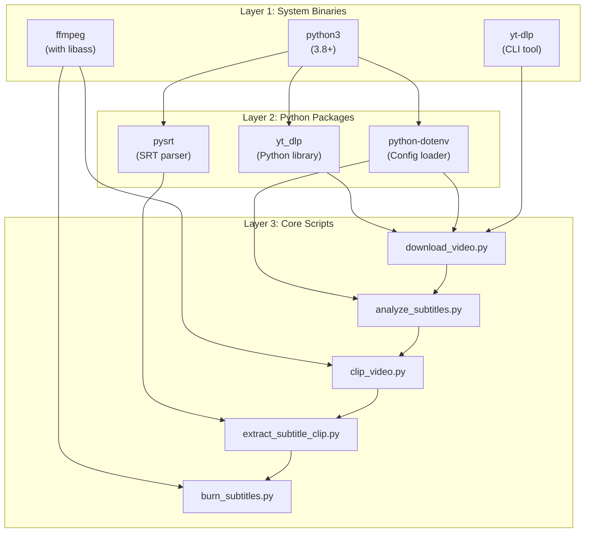
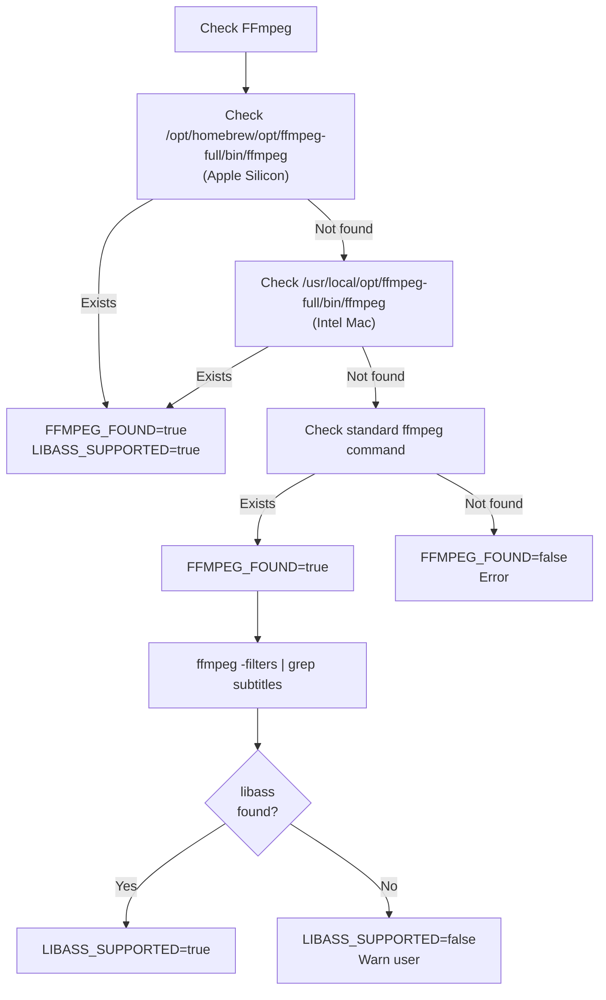
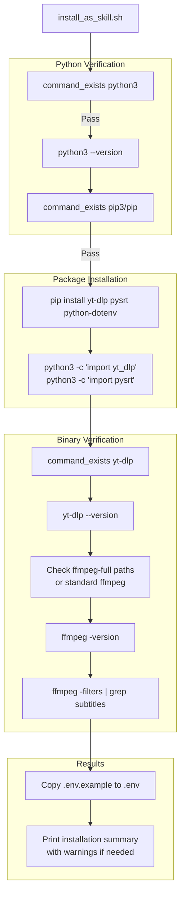

<!-- source: DeepWiki mcp.deepwiki.com · repo op7418/Youtube-clipper-skill · page 1.2 System Requirements · fetched 2026-10-26 -->

# System Requirements

<details>
<summary>Relevant source files</summary>

The following files were used as context for generating this wiki page:

- [README.md](README.md)
- [SKILL.md](SKILL.md)
- [install_as_skill.sh](install_as_skill.sh)

</details>


## Purpose and Scope

This page documents all software dependencies required to run the YouTube Clipper Skill. It covers system-level binaries, Python runtime requirements, and Python package dependencies. For installation procedures using these requirements, see [Installation](#2.1). For detailed configuration of these dependencies, see [Configuration](#6).

---

## Overview of Dependencies

The YouTube Clipper Skill requires three layers of dependencies that work together to process videos:



**Diagram 1: Dependency Layer Architecture**

Sources: [README.md:50-66](), [install_as_skill.sh:109-191]()

---

## System Binaries

### Python 3.8+

**Requirement**: Python 3.8 or higher

**Purpose**: Executes all core processing scripts in the `scripts/` directory

**Verification**:
```bash
python3 --version
# Expected: Python 3.8.0 or higher
```

The installation script checks for Python at [install_as_skill.sh:110-117]():

```bash
if ! command_exists python3; then
    print_error "未找到 Python 3，请先安装 Python 3.8+"
    exit 1
fi
```

**Installation**:
- **macOS**: Pre-installed, or `brew install python@3.11`
- **Ubuntu/Debian**: `sudo apt install python3 python3-pip`
- **All platforms**: [python.org/downloads](https://www.python.org/downloads)

Sources: [README.md:56](), [install_as_skill.sh:110-117]()

---

### yt-dlp (Command-Line Tool)

**Requirement**: Latest version of yt-dlp binary

**Purpose**: Downloads YouTube videos and subtitle tracks. Used by `download_video.py` to fetch content.

**Verification**:
```bash
yt-dlp --version
# Expected: 2023.XX.XX or later
```

The installation script verifies yt-dlp at [install_as_skill.sh:140-150]():

```bash
if command_exists yt-dlp; then
    YT_DLP_VERSION=$(yt-dlp --version)
    print_success "yt-dlp 已安装: $YT_DLP_VERSION"
else
    print_warning "yt-dlp 命令行工具未安装"
fi
```

**Installation**:

| Platform | Installation Command |
|----------|---------------------|
| **macOS** | `brew install yt-dlp` |
| **Ubuntu/Debian** | `sudo apt install yt-dlp` |
| **Arch Linux** | `sudo pacman -S yt-dlp` |
| **pip (all platforms)** | `pip install -U yt-dlp` |

**Note**: Both the CLI tool and Python library (`yt_dlp`) are required. They serve different purposes.

Sources: [README.md:57](), [install_as_skill.sh:140-150]()

---

### FFmpeg with libass Support

**Requirement**: FFmpeg compiled with libass filter support

**Purpose**: 
- **Video clipping**: Precise frame-accurate segment extraction ([clip_video.py]())
- **Subtitle burning**: Hardcoding subtitles into video frames ([burn_subtitles.py]())

**Critical**: The `libass` library is **required** for subtitle burning functionality. Standard FFmpeg installations on macOS do **not** include libass support.

**Verification**:

```bash
# Check FFmpeg version
ffmpeg -version

# Verify libass support (CRITICAL)
ffmpeg -filters 2>&1 | grep subtitles
# Expected output: subtitles    V->V  Render text subtitles onto input video using the libass library.
```

The installation script performs a comprehensive FFmpeg check at [install_as_skill.sh:153-191]():



**Diagram 2: FFmpeg Detection Logic**

Sources: [install_as_skill.sh:153-191]()

---

#### Platform-Specific FFmpeg Installation

**macOS**:

The standard Homebrew `ffmpeg` package **does not include libass**. You must install `ffmpeg-full`:

```bash
# Remove standard ffmpeg if installed
brew uninstall ffmpeg

# Install ffmpeg-full with libass support
brew install ffmpeg-full
```

**Paths**:
- **Apple Silicon**: `/opt/homebrew/opt/ffmpeg-full/bin/ffmpeg`
- **Intel Mac**: `/usr/local/opt/ffmpeg-full/bin/ffmpeg`

**Ubuntu/Debian**:

```bash
sudo apt install ffmpeg libass-dev
```

**Arch Linux**:

```bash
sudo pacman -S ffmpeg
# libass is included by default
```

Sources: [README.md:67-83](), [install_as_skill.sh:158-191](), [SKILL.md:310-318]()

---

## Python Package Dependencies

The following Python packages are automatically installed by `install_as_skill.sh` but can also be installed manually:

### yt_dlp (Python Library)

**Package**: `yt_dlp`

**Version**: Latest

**Purpose**: Python interface to yt-dlp functionality. Used by `download_video.py` to programmatically download videos.

**Installation**: 
```bash
pip install yt-dlp
```

**Usage in Code**: [scripts/download_video.py]() imports `yt_dlp` to configure download options.

---

### pysrt

**Package**: `pysrt`

**Version**: Latest

**Purpose**: Parse and manipulate SRT subtitle files. Used by `extract_subtitle_clip.py` to extract subtitle segments and adjust timestamps.

**Installation**:
```bash
pip install pysrt
```

**Usage in Code**: [scripts/extract_subtitle_clip.py]() uses `pysrt.open()` to read SRT files and manipulate subtitle timing.

---

### python-dotenv

**Package**: `python-dotenv`

**Version**: Latest

**Purpose**: Load environment variables from `.env` file. Used across all scripts to read configuration.

**Installation**:
```bash
pip install python-dotenv
```

**Usage in Code**: Scripts import `load_dotenv()` and `os.getenv()` to access configuration variables like `FFMPEG_PATH`, `MAX_VIDEO_HEIGHT`, etc.

---

### Installation of Python Packages

All three packages are installed by the setup script at [install_as_skill.sh:126-137]():

```bash
#尝试使用 pip3，如果不存在则使用 pip
if command_exists pip3; then
    pip3 install -q yt-dlp pysrt python-dotenv
else
    pip install -q yt-dlp pysrt python-dotenv
fi
```

**Manual Installation**:
```bash
pip install yt-dlp pysrt python-dotenv
```

Sources: [README.md:60-65](), [install_as_skill.sh:126-137]()

---

## Dependency Verification Matrix

The installation script systematically verifies all requirements. Here is the complete verification workflow:



**Diagram 3: Complete Dependency Verification Workflow**

Sources: [install_as_skill.sh:56-241]()

---

## Minimum Requirements Summary

| Component | Minimum Version | Verification Command | Installation Detection |
|-----------|----------------|---------------------|----------------------|
| **Python** | 3.8+ | `python3 --version` | [install_as_skill.sh:110-117]() |
| **pip** | Any | `pip3 --version` | [install_as_skill.sh:120-124]() |
| **yt-dlp (CLI)** | Latest | `yt-dlp --version` | [install_as_skill.sh:140-150]() |
| **FFmpeg** | Latest | `ffmpeg -version` | [install_as_skill.sh:153-179]() |
| **libass support** | Required | `ffmpeg -filters \| grep subtitles` | [install_as_skill.sh:173-178]() |
| **yt_dlp (Python)** | Latest | `python3 -c "import yt_dlp"` | [install_as_skill.sh:132-135]() |
| **pysrt** | Latest | `python3 -c "import pysrt"` | [install_as_skill.sh:132-135]() |
| **python-dotenv** | Latest | `python3 -c "import dotenv"` | [install_as_skill.sh:132-135]() |

Sources: [README.md:50-66](), [install_as_skill.sh:109-191]()

---

## Critical Dependency: libass

The `libass` library deserves special attention as it is the most common source of installation issues.

### Why libass is Required

The `burn_subtitles.py` script uses FFmpeg's `subtitles` filter to hardcode subtitle text onto video frames. This filter requires the `libass` library to render text with proper font rendering, positioning, and styling.

Without libass:
- Video clipping works normally
- Subtitle extraction works normally  
- **Subtitle burning fails** with error: `Option not found: subtitles`

### Detection Logic

The script checks for libass support at [install_as_skill.sh:173-178]():

```bash
# 检查 libass 支持
if ffmpeg -filters 2>&1 | grep -q "subtitles"; then
    print_success "FFmpeg 支持 libass（字幕烧录可用）"
    LIBASS_SUPPORTED=true
else
    print_warning "FFmpeg 不支持 libass（字幕烧录不可用）"
fi
```

### macOS-Specific Issue

Standard Homebrew FFmpeg (`brew install ffmpeg`) is compiled **without libass** on macOS. Users must install `ffmpeg-full`:

| Package | libass Support | Installation |
|---------|---------------|--------------|
| `ffmpeg` | ❌ No | `brew install ffmpeg` |
| `ffmpeg-full` | ✅ Yes | `brew install ffmpeg-full` |

The installation script explicitly checks for `ffmpeg-full` first at [install_as_skill.sh:158-166]():

```bash
# 检查 ffmpeg-full（macOS 推荐）
if [ -f "/opt/homebrew/opt/ffmpeg-full/bin/ffmpeg" ]; then
    print_success "ffmpeg-full 已安装（Apple Silicon）"
    FFMPEG_FOUND=true
    LIBASS_SUPPORTED=true
elif [ -f "/usr/local/opt/ffmpeg-full/bin/ffmpeg" ]; then
    print_success "ffmpeg-full 已安装（Intel Mac）"
    FFMPEG_FOUND=true
    LIBASS_SUPPORTED=true
```

Sources: [README.md:67-83](), [install_as_skill.sh:153-191](), [SKILL.md:34-44](), [SKILL.md:310-318]()

---

## Environment Variable for FFmpeg Path

If FFmpeg is installed in a non-standard location, you can specify the path via `.env`:

```bash
# In ~/.claude/skills/youtube-clipper/.env
FFMPEG_PATH=/opt/homebrew/opt/ffmpeg-full/bin/ffmpeg
```

If `FFMPEG_PATH` is empty, scripts will use `ffmpeg` from `PATH`. This configuration is documented at [.env.example]().

For more on configuration options, see [Environment Variables Reference](#6.1).

Sources: [README.md:134-135]()

---

## Common Requirement Issues

### Missing Python
**Symptom**: `command not found: python3`

**Solution**: Install Python 3.8+ from [python.org](https://www.python.org/downloads) or via package manager

---

### Missing yt-dlp CLI
**Symptom**: `command not found: yt-dlp`

**Solution**: Install via package manager or pip (see [yt-dlp Installation](#yt-dlp-command-line-tool))

---

### FFmpeg without libass
**Symptom**: `Option not found: subtitles` when burning subtitles

**Solution**: 
- **macOS**: Install `ffmpeg-full` (see [FFmpeg with libass Support](#ffmpeg-with-libass-support))
- **Linux**: Install `libass-dev` package

**Verification**: `ffmpeg -filters 2>&1 | grep subtitles` should produce output

---

### Package Import Errors
**Symptom**: `ModuleNotFoundError: No module named 'pysrt'`

**Solution**: Reinstall Python packages:
```bash
pip install --force-reinstall yt-dlp pysrt python-dotenv
```

For more troubleshooting, see [Installation Issues](#8.1).

Sources: [README.md:236-250](), [install_as_skill.sh:140-191]()

---

