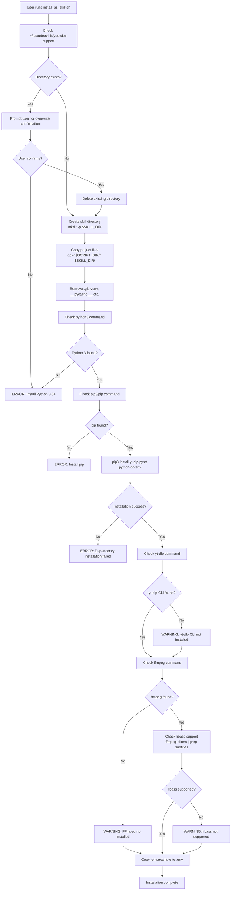
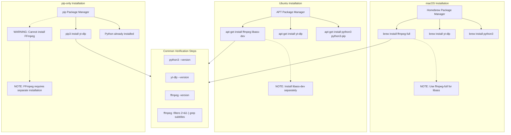
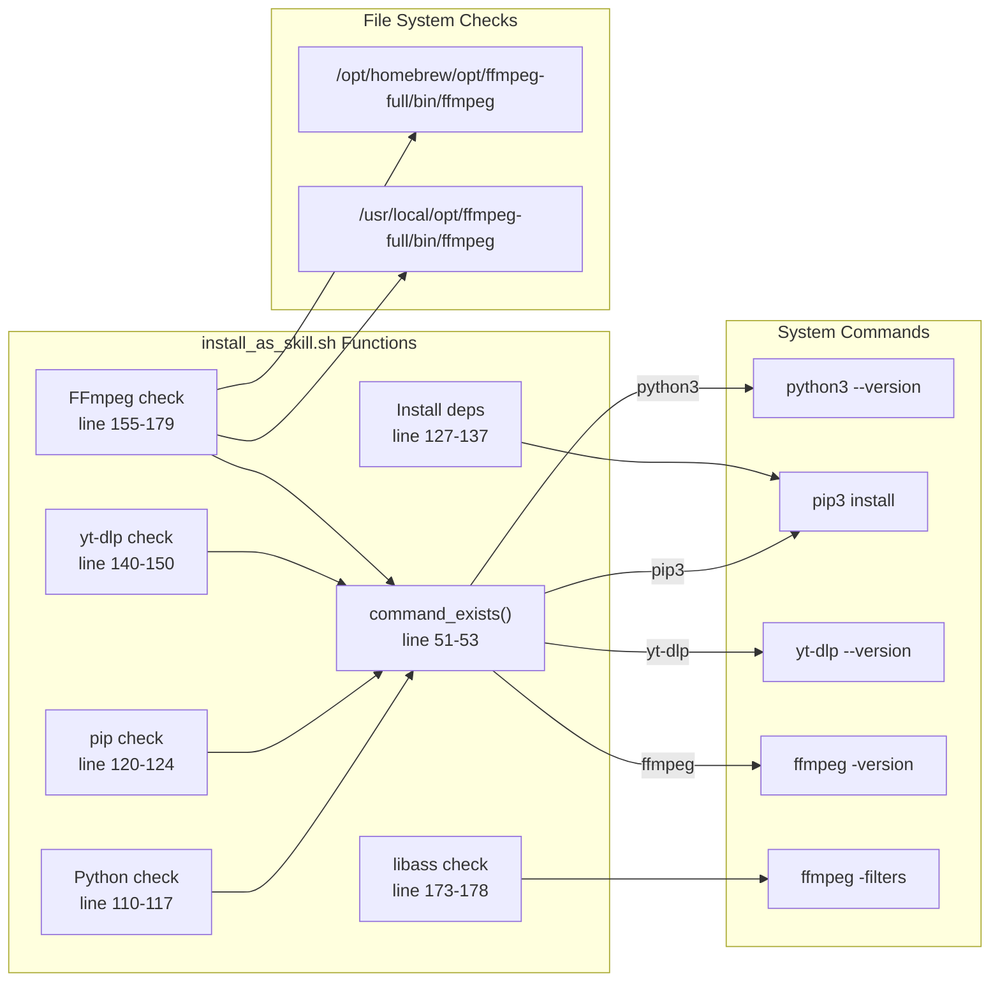

<!-- source: DeepWiki mcp.deepwiki.com · repo op7418/Youtube-clipper-skill · page 8.1 Installation Issues · fetched 2026-10-26 -->

# Installation Issues

<details>
<summary>Relevant source files</summary>

The following files were used as context for generating this wiki page:

- [FIXES_AND_IMPROVEMENTS.md](FIXES_AND_IMPROVEMENTS.md)
- [README.md](README.md)
- [install_as_skill.sh](install_as_skill.sh)

</details>


This page documents common problems encountered during the installation of the YouTube Clipper Skill and provides solutions. Installation issues typically occur when running [install_as_skill.sh]() or when system dependencies are missing or misconfigured.

For runtime issues related to FFmpeg and subtitle burning, see [FFmpeg and libass Problems](#8.2). For download-related problems, see [Download and Network Issues](#8.3). For general system requirements, see [System Requirements](#1.2).

---

## Overview of Installation Process

The YouTube Clipper Skill installation involves multiple verification and setup steps. Understanding this flow helps diagnose where failures occur.



**Installation Flow Diagram**: Shows the complete verification and setup process implemented in install_as_skill.sh.

**Sources**: [install_as_skill.sh:56-241]()

---

## Python Environment Issues

### Externally-Managed Python Environment (macOS)

**Problem**: On modern macOS systems, Python is marked as "externally-managed" by the operating system, preventing standard `pip install` commands.

**Error Message**:
```
error: externally-managed-environment

This environment is externally managed
To install Python packages system-wide, try brew install xyz
```

**Solution**: Use the `--break-system-packages` flag with pip:

```bash
pip3 install --break-system-packages yt-dlp pysrt python-dotenv
```

**Why This Happens**: macOS Sonoma (14+) and Homebrew-installed Python use PEP 668 to prevent accidental modifications to system Python environments.

**Implementation in install_as_skill.sh**: The current script does not include the `--break-system-packages` flag. Users encountering this error must manually install dependencies with this flag.

**Locations**:
- Dependency installation: [install_as_skill.sh:127-137]()

**Sources**: [FIXES_AND_IMPROVEMENTS.md:9-25](), [install_as_skill.sh:127-137]()

---

### Missing Python 3

**Problem**: The system lacks Python 3.8 or higher.

**Error Message**:
```
❌ 未找到 Python 3，请先安装 Python 3.8+
```

**Detection Logic**: [install_as_skill.sh:110-117]()

```bash
if ! command_exists python3; then
    print_error "未找到 Python 3，请先安装 Python 3.8+"
    exit 1
fi
```

**Solutions by Platform**:

| Platform | Installation Command |
|----------|---------------------|
| **macOS** | `brew install python3` |
| **Ubuntu/Debian** | `sudo apt-get install python3 python3-pip` |
| **Windows** | Download from [python.org](https://www.python.org/downloads) |
| **From Source** | [python.org/downloads/source](https://www.python.org/downloads/source) |

**Verification**:
```bash
python3 --version
# Should output: Python 3.8.x or higher
```

**Sources**: [install_as_skill.sh:110-117](), [README.md:56-57]()

---

### Missing pip

**Problem**: Python is installed but pip (package manager) is missing.

**Error Message**:
```
❌ 未找到 pip，请先安装 pip
```

**Detection Logic**: [install_as_skill.sh:120-124]()

```bash
if ! command_exists pip3 && ! command_exists pip; then
    print_error "未找到 pip，请先安装 pip"
    exit 1
fi
```

**Solutions by Platform**:

| Platform | Installation Command |
|----------|---------------------|
| **macOS** | `python3 -m ensurepip --upgrade` |
| **Ubuntu/Debian** | `sudo apt-get install python3-pip` |
| **Manual** | `curl https://bootstrap.pypa.io/get-pip.py -o get-pip.py`<br>`python3 get-pip.py` |

**Sources**: [install_as_skill.sh:120-124]()

---

## Python Package Installation Failures

### ModuleNotFoundError at Runtime

**Problem**: Installation script completes, but scripts fail with missing module errors.

**Error Messages**:
```python
ModuleNotFoundError: No module named 'yt_dlp'
ModuleNotFoundError: No module named 'pysrt'
ModuleNotFoundError: No module named 'dotenv'
```

**Cause**: Python packages were not successfully installed during setup.

**Diagnosis**:
```bash
# Check if packages are installed
python3 -c "import yt_dlp; print('yt_dlp OK')"
python3 -c "import pysrt; print('pysrt OK')"
python3 -c "import dotenv; print('dotenv OK')"
```

**Solution**: Manually install packages:
```bash
# Standard installation
pip3 install yt-dlp pysrt python-dotenv

# macOS externally-managed environment
pip3 install --break-system-packages yt-dlp pysrt python-dotenv

# Install to user directory (alternative)
pip3 install --user yt-dlp pysrt python-dotenv
```

**Package Purposes**:

| Package | Purpose | Used By |
|---------|---------|---------|
| `yt-dlp` | YouTube video/subtitle downloading | [scripts/download_video.py]() |
| `pysrt` | SRT subtitle parsing and manipulation | [scripts/extract_subtitle_clip.py]() |
| `python-dotenv` | Load configuration from .env file | All scripts |

**Sources**: [FIXES_AND_IMPROVEMENTS.md:9-25](), [install_as_skill.sh:127-137](), [README.md:60-65]()

---

## System Dependency Issues

### yt-dlp Command Not Found

**Problem**: The yt-dlp CLI tool is not installed, even though the Python package may be.

**Warning Message**:
```
⚠️  yt-dlp 命令行工具未安装
```

**Detection Logic**: [install_as_skill.sh:140-150]()

```bash
if command_exists yt-dlp; then
    YT_DLP_VERSION=$(yt-dlp --version)
    print_success "yt-dlp 已安装: $YT_DLP_VERSION"
else
    print_warning "yt-dlp 命令行工具未安装"
fi
```

**Important Distinction**: The Python package `yt_dlp` (installed by pip) and the CLI tool `yt-dlp` are different:
- **Python package**: Used by [scripts/download_video.py:25]() via `import yt_dlp`
- **CLI tool**: Can be invoked as standalone command

**Installation Options**:

| Method | Command | Provides |
|--------|---------|----------|
| **Homebrew (macOS)** | `brew install yt-dlp` | Both CLI and Python package |
| **APT (Ubuntu)** | `sudo apt-get install yt-dlp` | Both CLI and Python package |
| **pip** | `pip3 install yt-dlp` | Primarily Python package, may provide CLI |

**Recommended**: Use system package manager (brew/apt) for complete installation.

**Sources**: [install_as_skill.sh:140-150](), [README.md:57]()

---

### FFmpeg Not Installed

**Problem**: FFmpeg binary is not found on the system.

**Error Message**:
```
❌ FFmpeg 未安装
```

**Detection Logic**: [install_as_skill.sh:155-186]()

The installation script checks multiple locations:
1. `/opt/homebrew/opt/ffmpeg-full/bin/ffmpeg` (Apple Silicon Mac with ffmpeg-full)
2. `/usr/local/opt/ffmpeg-full/bin/ffmpeg` (Intel Mac with ffmpeg-full)
3. `ffmpeg` command in PATH (standard installation)

**Installation by Platform**:

| Platform | Command | Notes |
|----------|---------|-------|
| **macOS** | `brew install ffmpeg-full` | Includes libass support |
| **Ubuntu/Debian** | `sudo apt-get install ffmpeg libass-dev` | Install both packages |
| **From Source** | See [FFmpeg compilation guide](https://trac.ffmpeg.org/wiki/CompilationGuide) | Advanced users |

**Why FFmpeg is Required**:
- Video clipping: [scripts/clip_video.py]()
- Subtitle burning: [scripts/burn_subtitles.py]()

**Note**: For subtitle burning functionality, FFmpeg must have libass support. See [FFmpeg and libass Problems](#8.2) for libass-specific issues.

**Sources**: [install_as_skill.sh:155-191](), [README.md:58]()

---

## Platform-Specific Installation Differences



**Platform Installation Comparison**: Different platforms require different installation approaches, particularly for FFmpeg.

**Sources**: [README.md:54-84](), [install_as_skill.sh:140-191]()

---

## Dependency Verification Code Mapping

Understanding how the installation script verifies dependencies helps diagnose failures.



**Dependency Verification Mapping**: Shows how install_as_skill.sh functions map to system commands and file checks.

**Key Functions**:

| Function | Purpose | Lines |
|----------|---------|-------|
| `command_exists()` | Check if command is available in PATH | [install_as_skill.sh:51-53]() |
| `print_info()` | Display informational messages | [install_as_skill.sh:26-28]() |
| `print_success()` | Display success messages | [install_as_skill.sh:30-32]() |
| `print_warning()` | Display warning messages | [install_as_skill.sh:34-36]() |
| `print_error()` | Display error messages | [install_as_skill.sh:38-40]() |

**Sources**: [install_as_skill.sh:51-191]()

---

## Manual Installation Verification

If automatic installation fails, verify each component manually:

### Step 1: Verify Python Installation

```bash
# Check Python version
python3 --version
# Expected: Python 3.8.0 or higher

# Check Python import paths
python3 -c "import sys; print('\n'.join(sys.path))"
```

### Step 2: Verify pip Installation

```bash
# Check pip version
pip3 --version
# Expected: pip 20.0 or higher

# Check pip installation location
which pip3
```

### Step 3: Verify Python Packages

```bash
# Check yt_dlp
python3 -c "import yt_dlp; print(f'yt_dlp: {yt_dlp.version.__version__}')"

# Check pysrt
python3 -c "import pysrt; print('pysrt: OK')"

# Check dotenv
python3 -c "import dotenv; print('dotenv: OK')"
```

### Step 4: Verify System Tools

```bash
# Check yt-dlp CLI
yt-dlp --version

# Check FFmpeg
ffmpeg -version

# Check FFmpeg libass support
ffmpeg -filters 2>&1 | grep subtitles
# Expected output: subtitles    V->V  (...)
```

### Step 5: Verify Skill Directory

```bash
# Check directory exists
ls -la ~/.claude/skills/youtube-clipper/

# Check required files
ls ~/.claude/skills/youtube-clipper/scripts/
# Expected: download_video.py, analyze_subtitles.py, clip_video.py, etc.

# Check .env file
cat ~/.claude/skills/youtube-clipper/.env
```

**Sources**: [install_as_skill.sh:110-191]()

---

## Common Installation Failures Table

| Symptom | Probable Cause | Solution | Reference |
|---------|---------------|----------|-----------|
| `externally-managed-environment` error | macOS PEP 668 protection | Use `--break-system-packages` flag | [FIXES_AND_IMPROVEMENTS.md:9-25]() |
| `ModuleNotFoundError: yt_dlp` | Package not installed | Run `pip3 install yt-dlp` | [install_as_skill.sh:132]() |
| `ModuleNotFoundError: pysrt` | Package not installed | Run `pip3 install pysrt` | [install_as_skill.sh:132]() |
| `command not found: python3` | Python not installed | Install Python 3.8+ | [README.md:56]() |
| `command not found: pip3` | pip not installed | Install pip via ensurepip or get-pip.py | [install_as_skill.sh:120-124]() |
| `command not found: yt-dlp` | CLI tool not installed | Use brew/apt to install | [install_as_skill.sh:140-150]() |
| `command not found: ffmpeg` | FFmpeg not installed | Install FFmpeg | [install_as_skill.sh:155-179]() |
| Skill directory already exists | Previous installation | Confirm overwrite or cancel | [install_as_skill.sh:64-74]() |

**Sources**: [install_as_skill.sh:56-241](), [FIXES_AND_IMPROVEMENTS.md:9-25](), [README.md:50-84]()

---

## Installation Script Error Handling

The installation script uses Bash error handling to ensure clean failures:

**Error Trap**: [install_as_skill.sh:16]()
```bash
set -e  # Exit immediately on error
```

**Custom Error Handler**: [install_as_skill.sh:238]()
```bash
trap 'print_error "安装过程中发生错误"; exit 1' ERR
```

This means:
- Any command failure causes immediate exit
- Error message is printed before exit
- Exit code 1 indicates installation failure

**Consequences**:
- Partial installations are prevented
- User knows exactly where failure occurred
- Re-running script is safe (overwrites incomplete installation)

**Sources**: [install_as_skill.sh:16](), [install_as_skill.sh:238]()

---

## Post-Installation Verification

After successful installation, verify the complete setup:

```bash
# Run from any directory
cd /tmp

# Test Python imports
python3 -c "
import sys
sys.path.insert(0, '$HOME/.claude/skills/youtube-clipper')
from scripts.utils import ensure_dir_exists
print('Utils import: OK')
"

# Check .env file created
test -f ~/.claude/skills/youtube-clipper/.env && echo ".env exists: OK"

# Check all scripts present
for script in download_video.py analyze_subtitles.py clip_video.py burn_subtitles.py extract_subtitle_clip.py utils.py; do
    test -f ~/.claude/skills/youtube-clipper/scripts/$script && echo "$script: OK"
done
```

**Expected Output**:
```
Utils import: OK
.env exists: OK
download_video.py: OK
analyze_subtitles.py: OK
clip_video.py: OK
burn_subtitles.py: OK
extract_subtitle_clip.py: OK
utils.py: OK
```

**Sources**: [install_as_skill.sh:194-209]()

---

