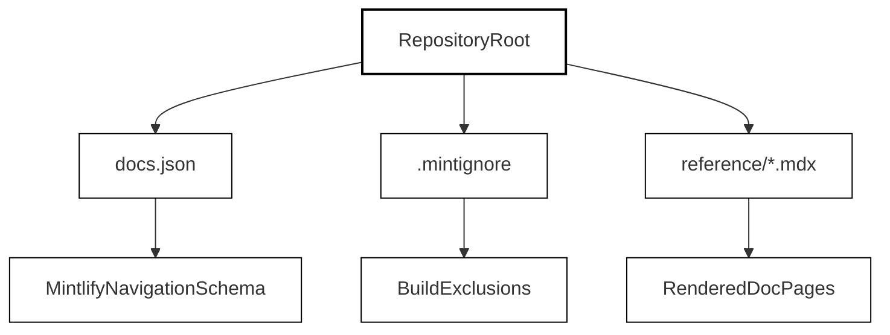
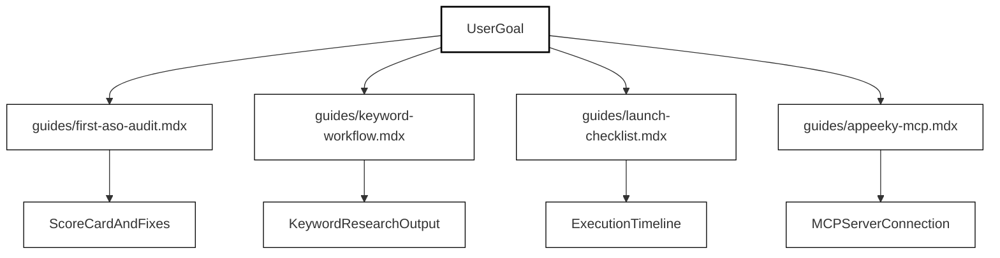

<!-- source: DeepWiki mcp.deepwiki.com · repo Eronred/aso-skills · page 6 Documentation Site & Guides · fetched 2026-10-26 -->

# Documentation Site & Guides

Relevant source files

The following files were used as context for generating this wiki page:

- [.atlas-analysis.json](.atlas-analysis.json)
- [.mintignore](.mintignore)
- [docs.json](docs.json)
- [index.mdx](index.mdx)
- [reference/competitor-analysis.mdx](reference/competitor-analysis.mdx)

The documentation site for `aso-skills` is built using [Mintlify](https://mintlify.com), providing an interactive, structured portal for users to explore skills, installation guides, and workflow tutorials. The site source is housed directly in the repository alongside the agent skills, allowing documentation to evolve in lockstep with the codebase.

For details, see the child pages:
- [Docs Configuration & Conventions](#6.1) — Covers `docs.json` navigation schemas [docs.json:1-105](), build exclusions via `.mintignore` [.mintignore:1-9](), and MDX frontmatter patterns [reference/competitor-analysis.mdx:1-5]().
- [Workflow Guides](#6.2) — Covers step-by-step practical guides in `guides/` for running initial audits, keyword workflows, launch checklists, and MCP server setup.

---

## 6.1 Docs Configuration & Conventions

The Mintlify site relies on configuration files at the repository root to determine site metadata, styling, and navigation hierarchies. The primary configuration is defined in `docs.json` [docs.json:1-105](), which establishes the theme, brand colors, and tabbed navigation groups. Source code files like individual skill directories (`skills/*/`) and utility scripts (`validate-skills.sh`) are explicitly excluded from the documentation build output using `.mintignore` [.mintignore:1-9]().

Documentation pages utilize MDX format with structured frontmatter defining metadata such as page titles, sidebar labels, and descriptions [reference/competitor-analysis.mdx:1-5](). 

*Figure 6.1: Documentation Site Build Pipeline Configuration.*

For complete technical specifications on navigation layout, tab structures, and frontmatter patterns, see [Docs Configuration & Conventions](#6.1).

Sources: `docs.json:1-105](), [.mintignore:1-9](), [reference/competitor-analysis.mdx:1-5]()`

---

## 6.2 Workflow Guides

In addition to API and skill references, the documentation site includes practical, step-by-step walkthroughs located in the `guides/` directory. These guides bridge theoretical ASO concepts with actionable execution, helping practitioners run their first audit, execute keyword expansion strategies, plan app launches, and configure the Appeeky MCP server [index.mdx:24-36]().

*Figure 6.2: Workflow Guides Architecture and Output Mapping.*

For detailed walkthroughs, code snippets, and operational checklists, see [Workflow Guides](#6.2).

Sources: `[index.mdx:24-36](), [docs.json:60-67]()`

---

