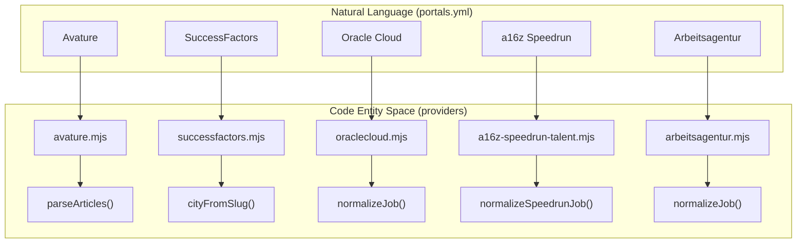
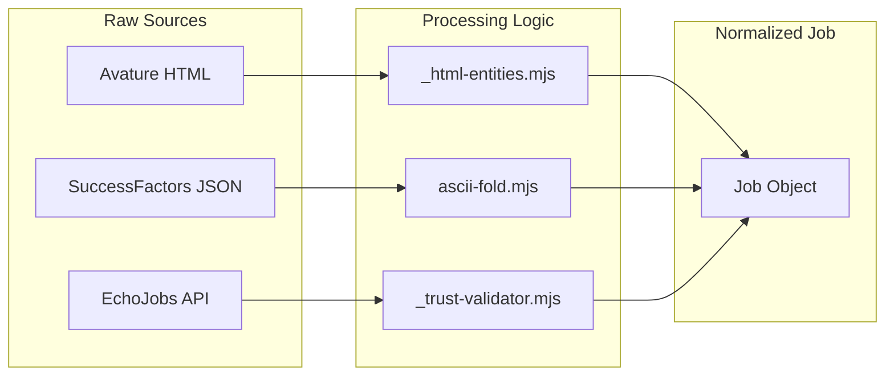

<!-- source: DeepWiki mcp.deepwiki.com · repo santifer/career-ops · page 11.2 Long-Tail & Specialty Providers · fetched 2026-10-26 -->

# Long-Tail & Specialty Providers

Relevant source files

The following files were used as context for generating this wiki page:

- [.gitattributes](.gitattributes)
- [docs/SUPPORTED_JOB_BOARDS.md](docs/SUPPORTED_JOB_BOARDS.md)
- [lib/ascii-fold.mjs](lib/ascii-fold.mjs)
- [providers/_config-utils.mjs](providers/_config-utils.mjs)
- [providers/_html-entities.mjs](providers/_html-entities.mjs)
- [providers/_profile-keywords.mjs](providers/_profile-keywords.mjs)
- [providers/_trust-validator.mjs](providers/_trust-validator.mjs)
- [providers/a16z-speedrun-talent.mjs](providers/a16z-speedrun-talent.mjs)
- [providers/amazon.mjs](providers/amazon.mjs)
- [providers/arbeitsagentur.mjs](providers/arbeitsagentur.mjs)
- [providers/avature.mjs](providers/avature.mjs)
- [providers/beesite.mjs](providers/beesite.mjs)
- [providers/consider.mjs](providers/consider.mjs)
- [providers/cryptocurrencyjobs.mjs](providers/cryptocurrencyjobs.mjs)
- [providers/csod.mjs](providers/csod.mjs)
- [providers/deutschebahn.mjs](providers/deutschebahn.mjs)
- [providers/echojobs.mjs](providers/echojobs.mjs)
- [providers/eightfold.mjs](providers/eightfold.mjs)
- [providers/getro.mjs](providers/getro.mjs)
- [providers/glints.mjs](providers/glints.mjs)
- [providers/hackernews.mjs](providers/hackernews.mjs)
- [providers/hecklerkoch.mjs](providers/hecklerkoch.mjs)
- [providers/higheredjobs.mjs](providers/higheredjobs.mjs)
- [providers/icims.mjs](providers/icims.mjs)
- [providers/jobbankca.mjs](providers/jobbankca.mjs)
- [providers/jobspresso.mjs](providers/jobspresso.mjs)
- [providers/jobstreet.mjs](providers/jobstreet.mjs)
- [providers/jobvite.mjs](providers/jobvite.mjs)
- [providers/joinup.mjs](providers/joinup.mjs)
- [providers/larajobs.mjs](providers/larajobs.mjs)
- [providers/mycareersfuture.mjs](providers/mycareersfuture.mjs)
- [providers/nodesk.mjs](providers/nodesk.mjs)
- [providers/oraclecloud.mjs](providers/oraclecloud.mjs)
- [providers/personio.mjs](providers/personio.mjs)
- [providers/phenom.mjs](providers/phenom.mjs)
- [providers/radancy.mjs](providers/radancy.mjs)
- [providers/recruitee.mjs](providers/recruitee.mjs)
- [providers/senjob.mjs](providers/senjob.mjs)
- [providers/smartrecruiters.mjs](providers/smartrecruiters.mjs)
- [providers/softgarden.mjs](providers/softgarden.mjs)
- [providers/successfactors.mjs](providers/successfactors.mjs)
- [providers/teamtailor.mjs](providers/teamtailor.mjs)
- [providers/tencent.mjs](providers/tencent.mjs)
- [providers/thehub.mjs](providers/thehub.mjs)
- [providers/themuse.mjs](providers/themuse.mjs)
- [providers/tkms.mjs](providers/tkms.mjs)
- [providers/vdab.mjs](providers/vdab.mjs)
- [providers/weworkremotely.mjs](providers/weworkremotely.mjs)
- [providers/workable.mjs](providers/workable.mjs)
- [test-trust-validator.mjs](test-trust-validator.mjs)
- [tests/ascii-fold-punctuation.test.mjs](tests/ascii-fold-punctuation.test.mjs)
- [tests/board-title-entities.test.mjs](tests/board-title-entities.test.mjs)
- [tests/providers/_html-entities.test.mjs](tests/providers/_html-entities.test.mjs)
- [tests/providers/_http.test.mjs](tests/providers/_http.test.mjs)
- [tests/providers/_profile-keywords.test.mjs](tests/providers/_profile-keywords.test.mjs)
- [tests/providers/a16z-speedrun-talent.test.mjs](tests/providers/a16z-speedrun-talent.test.mjs)
- [tests/providers/arbeitsagentur.test.mjs](tests/providers/arbeitsagentur.test.mjs)
- [tests/providers/consider.test.mjs](tests/providers/consider.test.mjs)
- [tests/providers/cryptocurrencyjobs.test.mjs](tests/providers/cryptocurrencyjobs.test.mjs)
- [tests/providers/csod.test.mjs](tests/providers/csod.test.mjs)
- [tests/providers/deutschebahn.test.mjs](tests/providers/deutschebahn.test.mjs)
- [tests/providers/echojobs.test.mjs](tests/providers/echojobs.test.mjs)
- [tests/providers/eightfold.test.mjs](tests/providers/eightfold.test.mjs)
- [tests/providers/getro.test.mjs](tests/providers/getro.test.mjs)
- [tests/providers/hackernews.test.mjs](tests/providers/hackernews.test.mjs)
- [tests/providers/hecklerkoch.test.mjs](tests/providers/hecklerkoch.test.mjs)
- [tests/providers/jobbankca.test.mjs](tests/providers/jobbankca.test.mjs)
- [tests/providers/jobvite.test.mjs](tests/providers/jobvite.test.mjs)
- [tests/providers/joinup.test.mjs](tests/providers/joinup.test.mjs)
- [tests/providers/larajobs.test.mjs](tests/providers/larajobs.test.mjs)
- [tests/providers/mycareersfuture.test.mjs](tests/providers/mycareersfuture.test.mjs)
- [tests/providers/oraclecloud.test.mjs](tests/providers/oraclecloud.test.mjs)
- [tests/providers/personio.test.mjs](tests/providers/personio.test.mjs)
- [tests/providers/phenom.test.mjs](tests/providers/phenom.test.mjs)
- [tests/providers/radancy.test.mjs](tests/providers/radancy.test.mjs)
- [tests/providers/rss-entity-decoding.test.mjs](tests/providers/rss-entity-decoding.test.mjs)
- [tests/providers/senjob.test.mjs](tests/providers/senjob.test.mjs)
- [tests/providers/smartrecruiters.test.mjs](tests/providers/smartrecruiters.test.mjs)
- [tests/providers/softgarden.test.mjs](tests/providers/softgarden.test.mjs)
- [tests/providers/tencent.test.mjs](tests/providers/tencent.test.mjs)
- [tests/providers/thehub.test.mjs](tests/providers/thehub.test.mjs)
- [tests/providers/themuse.test.mjs](tests/providers/themuse.test.mjs)
- [tests/providers/title-entity-decode.test.mjs](tests/providers/title-entity-decode.test.mjs)
- [tests/providers/tkms.test.mjs](tests/providers/tkms.test.mjs)
- [tests/providers/vdab.test.mjs](tests/providers/vdab.test.mjs)
- [tests/providers/workable.test.mjs](tests/providers/workable.test.mjs)
- [verify-portals.mjs](verify-portals.mjs)
- [web/src/lib/company.ts](web/src/lib/company.ts)

The `providers/` directory contains a library of specialized modules for scraping job boards that fall outside the major ATS platforms (Greenhouse, Lever, Ashby, Workday). These range from single-company parsers to board-wide JSON aggregators and RSS/Atom feeds.

## Provider Architecture & Discovery

All providers implement the `Provider` interface defined in `providers/_types.js`, consisting of a `detect(entry)` function to claim a URL and a `fetch(entry, ctx)` function to retrieve normalized job objects [providers/avature.mjs:124-168]().

### Mapping Natural Language to Code Entities

The following diagram bridges the job board names used in `portals.yml` configuration to the specific implementation files and their primary normalization logic.

**Sources:** [providers/avature.mjs:89-121](), [providers/successfactors.mjs:122-138](), [providers/oraclecloud.mjs:188-217](), [providers/a16z-speedrun-talent.mjs:97-130](), [providers/arbeitsagentur.mjs:108-119]().

## Core Specialty Implementations

### Avature (Parser-based)
The Avature provider handles branded career sites on `*.avature.net`. It is a request-heavy parser because Avature hard-caps server-rendered results to 6 per page [providers/avature.mjs:14-17]().
- **Self-Healing Pagination:** It detects if the tenant uses `jobOffset` or `offset` by checking for duplicate IDs and retrying with the alternative parameter if the first page proves inert [providers/avature.mjs:19-26]().
- **Parsing:** Uses `parseArticles()` to extract job metadata from `<article class="article--result">` blocks [providers/avature.mjs:89-95]().

### SuccessFactors (Hybrid Strategy)
This provider handles SAP SuccessFactors Recruiting Marketing (RMK) sites. It employs a two-tier strategy:
1. **RMK Tile Path:** Hits `{origin}/tile-search-results/` to parse HTML fragments [providers/successfactors.mjs:10-15]().
2. **CSB Fallback:** If the tile path returns an empty shell, it falls back to the "Career Site Builder" JSON API at `{origin}/services/recruiting/v1/jobs` [providers/successfactors.mjs:31-40]().
- **Locale Discovery:** CSB tenants often hide jobs under specific locales. The provider discovers supported locales from the language switcher on the `/search/` page and queries each one [providers/successfactors.mjs:48-50]().

### Oracle Recruiting Cloud (ORC)
ORC providers hit the `recruitingCEJobRequisitions` REST API. 
- **Host Pinning:** Uses `ORACLE_HOST_RE` to ensure requests only hit valid `*.fa.*.oraclecloud.com` domains [providers/oraclecloud.mjs:50-50]().
- **Finder API:** Queries are constructed using a specific `finder` parameter (e.g., `findReqs;siteNumber=CX_1`) [providers/oraclecloud.mjs:138-146]().

## Shared Helpers & Infrastructure

### HTML Entity Decoding (`_html-entities.mjs`)
To prevent data corruption in job titles (e.g., `D&eacute;veloppeur`), a centralized decoder is used. It handles:
- **Named Entities:** Standard XML/HTML5 entities like `&amp;`, `&nbsp;`, and Latin-1 letters [providers/_html-entities.mjs:49-71]().
- **Numeric Entities:** Decodes `&#252;` (decimal) and `&#xfc;` (hex) [providers/_html-entities.mjs:116-122]().
- **Safety Guard:** The `isEmittableCodePoint(code)` function prevents decoding NUL characters, C0 controls, or lone surrogates that could truncate C-string-backed consumers or break UTF-8 serialization [providers/_html-entities.mjs:107-112]().

### Trust Validation (`_trust-validator.mjs`)
Every scanned job is processed by a trust validator that assigns a `trustScore` (0-100) and `trustLevel` ('high'|'medium'|'low') [providers/_trust-validator.mjs:5-6]().

| Penalty Flag | Score Deduction | Description |
| :--- | :--- | :--- |
| `invalid_url` | 50 | URL is malformed or uses non-HTTP(S) protocol [providers/_trust-validator.mjs:54-54]() |
| `missing_apply_url` | 40 | Job object lacks a URL [providers/_trust-validator.mjs:55-55]() |
| `suspicious_domain` | 25 | Host matches a known URL shortener (e.g., bit.ly) [providers/_trust-validator.mjs:56-56]() |
| `company_domain_mismatch` | 15 | Company name does not appear in the hostname [providers/_trust-validator.mjs:57-57]() |

**Sources:** [providers/_trust-validator.mjs:53-58](), [providers/_trust-validator.mjs:21-30]().

### Data Flow: Discovery to Normalization

The diagram below illustrates how raw data from specialty sources flows through helper utilities before being returned to the scanner.

**Sources:** [providers/_html-entities.mjs:115-133](), [providers/_trust-validator.mjs:182-200](), [providers/successfactors.mjs:132-132]().

## Retired Providers
Providers are retired when their source feeds become inaccessible due to intentional bot protection or site closures.
- **EchoJobs:** Retired in #2976 (2026-08-20). The `/api/jobs` feed now returns HTTP 429 via Vercel bot protection [providers/echojobs.mjs:4-9](). The `fetch()` function throws a `RETIRED_MESSAGE` to guide users to remove the configuration [providers/echojobs.mjs:133-139]().

## Health Probe Pattern
Providers like `arbeitsagentur.mjs` use a "recall-first" strategy, over-fetching results for keywords and relying on the scanner's `title_filter` and `location_filter` to prune the results [providers/arbeitsagentur.mjs:6-8](). They also implement specific `remoteMatch` logic to verify remote claims via server-side filters or title regex [providers/arbeitsagentur.mjs:22-29]().

**Sources:** [docs/SUPPORTED_JOB_BOARDS.md:1-50](), [providers/avature.mjs:1-60](), [providers/successfactors.mjs:1-110](), [providers/oraclecloud.mjs:1-130](), [providers/_html-entities.mjs:1-133](), [providers/_trust-validator.mjs:1-213](), [providers/echojobs.mjs:1-140]().

---

