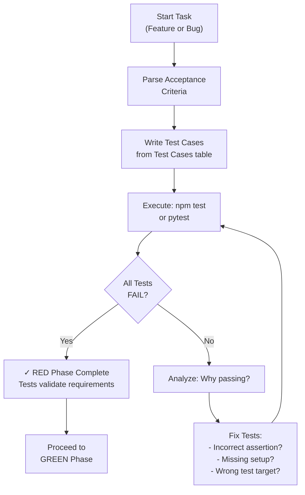
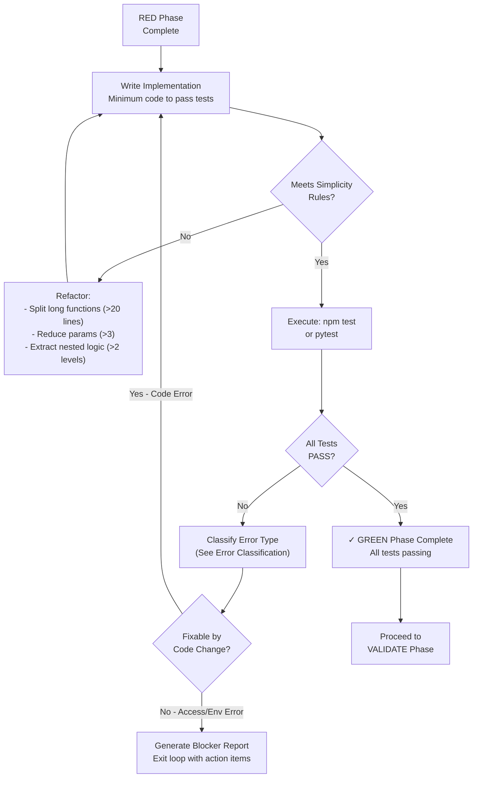
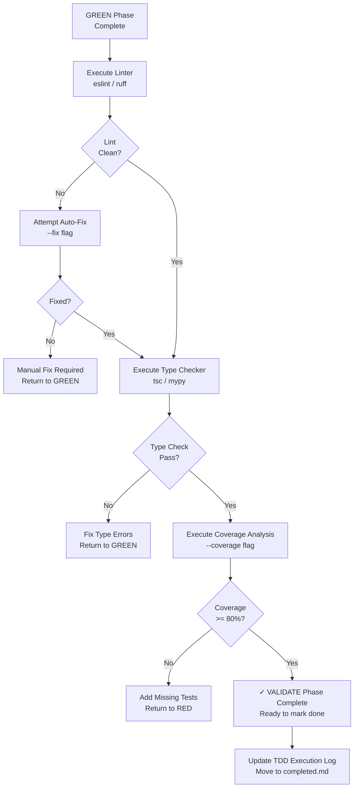
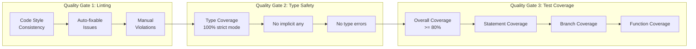
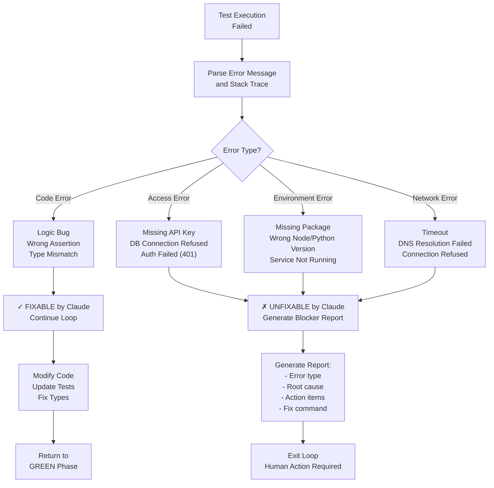
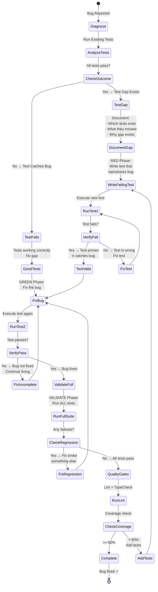

<!-- source: DeepWiki mcp.deepwiki.com · repo alinaqi/claude-bootstrap · page 3.2 TDD Workflow (RED-GREEN-VALIDATE) · fetched 2026-10-26 -->

# TDD Workflow (RED-GREEN-VALIDATE)

<details>
<summary>Relevant source files</summary>

The following files were used as context for generating this wiki page:

- [README.md](README.md)
- [skills/base.md](skills/base.md)
- [templates/CLAUDE.md](templates/CLAUDE.md)

</details>


**Purpose:** This document details the mandatory Test-Driven Development workflow enforced by Claude Bootstrap. It covers the three-phase TDD cycle (RED-GREEN-VALIDATE), execution commands for different technology stacks, error classification that controls loop behavior, and the specialized workflow for bug fixes.

**Scope:** This page focuses on the mechanical workflow of TDD execution. For the philosophical rationale behind TDD-first development, see [Development Philosophy](#3.1). For the Ralph loop automation that executes this workflow iteratively, see [Ralph Loop: Iterative Development](#4.1).

---

## Overview

Claude Bootstrap enforces a strict TDD workflow for all feature development and bug fixes. The workflow consists of three mandatory phases executed in order, with specific validation criteria that must be met before proceeding.

**Core Principle:** Tests must fail before implementation begins. This proves the test validates the requirement and prevents false confidence from tests that always pass.

**Non-Negotiable Rules:**
- Tests are written before any implementation code
- Tests must fail on first execution (RED phase verification)
- Implementation proceeds only after RED phase confirmation
- No todo marked complete without passing all three phases

**Sources:** [skills/base.md:187-214](), [README.md:321-343]()

---

## The Three Phases

### Phase 1: RED - Write Failing Tests

The RED phase establishes test validity by ensuring tests fail before implementation exists.

**Workflow:**



**File Locations:**
- Test files follow naming convention: `*.test.ts`, `*.spec.ts`, `test_*.py`
- Tests organized by module: `src/components/__tests__/`, `tests/unit/`

**RED Phase Commands:**

| Stack | Command | Expected Output |
|-------|---------|----------------|
| Node.js/TypeScript | `npm test -- --grep "feature-name"` | All tests fail with specific assertions |
| Python | `pytest -k "feature_name" -v` | All tests fail with traceback |
| React/Next.js | `npm test -- --testPathPattern="ComponentName"` | All component tests fail |

**Why Tests Must Fail First:**
1. **Proves test validity** - A test that passes without implementation doesn't validate anything
2. **Catches test bugs** - Wrong assertions or setup errors surface immediately
3. **Establishes baseline** - Clear "before" state to compare against
4. **For bugs:** Demonstrates the test would have caught the defect

**Anti-Pattern Prevention:**
- ❌ Tests that always pass (tautologies)
- ❌ Tests written after implementation
- ❌ Skipping RED verification
- ❌ Proceeding with partial test failures

**Sources:** [skills/base.md:192-196](), [README.md:327-336]()

---

### Phase 2: GREEN - Minimum Implementation

The GREEN phase implements the simplest code that makes all tests pass, adhering to complexity constraints.

**Workflow:**



**Simplicity Rules Enforced:**

| Constraint | Limit | Action if Exceeded |
|------------|-------|-------------------|
| Lines per function | 20 | STOP and decompose immediately |
| Parameters per function | 3 | STOP and refactor to options object |
| Nesting depth | 2 levels | STOP and flatten with early returns |
| Lines per file | 200 | STOP and split by responsibility |

**GREEN Phase Commands:**

| Stack | Command | Expected Output |
|-------|---------|----------------|
| Node.js/TypeScript | `npm test -- --grep "feature-name"` | All tests pass (green checkmarks) |
| Python | `pytest -k "feature_name" -v` | All tests pass with PASSED status |
| React/Next.js | `npm test -- --testPathPattern="ComponentName"` | All component tests pass |

**Implementation Guidelines:**
- Write minimum code required - no premature features
- Follow single responsibility principle
- Use descriptive names over comments
- Extract complexity into small functions
- No dead code or commented-out code

**Sources:** [skills/base.md:198-201](), [skills/base.md:9-50](), [README.md:329]()

---

### Phase 3: VALIDATE - Quality Gates

The VALIDATE phase runs comprehensive quality checks: linting, type checking, and coverage verification.

**Workflow:**



**VALIDATE Phase Commands:**

| Stack | Full Validation Command | Components |
|-------|------------------------|------------|
| Node.js/TypeScript | `npm run lint && npm run typecheck && npm test -- --coverage` | eslint → tsc → jest/vitest |
| Python | `ruff check . && mypy . && pytest --cov --cov-fail-under=80` | ruff → mypy → pytest-cov |
| React/Next.js | `npm run lint && npm run typecheck && npm test -- --coverage --watchAll=false` | eslint → tsc → jest |

**Quality Gates:**



**Coverage Threshold Enforcement:**
- **Minimum 80%** overall coverage required
- CI blocks merges below threshold
- Business logic (core) should aim for 100%
- Integration tests cover boundaries (API, database)

**Blocking Conditions:**

Tests passing but validation fails:

| Failure Type | Action | Can Complete? |
|--------------|--------|---------------|
| Lint errors | Fix immediately | ❌ No |
| Lint warnings | Advisory only | ✅ Yes (with note) |
| Type errors | Fix immediately | ❌ No |
| Coverage < 80% | Add tests (return to RED) | ❌ No |
| Coverage 75-79% | Add 1-2 tests | ❌ No |
| Coverage >= 80% | Proceed | ✅ Yes |

**Sources:** [skills/base.md:203-207](), [skills/base.md:254-270](), [README.md:516-530]()

---

## Execution Commands by Technology Stack

### Node.js / TypeScript Projects

**Project Structure:**
```
src/
├── components/
│   ├── Button.tsx
│   └── __tests__/
│       └── Button.test.tsx
├── utils/
│   ├── validation.ts
│   └── __tests__/
│       └── validation.test.ts
```

**Commands:**

```bash
# Phase 1: RED - Run specific test
npm test -- --grep "email validation"
npm test -- --testPathPattern="Button"

# Phase 2: GREEN - Run same test
npm test -- --grep "email validation"

# Phase 3: VALIDATE - Full suite
npm run lint          # eslint
npm run typecheck     # tsc --noEmit
npm test -- --coverage --watchAll=false

# Combined validation
npm run lint && npm run typecheck && npm test -- --coverage
```

**Test Framework:** Jest or Vitest
**Linter:** ESLint
**Type Checker:** TypeScript (`tsc`)

**Sources:** [skills/base.md:218-228]()

---

### Python Projects

**Project Structure:**
```
src/
├── services/
│   ├── auth.py
│   └── validation.py
tests/
├── unit/
│   ├── test_auth.py
│   └── test_validation.py
```

**Commands:**

```bash
# Phase 1: RED - Run specific test
pytest -k "email_validation" -v
pytest tests/unit/test_validation.py::test_email_format -v

# Phase 2: GREEN - Run same test
pytest -k "email_validation" -v

# Phase 3: VALIDATE - Full suite
ruff check .          # Linter
mypy .                # Type checker
pytest --cov --cov-fail-under=80

# Combined validation
ruff check . && mypy . && pytest --cov --cov-fail-under=80
```

**Test Framework:** pytest
**Linter:** ruff
**Type Checker:** mypy or pyright

**Sources:** [skills/base.md:230-240]()

---

### React / Next.js Projects

**Project Structure:**
```
src/
├── app/
│   ├── login/
│   │   ├── page.tsx
│   │   └── page.test.tsx
├── components/
│   ├── Form/
│   │   ├── EmailInput.tsx
│   │   └── EmailInput.test.tsx
```

**Commands:**

```bash
# Phase 1: RED - Run component test
npm test -- --testPathPattern="EmailInput"
npm test -- --testPathPattern="page"

# Phase 2: GREEN - Run same test
npm test -- --testPathPattern="EmailInput"

# Phase 3: VALIDATE - Full suite
npm run lint          # eslint
npm run typecheck     # tsc
npm test -- --coverage --watchAll=false

# Combined validation
npm run lint && npm run typecheck && npm test -- --coverage --watchAll=false
```

**Test Framework:** Jest + React Testing Library
**Linter:** ESLint (Next.js config)
**Type Checker:** TypeScript

**Sources:** [skills/base.md:242-252]()

---

## Error Classification and Loop Control

The Ralph loop uses error classification to determine whether to continue iterating or stop and report a blocker.

### Error Classification Logic



**Error Classification Table:**

| Error Type | Examples | Claude Fixes? | Action |
|------------|----------|---------------|--------|
| **Code Error** | Logic bug, wrong assertion, type mismatch, undefined variable | ✅ Yes | Continue loop, fix code |
| **Test Error** | Incorrect test setup, wrong mock, missing fixture | ✅ Yes | Continue loop, fix test |
| **Type Error** | Type annotation wrong, missing import, incompatible types | ✅ Yes | Continue loop, fix types |
| **Logic Error** | Off-by-one, wrong operator, incorrect algorithm | ✅ Yes | Continue loop, reimplement |
| **Access Error** | Missing API key, 401 Unauthorized, DB credentials wrong | ❌ No | Stop, report blocker |
| **Network Error** | ECONNREFUSED, DNS failure, timeout | ❌ No | Stop, report blocker |
| **Environment Error** | MODULE_NOT_FOUND, wrong version, service not running | ❌ No | Stop, report blocker |

**Sources:** [README.md:579-612](), [skills/base.md:187-214]()

---

### Blocker Report Format

When Claude encounters an unfixable error, it generates a structured blocker report and exits the loop:

```markdown
🛑 LOOP BLOCKED - Human Action Required

**Error Type:** Access Error
**Error Message:** ECONNREFUSED 127.0.0.1:5432

**Root Cause:**
PostgreSQL database is not running or not accepting connections.

**Required Actions:**
1. Start PostgreSQL: `brew services start postgresql`
2. Verify connection: `psql -U postgres -c "SELECT 1"`
3. Check DATABASE_URL in .env matches running instance
4. Confirm PostgreSQL is listening on port 5432

**After Fixing:**
Run `/ralph-loop` again with the same prompt to resume.

**Context:**
- Currently in GREEN phase (tests failing)
- Test file: `tests/unit/test_user_repository.py`
- Last working state: RED phase confirmed (tests failed as expected)
```

**Common Blockers:**

| Error Message | Cause | Fix Command |
|---------------|-------|-------------|
| `ECONNREFUSED :5432` | PostgreSQL not running | `brew services start postgresql` |
| `ECONNREFUSED :6379` | Redis not running | `brew services start redis` |
| `401 Unauthorized` | Bad API key | Check `.env` file for correct key |
| `MODULE_NOT_FOUND: 'xyz'` | Missing package | `npm install xyz` or `pip install xyz` |
| `Error: spawn tsc ENOENT` | TypeScript not installed | `npm install -D typescript` |

**Sources:** [README.md:589-612]()

---

## Bug Fix Workflow

Bug fixes follow a specialized TDD workflow that includes test gap analysis as the first step.

### Bug Fix Phases



**Why Test Gap Analysis Matters:**
- If tests pass but bug exists, tests are incomplete
- Documents what the test suite missed
- Prevents similar bugs in the future
- Proves new test would have caught the bug

**Sources:** [skills/base.md:272-296](), [README.md:560-577]()

---

### Bug Report Todo Format

Bug fixes use an extended todo format with test gap analysis:

```markdown
## [BUG-007] Email validation accepts "user@"

**Status:** pending
**Priority:** high
**Reported:** User reported via signup form - partial emails accepted

### Bug Description
**Current Behavior:** Email validation accepts "user@" without domain
**Expected Behavior:** Should reject emails without valid domain

### Reproduction Steps
1. Navigate to signup form
2. Enter "user@" in email field
3. Observe: No validation error shown
4. Expected: Error message "Invalid email format"

### Test Gap Analysis
- **Existing test coverage:** `tests/unit/test_validation.test.ts`
- **Gap identified:** Tests only covered valid emails and completely invalid formats
- **What was missed:** Partial emails (has @ but missing domain)
- **New test needed:** Test case for emails with @ but no domain portion

### Test Cases for Bug
| Input | Current (Bug) | Expected (Fixed) |
|-------|---------------|------------------|
| user@example.com | Valid ✓ | Valid ✓ |
| user@ | Valid ✗ (BUG) | Invalid, show error |
| @example.com | Valid ✗ (BUG) | Invalid, show error |
| user | Invalid ✓ | Invalid ✓ |

### TDD Execution Log
| Phase | Command | Result | Timestamp |
|-------|---------|--------|-----------|
| DIAGNOSE | `npm test -- --grep "email validation"` | All pass (gap!) | 2024-01-15 10:30 |
| RED | `npm test -- --grep "partial email"` | 2 tests failed ✓ | 2024-01-15 10:35 |
| GREEN | `npm test -- --grep "partial email"` | 2 tests passed ✓ | 2024-01-15 10:42 |
| VALIDATE | `npm run lint && npm test -- --coverage` | Pass, 83% ✓ | 2024-01-15 10:45 |
```

**Bug Fix Anti-Patterns:**
- ❌ Fixing without a test - Bug will likely return
- ❌ Writing test after fix - Can't prove test catches the bug
- ❌ Skipping test gap analysis - Misses why tests didn't catch it
- ❌ Only testing the fix - Must run full test suite for regressions

**Sources:** [skills/base.md:299-341]()

---

## TDD Execution Log Tracking

Every todo and bug fix maintains a TDD execution log showing each phase's command and result.

### Log Format

```markdown
### TDD Execution Log
| Phase | Command | Result | Timestamp |
|-------|---------|--------|-----------|
| RED | `npm test -- --grep "email validation"` | 5 tests failed ✓ | 2024-01-15 09:00 |
| GREEN | `npm test -- --grep "email validation"` | 5 tests passed ✓ | 2024-01-15 09:15 |
| VALIDATE | `npm run lint && npm run typecheck && npm test -- --coverage` | Pass, 84% ✓ | 2024-01-15 09:20 |
| COMPLETE | Moved to completed.md | ✓ | 2024-01-15 09:21 |
```

**Why Logging Matters:**
- **Audit trail** - Shows TDD process was followed
- **Debug failures** - Understand where loop got stuck
- **Time tracking** - See how long each phase took
- **Coverage progression** - Track coverage improvements

**Log Entry Requirements:**
- Command must be exact (copy-pasteable)
- Result must be concrete (not "passed", but "5 tests passed")
- Timestamp for phase progression tracking
- For failures: include error summary in notes

**Sources:** [skills/base.md:172-177](), [README.md:552-558]()

---

## Integration with Ralph Loop

The TDD workflow is executed automatically by the Ralph loop system. See [Ralph Loop: Iterative Development](#4.1) for the automation mechanism.

### Auto-Transformation Example

**User Request:**
```
"Add email validation to signup form"
```

**Claude Auto-Invokes:**
```bash
/ralph-loop "
## Task: Add email validation to signup form

### Requirements (extracted from user request)
- Validate email format on client side
- Show inline error for invalid emails
- Prevent form submission with invalid email
- Clear error when user corrects email

### TDD Workflow
1. RED: Write failing tests for email validation
2. Verify tests FAIL (proves tests validate requirement)
3. GREEN: Implement email validation logic
4. Verify tests PASS
5. VALIDATE: Run lint + typecheck + coverage
6. Repeat if any phase fails

### Completion Criteria
- [ ] All email validation tests passing
- [ ] Coverage >= 80%
- [ ] Lint clean
- [ ] No type errors

### Exit Condition
<promise>EMAIL VALIDATION COMPLETE</promise>
" --completion-promise "EMAIL VALIDATION COMPLETE" --max-iterations 20
```

The Ralph loop then:
1. Executes RED phase (write tests, verify they fail)
2. Executes GREEN phase (implement, verify tests pass)
3. Executes VALIDATE phase (lint, typecheck, coverage)
4. Returns identical prompt with updated file state if failures
5. Exits when `<promise>EMAIL VALIDATION COMPLETE</promise>` is output

**Sources:** [skills/base.md:499-578](), [README.md:71-100]()

---

## Summary

The TDD workflow enforced by Claude Bootstrap ensures:

**Quality Through Process:**
- Tests written first prove requirements are testable
- Tests must fail to prove they validate requirements
- Minimum implementation reduces complexity
- Quality gates catch issues before commit

**Error Resilience:**
- Error classification prevents infinite loops
- Blocker reports provide clear action items
- Fixable errors continue loop automatically

**Bug Prevention:**
- Test gap analysis documents coverage holes
- New tests prove they would have caught the bug
- Full test suite run prevents regressions

**Automation:**
- Ralph loop executes TDD workflow automatically
- User describes what, not how
- Loop continues until all phases pass

The three-phase workflow (RED-GREEN-VALIDATE) is the foundation that enables autonomous, iterative development while maintaining code quality and preventing defects.

---

