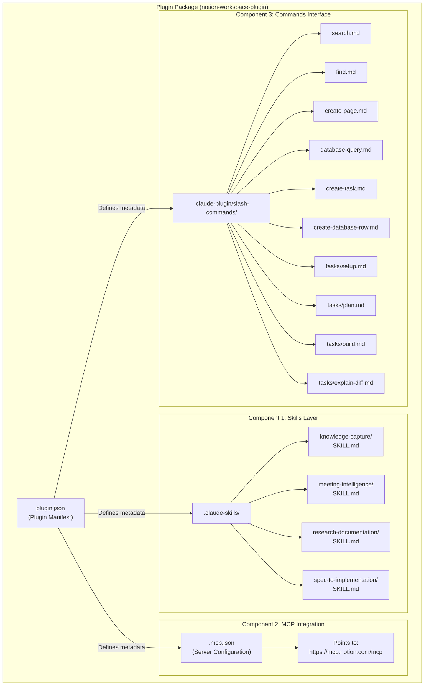
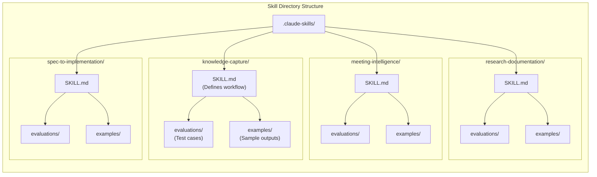
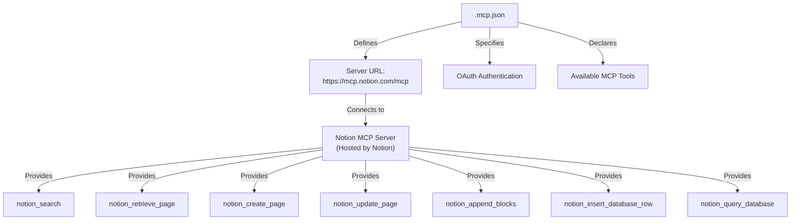
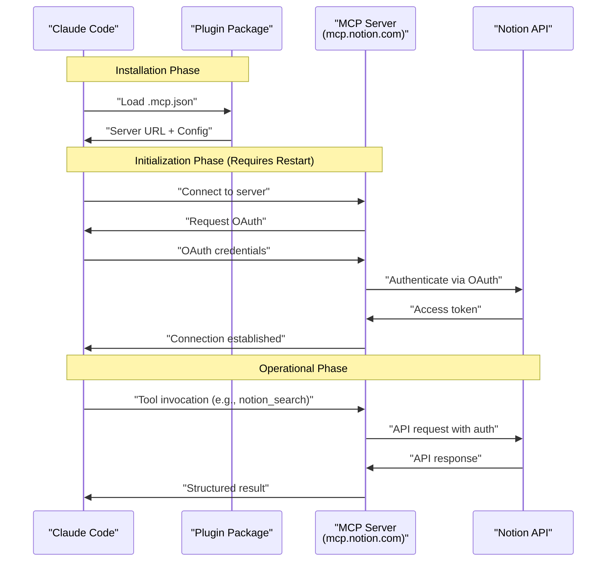
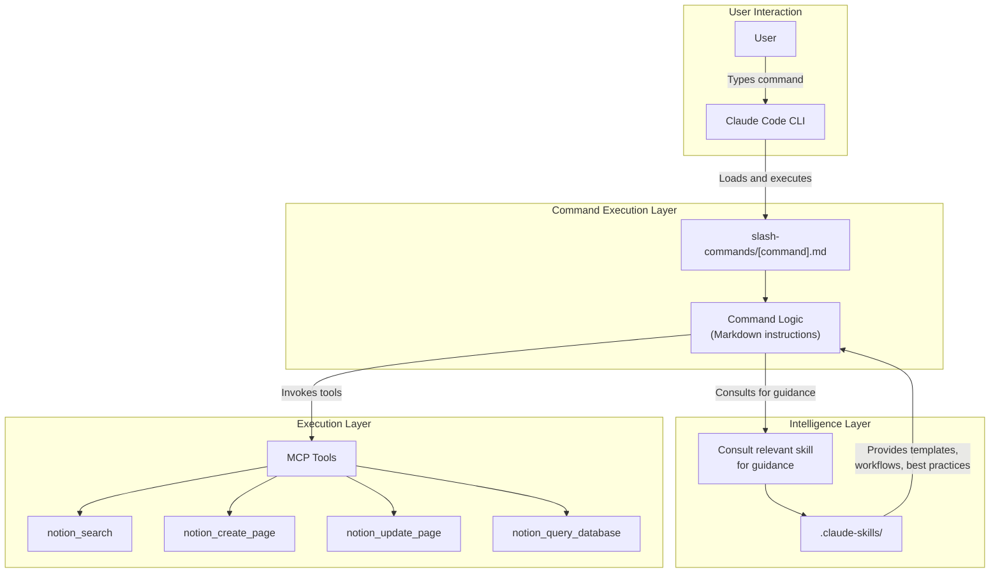
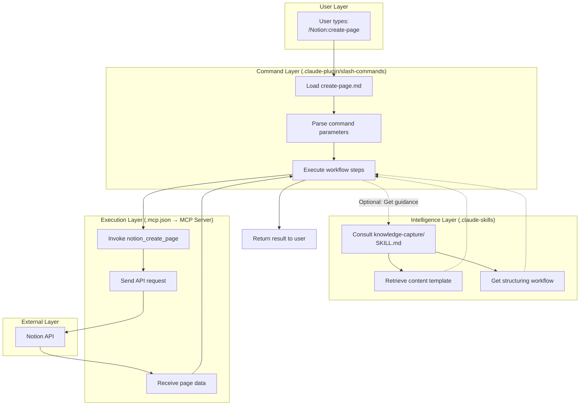

<!-- source: DeepWiki mcp.deepwiki.com · repo makenotion/claude-code-notion-plugin · page 3.1 Core Components · fetched 2026-10-26 -->

# Core Components

<details>
<summary>Relevant source files</summary>

The following files were used as context for generating this wiki page:

- [.claude-plugin/plugin.json](.claude-plugin/plugin.json)
- [README.md](README.md)

</details>


## Purpose and Scope

This page details the three core components that comprise the Notion Plugin for Claude Code and explains how they work together to enable Notion workspace integration. The plugin is architecturally divided into distinct layers that provide different capabilities: **Notion Skills** (intelligence layer), **MCP Server Integration** (API execution layer), and **Slash Commands** (user interface layer).

For information about installation and configuration of these components, see [Installation](#2.1) and [MCP Server Configuration](#2.2). For detailed usage of individual commands and skills, see [Slash Commands Reference](#5) and [Notion Skills](#6).

**Sources:** [README.md:1-92]()

---

## Component Architecture Overview

The plugin bundles three distinct components that operate at different architectural layers. Each component has a specific responsibility in the system, and they are designed to work together through well-defined interfaces.

### Plugin Structure Diagram



**Sources:** [README.md:3-9](), [.claude-plugin/plugin.json:1-11]()

---

## Component 1: Notion Skills Bundle

The Skills layer provides intelligence and guidance to Claude on how to work effectively with Notion workspaces. Skills are markdown documents that define structured workflows, best practices, and templates for specific use cases.

### Included Skills

The plugin bundles four skills from the Notion Cookbook, each stored in the `.claude-skills/` directory:

| Skill Name | Directory | Purpose |
|------------|-----------|---------|
| **Knowledge Capture** | `.claude-skills/knowledge-capture/` | Extracts and structures knowledge from conversations into Notion documentation |
| **Meeting Intelligence** | `.claude-skills/meeting-intelligence/` | Processes meeting transcripts into structured meeting notes |
| **Research Documentation** | `.claude-skills/research-documentation/` | Organizes research findings into structured documentation |
| **Spec to Implementation** | `.claude-skills/spec-to-implementation/` | Guides implementation from specification documents |

Each skill directory contains a `SKILL.md` file that defines the skill's behavior, workflow steps, and output templates.

### Skill Architecture



### How Skills Work

Skills operate as **guidance documents** that Claude consults when executing commands. They do not directly execute operations; instead, they provide:

1. **Workflow definitions** - Step-by-step processes for accomplishing tasks
2. **Content templates** - Structured formats for different document types
3. **Decision logic** - Rules for classifying content and choosing appropriate destinations
4. **Best practices** - Patterns for organizing and linking information in Notion

When a slash command is executed, Claude may reference relevant skills to determine how to structure requests, format content, and organize information within the Notion workspace.

**Sources:** [README.md:15-23]()

---

## Component 2: MCP Server Integration

The MCP (Model Context Protocol) Server Integration provides the execution layer for all Notion API operations. This component establishes a secure connection to Notion's hosted MCP server and handles authentication and data operations.

### Configuration Structure

The MCP server is configured via the `.mcp.json` file in the plugin package:



### MCP Tool Capabilities

The Notion MCP server exposes the following tools that slash commands use for Notion operations:

| MCP Tool | Operation | Used By Commands |
|----------|-----------|------------------|
| `notion_search` | Search entire workspace | `/Notion:search`, `/Notion:find` |
| `notion_retrieve_page` | Fetch page/database content | Multiple commands |
| `notion_create_page` | Create new pages | `/Notion:create-page`, task commands |
| `notion_update_page` | Modify page properties | Task commands |
| `notion_append_blocks` | Add content blocks | Task commands, knowledge capture |
| `notion_insert_database_row` | Insert database rows | `/Notion:create-task`, `/Notion:create-database-row` |
| `notion_query_database` | Query and filter databases | `/Notion:database-query`, task commands |

### Authentication Flow



The MCP server handles all authentication complexity, including OAuth token management and refresh. Commands never directly interact with the Notion API—all operations flow through the MCP server.

**Sources:** [README.md:25-40](), [README.md:76-77](), [README.md:82-84]()

---

## Component 3: Slash Commands Interface

Slash commands provide the user interface layer for the plugin. Each command is defined as a markdown file in the `.claude-plugin/slash-commands/` directory and implements a specific workflow by coordinating between Skills (for guidance) and MCP tools (for execution).

### Command Catalog

The plugin includes 10 slash commands organized into two functional categories:

#### Basic Notion Operations

| Command File | Invocation | Function | MCP Tools Used |
|-------------|------------|----------|----------------|
| `search.md` | `/Notion:search` | Full-text workspace search | `notion_search` |
| `find.md` | `/Notion:find` | Quick title-based lookup | `notion_search` |
| `create-page.md` | `/Notion:create-page` | Create new pages | `notion_create_page` |
| `database-query.md` | `/Notion:database-query` | Query databases with filters | `notion_query_database` |
| `create-task.md` | `/Notion:create-task` | Create task entries | `notion_insert_database_row` |
| `create-database-row.md` | `/Notion:create-database-row` | Insert database rows | `notion_insert_database_row` |

#### Task Management Suite

| Command File | Invocation | Function | MCP Tools Used |
|-------------|------------|----------|----------------|
| `tasks/setup.md` | `/Notion:tasks:setup` | Configure task board | `notion_create_page`, `notion_query_database` |
| `tasks/plan.md` | `/Notion:tasks:plan` | Create task plan | Multiple tools + polling |
| `tasks/build.md` | `/Notion:tasks:build` | Execute task autonomously | Multiple tools + polling |
| `tasks/explain-diff.md` | `/Notion:tasks:explain-diff` | Document code changes | `notion_create_page`, `notion_append_blocks` |

**Sources:** [README.md:41-56]()

### Command Architecture Pattern



### Command Dependency Pattern

Commands follow a consistent pattern for leveraging the other two components:

1. **Read command definition** - Load markdown file from `.claude-plugin/slash-commands/`
2. **Consult skills (optional)** - Reference relevant skill from `.claude-skills/` for workflow guidance
3. **Execute MCP tools** - Invoke one or more tools via MCP server connection
4. **Structure output** - Format results according to skill templates (if applicable)

For example, the `/Notion:create-page` command:
- Reads workflow from `slash-commands/create-page.md`
- May consult `knowledge-capture/SKILL.md` for content structuring
- Invokes `notion_create_page` tool via MCP server
- Returns the created page URL to the user

**Sources:** [README.md:41-57]()

---

## Component Interaction Architecture

The three components interact through a layered architecture where each layer has a distinct responsibility and communicates through well-defined interfaces.

### Data Flow Between Components



### Interaction Patterns by Command Type

Different commands use the three components in different ways:

#### Pattern 1: Simple CRUD Commands
Commands like `/Notion:search` and `/Notion:find`:
- **Skills:** Not typically consulted
- **MCP Tools:** Direct single tool invocation
- **Flow:** Command → MCP tool → Result

#### Pattern 2: Knowledge-Intensive Commands
Commands that create structured content:
- **Skills:** Heavily consulted for templates and structure
- **MCP Tools:** Multiple tool invocations
- **Flow:** Command → Skill consultation → Template application → MCP tools → Result

#### Pattern 3: Agent-Based Commands
Task management commands like `/Notion:tasks:build`:
- **Skills:** Consulted for workflow and decision logic
- **MCP Tools:** Continuous tool invocations with polling
- **Flow:** Command → Skill workflow → Iterative MCP calls + polling → Result

### Component Dependency Matrix

| Component | Depends On | Provides To | Communication Method |
|-----------|------------|-------------|---------------------|
| **Slash Commands** | Skills, MCP Server | User | Markdown file definition, tool invocation |
| **Skills** | None | Slash Commands | Markdown documentation read by Claude |
| **MCP Server** | Notion API | Slash Commands | JSON-RPC tool protocol |

**Sources:** [README.md:1-92]()

---

## Plugin Manifest Integration

The three components are unified through the plugin manifest file at `.claude-plugin/plugin.json`, which defines the plugin's metadata and implicitly references the component directories.

### Manifest Structure

```json
{
    "name": "Notion",
    "version": "0.1.0",
    "description": "Notion Skills + Notion MCP server packaged as a Claude Code plugin.",
    "author": {
      "name": "Notion Labs",
      "url": "https://www.notion.so"
    },
    "repository": "https://github.com/makenotion/claude-code-notion-plugin",
    "license": "MIT"
}
```

The manifest establishes the plugin identity, but the actual component loading is handled by Claude Code's plugin system, which automatically:

1. Loads all markdown files from `.claude-skills/` as skills
2. Registers all markdown files from `.claude-plugin/slash-commands/` as commands
3. Initializes MCP server connection from `.mcp.json`

**Sources:** [.claude-plugin/plugin.json:1-11]()

---

## Summary

The Notion Plugin's three-component architecture provides clear separation of concerns:

- **Skills** provide intelligence and guidance through structured documentation
- **MCP Server** provides secure, authenticated API execution through a hosted service
- **Slash Commands** provide user-facing workflows that coordinate the other two layers

This layered design enables flexible composition where commands can choose whether to leverage skills (for structured workflows) or execute direct operations (for simple queries), while all API communication is consistently mediated through the MCP server layer. The architecture's modularity also allows for independent updates to each component without affecting the others.

**Sources:** [README.md:1-92](), [.claude-plugin/plugin.json:1-11]()

---

