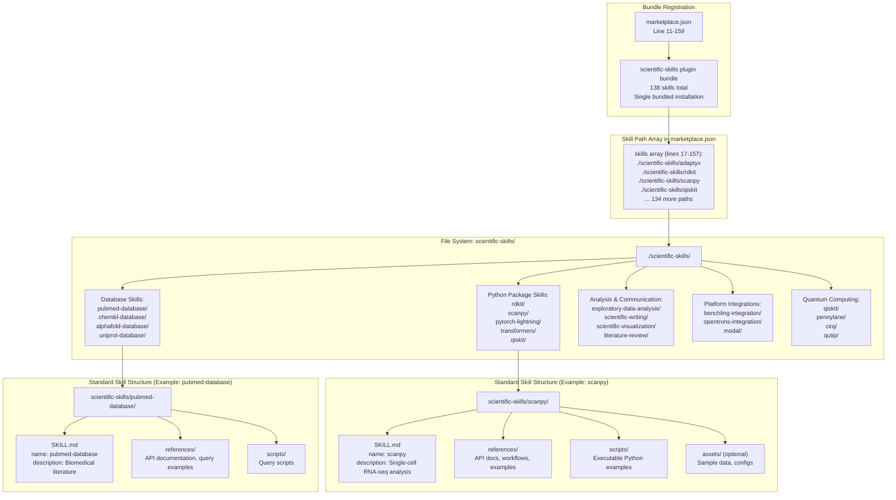

<!-- source: DeepWiki mcp.deepwiki.com · repo K-Dense-AI/claude-scientific-skills · page 10.1 Complete Skill Catalog · fetched 2026-10-26 -->

# Complete Skill Catalog

<details>
<summary>Relevant source files</summary>

The following files were used as context for generating this wiki page:

- [.claude-plugin/marketplace.json](.claude-plugin/marketplace.json)
- [README.md](README.md)
- [docs/scientific-skills.md](docs/scientific-skills.md)
- [scientific-skills/ginkgo-cloud-lab/SKILL.md](scientific-skills/ginkgo-cloud-lab/SKILL.md)
- [scientific-skills/ginkgo-cloud-lab/references/cell-free-protein-expression-optimization.md](scientific-skills/ginkgo-cloud-lab/references/cell-free-protein-expression-optimization.md)
- [scientific-skills/ginkgo-cloud-lab/references/cell-free-protein-expression-validation.md](scientific-skills/ginkgo-cloud-lab/references/cell-free-protein-expression-validation.md)
- [scientific-skills/ginkgo-cloud-lab/references/fluorescent-pixel-art-generation.md](scientific-skills/ginkgo-cloud-lab/references/fluorescent-pixel-art-generation.md)

</details>


## Purpose and Scope

This page provides an alphabetical reference catalog of all 138 skills available in the Claude Scientific Skills repository. Each entry includes the skill name, category, brief description, trigger phrases for skill discovery, and file path location. This catalog serves as a quick lookup reference for users who know what functionality they need but want to identify the corresponding skill.

For category-organized overviews, see:
- [Skill Categories Overview](#4) - High-level categorization of 138 skills into 7 domains
- [Quantum Computing Skills](#5) - Quantum computing capabilities
- [Bioinformatics and Genomics](#6) - Genomics and single-cell analysis
- [Cheminformatics and Drug Discovery](#7) - Chemistry and drug discovery tools
- [Scientific Databases](#8) - External data source integrations
- [Machine Learning and AI](#9) - ML frameworks and tools
- [Multi-Domain Workflows](#14) - End-to-end research workflows

For workflow examples demonstrating multi-skill composition, see [Multi-Domain Workflows](#14).

## Catalog Statistics

The repository contains 138 individual skills organized into a single plugin bundle:

| Bundle Name | Skill Count | Directory Structure | Installation Method |
|-------------|-------------|---------------------|---------------------|
| **scientific-skills** | 138 | `./scientific-skills/` | Single plugin installation via marketplace |

All 138 skills are distributed as one cohesive bundle to enable seamless interdisciplinary workflows without configuration overhead. The bundled approach allows Claude to automatically discover and chain skills from multiple scientific domains (bioinformatics, cheminformatics, clinical databases, machine learning, etc.) in a single workflow.

**Sources:** [README.md:4](), [README.md:36-38](), [.claude-plugin/marketplace.json:11-159]()

## Skill Directory Structure to Code Entities

This diagram shows how skill names in the catalog map to actual directory structures and the standardized documentation pattern used across all 138 skills in the single bundle:



**Sources:** [.claude-plugin/marketplace.json:11-159](), [README.md:36-38](), [README.md:127-134]()

## Skill Discovery and Search Protocol

This diagram illustrates how Claude searches the skill catalog when a user poses a scientific question, bridging natural language queries to specific skill files:

```mermaid
sequenceDiagram
    participant User
    participant Claude
    participant SkillCatalog["Installed Skills<br/>(SKILL.md files)"]
    participant SearchIndex["Search Keywords<br/>(from 'When to Use' sections)"]
    participant SkillDocs["Skill Documentation<br/>(SKILL.md + references)"]
    
    Note over User,SkillDocs: User Query Phase
    User->>Claude: "Analyze protein sequences<br/>from FASTA files"
    
    Claude->>SkillCatalog: Extract keywords:<br/>["protein", "sequence", "FASTA"]
    
    Note over Claude,SearchIndex: Keyword Matching
    SkillCatalog->>SearchIndex: Search installed skills
    SearchIndex-->>SkillCatalog: Matches:<br/>- biopython: "protein", "sequence", "FASTA"<br/>- uniprot-database: "protein"<br/>- scanpy: "sequence"
    
    Note over Claude,SkillCatalog: Relevance Ranking
    Claude->>Claude: Rank by keyword coverage:<br/>1. biopython (3/3 matches)<br/>2. uniprot-database (1/3)<br/>3. scanpy (1/3)
    
    Claude->>SkillDocs: Read scientific-packages/biopython/SKILL.md
    SkillDocs-->>Claude: Overview: "Sequence I/O, alignment, analysis"<br/>When to Use: "Read FASTA files, protein sequences"<br/>Quick Start: SeqIO.parse() example
    
    Claude->>SkillDocs: Read scientific-packages/biopython/references/sequence_io.md
    SkillDocs-->>Claude: API details: SeqIO.parse(handle, format)<br/>Supported formats: FASTA, GenBank, FASTQ
    
    Note over Claude: Synthesize approach
    Claude->>User: "I'll use BioPython's SeqIO module.<br/>Here's how to read FASTA and analyze sequences..."
    
    alt User requests additional data
        User->>Claude: "Also query UniProt for protein info"
        Claude->>SkillCatalog: Search: ["UniProt", "protein", "query"]
        SkillCatalog-->>Claude: Match: uniprot-database
        Claude->>SkillDocs: Read scientific-databases/uniprot-database/SKILL.md
        Claude->>User: "I'll combine BioPython with UniProt API..."
    end
```

**Sources:** [README.md:50-54](), [README.md:88-90](), [README.md:107-139]()

## Alphabetical Skill Catalog

### A

#### Adaptyv
- **Category:** Laboratory Integration & Protein Engineering
- **Description:** Cloud laboratory platform for automated protein testing and validation. API for binding assays, expression testing, thermostability, enzyme activity, protein optimization tools.
- **Trigger Phrases:** "Adaptyv API", "cloud laboratory", "protein testing", "binding assay", "protein optimization"
- **Path:** `./scientific-skills/adaptyv/`
- **References:** [Adaptyv: Cloud Laboratory Protein Testing](#12.2)

#### Aeon
- **Category:** Machine Learning & AI
- **Description:** Time series analysis and classification library. Algorithms for time series classification, regression, clustering, and forecasting with scikit-learn compatible API.
- **Trigger Phrases:** "time series classification", "aeon library", "temporal pattern recognition", "time series forecasting", "temporal clustering"
- **Path:** `./scientific-skills/aeon/`
- **References:** [Machine Learning and AI](#9)

#### AlphaFold Database
- **Category:** Scientific Database
- **Description:** Access AI-predicted protein structures from DeepMind's AlphaFold DB (200M+ predictions). Query by UniProt ID, retrieve PDB files and confidence scores (pLDDT), analyze structure quality.
- **Trigger Phrases:** "AlphaFold prediction", "protein structure prediction", "pLDDT confidence", "predicted 3D structure", "AlphaFold DB"
- **Path:** `./scientific-skills/alphafold-database/`
- **References:** [Protein and Genomics Databases](#8.2)

#### AnnData
- **Category:** Bioinformatics & Genomics
- **Description:** Annotated data matrices for single-cell genomics. Handle h5ad files, store observations (cells), variables (genes), and multi-dimensional annotations. Essential for single-cell RNA-seq workflows.
- **Trigger Phrases:** "h5ad file", "AnnData object", "single-cell data structure", "annotated data matrix", "obs/var annotations"
- **Path:** `./scientific-skills/anndata/`
- **References:** [Single-Cell RNA-seq Analysis](#6.1)

#### Arboreto
- **Category:** Bioinformatics & Genomics
- **Description:** Gene regulatory network inference using GRNBoost2 (gradient boosting) and GENIE3 (random forest) algorithms. Predict transcription factor targets from expression data.
- **Trigger Phrases:** "gene regulatory network", "GRN inference", "GRNBoost2", "transcription factor targets", "GENIE3 algorithm"
- **Path:** `./scientific-skills/arboreto/`
- **References:** [Bioinformatics and Genomics](#6)

#### Astropy
- **Category:** Computational Physics & Engineering
- **Description:** Core astronomy and astrophysics tools. Handle coordinates, cosmology calculations, FITS file I/O, units and constants, time series analysis, celestial coordinate transformations.
- **Trigger Phrases:** "astronomy data", "FITS file", "cosmological calculations", "celestial coordinates", "astrophysics units"
- **Path:** `./scientific-skills/astropy/`
- **References:** [Computational Physics and Engineering](#11)

**Sources:** [README.md:344-458](), [.claude-plugin/marketplace.json:18-23]()

### B

#### Benchling Integration
- **Category:** Laboratory Automation & LIMS
- **Description:** R&D platform and LIMS integration. Access Registry entities (DNA sequences, proteins, custom schemas), manage inventory, create ELN entries, execute workflows, handle events via webhooks.
- **Trigger Phrases:** "Benchling API", "Registry entity", "molecular biology LIMS", "lab inventory management", "ELN entry"
- **Path:** `./scientific-skills/benchling-integration/`
- **References:** [Lab Automation and LIMS Integration](#12.3)

#### bioRxiv Database
- **Category:** Scientific Database
- **Description:** Preprint server for biology. Search and retrieve preprint manuscripts, metadata, authors, subjects, full-text content before peer review publication.
- **Trigger Phrases:** "bioRxiv preprint", "preprint search", "unpublished research", "bioRxiv API", "preprint manuscript"
- **Path:** `./scientific-skills/biorxiv-database/`
- **References:** [Biomedical Literature Databases](#8.1)

#### BioPython
- **Category:** Bioinformatics & Genomics
- **Description:** Comprehensive sequence analysis toolkit. Modules: Bio.Seq (sequences), Bio.SeqIO (file I/O for FASTA/GenBank/FASTQ), Bio.Align (alignments), Bio.Entrez (NCBI queries), Bio.Phylo (phylogenetics), Bio.Blast (BLAST searches).
- **Trigger Phrases:** "parse FASTA", "sequence alignment", "BLAST search", "Entrez query", "phylogenetic tree", "SeqIO.parse", "protein sequence analysis"
- **Path:** `./scientific-skills/biopython/`
- **References:** [Sequence Analysis and Genomics](#6.2)

#### BioServices
- **Category:** Bioinformatics & Genomics
- **Description:** Programmatic access to 40+ biological web services. Query KEGG pathways, UniProt proteins, ChEBI compounds, ChEMBL bioactivity through unified Python interface.
- **Trigger Phrases:** "BioServices query", "multiple database access", "KEGG pathway query", "unified bio-database interface"
- **Path:** `./scientific-skills/bioservices/`
- **References:** [Bioinformatics and Genomics](#6)

#### BIOMNI
- **Category:** Multi-omics & Systems Biology
- **Description:** Multi-omics data integration with LLM-powered analysis. Combine genomics, transcriptomics, proteomics, and metabolomics datasets for systems biology approaches.
- **Trigger Phrases:** "multi-omics integration", "systems biology analysis", "integrate omics data", "BIOMNI analysis"
- **Path:** `./scientific-skills/biomni/`
- **References:** [Multi-Omics Integration and Biomarker Discovery](#14.4)

#### BRENDA Database
- **Category:** Scientific Database
- **Description:** Comprehensive enzyme information database. Query enzyme kinetics (Km values), reaction data, organism comparisons, pathway building, enzyme classifications (EC numbers).
- **Trigger Phrases:** "enzyme kinetics", "BRENDA database", "Km value", "enzyme reaction", "EC number"
- **Path:** `./scientific-skills/brenda-database/`
- **References:** [Enzyme and Biochemical Databases](#8.4)

**Sources:** [README.md:344-458](), [.claude-plugin/marketplace.json:23-26]()

### C

#### Cellxgene Census
- **Category:** Bioinformatics & Genomics
- **Description:** Query and analyze large-scale single-cell RNA-seq data from CZ CELLxGENE platform. Access millions of cells across tissues, species, and conditions with efficient cloud-based queries.
- **Trigger Phrases:** "CELLxGENE Census", "large-scale single-cell", "query cell atlas", "cross-dataset single-cell"
- **Path:** `./scientific-skills/cellxgene-census/`
- **References:** [Single-Cell RNA-seq Analysis](#6.1)

#### ChEMBL Database
- **Category:** Scientific Database
- **Description:** Bioactive molecules and drug-like compound properties. Query bioactivity data, target information, assay results, molecule structures, IC50/EC50 values via Python client or REST API.
- **Trigger Phrases:** "ChEMBL query", "bioactivity data", "compound IC50", "drug target information", "molecular bioactivity"
- **Path:** `./scientific-skills/chembl-database/`
- **References:** [Chemical and Drug Databases](#8.5)

#### Cirq
- **Category:** Quantum Computing
- **Description:** Google's quantum programming framework. Circuit building, noise modeling, hardware integration (Sycamore), quantum experiments, simulations for quantum algorithms.
- **Trigger Phrases:** "Cirq quantum", "Google quantum", "Sycamore processor", "quantum circuit builder", "quantum simulation"
- **Path:** `./scientific-skills/cirq/`
- **References:** [Cirq: Google Quantum Programming](#5.3)

#### Citation Management
- **Category:** Scientific Communication
- **Description:** Bibliographic reference management and formatting. Generate citations in APA, Vancouver, Nature styles, manage bibliographies, integrate with scientific writing workflows.
- **Trigger Phrases:** "citation formatting", "bibliography management", "reference style", "citation generator", "BibTeX"
- **Path:** `./scientific-skills/citation-management/`
- **References:** [Scientific Communication](#4)

#### Clinical Decision Support
- **Category:** Clinical & Medical
- **Description:** Clinical decision-making tools and frameworks. Evidence-based recommendations, diagnostic algorithms, treatment pathways, clinical guideline integration.
- **Trigger Phrases:** "clinical decision support", "diagnostic algorithm", "treatment recommendation", "clinical guideline", "evidence-based medicine"
- **Path:** `./scientific-skills/clinical-decision-support/`
- **References:** [Clinical Research & Precision Medicine](#4)

#### Clinical Reports
- **Category:** Clinical & Medical
- **Description:** Generate structured clinical reports and documentation. Patient summaries, diagnostic reports, treatment plans, laboratory result interpretation, clinical documentation.
- **Trigger Phrases:** "clinical report generation", "patient summary", "diagnostic report", "medical documentation", "clinical findings"
- **Path:** `./scientific-skills/clinical-reports/`
- **References:** [Clinical Research & Precision Medicine](#4)

#### ClinicalTrials.gov
- **Category:** Scientific Database
- **Description:** Global clinical studies registry. Search trials by condition, intervention, location, status, sponsor. Access trial design, enrollment criteria, outcomes, results using API v2.
- **Trigger Phrases:** "clinical trial search", "ClinicalTrials.gov query", "trial enrollment criteria", "study intervention", "clinical trial results"
- **Path:** `./scientific-skills/clinicaltrials-database/`
- **References:** [Clinical and Healthcare Databases](#8.6)

#### ClinPGx Database
- **Category:** Scientific Database
- **Description:** Clinical pharmacogenomics and gene-drug interactions. Query pharmacogenomic annotations, drug response variants, dosing guidelines, clinical recommendations.
- **Trigger Phrases:** "pharmacogenomics data", "gene-drug interaction", "ClinPGx query", "drug response variant", "PGx guideline"
- **Path:** `./scientific-skills/clinpgx-database/`
- **References:** [Clinical and Healthcare Databases](#8.6)

#### ClinVar Database
- **Category:** Scientific Database
- **Description:** Genomic variants and clinical significance. Access human genetic variants, disease associations, pathogenicity classifications using E-utilities or FTP bulk downloads.
- **Trigger Phrases:** "ClinVar variant", "pathogenic variant", "clinical significance", "genetic variant classification", "disease-causing mutation"
- **Path:** `./scientific-skills/clinvar-database/`
- **References:** [Clinical and Healthcare Databases](#8.6)

#### COBRApy
- **Category:** Materials Science & Chemistry
- **Description:** Constraint-based metabolic modeling and flux balance analysis (FBA). Analyze metabolic networks, predict growth rates, identify essential genes, optimize metabolic pathways.
- **Trigger Phrases:** "flux balance analysis", "metabolic network modeling", "FBA simulation", "constraint-based modeling", "COBRA toolbox"
- **Path:** `./scientific-skills/cobrapy/`
- **References:** [Materials Science, Chemistry & Physics](#4)

#### COSMIC Database
- **Category:** Scientific Database
- **Description:** Somatic cancer mutations database. Access mutation frequencies, cancer types, gene census, fusion genes, drug resistance mutations via file downloads.
- **Trigger Phrases:** "COSMIC mutation", "cancer mutation database", "somatic variant", "cancer gene census", "oncogenic mutation"
- **Path:** `./scientific-skills/cosmic-database/`
- **References:** [Clinical and Healthcare Databases](#8.6)

**Sources:** [README.md:344-458](), [.claude-plugin/marketplace.json:26-30]()

### D

#### Dask
- **Category:** Engineering & Simulation
- **Description:** Parallel computing for larger-than-memory datasets. Distributed DataFrames, Arrays, Bags, and Futures with automatic task scheduling. Scale Pandas/NumPy operations to clusters.
- **Trigger Phrases:** "parallel computing", "distributed dataframe", "larger than memory", "Dask array", "scale Pandas operations"
- **Path:** `./scientific-skills/dask/`
- **References:** [Engineering & Simulation](#4)

#### Data Commons
- **Category:** Data Analysis & Visualization
- **Description:** Google's public data platform. Access demographic, economic, health, environmental datasets with unified API. Query statistical observations across multiple domains.
- **Trigger Phrases:** "Data Commons API", "public data access", "statistical datasets", "demographic data", "economic indicators"
- **Path:** `./scientific-skills/datacommons-client/`
- **References:** [Data Analysis & Visualization](#4)

#### Datamol
- **Category:** Cheminformatics & Drug Discovery
- **Description:** Molecular manipulation and featurization with enhanced RDKit workflows. Simplified molecular I/O, standardization, descriptor calculation, integration with machine learning pipelines.
- **Trigger Phrases:** "molecular manipulation", "Datamol workflow", "molecular standardization", "RDKit wrapper", "molecular featurization"
- **Path:** `./scientific-skills/datamol/`
- **References:** [AI-Driven Drug Discovery](#7.2)

#### DeepChem
- **Category:** Cheminformatics & Drug Discovery
- **Description:** Molecular machine learning with graph neural networks. Access MoleculeNet benchmarks, train models for property prediction, use pre-trained molecular representations.
- **Trigger Phrases:** "molecular machine learning", "DeepChem model", "MoleculeNet benchmark", "molecular property prediction", "GNN for molecules"
- **Path:** `./scientific-skills/deepchem/`
- **References:** [AI-Driven Drug Discovery](#7.2)

#### deepTools
- **Category:** Bioinformatics & Genomics
- **Description:** NGS data analysis for ChIP-seq, RNA-seq, ATAC-seq. Process BAM files, create bigWig coverage tracks, generate heatmaps, compute enrichment scores.
- **Trigger Phrases:** "ChIP-seq analysis", "NGS coverage track", "deepTools heatmap", "BAM to bigWig", "genomic enrichment"
- **Path:** `./scientific-skills/deeptools/`
- **References:** [Bioinformatics and Genomics](#6)

#### Denario
- **Category:** Multi-omics & Systems Biology
- **Description:** Multi-omics data integration and network analysis. Combine different omics layers, perform integrated pathway analysis, identify multi-omics signatures.
- **Trigger Phrases:** "Denario analysis", "multi-omics network", "integrated omics", "omics layer integration"
- **Path:** `./scientific-skills/denario/`
- **References:** [Multi-Omics Integration](#4)

#### DiffDock
- **Category:** Cheminformatics & Drug Discovery
- **Description:** Diffusion-based molecular docking for protein-ligand binding prediction. AI-powered docking without traditional scoring functions, predict binding poses and affinities.
- **Trigger Phrases:** "molecular docking", "DiffDock prediction", "protein-ligand binding", "AI docking", "binding pose prediction"
- **Path:** `./scientific-skills/diffdock/`
- **References:** [Cheminformatics and Drug Discovery](#7)

#### DNAnexus Integration
- **Category:** Infrastructure & Platforms
- **Description:** Cloud genomics and biomedical data analysis platform. Build apps with dxpy SDK, execute workflows, manage data objects, run batch jobs on cloud infrastructure.
- **Trigger Phrases:** "DNAnexus platform", "dxpy SDK", "cloud genomics pipeline", "DNAnexus app", "dx-toolkit"
- **Path:** `./scientific-skills/dnanexus-integration/`
- **References:** [Infrastructure & Platforms](#4)

#### DOCX Document Skills
- **Category:** Scientific Communication
- **Description:** Microsoft Word document manipulation. Read/write DOCX files, track changes, manage comments, apply formatting, extract text and tables, preserve document structure.
- **Trigger Phrases:** "DOCX manipulation", "Word document processing", "track changes", "extract DOCX text", "DOCX table parsing"
- **Path:** `./scientific-skills/document-skills/docx/`
- **References:** [Scientific Communication](#4)

#### DrugBank Database
- **Category:** Scientific Database
- **Description:** Comprehensive drug and drug target database. Query approved drugs, drug targets, mechanisms of action, pharmacology, drug interactions, clinical data.
- **Trigger Phrases:** "DrugBank query", "drug target", "drug mechanism", "drug interaction", "pharmaceutical database"
- **Path:** `./scientific-skills/drugbank-database/`
- **References:** [Chemical and Drug Databases](#8.5)

**Sources:** [README.md:344-458](), [.claude-plugin/marketplace.json:29-36]()

### E

#### ENA Database
- **Category:** Scientific Database
- **Description:** European Nucleotide Archive for nucleotide sequences and raw reads. Access genomes, transcriptomes, sequencing reads, assemblies via REST APIs with rich metadata.
- **Trigger Phrases:** "ENA database", "nucleotide archive", "raw sequencing reads", "genome assembly", "ENA accession"
- **Path:** `scientific-databases/ena-database/`
- **References:** [ENA Database](#5.2.2)

#### Ensembl Database
- **Category:** Scientific Database
- **Description:** Genome browser and annotations. Query genes, transcripts, variants, regulatory features, comparative genomics via REST API. Access multiple species and genome builds.
- **Trigger Phrases:** "Ensembl gene", "genome annotation", "transcript variant", "Ensembl REST API", "comparative genomics"
- **Path:** `scientific-databases/ensembl-database/`

#### ETE Toolkit
- **Category:** Scientific Package
- **Description:** Phylogenetic tree manipulation, visualization, and analysis. Parse Newick/PhyloXML formats, tree traversal, node operations, evolutionary analysis, tree rendering.
- **Trigger Phrases:** "phylogenetic tree", "ETE toolkit", "tree visualization", "Newick format", "evolutionary tree analysis"
- **Path:** `scientific-packages/etetoolkit/`

#### Exploratory Data Analysis
- **Category:** Scientific Thinking
- **Description:** Automated statistics and insights generation. Tools: eda_analyzer.py, visualizer.py. Generate comprehensive reports, distribution analysis, correlation matrices, automated insights, outlier detection.
- **Trigger Phrases:** "exploratory data analysis", "EDA report", "automated statistics", "data profiling", "distribution analysis"
- **Path:** `scientific-thinking/exploratory-data-analysis/`
- **References:** [Exploratory Data Analysis](#6.1.1)

**Sources:** [README.md:186-209](), [docs/scientific-packages.md:50-57](), [.claude-plugin/marketplace.json:32-35]()

### F

#### FDA Databases
- **Category:** Scientific Database
- **Description:** Drug approvals, adverse events, recalls. Access FDA Orange Book (approved drugs), FAERS (adverse event reporting), recall databases, drug labeling information.
- **Trigger Phrases:** "FDA approval", "drug adverse event", "FDA recall", "Orange Book query", "FAERS report"
- **Path:** `scientific-databases/fda-database/`

#### FlowIO
- **Category:** Scientific Package
- **Description:** Flow Cytometry Standard (FCS) file reading and manipulation. Parse FCS files, extract fluorescence data, handle compensation matrices, analyze cell populations.
- **Trigger Phrases:** "flow cytometry data", "FCS file parsing", "FlowIO read", "cell population analysis", "fluorescence data"
- **Path:** `scientific-packages/flowio/`

**Sources:** [README.md:186-209](), [docs/scientific-packages.md:54-57](), [.claude-plugin/marketplace.json:33-34]()

### G

#### Gene Database (NCBI)
- **Category:** Scientific Database
- **Description:** Gene information and annotations from NCBI. Query gene symbols, descriptions, chromosomal locations, homologs, expression data, pathways via Entrez API.
- **Trigger Phrases:** "NCBI Gene", "gene annotation", "gene symbol query", "chromosomal location", "gene homolog"
- **Path:** `scientific-databases/gene-database/`
- **References:** [Gene and GEO Databases](#5.2.3)

#### GEO Database
- **Category:** Scientific Database
- **Description:** Gene Expression Omnibus for functional genomics. Access microarray and RNA-seq datasets, series matrices, platform annotations, expression profiles via GEOquery.
- **Trigger Phrases:** "GEO dataset", "gene expression data", "GEO series", "microarray data", "expression matrix"
- **Path:** `scientific-databases/geo-database/`
- **References:** [Gene and GEO Databases](#5.2.3)

#### gget
- **Category:** Scientific Package
- **Description:** Efficient genomic database queries. Access Ensembl, UniProt, NCBI, PDB, COSMIC with simplified commands. Search genes, sequences, structures, variants.
- **Trigger Phrases:** "gget query", "fast genomic search", "gget search", "efficient database query", "gget info"
- **Path:** `scientific-packages/gget/`

#### GWAS Catalog
- **Category:** Scientific Database
- **Description:** Genome-wide association studies data. Query genetic variants, disease associations, summary statistics, effect sizes, p-values via REST API.
- **Trigger Phrases:** "GWAS variant", "genetic association", "GWAS Catalog query", "trait-associated SNP", "association study"
- **Path:** `scientific-databases/gwas-database/`
- **References:** [GWAS Catalog](#5.2.1)

**Sources:** [README.md:186-209](), [docs/scientific-packages.md:9](), [.claude-plugin/marketplace.json:34-35]()

### H

#### HMDB Database
- **Category:** Scientific Database
- **Description:** Human metabolome database. Query metabolite information, chemical properties, biological roles, disease associations, concentrations in biofluids.
- **Trigger Phrases:** "human metabolome", "HMDB metabolite", "metabolite concentration", "biofluid metabolite", "metabolite database"
- **Path:** `scientific-databases/hmdb-database/`

#### Hypothesis Generation
- **Category:** Scientific Thinking
- **Description:** Structured frameworks for generating testable hypotheses. Eight-phase process: observation, literature search, gap identification, hypothesis formulation, prediction, testability assessment, quality criteria.
- **Trigger Phrases:** "hypothesis generation", "testable hypothesis", "research question", "hypothesis framework", "scientific hypothesis"
- **Path:** `scientific-thinking/hypothesis-generation/`
- **References:** [Hypothesis Generation](#6.3.1)

**Sources:** [README.md:186-209](), [README.md:279-287](), [.claude-plugin/marketplace.json:101]()

### K

#### KEGG Database
- **Category:** Scientific Database
- **Description:** Biological pathways and molecular interactions. Query metabolic pathways, genes, enzymes, reactions, diseases via KEGG REST API. Access pathway maps and orthologs.
- **Trigger Phrases:** "KEGG pathway", "metabolic pathway", "enzyme reaction", "KEGG map", "pathway database"
- **Path:** `scientific-databases/kegg-database/`

**Sources:** [README.md:186-209]()

### L

#### LabArchives Integration
- **Category:** Scientific Integration
- **Description:** Electronic Lab Notebook (ELN) integration. Create entries, manage notebooks, attach files, handle templates, collaborate on research documentation.
- **Trigger Phrases:** "LabArchives ELN", "electronic lab notebook", "lab notebook entry", "research documentation", "LabArchives API"
- **Path:** `scientific-integrations/labarchive-integration/`

#### LatchBio Integration
- **Category:** Scientific Integration
- **Description:** Workflow platform and cloud execution. Build pipelines with Latch SDK, @workflow/@task decorators, deploy serverless workflows, LatchFile/LatchDir, Nextflow/Snakemake integration.
- **Trigger Phrases:** "Latch workflow", "LatchBio platform", "serverless bioinformatics", "Latch SDK", "@workflow decorator"
- **Path:** `scientific-integrations/latchbio-integration/`
- **References:** [LatchBio Integration](#7.1.2)

**Sources:** [README.md:301-306](), [scientific-integrations/latchbio-integration/SKILL.md:1-348](), [.claude-plugin/marketplace.json:122-124]()

### M

#### matchms
- **Category:** Scientific Package
- **Description:** Mass spectrometry data processing and similarity matching. 40+ filters, spectral library matching (Cosine, Modified Cosine, Neutral Losses), metadata harmonization, molecular fingerprint comparison. Supports MGF, MSP, mzML, JSON formats.
- **Trigger Phrases:** "mass spectrometry similarity", "spectral matching", "matchms filter", "MS/MS comparison", "spectral library"
- **Path:** `scientific-packages/matchms/`

#### Matplotlib
- **Category:** Scientific Package
- **Description:** Publication-quality plotting and visualization. Create line plots, scatter plots, bar charts, heatmaps, subplots. Extensive customization for scientific figures.
- **Trigger Phrases:** "matplotlib plot", "scientific visualization", "publication figure", "plotting library", "data visualization"
- **Path:** `scientific-packages/matplotlib/`

#### MedChem
- **Category:** Scientific Package
- **Description:** Medicinal chemistry analysis, ADMET prediction, drug-likeness assessment. Evaluate Lipinski's Rule of Five, calculate drug-like properties, predict pharmacokinetic parameters.
- **Trigger Phrases:** "medicinal chemistry", "ADMET prediction", "drug-likeness", "Lipinski rule", "pharmacokinetic properties"
- **Path:** `scientific-packages/medchem/`

#### Metabolomics Workbench
- **Category:** Scientific Database
- **Description:** NIH metabolomics data repository. Access metabolite data, experimental protocols, study designs, mass spectrometry results via REST API.
- **Trigger Phrases:** "metabolomics data", "Workbench query", "metabolite dataset", "metabolomics study", "NIH metabolomics"
- **Path:** `scientific-databases/metabolomics-workbench-database/`

#### Molfeat
- **Category:** Scientific Package
- **Description:** 100+ molecular featurizers including fingerprints (Morgan, MACCS, RDKit), descriptors (physicochemical, topological), and pretrained models (ChemBERTa, MolFormer).
- **Trigger Phrases:** "molecular featurization", "molecular fingerprint", "Molfeat calculator", "molecular descriptor", "pretrained molecular model"
- **Path:** `scientific-packages/molfeat/`

**Sources:** [README.md:228-262](), [docs/scientific-packages.md:24-48](), [.claude-plugin/marketplace.json:35-39]()

### O

#### OMERO Integration
- **Category:** Scientific Integration
- **Description:** Microscopy and bio-image data management. Access image data, annotations, ROIs, metadata, integrate with imaging workflows, handle multi-dimensional images.
- **Trigger Phrases:** "OMERO image", "microscopy data management", "bio-image server", "image annotation", "OMERO API"
- **Path:** `scientific-integrations/omero-integration/`

#### Open Targets Platform
- **Category:** Scientific Database
- **Description:** Therapeutic target identification and validation. Query target-disease associations, evidence scores, genetic evidence, pathways, tractability assessments via GraphQL API.
- **Trigger Phrases:** "Open Targets", "target-disease association", "target validation", "drug target", "therapeutic target"
- **Path:** `scientific-databases/opentargets-database/`
- **References:** [Open Targets Platform](#5.4.3)

#### Opentrons Integration
- **Category:** Scientific Integration
- **Description:** Laboratory automation protocols. Program Opentrons liquid handling robots using Python Protocol API v2, define labware, pipetting operations, deck layouts.
- **Trigger Phrases:** "Opentrons protocol", "liquid handling automation", "Opentrons API", "pipetting robot", "lab automation"
- **Path:** `scientific-integrations/opentrons-integration/`

**Sources:** [README.md:301-306](), [.claude-plugin/marketplace.json:119-126]()

### P

#### PDB Database
- **Category:** Scientific Database
- **Description:** Protein Data Bank for experimental 3D structures. Query protein structures, ligands, binding sites, resolution, experimental methods via REST API.
- **Trigger Phrases:** "PDB structure", "protein crystal structure", "PDB query", "experimental structure", "X-ray structure"
- **Path:** `scientific-databases/pdb-database/`

#### PDF Document Skills
- **Category:** Scientific Thinking
- **Description:** PDF manipulation and analysis. Extract text, parse tables, handle annotations, merge/split documents, preserve formatting, convert to/from PDF.
- **Trigger Phrases:** "PDF extraction", "parse PDF table", "PDF text mining", "PDF manipulation", "convert PDF"
- **Path:** `scientific-thinking/document-skills/pdf/`

#### Peer Review
- **Category:** Scientific Thinking
- **Description:** Systematic six-stage peer review process. Evaluate methodology, reproducibility, statistical rigor, evidence quality. Apply reporting standards (GRADE, Cochrane ROB).
- **Trigger Phrases:** "peer review", "manuscript review", "evaluate study quality", "review methodology", "scientific critique"
- **Path:** `scientific-thinking/peer-review/`
- **References:** [Peer Review](#6.3.3)

#### Polars
- **Category:** Scientific Package
- **Description:** High-performance DataFrame operations with lazy evaluation. Memory-efficient data processing, parallel execution, optimized query engine faster than Pandas.
- **Trigger Phrases:** "Polars DataFrame", "lazy evaluation", "high-performance dataframe", "efficient data processing", "Polars query"
- **Path:** `scientific-packages/polars/`

#### PPTX Document Skills
- **Category:** Scientific Thinking
- **Description:** PowerPoint presentation manipulation. Create/edit slides, manage layouts, add charts/images/tables, extract content, apply themes, automate presentations.
- **Trigger Phrases:** "PowerPoint automation", "PPTX manipulation", "create slide", "presentation generation", "extract PPTX content"
- **Path:** `scientific-thinking/document-skills/pptx/`

#### PubChem Database
- **Category:** Scientific Database
- **Description:** Chemical compound data (110M+ compounds). Query molecular structures, properties, bioassays, patents, literature via PUG REST API. Access chemical identifiers, similarity search.
- **Trigger Phrases:** "PubChem compound", "chemical structure", "PubChem CID", "compound properties", "chemical database"
- **Path:** `scientific-databases/pubchem-database/`

#### PubMed Database
- **Category:** Scientific Database
- **Description:** Biomedical literature database. Search publications using E-utilities API (ESearch, EFetch, ESummary, ELink, EPost). Access abstracts, citations, MeSH terms, PMIDs.
- **Trigger Phrases:** "PubMed search", "literature search", "PMID", "biomedical articles", "Entrez query"
- **Path:** `scientific-databases/pubmed-database/`
- **References:** [PubMed Database](#5.1.1)

#### PyDESeq2
- **Category:** Scientific Package
- **Description:** Differential gene expression analysis for bulk RNA-seq data. Python implementation of DESeq2 algorithm, identify differentially expressed genes, statistical testing, normalization.
- **Trigger Phrases:** "differential expression", "DESeq2 analysis", "RNA-seq DE", "gene expression testing", "PyDESeq2"
- **Path:** `scientific-packages/pydeseq2/`

#### Pymatgen
- **Category:** Scientific Package
- **Description:** Materials structure analysis, phase diagrams, electronic structure calculations. Handle crystal structures, perform symmetry analysis, compute properties, materials informatics.
- **Trigger Phrases:** "crystal structure", "materials science", "Pymatgen analysis", "phase diagram", "electronic structure"
- **Path:** `scientific-packages/pymatgen/`

#### PyMC
- **Category:** Scientific Package
- **Description:** Bayesian statistical modeling and probabilistic programming. Define probabilistic models, perform MCMC sampling, variational inference, posterior analysis, model comparison.
- **Trigger Phrases:** "Bayesian modeling", "MCMC sampling", "probabilistic programming", "PyMC model", "posterior inference"
- **Path:** `scientific-packages/pymc/`

#### PyMOO
- **Category:** Scientific Package
- **Description:** Multi-objective optimization with evolutionary algorithms. Solve optimization problems with multiple conflicting objectives, Pareto front analysis, NSGA-II/III algorithms.
- **Trigger Phrases:** "multi-objective optimization", "evolutionary algorithm", "Pareto optimization", "PyMOO solver", "NSGA algorithm"
- **Path:** `scientific-packages/pymoo/`

#### pyOpenMS
- **Category:** Scientific Package
- **Description:** Comprehensive mass spectrometry data analysis for proteomics and metabolomics. LC-MS/MS processing, peptide identification, feature detection, quantification, chemical calculations. Integration with Comet, Mascot, MSGF+ search engines.
- **Trigger Phrases:** "proteomics analysis", "LC-MS/MS processing", "peptide identification", "pyOpenMS workflow", "mass spec quantification"
- **Path:** `scientific-packages/pyopenms/`

#### pysam
- **Category:** Scientific Package
- **Description:** Read, write, and manipulate genomic data files. Handle SAM/BAM/CRAM alignments, VCF/BCF variants, FASTA/FASTQ sequences with pileup analysis, coverage calculations.
- **Trigger Phrases:** "BAM file processing", "SAM alignment", "VCF parsing", "pysam read", "genomic file manipulation"
- **Path:** `scientific-packages/pysam/`

#### PyTDC
- **Category:** Scientific Package
- **Description:** Therapeutics Data Commons for drug discovery datasets and benchmarks. Access curated datasets for ADMET prediction, molecular generation, drug-target interaction, clinical trial outcome prediction.
- **Trigger Phrases:** "Therapeutics Data Commons", "PyTDC dataset", "drug discovery benchmark", "TDC leaderboard", "ADMET dataset"
- **Path:** `scientific-packages/pytdc/`

#### PyTorch Lightning
- **Category:** Scientific Package
- **Description:** Deep learning framework organizing PyTorch code to eliminate boilerplate. Automates training workflows (40+ tasks), supports multi-GPU/TPU training with DDP/FSDP/DeepSpeed, includes LightningModule, Trainer, LightningDataModule, callbacks, integrations with TensorBoard/Wandb/MLflow.
- **Trigger Phrases:** "PyTorch Lightning", "LightningModule", "Trainer class", "distributed training", "multi-GPU training"
- **Path:** `scientific-packages/pytorch-lightning/`
- **References:** [PyTorch Lightning](#4.1.2)

**Sources:** [README.md:186-262](), [docs/scientific-packages.md:24-48](), [.claude-plugin/marketplace.json:39-48]()

### R

#### Reactome Database
- **Category:** Scientific Database
- **Description:** Curated biological pathways. Query reaction networks, pathway hierarchies, protein interactions, pathway analysis tools via REST API.
- **Trigger Phrases:** "Reactome pathway", "pathway analysis", "reaction network", "biological pathway database", "pathway enrichment"
- **Path:** `scientific-databases/reactome-database/`

#### RDKit
- **Category:** Scientific Package
- **Description:** Cheminformatics toolkit for molecular I/O, descriptors, fingerprints, SMARTS pattern matching. Core library for molecular manipulation, substructure search, property calculation.
- **Trigger Phrases:** "RDKit molecule", "molecular fingerprint", "SMARTS pattern", "cheminformatics", "molecular descriptor"
- **Path:** `scientific-packages/rdkit/`

#### ReportLab
- **Category:** Scientific Package
- **Description:** Programmatic PDF generation for reports and documents. Create scientific reports, figures, tables, multi-page documents with precise layout control.
- **Trigger Phrases:** "PDF generation", "ReportLab document", "programmatic PDF", "create PDF report", "scientific report PDF"
- **Path:** `scientific-packages/reportlab/`

**Sources:** [README.md:186-209](), [docs/scientific-packages.md:14-22](), [.claude-plugin/marketplace.json:48-50]()

### S

#### Scanpy
- **Category:** Scientific Package
- **Description:** Single-cell RNA-seq analysis with clustering, marker genes, UMAP/t-SNE visualization. Complete workflow from preprocessing to visualization, trajectory inference, differential expression.
- **Trigger Phrases:** "single-cell analysis", "Scanpy workflow", "scRNA-seq clustering", "UMAP visualization", "marker gene detection"
- **Path:** `scientific-packages/scanpy/`

#### scikit-bio
- **Category:** Scientific Package
- **Description:** Bioinformatics sequence analysis and diversity metrics. Sequence alignment, phylogenetics, diversity calculations (alpha/beta diversity), sequence statistics.
- **Trigger Phrases:** "scikit-bio analysis", "sequence diversity", "alpha diversity", "phylogenetic distance", "sequence statistics"
- **Path:** `scientific-packages/scikit-bio/`

#### scikit-learn
- **Category:** Scientific Package
- **Description:** Machine learning algorithms, preprocessing, and model selection. Classification, regression, clustering, dimensionality reduction, cross-validation, pipelines.
- **Trigger Phrases:** "scikit-learn model", "machine learning", "classification algorithm", "model training", "cross-validation"
- **Path:** `scientific-packages/scikit-learn/`

#### Scientific Brainstorming
- **Category:** Scientific Thinking
- **Description:** Structured brainstorming methodologies for research idea generation. Techniques: SCAMPER, Six Thinking Hats, Mind Mapping, morphological analysis, lateral thinking.
- **Trigger Phrases:** "brainstorming session", "idea generation", "research ideation", "SCAMPER technique", "creative thinking"
- **Path:** `scientific-thinking/scientific-brainstorming/`
- **References:** [Scientific Brainstorming](#6.3.4)

#### Scientific Context Initialization
- **Category:** Scientific Helper
- **Description:** Auto-invoked skill that creates/updates workspace AGENT.md file. Instructs Claude to always search for existing skills before attempting scientific tasks, ensuring skill utilization.
- **Trigger Phrases:** *Automatically invoked during installation*
- **Path:** `scientific-helpers/scientific-context-initialization/`
- **References:** [Context Initialization](#2.2)

#### Scientific Critical Thinking
- **Category:** Scientific Thinking
- **Description:** Framework for evaluating methodology, detecting bias, assessing evidence quality, identifying logical fallacies. Rigorous reasoning for research evaluation.
- **Trigger Phrases:** "critical thinking", "evaluate methodology", "bias detection", "evidence assessment", "logical reasoning"
- **Path:** `scientific-thinking/scientific-critical-thinking/`
- **References:** [Scientific Critical Thinking](#6.3.2)

#### Scientific Visualization
- **Category:** Scientific Thinking
- **Description:** Publication-ready figures using matplotlib/seaborn/plotly. Journal-specific formatting, colorblind-safe palettes, figure composition, vector graphics, resolution optimization.
- **Trigger Phrases:** "publication figure", "scientific plot", "journal formatting", "colorblind-safe palette", "figure composition"
- **Path:** `scientific-thinking/scientific-visualization/`
- **References:** [Scientific Visualization](#6.2.1)

#### Scientific Writing
- **Category:** Scientific Thinking
- **Description:** Comprehensive writing guide for manuscripts. IMRAD structure (Introduction, Methods, Results, Discussion), citation styles (APA, Vancouver, Nature), figure/table formatting, reporting guidelines (CONSORT, STROBE, PRISMA).
- **Trigger Phrases:** "scientific manuscript", "IMRAD structure", "citation formatting", "manuscript writing", "research paper"
- **Path:** `scientific-thinking/scientific-writing/`
- **References:** [Scientific Writing](#6.2.2)

#### Seaborn
- **Category:** Scientific Package
- **Description:** Statistical data visualization with dataset-oriented interface. Automatic confidence intervals, publication-quality themes, colorblind-safe palettes, exploratory analysis, distribution comparisons, correlation matrices, regression plots.
- **Trigger Phrases:** "Seaborn plot", "statistical visualization", "distribution plot", "correlation heatmap", "regression plot"
- **Path:** `scientific-packages/seaborn/`

#### Statistical Analysis
- **Category:** Scientific Thinking
- **Description:** Comprehensive hypothesis testing, assumption checking, effect sizes, power analysis, Bayesian statistics. Parametric and non-parametric tests, multiple comparison corrections.
- **Trigger Phrases:** "hypothesis testing", "statistical test", "p-value", "effect size", "power analysis"
- **Path:** `scientific-thinking/statistical-analysis/`
- **References:** [Statistical Analysis](#6.1.2)

#### statsmodels
- **Category:** Scientific Package
- **Description:** Statistical modeling and econometrics. OLS regression, GLM, logit/probit models, ARIMA time series forecasting, hypothesis testing, model diagnostics.
- **Trigger Phrases:** "statistical modeling", "regression analysis", "time series forecasting", "statsmodels OLS", "econometric model"
- **Path:** `scientific-packages/statsmodels/`

#### STRING Database
- **Category:** Scientific Database
- **Description:** Protein-protein interaction networks. Query known and predicted interactions, network visualization, enrichment analysis, functional associations.
- **Trigger Phrases:** "protein interaction", "STRING database", "PPI network", "protein association", "interaction network"
- **Path:** `scientific-databases/string-database/`

**Sources:** [README.md:186-287](), [docs/scientific-packages.md:28-48](), [.claude-plugin/marketplace.json:50-58]()

### T

#### Torch Geometric
- **Category:** Scientific Package
- **Description:** Graph Neural Networks for molecular and geometric data. Message passing networks, graph convolutions, pooling, support for molecular graphs, social networks, citation networks.
- **Trigger Phrases:** "graph neural network", "PyTorch Geometric", "GNN model", "molecular graph", "graph convolution"
- **Path:** `scientific-packages/torch_geometric/`
- **References:** [PyTorch Geometric](#4.1.3)

#### TorchDrug
- **Category:** Scientific Package
- **Description:** PyTorch-based machine learning platform for drug discovery with 40+ datasets, 20+ GNN models. Molecular property prediction, protein modeling, knowledge graph reasoning, molecular generation, retrosynthesis planning.
- **Trigger Phrases:** "TorchDrug model", "drug discovery ML", "molecular property prediction", "protein representation", "retrosynthesis"
- **Path:** `scientific-packages/torchdrug/`
- **References:** [TorchDrug](#4.3.1)

#### Transformers
- **Category:** Scientific Package
- **Description:** State-of-the-art machine learning models for NLP, computer vision, audio, multimodal tasks. 1M+ pre-trained models via pipelines (text-classification, NER, QA, summarization, translation, text-generation, image-classification, object-detection, ASR, VQA). Comprehensive Trainer API, flexible text generation, Auto classes.
- **Trigger Phrases:** "Transformers library", "BERT model", "GPT", "text generation", "pipeline API", "Hugging Face"
- **Path:** `scientific-packages/transformers/`
- **References:** [Transformers Library](#4.1.1)

**Sources:** [README.md:244-247](), [docs/scientific-packages.md:28-36](), [.claude-plugin/marketplace.json:55-58]()

### U

#### UMAP-learn
- **Category:** Scientific Package
- **Description:** Dimensionality reduction and manifold learning. Non-linear dimension reduction preserving global structure, visualization of high-dimensional data, clustering visualization.
- **Trigger Phrases:** "UMAP reduction", "manifold learning", "dimensionality reduction", "UMAP embedding", "high-dimensional visualization"
- **Path:** `scientific-packages/umap-learn/`

#### UniProt Database
- **Category:** Scientific Database
- **Description:** Protein sequences and annotations. Query protein information, sequences, domains, functions, PTMs, subcellular localization via REST API. Access Swiss-Prot and TrEMBL.
- **Trigger Phrases:** "UniProt protein", "protein sequence", "protein annotation", "UniProt accession", "protein function"
- **Path:** `scientific-databases/uniprot-database/`

#### USPTO Database
- **Category:** Scientific Database
- **Description:** Patent and trademark data. Search patent applications, granted patents, inventor information, classification codes, citation networks.
- **Trigger Phrases:** "patent search", "USPTO database", "patent application", "inventor search", "patent classification"
- **Path:** `scientific-databases/uspto-database/`

**Sources:** [README.md:186-209](), [docs/scientific-packages.md:36](), [.claude-plugin/marketplace.json:58-59]()

### X

#### XLSX Document Skills
- **Category:** Scientific Thinking
- **Description:** Excel spreadsheet manipulation and analysis. Read/write XLSX files, parse tables, handle formulas, create charts, data extraction, formatting preservation.
- **Trigger Phrases:** "Excel processing", "XLSX manipulation", "spreadsheet parsing", "Excel data extraction", "XLSX table"
- **Path:** `scientific-thinking/document-skills/xlsx/`

**Sources:** [README.md:290-292](), [.claude-plugin/marketplace.json:111]()

### Z

#### Zarr
- **Category:** Scientific Package
- **Description:** Chunked, compressed N-dimensional array storage. Efficient storage and access of large multi-dimensional datasets, cloud-optimized format, parallel I/O.
- **Trigger Phrases:** "Zarr array", "chunked storage", "N-dimensional array", "cloud array storage", "compressed array"
- **Path:** `scientific-packages/zarr-python/`

#### ZINC Database
- **Category:** Scientific Database
- **Description:** Commercially-available compounds for virtual screening. Access ZINC CartBlanche22 API for purchasable chemicals, molecular properties, vendor information, 3D conformers.
- **Trigger Phrases:** "ZINC database", "purchasable compounds", "virtual screening library", "commercial compounds", "ZINC molecule"
- **Path:** `scientific-databases/zinc-database/`
- **References:** [ZINC Database](#5.3.2)

**Sources:** [README.md:186-209](), [docs/scientific-packages.md:57](), [.claude-plugin/marketplace.json:59]()

## Skill Organization by Domain

This table organizes all skills by their primary scientific domain for easier domain-specific lookup:

| Domain | Skill Count | Representative Skills |
|--------|-------------|-----------------------|
| **Bioinformatics & Genomics** | 19 | BioPython, Scanpy, PyDESeq2, pysam, Ensembl, ENA, Gene, GEO, GWAS Catalog, ClinVar |
| **Cheminformatics & Drug Discovery** | 15 | RDKit, DeepChem, TorchDrug, DiffDock, ChEMBL, PubChem, ZINC |
| **Machine Learning & Deep Learning** | 10 | Transformers, PyTorch Lightning, Torch Geometric, PyMC, scikit-learn, UMAP-learn |
| **Proteomics & Mass Spectrometry** | 4 | pyOpenMS, matchms, UniProt, PDB |
| **Clinical & Medical** | 6 | ClinicalTrials.gov, COSMIC, ClinVar, ClinPGx, FDA Databases |
| **Materials Science** | 3 | Pymatgen, Astropy, COBRApy |
| **Data Analysis & Visualization** | 7 | Matplotlib, Seaborn, Dask, Polars, EDA, Statistical Analysis, Scientific Visualization |
| **Scientific Communication** | 6 | Scientific Writing, DOCX, PDF, PPTX, XLSX, Peer Review |
| **Research Methodology** | 4 | Hypothesis Generation, Critical Thinking, Scientific Brainstorming, Peer Review |
| **Platform Integrations** | 6 | Benchling, DNAnexus, LatchBio, Opentrons, OMERO, LabArchives |
| **Cross-Domain Databases** | 8 | PubMed, Open Targets, KEGG, Reactome, STRING, Metabolomics Workbench, HMDB |

**Sources:** [README.md:96-307](), [docs/scientific-packages.md:1-62]()

## Skill Bundle to File System Mapping

This diagram shows the complete mapping from bundle names in `marketplace.json` to directory structures and individual skill paths:

```mermaid
graph TB
    subgraph "marketplace.json Bundle Definitions"
        MP["marketplace.json<br/>Line 12-134"]
        
        MP --> PKG["scientific-packages<br/>Line 14-60<br/>41 skills"]
        MP --> DB["scientific-databases<br/>Line 63-92<br/>24 skills"]
        MP --> THK["scientific-thinking<br/>Line 95-112<br/>12 skills"]
        MP --> INT["scientific-integrations<br/>Line 115-126<br/>6 skills"]
        MP --> CTX["scientific-context-initialization<br/>Line 129-133<br/>1 skill"]
    end
    
    subgraph "File System: scientific-packages/"
        PKG --> PKG_DIR["scientific-packages/"]
        PKG_DIR --> Bio["biopython/<br/>SKILL.md<br/>references/<br/>scripts/"]
        PKG_DIR --> RDK["rdkit/<br/>SKILL.md<br/>references/<br/>scripts/"]
        PKG_DIR --> TF["transformers/<br/>SKILL.md<br/>references/<br/>scripts/"]
        PKG_DIR --> SC["scanpy/<br/>SKILL.md<br/>references/<br/>scripts/"]
        PKG_DIR --> PKGMore["... 37 more package dirs"]
    end
    
    subgraph "File System: scientific-databases/"
        DB --> DB_DIR["scientific-databases/"]
        DB_DIR --> PM["pubmed-database/<br/>SKILL.md<br/>references/<br/>scripts/"]
        DB_DIR --> CB["chembl-database/<br/>SKILL.md<br/>references/<br/>scripts/"]
        DB_DIR --> AF["alphafold-database/<br/>SKILL.md<br/>references/<br/>scripts/"]
        DB_DIR --> GW["gwas-database/<br/>SKILL.md<br/>references/<br/>scripts/"]
        DB_DIR --> DBMore["... 20 more database dirs"]
    end
    
    subgraph "File System: scientific-thinking/"
        THK --> THK_DIR["scientific-thinking/"]
        THK_DIR --> EDA["exploratory-data-analysis/<br/>SKILL.md<br/>references/<br/>scripts/"]
        THK_DIR --> STAT["statistical-analysis/<br/>SKILL.md<br/>references/<br/>scripts/"]
        THK_DIR --> WRITE["scientific-writing/<br/>SKILL.md<br/>references/<br/>scripts/"]
        THK_DIR --> DOC["document-skills/<br/>docx/<br/>pdf/<br/>pptx/<br/>xlsx/"]
        THK_DIR --> THKMore["... 4 more methodology dirs"]
    end
    
    subgraph "File System: scientific-integrations/"
        INT --> INT_DIR["scientific-integrations/"]
        INT_DIR --> BENCH["benchling-integration/<br/>SKILL.md<br/>references/<br/>scripts/"]
        INT_DIR --> LATCH["latchbio-integration/<br/>SKILL.md<br/>references/<br/>scripts/"]
        INT_DIR --> DNA["dnanexus-integration/<br/>SKILL.md<br/>references/<br/>scripts/"]
        INT_DIR --> INTMore["... 3 more integration dirs"]
    end
    
    subgraph "File System: scientific-helpers/"
        CTX --> HELP_DIR["scientific-helpers/"]
        HELP_DIR --> CTXSKILL["scientific-context-initialization/<br/>SKILL.md<br/>Auto-creates AGENT.md"]
    end
```



**Sources:** [.claude-plugin/marketplace.json:1-135]()

## Quick Reference: Skill Lookup by Use Case

This table provides a quick mapping from common research tasks to relevant skills:

| Research Task | Primary Skills | Supporting Skills |
|---------------|---------------|-------------------|
| **Sequence Analysis** | BioPython, pysam | Gene Database, ENA, Ensembl |
| **Single-Cell RNA-seq** | Scanpy, AnnData | PyDESeq2, GEO, Statistical Analysis, EDA |
| **Drug Discovery** | TorchDrug, RDKit, DeepChem | ChEMBL, PubChem, ZINC, Open Targets |
| **Literature Review** | PubMed | Scientific Writing, Critical Thinking |
| **Molecular Docking** | DiffDock | PDB, AlphaFold DB, RDKit |
| **Clinical Trial Analysis** | ClinicalTrials.gov | Statistical Analysis, Scientific Visualization |
| **Protein Structure** | AlphaFold DB, PDB | BioPython, UniProt |
| **Pathway Analysis** | KEGG, Reactome | Open Targets, STRING |
| **Variant Analysis** | GWAS Catalog, ClinVar | Ensembl, Gene Database |
| **Mass Spectrometry** | pyOpenMS, matchms | Statistical Analysis, EDA |
| **NLP/Text Mining** | Transformers | PubMed, Scientific Writing |
| **Machine Learning** | PyTorch Lightning, Torch Geometric | scikit-learn, UMAP-learn, Statistical Analysis |
| **Workflow Automation** | LatchBio, DNAnexus | Benchling, Opentrons |
| **Data Visualization** | Scientific Visualization, Matplotlib, Seaborn | Statistical Analysis, EDA |
| **Manuscript Writing** | Scientific Writing | Scientific Visualization, Statistical Analysis, DOCX, PDF |

**Sources:** [README.md:70-78](), [README.md:107-173]()

## Installation Commands Reference

Quick reference for installing specific skill bundles:

```bash
# Register the marketplace
/plugin marketplace add K-Dense-AI/claude-scientific-skills

# Install scientific packages bundle (41 skills)
# Select "Browse and install plugins" → "claude-scientific-skills" → "scientific-packages" → "Install now"

# Install scientific databases bundle (24 skills)
# Select "Browse and install plugins" → "claude-scientific-skills" → "scientific-databases" → "Install now"

# Install scientific thinking bundle (12 skills)
# Select "Browse and install plugins" → "claude-scientific-skills" → "scientific-thinking" → "Install now"

# Install scientific integrations bundle (6 skills)
# Select "Browse and install plugins" → "claude-scientific-skills" → "scientific-integrations" → "Install now"

# Install context initialization (1 skill, auto-invoked)
# Select "Browse and install plugins" → "claude-scientific-skills" → "scientific-context-initialization" → "Install now"
```

After installation, the context initialization skill automatically creates `AGENT.md` in your workspace, instructing Claude to search for and use installed skills before attempting scientific tasks.

**Sources:** [README.md:66-90]()

---

