<!-- source: DeepWiki mcp.deepwiki.com · repo K-Dense-AI/claude-scientific-skills · page 10.3 Troubleshooting and FAQ · fetched 2026-10-26 -->

# Troubleshooting and FAQ

<details>
<summary>Relevant source files</summary>

The following files were used as context for generating this wiki page:

- [.claude-plugin/marketplace.json](.claude-plugin/marketplace.json)
- [README.md](README.md)
- [docs/scientific-skills.md](docs/scientific-skills.md)
- [scientific-skills/ginkgo-cloud-lab/SKILL.md](scientific-skills/ginkgo-cloud-lab/SKILL.md)
- [scientific-skills/ginkgo-cloud-lab/references/cell-free-protein-expression-optimization.md](scientific-skills/ginkgo-cloud-lab/references/cell-free-protein-expression-optimization.md)
- [scientific-skills/ginkgo-cloud-lab/references/cell-free-protein-expression-validation.md](scientific-skills/ginkgo-cloud-lab/references/cell-free-protein-expression-validation.md)
- [scientific-skills/ginkgo-cloud-lab/references/fluorescent-pixel-art-generation.md](scientific-skills/ginkgo-cloud-lab/references/fluorescent-pixel-art-generation.md)
- [scientific-skills/timesfm-forecasting/SKILL.md](scientific-skills/timesfm-forecasting/SKILL.md)
- [scientific-skills/timesfm-forecasting/examples/anomaly-detection/detect_anomalies.py](scientific-skills/timesfm-forecasting/examples/anomaly-detection/detect_anomalies.py)
- [scientific-skills/timesfm-forecasting/examples/anomaly-detection/output/anomaly_detection.json](scientific-skills/timesfm-forecasting/examples/anomaly-detection/output/anomaly_detection.json)
- [scientific-skills/timesfm-forecasting/examples/anomaly-detection/output/anomaly_detection.png](scientific-skills/timesfm-forecasting/examples/anomaly-detection/output/anomaly_detection.png)
- [scientific-skills/timesfm-forecasting/examples/covariates-forecasting/demo_covariates.py](scientific-skills/timesfm-forecasting/examples/covariates-forecasting/demo_covariates.py)
- [scientific-skills/timesfm-forecasting/examples/covariates-forecasting/output/covariates_data.png](scientific-skills/timesfm-forecasting/examples/covariates-forecasting/output/covariates_data.png)
- [scientific-skills/timesfm-forecasting/examples/covariates-forecasting/output/covariates_metadata.json](scientific-skills/timesfm-forecasting/examples/covariates-forecasting/output/covariates_metadata.json)
- [scientific-skills/timesfm-forecasting/examples/covariates-forecasting/output/sales_with_covariates.csv](scientific-skills/timesfm-forecasting/examples/covariates-forecasting/output/sales_with_covariates.csv)
- [scientific-skills/timesfm-forecasting/examples/global-temperature/generate_html.py](scientific-skills/timesfm-forecasting/examples/global-temperature/generate_html.py)
- [scientific-skills/timesfm-forecasting/examples/global-temperature/output/forecast_animation.gif](scientific-skills/timesfm-forecasting/examples/global-temperature/output/forecast_animation.gif)
- [scientific-skills/timesfm-forecasting/examples/global-temperature/output/forecast_visualization.png](scientific-skills/timesfm-forecasting/examples/global-temperature/output/forecast_visualization.png)

</details>


This page provides solutions to common issues encountered when installing, configuring, and using Claude Scientific Skills. It covers installation problems, dependency conflicts, authentication errors, skill execution failures, and platform-specific issues.

For information about skill installation and setup procedures, see [Installation and Setup](#2.1). For details on the plugin architecture and how skills are loaded, see [Plugin and Distribution Model](#3.1). For dependency resolution mechanisms, see [Dependency Management with uv](#3.3).

---

## Common Installation Issues

### Claude Code Installation Failures

**Problem: Installation script fails to download or execute**

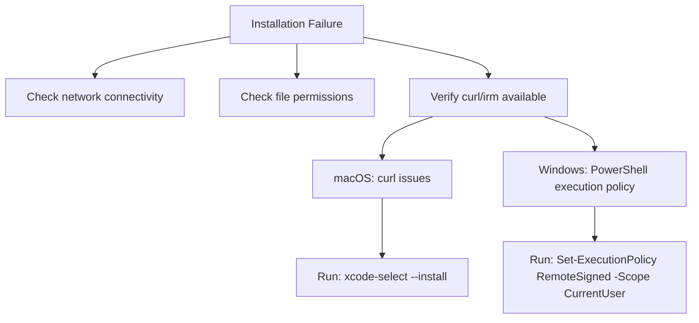

**Solutions:**

| Error | Platform | Solution |
|-------|----------|----------|
| `curl: command not found` | macOS | Install Xcode Command Line Tools: `xcode-select --install` |
| `irm: command not found` | Windows | Use PowerShell 5.1+, not Command Prompt |
| `Execution Policy` error | Windows | Run: `Set-ExecutionPolicy RemoteSigned -Scope CurrentUser` |
| Permission denied | Linux/macOS | Run with appropriate permissions or use `sudo` |
| SSL certificate error | All | Update system certificates or add `--insecure` flag (not recommended) |

**Verification steps:**
```bash
# macOS/Linux
curl --version
which claude

# Windows
Get-Command irm
Get-Command claude
```

Sources: [README.md:99-133]()

---

### Marketplace Registration Failures

**Problem: `/plugin marketplace add K-Dense-AI/claude-scientific-skills` fails**

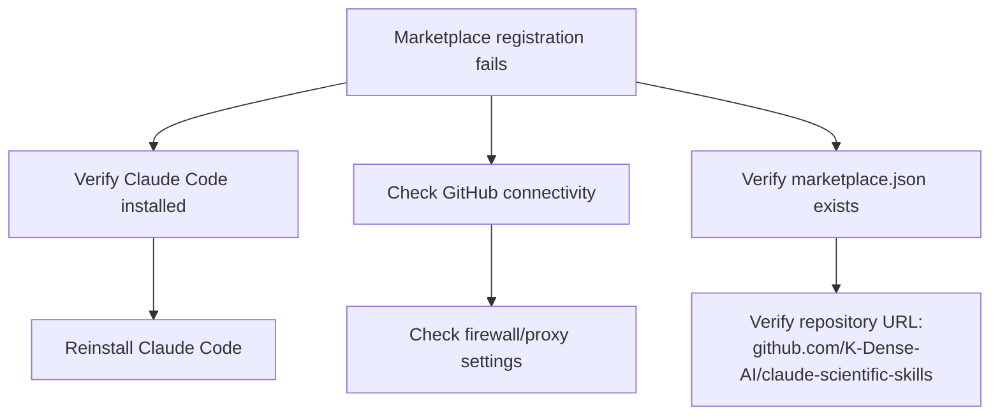

**Common error messages and solutions:**

| Error Message | Cause | Solution |
|---------------|-------|----------|
| `marketplace not found` | Repository doesn't exist or is private | Verify URL: `https://github.com/K-Dense-AI/claude-scientific-skills` |
| `failed to parse marketplace.json` | JSON syntax error in marketplace file | Wait for repository fix or report issue |
| `network timeout` | Network connectivity issues | Check firewall, proxy settings, or VPN |
| `rate limit exceeded` | GitHub API rate limiting | Wait 1 hour or authenticate with GitHub token |

**Manual verification:**
```bash
# Check if marketplace.json is accessible
curl -I https://raw.githubusercontent.com/K-Dense-AI/claude-scientific-skills/main/.claude-plugin/marketplace.json

# Expected: HTTP/2 200
```

Sources: [README.md:119-123](), [.claude-plugin/marketplace.json:1-160]()

---

### Plugin Installation Failures

**Problem: Skills don't appear after installation or fail to load**

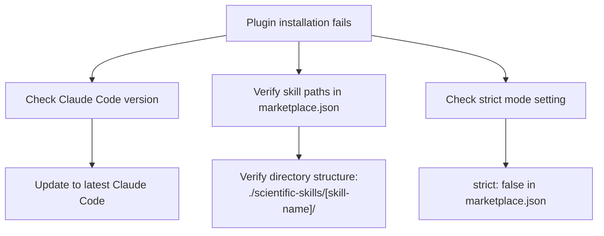

**Common issues:**

| Issue | File Reference | Solution |
|-------|----------------|----------|
| Skills not appearing in UI | [.claude-plugin/marketplace.json:17-157]() | Verify all 138 skill paths are correct |
| "strict mode" errors | [.claude-plugin/marketplace.json:16]() | Ensure `"strict": false` is set |
| Version mismatch | [.claude-plugin/marketplace.json:9]() | Update to version 2.11.0 or later |
| Missing SKILL.md files | Various skill directories | Each skill must have a SKILL.md file |

**Validation script:**
```bash
# Check if all skills have SKILL.md
for skill_dir in scientific-skills/*/; do
    if [ ! -f "${skill_dir}SKILL.md" ]; then
        echo "Missing SKILL.md in: $skill_dir"
    fi
done
```

Sources: [.claude-plugin/marketplace.json:1-160](), [README.md:125-133]()

---

## Dependency Management Issues

### uv Package Manager Not Found

**Problem: `uv: command not found` when skill tries to install dependencies**

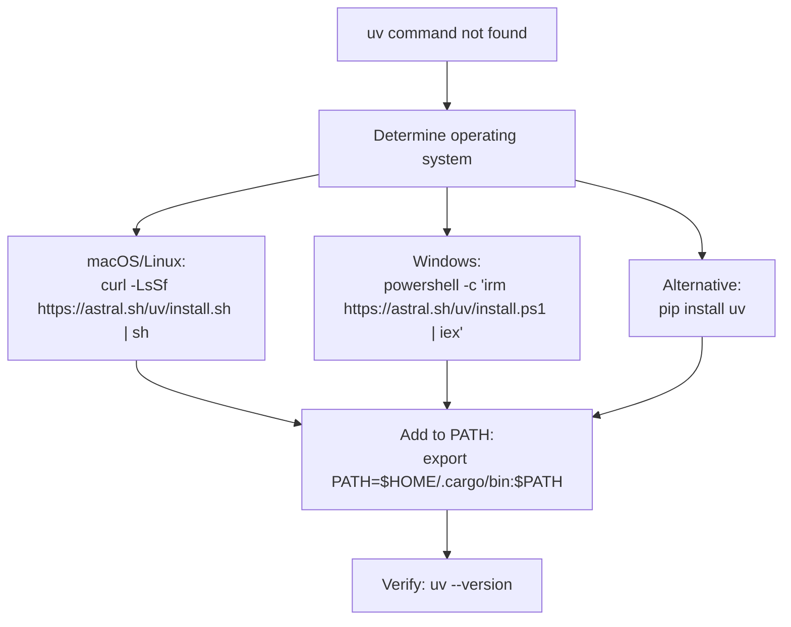

**Installation verification:**

```bash
# Test uv installation
uv --version
# Expected output: uv X.Y.Z

# Test pip installation capability
uv pip list
# Should list installed packages
```

**Platform-specific PATH configuration:**

| Platform | Configuration File | PATH Entry |
|----------|-------------------|------------|
| macOS/Linux (bash) | `~/.bashrc` or `~/.bash_profile` | `export PATH="$HOME/.cargo/bin:$PATH"` |
| macOS/Linux (zsh) | `~/.zshrc` | `export PATH="$HOME/.cargo/bin:$PATH"` |
| Windows | Environment Variables UI | Add `%USERPROFILE%\.cargo\bin` to PATH |

Sources: [README.md:165-198]()

---

### Python Version Incompatibility

**Problem: Skills fail with Python version errors**

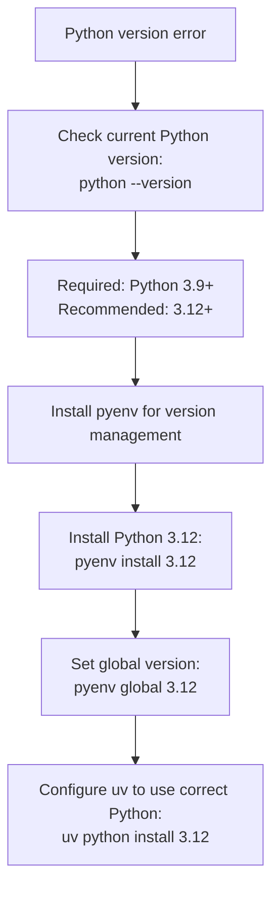

**Version compatibility matrix:**

| Python Version | Status | Notes |
|----------------|--------|-------|
| 3.8 and below | ❌ Not supported | Many packages require 3.9+ |
| 3.9 | ⚠️ Minimum | Some packages may have limited support |
| 3.10 | ✅ Supported | Good compatibility |
| 3.11 | ✅ Supported | Better performance |
| 3.12+ | ✅ Recommended | Best compatibility and performance |

**Quick fix:**
```bash
# Install Python 3.12 with uv
uv python install 3.12

# Set as default for uv
uv python pin 3.12

# Verify
python --version
```

Sources: [README.md:167-168]()

---

### Package Installation Failures

**Problem: `uv pip install` fails for specific packages**

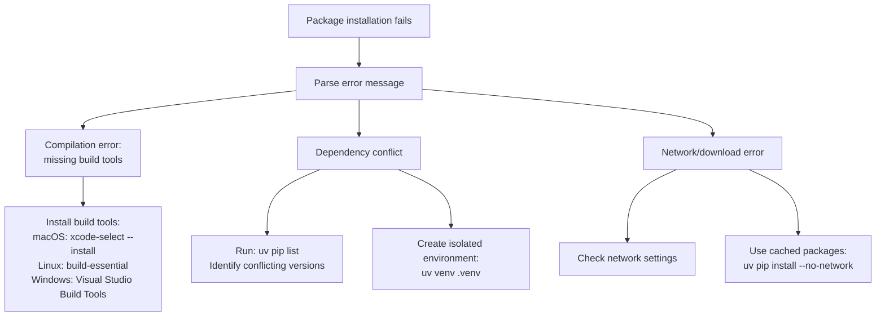

**Common compilation errors:**

| Package | Error Type | Solution |
|---------|-----------|----------|
| `numpy`, `scipy` | C compiler missing | Install build tools (see above) |
| `rdkit` | Boost library missing | Use pre-built wheels: `uv pip install rdkit-pypi` |
| `pysam` | zlib/htslib missing | Install system libraries: `apt install zlib1g-dev` (Linux) |
| `scanpy` | Multiple dependencies | Install with extra patience: takes 5-10 minutes |

**Dependency conflict resolution:**
```bash
# Check what's installed
uv pip list

# Remove conflicting package
uv pip uninstall conflicting-package

# Install with specific version
uv pip install "package==1.2.3"

# Force reinstall
uv pip install --reinstall package
```

Sources: [README.md:526-527]()

---

## API Authentication and Credentials

### OpenRouter API Key Issues

**Problem: `OPENROUTER_API_KEY not found` when using generate-image or other API-dependent skills**

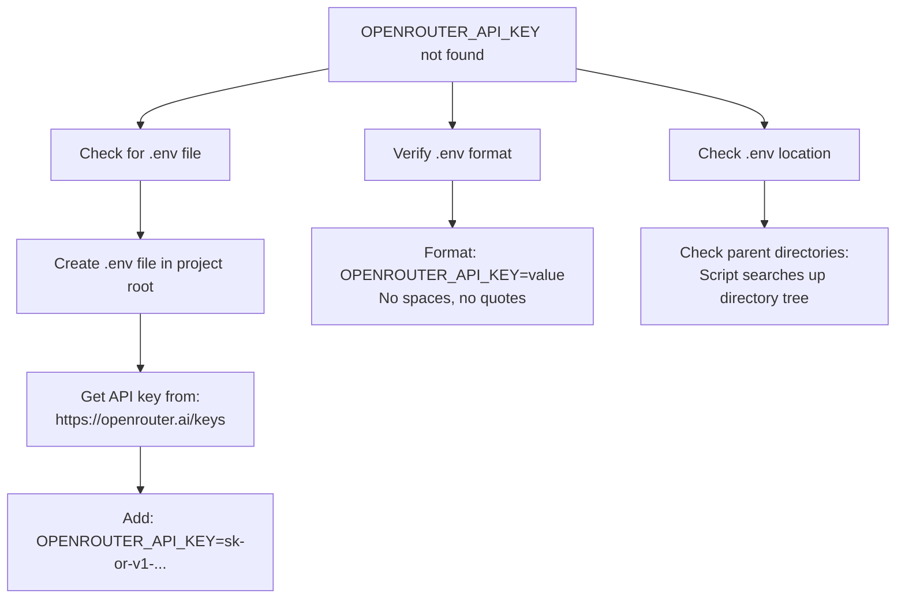

**API key configuration:**

The `check_env_file()` function searches for `.env` in the current directory and all parent directories:
[scientific-skills/generate-image/scripts/generate_image.py:22-35]()

**Correct `.env` file format:**
```bash
# .env file (no quotes needed)
OPENROUTER_API_KEY=sk-or-v1-1234567890abcdef
```

**Incorrect formats (will fail):**
```bash
# ❌ Don't use quotes
OPENROUTER_API_KEY="sk-or-v1-..."

# ❌ Don't add spaces
OPENROUTER_API_KEY = sk-or-v1-...

# ❌ Don't use export
export OPENROUTER_API_KEY=sk-or-v1-...
```

**Manual verification:**
```bash
# Check if .env is readable
cat .env | grep OPENROUTER_API_KEY

# Test API key manually
curl -H "Authorization: Bearer $OPENROUTER_API_KEY" \
     https://openrouter.ai/api/v1/models
```

Sources: [scientific-skills/generate-image/SKILL.md:42-53](), [scientific-skills/generate-image/scripts/generate_image.py:22-35]()

---

### Database API Authentication Failures

**Problem: Rate limiting or authentication errors when querying scientific databases**

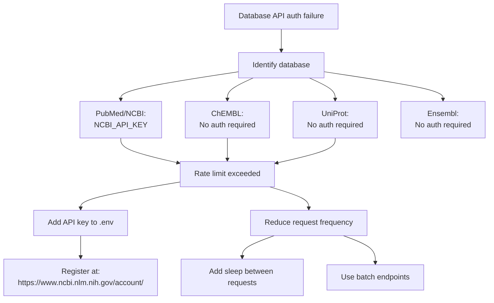

**Database-specific authentication requirements:**

| Database | API Key Required | Rate Limits (unauthenticated) | Rate Limits (authenticated) |
|----------|------------------|-------------------------------|----------------------------|
| PubMed/NCBI | Optional | 3 requests/second | 10 requests/second |
| ChEMBL | No | No strict limits | N/A |
| UniProt | No | ~1 request/second recommended | N/A |
| Ensembl | No | 15 requests/second | N/A |
| OpenAlex | Optional | 100k requests/day | No limit with API key |
| ClinicalTrials.gov | No | No strict limits | N/A |

**Best practices for avoiding rate limits:**
```python
import time

# Add delay between requests
for item in items:
    response = api_call(item)
    time.sleep(0.5)  # 500ms delay

# Use batch endpoints when available
batch_results = api_batch_call(items[:100])  # Process 100 at once

# Implement exponential backoff on errors
def api_call_with_retry(url, max_retries=3):
    for i in range(max_retries):
        try:
            response = requests.get(url)
            if response.status_code == 429:  # Rate limit
                wait_time = 2 ** i
                time.sleep(wait_time)
                continue
            return response
        except Exception as e:
            if i == max_retries - 1:
                raise
            time.sleep(2 ** i)
```

Sources: [README.md:528-531]()

---

## Skill Execution Errors

### "Skill Not Found" Errors

**Problem: Claude reports that a skill is not available or cannot be found**

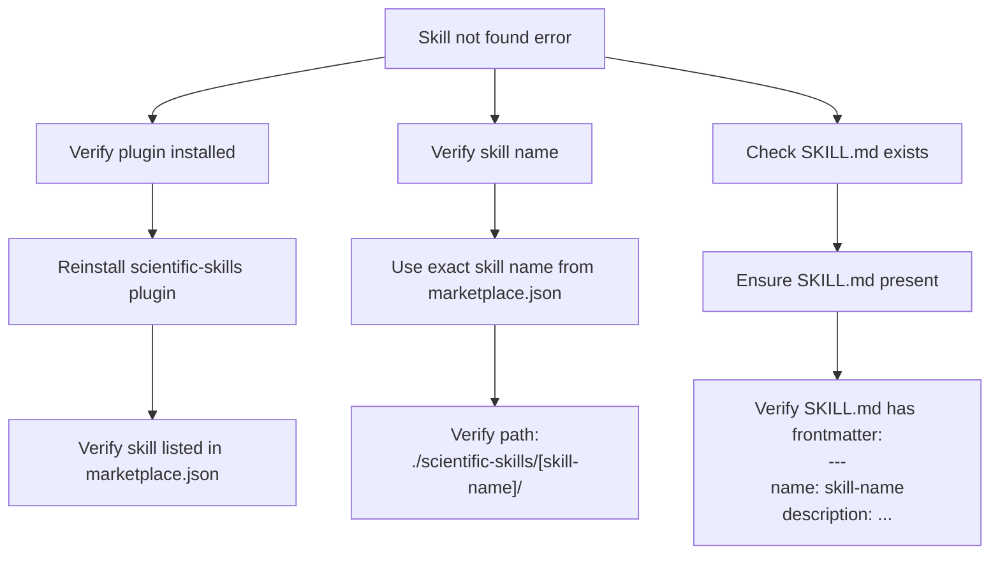

**Skill name verification:**

All 138 skills are listed in [.claude-plugin/marketplace.json:17-157](). Common naming issues:

| Incorrect Name | Correct Name | Notes |
|----------------|--------------|-------|
| `rdkit-skill` | `rdkit` | No "-skill" suffix |
| `pubmed` | `pubmed-database` | Database skills use "-database" suffix |
| `openalex` | `openalex-database` | Database skills use "-database" suffix |
| `scanpy-analysis` | `scanpy` | No additional suffix |
| `generate_image` | `generate-image` | Use hyphens, not underscores |

**SKILL.md frontmatter format:**

Each skill must have YAML frontmatter at the top of SKILL.md:
```yaml
---
name: skill-name
description: Brief description of what this skill does
---
```

Example from [scientific-skills/generate-image/SKILL.md:1-4]()

Sources: [.claude-plugin/marketplace.json:17-157](), [scientific-skills/generate-image/SKILL.md:1-4]()

---

### Script Execution Failures

**Problem: Skills fail when executing Python scripts**

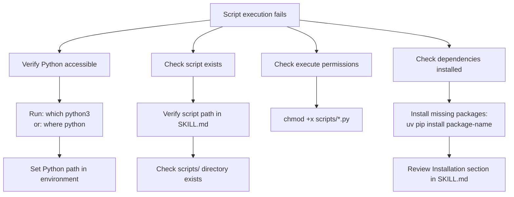

**Common script execution errors:**

| Error | File Reference | Cause | Solution |
|-------|----------------|-------|----------|
| `No such file or directory` | N/A | Script path incorrect | Verify path in SKILL.md matches actual location |
| `Permission denied` | N/A | Script not executable | Run: `chmod +x path/to/script.py` |
| `ModuleNotFoundError` | N/A | Missing dependencies | Check SKILL.md Installation section, run `uv pip install` |
| `SyntaxError` | N/A | Python version incompatible | Verify Python 3.9+ with `python --version` |

**Script path validation:**
```bash
# Check if script exists
ls scientific-skills/generate-image/scripts/generate_image.py

# Check permissions
ls -l scientific-skills/generate-image/scripts/generate_image.py

# Test script directly
python scientific-skills/generate-image/scripts/generate_image.py --help
```

Sources: [scientific-skills/generate-image/scripts/generate_image.py:1-282]()

---

### Missing Dependencies Runtime Errors

**Problem: `ImportError` or `ModuleNotFoundError` when skill executes**

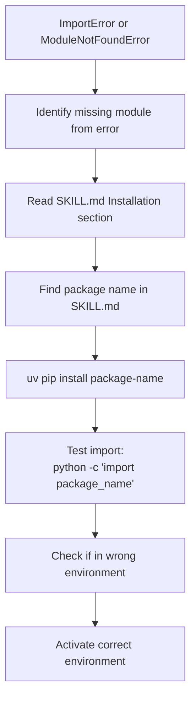

**Common import errors and their package mappings:**

| Import Error | Package to Install | Skill Context |
|--------------|-------------------|---------------|
| `import rdkit` | `rdkit-pypi` | Cheminformatics skills |
| `import scanpy` | `scanpy` | Single-cell RNA-seq skills |
| `import qiskit` | `qiskit` | Quantum computing skills |
| `import requests` | `requests` | Many database and API skills |
| `import matplotlib` | `matplotlib` | Visualization skills |
| `import numpy` | `numpy` | Almost all scientific skills |
| `import pandas` | `pandas` | Data analysis skills |

**Dependency installation check:**
```bash
# List all installed packages
uv pip list

# Check if specific package is installed
uv pip show package-name

# Install from SKILL.md requirements
# Example for generate-image skill
uv pip install requests
```

**Note:** Skills are designed to lazily install dependencies on first use. If this fails, manual installation may be required.

Sources: [README.md:564-565]()

---

## Platform-Specific Issues

### macOS Issues

**Problem: macOS-specific errors with system permissions or frameworks**

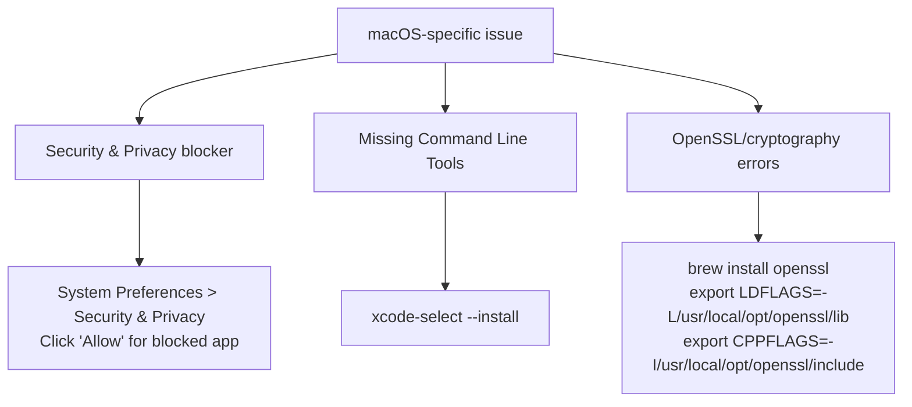

**macOS-specific fixes:**

| Issue | Error Message | Solution |
|-------|---------------|----------|
| Gatekeeper blocking | "cannot be opened because it is from an unidentified developer" | Open Security & Privacy preferences, allow app |
| Missing build tools | `xcrun: error: invalid active developer path` | Run: `xcode-select --install` |
| SSL certificate errors | `SSL: CERTIFICATE_VERIFY_FAILED` | Install certificates: `/Applications/Python\ 3.x/Install\ Certificates.command` |
| Library linking errors | `Library not loaded: libssl.1.1.dylib` | Install OpenSSL via Homebrew: `brew install openssl` |

**Environment configuration for macOS:**
```bash
# Add to ~/.zshrc or ~/.bash_profile

# OpenSSL (for cryptography packages)
export LDFLAGS="-L/usr/local/opt/openssl/lib"
export CPPFLAGS="-I/usr/local/opt/openssl/include"

# Ensure Homebrew in PATH
export PATH="/usr/local/bin:$PATH"

# uv in PATH
export PATH="$HOME/.cargo/bin:$PATH"
```

Sources: [README.md:109-112]()

---

### Windows Issues

**Problem: Windows-specific errors with PowerShell or path handling**

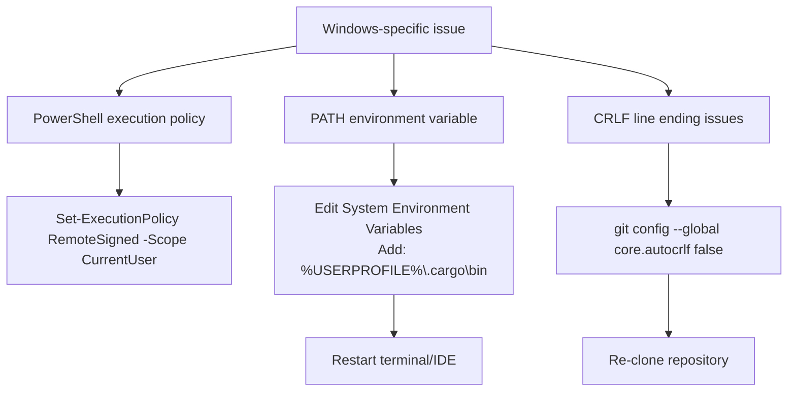

**Windows-specific fixes:**

| Issue | Error Message | Solution |
|-------|---------------|----------|
| Execution policy | `cannot be loaded because running scripts is disabled` | Run PowerShell as admin: `Set-ExecutionPolicy RemoteSigned` |
| Command not found | `'uv' is not recognized as an internal or external command` | Add `%USERPROFILE%\.cargo\bin` to PATH |
| Path separators | Various path errors | Use `os.path.join()` or pathlib, avoid hardcoded `/` or `\` |
| Line endings | Script syntax errors | Configure Git: `git config --global core.autocrlf false` |
| Long paths | `The filename or extension is too long` | Enable long paths: `New-ItemProperty -Path HKLM:\SYSTEM\CurrentControlSet\Control\FileSystem -Name LongPathsEnabled -Value 1` |

**PowerShell profile configuration:**
```powershell
# Add to $PROFILE (PowerShell profile)

# Add uv to PATH
$env:PATH += ";$env:USERPROFILE\.cargo\bin"

# Set UTF-8 encoding
[Console]::OutputEncoding = [System.Text.Encoding]::UTF8
```

Sources: [README.md:114-117]()

---

### Linux/WSL Issues

**Problem: Linux or WSL-specific errors**

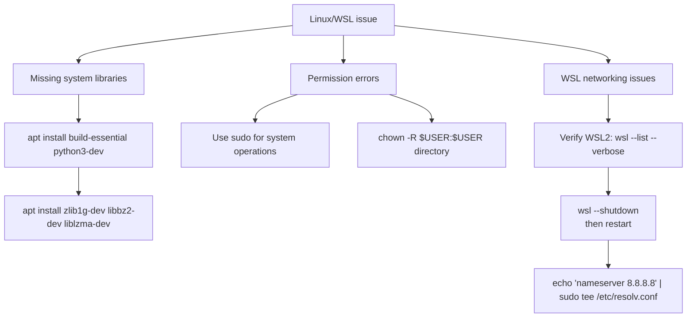

**Linux package dependencies by skill category:**

| Skill Category | Required System Packages | Install Command |
|----------------|--------------------------|-----------------|
| Core scientific computing | `build-essential, python3-dev` | `sudo apt install build-essential python3-dev` |
| Bioinformatics (pysam) | `zlib1g-dev, libbz2-dev, liblzma-dev` | `sudo apt install zlib1g-dev libbz2-dev liblzma-dev` |
| Image processing | `libfreetype6-dev, libpng-dev` | `sudo apt install libfreetype6-dev libpng-dev` |
| Quantum computing | `gfortran, libopenblas-dev` | `sudo apt install gfortran libopenblas-dev` |

**WSL-specific issues:**
```bash
# Check WSL version (must be WSL2)
wsl --list --verbose

# Upgrade WSL1 to WSL2
wsl --set-version Ubuntu 2

# Fix networking issues
sudo nano /etc/resolv.conf
# Add: nameserver 8.8.8.8

# Fix file permission issues
sudo chown -R $USER:$USER ~/project-directory
```

Sources: [README.md:170]()

---

## Performance and Resource Issues

### Slow Skill Execution

**Problem: Skills take a long time to execute or appear to hang**

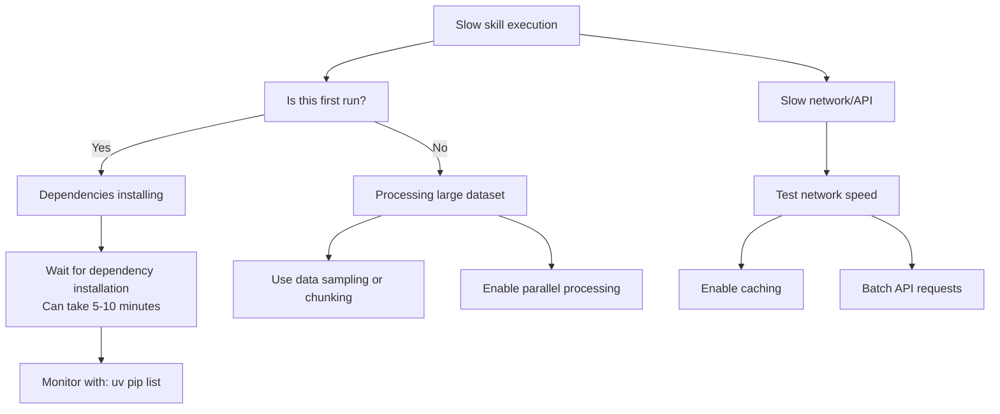

**Performance optimization by skill type:**

| Skill Type | Common Bottleneck | Optimization Strategy |
|------------|------------------|----------------------|
| Database queries (PubMed, ChEMBL) | Network latency | Batch requests, cache results |
| Single-cell analysis (Scanpy) | Large datasets | Use sampling, enable multi-threading |
| Cheminformatics (RDKit) | CPU-intensive | Parallelize with multiprocessing |
| Machine learning (PyTorch) | Memory usage | Reduce batch size, use GPU if available |
| Image generation | API latency | Use faster models (flux.2-flex) |

**First-run dependency installation:**

The first time a skill executes, it may install 10-50 dependencies. Expected times:

| Skill Category | Typical Installation Time |
|----------------|---------------------------|
| Simple database skills | 10-30 seconds |
| Scientific computing (numpy, scipy) | 1-3 minutes |
| Bioinformatics (scanpy) | 5-10 minutes |
| Cheminformatics (rdkit) | 3-7 minutes |
| Machine learning (pytorch) | 10-15 minutes |

**Monitoring installation progress:**
```bash
# Watch installation in real-time
watch -n 1 'uv pip list | tail -20'

# Check if specific package installed
uv pip show package-name
```

Sources: [README.md:564-565]()

---

### Memory and Disk Space Issues

**Problem: Out of memory errors or insufficient disk space**

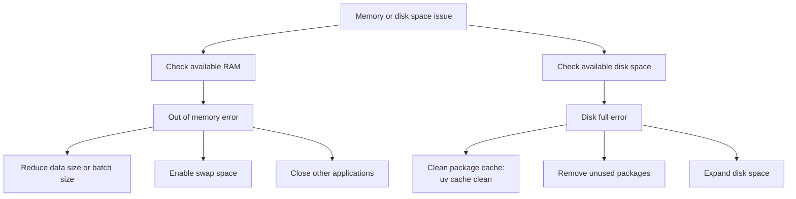

**Memory requirements by skill category:**

| Skill Category | Minimum RAM | Recommended RAM | Notes |
|----------------|-------------|-----------------|-------|
| Database queries | 512 MB | 2 GB | Low memory usage |
| Data analysis (pandas) | 2 GB | 8 GB | Depends on dataset size |
| Single-cell (scanpy) | 8 GB | 16+ GB | Large datasets require more |
| Machine learning (training) | 4 GB | 16+ GB | GPU memory separate |
| Molecular docking | 4 GB | 8 GB | Moderate memory usage |

**Disk space management:**
```bash
# Check disk usage
df -h

# Check uv cache size
du -sh ~/.cache/uv

# Clean uv cache
uv cache clean

# Remove unused packages
uv pip uninstall unused-package

# Find large Python packages
du -sh $(python -c "import site; print(site.getsitepackages()[0])")/*/ | sort -h
```

**Memory optimization strategies:**
```python
# For pandas/dataframe operations
import pandas as pd

# Use chunking for large files
for chunk in pd.read_csv('large_file.csv', chunksize=10000):
    process(chunk)

# Use memory-efficient dtypes
df = pd.read_csv('file.csv', dtype={'column': 'int32'})

# For scanpy/single-cell
import scanpy as sc

# Use sparse matrices
adata.X = scipy.sparse.csr_matrix(adata.X)

# Use backed mode for large datasets
adata = sc.read_h5ad('large_dataset.h5ad', backed='r')
```

Sources: [README.md:170]()

---

## Integration Issues with Different Clients

### Cursor IDE Connection Issues

**Problem: Skills not available in Cursor IDE or MCP connection fails**

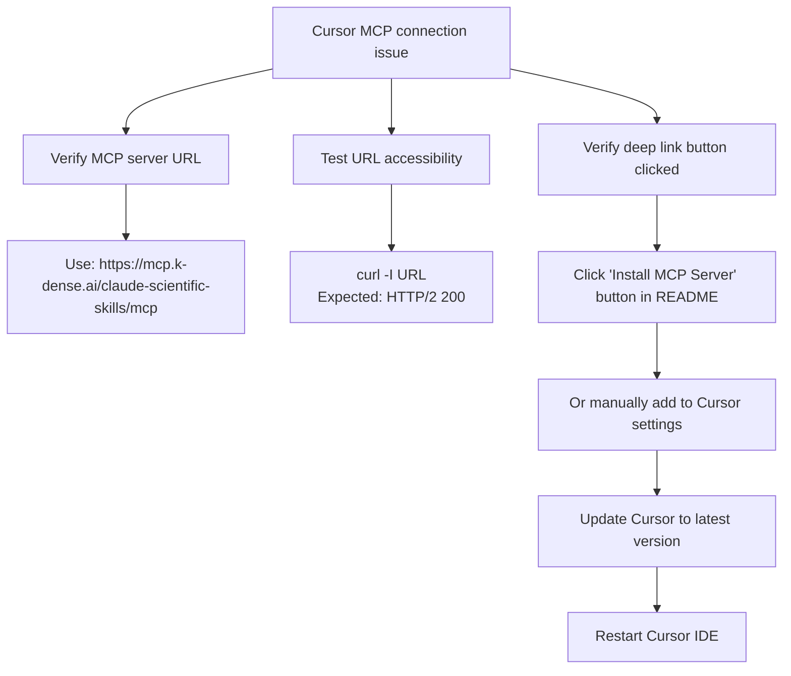

**Cursor MCP configuration:**

Hosted MCP server URL: `https://mcp.k-dense.ai/claude-scientific-skills/mcp`

**Manual configuration in Cursor settings:**
```json
{
  "mcpServers": {
    "claude-scientific-skills": {
      "url": "https://mcp.k-dense.ai/claude-scientific-skills/mcp"
    }
  }
}
```

**Verification steps:**
```bash
# Test MCP server accessibility
curl -I https://mcp.k-dense.ai/claude-scientific-skills/mcp

# Expected response: HTTP/2 200
```

Sources: [README.md:137-147]()

---

### Self-Hosted MCP Server Issues

**Problem: Self-hosted MCP server fails to start or serve skills**

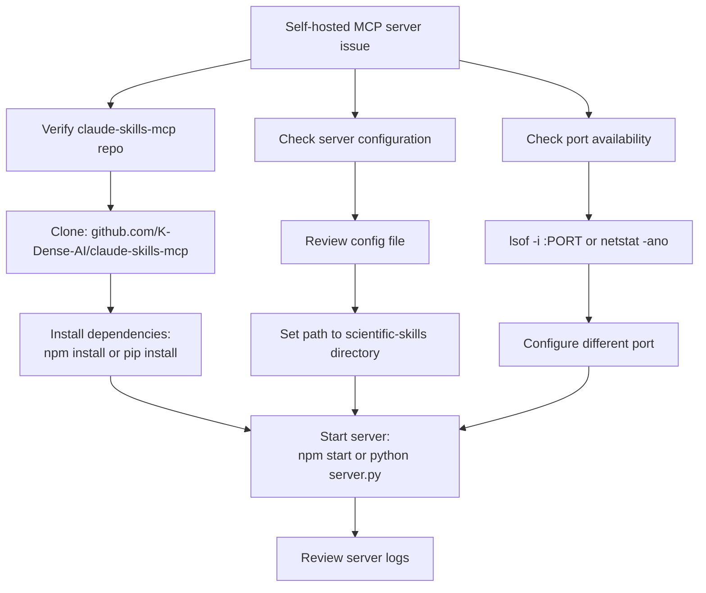

**Self-hosted MCP setup reference:**

See the [claude-skills-mcp](https://github.com/K-Dense-AI/claude-skills-mcp) repository for:
- Server installation instructions
- Configuration file format
- Port and networking setup
- Authentication options

**Common server issues:**

| Issue | Symptom | Solution |
|-------|---------|----------|
| Port conflict | `Address already in use` | Use different port or kill existing process |
| Skills not found | Skills missing in client | Verify `skills_path` points to scientific-skills directory |
| CORS errors | Connection blocked in browser | Configure CORS headers in server config |
| Authentication failure | `401 Unauthorized` | Check authentication token/API key configuration |

Sources: [README.md:155-161]()

---

### MCP Client Compatibility

**Problem: Skills not working with specific MCP clients (ChatGPT, Google ADK, etc.)**

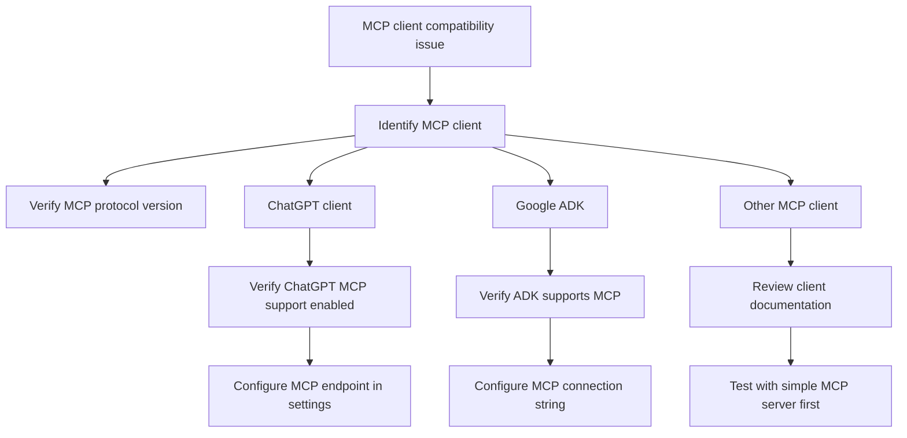

**MCP client compatibility matrix:**

| Client | MCP Support | Configuration Method | Notes |
|--------|-------------|---------------------|-------|
| Claude Code | ✅ Native | Marketplace registration | Recommended method |
| Cursor IDE | ✅ Native | Deep link or settings | One-click installation |
| ChatGPT | ⚠️ Experimental | Settings > Beta Features | May have limitations |
| Google ADK | ⚠️ Experimental | SDK configuration | Check ADK documentation |
| OpenAI Agent SDK | ✅ Supported | Connection string | Use hosted or self-hosted URL |

**Generic MCP client configuration:**
```json
{
  "mcpEndpoint": "https://mcp.k-dense.ai/claude-scientific-skills/mcp",
  "mcpProtocolVersion": "1.0",
  "capabilities": ["skills", "tools", "resources"]
}
```

Sources: [README.md:151-153]()

---

## Frequently Asked Questions (FAQ)

### General Questions

**Q: Do I need to install all 138 skills individually?**

A: No. All skills are bundled in a single plugin called `scientific-skills`. When you install this one plugin, you get access to all 138 skills automatically. This is the key architectural decision described in [.claude-plugin/marketplace.json:11-16]().

**Q: Why are skills grouped into one plugin instead of separate plugins?**

A: Modern science is inherently interdisciplinary. Bundling all 138 skills into a single plugin eliminates the need to manually select and wire together individual tools. For example, a drug discovery workflow naturally requires cheminformatics (RDKit), database queries (ChEMBL), machine learning (DeepChem), and visualization (matplotlib) skills working together seamlessly.

**Q: Are the skills free to use?**

A: Yes. The repository is MIT licensed, allowing free use for any purpose including commercial projects. See [README.md:643-656]().

**Q: How often are skills updated?**

A: Skills are regularly maintained and updated. The current version is 2.11.0 ([.claude-plugin/marketplace.json:9]()). Check the repository for release notes and updates.

---

### Installation and Setup

**Q: Do I need all Python packages installed upfront?**

A: No. Dependencies are installed lazily on first use of each skill. When you first use a skill like `scanpy`, it will automatically install required packages via `uv pip install`. Subsequent uses are instantaneous since dependencies are cached.

**Q: Can I use skills offline?**

A: Partially. Package-based skills (like `rdkit`, `scanpy`) work offline once dependencies are installed. Database skills (like `pubmed-database`, `chembl-database`) require internet access to query APIs. See [README.md:569-570]().

**Q: Which Python version should I use?**

A: Python 3.9+ is minimum, but **Python 3.12+ is recommended** for best compatibility and performance. See [README.md:167-168]().

**Q: Do I need Claude Code to use the skills?**

A: No. You have three options:
1. **Claude Code** (recommended) - Local installation via marketplace
2. **Cursor IDE** - Via hosted MCP server (one-click)
3. **Any MCP client** - Via hosted or self-hosted MCP server

See [README.md:99-163]().

---

### Usage and Functionality

**Q: How does Claude know which skills to use?**

A: Claude automatically selects appropriate skills based on your natural language prompts. You don't need to explicitly name skills. Just describe your scientific task naturally, and Claude will orchestrate the required skills. For example: "Analyze this single-cell RNA-seq data, identify cell types, and run differential expression analysis."

**Q: Can I use multiple skills in one workflow?**

A: Yes. Skills are designed to be chained together. Complex workflows often use 5-10 different skills. See multi-domain workflow examples in [docs/examples.md]() for 20 comprehensive examples spanning drug discovery, genomics, and more.

**Q: What if a skill doesn't work as expected?**

A: First check:
1. The skill's `SKILL.md` file for usage instructions
2. Whether dependencies are installed: `uv pip list`
3. Error messages for specific issues
4. This troubleshooting guide for solutions

If the issue persists, file an issue on GitHub with detailed reproduction steps.

---

### Technical Questions

**Q: How are dependencies managed across 138 skills?**

A: Dependencies are managed per-skill using `uv` package manager. Each skill's `SKILL.md` specifies required packages. The `uv` tool handles version conflicts and creates isolated environments as needed. See [Dependency Management with uv](#3.3).

**Q: Can skills conflict with each other?**

A: No. The bundled architecture ensures all skills are tested together for version 2.11.0. Shared dependencies (like `numpy`, `pandas`) are coordinated across skills to prevent conflicts. See [.claude-plugin/marketplace.json:9]().

**Q: How much disk space do I need?**

A: Varies by skills used:
- Base installation: ~100 MB
- Light usage (10-20 skills): 1-2 GB
- Heavy usage (50+ skills): 5-10 GB
- Full installation (all dependencies): 15-20 GB

**Q: Can I use skills with other AI models?**

A: Skills are optimized for Claude but work with any MCP-compatible client. The MCP (Model Context Protocol) server provides standardized access to all skills. See [README.md:558-559]().

---

### Performance and Optimization

**Q: Why is the first execution of a skill slow?**

A: First execution triggers dependency installation, which can take 5-15 minutes depending on the skill. Subsequent executions are fast since dependencies are cached. This is expected behavior. See [Performance and Resource Issues](#performance-and-resource-issues).

**Q: Can I speed up skill execution?**

A: Yes, several strategies:
- **Use sampling** for large datasets
- **Enable parallel processing** where supported
- **Batch API requests** to databases
- **Cache results** to avoid redundant queries
- **Use GPU** for machine learning tasks (if available)

**Q: How do I handle large datasets?**

A: Use chunking and streaming:
```python
# For pandas
for chunk in pd.read_csv('large_file.csv', chunksize=10000):
    process(chunk)

# For scanpy
adata = sc.read_h5ad('large_dataset.h5ad', backed='r')
```

---

### Error Resolution

**Q: What does "skill not found" mean?**

A: Either:
1. Plugin not installed - reinstall via Claude Code
2. Wrong skill name - check [.claude-plugin/marketplace.json:17-157]() for correct names
3. Missing `SKILL.md` - verify file exists in skill directory

See [Skill Not Found Errors](#skill-not-found-errors).

**Q: What does "OPENROUTER_API_KEY not found" mean?**

A: The `generate-image` skill (and potentially others using OpenRouter) requires an API key. Create a `.env` file with:
```bash
OPENROUTER_API_KEY=sk-or-v1-your-key-here
```

Get a key from: https://openrouter.ai/keys

See [scientific-skills/generate-image/SKILL.md:42-53]() and [scientific-skills/generate-image/scripts/generate_image.py:22-35]().

**Q: How do I handle rate limiting from databases?**

A: 
1. Add delays between requests: `time.sleep(0.5)`
2. Use batch endpoints when available
3. Register for API keys (increases limits)
4. Implement exponential backoff on errors

See [Database API Authentication Failures](#database-api-authentication-failures).

---

### Contributing and Support

**Q: Can I contribute new skills?**

A: Yes! Contributions are welcome. See [README.md:464-513](). Follow the existing skill structure:
- Create `SKILL.md` with frontmatter
- Add scripts in `scripts/` directory
- Include usage examples and references
- Test thoroughly before submitting

**Q: How do I report bugs?**

A: Open an issue on GitHub with:
- Detailed description of the problem
- Steps to reproduce
- Error messages (full stack traces)
- Environment info (OS, Python version, skill used)
- Expected vs actual behavior

See [README.md:583-590]().

**Q: Where can I get help?**

A: Multiple channels:
- 📖 **Documentation**: Check `SKILL.md` files and `references/` folders
- 💬 **Community**: [Join Slack Community](https://join.slack.com/t/k-densecommunity/shared_invite/zt-3iajtyls1-EwmkwIZk0g_o74311Tkf5g)
- 🐛 **Issues**: GitHub issue tracker
- 💼 **Enterprise**: Contact [K-Dense](https://k-dense.ai) for commercial support

See [README.md:583-604]().

---

### Advanced Topics

**Q: Can I self-host the MCP server?**

A: Yes. Clone [claude-skills-mcp](https://github.com/K-Dense-AI/claude-skills-mcp) and follow setup instructions. This gives you full control over:
- Server configuration
- Authentication
- Network settings
- Multi-user deployment

See [README.md:160-161]() and [MCP Server Deployment](#15.1).

**Q: How do I optimize for HPC environments?**

A: See [Performance Optimization](#15.3) for:
- Parallel execution strategies
- GPU acceleration
- Cloud compute integration (Modal)
- HPC job scheduling
- Memory optimization techniques

**Q: Can I create custom skill compositions?**

A: Yes. See [Skill Composition and Orchestration Patterns](#15.2) for:
- Best practices for chaining skills
- Data flow patterns
- Error handling strategies
- Caching approaches
- Prompt engineering for multi-skill workflows

---

## Summary

This troubleshooting guide covers the most common issues encountered when using Claude Scientific Skills:

1. **Installation issues** - Claude Code, marketplace registration, plugin loading
2. **Dependency management** - uv installation, package conflicts, Python versions
3. **Authentication** - API keys, rate limits, database access
4. **Execution errors** - Skill not found, script failures, missing dependencies
5. **Platform-specific** - macOS, Windows, Linux/WSL quirks
6. **Performance** - Slow execution, memory usage, disk space
7. **Integration** - Cursor IDE, MCP clients, self-hosting

For issues not covered here, consult:
- Individual `SKILL.md` files for skill-specific documentation
- [Complete Skill Catalog](#16.1) for skill listings
- [GitHub Issues](https://github.com/K-Dense-AI/claude-scientific-skills/issues) for community support
- [Slack Community](https://join.slack.com/t/k-densecommunity/shared_invite/zt-3iajtyls1-EwmkwIZk0g_o74311Tkf5g) for discussion

Sources: [README.md:1-660](), [.claude-plugin/marketplace.json:1-160](), [scientific-skills/generate-image/SKILL.md:1-179](), [scientific-skills/generate-image/scripts/generate_image.py:1-282](), [docs/examples.md:1-2668]()