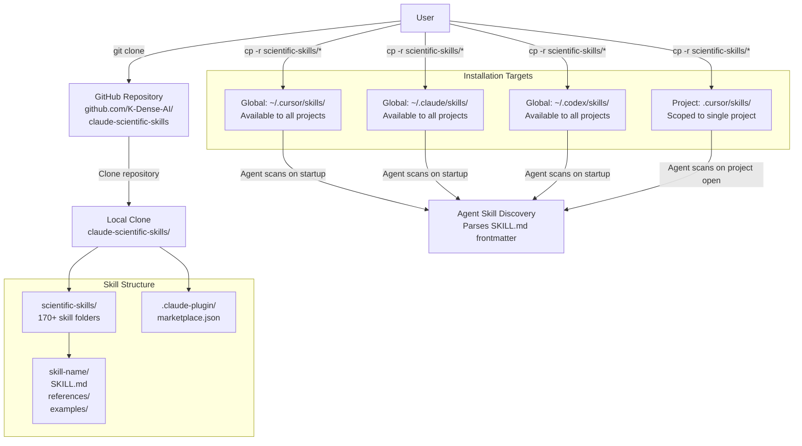
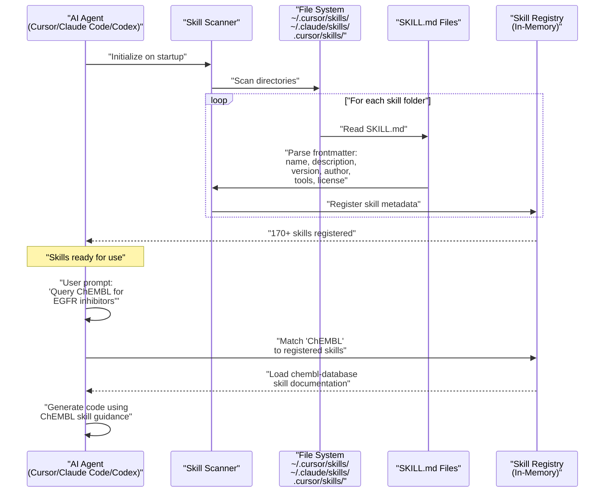
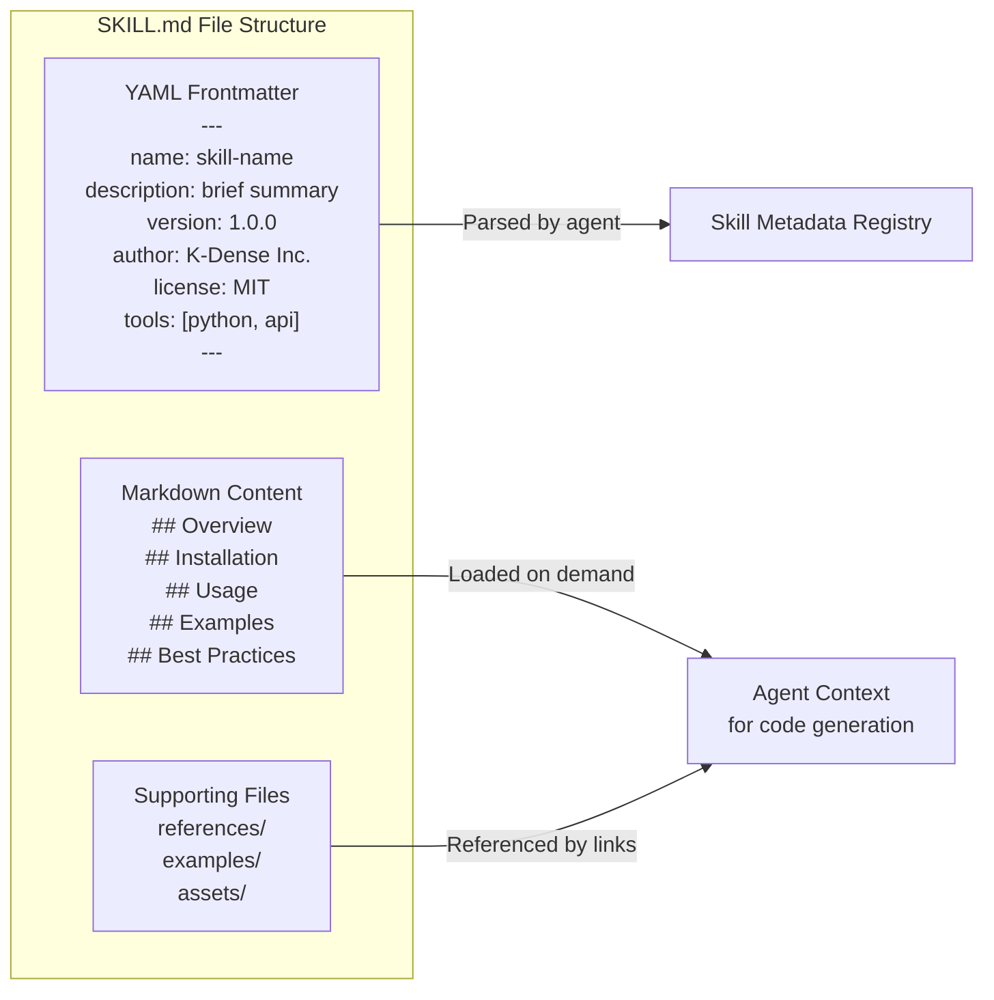
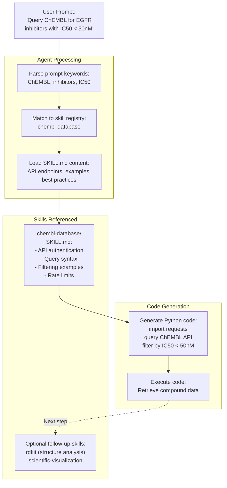
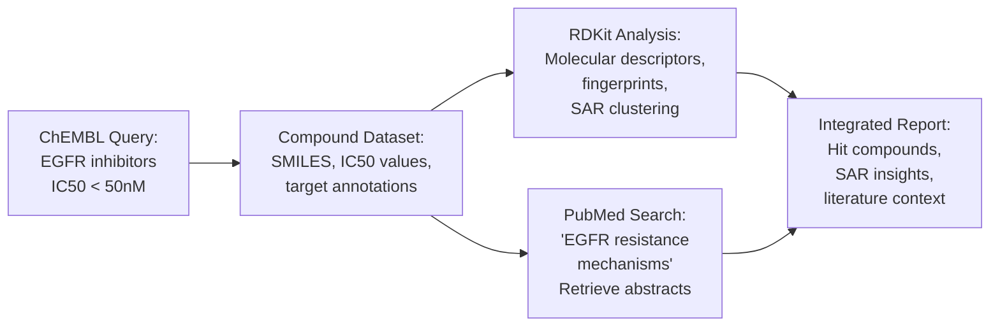

<!-- source: DeepWiki mcp.deepwiki.com · repo K-Dense-AI/claude-scientific-skills · page 2 Getting Started · fetched 2026-10-26 -->

# Getting Started

<details>
<summary>Relevant source files</summary>

The following files were used as context for generating this wiki page:

- [.claude-plugin/marketplace.json](.claude-plugin/marketplace.json)
- [README.md](README.md)
- [docs/scientific-skills.md](docs/scientific-skills.md)
- [scientific-skills/ginkgo-cloud-lab/SKILL.md](scientific-skills/ginkgo-cloud-lab/SKILL.md)
- [scientific-skills/ginkgo-cloud-lab/references/cell-free-protein-expression-optimization.md](scientific-skills/ginkgo-cloud-lab/references/cell-free-protein-expression-optimization.md)
- [scientific-skills/ginkgo-cloud-lab/references/cell-free-protein-expression-validation.md](scientific-skills/ginkgo-cloud-lab/references/cell-free-protein-expression-validation.md)
- [scientific-skills/ginkgo-cloud-lab/references/fluorescent-pixel-art-generation.md](scientific-skills/ginkgo-cloud-lab/references/fluorescent-pixel-art-generation.md)

</details>


This page provides step-by-step instructions for installing Claude Scientific Skills and running your first scientific workflow. By the end of this guide, you will have 170+ scientific skills installed and ready to use with any Agent Skills-compatible AI agent.

For detailed installation instructions including troubleshooting, see [Installation and Setup](#2.1). For a comprehensive walkthrough of building multi-step workflows, see [Your First Scientific Workflow](#2.2).

---

## Prerequisites

Before installing Claude Scientific Skills, ensure your system meets the following requirements:

| Requirement | Specification | Notes |
|-------------|--------------|-------|
| **Python** | 3.9+ (3.12+ recommended) | Required for skill dependencies |
| **uv** | Latest version | Python package manager used by skills |
| **AI Agent** | Cursor, Claude Code, or Codex | Any [Agent Skills](https://agentskills.io) standard-compatible tool |
| **Operating System** | macOS, Linux, or Windows with WSL2 | Cross-platform support |
| **Git** | Any version | For cloning the repository |

### Installing uv Package Manager

The skills use `uv` for dependency management. Install it using the appropriate command for your system:

**macOS and Linux:**
```bash
curl -LsSf https://astral.sh/uv/install.sh | sh
```

**Windows:**
```powershell
powershell -ExecutionPolicy ByPass -c "irm https://astral.sh/uv/install.ps1 | iex"
```

**Alternative (via pip):**
```bash
pip install uv
```

Verify installation:
```bash
uv --version
```

**Sources:** [README.md:180-213]()

---

## Installation Overview

Claude Scientific Skills uses a **write-once, use-everywhere** installation model. Copy skill folders to standard directories, and all Agent Skills-compatible tools automatically discover them.

### Installation Flow



**Sources:** [README.md:113-162](), Diagram 2 from high-level architecture

---

## Step 1: Clone the Repository

Clone the Claude Scientific Skills repository to your local machine:

```bash
git clone https://github.com/K-Dense-AI/claude-scientific-skills.git
cd claude-scientific-skills
```

This creates a directory containing:
- `scientific-skills/` - 170+ skill folders, each containing [SKILL.md](), [references/](), and [examples/]()
- `.claude-plugin/marketplace.json` - Skill registry with metadata [.claude-plugin/marketplace.json:1-194]()
- `docs/` - Documentation files
- `README.md` - Repository overview

**Sources:** [README.md:117-121]()

---

## Step 2: Choose Installation Location

Skills can be installed **globally** (available to all projects) or **per-project** (scoped to a single project).

### Global Installation (Recommended)

Copy skills to your home directory. They will be available in all projects:

| Tool | Directory Path |
|------|----------------|
| **Cursor** | `~/.cursor/skills/` |
| **Claude Code** | `~/.claude/skills/` |
| **Codex** | `~/.codex/skills/` |

**Example — Global install for Cursor:**
```bash
cp -r claude-scientific-skills/scientific-skills/* ~/.cursor/skills/
```

**Example — Global install for Claude Code:**
```bash
cp -r claude-scientific-skills/scientific-skills/* ~/.claude/skills/
```

### Project-Level Installation

Copy skills to a `.cursor/skills/`, `.claude/skills/`, or `.codex/skills/` directory in your project root. They will only be available in that project:

```bash
mkdir -p .cursor/skills
cp -r /path/to/claude-scientific-skills/scientific-skills/* .cursor/skills/
```

### Cross-Tool Compatibility

Cursor also reads from `.claude/skills/` and `.codex/skills/` directories, and vice versa. Skills installed for one tool are automatically available to others.

**Sources:** [README.md:123-162]()

---

## Step 3: Verify Installation

After copying skills to your chosen directory, restart your AI agent (Cursor IDE, Claude Code, etc.) to trigger skill discovery.

### Skill Discovery Mechanism



**Sources:** [README.md:113-162](), Diagram 2 from high-level architecture

### Verification Steps

1. **In Cursor IDE:**
   - Open Settings → Rules
   - Verify that skill folders appear in the discovered rules list
   - Look for entries like "scanpy", "chembl-database", "pytorch-lightning"

2. **Test with a simple prompt:**
   - Open a new chat session
   - Type: "List the scientific skills you have access to"
   - The agent should enumerate available skills

3. **Check skill loading:**
   - Each skill folder must contain a `SKILL.md` file with valid frontmatter [README.md:627-628]()
   - Verify directory structure: `skill-name/SKILL.md`, `skill-name/references/`, `skill-name/examples/`

**Sources:** [README.md:623-629]()

---

## Step 4: Understanding SKILL.md Structure

Each skill is defined by a `SKILL.md` file with YAML frontmatter. The agent parses this metadata during discovery:



### Example: ChEMBL Database Skill

```yaml
---
name: chembl-database
description: Query ChEMBL database for bioactive molecules, bioactivity data, targets, assays, and drug discovery information via REST API
version: 1.2.0
author: K-Dense Inc.
license: MIT
tools: [python, api]
---
```

The agent uses:
- **name** - Skill identifier for matching user prompts
- **description** - Determines when skill is relevant to user queries
- **tools** - Filters skills by required technology (python, api, etc.)

**Sources:** For complete SKILL.md specification, see [SKILL.md Anatomy and Structure](#3.4)

---

## Step 5: Your First Query

Once skills are installed, the agent automatically matches user prompts to relevant skills and loads their documentation.

### Prompt → Skill Mapping



**Sources:** [README.md:216-251]()

### Example Workflow: Query ChEMBL Database

**Prompt:**
```
Query ChEMBL for EGFR inhibitors with IC50 < 50nM. 
Show compound structures and bioactivity data.
```

**Agent Response:**
The agent will:
1. Recognize "ChEMBL" and load [scientific-skills/chembl-database/SKILL.md]()
2. Parse API endpoint documentation from the skill
3. Generate code using ChEMBL REST API to query compounds
4. Filter results by IC50 < 50nM
5. Optionally use [scientific-skills/rdkit/SKILL.md]() for structure visualization

**Expected Output:**
- Python code using `requests` library to query ChEMBL API
- DataFrame with compound IDs, SMILES strings, IC50 values, targets
- Optional: Chemical structure visualization using RDKit

**Sources:** [README.md:216-251]()

---

## Step 6: Multi-Skill Workflows

The power of Claude Scientific Skills emerges when chaining multiple skills together.

### Example: Drug Discovery Pipeline

**Prompt:**
```
Use available skills you have access to whenever possible. 
Query ChEMBL for EGFR inhibitors (IC50 < 50nM), analyze 
structure-activity relationships with RDKit, and search PubMed 
for resistance mechanisms.
```

**Skills Used:**
1. **chembl-database** [scientific-skills/chembl-database/]() - Query bioactivity data
2. **rdkit** [scientific-skills/rdkit/]() - Molecular structure analysis
3. **pubmed-database** [scientific-skills/pubmed-database/]() - Literature search

**Workflow:**


**Sources:** [README.md:220-232]()

---

## Skill Categories

The 170+ skills are organized into domains. You can invoke any skill by mentioning its name or domain in your prompt:

| Domain | Skill Count | Example Skills |
|--------|-------------|----------------|
| **Bioinformatics & Genomics** | 20+ | scanpy, biopython, arboreto, scvelo, tiledbvcf |
| **Cheminformatics & Drug Discovery** | 13+ | rdkit, deepchem, diffdock, openmm, datamol |
| **Clinical Research** | 16+ | clinvar, cosmic, cbioportal, depmap |
| **Machine Learning & AI** | 16+ | pytorch-lightning, scikit-learn, timesfm-forecasting |
| **Scientific Databases** | 37+ direct skills<br/>250+ databases total | chembl, pubmed, uniprot, alphafold-database |
| **Laboratory Automation** | 4 | ginkgo-cloud-lab, opentrons, pylabrobot |
| **Scientific Communication** | 24+ | scientific-writing, latex-posters, generate-image |

**Sources:** [README.md:50-59](), [docs/scientific-skills.md:1-546]()

---

## Package Installation for Skills

Individual skills may require Python packages. The agent will:
1. Detect missing packages when generating code
2. Suggest installation commands using `uv`
3. Install dependencies automatically (if configured)

**Manual installation example:**
```bash
# Install packages for Scanpy skill
uv pip install scanpy anndata

# Install packages for RDKit skill
uv pip install rdkit

# Install packages for multiple skills
uv pip install scanpy rdkit biopython
```

Each `SKILL.md` file documents required packages in its Installation section.

**Sources:** [README.md:630-637]()

---

## Next Steps

Now that skills are installed, explore the following:

1. **[Your First Scientific Workflow](#2.2)** - Step-by-step tutorial building a complete analysis pipeline
2. **[Core Architecture](#3)** - Understand how the skill system works under the hood
3. **[Scientific Domains](#4)** - Explore skills organized by scientific field
4. **[Complete Skill Catalog](#10.1)** - Browse all 170+ available skills
5. **[Multi-Domain Workflows](#8)** - See advanced examples combining multiple skills

### Quick Reference Commands

```bash
# Clone repository
git clone https://github.com/K-Dense-AI/claude-scientific-skills.git

# Global install for Cursor
cp -r claude-scientific-skills/scientific-skills/* ~/.cursor/skills/

# Verify uv installation
uv --version

# Install skill dependencies
uv pip install package-name

# Update skills (pull latest changes)
cd claude-scientific-skills
git pull
cp -r scientific-skills/* ~/.cursor/skills/
```

**Sources:** [README.md:113-213]()

---

## Troubleshooting

### Skills Not Loading

**Problem:** Agent does not recognize installed skills

**Solutions:**
- Verify skill folders are in correct directory [README.md:625-629]()
- Each skill folder must contain `SKILL.md` with valid frontmatter
- Restart your AI agent/IDE after copying skills
- In Cursor, check Settings → Rules to confirm skills are discovered

### Missing Dependencies

**Problem:** Code fails with `ModuleNotFoundError`

**Solutions:**
- Check skill's `SKILL.md` for required packages
- Install using: `uv pip install package-name`
- Some skills access external APIs without requiring local packages

### API Authentication Errors

**Problem:** Database queries fail with authentication errors

**Solutions:**
- Some services require API keys (check skill documentation)
- Many databases (PubMed, ChEMBL, UniProt) provide free public APIs
- Set environment variables for API keys when required

**Sources:** [README.md:621-646]()

---

## Marketplace Configuration

The skill registry is defined in [.claude-plugin/marketplace.json:1-194](). This file contains:

- **name** - Plugin package identifier: `"claude-scientific-skills"`
- **owner** - K-Dense Inc. contact information
- **metadata.version** - Current version: `"2.26.0"` [.claude-plugin/marketplace.json:9]()
- **plugins[].skills[]** - Array of 170+ skill paths

When you update the repository (`git pull`), the marketplace version increments, triggering automated releases via [.github/workflows/release.yml](). For details on the release system, see [Release Automation and Versioning](#9.2).

**Sources:** [.claude-plugin/marketplace.json:1-194]()

---

