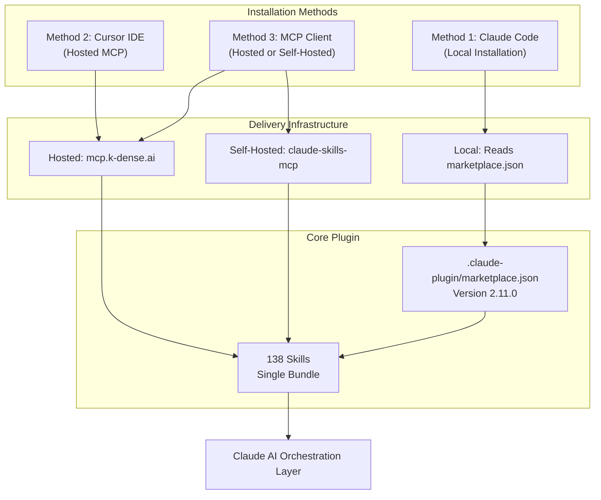
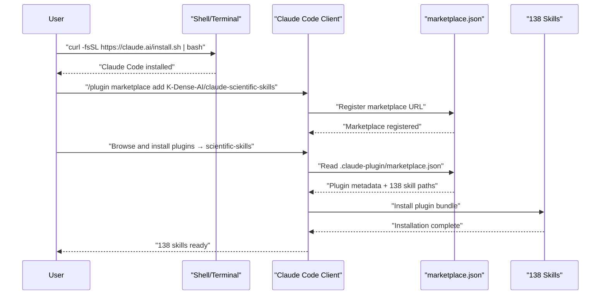
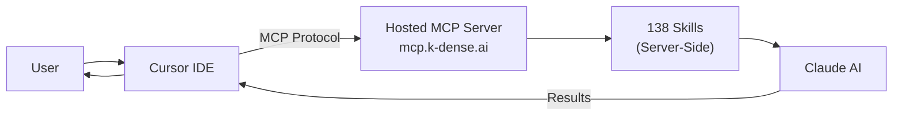
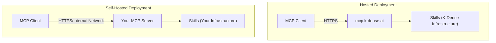
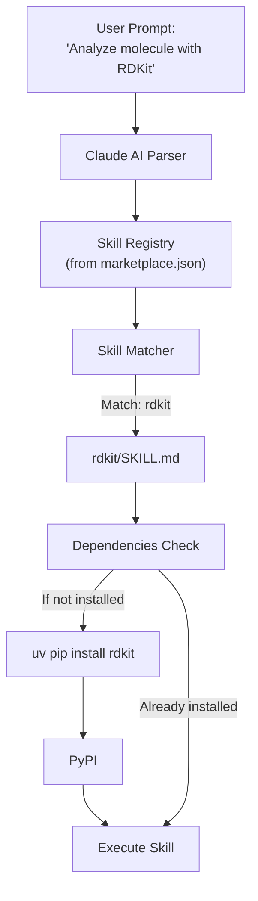
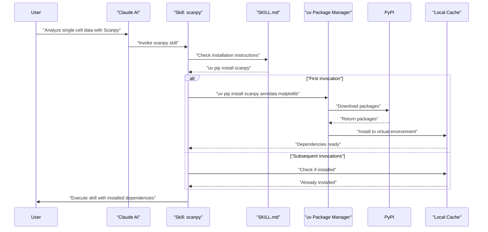

<!-- source: DeepWiki mcp.deepwiki.com · repo K-Dense-AI/claude-scientific-skills · page 2.1 Installation and Setup · fetched 2026-10-26 -->

# Installation and Setup

<details>
<summary>Relevant source files</summary>

The following files were used as context for generating this wiki page:

- [.claude-plugin/marketplace.json](.claude-plugin/marketplace.json)
- [.gitignore](.gitignore)
- [README.md](README.md)
- [docs/scientific-skills.md](docs/scientific-skills.md)
- [scientific-skills/ginkgo-cloud-lab/SKILL.md](scientific-skills/ginkgo-cloud-lab/SKILL.md)
- [scientific-skills/ginkgo-cloud-lab/references/cell-free-protein-expression-optimization.md](scientific-skills/ginkgo-cloud-lab/references/cell-free-protein-expression-optimization.md)
- [scientific-skills/ginkgo-cloud-lab/references/cell-free-protein-expression-validation.md](scientific-skills/ginkgo-cloud-lab/references/cell-free-protein-expression-validation.md)
- [scientific-skills/ginkgo-cloud-lab/references/fluorescent-pixel-art-generation.md](scientific-skills/ginkgo-cloud-lab/references/fluorescent-pixel-art-generation.md)

</details>


## Purpose and Scope

This page provides detailed instructions for installing and configuring Claude Scientific Skills across all supported platforms. It covers prerequisite software installation, the three primary integration methods (Claude Code, Cursor IDE, and generic MCP clients), plugin structure, environment configuration, and dependency management.

For information about running your first workflow after installation, see [Your First Scientific Workflow](#2.2). For technical details on the plugin distribution architecture, see [Plugin and Distribution Model](#3.1). For troubleshooting installation issues, see [Troubleshooting and FAQ](#16.3).

---

## Prerequisites

### Required Software

| Component | Version | Purpose |
|-----------|---------|---------|
| **Python** | 3.9+ (3.12+ recommended) | Runtime for all 138 scientific skills |
| **uv** | Latest | Package manager for skill dependencies |
| **Client** | Claude Code, Cursor, or MCP-compatible | Interface to Claude AI orchestration |

### System Requirements

- **Operating Systems**: macOS, Linux, or Windows with WSL2
- **Disk Space**: ~5GB for skill dependencies (installed on-demand)
- **Internet Access**: Required for database skills and initial setup

---

## Installing Python

Claude Scientific Skills requires Python 3.9 or higher, with 3.12+ recommended for optimal compatibility.

**Verify existing installation:**
```bash
python --version
# or
python3 --version
```

**Installation (if needed):**
- **macOS**: `brew install python@3.12`
- **Ubuntu/Debian**: `sudo apt install python3.12`
- **Windows**: Download from [python.org](https://www.python.org/downloads)

---

## Installing uv Package Manager

The `uv` package manager is required for automatic dependency installation when skills are first invoked. It provides significantly faster package installation compared to `pip`.

### Installation Commands

**macOS and Linux:**
```bash
curl -LsSf https://astral.sh/uv/install.sh | sh
```

**Windows:**
```powershell
powershell -ExecutionPolicy ByPass -c "irm https://astral.sh/uv/install.ps1 | iex"
```

**Alternative (via pip):**
```bash
pip install uv
```

### Verification

```bash
uv --version
```

Expected output: `uv X.Y.Z` (version number varies)

Sources: [README.md:173-197]()

---

## Installation Method Overview

Claude Scientific Skills supports three integration pathways, each optimized for different use cases:



**Installation Method Comparison**

| Feature | Claude Code | Cursor IDE | MCP Client |
|---------|-------------|------------|------------|
| **Installation Time** | 2-5 minutes | 1-click | Varies |
| **Local Files** | Yes (marketplace.json) | No | No (hosted) / Yes (self-hosted) |
| **Automatic Updates** | Manual plugin update | Automatic | Automatic (hosted) |
| **Offline Skills** | Package skills only | No | No (hosted) |
| **Customization** | Full | Limited | Full (self-hosted) |
| **Best For** | Primary development | Quick evaluation | Integration into existing workflows |

Sources: [README.md:99-163](), [.claude-plugin/marketplace.json:1-160]()

---

## Method 1: Claude Code (Local Installation)

This is the recommended installation method, providing full local control and the best performance for package-based skills.

### Installation Flow Diagram



### Step 1: Install Claude Code

**macOS:**
```bash
curl -fsSL https://claude.ai/install.sh | bash
```

**Windows:**
```powershell
irm https://claude.ai/install.ps1 | iex
```

This downloads and installs the Claude Code client executable.

**Verification:**
```bash
claude --version
```

### Step 2: Register the Marketplace

Execute the following command in Claude Code or your terminal:

```bash
/plugin marketplace add K-Dense-AI/claude-scientific-skills
```

This command registers the GitHub repository URL `https://github.com/K-Dense-AI/claude-scientific-skills` as a plugin marketplace source.

**What happens internally:**
- Claude Code stores the marketplace URL in its configuration
- The client periodically checks for updates to [.claude-plugin/marketplace.json:1-160]()
- The marketplace registry becomes available in the plugin browser

### Step 3: Install the Plugin Bundle

1. Open Claude Code
2. Navigate to **Browse and install plugins**
3. Locate **claude-scientific-skills** marketplace
4. Select **scientific-skills** plugin
5. Click **Install now**

**What happens during installation:**
- Claude Code reads [.claude-plugin/marketplace.json:1-160]()
- Parses the `plugins` array containing the single `scientific-skills` bundle
- Reads the `skills` array listing 138 skill paths from [.claude-plugin/marketplace.json:17-157]()
- Downloads all skill directories to local cache
- Registers skills for Claude AI discovery

### Plugin Structure

The [.claude-plugin/marketplace.json]() file defines the entire plugin structure:

```json
{
  "name": "claude-scientific-skills",
  "owner": {
    "name": "K-Dense Inc.",
    "email": "contact@k-dense.ai"
  },
  "metadata": {
    "description": "Claude scientific skills from K-Dense Inc",
    "version": "2.11.0"
  },
  "plugins": [
    {
      "name": "scientific-skills",
      "description": "Collection of scientific skills",
      "source": "./",
      "strict": false,
      "skills": [
        "./scientific-skills/adaptyv",
        "./scientific-skills/aeon",
        ...138 total skill paths...
      ]
    }
  ]
}
```

**Key fields:**
- **`version`**: Current plugin version (2.11.0), incremented with updates
- **`source`**: Root directory containing all skills (`./`)
- **`strict: false`**: Allows flexible skill loading
- **`skills`**: Array of 138 relative paths to skill directories

### Verification

After installation, verify that skills are accessible:

```bash
# In Claude Code, test a simple skill:
Ask Claude: "Use the matplotlib skill to create a simple plot"
```

If successful, Claude will automatically discover and use the `matplotlib` skill.

Sources: [README.md:103-134](), [.claude-plugin/marketplace.json:1-160]()

---

## Method 2: Cursor IDE (Hosted MCP)

Cursor IDE integration uses a hosted Model Context Protocol (MCP) server, eliminating local installation requirements.

### One-Click Installation

Click the deep link button in the [README.md:141-147]():

```
https://cursor.com/en-US/install-mcp?name=claude-scientific-skills&config=eyJ1cmwiOiJodHRwczovL21jcC5rLWRlbnNlLmFpL2NsYXVkZS1zY2llbnRpZmljLXNraWxscy9tY3AifQ%3D%3D
```

### Deep Link Parameters

The deep link encodes configuration in base64:

**Decoded configuration:**
```json
{
  "url": "https://mcp.k-dense.ai/claude-scientific-skills/mcp"
}
```

**What happens during installation:**
1. Cursor IDE opens with installation prompt
2. User confirms MCP server connection
3. Cursor adds the hosted MCP endpoint to its configuration
4. All 138 skills become available through the MCP protocol

### Architecture Diagram



### Verification

In Cursor IDE:
1. Open a new chat
2. Type: "List available scientific skills"
3. Claude should enumerate skills from the MCP server

Sources: [README.md:138-148]()

---

## Method 3: MCP Client Integration

Generic MCP-compatible clients (ChatGPT Desktop, Google ADK, OpenAI Agent SDK, etc.) can connect to either the hosted or self-hosted MCP server.

### Option A: Hosted MCP Server (Easiest)

**Server URL:**
```
https://mcp.k-dense.ai/claude-scientific-skills/mcp
```

**Configuration in MCP clients:**

Most MCP clients use a configuration file (e.g., `mcp_config.json`):

```json
{
  "mcpServers": {
    "claude-scientific-skills": {
      "url": "https://mcp.k-dense.ai/claude-scientific-skills/mcp",
      "type": "sse"
    }
  }
}
```

**Protocol:** Server-Sent Events (SSE) for real-time communication

### Option B: Self-Hosted MCP Server

For organizations requiring on-premises deployment or customization, deploy the [claude-skills-mcp](https://github.com/K-Dense-AI/claude-skills-mcp) server.

**Deployment steps:**
1. Clone the repository
2. Configure server with skill paths
3. Deploy to infrastructure (Docker, Kubernetes, cloud VM)
4. Point MCP client to your server URL

**Architecture comparison:**



Sources: [README.md:151-162]()

---

## Plugin Structure and Skill Discovery

### Directory Structure

After installation, the plugin has the following structure:

```
claude-scientific-skills/
├── .claude-plugin/
│   └── marketplace.json          # Plugin registry (version 2.11.0)
├── scientific-skills/
│   ├── adaptyv/
│   │   ├── SKILL.md             # Skill documentation
│   │   ├── scripts/             # Executable scripts
│   │   ├── references/          # Reference materials
│   │   └── assets/              # Supporting files
│   ├── rdkit/
│   │   ├── SKILL.md
│   │   └── ...
│   ├── scanpy/
│   │   ├── SKILL.md
│   │   └── ...
│   └── ... (138 total skill directories)
└── README.md
```

### Skill Discovery Mechanism



**Discovery process:**
1. User provides natural language prompt
2. Claude AI parses prompt and identifies keywords (e.g., "RDKit", "molecule")
3. Claude searches the skill registry from [.claude-plugin/marketplace.json:17-157]()
4. Matches prompt intent to skill name and description in `SKILL.md`
5. Claude selects appropriate skill(s) for execution

**Skill metadata location:**
- Each skill has a `SKILL.md` frontmatter with `name` and `description` fields
- Example from [scientific-skills/generate-image/SKILL.md:1-4]():
  ```yaml
  ---
  name: generate-image
  description: Generate or edit images using AI models...
  ---
  ```

Sources: [.claude-plugin/marketplace.json:1-160](), [scientific-skills/generate-image/SKILL.md:1-7]()

---

## Environment Configuration

### API Keys for External Services

Many skills require API keys for external services. These are configured via environment variables or `.env` files.

### Configuration Methods

**Method 1: `.env` File (Recommended)**

Create a `.env` file in your project directory or parent directories:

```bash
# .env
OPENROUTER_API_KEY=your-openrouter-key-here
PUBMED_API_KEY=your-ncbi-api-key
# Add other API keys as needed
```

**Method 2: Environment Variables**

```bash
export OPENROUTER_API_KEY=your-openrouter-key-here
export PUBMED_API_KEY=your-ncbi-api-key
```

### API Key Detection

Skills automatically detect API keys using a search pattern. Example from [scientific-skills/generate-image/scripts/generate_image.py:22-36]():

```python
def check_env_file() -> Optional[str]:
    """Check if .env file exists and contains OPENROUTER_API_KEY."""
    current_dir = Path.cwd()
    for parent in [current_dir] + list(current_dir.parents):
        env_file = parent / ".env"
        if env_file.exists():
            with open(env_file, 'r') as f:
                for line in f:
                    if line.startswith('OPENROUTER_API_KEY='):
                        api_key = line.split('=', 1)[1].strip()
                        return api_key
    return None
```

**Search order:**
1. Current working directory
2. Parent directories (recursive)
3. Environment variables

### Required API Keys by Skill Category

| Skill Category | Required API Keys | Where to Obtain |
|----------------|-------------------|-----------------|
| **Image Generation** | `OPENROUTER_API_KEY` | https://openrouter.ai/keys |
| **PubMed Database** | `PUBMED_API_KEY` (optional) | https://www.ncbi.nlm.nih.gov/account/ |
| **ChEMBL Database** | None (public API) | - |
| **UniProt Database** | None (public API) | - |
| **OpenRouter LLMs** | `OPENROUTER_API_KEY` | https://openrouter.ai/keys |
| **Perplexity Search** | `OPENROUTER_API_KEY` | https://openrouter.ai/keys |

### Error Handling

If an API key is missing, skills provide clear error messages. Example from [scientific-skills/generate-image/scripts/generate_image.py:105-112]():

```python
if not api_key:
    print("❌ Error: OPENROUTER_API_KEY not found!")
    print("\nPlease create a .env file in your project directory with:")
    print("OPENROUTER_API_KEY=your-api-key-here")
    print("\nOr set the environment variable:")
    print("export OPENROUTER_API_KEY=your-api-key-here")
    print("\nGet your API key from: https://openrouter.ai/keys")
    sys.exit(1)
```

Sources: [scientific-skills/generate-image/SKILL.md:42-52](), [scientific-skills/generate-image/scripts/generate_image.py:22-112]()

---

## Dependency Management with uv

### Lazy Installation Philosophy

Dependencies are **not installed during plugin installation**. Instead, they are installed on-demand when a skill is first invoked, minimizing initial setup time and disk usage.

### Installation Workflow



### Dependency Declaration

Each skill's `SKILL.md` file contains installation instructions. Skills check for dependencies and install them if missing.

**Example from a typical skill:**

```markdown
## Installation

```bash
uv pip install scanpy anndata matplotlib numpy pandas scipy
```

### Virtual Environment Management

`uv` automatically creates and manages isolated Python virtual environments:

- **Location**: Typically in `~/.local/share/uv/` or project-specific `.venv/`
- **Isolation**: Each skill's dependencies are isolated
- **Caching**: Downloaded packages are cached for fast reinstallation

### Dependency Resolution Speed

`uv` provides significant performance improvements over traditional `pip`:

- **Cold install**: ~5-10x faster than `pip`
- **Cached install**: Near-instantaneous
- **Conflict resolution**: Faster dependency graph solving

### Verification of Dependency Installation

After first skill invocation, verify dependencies:

```bash
uv pip list
```

Expected output includes packages like:
```
scanpy    1.9.x
anndata   0.9.x
matplotlib 3.7.x
...
```

Sources: [README.md:173-197]()

---

## Verification Steps

### Post-Installation Checklist

| Step | Command/Action | Expected Result |
|------|----------------|-----------------|
| 1. Python version | `python --version` | `Python 3.9+` |
| 2. uv installed | `uv --version` | `uv X.Y.Z` |
| 3. Claude Code | `claude --version` | Version number |
| 4. Plugin installed | Check Claude Code plugin list | `scientific-skills` present |
| 5. First skill test | Ask Claude to use any skill | Successful execution |

### Test Simple Skill

**Matplotlib visualization test:**

Prompt Claude:
```
Use the matplotlib skill to create a simple sine wave plot and save it as test_plot.png
```

**Expected behavior:**
1. Claude identifies `matplotlib` skill
2. Installs dependencies (if first use): `uv pip install matplotlib numpy`
3. Generates Python script
4. Executes script
5. Saves `test_plot.png`
6. Returns success message

**Verification:**
```bash
ls -lh test_plot.png
file test_plot.png  # Should show: PNG image data
```

### Test Database Skill

**PubMed query test:**

Prompt Claude:
```
Use the pubmed-database skill to search for recent papers on CRISPR (last 5 results)
```

**Expected behavior:**
1. Claude identifies `pubmed-database` skill
2. No dependencies to install (uses requests library)
3. Queries PubMed E-utilities API
4. Returns list of 5 recent papers with PMIDs, titles, authors

### Test Skill with Dependencies

**RDKit molecule test:**

Prompt Claude:
```
Use rdkit to parse the SMILES string 'CCO' (ethanol) and calculate its molecular weight
```

**Expected behavior:**
1. Claude identifies `rdkit` skill
2. First use: `uv pip install rdkit` (may take 30-60 seconds)
3. Subsequent uses: Instantaneous
4. Parses SMILES
5. Returns molecular weight: ~46.07 g/mol

Sources: [docs/examples.md:201-293]()

---

## Troubleshooting

### Common Installation Issues

#### Issue 1: `uv: command not found`

**Symptoms:**
```bash
bash: uv: command not found
```

**Solution:**
```bash
# Re-run installation
curl -LsSf https://astral.sh/uv/install.sh | sh

# Add to PATH (if needed)
export PATH="$HOME/.cargo/bin:$PATH"

# Verify
uv --version
```

#### Issue 2: Plugin Not Appearing in Claude Code

**Symptoms:** After running `/plugin marketplace add`, the plugin doesn't appear in the browser.

**Solution:**
1. Verify marketplace URL:
   ```bash
   /plugin marketplace list
   ```
   Should show: `K-Dense-AI/claude-scientific-skills`

2. Refresh plugin list:
   ```bash
   /plugin marketplace refresh
   ```

3. Check [.claude-plugin/marketplace.json]() is accessible at:
   ```
   https://github.com/K-Dense-AI/claude-scientific-skills/blob/main/.claude-plugin/marketplace.json
   ```

#### Issue 3: Skill Fails with `ModuleNotFoundError`

**Symptoms:**
```python
ModuleNotFoundError: No module named 'rdkit'
```

**Solution:**
```bash
# Manually install the missing dependency
uv pip install rdkit

# Or install all dependencies for a skill
cd scientific-skills/rdkit/
uv pip install -r requirements.txt  # if requirements.txt exists
```

#### Issue 4: MCP Connection Timeout (Cursor/MCP Clients)

**Symptoms:** Cursor IDE shows "MCP server connection timeout"

**Solution:**
1. Verify internet connectivity
2. Check if hosted MCP server is operational:
   ```bash
   curl https://mcp.k-dense.ai/claude-scientific-skills/mcp
   ```
3. Retry connection
4. If persistent, use self-hosted MCP server

#### Issue 5: API Key Not Detected

**Symptoms:**
```
❌ Error: OPENROUTER_API_KEY not found!
```

**Solution:**
1. Create `.env` file in project directory:
   ```bash
   echo "OPENROUTER_API_KEY=your-key-here" > .env
   ```

2. Verify file contents:
   ```bash
   cat .env
   ```

3. Ensure no extra spaces or quotes:
   ```
   # Correct:
   OPENROUTER_API_KEY=sk-abc123

   # Incorrect:
   OPENROUTER_API_KEY = sk-abc123
   OPENROUTER_API_KEY="sk-abc123"
   ```

#### Issue 6: Python Version Incompatibility

**Symptoms:**
```
SyntaxError: invalid syntax (Python 3.8)
```

**Solution:**
1. Verify Python version:
   ```bash
   python --version
   ```

2. If Python < 3.9, upgrade:
   ```bash
   # macOS
   brew install python@3.12
   
   # Ubuntu
   sudo apt install python3.12
   ```

3. Update `uv` to use correct Python:
   ```bash
   uv python install 3.12
   ```

### Getting Help

For additional support:
- **GitHub Issues**: [github.com/K-Dense-AI/claude-scientific-skills/issues](https://github.com/K-Dense-AI/claude-scientific-skills/issues)
- **Slack Community**: [join.slack.com/t/k-densecommunity/shared_invite/zt-3iajtyls1-EwmkwIZk0g_o74311Tkf5g](https://join.slack.com/t/k-densecommunity/shared_invite/zt-3iajtyls1-EwmkwIZk0g_o74311Tkf5g)
- **Documentation**: [docs/](https://github.com/K-Dense-AI/claude-scientific-skills/tree/main/docs)

Sources: [README.md:516-541]()

---

## Next Steps

After successful installation and verification:
1. Review [Your First Scientific Workflow](#2.2) for a guided example
2. Explore [Available Skills](#16.1) to see the complete catalog
3. Try [Quick Examples](#) from the README for inspiration
4. Configure additional API keys for database skills
5. Join the community to share workflows and get support

Sources: [README.md:99-294]()

---

