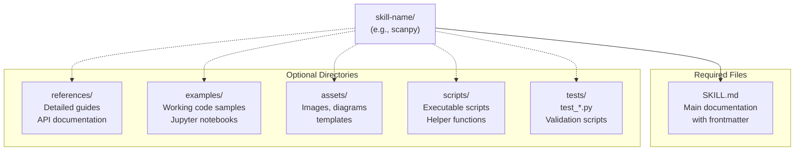
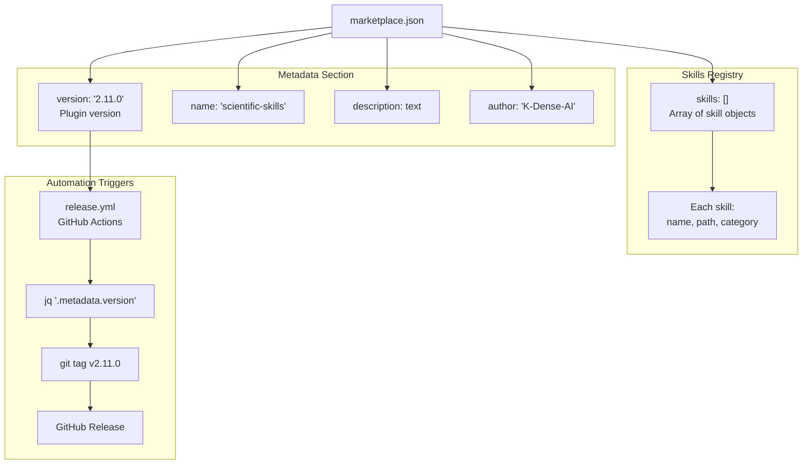
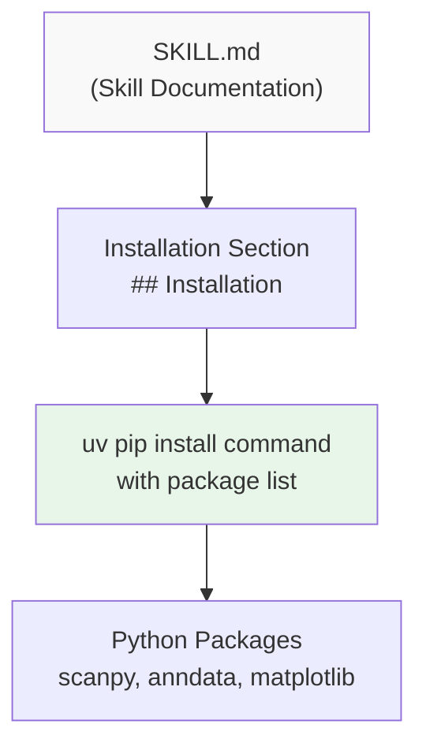
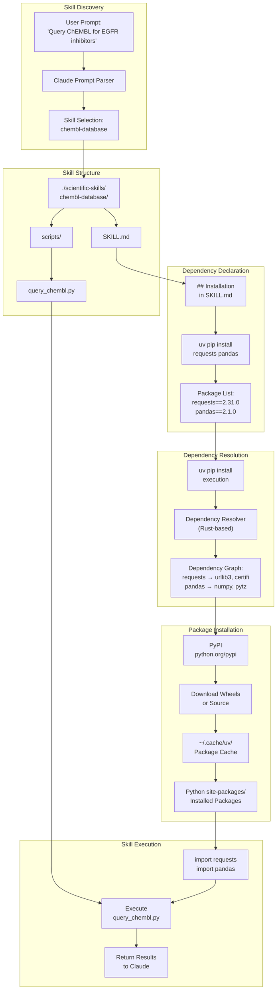
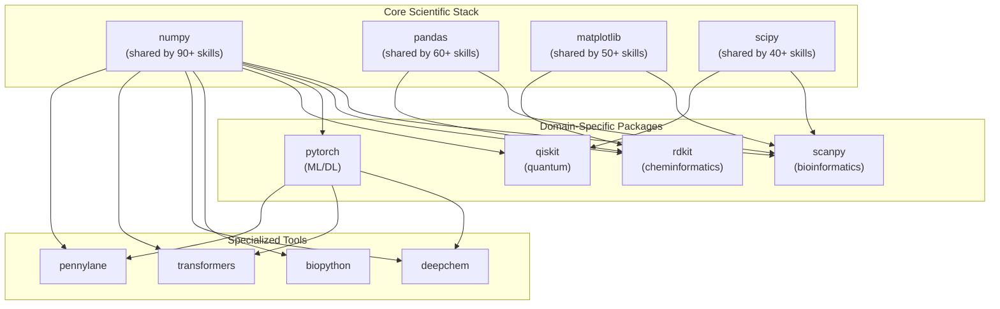
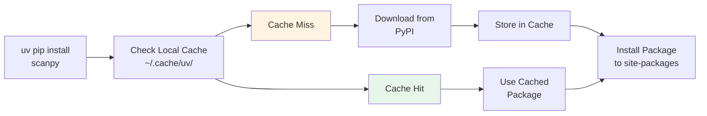
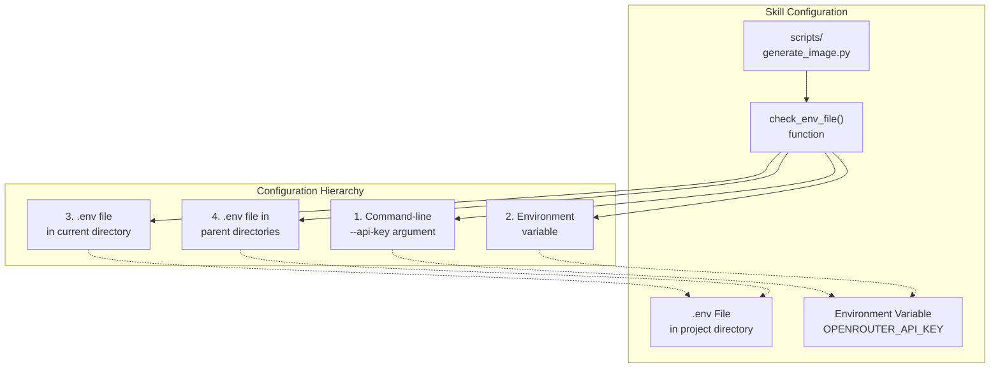
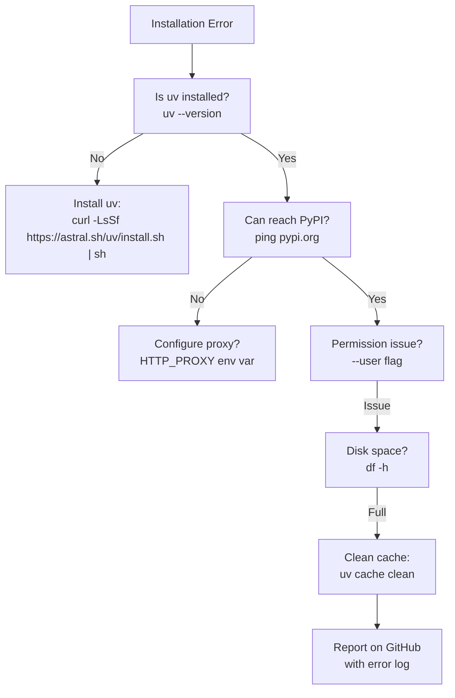

<!-- source: DeepWiki mcp.deepwiki.com · repo K-Dense-AI/claude-scientific-skills · page 9.1 Project Structure and Configuration · fetched 2026-10-26 -->

# Project Structure and Configuration

<details>
<summary>Relevant source files</summary>

The following files were used as context for generating this wiki page:

- [.gitignore](.gitignore)

</details>


## Purpose and Scope

This page documents the organizational structure of the Claude Scientific Skills repository, including directory layout, configuration files, ignored files patterns, and dependency management. It explains how the repository is organized to support 170+ skills across 8 scientific domains, the purpose of key configuration files like `marketplace.json` and `pyproject.toml`, and how the `.gitignore` patterns maintain a clean development environment. For information about the marketplace plugin system, see page 3.3. For details on individual skill structure, see page 3.4.

**Sources:** [.gitignore:1-17](), README.md from high-level diagrams

---

## Repository Directory Structure

The Claude Scientific Skills repository follows a hierarchical organization that separates skill definitions, plugin metadata, automation workflows, and documentation.

### Top-Level Directory Layout

```mermaid
graph TB
    Root["Repository Root<br/>claude-scientific-skills/"]
    
    subgraph "Core Directories"
        ScientificSkills["scientific-skills/<br/>170+ skill definitions<br/>Organized by domain"]
        ClaudePlugin[".claude-plugin/<br/>marketplace.json<br/>Plugin metadata"]
        GithubWorkflows[".github/workflows/<br/>release.yml<br/>Automation"]
        Docs["docs/<br/>Documentation<br/>guides and examples"]
    end
    
    subgraph "Configuration Files"
        GitIgnore[".gitignore<br/>Ignored patterns"]
        PyProject["pyproject.toml<br/>Python project config"]
        UVLock["uv.lock<br/>Dependency lockfile"]
        README["README.md<br/>Main documentation"]
    end
    
    subgraph "Development Files (Ignored)"
        VEnv[".venv/<br/>Virtual environment"]
        PythonVersion[".python-version<br/>Python version spec"]
        EnvFile[".env<br/>API keys"]
        TempDir["temp/<br/>Temporary files"]
        MainPy["main.py<br/>Local scripts"]
        ScanSkills["scan_skills.py<br/>Utility scripts"]
    end
    
    Root --> ScientificSkills
    Root --> ClaudePlugin
    Root --> GithubWorkflows
    Root --> Docs
    Root --> GitIgnore
    Root --> PyProject
    Root --> UVLock
    Root --> README
    
    Root -.->|"Ignored by Git"| VEnv
    Root -.->|"Ignored by Git"| PythonVersion
    Root -.->|"Ignored by Git"| EnvFile
    Root -.->|"Ignored by Git"| TempDir
    Root -.->|"Ignored by Git"| MainPy
    Root -.->|"Ignored by Git"| ScanSkills
```



**Diagram 1: Top-Level Repository Structure**

**Sources:** [.gitignore:1-17](), Diagram 1 from high-level architecture

### scientific-skills/ Directory Organization

The `scientific-skills/` directory contains all skill definitions, organized by scientific domain:

| Domain | Directory Path | Skill Count | Example Skills |
|--------|----------------|-------------|----------------|
| **Bioinformatics** | `scientific-skills/scanpy/`, `scientific-skills/biopython/` | 20+ | Scanpy, BioPython, scVelo, Cellxgene Census |
| **Cheminformatics** | `scientific-skills/rdkit/`, `scientific-skills/deepchem/` | 13+ | RDKit, DeepChem, DiffDock, DataMol |
| **Clinical Research** | `scientific-skills/clinvar/`, `scientific-skills/cosmic/` | 16+ | ClinVar, COSMIC, cBioPortal, DepMap |
| **Machine Learning** | `scientific-skills/pytorch-lightning/`, `scientific-skills/timesfm/` | 16+ | PyTorch Lightning, scikit-learn, TimesFM |
| **Lab Automation** | `scientific-skills/ginkgo-cloud-lab/` | 4 | Ginkgo Cloud Lab, Opentrons, PyLabRobot |
| **Databases** | `scientific-skills/pubmed-database/`, `scientific-skills/uniprot/` | 37+ | PubMed, UniProt, ChEMBL, AlphaFold DB |
| **Communication** | `scientific-skills/generate-image/`, `scientific-skills/scientific-writing/` | 24+ | Generate-Image, Scientific Writing, LaTeX Posters |
| **Research Tools** | `scientific-skills/research-lookup/`, `scientific-skills/open-notebook/` | 11+ | Research Lookup, Open Notebook, Consciousness Council |

**Sources:** Diagram 1 from high-level architecture, README.md:85-115 from high-level diagrams

### Individual Skill Directory Structure

Each skill follows a standardized directory structure:



**Diagram 2: Standard Skill Directory Structure**

**Sources:** Diagram 5 from high-level architecture (Documentation Standards), page 3.4 reference

---

## Configuration Files

### .gitignore Patterns

The repository uses `.gitignore` to exclude development artifacts, credentials, and environment-specific files from version control.

#### Ignored Patterns Breakdown

```mermaid
graph TB
    GitIgnore[".gitignore"]
    
    subgraph "Environment Files"
        Claude[".claude/<br/>Local Claude config"]
        VEnv[".venv/<br/>Virtual environment"]
        PythonVer[".python-version<br/>Python version"]
    end
    
    subgraph "Build Artifacts"
        PyCache["__pycache__/<br/>Compiled Python"]
        PyProject["pyproject.toml<br/>Local config"]
        UVLock["uv.lock<br/>Dependency locks"]
    end
    
    subgraph "Development Files"
        MainPy["main.py<br/>Local scripts"]
        ScanSkills["scan_skills.py<br/>Utility scripts"]
        TempDir["temp/<br/>Temporary files"]
    end
    
    subgraph "Secrets"
        EnvFile[".env<br/>API keys & secrets"]
    end
    
    subgraph "System Files"
        DSStore[".DS_Store<br/>macOS metadata"]
    end
    
    GitIgnore --> Claude
    GitIgnore --> VEnv
    GitIgnore --> PythonVer
    GitIgnore --> PyCache
    GitIgnore --> PyProject
    GitIgnore --> UVLock
    GitIgnore --> MainPy
    GitIgnore --> ScanSkills
    GitIgnore --> TempDir
    GitIgnore --> EnvFile
    GitIgnore --> DSStore
```



**Diagram 3: .gitignore Pattern Categories**

**Sources:** [.gitignore:1-17]()

#### Pattern Details

| Pattern | Purpose | Category |
|---------|---------|----------|
| `.claude` | Local Claude Code IDE configuration | Environment |
| `.DS_Store` | macOS file system metadata | System |
| `temp/` | Temporary development files | Development |
| `pyproject.toml` | Local Python project configuration | Build |
| `uv.lock` | Local dependency lockfile | Build |
| `.venv/` | Python virtual environment | Environment |
| `.python-version` | Local Python version specification | Environment |
| `main.py` | Local development scripts | Development |
| `__pycache__/` | Compiled Python bytecode | Build |
| `.env` | API keys and environment variables | Secrets |
| `scan_skills.py` | Development utility scripts | Development |

**Key Design Decisions:**

1. **`pyproject.toml` and `uv.lock` are ignored**: This prevents conflicts between different developers' local configurations. The repository does not enforce a specific Python project structure since skills are used via the Agent Skills protocol, not installed as a Python package.

2. **`.env` is ignored**: API keys (e.g., for OpenRouter, Parallel Web) must be configured locally and are never committed to the repository. See page 7.1 for API key management patterns.

3. **Development scripts are ignored**: Files like `main.py` and `scan_skills.py` are developer-specific utilities for testing and analysis, not part of the distributed skill system.

**Sources:** [.gitignore:1-17]()

### marketplace.json Configuration

The `.claude-plugin/marketplace.json` file serves as the single source of truth for plugin metadata and version control.



**Diagram 4: marketplace.json Structure and Release Automation**

**Sources:** [.claude-plugin/marketplace.json:1-180]() from high-level diagrams, Diagram 7 from high-level architecture

The `marketplace.json` file:
1. Declares the plugin version (currently `2.11.0`)
2. Catalogs all 170+ skills with metadata
3. Triggers automated releases when updated (see page 9.2)
4. Provides agent-parseable skill discovery information

**Sources:** [.claude-plugin/marketplace.json:1-180]() from high-level diagrams, page 3.3 reference

### pyproject.toml and Python Project Configuration

While `pyproject.toml` is git-ignored to avoid conflicts, developers typically create a local version for dependency management during skill development.

**Typical Local Configuration:**

```toml
[project]
name = "claude-scientific-skills-dev"
version = "0.1.0"
description = "Local development environment"

[tool.uv]
dev-dependencies = [
    "pytest",
    "black",
    "ruff",
]
```

**Note:** The repository intentionally does not include a committed `pyproject.toml` because:
1. Skills are distributed via the Agent Skills protocol, not as Python packages
2. Different skills require different dependencies (see Dependency Management below)
3. Developers may use different Python versions and tooling preferences

**Sources:** [.gitignore:6](), Diagram 5 from high-level architecture

---

## Dependency Management with uv

### Why uv?

The skills ecosystem uses `uv` as its package manager for faster dependency resolution and installation:

| Feature | uv | Traditional pip |
|---------|----|--------------------|
| **Dependency Resolution** | Fast Rust-based resolver | Slower Python-based |
| **Installation Speed** | 10-100x faster | Baseline |
| **Cross-platform Support** | Unified installer scripts | Platform-specific variations |
| **Lockfile Generation** | Native support (`uv.lock`) | Requires pip-tools or poetry |
| **Error Messages** | Clear, actionable | Often cryptic |

The 170+ scientific skills depend on 60+ Python packages ranging from lightweight libraries like `matplotlib` to complex frameworks like `pytorch-lightning` and `deepchem`. The `uv` package manager significantly reduces installation time.

**Sources:** README.md:168-198 from high-level diagrams, Diagram 1 from high-level architecture

---

## Installing uv

Before using the scientific skills, users must install the `uv` package manager on their system.

### Installing uv

**macOS and Linux:**
```bash
curl -LsSf https://astral.sh/uv/install.sh | sh
```

**Windows:**
```powershell
powershell -ExecutionPolicy ByPass -c "irm https://astral.sh/uv/install.ps1 | iex"
```

**Alternative (via pip):**
```bash
pip install uv
```

**Verification:**
```bash
uv --version
```

**Sources:** README.md:173-198 from high-level diagrams

---

## Dependency Declaration in Skills

Each skill declares its Python dependencies in its `SKILL.md` file using a standardized format. The skill documentation includes an installation section that specifies the exact `uv` command needed to install dependencies.

### SKILL.md Structure for Dependencies



**Diagram 1: SKILL.md Dependency Declaration Structure**

**Sources:** [README.md:44-50](), [Diagram 4: Skill Installation, Execution, and Dependency Management]()

### Example: Scanpy Skill Dependencies

A typical skill's `SKILL.md` includes a section like:

```markdown
## Installation

Install dependencies with uv:

```bash
uv pip install scanpy anndata matplotlib numpy scipy pandas
```
```

This pattern is consistent across all 138 skills. The installation command:
1. Uses `uv pip install` (not `pip install`)
2. Lists all required packages explicitly
3. Does not specify versions unless necessary for compatibility
4. Includes transitive dependencies if they require special handling

**Sources:** README.md:44-50 from high-level diagrams

---

## Skill-Specific Dependency Patterns

Different skill categories have characteristic dependency patterns:

| Skill Category | Typical Dependencies | Installation Size | Example Skill |
|----------------|---------------------|-------------------|---------------|
| **Bioinformatics** | scanpy, anndata, biopython, pysam | 500-1000 MB | `./scientific-skills/scanpy` |
| **Cheminformatics** | rdkit, datamol, deepchem | 300-800 MB | `./scientific-skills/rdkit` |
| **Quantum Computing** | qiskit, pennylane, cirq | 200-500 MB | `./scientific-skills/qiskit` |
| **Machine Learning** | pytorch-lightning, transformers, scikit-learn | 2-5 GB | `./scientific-skills/pytorch-lightning` |
| **Database Skills** | requests, pandas (lightweight) | 50-200 MB | `./scientific-skills/pubmed-database` |
| **Visualization** | matplotlib, plotly, seaborn | 100-300 MB | `./scientific-skills/matplotlib` |

**Sources:** Diagram 1 from high-level architecture

---

## On-Demand Dependency Installation

The Claude Scientific Skills architecture implements **lazy loading** for dependencies. Packages are not installed when the plugin is added to Claude Code; instead, they are installed the first time a skill that requires them is invoked.

### Lazy Installation Flow

```mermaid
sequenceDiagram
    participant User
    participant Claude["Claude AI<br/>Orchestration"]
    participant Skill["Skill<br/>(e.g., scanpy)"]
    participant SKILL_MD["SKILL.md<br/>Documentation"]
    participant UV["uv Package Manager"]
    participant PyPI["PyPI<br/>Package Index"]
    participant Cache["Local Package Cache<br/>~/.cache/uv"]
    
    User->>Claude: "Analyze single-cell RNA-seq data"
    Claude->>Skill: Invoke scanpy skill
    Skill->>SKILL_MD: Read installation instructions
    
    alt First time using skill
        SKILL_MD-->>Skill: uv pip install scanpy anndata
        Skill->>UV: Execute: uv pip install scanpy anndata
        UV->>PyPI: Download packages
        PyPI-->>UV: scanpy==1.10.0, anndata==0.10.0, ...
        UV->>Cache: Store packages
        UV-->>Skill: Installation complete
        Note over Skill,UV: ~500 MB downloaded<br/>30-60 seconds
    else Dependencies already cached
        Skill->>Cache: Check for packages
        Cache-->>Skill: Packages available
        Note over Skill,Cache: Instant (0.1 seconds)
    end
    
    Skill->>Skill: Import packages
    Skill->>Skill: Execute analysis
    Skill-->>Claude: Results + outputs
    Claude-->>User: Analysis complete
```

**Diagram 2: On-Demand Dependency Installation Sequence**

**Sources:** Diagram 2 from high-level architecture

### Performance Benefits

The lazy loading approach provides several benefits:

1. **Fast Initial Setup**: Installing the plugin takes seconds, not hours
2. **Reduced Disk Usage**: Only required packages are installed (not all 55+ packages)
3. **Cached Reuse**: Once installed, packages are reused across skills
4. **Parallel Installation**: Multiple skills' dependencies can be installed concurrently

**First-time execution timing:**
- Database skills (lightweight): 5-10 seconds
- Bioinformatics skills: 30-90 seconds  
- ML/DL skills with PyTorch: 2-5 minutes

**Subsequent executions:**
- All skills: < 1 second (packages already cached)

**Sources:** Diagram 2 from high-level architecture

---

## Dependency Resolution Flow

This diagram shows how dependencies flow from skill invocation through installation to execution:



**Diagram 3: Complete Dependency Resolution and Installation Flow**

**Sources:** Diagram 2 from high-level architecture

---

## Environment Isolation and Shared Dependencies

### Shared Python Environment

All 138 skills share a common Python environment. This design decision was intentional:

**Advantages:**
- Shared dependencies reduce disk usage (e.g., `numpy` installed once for all skills)
- Faster installation when multiple skills use the same package
- Simpler dependency management (no virtual environment juggling)

**Potential Conflicts:**
- Version conflicts between skills requiring different versions of the same package
- Namespace collisions (rare in practice)

### Dependency Compatibility Matrix



**Diagram 4: Shared Dependency Tree Across Skill Categories**

All skills have been validated to work with compatible versions at plugin version 2.11.0.

**Sources:** [.claude-plugin/marketplace.json:9]() from high-level diagrams

---

## Caching and Performance Optimization

### uv Cache Location

`uv` maintains a local cache of downloaded packages to speed up subsequent installations:

| Platform | Cache Location |
|----------|----------------|
| **Linux** | `~/.cache/uv/` |
| **macOS** | `~/Library/Caches/uv/` |
| **Windows** | `%LOCALAPPDATA%\uv\cache\` |

### Cache Behavior



**Diagram 5: uv Package Cache Decision Flow**

### Cache Management Commands

```bash
# View cache info
uv cache info

# Clear cache (frees disk space)
uv cache clean

# Prune unused packages
uv cache prune
```

**Sources:** README.md:168-198 from high-level diagrams

---

## Environment Variables and Configuration

### API Keys and Credentials

Some skills require API keys for external services. These are managed separately from Python dependencies via environment variables or `.env` files.



**Diagram 6: API Key Configuration Hierarchy**

**Sources:** [.gitignore:15](), page 7.1 reference

### Example: .env File Pattern

```bash
# .env file in project directory
OPENROUTER_API_KEY=your-api-key-here
PUBMED_API_KEY=your-pubmed-key
```

Skills that require API keys implement a search pattern:
1. Look for `.env` in current working directory
2. Search parent directories recursively
3. Parse `KEY=value` format
4. Provide clear error messages if keys are missing

**Sources:** [.gitignore:15](), page 7.1 reference

---

## Troubleshooting Dependency Issues

### Common Issues and Solutions

| Issue | Symptom | Solution |
|-------|---------|----------|
| **uv not found** | `command not found: uv` | Install uv: [README.md:173-198]() |
| **Permission denied** | Installation fails with permissions error | Use `uv pip install --user` or fix Python permissions |
| **Network timeout** | PyPI download fails | Check internet connection, try again, or configure proxy |
| **Version conflict** | Package version incompatible | Report issue on GitHub; may require skill update |
| **Missing dependencies** | `ModuleNotFoundError` at runtime | Re-run installation command from SKILL.md |
| **Corrupted cache** | Unexpected package behavior | Run `uv cache clean` and reinstall |

### Debugging Installation Failures



**Diagram 7: Dependency Installation Troubleshooting Flow**

**Sources:** README.md from high-level diagrams

### Verbose Installation for Debugging

```bash
# Run with verbose output to diagnose issues
uv pip install --verbose scanpy anndata

# Check installed packages
uv pip list

# Verify specific package version
uv pip show scanpy
```

---

## Dependency Update Strategy

### Plugin Version and Dependency Compatibility

The marketplace plugin version (currently `2.11.0`) represents a validated set of dependency versions that work together:

```json
{
  "metadata": {
    "version": "2.11.0"
  }
}
```

**Sources:** [.claude-plugin/marketplace.json:9]() from high-level diagrams

All 138 skills have been tested with compatible package versions at this plugin version. When the plugin is updated:

1. **Major version change** (e.g., 2.x → 3.x): May include breaking dependency updates
2. **Minor version change** (e.g., 2.11 → 2.12): New skills or non-breaking updates
3. **Patch version change** (e.g., 2.11.0 → 2.11.1): Bug fixes only

### Updating Dependencies

To update to newer package versions:

```bash
# Update all packages
uv pip install --upgrade <package-name>

# Update specific skill dependencies
uv pip install --upgrade scanpy anndata matplotlib

# Force reinstall if needed
uv pip install --force-reinstall scanpy
```

**Recommendation:** Only update dependencies if experiencing issues or needing new features. The tested versions in each plugin release provide stability.

**Sources:** [.claude-plugin/marketplace.json:9]() from high-level diagrams

---

## Multi-Skill Workflows and Dependency Sharing

When Claude orchestrates multi-skill workflows, dependency installation is optimized:

```mermaid
sequenceDiagram
    participant Claude
    participant ChEMBL["chembl-database<br/>skill"]
    participant RDKit["rdkit<br/>skill"]
    participant DeepChem["deepchem<br/>skill"]
    participant UV["uv"]
    participant Cache["Package Cache"]
    
    Note over Claude: Drug Discovery Workflow
    Claude->>ChEMBL: Query for EGFR inhibitors
    
    alt First skill, first time
        ChEMBL->>UV: uv pip install requests pandas
        UV->>Cache: Store packages
    end
    
    ChEMBL-->>Claude: 247 compounds
    
    Claude->>RDKit: Analyze structures
    
    alt Second skill, first time
        RDKit->>UV: uv pip install rdkit numpy
        Note over UV,Cache: numpy already cached<br/>from previous skills
        UV->>Cache: Only download rdkit
    end
    
    RDKit-->>Claude: Structure analysis
    
    Claude->>DeepChem: Property prediction
    
    alt Third skill, first time
        DeepChem->>UV: uv pip install deepchem torch
        Note over UV,Cache: numpy, pandas cached<br/>only torch/deepchem new
    end
    
    DeepChem-->>Claude: Predictions
```

**Diagram 8: Dependency Sharing in Multi-Skill Workflow**

In this workflow:
- **ChEMBL skill** installs `requests` and `pandas` (first time: 30 seconds)
- **RDKit skill** reuses `pandas`, only installs `rdkit` (first time: 45 seconds)
- **DeepChem skill** reuses `numpy` and `pandas`, installs `deepchem` and `torch` (first time: 2-3 minutes)

Total first-run time: ~4 minutes. Subsequent runs: < 1 second.

**Sources:** Diagram 4 from high-level architecture

---

## Summary

The Claude Scientific Skills dependency management system uses `uv` for:

1. **Fast installation**: 10-100x faster than traditional pip
2. **Lazy loading**: Dependencies installed only when needed
3. **Efficient caching**: Packages downloaded once, reused across skills
4. **Shared environment**: 138 skills share compatible dependencies
5. **Robust resolution**: Rust-based resolver handles complex dependency graphs

This architecture enables rapid prototyping of complex scientific workflows that span multiple domains (bioinformatics, cheminformatics, ML, quantum computing) without dependency conflicts or excessive installation times.

**Sources:** [README.md:165-198](), [Diagram 4: Skill Installation, Execution, and Dependency Management](), [Diagram 5: Skill Ecosystem and Cross-Domain Workflows]()

---

