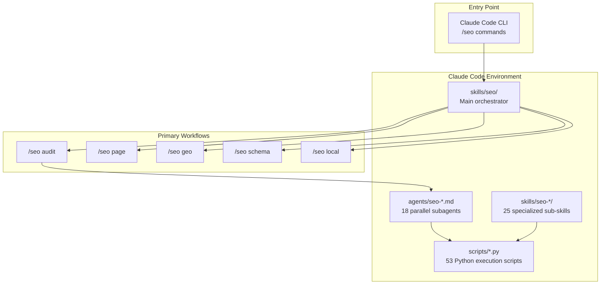
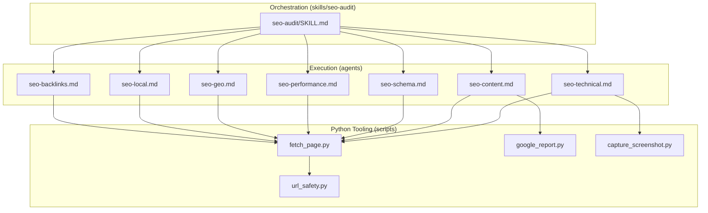

<!-- source: DeepWiki mcp.deepwiki.com · repo AgriciDaniel/claude-seo · page 1 Overview · fetched 2026-10-26 -->

# Overview

Relevant source files

The following files were used as context for generating this wiki page:

- [.claude-plugin/marketplace.json](.claude-plugin/marketplace.json)
- [.claude-plugin/plugin.json](.claude-plugin/plugin.json)
- [CHANGELOG.md](CHANGELOG.md)
- [CLAUDE.md](CLAUDE.md)
- [README.md](README.md)

This document provides a high-level introduction to the **claude-seo** system: its purpose, architecture, command structure, and integration with the Claude Code ecosystem. For detailed information on specific analysis types, see the respective sections: Technical SEO Analysis ([#5]()), Content Quality ([#6]()), Schema Markup ([#7]()), Performance Analysis ([#8]()), and others. For installation and configuration instructions, see Getting Started ([#2]()).

## Purpose and Scope

**claude-seo** is an open-source SEO analysis plugin for [Claude Code](https://claude.ai/claude-code) [`README.md:3-5`](). It runs 25 sub-skills and 18 specialist agents in parallel across technical SEO, content quality (E-E-A-T), Schema.org markup, AI search optimization (GEO), local SEO, e-commerce, and international SEO [`README.md:5-5`](). Every audit produces a prioritized action plan with falsifiable recommendations grounded in primary-source guidance from Google [`README.md:5-5`]().

**Sources:** [`README.md:1-40`](), [`CLAUDE.md:1-15`]()

## System Identity

**Figure 1: System Architecture and Command Flow**

The system follows a 3-layer architecture:
1.  **Directive Layer**: The user-facing `/seo` commands [`README.md:120-135`]().
2.  **Orchestration Layer**: The `seo` main skill [`skills/seo/SKILL.md:1-28`]() and 18 subagents [`agents/`]() that coordinate complex tasks [`CLAUDE.md:16-17`]().
3.  **Execution Layer**: 25 sub-skills [`skills/`]() and 53 Python scripts [`scripts/`]() that perform data fetching, rendering, and analysis [`CLAUDE.md:88-120`]().

**Sources:** [`README.md:120-135`](), [`CLAUDE.md:1-120`](), [`.claude-plugin/plugin.json:3-4`]()

## Command Surface

| Command | Target Sub-Skill | Analysis Type |
| :--- | :--- | :--- |
| `/seo audit <url>` | `seo-audit` | Parallel analysis via 15 core subagents [`README.md:126-127`]() |
| `/seo page <url>` | `seo-page` | Deep single-page analysis: on-page, quality, schema [`README.md:129-130`]() |
| `/seo technical <url>` | `seo-technical` | 9 categories: crawlability, security, mobile, etc. [`CLAUDE.md:32-32`]() |
| `/seo content <url>` | `seo-content` | E-E-A-T and QRG-aligned quality gates [`CLAUDE.md:33-33`]() |
| `/seo schema <url>` | `seo-schema` | Detection, validation, and generation [`README.md:132-132`]() |
| `/seo geo <url>` | `seo-geo` | AI search optimization and passage citability [`README.md:134-135`]() |
| `/seo local <url>` | `seo-local` | GBP, citations, reviews, and local schema [`CLAUDE.md:39-39`]() |
| `/seo maps <url>` | `seo-maps` | Geo-grid analysis and competitor radius [`CLAUDE.md:40-40`]() |
| `/seo sitemap <cmd>` | `seo-sitemap` | XML sitemap analysis or generation [`CLAUDE.md:36-36`]() |
| `/seo cluster <url>` | `seo-cluster` | Semantic topic clustering and map visualization [`CLAUDE.md:50-53`]() |
| `/seo drift <url>` | `seo-drift` | Monitoring SEO changes across 17 rules [`CLAUDE.md:57-59`]() |
| `/seo sxo <url>` | `seo-sxo` | Search Experience Optimization analysis [`CLAUDE.md:54-56`]() |

**Sources:** [`README.md:120-135`](), [`CLAUDE.md:26-64`]()

## Skill and Subagent Model

The system utilizes a massive parallel execution model. A full site audit (`/seo audit`) spawns up to 15 specialist agents simultaneously [`README.md:21-21`]().

**Figure 2: Parallel Agent Delegation Model**

The system handles modern web architectures through SPA-aware rendering and extraction. SPA rendering recognizes common hosted builders and uses bounded DOM stabilization [`CHANGELOG.md:34-35`]().

**Sources:** [`CHANGELOG.md:34-35`](), [`CLAUDE.md:67-85`](), [`README.md:20-22`]()

## External Integration Layer

Claude SEO integrates with the Claude Code ecosystem through MCP (Model Context Protocol) and direct API integrations.

| Integration | Source / Script | Purpose |
| :--- | :--- | :--- |
| **DataForSEO** | `seo-dataforseo.md` | Live SERP, Merchant, and Keyword data [`CLAUDE.md:79-79`]() |
| **Google Search Console** | `gsc_query.py` | Indexing status, queries, and sitemaps [`CLAUDE.md:97-98`]() |
| **PageSpeed / CrUX** | `pagespeed_check.py` | CWV lab and field data (PSI v5) [`CLAUDE.md:95-96`]() |
| **Ahrefs / SE Ranking** | MCP Extensions | Backlink and ranking intelligence [`.claude-plugin/marketplace.json:8-8`]() |
| **Moz / Bing** | `backlinks_auth.py` | Link profile analysis [`CLAUDE.md:90-92`]() |
| **GA4** | `ga4_report.py` | Organic traffic reports [`CLAUDE.md:100-100`]() |

**Sources:** [`CHANGELOG.md:25-30`](), [`CLAUDE.md:88-115`](), [`.claude-plugin/plugin.json:4-4`]()

## Quality Control and Safety

The system implements a hardened safety layer and strict quality gates to ensure SEO recommendations are safe and effective.

*   **SSRF & DNS-Rebinding Protection**: The `url_safety.py` module provides strict cross-host validation and bounded responses [`CHANGELOG.md:20-21`](), [`CLAUDE.md:117-117`]().
*   **Content Quality Gates**: The system enforces word count thresholds, readability metrics, and AI content detection [`CLAUDE.md:69-69`]().
*   **Schema Validation**: The `hooks/validate-schema.py` script runs post-edit to ensure JSON-LD compliance and prevents the use of deprecated types [`CHANGELOG.md:75-75`](), [`hooks/hooks.json:1-5`]().
*   **Parasite SEO Risk**: The system includes scanners for site-reputation-abuse exposure [`CLAUDE.md:120-120`]().

**Sources:** [`CHANGELOG.md:20-75`](), [`CLAUDE.md:86-120`](), [`hooks/hooks.json:1-5`]()

## Reference Data and Templates

The system maintains an extensible reference system in `skills/*/references/` to ground AI analysis in primary-source data:
- **Google Updates**: `data/google-updates.json` tracks historical ranking updates [`CHANGELOG.md:96-96`]().
- **Schema Templates**: `schema/templates.json` provides base structures for complex markup [`CLAUDE.md:120-120`]().
- **Clustering Methodology**: `skills/seo-cluster/references/` defines semantic topic clustering workflows [`CLAUDE.md:52-52`]()
- **CWV Thresholds**: `skills/seo/references/cwv-thresholds.md` defines the 75th percentile evaluation standards [`CHANGELOG.md:88-88`]().

**Sources:** [`CHANGELOG.md:88-96`](), [`CLAUDE.md:29-66`]()

---

