# Page: Overview

# Overview

<details>
<summary>Relevant source files</summary>

The following files were used as context for generating this wiki page:

- [.claude-plugin/marketplace.json](.claude-plugin/marketplace.json)
- [.claude-plugin/plugin.json](.claude-plugin/plugin.json)
- [CHANGELOG.md](CHANGELOG.md)
- [CLAUDE.md](CLAUDE.md)
- [README.md](README.md)

</details>


This document provides a high-level introduction to the **claude-seo** system: its purpose, architecture, command structure, and integration with the Claude Code ecosystem. For detailed information on specific analysis types, see the respective sections: Technical SEO Analysis ([#5]()), Content Quality ([#6]()), Schema Markup ([#7]()), Performance Analysis ([#8]()), and others. For installation and configuration instructions, see Getting Started ([#2]()).

## Purpose and Scope

**claude-seo** is an open-source SEO analysis plugin for [Claude Code](https://claude.ai/claude-code) [`README.md:3-5`](). It runs 25 sub-skills and 18 specialist agents in parallel across technical SEO, content quality (E-E-A-T), Schema.org markup, AI search optimization (GEO), local SEO, e-commerce, and international SEO [`README.md:5-5`](). Every audit produces a prioritized action plan with falsifiable recommendations grounded in primary-source guidance from Google [`README.md:5-5`]().

**Sources:** [`README.md:1-40`](), [`CLAUDE.md:1-15`]()

## System Identity

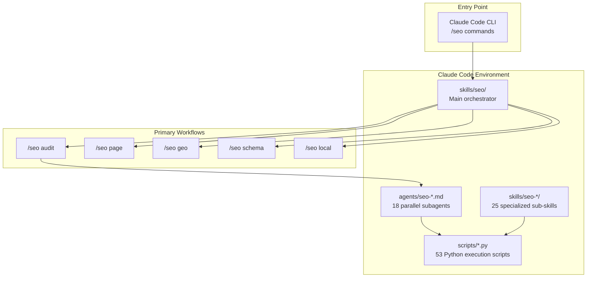

**Figure 1: System Architecture and Command Flow**

The system follows a 3-layer architecture:
1.  **Directive Layer**: The user-facing `/seo` commands [`README.md:120-135`]().
2.  **Orchestration Layer**: The `seo` main skill [`skills/seo/SKILL.md:1-28`]() and 18 subagents [`agents/`]() that coordinate complex tasks [`CLAUDE.md:16-17`]().
3.  **Execution Layer**: 25 sub-skills [`skills/`]() and 53 Python scripts [`scripts/`]() that perform data fetching, rendering, and analysis [`CLAUDE.md:88-120`]().

**Sources:** [`README.md:120-135`](), [`CLAUDE.md:1-120`](), [`.claude-plugin/plugin.json:3-4`]()

## Command Surface

| Command | Target Sub-Skill | Analysis Type |
| :--- | :--- | :--- |
| `/seo audit <url>` | `seo-audit` | Parallel analysis via 15 core subagents [`README.md:126-127`]() |
| `/seo page <url>` | `seo-page` | Deep single-page analysis: on-page, quality, schema [`README.md:129-130`]() |
| `/seo technical <url>` | `seo-technical` | 9 categories: crawlability, security, mobile, etc. [`CLAUDE.md:32-32`]() |
| `/seo content <url>` | `seo-content` | E-E-A-T and QRG-aligned quality gates [`CLAUDE.md:33-33`]() |
| `/seo schema <url>` | `seo-schema` | Detection, validation, and generation [`README.md:132-132`]() |
| `/seo geo <url>` | `seo-geo` | AI search optimization and passage citability [`README.md:134-135`]() |
| `/seo local <url>` | `seo-local` | GBP, citations, reviews, and local schema [`CLAUDE.md:39-39`]() |
| `/seo maps <url>` | `seo-maps` | Geo-grid analysis and competitor radius [`CLAUDE.md:40-40`]() |
| `/seo sitemap <cmd>` | `seo-sitemap` | XML sitemap analysis or generation [`CLAUDE.md:36-36`]() |
| `/seo cluster <url>` | `seo-cluster` | Semantic topic clustering and map visualization [`CLAUDE.md:50-53`]() |
| `/seo drift <url>` | `seo-drift` | Monitoring SEO changes across 17 rules [`CLAUDE.md:57-59`]() |
| `/seo sxo <url>` | `seo-sxo` | Search Experience Optimization analysis [`CLAUDE.md:54-56`]() |

**Sources:** [`README.md:120-135`](), [`CLAUDE.md:26-64`]()

## Skill and Subagent Model

The system utilizes a massive parallel execution model. A full site audit (`/seo audit`) spawns up to 15 specialist agents simultaneously [`README.md:21-21`]().

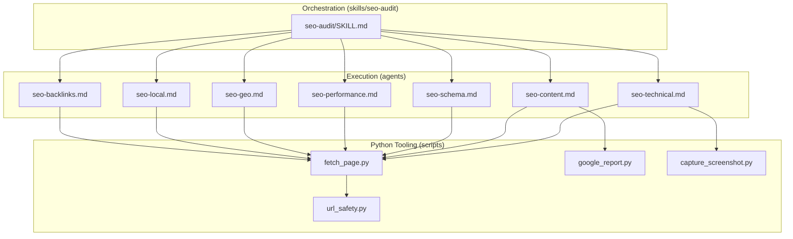

**Figure 2: Parallel Agent Delegation Model**

The system handles modern web architectures through SPA-aware rendering and extraction. SPA rendering recognizes common hosted builders and uses bounded DOM stabilization [`CHANGELOG.md:34-35`]().

**Sources:** [`CHANGELOG.md:34-35`](), [`CLAUDE.md:67-85`](), [`README.md:20-22`]()

## External Integration Layer

Claude SEO integrates with the Claude Code ecosystem through MCP (Model Context Protocol) and direct API integrations.

| Integration | Source / Script | Purpose |
| :--- | :--- | :--- |
| **DataForSEO** | `seo-dataforseo.md` | Live SERP, Merchant, and Keyword data [`CLAUDE.md:79-79`]() |
| **Google Search Console** | `gsc_query.py` | Indexing status, queries, and sitemaps [`CLAUDE.md:97-98`]() |
| **PageSpeed / CrUX** | `pagespeed_check.py` | CWV lab and field data (PSI v5) [`CLAUDE.md:95-96`]() |
| **Ahrefs / SE Ranking** | MCP Extensions | Backlink and ranking intelligence [`.claude-plugin/marketplace.json:8-8`]() |
| **Moz / Bing** | `backlinks_auth.py` | Link profile analysis [`CLAUDE.md:90-92`]() |
| **GA4** | `ga4_report.py` | Organic traffic reports [`CLAUDE.md:100-100`]() |

**Sources:** [`CHANGELOG.md:25-30`](), [`CLAUDE.md:88-115`](), [`.claude-plugin/plugin.json:4-4`]()

## Quality Control and Safety

The system implements a hardened safety layer and strict quality gates to ensure SEO recommendations are safe and effective.

*   **SSRF & DNS-Rebinding Protection**: The `url_safety.py` module provides strict cross-host validation and bounded responses [`CHANGELOG.md:20-21`](), [`CLAUDE.md:117-117`]().
*   **Content Quality Gates**: The system enforces word count thresholds, readability metrics, and AI content detection [`CLAUDE.md:69-69`]().
*   **Schema Validation**: The `hooks/validate-schema.py` script runs post-edit to ensure JSON-LD compliance and prevents the use of deprecated types [`CHANGELOG.md:75-75`](), [`hooks/hooks.json:1-5`]().
*   **Parasite SEO Risk**: The system includes scanners for site-reputation-abuse exposure [`CLAUDE.md:120-120`]().

**Sources:** [`CHANGELOG.md:20-75`](), [`CLAUDE.md:86-120`](), [`hooks/hooks.json:1-5`]()

## Reference Data and Templates

The system maintains an extensible reference system in `skills/*/references/` to ground AI analysis in primary-source data:
- **Google Updates**: `data/google-updates.json` tracks historical ranking updates [`CHANGELOG.md:96-96`]().
- **Schema Templates**: `schema/templates.json` provides base structures for complex markup [`CLAUDE.md:120-120`]().
- **Clustering Methodology**: `skills/seo-cluster/references/` defines semantic topic clustering workflows [`CLAUDE.md:52-52`]()
- **CWV Thresholds**: `skills/seo/references/cwv-thresholds.md` defines the 75th percentile evaluation standards [`CHANGELOG.md:88-88`]().

**Sources:** [`CHANGELOG.md:88-96`](), [`CLAUDE.md:29-66`]()

---

# Page: Getting Started

# Getting Started

<details>
<summary>Relevant source files</summary>

The following files were used as context for generating this wiki page:

- [docs/ARCHITECTURE.md](docs/ARCHITECTURE.md)
- [docs/COMMANDS.md](docs/COMMANDS.md)
- [docs/INSTALLATION.md](docs/INSTALLATION.md)
- [docs/TROUBLESHOOTING.md](docs/TROUBLESHOOTING.md)
- [install.ps1](install.ps1)
- [install.sh](install.sh)
- [uninstall.ps1](uninstall.ps1)
- [uninstall.sh](uninstall.sh)

</details>


This document provides an overview of how to install, configure, and begin using the **claude-seo** system. It covers essential prerequisites, the installation process, basic configuration, and how to run your first SEO analysis commands.

For detailed installation steps including Python dependency management and Playwright setup, see [Installation](#2.1). For comprehensive configuration of API keys and MCP integrations, see [Configuration](#2.2). For step-by-step workflow examples, see [Quick Start Guide](#2.3).

---

## Prerequisites

Before installing claude-seo, ensure your system meets these requirements:

| Requirement | Minimum Version | Purpose |
|------------|-----------------|---------|
| **Python** | 3.10+ | Runs validation hooks, scripts, and MCP servers [install.ps1:75-76](), [install.sh:23-24]() |
| **Claude Code CLI** | Latest | Provides the `/seo` command interface [docs/INSTALLATION.md:7]() |
| **Git** | Any | Clones the repository and submodules [install.sh:25](), [install.ps1:105-111]() |

**Optional but Recommended:**

| Component | Purpose | Impact if Missing |
|-----------|---------|-------------------|
| **Playwright** | Visual analysis & screenshots | Falls back to `WebFetch` [docs/INSTALLATION.md:10](), [docs/COMMANDS.md:39]() |
| **MCP Servers** | Live SEO data (Ahrefs, GSC, etc.) | Analysis relies on HTML-only inspection [docs/ARCHITECTURE.md:126-129]() |

Sources: [install.sh:23-35](), [install.ps1:75-111](), [docs/INSTALLATION.md:3-10]()

---

## Installation Overview

The installation process deploys a modular architecture consisting of 25 sub-skills and 18 sub-agents into the Claude Code environment [docs/ARCHITECTURE.md:9]().

### Installation Artifacts Mapping

```mermaid
graph TB
    subgraph "Source (Code Entity Space)"
        [install.sh] -->|"Executes"| MainLogic["main() function"]
        [install.ps1] -->|"Executes"| MainPS["Main function"]
    end
    
    subgraph "Target: ~/.claude/ (Natural Language Space)"
        MainLogic -->|"Copies to /skills/seo/"| Orchestrator["Main Orchestrator"]
        MainLogic -->|"Copies to /agents/"| AgentMD["18 Specialist Subagents"]
        MainPS -->|"Creates .venv/"| PythonEnv["Isolated Runtime"]
    end

    subgraph "System Entities"
        Orchestrator --- ["skills/seo/SKILL.md"]
        AgentMD --- ["agents/seo-technical.md"]
        PythonEnv --- ["bin/claude-seo"]
    end
```

**Installation Methods:**

1.  **Plugin Install (Recommended)**: Uses Claude Code's internal marketplace via `/plugin install claude-seo@agricidaniel-claude-seo` [docs/INSTALLATION.md:14-22]().
2.  **Automated Script**: The `install.sh` (Unix) or `install.ps1` (Windows) scripts automate directory creation, file copying, and virtual environment setup [install.sh:7-82](), [install.ps1:135-200]().
3.  **Manual Setup**: Cloning the repo and running the installer to create the managed runtime at `~/.claude/skills/seo/.venv/` [docs/INSTALLATION.md:53-76]().

Sources: [install.sh:7-92](), [install.ps1:135-210](), [docs/INSTALLATION.md:12-47](), [docs/ARCHITECTURE.md:7-62]()

---

## Python Dependencies

The system requires specific Python packages to handle parsing, network requests, and visual analysis. These are managed within an isolated virtual environment to avoid global conflicts [docs/INSTALLATION.md:70-72]().

| Component | Purpose | Related Script |
|---------|---------|------------------|
| `beautifulsoup4` | HTML Parsing | `parse_html.py` [docs/TROUBLESHOOTING.md:211]() |
| `requests` | HTTP Client | `fetch_page.py` [docs/TROUBLESHOOTING.md:208]() |
| `playwright` | Browser Automation | `capture_screenshot.py` [docs/TROUBLESHOOTING.md:214]() |

Sources: [docs/INSTALLATION.md:70-76](), [docs/TROUBLESHOOTING.md:48-65](), [install.sh:127-129]()

---

## Configuration Overview

While the system works out-of-box via HTML parsing, connecting to external APIs through the Model Context Protocol (MCP) provides significantly deeper insights.

### Integration Tiers Diagram

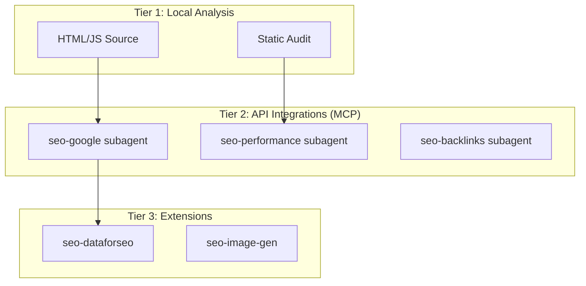

**Configuration Storage:**
- **MCP Registration**: Configured in the Claude Code `settings.json` file [uninstall.sh:64]().
- **Runtime Setup**: The `/seo setup` command initializes the Python environment and Playwright Chromium [docs/COMMANDS.md:9-13]().

Sources: [docs/COMMANDS.md:9-13](), [docs/ARCHITECTURE.md:125-133](), [uninstall.sh:64]()

---

## First Commands

Once installed, the `/seo` command acts as the primary entry point.

### Common Workflows

*   **Full Site Audit**: `/seo audit <url>` — Crawls up to 500 pages, detects business type, and spawns parallel subagents [docs/COMMANDS.md:20-35]().
*   **Technical Deep Dive**: `/seo technical <url>` — Audits 9 categories including crawlability, security, and IndexNow [docs/COMMANDS.md:62-82]().
*   **Content & E-E-A-T**: `/seo content <url>` — Evaluates Experience, Expertise, Authoritativeness, and Trustworthiness [docs/COMMANDS.md:84-101]().
*   **Schema Check**: `/seo schema <url>` — Validates JSON-LD/Microdata against Google requirements [docs/COMMANDS.md:121-136]().

Sources: [docs/COMMANDS.md:1-136](), [docs/ARCHITECTURE.md:105-146]()

---

## Verification Steps

To ensure a successful setup, perform the following checks:

1.  **Skill Loading**: Run `/seo` in Claude Code; it should return a help message [docs/INSTALLATION.md:102-108]().
2.  **Health Check**: Run `/seo doctor` to verify runtime, dependency, and Chromium readiness [docs/COMMANDS.md:15-18]().
3.  **File Integrity**: Verify `SKILL.md` exists at `~/.claude/skills/seo/SKILL.md` [docs/INSTALLATION.md:143-151]().
4.  **Runtime Verification**: Ensure the virtual environment is present at `~/.claude/skills/seo/.venv/` [docs/INSTALLATION.md:85-91]().

Sources: [docs/INSTALLATION.md:93-108](), [docs/COMMANDS.md:15-18](), [install.sh:77-81]()

---

## Next Steps

*   For detailed setup of API keys for Google Search Console or Ahrefs, see [Configuration](#2.2).
*   To learn about the 18 specialized subagents and how they process data, see [System Architecture](#4).
*   To explore the full list of available commands, see [Command Reference](#3).

---

# Page: Installation

# Installation

<details>
<summary>Relevant source files</summary>

The following files were used as context for generating this wiki page:

- [CITATION.cff](CITATION.cff)
- [docs/ARCHITECTURE.md](docs/ARCHITECTURE.md)
- [docs/COMMANDS.md](docs/COMMANDS.md)
- [docs/INSTALLATION.md](docs/INSTALLATION.md)
- [docs/TROUBLESHOOTING.md](docs/TROUBLESHOOTING.md)
- [install.ps1](install.ps1)
- [install.sh](install.sh)
- [pyproject.toml](pyproject.toml)
- [requirements.txt](requirements.txt)
- [tests/test_pyproject_metadata.py](tests/test_pyproject_metadata.py)
- [uninstall.ps1](uninstall.ps1)
- [uninstall.sh](uninstall.sh)

</details>


## Purpose and Scope

This document provides detailed technical instructions for installing the `claude-seo` system. It covers automated installation via shell and PowerShell scripts, manual dependency management using Python virtual environments, Playwright browser setup for visual analysis, and Model Context Protocol (MCP) server integration for external data sources.

---

## Automated Installation

The project provides dedicated installers for Unix-based systems (macOS/Linux) and Windows to automate the creation of skill directories, cloning of the repository, and environment setup. The system is designed to run in an isolated runtime environment to prevent global package pollution.

### Plugin Install (Recommended)
For Claude Code 1.0.33+, the recommended path is via the marketplace. This method integrates with Claude's native plugin lifecycle [docs/INSTALLATION.md:14-22]().

```bash
/plugin marketplace add AgriciDaniel/claude-seo
/plugin install claude-seo@agricidaniel-claude-seo
/seo setup
```

### Unix/macOS (install.sh)
The `install.sh` script performs a comprehensive setup by targeting the Claude Code skill and agent directories.

1.  **Environment Check**: Validates Git presence and minimum Python requirements [install.sh:23-25]().
2.  **Directory Initialization**: Creates `~/.claude/skills/seo` and `~/.claude/agents` [install.sh:27-29]().
3.  **Component Distribution**: 
    *   Clones the repository (pinned to version `v2.2.4` by default) [install.sh:15,37]().
    *   Installs 18+ subagents into the agent directory [install.sh:66-67]().
    *   Deploys 25+ sub-skills, schema templates, and reference PDFs into the skill directory [install.sh:40-63]().
    *   Copies the stable runtime launcher `bin/claude-seo` [install.sh:77-81]().
4.  **Python Environment**: Creates a virtual environment (`.venv`) inside the skill directory and installs dependencies pinned in `requirements.txt` [install.sh:176-180]().

### Windows (install.ps1)
The `install.ps1` script mirrors the Unix functionality for PowerShell environments. It includes a `Resolve-Python` function to detect `py -3`, `python3`, or `python` and validates that the version is `3.10` or higher [install.ps1:12-27, 75](). It targets `$env:USERPROFILE\.claude\skills\seo` for deployment [install.ps1:114]().

**Sources:** [install.sh:1-198](), [install.ps1:1-200](), [docs/INSTALLATION.md:28-51]()

---

## Technical Dependency Management

The system relies on a specific set of Python libraries for SEO analysis, scraping, and validation, with bounded version pinning for security.

### Python Requirements
The `requirements.txt` file pins dependencies to ensure stability and fix known CVEs:

| Package | Version | Role |
| :--- | :--- | :--- |
| `beautifulsoup4` | `>=4.12.0` | HTML parsing and DOM traversal [requirements.txt:5]() |
| `requests` | `>=2.32.4` | HTTP requests (CVE-2024-47081 fix) [requirements.txt:6]() |
| `lxml` | `>=6.1.1` | XML/HTML processing (CVE-2025-24928 fix) [requirements.txt:7]() |
| `playwright` | `>=1.59.0` | Headless rendering (CVE-2025-59288 fix) [requirements.txt:8]() |
| `trafilatura` | `>=2.0.0` | Boilerplate-free content extraction [requirements.txt:12]() |
| `weasyprint` | `>=68.1` | PDF report generation [requirements.txt:19]() |
| `google-api-python-client` | `>=2.196.0` | GSC and Google API integration [requirements.txt:23]() |

**Sources:** [requirements.txt:1-27](), [pyproject.toml:1-12]()

### Playwright and Managed Runtime
The system uses an isolated runtime. The command `/seo setup` explicitly creates or refreshes the isolated Python runtime and Playwright Chromium [docs/COMMANDS.md:9-13]().

```bash
# Manual check of the managed runtime
~/.claude/skills/seo/bin/claude-seo doctor
```

The installer attempts to provision Chromium automatically. If it fails, the system falls back to raw-fetch analysis without headless rendering [docs/INSTALLATION.md:78-80]().

---

## System Entity Mapping

The following diagrams illustrate how the installation process bridges the repository structure to the runtime environment.

### Installer Data Flow

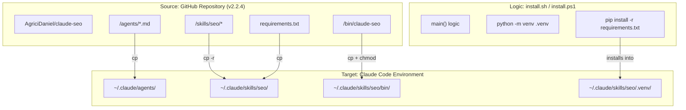

**Sources:** [install.sh:39-81, 176-180](), [install.ps1:142-198]()

### Component Association

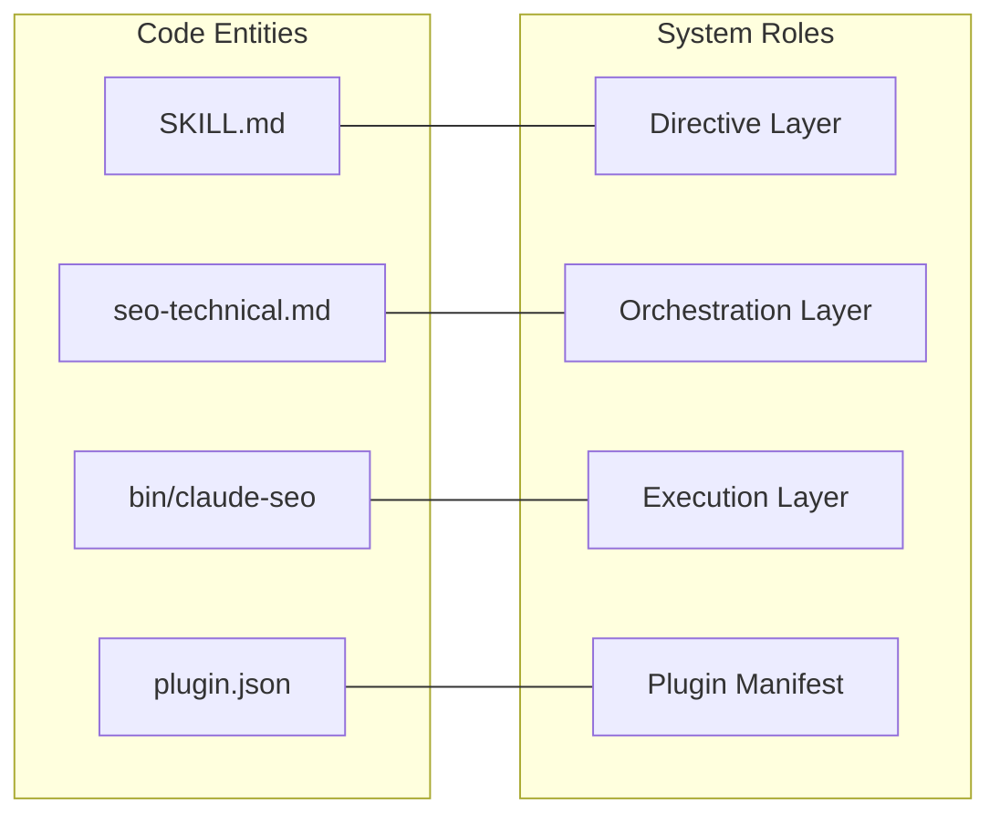

**Sources:** [docs/ARCHITECTURE.md:66-98](), [install.sh:77-81, 128]()

---

## Extension and MCP Setup

The system supports modular extensions (e.g., DataForSEO, Banana) which are installed into the same skill/agent structure.

### Extension Distribution
The `install.sh` script iterates through the `/extensions` directory, copying extension-specific skills, agents, and scripts to the respective Claude directories [install.sh:94-124]().

### MCP Registration
Manual installers copy hook files (e.g., `hooks/validate-schema.py`), but enforcement requires a plugin install which loads the hooks through the plugin manifest [install.sh:89-91](). MCP server registration for extensions typically involves adding entries to `~/.claude/settings.json`.

**Sources:** [install.sh:84-124](), [docs/INSTALLATION.md:24-26]()

---

## Uninstallation

To remove the system, dedicated uninstallation scripts are provided. They use glob enumeration to ensure all `seo-*` sub-skills and agents are removed.

*   **Unix**: `uninstall.sh` removes `~/.claude/skills/seo`, all `seo-*` sub-skills, and `seo-*.md` agent files [uninstall.sh:28-51]().
*   **Windows**: `uninstall.ps1` performs the same cleanup using `Remove-Item -Recurse -Force` [uninstall.ps1:31-55]().

If installed as a plugin, users should use the native command:
```bash
/plugin uninstall claude-seo@agricidaniel-claude-seo
```

**Sources:** [uninstall.sh:1-64](), [uninstall.ps1:1-69](), [docs/INSTALLATION.md:109-126]()

---

# Page: Configuration

# Configuration

<details>
<summary>Relevant source files</summary>

The following files were used as context for generating this wiki page:

- [.github/CODEOWNERS](.github/CODEOWNERS)
- [.github/dependabot.yml](.github/dependabot.yml)
- [.github/workflows/v2.yml](.github/workflows/v2.yml)
- [.gitignore](.gitignore)
- [CODE_OF_CONDUCT.md](CODE_OF_CONDUCT.md)
- [SECURITY.md](SECURITY.md)
- [docs/MCP-INTEGRATION.md](docs/MCP-INTEGRATION.md)
- [extensions/banana/scripts/edit.py](extensions/banana/scripts/edit.py)
- [extensions/banana/scripts/generate.py](extensions/banana/scripts/generate.py)
- [scripts/google_auth.py](scripts/google_auth.py)
- [scripts/render_page.py](scripts/render_page.py)
- [scripts/url_safety.py](scripts/url_safety.py)
- [skills/seo-flow/references/flow-framework.md](skills/seo-flow/references/flow-framework.md)
- [skills/seo-google/references/auth-setup.md](skills/seo-google/references/auth-setup.md)
- [skills/seo-google/references/nlp-api.md](skills/seo-google/references/nlp-api.md)
- [skills/seo-google/references/pagespeed-crux-api.md](skills/seo-google/references/pagespeed-crux-api.md)
- [skills/seo/references/cwv-thresholds.md](skills/seo/references/cwv-thresholds.md)
- [tests/test_url_safety.py](tests/test_url_safety.py)

</details>


This document explains how to configure `claude-seo` to work with external data sources, Model Context Protocol (MCP) servers, and API integrations. The system manages credentials through a multi-tier storage model, primarily using `~/.config/claude-seo/` for local configuration and `~/.claude/settings.json` for MCP registration.

---

## Configuration Architecture

The configuration is split into three functional layers: credential storage, environment variable overrides, and MCP server registration.

### Credential Storage Model
The system centralizes SEO-specific credentials in the user's home directory to avoid project-level leaks.
*   **Google APIs**: Managed by `google_auth.py`, configuration stored in `~/.config/claude-seo/google-api.json`. [scripts/google_auth.py:26-26]()
*   **OAuth Tokens**: Securely stored with `0o600` permissions in `~/.config/claude-seo/oauth-token.json`. The system automatically remediates legacy `0o644` permissions on load. [scripts/google_auth.py:27-27](), [scripts/google_auth.py:200-209]()
*   **Backlink APIs**: Managed by `backlinks_auth.py`, stored in `~/.config/claude-seo/backlinks-api.json`. [scripts/SECURITY.md:73-73]()

### Data Flow Diagram
This diagram shows how the `google_auth.py` and `url_safety.py` modules bridge the gap between physical configuration files and the execution logic used by subagents.

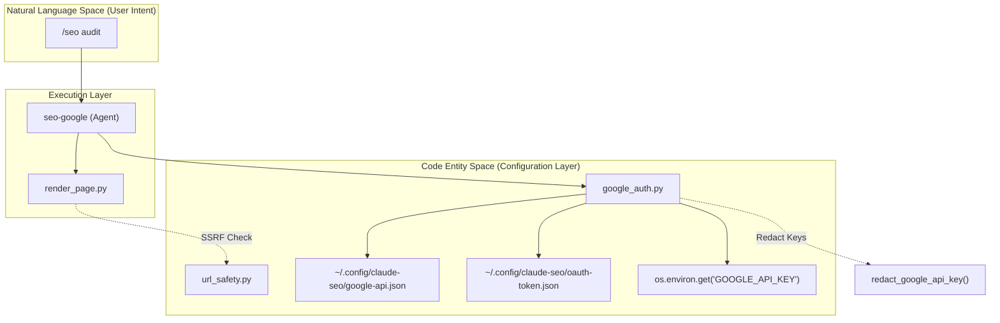
**Sources**: [scripts/google_auth.py:26-27](), [scripts/google_auth.py:92-132](), [scripts/url_safety.py:9-37](), [scripts/render_page.py:97-106]()

---

## Google API Configuration

The `google_auth.py` script handles authentication for Google Search Console (GSC), PageSpeed Insights (PSI), Chrome UX Report (CrUX), and GA4.

### Supported Credential Tiers
The system detects the "tier" of access based on available configuration:
*   **Tier 0**: No credentials. Only public HTML analysis via `render_page.py`. [docs/MCP-INTEGRATION.md:142-152]()
*   **Tier 1**: API Key only. Used for PageSpeed Insights and CrUX. [scripts/google_auth.py:38-41]()
*   **Tier 2**: Service Account or OAuth. Required for GSC, Indexing API, and GA4. [scripts/google_auth.py:42-45]()

### Setup via CLI
Users can configure Google credentials using the built-in setup command:
```bash
python scripts/google_auth.py --setup
```
[scripts/google_auth.py:13-13]()

### Manual Config File (`google-api.json`)
The file structure at `~/.config/claude-seo/google-api.json` supports:
```json
{
  "service_account_path": "~/path/to/sa.json",
  "api_key": "AIza...",
  "default_property": "https://example.com/",
  "ga4_property_id": "123456789"
}
```
[scripts/google_auth.py:103-108]()

**Sources**: [scripts/google_auth.py:29-62](), [scripts/google_auth.py:92-132](), [docs/MCP-INTEGRATION.md:9-22]()

---

## MCP Server Registration

`claude-seo` integrates with external tools via the Model Context Protocol. These are registered in the Claude Code `settings.json` file.

### Registration Mapping
The following table maps system requirements to specific MCP server configurations.

| Integration | Command | Required Env Vars |
| :--- | :--- | :--- |
| **Search Console** | `npx -y mcp-server-gsc` | `GOOGLE_CREDENTIALS_PATH` |
| **PageSpeed** | `npx -y mcp-server-pagespeed` | `PAGESPEED_API_KEY` |
| **Ahrefs** | `npx -y @ahrefs/mcp` | `AHREFS_API_TOKEN` |
| **DataForSEO** | `dataforseo-mcp-server` | `DATAFORSEO_LOGIN`, `DATAFORSEO_PASSWORD` |

**Sources**: [docs/MCP-INTEGRATION.md:30-42](), [docs/MCP-INTEGRATION.md:52-62](), [docs/MCP-INTEGRATION.md:64-77]()

---

## Security & URL Safety

A critical part of the configuration is the `url_safety.py` module, which enforces SSRF protection and DNS-rebinding mitigation for all network requests.

### Safety Mechanisms
*   **Hostname Normalization**: Collapses FQDN trailing dots and glibc-friendly IPv4 obfuscation (hex/octal/decimal) to prevent bypasses. [scripts/url_safety.py:105-121](), [tests/test_url_safety.py:36-59]()
*   **Strict Validation**: Resolves hostnames via `socket.getaddrinfo` and checks every returned IP against private/reserved ranges. [scripts/url_safety.py:19-25]()
*   **DNS Pinning**: The `safe_requests_get` function uses a DNS-pinning context manager to prevent "Time of Check to Time of Use" (TOCTOU) attacks. [scripts/url_safety.py:27-32]()
*   **Browser Safety**: For Playwright-based fetches in `render_page.py`, a `route()` handler intercepts subresource requests to block private IP resolutions inside Chromium. [scripts/render_page.py:48-56](), [scripts/url_safety.py:101-102]()

### System Safety Diagram
This diagram illustrates how the `URLSafetyError` and `validate_url_strict` functions protect the configuration and execution layer from malicious inputs.

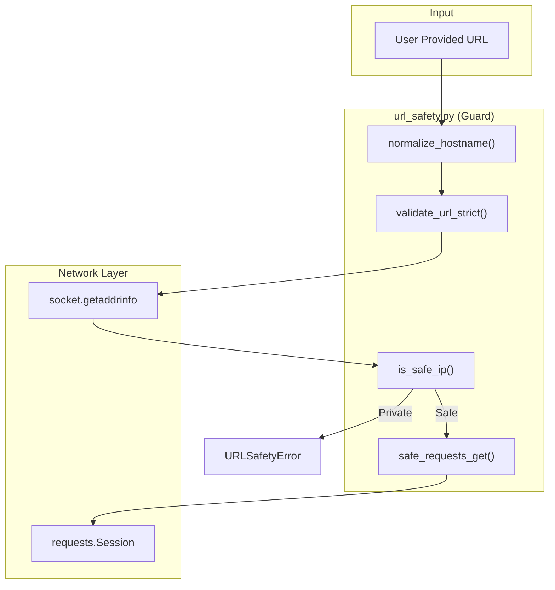
**Sources**: [scripts/url_safety.py:151-182](), [scripts/url_safety.py:183-190](), [tests/test_url_safety.py:125-148]()

---

## Extension Configuration (Claude Banana)

For image generation and editing tasks, the `banana` extension uses the Gemini REST API as a fallback when MCP is unavailable.

### API Configuration
These scripts use environment variables for authentication:
*   `GOOGLE_AI_API_KEY` or `GOOGLE_API_KEY`: The API key for Gemini. [extensions/banana/scripts/generate.py:155-158]()
*   `NANOBANANA_MODEL`: The default model ID (e.g., `gemini-2.0-flash`). [extensions/banana/scripts/generate.py:22-22]()

### Output Management
Generated images are stored in `~/Documents/nanobanana_generated`. [extensions/banana/scripts/generate.py:25-25]()

**Sources**: [extensions/banana/scripts/generate.py:22-30](), [extensions/banana/scripts/edit.py:22-28]()

---

# Page: Quick Start Guide

# Quick Start Guide

<details>
<summary>Relevant source files</summary>

The following files were used as context for generating this wiki page:

- [docs/ARCHITECTURE.md](docs/ARCHITECTURE.md)
- [docs/COMMANDS.md](docs/COMMANDS.md)
- [docs/INSTALLATION.md](docs/INSTALLATION.md)
- [docs/TROUBLESHOOTING.md](docs/TROUBLESHOOTING.md)
- [skills/seo-audit/SKILL.md](skills/seo-audit/SKILL.md)
- [skills/seo-cluster/SKILL.md](skills/seo-cluster/SKILL.md)
- [skills/seo-drift/SKILL.md](skills/seo-drift/SKILL.md)
- [skills/seo-ecommerce/SKILL.md](skills/seo-ecommerce/SKILL.md)
- [skills/seo-flow/SKILL.md](skills/seo-flow/SKILL.md)
- [skills/seo-sxo/SKILL.md](skills/seo-sxo/SKILL.md)
- [uninstall.ps1](uninstall.ps1)
- [uninstall.sh](uninstall.sh)

</details>


This guide provides step-by-step walkthroughs of the most common SEO analysis workflows in `claude-seo`. It covers practical examples from initial setup verification through running your first analyses and interpreting results.

For detailed command parameters and options, see [Command Reference](). For installation procedures, see [Installation](). For configuration of external integrations, see [Configuration]().

---

## Prerequisites Verification

Before running SEO analyses, verify your installation is functional:

```bash
# Start Claude Code CLI
claude

# Verify the main SEO skill is loaded
/seo
```

The system is a multi-skill architecture composed of 25 sub-skills and 18 specialist agents across technical SEO, content quality, and strategic planning. [docs/ARCHITECTURE.md:5-9](). Use the `/seo doctor` command to verify the runtime environment, dependencies, and Chromium readiness without altering the system. [docs/COMMANDS.md:15-18]().

**Sources:** [docs/ARCHITECTURE.md:5-9](), [docs/COMMANDS.md:15-18](), [docs/INSTALLATION.md:93-107]()

---

## Workflow 1: Full Site Audit

The `/seo audit` command performs a comprehensive website audit by spawning up to 15 specialist subagents in parallel (8 always-on + 7 conditional). [skills/seo-audit/SKILL.md:3-5]().

### Basic Usage

```bash
/seo audit https://example.com
```

### Execution Flow and Data Orchestration

The orchestrator identifies the business type from homepage signals (SaaS, Local, Ecommerce, Publisher, Agency) and tailors the analysis by conditionally spawning relevant subagents. [skills/seo-audit/SKILL.md:18-35]().

**Diagram: /seo audit Orchestration Flow**
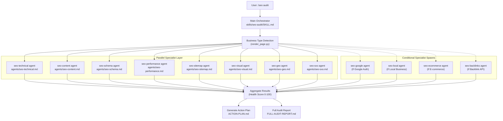

### Expected Output Structure

The audit produces artifacts under a `{domain}-audit/` directory: [skills/seo-audit/SKILL.md:37-38]().
1. **`FULL-AUDIT-REPORT.md`**: Comprehensive findings across all categories. [skills/seo-audit/SKILL.md:53]().
2. **`ACTION-PLAN.md`**: Prioritized recommendations (Critical > High > Medium > Low). [skills/seo-audit/SKILL.md:54]().
3. **`audit-data.json`**: Structured data envelope for report generation. [skills/seo-audit/SKILL.md:55]().
4. **`findings/*.md`**: Per-category specialist findings (e.g., `technical.md`, `content.md`). [skills/seo-audit/SKILL.md:56]().

**Sources:** [skills/seo-audit/SKILL.md:3-58](), [docs/COMMANDS.md:20-40](), [docs/ARCHITECTURE.md:105-146]()

---

## Workflow 2: Single Page Deep Analysis

For detailed analysis of one specific page, use `/seo page`. This command evaluates on-page elements, content quality, and technical health for a single URL. [docs/COMMANDS.md:43-59]().

### Basic Usage

```bash
/seo page https://example.com/about
```

### What Gets Analyzed

| Category | Specific Checks |
|----------|-----------------|
| **On-Page** | Title tags, meta descriptions, heading structure, URL patterns. [docs/COMMANDS.md:53]() |
| **Content** | Word count, readability, E-E-A-T (Experience, Expertise, Authoritativeness, Trustworthiness). [docs/COMMANDS.md:54]() |
| **Technical** | Canonical tags, robots directives, Open Graph tags. [docs/COMMANDS.md:55]() |
| **Schema** | Detection of JSON-LD, Microdata, and RDFa. [docs/COMMANDS.md:56]() |
| **Images** | Alt text, file sizes, formats, and CLS prevention. [docs/COMMANDS.md:57]() |

**Sources:** [docs/COMMANDS.md:43-59]()

---

## Workflow 3: Schema Markup Management

The `/seo schema` command handles detection, validation, and generation of structured data. [docs/COMMANDS.md:121-136]().

### Detection and Validation

```bash
/seo schema https://example.com
```

The system detects existing schema and validates it against Google's requirements, identifying missing opportunities for rich snippets. [docs/COMMANDS.md:131-133]().

### Generation Example

The system can generate ready-to-use JSON-LD. For e-commerce sites, the `seo-ecommerce` sub-skill provides specialized product schema validation and enhancement. [skills/seo-ecommerce/SKILL.md:34]().

```bash
# Example: Generate product schema for an e-commerce page
/seo ecommerce schema https://example.com/product-p
```

**Sources:** [docs/COMMANDS.md:121-136](), [skills/seo-ecommerce/SKILL.md:21-35]()

---

## Workflow 4: AI Search Optimization (GEO)

The `/seo geo` command focuses on "Generative Engine Optimization," ensuring content is optimized for AI search engines like Perplexity, ChatGPT, and Google AI Overviews. [docs/COMMANDS.md:138-154]().

### Analysis Metrics

**Diagram: GEO Analysis Data Flow**
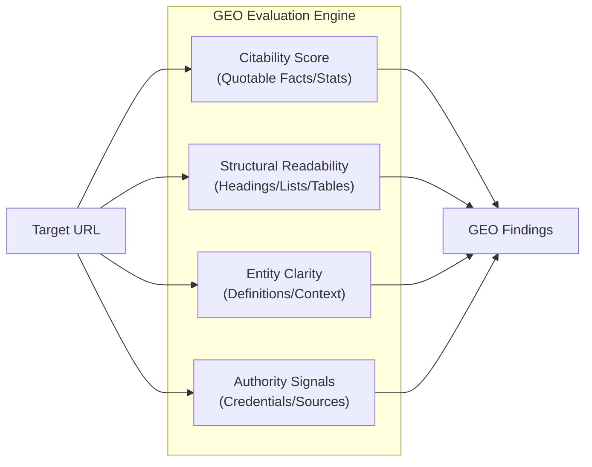

**Key Optimization Points:**
- **Citability**: Measures how easily AI models can extract and cite facts from the content. [docs/COMMANDS.md:148]().
- **Structural Readability**: Enforces use of headings, lists, and tables for generative parsing. [docs/COMMANDS.md:149]().

**Sources:** [docs/COMMANDS.md:138-154](), [skills/seo-audit/SKILL.md:27](), [skills/seo-flow/SKILL.md:68]()

---

## Workflow 5: SEO Drift Monitoring

The `seo-drift` skill acts as "Git for SEO," capturing baselines and detecting regressions. [skills/seo-drift/SKILL.md:3-8]().

### Pre/Post Deployment Check

```bash
# 1. Capture "known good" state before a change
/seo drift baseline https://example.com

# 2. After deployment, compare current state to baseline
/seo drift compare https://example.com
```

The comparison engine applies 17 rules across 3 severity levels (Critical, Warning, Info) to detect changes in titles, meta tags, schema, and Core Web Vitals. [skills/seo-drift/SKILL.md:57-70]().

**Sources:** [skills/seo-drift/SKILL.md:3-215]()

---

## Common CLI Operations Summary

| Command | Use Case | Primary Output |
|---------|----------|----------------|
| `/seo audit <url>` | Full site health check | `FULL-AUDIT-REPORT.md` |
| `/seo page <url>` | Deep single-page analysis | Terminal Analysis |
| `/seo cluster plan <seed>` | Topic clustering & architecture | `cluster-map.html` |
| `/seo sxo <url> <keyword>` | Search Experience / Intent check | `SXO-ANALYSIS.md` |
| `/seo drift compare <url>` | Detect SEO regressions | JSON Diff / HTML Report |
| `/seo flow` | Framework-led SEO prompts | Stage-specific prompts |

**Sources:** [docs/COMMANDS.md:1-303](), [skills/seo-cluster/SKILL.md:32-40](), [skills/seo-sxo/SKILL.md:33-41](), [skills/seo-flow/SKILL.md:31-43]()

---

# Page: Command Reference

# Command Reference

<details>
<summary>Relevant source files</summary>

The following files were used as context for generating this wiki page:

- [docs/ARCHITECTURE.md](docs/ARCHITECTURE.md)
- [docs/COMMANDS.md](docs/COMMANDS.md)
- [docs/INSTALLATION.md](docs/INSTALLATION.md)
- [docs/TROUBLESHOOTING.md](docs/TROUBLESHOOTING.md)
- [extensions/firecrawl/skills/seo-firecrawl/SKILL.md](extensions/firecrawl/skills/seo-firecrawl/SKILL.md)
- [skills/seo-backlinks/SKILL.md](skills/seo-backlinks/SKILL.md)
- [skills/seo/SKILL.md](skills/seo/SKILL.md)
- [uninstall.ps1](uninstall.ps1)
- [uninstall.sh](uninstall.sh)

</details>


This document provides a comprehensive reference for all `/seo` commands available in the `claude-seo` system. It covers command syntax, parameters, use cases, and execution behavior. For detailed implementation documentation of specific analysis types, see [Full Site Audit](#3.1), [Individual Analysis Commands](#3.2), and [Strategic Planning Commands](#3.3). For system architecture details, see [System Architecture](#4).

## Command Structure

All commands follow the pattern `/seo <subcommand> [parameters]` and are invoked within the Claude Code CLI environment. Commands are parsed by the main orchestration skill and routed to specialized sub-skills or spawned as parallel subagents depending on the command type.

**Invocation Context:**
```bash
claude                    # Start Claude Code CLI
/seo audit example.com    # Execute command
```

Commands are defined in the main skill manifest at [skills/seo/SKILL.md:29-59]() and orchestration logic determines routing behavior based on the subcommand.

Sources: [docs/COMMANDS.md:1-7](), [skills/seo/SKILL.md:13-25]()

## Command Routing Architecture

The following diagram bridges the natural language commands to the specific code entities (skills and agents) responsible for their execution.

**System Routing Map**
```mermaid
graph TB
    CLI["Claude Code CLI"]
    MainSkill["seo orchestrator<br/>skills/seo/SKILL.md"]
    Router["Orchestration Logic"]
    
    subgraph "Direct Sub-Skill Routing"
        SSPage["seo-page<br/>skills/seo-page/SKILL.md"]
        SSTechnical["seo-technical<br/>skills/seo-technical/SKILL.md"]
        SSContent["seo-content<br/>skills/seo-content/SKILL.md"]
        SSSchema["seo-schema<br/>skills/seo-schema/SKILL.md"]
        SSImages["seo-images<br/>skills/seo-images/SKILL.md"]
        SSSitemap["seo-sitemap<br/>skills/seo-sitemap/SKILL.md"]
        SSGEO["seo-geo<br/>skills/seo-geo/SKILL.md"]
        SSPlan["seo-plan<br/>skills/seo-plan/SKILL.md"]
        SSBacklinks["seo-backlinks<br/>skills/seo-backlinks/SKILL.md"]
    end
    
    subgraph "Parallel Subagent Delegation"
        SSAudit["seo-audit<br/>skills/seo-audit/SKILL.md"]
        SA1["seo-technical.md agent"]
        SA2["seo-content.md agent"]
        SA3["seo-schema.md agent"]
        SA4["seo-performance.md agent"]
        SA5["seo-visual.md agent"]
        SA6["seo-geo.md agent"]
    end
    
    CLI -->|"/seo <subcommand>"| MainSkill
    MainSkill --> Router
    
    Router -->|"/seo page"| SSPage
    Router -->|"/seo technical"| SSTechnical
    Router -->|"/seo content"| SSContent
    Router -->|"/seo schema"| SSSchema
    Router -->|"/seo images"| SSImages
    Router -->|"/seo sitemap"| SSSitemap
    Router -->|"/seo geo"| SSGEO
    Router -->|"/seo plan"| SSPlan
    Router -->|"/seo backlinks"| SSBacklinks
    
    Router -->|"/seo audit"| SSAudit
    SSAudit -->|"spawn subagents"| SA1
    SSAudit -->|"spawn subagents"| SA2
    SSAudit -->|"spawn subagents"| SA3
    SSAudit -->|"spawn subagents"| SA4
    SSAudit -->|"spawn subagents"| SA5
    SSAudit -->|"spawn subagents"| SA6
    
    SSAudit --> Report["Unified Report<br/>Health Score: 0-100"]
```

**Command Routing Behavior:**

The router at [skills/seo/SKILL.md:70-91]() implements two execution patterns:

1. **Direct Routing**: Single commands (`/seo page`, `/seo technical`, etc.) route directly to their corresponding sub-skill for synchronous execution [skills/seo/SKILL.md:89]().
2. **Parallel Delegation**: The `/seo audit` command triggers the orchestration logic to spawn up to 15 specialist agents simultaneously [skills/seo/SKILL.md:72-83]().

Sources: [skills/seo/SKILL.md:70-91](), [docs/ARCHITECTURE.md:103-146]()

## Command Categories

Commands are organized into functional categories:

| Category | Commands | Purpose |
|----------|----------|---------|
| **Full Site Analysis** | `audit`, `firecrawl crawl` | Comprehensive multi-dimensional site audit or deep site-wide crawling. |
| **Individual Analysis** | `page`, `technical`, `content`, `schema`, `images`, `sitemap`, `geo`, `backlinks`, `local`, `maps` | Focused analysis of specific SEO dimensions on target URLs or local search presence. |
| **Strategic Planning** | `plan`, `programmatic`, `competitor-pages`, `hreflang`, `cluster`, `drift`, `flow` | Content strategy, scaled generation, internationalization, and search experience optimization. |

Sources: [skills/seo/SKILL.md:29-59](), [docs/COMMANDS.md:7-300]()

## Full Command Reference

### `/seo audit <url>`

Executes a comprehensive website audit across all SEO dimensions using parallel subagent delegation.

**Syntax:**
```bash
/seo audit https://example.com
```

**Execution Flow:**
1. **Business Detection**: Identifies type (SaaS, Local, Ecommerce, Publisher, Agency) from homepage signals [skills/seo/SKILL.md:73]().
2. **Parallel Spawning**: Spawns core agents: `seo-technical`, `seo-content`, `seo-schema`, `seo-sitemap`, `seo-performance`, `seo-visual`, `seo-geo` [skills/seo/SKILL.md:74]().
3. **Conditional Spawning**: Spawns `seo-google` (if credentials detected), `seo-local` (if local business), `seo-backlinks` (if APIs available), or `seo-ecommerce` (if store detected) [skills/seo/SKILL.md:75-81]().
4. **Aggregation**: Collects results and generates a unified report with an SEO Health Score (0-100) [skills/seo/SKILL.md:84]().

**Output Components:**
- `FULL-AUDIT-REPORT.md`: Comprehensive findings [docs/COMMANDS.md:37]().
- `ACTION-PLAN.md`: Prioritized task list with dependency sequencing [docs/COMMANDS.md:38]().
- Optional PDF report: Generated via `scripts/google_report.py` [skills/seo/SKILL.md:90]().

For detailed audit implementation, see [Full Site Audit](#3.1).

Sources: [skills/seo/SKILL.md:70-91](), [docs/COMMANDS.md:20-40]()

### `/seo page <url>`

Performs deep single-page analysis across all SEO dimensions including on-page elements, E-E-A-T, and images.

**Syntax:**
```bash
/seo page https://example.com/about
```

Routes to `skills/seo-page/SKILL.md`. Analyzes metadata, headings, content quality, technical tags, and images [docs/COMMANDS.md:52-58]().

Sources: [docs/COMMANDS.md:43-60](), [skills/seo/SKILL.md:32]()

### `/seo technical <url>`

Executes technical SEO audit across 9 categories including crawlability, indexability, security, and Core Web Vitals.

**Syntax:**
```bash
/seo technical https://example.com
```

**Audit Categories:**
1. Crawlability & Indexability
2. Security & URL Structure
3. Mobile Optimization
4. Core Web Vitals (LCP, INP, CLS)
5. JavaScript Rendering
6. IndexNow Protocol

For detailed technical analysis documentation, see [Technical SEO Analysis](#5).

Sources: [docs/COMMANDS.md:62-82](), [skills/seo/SKILL.md:36]()

### `/seo content <url>`

Analyzes content quality using the E-E-A-T framework and September 2025 Quality Rater Guidelines.

**Syntax:**
```bash
/seo content https://example.com/blog/post
```

**Analysis Dimensions:**
- **Experience**: First-hand knowledge signals [docs/COMMANDS.md:94]().
- **Expertise**: Author credentials and depth [docs/COMMANDS.md:95]().
- **Authoritativeness**: External recognition [docs/COMMANDS.md:96]().
- **Trustworthiness**: Transparency and security [docs/COMMANDS.md:97]().
- **AI Citation Readiness**: Passage-level factual density for AI overviews [docs/COMMANDS.md:98]().

For complete E-E-A-T documentation, see [Content Quality & E-E-A-T](#6).

Sources: [docs/COMMANDS.md:84-101](), [skills/seo/SKILL.md:37]()

### `/seo schema <url>`

Detects existing markup, validates against Google's requirements, and generates ready-to-use JSON-LD.

**Syntax:**
```bash
/seo schema https://example.com
```

**Capabilities:**
- Detects JSON-LD, Microdata, and RDFa [docs/COMMANDS.md:131]().
- Validates against Google's rich result requirements [docs/COMMANDS.md:132]().
- Identifies missing opportunities and generates JSON-LD [docs/COMMANDS.md:133-134]().

For complete schema documentation, see [Schema Markup Management](#7).

Sources: [docs/COMMANDS.md:121-136](), [skills/seo/SKILL.md:34]()

### `/seo geo <url>`

Optimizes content for AI-powered search engines (Generative Engine Optimization) such as ChatGPT, Perplexity, and Google AI Overviews.

**Syntax:**
```bash
/seo geo https://example.com
```

**Metrics:**
- **Citability Score**: Evaluates quotable facts and statistics [docs/COMMANDS.md:148]().
- **Structural Readability**: Headings, lists, and tables analysis [docs/COMMANDS.md:149]().

Sources: [docs/COMMANDS.md:138-154](), [skills/seo/SKILL.md:39]()

### `/seo backlinks <url>`

Analyzes backlink profile using a 3-tier data cascade: free (Common Crawl), free with signup (Moz, Bing), and premium (DataForSEO extension) [skills/seo-backlinks/SKILL.md:18-26]().

**Syntax:**
```bash
/seo backlinks https://example.com
/seo backlinks gap <url1> <url2>
/seo backlinks toxic <url>
```

Sources: [skills/seo-backlinks/SKILL.md:1-42](), [skills/seo/SKILL.md:47]()

## Command Execution Flow

The following diagram bridges the "Natural Language" intent to the "Code Entity" space by showing how a command flows through specific scripts and agents.

**Command Execution Pipeline**
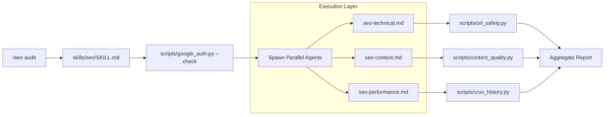

Sources: [skills/seo/SKILL.md:70-91](), [docs/ARCHITECTURE.md:103-146]()

## Quality Gates and Enforcement

The system enforces hard content thresholds and policy-aligned rules during command execution to prevent scaled content abuse.

| Threshold / Rule | Action | Source |
|------------------|--------|--------|
| 30+ location pages | WARNING (60% unique required) | [docs/COMMANDS.md:208]() |
| 50+ location pages | HARD STOP (Justification required) | [docs/COMMANDS.md:208]() |
| HowTo Schema | Never recommend (Deprecated) | [docs/TROUBLESHOOTING.md:175]() |
| FAQ Schema | Retired for all sites (2026-05-07) | [docs/TROUBLESHOOTING.md:176]() |
| FID Metric | Replace with INP (interaction to next paint) | [docs/COMMANDS.md:77]() |

Sources: [docs/COMMANDS.md:205-212](), [docs/TROUBLESHOOTING.md:167-179]()

---

# Page: Full Site Audit

# Full Site Audit

<details>
<summary>Relevant source files</summary>

The following files were used as context for generating this wiki page:

- [agents/seo-content.md](agents/seo-content.md)
- [agents/seo-ecommerce.md](agents/seo-ecommerce.md)
- [agents/seo-performance.md](agents/seo-performance.md)
- [agents/seo-schema.md](agents/seo-schema.md)
- [agents/seo-sxo.md](agents/seo-sxo.md)
- [agents/seo-technical.md](agents/seo-technical.md)
- [agents/seo-visual.md](agents/seo-visual.md)
- [scripts/google_report.py](scripts/google_report.py)
- [skills/seo-audit/SKILL.md](skills/seo-audit/SKILL.md)
- [skills/seo-cluster/SKILL.md](skills/seo-cluster/SKILL.md)
- [skills/seo-drift/SKILL.md](skills/seo-drift/SKILL.md)
- [skills/seo-ecommerce/SKILL.md](skills/seo-ecommerce/SKILL.md)
- [skills/seo-flow/SKILL.md](skills/seo-flow/SKILL.md)
- [skills/seo-sxo/SKILL.md](skills/seo-sxo/SKILL.md)
- [tests/test_audit_instructions.py](tests/test_audit_instructions.py)

</details>


The Full Site Audit is the primary analysis command in the `claude-seo` system, accessible via `/seo audit <url>`. It performs a comprehensive website evaluation by spawning up to 15 parallel subagents (8 core specialists and up to 7 conditional specialists) that analyze different aspects of SEO simultaneously. The process aggregates findings into a unified report with an overall health score and a prioritized action plan.

---

## Command Invocation and Routing

The audit command follows a specific routing path from user invocation through to execution:

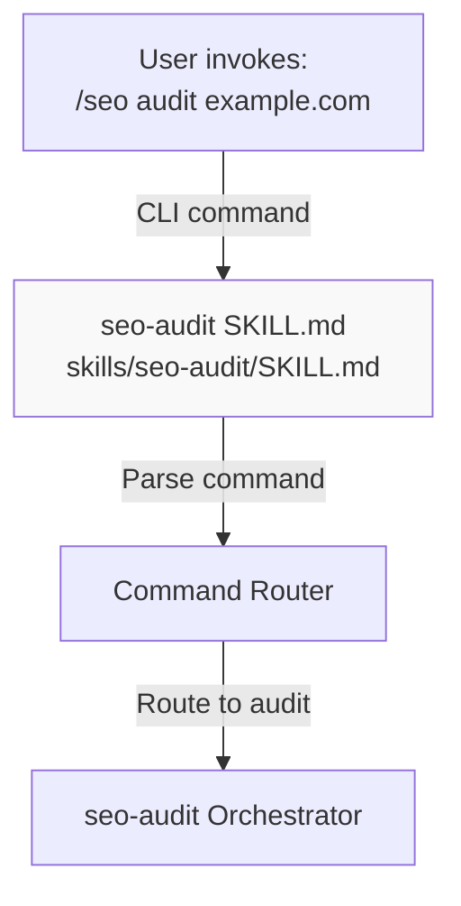

**Sources:** [skills/seo-audit/SKILL.md:1-11](), [skills/seo-audit/SKILL.md:13-20]()

When invoked, the command:
1. User executes `/seo audit <url>` in Claude Code CLI [skills/seo-audit/SKILL.md:4-5]().
2. The `seo-audit` skill at `skills/seo-audit/SKILL.md` receives the command [skills/seo-audit/SKILL.md:2-3]().
3. The system initiates the process by rendering the homepage using `claude-seo run render_page.py <url> --mode auto --json` to capture raw/rendered HTML and SPA status [skills/seo-audit/SKILL.md:17]().

---

## Business Type Detection and Crawl Phase

Before spawning subagents, the system detects the website's business type to tailor analysis and begins a controlled crawl:

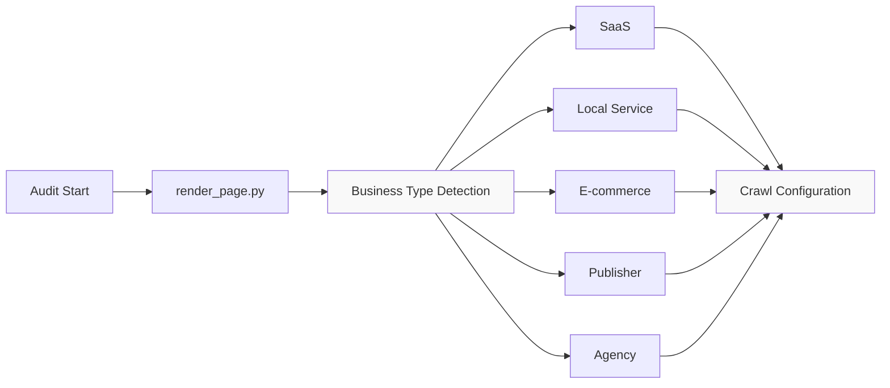

**Sources:** [skills/seo-audit/SKILL.md:17-19](), [skills/seo-audit/SKILL.md:35](), [agents/seo-ecommerce.md:6]()

### Crawl Configuration
The audit implements a strict crawl policy to ensure performance and respect site resources:
*   **Max pages:** 500 [skills/seo-audit/SKILL.md:43]().
*   **Delay between requests:** 1 second [skills/seo-audit/SKILL.md:48]().
*   **Concurrent requests:** 5 [skills/seo-audit/SKILL.md:47]().
*   **Timeout per page:** 30 seconds [skills/seo-audit/SKILL.md:46]().
*   **Respect robots.txt:** Yes [skills/seo-audit/SKILL.md:44]().

---

## Parallel Subagent Execution

The audit architecture spawns specialized subagents concurrently. Some are always active, while others are spawned conditionally based on business type, content signals, or credential availability.

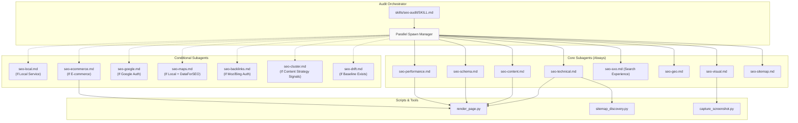

**Sources:** [skills/seo-audit/SKILL.md:20-35](), [agents/seo-technical.md:58](), [agents/seo-content.md:70](), [agents/seo-visual.md:29-34]()

### Specialist Roles
| Subagent | Conditional Trigger | Key Responsibilities |
|----------|---------------------|----------------------|
| `seo-technical` | Always | robots.txt, sitemaps, canonicals, security headers [skills/seo-audit/SKILL.md:21](). |
| `seo-content` | Always | E-E-A-T, readability, thin content, AI citation readiness [skills/seo-audit/SKILL.md:22](). |
| `seo-schema` | Always | Detection, validation, JSON-LD recommendations [skills/seo-audit/SKILL.md:23](). |
| `seo-performance`| Always | LCP, INP, CLS measurements [skills/seo-audit/SKILL.md:25](). |
| `seo-sxo` | Always | Search experience analysis: page-type mismatch, user stories [skills/seo-audit/SKILL.md:33](). |
| `seo-geo` | Always | AI crawler access, llms.txt, citability, brand mention signals [skills/seo-audit/SKILL.md:27](). |
| `seo-local` | Business = Local | GBP signals, NAP consistency, local schema [skills/seo-audit/SKILL.md:28](). |
| `seo-ecommerce` | Business = E-commerce | Product schema, marketplace intelligence [skills/seo-audit/SKILL.md:35](). |
| `seo-maps` | Local + DataForSEO | Geo-grid rank tracking, competitor radius mapping [skills/seo-audit/SKILL.md:29](). |
| `seo-google` | Google Credentials | CrUX field data, GSC indexation, GA4 traffic [skills/seo-audit/SKILL.md:30](). |
| `seo-cluster` | Content Signals | Semantic topic clustering analysis [skills/seo-audit/SKILL.md:32](). |

---

## Scoring Methodology

The audit calculates an overall SEO Health Score (0-100) as a weighted aggregate of individual category findings.

| Category | Weight |
|----------|--------|
| Content Quality | 23% |
| Technical SEO | 22% |
| On-Page SEO | 20% |
| Schema / Structured Data | 10% |
| Performance (CWV) | 10% |
| AI Search Readiness | 10% |
| Images | 5% |

**Sources:** [skills/seo-audit/SKILL.md:104-112]()

### Priority Definitions
*   **Critical**: Blocks indexing or causes penalties (fix immediately) [skills/seo-audit/SKILL.md:162]().
*   **High**: Significantly impacts rankings (fix within 1 week) [skills/seo-audit/SKILL.md:163]().
*   **Medium**: Optimization opportunity (fix within 1 month) [skills/seo-audit/SKILL.md:164]().
*   **Low**: Nice to have (backlog) [skills/seo-audit/SKILL.md:165]().

---

## Reporting Outputs

The audit generates three primary types of documentation and structured data artifacts:

1.  **`{domain}-audit/FULL-AUDIT-REPORT.md`**: Comprehensive technical findings across all categories [skills/seo-audit/SKILL.md:53]().
2.  **`{domain}-audit/ACTION-PLAN.md`**: Prioritized recommendations (Critical > High > Medium > Low) [skills/seo-audit/SKILL.md:54]().
3.  **`{domain}-audit/audit-data.json`**: A structured JSON envelope containing scores, summary, and action plan phases used for report generation [skills/seo-audit/SKILL.md:55](), [skills/seo-audit/SKILL.md:64-100]().
4.  **PDF Report**: A professional white-cover enterprise report generated via `claude-seo run google_report.py --type full`. It includes executive summaries, charts (Lighthouse gauges, query bars), and implementation roadmaps [skills/seo-audit/SKILL.md:58]().
5.  **`{domain}-audit/screenshots/`**: Desktop and mobile captures generated via Playwright [skills/seo-audit/SKILL.md:57]().

**Sources:** [skills/seo-audit/SKILL.md:51-58](), [skills/seo-audit/SKILL.md:64-100]()

---

## Data Integration Options

### DataForSEO Integration
If DataForSEO MCP tools are available, the system spawns the `seo-dataforseo` agent to enrich the audit with live SERP positions, backlink profiles with spam scores, and AI visibility checks (ChatGPT scraper/LLM mentions) [skills/seo-audit/SKILL.md:169]().

### Google API Integration
If credentials are configured, the `seo-performance` agent prioritizes CrUX field data (28-day Chrome user average) over Lighthouse lab data for Core Web Vitals assessment [agents/seo-performance.md:79-87]().

**Sources:** [skills/seo-audit/SKILL.md:169-171](), [agents/seo-performance.md:79-87]()

---

# Page: Individual Analysis Commands

# Individual Analysis Commands

<details>
<summary>Relevant source files</summary>

The following files were used as context for generating this wiki page:

- [skills/seo-competitor-pages/SKILL.md](skills/seo-competitor-pages/SKILL.md)
- [skills/seo-content/SKILL.md](skills/seo-content/SKILL.md)
- [skills/seo-geo/SKILL.md](skills/seo-geo/SKILL.md)
- [skills/seo-hreflang/SKILL.md](skills/seo-hreflang/SKILL.md)
- [skills/seo-image-gen/SKILL.md](skills/seo-image-gen/SKILL.md)
- [skills/seo-images/SKILL.md](skills/seo-images/SKILL.md)
- [skills/seo-local/SKILL.md](skills/seo-local/SKILL.md)
- [skills/seo-maps/SKILL.md](skills/seo-maps/SKILL.md)
- [skills/seo-page/SKILL.md](skills/seo-page/SKILL.md)
- [skills/seo-plan/SKILL.md](skills/seo-plan/SKILL.md)
- [skills/seo-programmatic/SKILL.md](skills/seo-programmatic/SKILL.md)
- [skills/seo-schema/SKILL.md](skills/seo-schema/SKILL.md)
- [skills/seo-sitemap/SKILL.md](skills/seo-sitemap/SKILL.md)
- [skills/seo-technical/SKILL.md](skills/seo-technical/SKILL.md)

</details>


This page documents the focused SEO analysis commands that target specific domains: technical infrastructure, content quality, schema markup, images, AI search optimization (GEO), sitemaps, and single-page deep dives. These commands route directly to specialized sub-skills and agents without the full parallel orchestration used by `/seo audit`.

---

## Command Routing and Execution Architecture

When an individual analysis command is invoked, the system uses a dispatcher model to route the request to the specific skill and agent responsible for that domain.

### System Entity Mapping

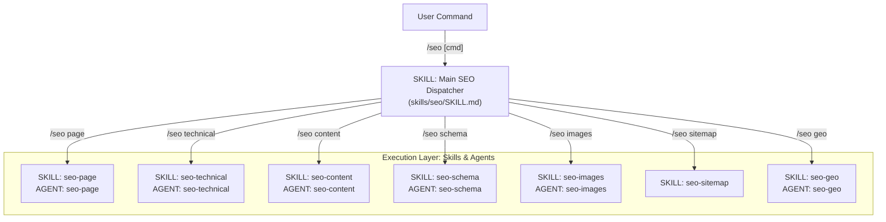

**Sources:** [skills/seo-page/SKILL.md:1-15](), [skills/seo-technical/SKILL.md:1-15](), [skills/seo-content/SKILL.md:1-14](), [skills/seo-schema/SKILL.md:1-14](), [skills/seo-geo/SKILL.md:1-18]()

---

## `/seo page` — Single-Page Deep Analysis

### Purpose
Performs a comprehensive audit of a single URL by aggregating checks from technical, content, schema, and image domains.

### Data Flow & Processing
The `seo-page` skill uses `python scripts/render_page.py` with `--mode auto` to retrieve content. It prioritizes:
1.  **On-Page SEO**: Title (50-60 chars), Meta Description (150-160 chars), H1 presence [skills/seo-page/SKILL.md:22-24]().
2.  **Content Quality**: Readability scoring (Flesch Reading Ease) and E-E-A-T signals [skills/seo-page/SKILL.md:30-35]().
3.  **Image Audit**: Reporting `lazy_method` (native, perfmatters, ewww, etc.) to avoid false negatives on JS-based lazy loaders [skills/seo-page/SKILL.md:55]().

**Sources:** [skills/seo-page/SKILL.md:17-61]()

---

## `/seo technical` — Technical SEO Audit

### Purpose
Audits 9 categories of technical infrastructure, including crawlability, security, and JavaScript rendering.

### Key Implementation Details
- **JS Rendering**: Detects CSR vs SSR. As of Dec 2025, it flags content that requires JS execution [skills/seo-technical/SKILL.md:28-30]().
- **Core Web Vitals**: LCP (target ≤2.5s) and INP (target ≤200ms). INP replaced FID as the primary interactivity metric in March 2024 [skills/seo-technical/SKILL.md:114-117]().
- **AI Crawler Management**: Checks `robots.txt` for tokens like `GPTBot`, `ClaudeBot`, and `Google-Extended` [skills/seo-technical/SKILL.md:34-49]().
- **Security**: Flags "Back-button hijacking" (spam policy violation) as a Critical issue [skills/seo-technical/SKILL.md:93-94]().

### Technical Data Flow

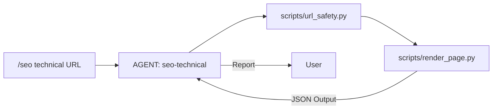

**Sources:** [skills/seo-technical/SKILL.md:17-135]()

---

## `/seo content` — E-E-A-T & Quality Analysis

### Purpose
Evaluates content based on Google’s September 2025 Quality Rater Guidelines (QRG).

### Evaluation Framework
- **The "Who/How/Why" Test**: Checks for visible bylines (Who), process disclosure for AI content (How), and people-first intent (Why) [skills/seo-content/SKILL.md:18-27]().
- **E-E-A-T Scoring**: Evaluates Experience (first-hand signals), Expertise, Authoritativeness, and Trustworthiness [skills/seo-content/SKILL.md:36-64]().
- **Topical Floors**: Enforces minimum word counts (e.g., 1,500 for blog posts) as coverage guidelines, not rigid ranking factors [skills/seo-content/SKILL.md:67-77]().
- **AI Citation Readiness**: Assesses clear, quotable statements and structured answers for AI search visibility [skills/seo-content/SKILL.md:139-156]().

**Sources:** [skills/seo-content/SKILL.md:16-156]()

---

## `/seo schema` — Structured Data Management

### Purpose
Detects, validates, and generates Schema.org markup in JSON-LD format.

### Rules and Deprecations (June 2026)
- **Active**: `Organization`, `LocalBusiness`, `Product` (with Certification markup), `DiscussionForumPosting` [skills/seo-schema/SKILL.md:42-43]().
- **Retired/Restricted**: `FAQPage` rich results were retired for ALL sites on May 7, 2026. `QAPage` is recommended for genuine Q&A [skills/seo-schema/SKILL.md:53-54]().
- **Deprecated**: `HowTo` (Sept 2023), `SpecialAnnouncement` (July 2025), and `Practice Problem` (Jan 2026) are no longer recommended [skills/seo-schema/SKILL.md:55-63]().

**Sources:** [skills/seo-schema/SKILL.md:16-173]()

---

## `/seo images` — Image Optimization

### Purpose
Analyzes image performance and SEO, focusing on formats, lazy loading, and CLS prevention.

### Technical Thresholds
- **Format Strategy**: Prefers AVIF (92%+ support) and WebP (97%+ support) over JPEG/PNG [skills/seo-images/SKILL.md:51-60]().
- **Performance**: Flags `loading="lazy"` on above-the-fold/hero images as a critical error that harms LCP [skills/seo-images/SKILL.md:132]().
- **Lazy Method Detection**: Differentiates between `native`, `perfmatters`, `ewww`, and `js-generic` loaders [skills/seo-images/SKILL.md:107-119]().
- **LCP Optimization**: Recommends `fetchpriority="high"` for hero images [skills/seo-images/SKILL.md:124-126]().

**Sources:** [skills/seo-images/SKILL.md:19-196]()

---

## `/seo geo` — AI Search Optimization

### Purpose
Optimizes for Generative Engine Optimization (GEO) and AI citation in platforms like ChatGPT, Perplexity, and Google AI Overviews.

### GEO Analysis Criteria
The `seo-geo` skill evaluates content across five dimensions [skills/seo-geo/SKILL.md:68-146]:
1.  **Citability Score (25%)**: Optimal passage length is **134-167 words**. Front-load answers in the first 30% of the page [skills/seo-geo/SKILL.md:70-74]().
2.  **Structural Readability (20%)**: Uses question-based headings and short paragraphs [skills/seo-geo/SKILL.md:90-100]().
3.  **Authority & Brand Signals (20%)**: Brand mentions correlate 3x more strongly with AI visibility than backlinks. Recency is critical (under 3 months) [skills/seo-geo/SKILL.md:51-62, 124]().
4.  **Technical Accessibility (20%)**: AI crawlers do NOT execute JavaScript; Server-Side Rendering (SSR) is critical [skills/seo-geo/SKILL.md:137-142]().
5.  **Multi-Modal Content (15%)**: Text combined with relevant images or video increases selection rates by 156% [skills/seo-geo/SKILL.md:108-117]().

**Sources:** [skills/seo-geo/SKILL.md:20-170]()

---

## `/seo sitemap` — Analysis & Generation

### Purpose
Validates existing XML sitemaps or generates new ones using industry-specific templates.

### Validation and Quality Gates
- **Scale Limits**: Enforces a per-file limit of **≤50,000 URLs AND ≤50MB uncompressed** [skills/seo-sitemap/SKILL.md:34]().
- **Generation Safeguards**: Triggers a **WARNING** at 30+ location pages and a **HARD STOP** at 50+ pages to prevent Scaled Content Abuse [skills/seo-sitemap/SKILL.md:90-91]().
- **Freshness**: Validates `<lastmod>` against W3C Datetime standards [skills/seo-sitemap/SKILL.md:36-38]().

**Sources:** [skills/seo-sitemap/SKILL.md:18-135]()

---

# Page: Strategic Planning Commands

# Strategic Planning Commands

<details>
<summary>Relevant source files</summary>

The following files were used as context for generating this wiki page:

- [agents/seo-backlinks.md](agents/seo-backlinks.md)
- [agents/seo-geo.md](agents/seo-geo.md)
- [agents/seo-local.md](agents/seo-local.md)
- [skills/seo-audit/SKILL.md](skills/seo-audit/SKILL.md)
- [skills/seo-cluster/SKILL.md](skills/seo-cluster/SKILL.md)
- [skills/seo-competitor-pages/SKILL.md](skills/seo-competitor-pages/SKILL.md)
- [skills/seo-drift/SKILL.md](skills/seo-drift/SKILL.md)
- [skills/seo-ecommerce/SKILL.md](skills/seo-ecommerce/SKILL.md)
- [skills/seo-flow/SKILL.md](skills/seo-flow/SKILL.md)
- [skills/seo-hreflang/SKILL.md](skills/seo-hreflang/SKILL.md)
- [skills/seo-plan/SKILL.md](skills/seo-plan/SKILL.md)
- [skills/seo-programmatic/SKILL.md](skills/seo-programmatic/SKILL.md)
- [skills/seo-schema/SKILL.md](skills/seo-schema/SKILL.md)
- [skills/seo-sitemap/SKILL.md](skills/seo-sitemap/SKILL.md)
- [skills/seo-sxo/SKILL.md](skills/seo-sxo/SKILL.md)

</details>


This document covers the strategic planning commands in the `claude-seo` system: `/seo plan`, `/seo programmatic`, `/seo competitor-pages`, `/seo hreflang`, `/seo cluster`, `/seo drift`, `/seo backlinks`, and `/seo maps`. These commands focus on high-level strategy, content architecture, competitive positioning, and multi-channel intelligence.

---

## Overview of Strategic Planning Commands

Strategic planning commands operate at a higher abstraction level than individual page analysis. While analysis commands inspect existing assets (e.g., `/seo page`), strategic commands design and audit initiatives spanning multiple pages, domains, or historical timelines.

### Strategic Command Architecture

Title: Strategic Command Routing and Data Flow
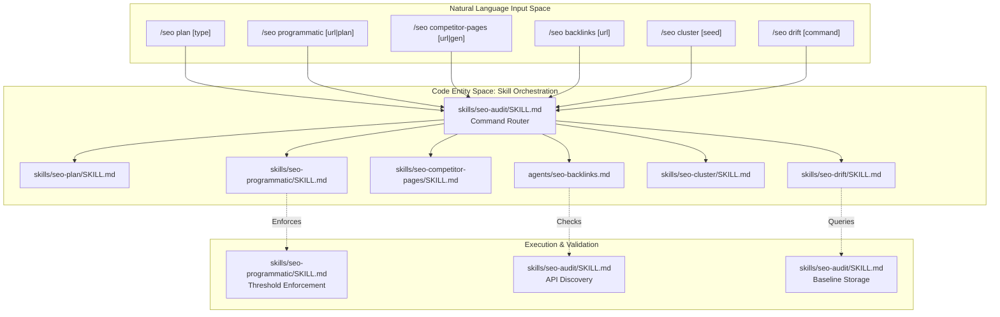
**Sources:** [skills/seo-audit/SKILL.md:20-35](), [skills/seo-programmatic/SKILL.md:74-82]()

---

## `/seo plan` — Business-Type Strategy

Generates tailored SEO strategy recommendations based on detected or specified business models.

### Industry Templates
The command loads industry-specific configurations from `skills/seo-plan/assets/` to tailor recommendations:
*   **SaaS**: Focuses on `/features`, `/integrations`, and `/docs` [skills/seo-plan/SKILL.md:85-85]().
*   **Local Service**: Prioritizes NAP consistency and service area pages [skills/seo-plan/SKILL.md:86-86]().
*   **E-commerce**: Focuses on product variants and shipping schema [skills/seo-plan/SKILL.md:87-87]().
*   **Publisher**: Prioritizes article schema and author E-E-A-T [skills/seo-plan/SKILL.md:88-88]().

**Sources:** [skills/seo-plan/SKILL.md:1-126]()

---

## `/seo programmatic` — Scaled Content Strategy

Builds and audits pages generated at scale from structured data (CSV, JSON, APIs).

### Quality Gate Enforcement
The system enforces strict thresholds to prevent "Scaled Content Abuse" penalties (March 2024 policy) [skills/seo-programmatic/SKILL.md:83-89]().

| Metric | Threshold | Action |
| :--- | :--- | :--- |
| Pages without content review | 100+ | ⚠️ WARNING: require content audit [skills/seo-programmatic/SKILL.md:78-78]() |
| Pages without justification | 500+ | 🛑 HARD STOP: require user approval [skills/seo-programmatic/SKILL.md:79-79]() |
| Unique content per page | <40% | ❌ Flag as thin content [skills/seo-programmatic/SKILL.md:80-80]() |
| Uniqueness for safety | <30% | 🛑 HARD STOP: Scaled Content Abuse risk [skills/seo-programmatic/SKILL.md:98-98]() |

### Implementation Patterns
*   **URL Strategy**: Recommends patterns like `/[city]/[service]` or `/tools/[name]` [skills/seo-programmatic/SKILL.md:48-54]().
*   **Uniqueness Calculation**: `(words unique to page) / (total words) * 100` [skills/seo-programmatic/SKILL.md:115-115]().

**Sources:** [skills/seo-programmatic/SKILL.md:1-140]()

---

## `/seo cluster` — Semantic Topic Architecture

Performs SERP-overlap-driven keyword clustering to design hub-and-spoke site architectures.

### Clustering Methodology
Unlike text-similarity clustering, `seo-cluster` uses actual Google SERP overlap (top 10 organic results) to group keywords [skills/seo-cluster/SKILL.md:23-26]().

| Shared Results | Relationship | Action |
| :--- | :--- | :--- |
| 7-10 | Same post | Merge into single target page [skills/seo-cluster/SKILL.md:72-72]() |
| 4-6 | Same cluster | Group under same spoke cluster [skills/seo-cluster/SKILL.md:73-73]() |
| 2-3 | Interlink | Place in adjacent clusters, add cross-links [skills/seo-cluster/SKILL.md:74-74]() |
| 0-1 | Separate | Assign to different clusters or exclude [skills/seo-cluster/SKILL.md:75-75]() |

### Internal Link Matrix
The skill generates a mandatory bidirectional linking structure [skills/seo-cluster/SKILL.md:132-140]():
*   **Spoke to Pillar**: Mandatory for every spoke [skills/seo-cluster/SKILL.md:137-137]().
*   **Pillar to Spoke**: Mandatory for every spoke [skills/seo-cluster/SKILL.md:138-138]().
*   **Spoke to Spoke**: 2-3 links per post within the same cluster [skills/seo-cluster/SKILL.md:139-139]().

**Sources:** [skills/seo-cluster/SKILL.md:1-173]()

---

## `/seo hreflang` — Internationalization

Validates and generates tags for multi-language/region sites.

### Validation Rules
*   **Return Tags**: Every relationship must be bidirectional (A→B and B→A); missing tags invalidate the signal [skills/seo-hreflang/SKILL.md:31-33]().
*   **Self-Referencing**: Every page must point to itself; missing this causes Google to ignore the set [skills/seo-hreflang/SKILL.md:25-28]().
*   **x-default**: Designates fallback for unmatched regions [skills/seo-hreflang/SKILL.md:37-40]().
*   **Code Validation**: Enforces ISO 639-1 for languages and ISO 3166-1 Alpha-2 for regions [skills/seo-hreflang/SKILL.md:42-53]().

**Sources:** [skills/seo-hreflang/SKILL.md:1-152]()

---

## `/seo competitor-pages` — Comparison Strategy

Generates "X vs Y" and "Alternatives to X" layouts with high-converting feature matrices.

### Implementation Requirements
*   **Schema**: Recommends `Product` schema with `AggregateRating` [skills/seo-competitor-pages/SKILL.md:67-86]() and `ItemList` for roundup pages [skills/seo-competitor-pages/SKILL.md:104-121]().
*   **Fairness**: Requires verifiable public data and "as of [date]" pricing disclaimers to maintain E-E-A-T and legal compliance [skills/seo-competitor-pages/SKILL.md:173-183]().
*   **Layout**: Prioritizes value advantages over just lowest price [skills/seo-competitor-pages/SKILL.md:163-163]().

**Sources:** [skills/seo-competitor-pages/SKILL.md:1-208]()

---

## `/seo maps` & `/seo local` — Geo-Intelligence

Focuses on Local Pack (Map Pack) performance and Google Business Profile (GBP) optimization.

### Local Ranking Factors
The system weights analysis based on modern local ranking signals [agents/seo-local.md:26-36]():
*   **GBP Primary Category**: Identified as the most critical local factor [agents/seo-local.md:85-85]().
*   **Review Velocity**: The "18-day rule"—potential rankings drop if no new reviews are acquired for 3 weeks [agents/seo-local.md:90]().
*   **Proximity**: Weighted at ~55% of ranking variance [agents/seo-local.md:29-29]().

### Local Data Integration
Title: Local SEO Data Orchestration
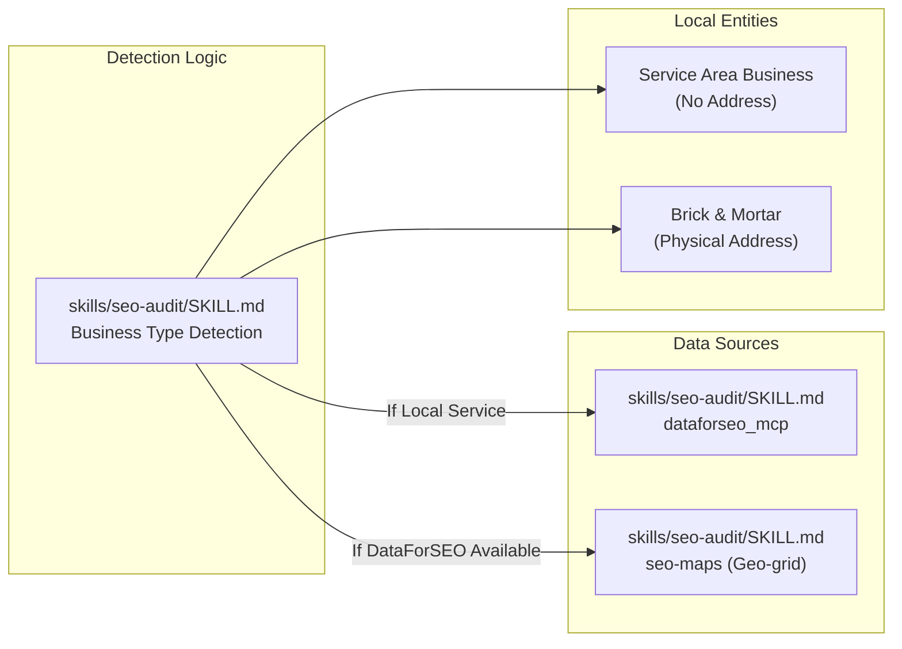
**Sources:** [skills/seo-audit/SKILL.md:28-29](), [agents/seo-local.md:40-60]()

---

## `/seo drift` — Temporal Monitoring

Captures and compares site states to monitor ranking or technical decay.

*   **Baseline**: Triggered when a drift baseline exists for a URL via `claude-seo run drift_history.py <url>` [skills/seo-audit/SKILL.md:34-34]().
*   **Comparison**: Compares current technical and content metrics against the stored baseline to identify lost schema, metadata changes, or performance drops.

**Sources:** [skills/seo-audit/SKILL.md:34-34]()

---

# Page: System Architecture

# System Architecture

<details>
<summary>Relevant source files</summary>

The following files were used as context for generating this wiki page:

- [.claude-plugin/marketplace.json](.claude-plugin/marketplace.json)
- [.claude-plugin/plugin.json](.claude-plugin/plugin.json)
- [CHANGELOG.md](CHANGELOG.md)
- [CLAUDE.md](CLAUDE.md)
- [README.md](README.md)

</details>


This document describes the internal architecture of the claude-seo system, including the orchestration layer, skill delegation model, subagent parallelization, and data flow patterns. For installation and configuration details, see [Getting Started](#2). For command-specific behavior, see [Command Reference](#3). For details on the skill and subagent models, see [Skill and Subagent Model](#4.1).

## Architectural Overview

The claude-seo system implements a **three-tier architecture** that separates user interaction, command orchestration, and specialized analysis:

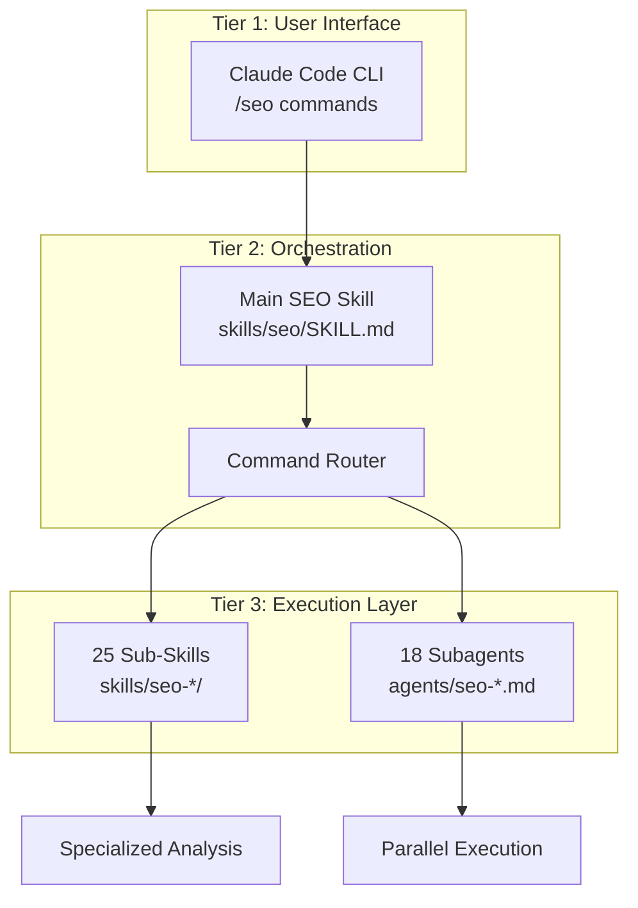

**Tier 1 (User Interface)**: Users invoke commands through the Claude Code CLI using the `/seo` command prefix. All commands route through the main skill.

**Tier 2 (Orchestration)**: The main skill at `skills/seo/SKILL.md` receives commands, parses arguments, and dispatches to appropriate sub-skills or subagents. The orchestration layer handles business type detection, quality gate enforcement, and result aggregation.

**Tier 3 (Execution)**: Specialized sub-skills perform focused analysis (technical, content, schema, etc.), while subagents execute in parallel during comprehensive audits.

**Sources**: [CLAUDE.md:5-16](), [skills/seo/SKILL.md:1-28]()

## File System Layout

The system distributes its components across the Claude Code skill and agent directories with a predictable naming convention. As of v2.2.4, the codebase includes 25 sub-skills and 18 sub-agents [CLAUDE.md:7-9]().

```mermaid
graph TB
    subgraph "skills/"
        MainSkillDir["seo/<br/>Main orchestration skill"]
        
        SubSkill1["seo-audit/<br/>Full audit orchestration"]
        SubSkill2["seo-page/<br/>Single page analysis"]
        SubSkill3["seo-technical/<br/>Technical SEO depth"]
        SubSkill4["seo-content/<br/>E-E-A-T analysis"]
        SubSkill5["seo-schema/<br/>Schema detection/generation"]
        SubSkill6["seo-images/<br/>Image optimization"]
        SubSkill7["seo-geo/<br/>AI search optimization"]
        SubSkill8["seo-local/<br/>Local SEO & GBP"]
        SubSkill9["seo-maps/<br/>Maps intelligence"]
        SubSkill10["seo-ecommerce/<br/>Product SEO"]
    end
    
    subgraph "agents/"
        Agent1["seo-technical.md<br/>Technical subagent"]
        Agent2["seo-content.md<br/>Content subagent"]
        Agent3["seo-schema.md<br/>Schema subagent"]
        Agent4["seo-performance.md<br/>CWV subagent"]
        Agent5["seo-visual.md<br/>Screenshot subagent"]
        Agent6["seo-geo.md<br/>AI Crawler subagent"]
    end
    
    subgraph "scripts/"
        S1["url_safety.py<br/>SSRF protection"]
        S2["render_page.py<br/>Playwright renderer"]
        S3["content_quality.py<br/>QRG scoring"]
    end
    
    MainSkillDir --> SubSkill1
    SubSkill1 --> Agent1
    SubSkill1 --> Agent2
    
    SubSkill3 --> S1
    SubSkill3 --> S2
    SubSkill4 --> S3
```

| Component | Path | Count | Purpose |
|-----------|------|-------|---------|
| Main Skill | `skills/seo/` | 1 | Command parsing, routing, business detection |
| Sub-skills | `skills/seo-*/` | 25 | Specialized domain analysis [CLAUDE.md:26-66]() |
| Sub-agents | `agents/` | 18 | Specialized workers with tool access [CLAUDE.md:67-85]() |
| Reference Files | `skills/*/references/` | 30+ | On-demand knowledge base files [CLAUDE.md:29]() |
| Core Scripts | `scripts/` | 53 | Python-based execution logic [CLAUDE.md:88-140]() |

**Sources**: [CLAUDE.md:16-85](), [.claude-plugin/plugin.json:3-4]()

## Command Routing and Dispatch

The main skill implements a command router that maps `/seo` subcommands to execution targets:

```mermaid
graph LR
    User["User Input:<br/>/seo <command> <args>"]
    
    subgraph "Main Skill: skills/seo/SKILL.md"
        Parser["Command Parser"]
        Router["Routing Logic"]
    end
    
    Parser --> Router
    
    User --> Parser
    
    Router -->|"audit"| Audit["seo-audit skill<br/>→ spawns 15+ subagents"]
    Router -->|"page"| Page["seo-page skill"]
    Router -->|"technical"| Tech["seo-technical skill"]
    Router -->|"content"| Content["seo-content skill"]
    Router -->|"local"| Local["seo-local skill"]
    Router -->|"maps"| Maps["seo-maps skill"]
    Router -->|"backlinks"| Back["seo-backlinks skill"]
```

### Command-to-Skill Mapping

| Command | Target Skill | Execution Pattern |
|---------|--------------|-------------------|
| `/seo audit` | `seo-audit/` | Parallel (up to 15 specialists) [README.md:21]() |
| `/seo page` | `seo-page/` | Sequential deep-dive [README.md:130]() |
| `/seo technical` | `seo-technical/` | 9-category technical audit [CLAUDE.md:32]() |
| `/seo content` | `seo-content/` | E-E-A-T and QRG evaluation [CLAUDE.md:33]() |
| `/seo maps` | `seo-maps/` | Geo-grid and GBP intelligence [CLAUDE.md:40]() |
| `/seo geo` | `seo-geo/` | AI search optimization [CLAUDE.md:38]() |

The `/seo audit` command is the primary entry point for parallel execution, spawning up to 15 specialist agents simultaneously [README.md:21]().

**Sources**: [README.md:120-140](), [CLAUDE.md:26-66]()

## Business Type Detection

The orchestration layer identifies the business type from homepage signals to conditionally spawn relevant subagents. For details, see [Business Type Detection](#4.2).

```mermaid
flowchart TD
    Start["/seo audit <url>"] --> Detect["Business Type Detection"]
    
    Detect --> SaaS["SaaS signals:<br/>/features, /pricing"]
    Detect --> Local["Local signals:<br/>NAP, Map embed"]
    Detect --> Ecommerce["E-commerce signals:<br/>Product schema, /cart"]
    
    SaaS --> SpawnSaaS["Spawn: seo-technical, seo-content,<br/>seo-sxo, seo-geo"]
    Local --> SpawnLocal["Spawn: seo-local, seo-maps,<br/>seo-schema, seo-technical"]
    Ecommerce --> SpawnEcom["Spawn: seo-ecommerce, seo-schema,<br/>seo-performance, seo-technical"]
```

**Sources**: [CLAUDE.md:13-14](), [README.md:34-36]()

## Orchestration Workflow

The orchestration logic follows a strict hierarchy. The `seo` skill acts as the Directive layer, `seo-audit` as Orchestration, and the subagents as Execution.

1.  **Directive**: User issues command to `seo/SKILL.md`.
2.  **Orchestration**: `seo-audit` analyzes the URL, detects the business type, and creates a task list.
3.  **Execution**: Specialized subagents (e.g., `seo-technical.md`) run Python scripts like `scripts/render_page.py` or `scripts/fetch_page.py` [CLAUDE.md:105-106]().
4.  **Aggregation**: Findings are collected into a unified prioritized action plan [README.md:5]().

**Sources**: [CLAUDE.md:5-14](), [README.md:5-22]()

## Quality Control and Safety

The system architecture includes a mandatory safety and quality layer. For details, see [Quality Control System](#4.3).

*   **SSRF Protection**: The system uses hardened SSRF/DNS-rebinding safe fetchers via `scripts/url_safety.py` [CLAUDE.md:117]() and [.claude-plugin/plugin.json:4]().
*   **Validation Hooks**: The `hooks/hooks.json` file defines `PostToolUse` validation, ensuring that any file edits (like schema generation) adhere to strict standards via `hooks/validate-schema.py` [CLAUDE.md:86-87]().
*   **Portability**: The `scripts/portability_check.py` script ensures that frontmatter remains compatible across platforms [CHANGELOG.md:27]().

**Sources**: [CHANGELOG.md:41-44](), [CLAUDE.md:86-87](), [CLAUDE.md:117]()

## External Integrations

The system extends its capabilities via MCP (Model Context Protocol) servers and external APIs. For details, see [External Integrations](#4.4).

*   **MCP Extensions**: 8 optional MCP extensions are supported, including DataForSEO, Firecrawl, Banana, Ahrefs, SE Ranking, Profound, Bing Webmaster, and Unlighthouse [.claude-plugin/marketplace.json:8]().
*   **Direct APIs**: The system interfaces directly with Google Search Console (`gsc_query.py`), PageSpeed Insights (`pagespeed_check.py`), and Moz (`moz_api.py`) [CLAUDE.md:91-98]().
*   **Headless Rendering**: `scripts/render_page.py` provides SPA-aware rendering for all subagents requiring JavaScript execution [CHANGELOG.md:34-35]().

**Sources**: [CLAUDE.md:88-115](), [.claude-plugin/marketplace.json:8](), [CHANGELOG.md:15-31]()

## Detailed Sub-Architecture Pages

- [Skill and Subagent Model](#4.1) — 18 agents and 25 sub-skills hierarchy, task delegation, and the SKILL.md contract.
- [Business Type Detection](#4.2) — Conditional spawning based on homepage signals (SaaS, Local, Ecommerce, etc.).
- [Quality Control System](#4.3) — SSRF protection, validation hooks, and portability checks.
- [External Integrations](#4.4) — MCP servers, Google APIs, and SEO data flow.

---

# Page: Skill and Subagent Model

# Skill and Subagent Model

<details>
<summary>Relevant source files</summary>

The following files were used as context for generating this wiki page:

- [.github/workflows/ci.yml](.github/workflows/ci.yml)
- [AGENTS.md](AGENTS.md)
- [agents/seo-content.md](agents/seo-content.md)
- [agents/seo-ecommerce.md](agents/seo-ecommerce.md)
- [agents/seo-performance.md](agents/seo-performance.md)
- [agents/seo-schema.md](agents/seo-schema.md)
- [agents/seo-sxo.md](agents/seo-sxo.md)
- [agents/seo-technical.md](agents/seo-technical.md)
- [agents/seo-visual.md](agents/seo-visual.md)
- [extensions/firecrawl/skills/seo-firecrawl/SKILL.md](extensions/firecrawl/skills/seo-firecrawl/SKILL.md)
- [scripts/google_report.py](scripts/google_report.py)
- [scripts/portability_check.py](scripts/portability_check.py)
- [skills/seo-backlinks/SKILL.md](skills/seo-backlinks/SKILL.md)
- [skills/seo/SKILL.md](skills/seo/SKILL.md)
- [tests/test_audit_instructions.py](tests/test_audit_instructions.py)
- [tests/test_portability.py](tests/test_portability.py)

</details>


## Purpose and Scope

This document explains the skill and subagent architecture that powers the `claude-seo` system. It covers the 3-layer hierarchy (Directive/Orchestration/Execution), the 18 subagents and 25 sub-skills architecture, parallel processing, task delegation, and the `SKILL.md` frontmatter contract that ensures cross-platform portability.

For details on business type detection logic, see [Business Type Detection](4.2). For quality control mechanisms enforced during execution, see [Quality Control System](4.3). For external data integrations used by skills and subagents, see [External Integrations](4.4).

---

## Skills vs Subagents: Two Execution Models

The `claude-seo` system employs two distinct execution models that serve different architectural purposes:

**Skills** are the native plugin mechanism. Each skill is a self-contained directory with a `SKILL.md` manifest that defines its name, description, trigger phrases, and allowed tools [skills/seo/SKILL.md:1-11](). Skills execute synchronously within the main session. The main `seo` skill acts as an orchestrator, routing commands to 25 specialized sub-skills based on command syntax [skills/seo/SKILL.md:23-25]().

**Subagents** are parallel worker processes spawned for concurrent analysis. Each subagent is defined by a markdown file in `agents/` with YAML frontmatter specifying its role, capabilities, and tool permissions [agents/seo-technical.md:1-7](). Subagents execute independently and return structured results to the parent skill for aggregation. Only the `/seo audit` command uses subagents—all other commands execute through direct skill invocation [skills/seo/SKILL.md:70-72]().

**Key Distinction**: Skills enable modular command routing and code reuse. Subagents enable parallel data collection and analysis. The audit workflow uses both: the `seo` skill spawns subagents, which may delegate back to skills or scripts for specific analysis tasks [skills/seo/SKILL.md:72-84]().

**Sources**: [skills/seo/SKILL.md:23-25](), [skills/seo/SKILL.md:70-72](), [AGENTS.md:57-59](), [agents/seo-technical.md:1-7]()

---

## 3-Layer Hierarchy

The architecture follows a strict 3-layer model to manage complexity:

1.  **Directive Layer (Natural Language Space)**: The user intent expressed through commands like `/seo audit` or `/seo page` [skills/seo/SKILL.md:15]().
2.  **Orchestration Layer (Code Entity Space)**: The `seo` skill ([skills/seo/SKILL.md]()) and the subagents in `agents/` that handle industry detection, spawning, and result synthesis [skills/seo/SKILL.md:70-86]().
3.  **Execution Layer (Script Space)**: The 53+ Python scripts in `scripts/` that perform the actual work (e.g., `render_page.py`, `pagespeed_check.py`) [AGENTS.md:59]().

### Hierarchy Mapping Diagram

```mermaid
graph TD
    subgraph "Directive Layer (User Interface)"
        UI["/seo audit <url>"]
    end

    subgraph "Orchestration Layer (Skills & Agents)"
        Main["Main Skill: skills/seo/SKILL.md"]
        Agents["18 Subagents: agents/seo-*.md"]
    end

    subgraph "Execution Layer (Python Scripts)"
        Render["scripts/render_page.py"]
        Parse["scripts/parse_html.py"]
        Safety["scripts/url_safety.py"]
        PSI["scripts/pagespeed_check.py"]
        Sitemap["scripts/sitemap_discovery.py"]
    end

    UI --> Main
    Main --> Agents
    Agents --> Render
    Agents --> PSI
    Agents --> Sitemap
    Render --> Safety
    Parse --> Safety
```

**Sources**: [skills/seo/SKILL.md:15-25](), [skills/seo/SKILL.md:70-86](), [AGENTS.md:57-59](), [agents/seo-technical.md:12-19]()

---

## Parallel Subagent Execution Model

The `/seo audit` command implements a unique parallel processing architecture. When invoked, the system spawns independent subagents that analyze different aspects of the site concurrently [skills/seo/SKILL.md:72-84]().

### Parallel Execution Flow

```mermaid
graph TB
    subgraph "Audit Orchestrator"
        Start["/seo audit"]
        DetectBiz["Industry Detection Signals"]
        DetectCreds["scripts/google_auth.py --check"]
    end

    subgraph "Parallel Execution Layer"
        SA_Tech["seo-technical.md<br/>Crawlability & Rendering"]
        SA_Content["seo-content.md<br/>E-E-A-T & Quality"]
        SA_Schema["seo-schema.md<br/>JSON-LD Validation"]
        SA_Perf["seo-performance.md<br/>CWV & INP Metrics"]
        SA_SXO["seo-sxo.md<br/>Search Experience"]
        SA_Local["seo-local.md<br/>(Conditional: Local Biz)"]
        SA_Maps["seo-maps.md<br/>(Conditional: DataForSEO)"]
    end

    subgraph "Script Invocation"
        S_Render["scripts/render_page.py"]
        S_PSI["scripts/pagespeed_check.py"]
        S_Parse["scripts/parse_html.py"]
    end

    Start --> DetectBiz
    Start --> DetectCreds
    DetectBiz --> SA_Tech
    DetectBiz --> SA_Content
    DetectBiz --> SA_Schema
    DetectBiz --> SA_Perf
    DetectBiz --> SA_SXO
    DetectBiz --> SA_Local
    DetectCreds --> SA_Maps

    SA_Tech --> S_Render
    SA_Content --> S_Render
    SA_Perf --> S_PSI
    SA_SXO --> S_Parse
```

**Execution Characteristics**:
*   **Concurrency**: Subagents run in parallel to minimize wall-clock time for full audits [skills/seo/SKILL.md:72]().
*   **Conditional Spawning**: Agents like `seo-local`, `seo-maps`, `seo-backlinks`, or `seo-ecommerce` are only spawned if specific signals or credentials are detected [skills/seo/SKILL.md:75-82]().
*   **Tool Isolation**: Each agent specifies its own toolset (e.g., `seo-technical` requires `Read, Bash, Write, Glob, Grep` [agents/seo-technical.md:6]()).

**Sources**: [skills/seo/SKILL.md:70-84](), [agents/seo-technical.md:1-7](), [agents/seo-performance.md:1-7]()

---

## The SKILL.md Frontmatter Contract

To ensure cross-platform portability across Claude Code, Cursor, and Gemini CLI, every skill follows a strict frontmatter contract [AGENTS.md:10-23](). This is validated via `scripts/portability_check.py` [AGENTS.md:16]().

### Manifest Structure

| Field | Purpose | Example |
| :--- | :--- | :--- |
| `name` | Unique identifier for the skill | `seo-technical` [agents/seo-technical.md:2]() |
| `description` | Trigger logic and system role | "Technical SEO specialist..." [agents/seo-technical.md:3]() |
| `model` | Recommended LLM for this task | `sonnet` [agents/seo-technical.md:4]() |
| `maxTurns` | Safety limit for agent loops | `20` [agents/seo-technical.md:5]() |
| `tools` | List of allowed capability tools | `Read, Bash, Write, Glob, Grep` [agents/seo-technical.md:6]() |

**Sources**: [AGENTS.md:10-23](), [agents/seo-technical.md:1-7](), [.github/workflows/ci.yml:26-27]()

---

## Task Delegation and Synthesis

The system uses a 10-principle thinking framework grouped into four phases: **PERCEIVE**, **ANALYZE**, **VALIDATE**, and **ACT** [skills/seo/SKILL.md:95-98]().

### Synthesis Methodology
*   **PERCEIVE**: Observation of signals using `scripts/render_page.py` [skills/seo/SKILL.md:96]().
*   **ANALYZE**: Lateral and systemic thinking performed by specialized agents like `seo-sxo` [agents/seo-sxo.md:14-17]().
*   **VALIDATE**: Quality gate enforcement and falsifiability checks [skills/seo/SKILL.md:97]().
*   **ACT**: Creation of a prioritized action plan with dependency sequencing [skills/seo/SKILL.md:86]().

### Weighted Scoring
Results are synthesized into a unified SEO Health Score (0-100) [skills/seo/SKILL.md:84](). Subagents also maintain internal scoring models, such as the E-E-A-T breakdown:
*   **Experience**: 20% [agents/seo-content.md:25]()
*   **Expertise**: 25% [agents/seo-content.md:26]()
*   **Authoritativeness**: 25% [agents/seo-content.md:27]()
*   **Trustworthiness**: 30% [agents/seo-content.md:28]()

**Sources**: [skills/seo/SKILL.md:84-86](), [skills/seo/SKILL.md:92-104](), [agents/seo-content.md:21-30]()

---

## Implementation Details: Script Layer

Agents invoke a suite of 53+ Python scripts to interface with the real world. All scripts must be run through the `claude-seo` launcher to ensure environment isolation [skills/seo/SKILL.md:17-20]().

| Agent | Primary Script | Role |
| :--- | :--- | :--- |
| `seo-technical` | `scripts/render_page.py` | Renders JS-heavy sites using Playwright; includes SSRF protection [agents/seo-technical.md:58](). |
| `seo-performance`| `scripts/pagespeed_check.py` | Fetches lab/field data from PageSpeed Insights API [agents/seo-performance.md:70](). |
| `seo-schema` | `scripts/render_page.py` | Extracts `structured_data` summary for JSON-LD detection [agents/seo-schema.md:73](). |
| `seo-backlinks` | `scripts/backlinks_auth.py` | Detects and verifies credentials for Moz, Bing, and DataForSEO [skills/seo-backlinks/SKILL.md:26](). |
| `seo-ecommerce` | `scripts/dataforseo_costs.py` | Enforces cost guardrails before calling Merchant APIs [agents/seo-ecommerce.md:28-31](). |

**Sources**: [skills/seo/SKILL.md:17-20](), [agents/seo-technical.md:56-58](), [agents/seo-performance.md:68-70](), [agents/seo-ecommerce.md:28-35](), [skills/seo-backlinks/SKILL.md:16-26]()

---

# Page: Business Type Detection

# Business Type Detection

<details>
<summary>Relevant source files</summary>

The following files were used as context for generating this wiki page:

- [skills/seo-audit/SKILL.md](skills/seo-audit/SKILL.md)
- [skills/seo-cluster/SKILL.md](skills/seo-cluster/SKILL.md)
- [skills/seo-drift/SKILL.md](skills/seo-drift/SKILL.md)
- [skills/seo-ecommerce/SKILL.md](skills/seo-ecommerce/SKILL.md)
- [skills/seo-flow/SKILL.md](skills/seo-flow/SKILL.md)
- [skills/seo-plan/assets/agency.md](skills/seo-plan/assets/agency.md)
- [skills/seo-plan/assets/ecommerce.md](skills/seo-plan/assets/ecommerce.md)
- [skills/seo-plan/assets/generic.md](skills/seo-plan/assets/generic.md)
- [skills/seo-plan/assets/local-service.md](skills/seo-plan/assets/local-service.md)
- [skills/seo-plan/assets/publisher.md](skills/seo-plan/assets/publisher.md)
- [skills/seo-plan/assets/saas.md](skills/seo-plan/assets/saas.md)
- [skills/seo-sxo/SKILL.md](skills/seo-sxo/SKILL.md)

</details>


## Purpose and Scope

This document explains how the `claude-seo` system automatically identifies the business model of a target website (SaaS, Local Business, E-commerce, Publisher, or Agency) and uses this classification to tailor all subsequent SEO analysis. Business type detection occurs at the beginning of every audit workflow and determines which analysis rules, quality thresholds, and specialized subagents are conditionally spawned.

For information about how detected business types influence quality enforcement, see [4.3 Quality Control System](). For details on business-specific strategic planning templates, see [3.3 Strategic Planning Commands]().

**Sources:** [skills/seo-audit/SKILL.md:17-18](), [skills/seo-audit/SKILL.md:68-68]()

---

## Overview of Business Type Classification

The system classifies websites into primary business types. Each business type has distinct SEO priorities, quality thresholds, and schema requirements.

### Business Type Taxonomy

| Business Type | Primary SEO Focus | Key Subagents | Schema Priorities |
|---------------|-------------------|---------------|-------------------|
| **SaaS** | Feature depth, integrations, pricing transparency | `seo-technical`, `seo-content` | `SoftwareApplication`, `Product`, `Offer` |
| **Local Business** | NAP consistency, GBP signals, local authority | `seo-local`, `seo-maps` | `LocalBusiness`, `Service`, `GeoCoordinates` |
| **E-commerce** | Product catalog, marketplace visibility, shopping ads | `seo-ecommerce`, `seo-backlinks` | `Product`, `Offer`, `ProductGroup`, `OfferShippingDetails` |
| **Publisher** | Content freshness, E-E-A-T, semantic clustering | `seo-content`, `seo-cluster` | `Article`, `NewsArticle`, `Person`, `ProfilePage` |
| **Agency** | Case studies, portfolio social proof, services | `seo-content`, `seo-sxo` | `ProfessionalService`, `Service`, `ProfilePage` |

**Sources:** [skills/seo-audit/SKILL.md:21-35](), [skills/seo-plan/assets/saas.md:79-86](), [skills/seo-plan/assets/ecommerce.md:48-60](), [skills/seo-plan/assets/local-service.md:60-67](), [skills/seo-plan/assets/publisher.md:41-49](), [skills/seo-plan/assets/agency.md:49-55]()

---

## Detection Mechanism

### Signal-Based Detection Process

Business type detection operates as a multi-signal classifier that analyzes the target website's homepage and primary navigation structure. The detection occurs during the `seo-audit` process after fetching the initial page using `render_page.py`.

```mermaid
graph TD
    Start["/seo audit [url]"] --> Render["scripts/render_page.py --mode auto --json"]
    Render --> Detect["Analyze homepage signals"]
    
    Detect --> Score["Score signal matches"]
    
    Score --> Classify{Classify Type}
    
    Classify -->|"pricing, features, /docs"| SaaS["SaaS"]
    Classify -->|"address, phone, areaServed"| Local["Local Business"]
    Classify -->|"cart, /products, SKU"| Ecommerce["E-commerce"]
    Classify -->|"NewsArticle, /authors, editorial"| Publisher["Publisher"]
    Classify -->|"case studies, /work, /services"| Agency["Agency"]
    
    SaaS --> SpawnSaaS["Spawn: Standard Subagents"]
    Local --> SpawnLocal["Spawn: Standard + seo-local + seo-maps"]
    Ecommerce --> SpawnEcomm["Spawn: Standard + seo-ecommerce"]
    Publisher --> SpawnPub["Spawn: Standard + seo-cluster"]
    
    SpawnSaaS --> Report["FULL-AUDIT-REPORT.md"]
    SpawnLocal --> Report
    SpawnEcomm --> Report
    SpawnPub --> Report
```

**Diagram: Business Type Detection Flow**

**Sources:** [skills/seo-audit/SKILL.md:17-35](), [skills/seo-ecommerce/SKILL.md:44-48](), [skills/seo-sxo/SKILL.md:46-50]()

### Detection Signals by Business Type

#### Local Business Detection Signals
The system identifies local service businesses based on geographic markers and industry-specific keywords.

*   **Brick-and-Mortar vs SAB**: Detects physical addresses (Brick-and-Mortar) vs. service area descriptions (SAB). [skills/seo-local/SKILL.md:28-28]()
*   **Industry Verticals**: Recognizes specific local sectors such as restaurants, legal, or medical based on specialized schema or navigation items. [skills/seo-plan/assets/local-service.md:138-142]()
*   **Schema Signals**: Presence of `LocalBusiness`, `PostalAddress`, or `GeoCoordinates`. [skills/seo-plan/assets/local-service.md:60-91]()

#### E-commerce Detection Signals
Identified via `seo-ecommerce` logic and `ecommerce.md` template patterns.

*   **URL Patterns**: Presence of `/products`, `/collections`, `/cart`, or `/checkout`. [skills/seo-plan/assets/ecommerce.md:15-44]()
*   **Content Signals**: "Add to cart" buttons, SKU numbers, price currency, and shipping/return policy links. [skills/seo-ecommerce/SKILL.md:52-88]()
*   **Schema Signals**: `Product`, `Offer`, `AggregateRating`, and `ProductGroup` for variants. [skills/seo-plan/assets/ecommerce.md:50-60]()

---

## Impact on Analysis Pipeline

### Conditional Subagent Spawning

The `seo-audit` orchestrator uses the detected business type to determine which of the 15 available subagents are relevant.

| Subagent | Spawning Condition | Role |
|----------|-------------------|------|
| `seo-local` | Local Service industry detected | NAP consistency, GBP signals, industry-specific local factors. [skills/seo-audit/SKILL.md:28-28]() |
| `seo-maps` | Local Service + DataForSEO MCP | Geo-grid rank tracking, competitor radius mapping. [skills/seo-audit/SKILL.md:29-29]() |
| `seo-ecommerce`| E-commerce industry detected | Product schema validation, marketplace intelligence. [skills/seo-audit/SKILL.md:35-35]() |
| `seo-cluster` | Content strategy signals detected | Semantic topic clustering and hub-and-spoke planning. [skills/seo-audit/SKILL.md:32-32]() |
| `seo-backlinks` | Moz/Bing API credentials detected | DA/PA, referring domains, and toxic link analysis. [skills/seo-audit/SKILL.md:31-31]() |
| `seo-drift` | Existing baseline found for URL | Regression analysis against previous snapshots. [skills/seo-audit/SKILL.md:34-34]() |

**Sources:** [skills/seo-audit/SKILL.md:21-35](), [skills/seo-drift/SKILL.md:30-31]()

### Strategic Planning Integration

The `seo-plan` skill loads specific templates from the `assets/` directory based on the detection to generate tailored roadmaps.

```mermaid
graph LR
    Plan["/seo plan [url]"] --> Detect["Detected Type"]
    Detect --> SaaS["assets/saas.md"]
    Detect --> Local["assets/local-service.md"]
    Detect --> Ecomm["assets/ecommerce.md"]
    Detect --> Pub["assets/publisher.md"]
    Detect --> Agency["assets/agency.md"]
    
    SaaS --> Strategy["ACTION-PLAN.md"]
    Local --> Strategy
    Ecomm --> Strategy
    Pub --> Strategy
    Agency --> Strategy
```

**Diagram: Strategy Template Mapping**

**Sources:** [skills/seo-plan/SKILL.md:37-38](), [skills/seo-audit/SKILL.md:54-54]()

---

## Implementation Architecture

### Code Entity Mapping

The following diagram bridges the natural language business concepts to the specific code entities that handle detection and specialized analysis.

```mermaid
graph TD
    AuditSkill["skills/seo-audit/SKILL.md"] -- "Step 1: Render" --> RenderScript["scripts/render_page.py"]
    AuditSkill -- "Step 2: Detect" --> Orchestrator["Claude SEO Orchestrator"]
    
    Orchestrator -- "If Local" --> LocalSkill["skills/seo-local/SKILL.md"]
    Orchestrator -- "If Ecommerce" --> EcommSkill["skills/seo-ecommerce/SKILL.md"]
    Orchestrator -- "If Content Heavy" --> ClusterSkill["skills/seo-cluster/SKILL.md"]
    
    LocalSkill -- "Uses" --> LocalTemplate["assets/local-service.md"]
    EcommSkill -- "Uses" --> EcommTemplate["assets/ecommerce.md"]
    
    EcommSkill -- "External Data" --> MerchantScript["scripts/dataforseo_merchant.py"]
    ClusterSkill -- "External Data" --> WebSearch["Claude WebSearch Tool"]
```

**Diagram: Detection Code Entities**

**Sources:** [skills/seo-audit/SKILL.md:17-35](), [skills/seo-ecommerce/SKILL.md:45-48](), [skills/seo-cluster/SKILL.md:47-52]()

### Scoring Weights and Priorities

The `seo-audit` skill applies different scoring weights to the SEO Health Score based on the detected type. For example, E-commerce sites place higher weight on Schema (Product/Offer), while Publishers prioritize Content Quality (E-E-A-T).

| Category | Standard Weight | Key Metric for Type |
|----------|-----------------|---------------------|
| Technical SEO | 22% | Indexability (All) |
| Content Quality | 23% | E-E-A-T (Publisher/Agency) |
| On-Page SEO | 20% | Title/Meta (All) |
| Schema | 10% | Product/Offer (E-commerce) |
| Performance | 10% | Core Web Vitals (SaaS/E-commerce) |
| AI Search Readiness | 10% | Citability (All) |

**Sources:** [skills/seo-audit/SKILL.md:104-112](), [skills/seo-ecommerce/SKILL.md:91-98]()

---

## Error Handling and Fallbacks

*   **Ambiguous Detection**: If the homepage does not provide clear signals, the system defaults to the `generic.md` template to ensure a baseline audit is still performed. [skills/seo-plan/assets/generic.md:2-6]()
*   **Credential-Based Spawning**: If a business type is detected but required API credentials (e.g., DataForSEO for `seo-maps`) are missing, the system skips the subagent and logs a requirement notice in the audit artifacts. [skills/seo-audit/SKILL.md:29-31]()
*   **Drift Detection**: The `seo-drift` subagent is only spawned if a previous SQLite baseline exists for the specific URL in `~/.cache/claude-seo/drift/baselines.db`. [skills/seo-drift/SKILL.md:75-79]()

**Sources:** [skills/seo-audit/SKILL.md:34-34](), [skills/seo-drift/SKILL.md:178-179]()

---

# Page: Quality Control System

# Quality Control System

<details>
<summary>Relevant source files</summary>

The following files were used as context for generating this wiki page:

- [.github/workflows/ci.yml](.github/workflows/ci.yml)
- [AGENTS.md](AGENTS.md)
- [agents/seo-cluster.md](agents/seo-cluster.md)
- [docs/MIGRATION-v1-to-v2.md](docs/MIGRATION-v1-to-v2.md)
- [extensions/firecrawl/install.ps1](extensions/firecrawl/install.ps1)
- [extensions/firecrawl/uninstall.sh](extensions/firecrawl/uninstall.sh)
- [hooks/hooks.json](hooks/hooks.json)
- [hooks/run-python-hook.js](hooks/run-python-hook.js)
- [hooks/validate-schema.py](hooks/validate-schema.py)
- [scripts/drift_baseline.py](scripts/drift_baseline.py)
- [scripts/portability_check.py](scripts/portability_check.py)
- [tests/test_cross_platform_hooks.py](tests/test_cross_platform_hooks.py)
- [tests/test_drift_portability.py](tests/test_drift_portability.py)
- [tests/test_fetch_page_decoding.py](tests/test_fetch_page_decoding.py)
- [tests/test_manifest_consistency.py](tests/test_manifest_consistency.py)
- [tests/test_portability.py](tests/test_portability.py)
- [tests/test_schema_hook_policy.py](tests/test_schema_hook_policy.py)

</details>


The quality control system enforces content quality standards, prevents schema markup errors, and mitigates scaled content abuse risks through a multi-stage validation pipeline. This system operates at three checkpoints: pre-generation validation, runtime quality gates, and post-edit validation hooks.

## Architecture Overview

The quality control system implements defense-in-depth validation across three stages, integrating automated scripts and manual-aligned logic.

```mermaid
graph TB
    subgraph PreGeneration["Pre-Generation Stage"]
        Input["Content/Schema Generation Request"]
        BizValidation["Business Type Detection"]
        RulesTailoring["Apply Business-Specific Rules"]
    end
    
    subgraph RuntimeGates["Runtime Quality Gates"]
        ContentGen["Content Generation Process"]
        SchemaGen["schema_generate.py"]
        QualityChecks["content_quality.py"]
        Thresholds["Threshold Enforcement"]
    end
    
    subgraph PostEdit["Post-Edit Validation"]
        FileOp["File Write/Edit Operation"]
        ValidateHook["validate-schema.py"]
        PortabilityHook["portability_check.py"]
        ExitCode["Exit Code Decision"]
    end
    
    subgraph Enforcement["Enforcement Actions"]
        Pass["✅ Allow Publication"]
        Warn["⚠️ Warning - Manual Review Required"]
        Block["🛑 Hard Stop - Block Operation"]
    end
    
    Input --> BizValidation
    BizValidation --> RulesTailoring
    RulesTailoring --> ContentGen
    RulesTailoring --> SchemaGen
    ContentGen --> QualityChecks
    SchemaGen --> QualityChecks
    QualityChecks --> Thresholds
    
    Thresholds --> Pass
    Thresholds --> Warn
    Thresholds --> Block
    
    Pass --> FileOp
    FileOp --> ValidateHook
    FileOp --> PortabilityHook
    ValidateHook --> ExitCode
    PortabilityHook --> ExitCode
    
    ExitCode --> |"Exit 0"| Pass
    ExitCode --> |"Exit 1"| Warn
    ExitCode --> |"Exit 2"| Block
```

**Quality Control Architecture**: Three-stage validation pipeline. Runtime gates evaluate content thresholds, while post-edit hooks like `validate-schema.py` and `portability_check.py` validate schema markup and cross-platform compatibility before file commits.

Sources: [hooks/validate-schema.py:1-31](), [scripts/portability_check.py:1-39](), [hooks/hooks.json:1-20]()

## Quality Gate Thresholds

The system enforces tiered quality gates with escalating severity. Gates trigger warnings or hard stops based on content characteristics and page counts.

### Content Quality Thresholds

The system acts as a QRG-aligned (Quality Rater Guidelines) scorer for filler, AI patterns, and information density.

| Metric | Warning Threshold | Hard Stop Threshold | Enforcement Action |
|--------|------------------|---------------------|-------------------|
| Unique content percentage | 30-40% | < 30% | Block pages with scaled content abuse risk |
| Location pages count | 30+ pages | 50+ pages | Prevent doorway page penalties |
| Programmatic pages count | 100+ pages | 500+ pages | Require comprehensive quality audit |
| Homepage word count | < 500 words | N/A | Flag for content expansion |
| Blog post word count | < 1500 words | N/A | Flag for content expansion |
| Service page word count | < 800 words | N/A | Flag for content expansion |

### AI Citation and Humanization

To meet September 2025 standards, the system utilizes specialized scripts to remediate AI-generated content patterns:

*   **`content_humanize.py`**: Performs 40+ deterministic replacements of common AI-phrasing (e.g., "delve into", "tapestry of").
*   **`content_verify.py`**: Extracts claims and identifies citation gaps to ensure E-E-A-T compliance.
*   **`parasite_risk.py`**: Scans for site-reputation-abuse risks as per November 2024 Google policy.

## Schema Validation Hook System

The `validate-schema.py` hook executes automatically after file edit/write operations, providing final validation before changes are committed.

### Hook Configuration

The hook is configured in `~/.claude/settings.json` or via `hooks/hooks.json` in the plugin root. It uses `run-python-hook.js` to probe for a valid Python environment before execution [hooks/run-python-hook.js:10-25]().

```json
{
  "hooks": {
    "PostToolUse": [
      {
        "matcher": "Edit|Write",
        "hooks": [
          {
            "type": "command",
            "command": "node",
            "args": [
              "${CLAUDE_PLUGIN_ROOT}/hooks/run-python-hook.js",
              "${CLAUDE_PLUGIN_ROOT}/hooks/validate-schema.py",
              "${tool_input.file_path}"
            ]
          }
        ]
      }
    ]
  }
}
```

Sources: [hooks/validate-schema.py:7-27](), [hooks/hooks.json:1-20](), [hooks/run-python-hook.js:40-63]()

### Validation Functions

The validation logic is implemented in two core functions:

**`validate_jsonld(content: str) -> List[str]`** [hooks/validate-schema.py:40-63]()
- Extracts JSON-LD blocks using regex pattern: `<script\s+type=["\']application/ld\+json["\']\s*>(.*?)</script>` [hooks/validate-schema.py:43-44]().
- Parses JSON and delegates to `_validate_schema_object` for each block.

**`_validate_schema_object(obj: dict, block_num: int) -> List[str]`** [hooks/validate-schema.py:66-121]()
- Validates `@context` is `https://schema.org` or `http://schema.org` [hooks/validate-schema.py:72-75]().
- Validates `@type` is present [hooks/validate-schema.py:78-79]().
- Checks for placeholder text patterns like `[Business Name]`, `[City]`, and `[INSERT]` [hooks/validate-schema.py:82-97]().
- Validates against deprecated types and restricted types.

### Deprecated and Restricted Schema Types

The hook enforces schema deprecation policy based on the 2024-2026 timeline [hooks/validate-schema.py:99-112]():

| Type | Status | Context |
|------|--------|---------|
| `HowTo` | Deprecated | September 2023 |
| `SpecialAnnouncement` | Deprecated | July 31, 2025 |
| `CourseInfo` | Retired | June 2025 |
| `ClaimReview` | Retired | June 2025; fact-check rich results discontinued |
| `VehicleListing` | Retired | June 2025; discontinued |

**Note on FAQPage**: Per system policy, `FAQPage` does NOT block edits even though Google retired rich results for most sites in May 2026, as it remains a valid Schema.org type [hooks/validate-schema.py:114-116](). This is verified by regression tests [tests/test_schema_hook_policy.py:29-30]().

Sources: [hooks/validate-schema.py:99-121](), [tests/test_schema_hook_policy.py:1-34]()

## Portability Linter

The `portability_check.py` script ensures that `SKILL.md` files remain compatible across multiple agent harnesses like Cursor, Gemini CLI, and Aider [scripts/portability_check.py:5-7]().

```mermaid
graph LR
    subgraph PortabilityCheck["portability_check.py"]
        FindFiles["_find_skill_files()"]
        ParseFM["_parse_frontmatter()"]
        ValidateName["Check kebab-case name"]
        ValidateDesc["Check description length"]
        ValidateTools["Check inline comments in tools"]
    end

    subgraph SkillFiles["Code Entities"]
        SkillMD["skills/*/SKILL.md"]
        ExtMD["extensions/*/SKILL.md"]
    end

    FindFiles --> SkillMD
    FindFiles --> ExtMD
    SkillMD --> ParseFM
    ParseFM --> ValidateName
    ParseFM --> ValidateDesc
    ParseFM --> ValidateTools
```

**Portability Linter Logic**: The linter parses frontmatter to ensure compliance with a portable subset of the Claude Code skill spec [AGENTS.md:10-17]().

*   **Name Validation**: Must be kebab-case and < 64 characters [scripts/portability_check.py:53](), [scripts/portability_check.py:131-144]().
*   **Description Validation**: Warns if length > 1024 characters to prevent truncation in Codex [scripts/portability_check.py:153-160]().
*   **Tools Validation**: Warns if the `tools` list contains inline comments (`#`), which can break parsing in Cline or Codex [scripts/portability_check.py:165-172]().

Sources: [scripts/portability_check.py:1-186](), [AGENTS.md:10-23](), [tests/test_portability.py:28-97]()

## Manifest Consistency Tests

The system includes a specialized test suite `tests/test_manifest_consistency.py` to prevent "skill-count drift" where documentation and manifests fall out of sync with actual files on disk [tests/test_manifest_consistency.py:5-12]().

| Test Function | Validation Logic |
|---------------|------------------|
| `test_plugin_json_skill_count_matches_disk` | Counts `SKILL.md` directories vs `plugin.json` description [tests/test_manifest_consistency.py:49-58]() |
| `test_plugin_json_subagent_count_matches_disk` | Counts `agents/seo-*.md` files vs `plugin.json` [tests/test_manifest_consistency.py:67-76]() |
| `test_version_triangulation` | Ensures `plugin.json` version matches `CITATION.cff` [tests/test_manifest_consistency.py:123-134]() |
| `test_pyproject_version_matches_plugin_json` | Syncs `pyproject.toml` version with `plugin.json` [tests/test_manifest_consistency.py:137-155]() |
| `test_install_scripts_default_tag_matches_plugin_version` | Ensures `install.sh` and `install.ps1` target the correct release tag [tests/test_manifest_consistency.py:158-174]() |

Sources: [tests/test_manifest_consistency.py:1-174]()

## Enforcement Actions

The quality control system implements three enforcement levels via exit codes in the validation scripts:

| Exit Code | Meaning | Action |
|-----------|---------|--------|
| `0` | Success | Allow edit/write to proceed [hooks/validate-schema.py:174-175](). |
| `1` | Warnings | Allow edit but display non-blocking warnings [hooks/validate-schema.py:193](). |
| `2` | Critical errors | Block the edit/write operation (e.g., deprecated schema, placeholder text) [hooks/validate-schema.py:187-191](). |

Sources: [hooks/validate-schema.py:146-197](), [scripts/portability_check.py:31-32](), [tests/test_schema_hook_policy.py:33-34]()

---

# Page: External Integrations

# External Integrations

<details>
<summary>Relevant source files</summary>

The following files were used as context for generating this wiki page:

- [docs/MCP-INTEGRATION.md](docs/MCP-INTEGRATION.md)
- [extensions/ahrefs/skills/seo-ahrefs/SKILL.md](extensions/ahrefs/skills/seo-ahrefs/SKILL.md)
- [extensions/banana/install.sh](extensions/banana/install.sh)
- [extensions/banana/scripts/edit.py](extensions/banana/scripts/edit.py)
- [extensions/banana/scripts/generate.py](extensions/banana/scripts/generate.py)
- [extensions/banana/scripts/validate_setup.py](extensions/banana/scripts/validate_setup.py)
- [extensions/banana/skills/seo-image-gen/SKILL.md](extensions/banana/skills/seo-image-gen/SKILL.md)
- [extensions/banana/uninstall.sh](extensions/banana/uninstall.sh)
- [extensions/bing-webmaster/skills/seo-bing/SKILL.md](extensions/bing-webmaster/skills/seo-bing/SKILL.md)
- [extensions/dataforseo/install.sh](extensions/dataforseo/install.sh)
- [extensions/dataforseo/skills/seo-dataforseo/SKILL.md](extensions/dataforseo/skills/seo-dataforseo/SKILL.md)
- [extensions/firecrawl/install.sh](extensions/firecrawl/install.sh)
- [extensions/profound/skills/seo-profound/SKILL.md](extensions/profound/skills/seo-profound/SKILL.md)
- [extensions/seranking/skills/seo-seranking/SKILL.md](extensions/seranking/skills/seo-seranking/SKILL.md)
- [extensions/unlighthouse/skills/seo-unlighthouse/SKILL.md](extensions/unlighthouse/skills/seo-unlighthouse/SKILL.md)
- [skills/seo-google/references/auth-setup.md](skills/seo-google/references/auth-setup.md)
- [skills/seo-google/references/nlp-api.md](skills/seo-google/references/nlp-api.md)
- [skills/seo-google/references/pagespeed-crux-api.md](skills/seo-google/references/pagespeed-crux-api.md)
- [skills/seo/references/cwv-thresholds.md](skills/seo/references/cwv-thresholds.md)
- [tests/test_extension_installer_injection.py](tests/test_extension_installer_injection.py)
- [tests/test_parasite_risk_and_extensions.py](tests/test_parasite_risk_and_extensions.py)

</details>


## Purpose and Scope

This document describes how the claude-seo system integrates with external SEO data providers through two primary mechanisms: the Model Context Protocol (MCP) and direct API calls. These integrations enable the system to access real-time backlink data, search performance metrics, Core Web Vitals measurements, AI visibility tracking, and automated asset generation that cannot be determined through static HTML analysis alone.

The system utilizes specialized extensions for DataForSEO, Firecrawl, Banana (Image Gen), Ahrefs, and others, which are installed via dedicated shell scripts to configure the local environment and MCP settings.

**Sources:** [docs/MCP-INTEGRATION.md:1-77](), [extensions/dataforseo/install.sh:7-176](), [extensions/firecrawl/install.sh:7-145]()

---

## Integration Architecture Overview

The system implements a multi-layered architecture combining local Python scripts, specialized subagents, and MCP servers. The orchestrator (`seo` skill) delegates to these entities based on the detected business type and available credentials.

### Data Flow and Entity Mapping

The following diagram bridges the Natural Language commands used in the terminal to the specific code entities and external APIs they trigger.

```mermaid
graph TB
    subgraph "Natural Language Space (Claude Code)"
        User["User Command<br/>/seo audit or /seo dataforseo"]
        Orchestrator["seo orchestrator<br/>skills/seo/SKILL.md"]
    end
    
    subgraph "Code Entity Space (Subagents & Skills)"
        DFSEAgent["seo-dataforseo agent<br/>agents/seo-dataforseo.md"]
        FCAgent["seo-firecrawl skill<br/>extensions/firecrawl/skills/seo-firecrawl/SKILL.md"]
        SERAgent["seo-seranking skill<br/>extensions/seranking/skills/seo-seranking/SKILL.md"]
        GSCSubagent["seo-google agent<br/>agents/seo-google.md"]
        BananaSkill["seo-image-gen skill<br/>extensions/banana/skills/seo-image-gen/SKILL.md"]
    end
    
    subgraph "MCP Server Layer (settings.json)"
        DFSEMCP["dataforseo-mcp-server<br/>npx dataforseo-mcp-server@2.8.10"]
        FCMCP["firecrawl-mcp<br/>npx firecrawl-mcp@3.11.0"]
        BananaMCP["nanobanana-mcp<br/>@ycse/nanobanana-mcp@1.1.1"]
    end
    
    subgraph "External API Space"
        DFSE_API["DataForSEO API<br/>SERP, Keywords, Backlinks"]
        FC_API["Firecrawl API<br/>Crawl, Scrape, Map"]
        SER_API["SE Ranking API<br/>AI Visibility, SOV"]
        GSC_API["Google Search Console API"]
        Gemini_API["Gemini Pro Vision / Imagen<br/>Image Generation"]
    end
    
    User --> Orchestrator
    Orchestrator --> DFSEAgent
    Orchestrator --> FCAgent
    Orchestrator --> SERAgent
    Orchestrator --> GSCSubagent
    Orchestrator --> BananaSkill
    
    DFSEAgent -->|"MCP call"| DFSEMCP
    FCAgent -->|"MCP call"| FCMCP
    GSCSubagent -->|"MCP/API"| GSC_API
    BananaSkill -->|"MCP call"| BananaMCP
    
    DFSEMCP --> DFSE_API
    FCMCP --> FC_API
    BananaMCP --> Gemini_API
```

**Sources:** [extensions/dataforseo/install.sh:128-137](), [extensions/firecrawl/install.sh:100-106](), [extensions/banana/install.sh:111-117](), [extensions/banana/skills/seo-image-gen/SKILL.md:20-28]()

---

## Core Extension Modules

### DataForSEO Integration
The DataForSEO extension provides live search data via the `dataforseo-mcp-server`. It covers 9 API modules including SERP, Keywords, Backlinks, and AI Visibility.

*   **Implementation:** Installed via `extensions/dataforseo/install.sh`. It copies `SKILL.md` to `~/.claude/skills/seo-dataforseo` [extensions/dataforseo/install.sh:93-97]() and the agent to `~/.claude/agents/seo-dataforseo.md` [extensions/dataforseo/install.sh:100-102]().
*   **Cost Management:** Before every call, the system runs `dataforseo_costs.py check <endpoint>` to enforce daily budget limits [extensions/dataforseo/skills/seo-dataforseo/SKILL.md:49-56]().
*   **Key Tools:** Includes `serp_organic_live_advanced` for live rankings and `dataforseo_labs_google_keyword_ideas` for research [extensions/dataforseo/skills/seo-dataforseo/SKILL.md:106-161]().

### Firecrawl Integration
Firecrawl is used for advanced crawling and scraping, particularly useful for complex SPAs or large-scale mapping.

*   **Capabilities:** Provides `crawl` (up to 500 pages), `scrape` (markdown conversion), and `map` (site structure discovery) [extensions/firecrawl/install.sh:138-141]().
*   **Setup:** Registers `firecrawl-mcp@3.11.0` in `settings.json` with the user's API key [extensions/firecrawl/install.sh:100-106]().

### Banana (AI Image Generation)
The Banana extension leverages Gemini models via `nanobanana-mcp` to generate SEO assets like OG images and blog headers.

*   **Pipeline:** Uses a "Creative Director" pipeline defined in `references/prompt-engineering.md` to map SEO needs to specific aspect ratios (e.g., 16:9 for OG images) [extensions/banana/skills/seo-image-gen/SKILL.md:54-78]().
*   **Direct Fallback:** If the MCP server is unavailable, the system can use `extensions/banana/scripts/generate.py` to call the Gemini REST API directly using Python's standard library [extensions/banana/scripts/generate.py:1-10]().
*   **SEO Checklist:** Automatically suggests Alt text, file naming conventions, and WebP conversion commands after generation [extensions/banana/skills/seo-image-gen/SKILL.md:91-118]().

### Ahrefs Integration
Launched in July 2025, the official Ahrefs integration provides high-confidence backlink and organic traffic data.

*   **Routing:** Commands like `/seo ahrefs metrics` and `/seo ahrefs backlinks` route to the `@ahrefs/mcp` server [extensions/ahrefs/skills/seo-ahrefs/SKILL.md:27-32]().
*   **Confidence Weighting:** Data is often paired with `seo-backlinks` for multi-source validation against Common Crawl and Moz [extensions/ahrefs/skills/seo-ahrefs/SKILL.md:40-44]().

**Sources:** [extensions/dataforseo/skills/seo-dataforseo/SKILL.md:20-68](), [extensions/banana/skills/seo-image-gen/SKILL.md:1-89](), [extensions/ahrefs/skills/seo-ahrefs/SKILL.md:1-53]()

---

## Performance and Google APIs

The system integrates with multiple Google Cloud APIs to retrieve both "Lab" (simulated) and "Field" (real-user) data.

| API | Code Entity / Script | Tier | Use Case |
|-----|----------------------|------|----------|
| **PageSpeed Insights** | `pagespeed_check.py` | Tier 1 | Lighthouse lab metrics (LCP, CLS, TBT) |
| **Chrome UX Report** | `crux_history.py` | Tier 1 | 75th percentile field data for CWV |
| **Search Console** | `gsc_query.py` | Tier 2 | Organic clicks, impressions, and indexing status |
| **Indexing API** | `indexing_submit.py` | Tier 2 | Fast indexing for new or updated pages |
| **GA4 Data API** | `ga4_metrics.py` | Tier 2 | Conversion and organic traffic attribution |

**Sources:** [docs/MCP-INTEGRATION.md:9-77](), [skills/seo-google/references/auth-setup.md:1-12]()

---

## Extension Installation Lifecycle

The system uses a standardized installation pattern to ensure security and portability.

```mermaid
sequenceDiagram
    participant User
    participant Script as install.sh
    participant Settings as ~/.claude/settings.json
    participant FS as Local Filesystem
    
    User->>Script: Run ./extensions/{name}/install.sh
    Script->>User: Prompt for API Credentials
    Script->>FS: Copy SKILL.md & Agents
    Script->>Settings: Atomic write to settings.json (0600 perms)
    Note over Script,Settings: Uses sys.argv to prevent injection
    Script->>FS: npx pre-download (pre-warm)
    Script-->>User: Installation Complete
```

### Security Guardrails in Installers
Installers (DataForSEO, Firecrawl, Banana) use a hardened pattern to prevent credential injection:
1.  **Quoted Heredocs:** Credentials are passed as `sys.argv` via a quoted `<<'PY'` heredoc to prevent shell interpolation vulnerabilities [extensions/dataforseo/install.sh:114-117]().
2.  **Atomic Writing:** The `settings.json` file is written using `tempfile.mkstemp` and `os.replace` to ensure atomicity [extensions/dataforseo/install.sh:139-145]().
3.  **Strict Permissions:** New configuration files are created with `0600` permissions (read/write only by the owner) [extensions/dataforseo/install.sh:144]().

**Sources:** [tests/test_extension_installer_injection.py:1-68](), [extensions/dataforseo/install.sh:112-152](), [extensions/firecrawl/install.sh:84-121]()

---

## Integration Summary Table

| Integration | Command Prefix | Primary MCP Server | Required Key |
|-------------|----------------|--------------------|--------------|
| **DataForSEO** | `/seo dataforseo` | `dataforseo-mcp-server` | User/Pass |
| **Firecrawl** | `/seo firecrawl` | `firecrawl-mcp` | API Key |
| **Banana** | `/seo image-gen` | `nanobanana-mcp` | Google AI Key |
| **Ahrefs** | `/seo ahrefs` | `@ahrefs/mcp` | API Token |
| **Unlighthouse**| `/seo unlighthouse`| Local CLI (Node) | None |
| **Bing** | `/seo bing` | `seo-bing` skill | API Key |

**Sources:** [extensions/dataforseo/skills/seo-dataforseo/SKILL.md:72-97](), [extensions/banana/skills/seo-image-gen/SKILL.md:43-50](), [extensions/unlighthouse/skills/seo-unlighthouse/SKILL.md:25-29](), [docs/MCP-INTEGRATION.md:68-76]()

---

# Page: Technical SEO Analysis

# Technical SEO Analysis

<details>
<summary>Relevant source files</summary>

The following files were used as context for generating this wiki page:

- [agents/seo-content.md](agents/seo-content.md)
- [agents/seo-ecommerce.md](agents/seo-ecommerce.md)
- [agents/seo-performance.md](agents/seo-performance.md)
- [agents/seo-schema.md](agents/seo-schema.md)
- [agents/seo-sxo.md](agents/seo-sxo.md)
- [agents/seo-technical.md](agents/seo-technical.md)
- [agents/seo-visual.md](agents/seo-visual.md)
- [scripts/google_report.py](scripts/google_report.py)
- [skills/seo-images/SKILL.md](skills/seo-images/SKILL.md)
- [skills/seo-page/SKILL.md](skills/seo-page/SKILL.md)
- [skills/seo-technical/SKILL.md](skills/seo-technical/SKILL.md)
- [tests/test_audit_instructions.py](tests/test_audit_instructions.py)

</details>


## Purpose and Scope

This document describes the technical SEO analysis system implemented in the `seo-technical` sub-skill. Technical SEO analysis evaluates website infrastructure, crawlability, security, mobile optimization, performance metrics, and rendering capabilities across nine distinct categories.

The technical analysis can be invoked directly via `/seo technical <url>` or as part of the full `/seo audit` command, where it runs as one of several parallel subagents [agents/seo-technical.md:9-20](). For content quality analysis, see [Content Quality & E-E-A-T](#6). For performance-specific deep dives, see [Performance Analysis](#8). For schema markup validation, see [Schema Markup Management](#7).

**Sources:** [skills/seo-technical/SKILL.md:1-15](), [agents/seo-technical.md:1-17]()

## System Architecture

The technical SEO system operates as both a standalone sub-skill and a parallel subagent within the audit workflow. It utilizes `render_page.py` for content acquisition, which features a hybrid `auto` mode to minimize overhead while ensuring SPA (Single Page Application) content is captured [agents/seo-technical.md:56-58]().

```mermaid
graph TB
    subgraph "Entry Points"
        DirectCmd["/seo technical &lt;url&gt;"]
        AuditCmd["/seo audit &lt;url&gt;"]
    end
    
    subgraph "Skill Layer"
        TechSkill["seo-technical skill<br/>skills/seo-technical/SKILL.md"]
        MainSkill["Main seo skill<br/>skills/seo/SKILL.md"]
    end
    
    subgraph "Agent Layer"
        TechAgent["seo-technical agent<br/>agents/seo-technical.md"]
    end
    
    subgraph "Execution Layer"
        Render["render_page.py<br/>(Playwright + auto-mode)"]
        Safety["url_safety.py<br/>(SSRF/DNS-rebinding protection)"]
    end
    
    subgraph "Analysis Categories"
        Cat1["1. Crawlability<br/>robots.txt, sitemap, noindex"]
        Cat2["2. Indexability<br/>canonical, duplicates, thin content"]
        Cat3["3. Security<br/>HTTPS, headers, HSTS"]
        Cat4["4. URL Structure<br/>clean URLs, redirects, hierarchy"]
        Cat5["5. Mobile Optimization<br/>responsive, touch targets, viewport"]
        Cat6["6. Core Web Vitals<br/>LCP, INP, CLS"]
        Cat7["7. Structured Data<br/>JSON-LD, Microdata, RDFa"]
        Cat8["8. JavaScript Rendering<br/>CSR vs SSR, indexing"]
        Cat9["9. IndexNow Protocol<br/>Bing/Yandex/Naver"]
    end
    
    DirectCmd --> TechSkill
    AuditCmd --> MainSkill
    MainSkill -->|"Spawn parallel subagent"| TechAgent
    
    TechSkill --> Render
    TechAgent --> Render
    Render --> Safety
    
    Render --> Cat1
    Render --> Cat2
    Render --> Cat3
    Render --> Cat4
    Render --> Cat5
    Render --> Cat6
    Render --> Cat7
    Render --> Cat8
    Render --> Cat9
```

**Technical SEO Analysis Architecture**

The system enforces strict security via `scripts/url_safety.py` to prevent SSRF and DNS-rebinding attacks when fetching user-supplied URLs [agents/seo-technical.md:58](). The `render_page.py` script provides the primary data interface, exposing `raw_content` (pre-JS) and `content` (post-JS) to detect rendering discrepancies [agents/seo-ecommerce.md:68]().

**Sources:** [agents/seo-technical.md:54-58](), [skills/seo-technical/SKILL.md:1-15](), [agents/seo-ecommerce.md:66-72]()

## Analysis Categories

### 1. Crawlability and Indexability

Crawlability analysis evaluates whether search engines can discover and access site content, while indexability identifies factors preventing page inclusion in search results. The system uses `sitemap_discovery.py` to validate XML sitemaps [skills/seo-technical/SKILL.md:23-25]().

For detailed documentation on AI crawler management and sitemap protocols, see [Crawlability and Indexability](#5.1).

**AI Crawler Management**

The system evaluates `robots.txt` directives for AI crawlers. As of 2025-2026, the system distinguishes between training crawlers (e.g., `GPTBot`, `Google-Extended`) and browsing crawlers (e.g., `ChatGPT-User`) [skills/seo-technical/SKILL.md:34-49]().

| Crawler | Company | `robots.txt` Token | Purpose | Block Impact |
|---------|---------|-------------------|---------|--------------|
| `GPTBot` | OpenAI | `GPTBot` | Model training | Prevents training, NOT browsing citations |
| `ChatGPT-User` | OpenAI | `ChatGPT-User` | Real-time browsing | Prevents citations in ChatGPT answers |
| `ClaudeBot` | Anthropic | `ClaudeBot` | Model training | Prevents training data collection |
| `Google-Extended` | Google | `Google-Extended` | Gemini training | Prevents Gemini training, NOT search or AIO |

**Sources:** [skills/seo-technical/SKILL.md:21-61](), [agents/seo-technical.md:28-30]()

### 2. Security and URL Structure

Security analysis evaluates HTTPS implementation and HTTP security headers (CSP, HSTS, X-Frame-Options) [skills/seo-technical/SKILL.md:84-92](). The system specifically flags **Back-button hijacking** as a critical spam-policy violation since June 2026 [skills/seo-technical/SKILL.md:93](). For detailed implementation details on SSRF protection and DNS-rebinding mitigation, see [Security and URL Structure](#5.2).

**Sources:** [skills/seo-technical/SKILL.md:84-93]()

### 3. Mobile Optimization

Mobile optimization analysis validates mobile-first indexing compliance. As of 2024, Googlebot Smartphone is the primary crawler [skills/seo-technical/SKILL.md:107](). The system checks for mobile/desktop content parity, touch target sizing (48x48px), and intrusive interstitials [skills/seo-technical/SKILL.md:102-111](). For responsive design validation, see [Mobile Optimization](#5.3).

**Sources:** [skills/seo-technical/SKILL.md:102-111]()

### 4. Core Web Vitals

The system measures user experience metrics against official 2026 thresholds [agents/seo-technical.md:21-26](). Evaluation uses the **75th percentile** of page visits [agents/seo-performance.md:21-23]().

| Metric | Threshold | Measurement |
|--------|-----------|-------------|
| **LCP** | ≤ 2.5s | Largest Contentful Paint |
| **INP** | ≤ 200ms | Interaction to Next Paint |
| **CLS** | ≤ 0.1 | Cumulative Layout Shift |

**Critical Update:** INP replaced FID on **March 12, 2024**. FID was fully removed from all Chrome tools on **September 9, 2024** [agents/seo-performance.md:19](). The system never references FID. For performance optimization strategies, see [Performance Analysis](#8).

**Sources:** [agents/seo-technical.md:21-29](), [agents/seo-performance.md:11-23]()

### 5. JavaScript Rendering

JavaScript rendering analysis identifies client-side vs server-side rendering patterns. The `seo-technical` agent uses `render_page.py --mode auto` to detect if an SPA shell is present and requires Playwright execution [agents/seo-technical.md:58](). For detailed CSR vs SSR detection, see [JavaScript Rendering](#5.4).

```mermaid
graph LR
    subgraph "Natural Language Space"
        UserQuery["'Is my React site indexable?'"]
        AuditRequest["'Check JS rendering'"]
    end

    subgraph "Code Entity Space"
        RenderPage["render_page.py<br/>--mode auto"]
        SPA_Check["is_spa flag"]
        RawContent["raw_content<br/>(Server-side)"]
        FullContent["content<br/>(Client-side)"]
    end

    UserQuery --> RenderPage
    AuditRequest --> RenderPage
    RenderPage --> SPA_Check
    SPA_Check -->|"Discrepancy detected"| RawContent
    SPA_Check -->|"Discrepancy detected"| FullContent
```

**Sources:** [agents/seo-technical.md:53-58](), [agents/seo-ecommerce.md:68-70]()

### 6. Structured Data

Structured data detection identifies JSON-LD (preferred), Microdata, and RDFa markup [agents/seo-schema.md:13](). Full validation is delegated to the `seo-schema` agent, which checks against Google's rich result requirements [agents/seo-schema.md:1-18](). For type status and generation templates, see [Schema Markup Management](#7).

**Sources:** [agents/seo-schema.md:1-18](), [agents/seo-technical.md:52]()

### 7. IndexNow Protocol

The system checks for IndexNow implementation, enabling instant indexing notifications to Bing, Yandex, and Naver [agents/seo-technical.md:54]().

**Sources:** [agents/seo-technical.md:54]()

## Analysis Execution Flow

```mermaid
flowchart TB
    subgraph "Execution Pipeline"
        URL["Target URL"] --> Safety["url_safety.py"]
        Safety --> Render["render_page.py"]
        Render --> TechAgent["seo-technical agent"]
    end
    
    subgraph "Category Scoring"
        TechAgent --> C1["Crawlability"]
        TechAgent --> C2["Indexability"]
        TechAgent --> C3["Security"]
        TechAgent --> C4["Core Web Vitals"]
    end
    
    subgraph "Report Generation"
        C1 --> Report["technical.md"]
        C2 --> Report
        C3 --> Report
        C4 --> Report
    end
```

**Sources:** [agents/seo-technical.md:37-64](), [tests/test_audit_instructions.py:45-62]()

## Output Format

The technical SEO analysis outputs a standardized report containing:
- **Pass/Fail Status:** Per category (Crawlability, Security, etc.) [agents/seo-technical.md:39]().
- **Technical Score:** 0-100 overall rating [agents/seo-technical.md:40]().
- **Prioritized Issues:** Ranked from Critical to Low [agents/seo-technical.md:41]().
- **Recommendations:** Specific implementation details for remediation [agents/seo-technical.md:42]().

Findings are persisted to `output_dir/findings/technical.md` and `audit-data.json` when part of a full audit [agents/seo-technical.md:60-65]().

**Sources:** [agents/seo-technical.md:37-65](), [tests/test_audit_instructions.py:45-62]()

---

# Page: Crawlability and Indexability

# Crawlability and Indexability

<details>
<summary>Relevant source files</summary>

The following files were used as context for generating this wiki page:

- [agents/seo-maps.md](agents/seo-maps.md)
- [agents/seo-sitemap.md](agents/seo-sitemap.md)
- [scripts/indexnow_submit.py](scripts/indexnow_submit.py)
- [scripts/preload_check.py](scripts/preload_check.py)
- [scripts/unlighthouse_run.py](scripts/unlighthouse_run.py)
- [skills/seo-images/SKILL.md](skills/seo-images/SKILL.md)
- [skills/seo-page/SKILL.md](skills/seo-page/SKILL.md)
- [skills/seo-technical/SKILL.md](skills/seo-technical/SKILL.md)
- [tests/test_technical_depth.py](tests/test_technical_depth.py)

</details>


## Purpose and Scope

This document describes the crawlability and indexability analysis components of the `claude-seo` system, primarily housed within the `seo-technical` skill. These categories represent the foundation of technical SEO: ensuring search engines and AI agents can discover, access, and index website content.

**Crawlability** analysis examines factors that control search engine bot access: `robots.txt` directives (including modern AI crawler tokens), XML sitemaps, crawl depth, and JavaScript rendering requirements.

**Indexability** analysis evaluates factors that determine which pages enter search engine indexes: canonical tags, meta robots directives, duplicate content detection, and the IndexNow protocol for instant indexing on non-Google engines.

**Sources:** [skills/seo-technical/SKILL.md:1-15]() | [agents/seo-technical.md:1-20]()

---

## System Context

The crawlability and indexability analysis operates as the first two categories within the broader technical SEO audit system. The `seo-technical` agent orchestrates these checks, delegating specific sitemap tasks to `seo-sitemap` and AI-specific visibility checks to `seo-geo`.

### Code Entity Space Mapping

```mermaid
graph TB
    subgraph "Orchestration Layer [agents/]"
        TechAgent["seo-technical.md"]
        SitemapAgent["seo-sitemap.md"]
        GeoAgent["seo-geo.md"]
    end
    
    subgraph "Execution Layer [scripts/]"
        SitemapDisc["sitemap_discovery.py"]
        RenderPage["render_page.py"]
        IndexNowSub["indexnow_submit.py"]
        PreloadCheck["preload_check.py"]
        URLSafety["url_safety.py"]
    end
    
    TechAgent -->|"Category 1: Crawl"| SitemapDisc
    TechAgent -->|"Category 1: Render"| RenderPage
    TechAgent -->|"Category 2: Index"| IndexNowSub
    TechAgent -->|"Performance/LCP"| PreloadCheck
    
    SitemapDisc -.->|"delegates to"| SitemapAgent
    GeoAgent -.->|"AI Crawler Logic"| TechAgent
    
    IndexNowSub --> URLSafety
    RenderPage --> URLSafety
    SitemapDisc --> URLSafety
```

**Diagram: Crawlability and Indexability Context within System Architecture**

**Sources:** [skills/seo-technical/SKILL.md:21-33](), [agents/seo-technical.md:42-53](), [scripts/unlighthouse_run.py:42-45]()

---

## Crawlability Analysis Components

### robots.txt and AI Crawler Management

The system validates `robots.txt` for existence and syntax, with a specific focus on the 2025-2026 AI crawler landscape. The `seo-technical` skill recognizes specific tokens for model training versus real-time browsing.

| Crawler | Company | robots.txt Token | Purpose |
|---------|---------|-----------------|---------|
| GPTBot | OpenAI | `GPTBot` | Model training |
| ChatGPT-User | OpenAI | `ChatGPT-User` | Real-time browsing |
| ClaudeBot | Anthropic | `ClaudeBot` | Model training |
| PerplexityBot | Perplexity | `PerplexityBot` | Search index + training |
| Google-Extended | Google | `Google-Extended` | Gemini training (NOT search) |
| Bytespider | ByteDance | `Bytespider` | Model training |

**Key Constraints:**
- **Fetch Limits:** Googlebot fetches the first **2MB of HTML** and **64MB of a PDF**. Critical content and JSON-LD must reside within this initial buffer. [skills/seo-technical/SKILL.md:30-31]()
- **User-Triggered Fetchers:** Agents like `Google-Agent` (Project Mariner) and `Google-NotebookLM` ignore `robots.txt` by design as they are user-triggered. [skills/seo-technical/SKILL.md:74-75]()

**Sources:** [skills/seo-technical/SKILL.md:34-75](), [skills/seo-page/SKILL.md:39-43]()

### XML Sitemap Discovery and Validation

Sitemap analysis is handled via `sitemap_discovery.py`. The `seo-sitemap` agent enforces quality gates, particularly for programmatic SEO and location pages.

- **URL Limits:** Enforces ≤50,000 URLs or ≤50MB uncompressed per file. [agents/seo-sitemap.md:19-20]()
- **Location Page Gates:** 
    - ⚠️ **Warning** at 30+ location pages: Requires 60%+ unique content. [agents/seo-sitemap.md:25-26]()
    - 🛑 **Hard Stop** at 50+ location pages: Requires explicit user justification to prevent "doorway page" penalties. [agents/seo-sitemap.md:26-27]()

**Sources:** [agents/seo-sitemap.md:11-31](), [skills/seo-technical/SKILL.md:22-25]()

---

## Indexability Analysis Components

### IndexNow Protocol Implementation

The `scripts/indexnow_submit.py` tool allows for immediate indexing notification to Bing, Naver, Seznam.cz, Yandex, and Yep.

```mermaid
sequenceDiagram
    participant Agent as seo-technical Agent
    participant Script as indexnow_submit.py
    participant Safety as url_safety.py
    participant API as api.indexnow.org
    
    Agent->>Script: submit(host, key, urls)
    Script->>Safety: validate_url_strict(u)
    Safety-->>Script: Validation Result
    Note over Script: Verify key (8-128 chars)
    Note over Script: Verify URL host matches declared host
    Script->>API: POST /indexnow (JSON)
    API-->>Script: 200/202 Response
    Script-->>Agent: Result Dict
```

**Diagram: IndexNow Submission Data Flow**

**Sources:** [scripts/indexnow_submit.py:70-134](), [tests/test_technical_depth.py:100-132]()

### Canonical and Rendering Conflicts

The system audits indexability signals that may be obscured by JavaScript rendering:
- **JS Parity:** Checks if `noindex` tags are added or removed dynamically via JS. Google typically honors the first `noindex` seen in the HTML. [skills/seo-technical/SKILL.md:125-126]()
- **Canonical Conflicts:** Identifies if HTML and JS-injected canonicals differ, which causes indexing signals to become unreliable. [skills/seo-technical/SKILL.md:124-125]()

**Sources:** [skills/seo-technical/SKILL.md:120-130](), [skills/seo-page/SKILL.md:37-43]()

---

## Preload and bfcache Audit

The `scripts/preload_check.py` script identifies advanced crawlability and performance signals that influence how browsers and crawlers handle navigation.

| Signal | Detection Method | SEO Impact |
|--------|------------------|------------|
| **Speculation Rules** | `_SPECULATION_BLOCK_RE` | Instant next-page paint via prefetch/prerender. |
| **bfcache Killers** | `Cache-Control: no-store` | Prevents instant back/forward navigation. |
| **LCP Hints** | `fetchpriority="high"` | Prioritizes critical resources for crawlers/browsers. |
| **Deprecated Prerender** | `rel="prerender"` | Flags for migration to Speculation Rules. |

**Sources:** [scripts/preload_check.py:66-88](), [scripts/preload_check.py:130-169](), [tests/test_technical_depth.py:38-75]()

---

# Page: Security and URL Structure

# Security and URL Structure

<details>
<summary>Relevant source files</summary>

The following files were used as context for generating this wiki page:

- [.github/CODEOWNERS](.github/CODEOWNERS)
- [.github/dependabot.yml](.github/dependabot.yml)
- [.github/workflows/v2.yml](.github/workflows/v2.yml)
- [.gitignore](.gitignore)
- [CODE_OF_CONDUCT.md](CODE_OF_CONDUCT.md)
- [SECURITY.md](SECURITY.md)
- [scripts/google_auth.py](scripts/google_auth.py)
- [scripts/render_page.py](scripts/render_page.py)
- [scripts/url_safety.py](scripts/url_safety.py)
- [skills/seo-flow/references/flow-framework.md](skills/seo-flow/references/flow-framework.md)
- [tests/test_url_safety.py](tests/test_url_safety.py)

</details>


## Purpose and Scope

This document covers the security and URL structure analysis components of the technical SEO audit system. These represent categories 3 and 4 of the 8-category technical audit framework implemented in the `seo-technical` skill. 

The system implements a hardened security layer in v2.0.0 to protect against **Server-Side Request Forgery (SSRF)** and **DNS-rebinding** attacks when fetching target URLs. Security analysis evaluates HTTPS enforcement, SSL certificate validity, mixed content, and security headers. URL structure analysis examines patterns, hierarchy, redirect chains, and trailing slash consistency.

For crawlability and indexability analysis, see [5.1](). For mobile optimization, see [5.3](). For JavaScript rendering concerns, see [5.4]().

---

## Security Layer Architecture

The codebase centralizes all network safety logic in `scripts/url_safety.py`. Every script in the repository that accepts a user-supplied URL MUST validate it through this module before issuing any network request [scripts/url_safety.py:5-7]().

### SSRF and DNS-Rebinding Protection

The system uses a multi-layered defense strategy to prevent malicious audit targets from accessing local-network or cloud-metadata endpoints [SECURITY.md:42-46]().

1.  **Normalization**: `normalize_hostname()` canonicalizes hostnames to prevent bypasses using trailing dots (FQDN), case sensitivity, or obfuscated IPv4 forms like decimal, hex, or octal [scripts/url_safety.py:118-121](), [scripts/url_safety.py:228-251]().
2.  **Strict Validation**: `validate_url_strict()` resolves hostnames via `socket.getaddrinfo` and validates every returned A record against a safety predicate before connection [scripts/url_safety.py:19-25](), [scripts/url_safety.py:277-310]().
3.  **DNS Pinning**: `safe_requests_get` and `safe_requests_session` wrap the `requests` library in a context manager that forces the OS-level resolver to use the pre-validated IP for the duration of the call [scripts/url_safety.py:27-38]().
4.  **Playwright Route Handling**: Since Chromium performs its own DNS resolution, the system attaches a `route()` handler via `make_safe_playwright_route_handler` to re-validate every subresource host [scripts/url_safety.py:59-68](), [scripts/url_safety.py:541-574]().

```mermaid
graph TD
    subgraph "Natural Language Space"
        UserURL["Target URL"]
        AuditReq["Audit Request"]
    end

    subgraph "Code Entity Space: url_safety.py"
        NH["normalize_hostname()"]
        VUS["validate_url_strict()"]
        ISIP["is_safe_ip()"]
        SRG["safe_requests_get()"]
        MSPRH["make_safe_playwright_route_handler()"]
    end

    subgraph "Execution Layer"
        Fetcher["scripts/fetch_page.py"]
        Renderer["scripts/render_page.py"]
    end

    UserURL --> NH
    NH --> VUS
    VUS --> ISIP
    ISIP -->|Safe| SRG
    ISIP -->|Safe| MSPRH
    SRG --> Fetcher
    MSPRH --> Renderer
```
**Diagram: Security Validation and Code Entities**
Sources: [scripts/url_safety.py:92-102](), [scripts/render_page.py:98-106](), [SECURITY.md:42-46]()

---

## Security Analysis Components

### HTTPS Enforcement and Credentials
The system validates HTTPS enforcement and manages credentials with high security standards. OAuth token files (`oauth-token.json`) are written with `0o600` permissions to prevent local privilege escalation, and legacy world-readable files are remediated on first load [scripts/google_auth.py:200-209]().

- **HTTPS Validation**: Sites serving pages over HTTP receive a critical-severity flag in the technical audit.
- **Credential Tiering**: `google_auth.py` and `backlinks_auth.py` detect available tiers (API Key, OAuth, Service Account) to tailor analysis depth [scripts/google_auth.py:10-16]().
- **SSRF Hardening**: The `validate_url` function preserves a v1.9.9 contract for compatibility but has been hardened to reject obfuscated IPv4 and authority confusion (e.g., backslashes or userinfo in the authority string) [scripts/url_safety.py:12-17](), [scripts/url_safety.py:161-182]().

### Security Headers
The `seo-technical` subagent extracts and validates the following headers:
- `Content-Security-Policy` (CSP)
- `Strict-Transport-Security` (HSTS)
- `X-Frame-Options`
- `X-Content-Type-Options`
- `Referrer-Policy`

Sources: [scripts/google_auth.py:200-209](), [scripts/url_safety.py:161-182]()

---

## URL Structure Analysis

### Shared Rendering System
In v2.0.0, every subagent fetching HTML (technical, content, schema, etc.) calls `scripts/render_page.py` instead of `fetch_page.py` whenever JS execution might change what an audit can see [scripts/render_page.py:5-9](). This ensures that URL structures generated by Single Page Applications (SPAs) are correctly analyzed.

- **Mode `auto`**: Performs a raw fetch first, then renders with Playwright if an SPA shell is detected via `_is_spa` [scripts/render_page.py:23-24]().
- **Redirect Chains**: `render_page.py` tracks the full `redirect_chain` including status codes to identify hops and latency issues [scripts/render_page.py:40]().
- **SPA Detection**: The `_is_spa` function uses heuristics like `<div id="root">`, `<div id="__next">`, and "please enable javascript" to determine if a render is required [scripts/render_page.py:124-133]().

### URL Pattern Validation
The system evaluates URLs against SEO best practices:
- **Hyphenation**: Enforces hyphens over underscores.
- **Case Sensitivity**: Enforces lowercase to prevent duplicate content.
- **Depth**: Flags hierarchies deeper than 4 levels.
- **Trailing Slashes**: Validates consistency across the site.

```mermaid
graph LR
    subgraph "Code Entity Space"
        RP["render_page.py"]
        ISSPA["_is_spa()"]
        VUS2["url_safety.validate_url_strict()"]
    end

    subgraph "Data Flow"
        RawHTML["Raw HTML Response"]
        RenderedDOM["Post-Render DOM"]
        Redirects["Redirect Chain Data"]
    end

    RP --> VUS2
    VUS2 --> ISSPA
    ISSPA -->|True| RenderedDOM
    ISSPA -->|False| RawHTML
    RP --> Redirects
```
**Diagram: URL Processing Flow in render_page.py**
Sources: [scripts/render_page.py:124-133](), [scripts/render_page.py:50-55]()

---

## Implementation Details

### Key Functions and Classes
| Code Entity | File | Role |
| :--- | :--- | :--- |
| `validate_url_strict` | `scripts/url_safety.py` | DNS-resolving SSRF validator. [scripts/url_safety.py:19]() |
| `safe_requests_session` | `scripts/url_safety.py` | DNS-pinned HTTP session manager. [scripts/url_safety.py:38]() |
| `render_page` | `scripts/render_page.py` | Shared headless renderer with SSRF protection. [scripts/render_page.py:21-47]() |
| `_is_spa` | `scripts/render_page.py` | Heuristic detector for hydration shells. [scripts/render_page.py:124]() |
| `URLSafetyError` | `scripts/url_safety.py` | Exception for safety violations. [scripts/url_safety.py:151]() |
| `is_safe_ip` | `scripts/url_safety.py` | Checks if IP is public unicast. [scripts/url_safety.py:183]() |

### Security-Relevant Dependencies
The system tracks and manages dependencies via Dependabot to mitigate known vulnerabilities [SECURITY.md:79-80]().

- **Pip Ecosystem**: Monitored weekly for security updates [ .github/dependabot.yml:4-10]().
- **Credential Protection**: The `.gitignore` file includes comprehensive patterns to prevent committing secrets like `client_secret*.json`, `service_account*.json`, and `.env` files [ .gitignore:34-43]().
- **Audit Workflows**: The `v2 audit` GitHub Action runs the `url_safety` regression battery and scans for leaked credentials in tracked files before tagging releases [ .github/workflows/v2.yml:59-61](), [ .github/workflows/v2.yml:94-117]().

Sources: [scripts/url_safety.py:92-102](), [scripts/render_page.py:1-62](), [SECURITY.md:66-74]()

---

# Page: Mobile Optimization

# Mobile Optimization

<details>
<summary>Relevant source files</summary>

The following files were used as context for generating this wiki page:

- [agents/seo-content.md](agents/seo-content.md)
- [agents/seo-ecommerce.md](agents/seo-ecommerce.md)
- [agents/seo-performance.md](agents/seo-performance.md)
- [agents/seo-schema.md](agents/seo-schema.md)
- [agents/seo-sxo.md](agents/seo-sxo.md)
- [agents/seo-technical.md](agents/seo-technical.md)
- [agents/seo-visual.md](agents/seo-visual.md)
- [scripts/google_report.py](scripts/google_report.py)
- [skills/seo-images/SKILL.md](skills/seo-images/SKILL.md)
- [skills/seo-page/SKILL.md](skills/seo-page/SKILL.md)
- [skills/seo-technical/SKILL.md](skills/seo-technical/SKILL.md)
- [tests/test_audit_instructions.py](tests/test_audit_instructions.py)

</details>


## Purpose and Scope

This page documents the mobile optimization analysis performed by the `seo-technical` skill as part of the technical SEO audit. Mobile optimization evaluation focuses on ensuring sites comply with Google's mobile-first indexing requirements, implement responsive design patterns correctly, and provide adequate touch targets for mobile users.

For Core Web Vitals analysis specific to mobile performance (LCP, INP, CLS), see [Core Web Vitals](#8.1). For JavaScript rendering considerations that affect mobile indexing, see [JavaScript Rendering](#5.4). For overall technical SEO context, see [Technical SEO Analysis](#5).

---

## Mobile-First Indexing Context

Googlebot Smartphone is now the primary crawler for all indexing [skills/seo-technical/SKILL.md:107](). While a mobile version is not strictly required for indexing, the primary risk is **content/parity loss** [skills/seo-technical/SKILL.md:107-108](). The `seo-technical` agent validates that the mobile version serves as the definitive source for Google's indexing systems.

Key requirements for compliance include:
- **Mobile/desktop content parity**: Equivalent primary content, matching robots meta tags, and matching titles/descriptions [skills/seo-technical/SKILL.md:108]().
- **Immediate visibility**: Primary content should be visible on load rather than hidden behind tabs or accordions, as content in expandable sections may not qualify for full weight [skills/seo-technical/SKILL.md:110]().
- **Resource crawlability**: All mobile resources must be crawlable by Googlebot Smartphone [skills/seo-technical/SKILL.md:108]().

Sources: [skills/seo-technical/SKILL.md:107-110]()

---

## Mobile Optimization Analysis Flow

The `seo-technical` agent coordinates the analysis of mobile-friendliness using a combination of static HTML analysis and dynamic rendering checks via `render_page.py` [agents/seo-technical.md:58]().

Title: Mobile Optimization Orchestration
```mermaid
graph TB
    subgraph "Natural Language Space"
        User["User asks for 'mobile audit'"]
    end

    subgraph "Code Entity Space: Orchestration"
        Agent["agents/seo-technical.md"]
        Skill["skills/seo-technical/SKILL.md"]
        Render["scripts/render_page.py"]
    end

    User --> Agent
    Agent --> Skill
    Skill --> Render

    subgraph "Mobile Category Checks"
        C1["Check viewport meta tag"]
        C2["Validate responsive CSS"]
        C3["Measure touch target sizes"]
        C4["Check font sizes (min 16px)"]
        C5["Detect horizontal scroll"]
        C6["Verify mobile-first parity"]
        C7["Check Intrusive Interstitials"]
    end

    Render --> C1
    Render --> C2
    Render --> C3
    Render --> C4
    Render --> C5
    Render --> C6
    Render --> C7
```

Sources: [skills/seo-technical/SKILL.md:103-112](), [agents/seo-technical.md:9-17](), [agents/seo-technical.md:58]()

---

## Responsive Design Validation

The system validates that sites implement proper responsive design patterns required for mobile-first indexing [skills/seo-technical/SKILL.md:103]().

### Viewport Meta Tag

**Required element:**
```html
<meta name="viewport" content="width=device-width, initial-scale=1">
```
The viewport meta tag is checked for presence and correct configuration to ensure responsive CSS functions as intended [skills/seo-technical/SKILL.md:103]().

### Responsive CSS Implementation

The system checks for responsive CSS patterns:

| Pattern | Detection Method | Purpose |
|---------|------------------|---------|
| Media queries | Parse CSS for `@media` rules | Detect breakpoint-based styling |
| Viewport Meta | `scripts/parse_html.py` | Verify base scaling instruction |
| Fluid layouts | Check for flexible grid properties | Verify modern layout systems |

Sources: [skills/seo-technical/SKILL.md:103](), [agents/seo-technical.md:50]()

---

## Touch Target Analysis

Touch target validation ensures interactive elements meet minimum size requirements for mobile usability. The `seo-technical` skill enforces a minimum size of **48x48px** with **8px spacing** [skills/seo-technical/SKILL.md:104]().

Title: Touch Target Validation Logic
```mermaid
graph LR
    subgraph "Code Entity: Measurement"
        Scan["scripts/parse_html.py"]
        Visual["agents/seo-visual.md"]
    end

    Scan --> Links["'a' tags"]
    Scan --> Buttons["'button' elements"]
    Scan --> Inputs["'input', 'select'"]

    Links --> Visual
    Buttons --> Visual
    Inputs --> Visual

    subgraph "Validation Logic"
        CheckSize{{"Size >= 48x48px?"}}
        CheckSpace{{"Spacing >= 8px?"}}
    end

    Visual --> CheckSize
    CheckSize -->|No| Fail["Critical: Too Small"]
    CheckSize -->|Yes| CheckSpace
    CheckSpace -->|No| Warn["High: Too Close"]
    CheckSpace -->|Yes| Pass["Mobile Friendly"]
```

### Touch Target Thresholds

| Measurement | Minimum | Recommendation | Rationale |
|-------------|---------|----------------|-----------|
| Width | 48px | 56px | Average finger pad size [skills/seo-technical/SKILL.md:104]() |
| Height | 48px | 56px | Prevents misclicks [skills/seo-technical/SKILL.md:104]() |
| Adjacent spacing | 8px | 12px | Separates tap zones [skills/seo-technical/SKILL.md:104]() |

Sources: [skills/seo-technical/SKILL.md:104](), [agents/seo-visual.md:55]()

---

## Font Size and Layout Requirements

### Minimum Font Size
The system enforces a **minimum 16px base font size** for body text to ensure readability without zooming [skills/seo-technical/SKILL.md:105]().

### Horizontal Scroll Detection
Horizontal scrolling indicates layout breakage on small screens. The system flags pages where content does not fit within the mobile viewport [skills/seo-technical/SKILL.md:106]().

### Intrusive Interstitials
The auditor flags full-page interstitials, standalone consent-redirect pages, and persistent blocking dialogs that negatively impact the mobile user experience [skills/seo-technical/SKILL.md:109](). Small banners and standard legal dialogs are considered acceptable [skills/seo-technical/SKILL.md:109]().

Sources: [skills/seo-technical/SKILL.md:105-109]()

---

## Mobile-First Indexing Compliance

The `seo-technical` agent validates mobile-desktop parity by fetching pages and comparing structures [skills/seo-technical/SKILL.md:108]().

### Parity Checks

| Component | Validation | Impact |
|-----------|------------|--------|
| **Primary Content** | Must be equivalent on mobile and desktop [skills/seo-technical/SKILL.md:108](). | Google cannot index content hidden on mobile. |
| **Structured Data** | Schema (JSON-LD) must be equivalent [skills/seo-technical/SKILL.md:108](). | Incomplete schema on mobile leads to rich result loss. |
| **Meta Tags** | Robots meta tags must match [skills/seo-technical/SKILL.md:108](). | Mismatches cause indexing errors. |
| **Visibility** | Key content should be immediately visible [skills/seo-technical/SKILL.md:110](). | Content behind accordions may receive less weight. |

### Technical Implementation
The system uses `scripts/render_page.py` with `--mode auto` to handle JavaScript-heavy sites (SPAs) [agents/seo-technical.md:58](). For e-commerce sites, which often inject product schema client-side, the auditor prefers `--mode always` to ensure the full mobile DOM is analyzed [agents/seo-ecommerce.md:70]().

Sources: [skills/seo-technical/SKILL.md:108-110](), [agents/seo-technical.md:58](), [agents/seo-ecommerce.md:70]()

---

## Integration with Technical Audit

Mobile optimization is category 5 of 9 in the technical audit [agents/seo-technical.md:50](). The mobile category score flows into the overall technical score calculation.

| Check | Weight | Pass Criteria |
|-------|--------|---------------|
| Viewport meta tag | 15% | Present and valid [skills/seo-technical/SKILL.md:103](). |
| Touch targets | 25% | ≥48x48px with 8px spacing [skills/seo-technical/SKILL.md:104](). |
| Base font size | 15% | ≥16px [skills/seo-technical/SKILL.md:105](). |
| Horizontal scroll | 20% | No overflow [skills/seo-technical/SKILL.md:106](). |
| Mobile parity | 25% | Content/Meta/Schema identical to desktop [skills/seo-technical/SKILL.md:108](). |

Sources: [agents/seo-technical.md:44-50](), [skills/seo-technical/SKILL.md:103-112]()

---

# Page: JavaScript Rendering

# JavaScript Rendering

<details>
<summary>Relevant source files</summary>

The following files were used as context for generating this wiki page:

- [CITATION.cff](CITATION.cff)
- [pyproject.toml](pyproject.toml)
- [requirements.txt](requirements.txt)
- [scripts/analyze_visual.py](scripts/analyze_visual.py)
- [scripts/capture_screenshot.py](scripts/capture_screenshot.py)
- [scripts/fetch_page.py](scripts/fetch_page.py)
- [tests/test_pyproject_metadata.py](tests/test_pyproject_metadata.py)
- [tests/test_render_page.py](tests/test_render_page.py)

</details>


## Purpose and Scope

This document covers the JavaScript rendering analysis performed by the `seo-technical` skill. JavaScript rendering analysis determines whether site content is accessible to search engine crawlers in the initial HTML response or requires JavaScript execution to become visible. This is a critical component of technical SEO auditing, particularly for modern web applications.

The system utilizes `render_page.py` to detect Client-Side Rendering (CSR) versus Server-Side Rendering (SSR) and identify Single-Page Application (SPA) hydration shells. It enforces December 2025 guidance regarding AI crawler execution and JavaScript SEO best practices, specifically addressing how LLM crawlers like `ClaudeBot` and `GPTBot` interact with JS-heavy sites.

Sources: [scripts/render_page.py:1-14](), [requirements.txt:11-14]()

## Rendering Detection Flow

The system analyzes JavaScript rendering through a multi-stage detection process centered on the `render_page` function. It leverages `playwright` for headless rendering and `trafilatura` for boilerplate-free content extraction.

### System Flow: Natural Language to Code Entity Space

```mermaid
graph TB
    Start["User requests /seo technical"]
    Start --> Agent["Agent: seo-technical"]
    Agent --> RenderCall["Call: scripts/render_page.py"]
    
    subgraph "Execution Layer"
        RenderCall --> ModeCheck{"Check --render mode"}
        ModeCheck -->|"auto (Default)"| RawFetch["Function: fetch_page"]
        ModeCheck -->|"always"| PW["Playwright Chromium"]
        
        RawFetch --> SPADetect["Function: _is_spa"]
        SPADetect -->|"True (Hydration Shell)"| PW
        SPADetect -->|"False (Static)"| Result["Return dict: result"]
        
        PW --> ContentExt["Function: trafilatura.extract"]
        PW --> DateExt["Function: htmldate.find_date"]
        ContentExt --> Result
        DateExt --> Result
    end
    
    Result --> Analysis["Agent evaluates result['is_spa'] and result['content']"]
```

Sources: [scripts/render_page.py:245-280](), [scripts/fetch_page.py:107-132](), [requirements.txt:8-14]()

## Implementation Details

### SPA Shell Identification
The `_is_spa` heuristic in `render_page.py` identifies hydration shells by searching for common framework signatures and content volume thresholds.

| Pattern | Framework / Target |
|---------|--------------------|
| `<div id="root"></div>` | React (CRA, Vite, Remix) |
| `<div id="__next">` | Next.js |
| `<div id="app"></div>` | Vue.js / Generic JS apps |
| `<div id="__nuxt">` | Nuxt.js |
| `data-svelte-h=` | Svelte |
| `<astro-island ` | Astro Islands |
| `you need to enable javascript` | General noscript fallback |
| `Wix.com Website Builder` | Wix (sparse builder shell) |

The detector also flags pages where the `<body>` contains fewer than 100 characters of text after stripping HTML tags, suggesting a JavaScript-dependent application.

Sources: [scripts/render_page.py:118-156](), [tests/test_render_page.py:41-66]()

### SSRF and DNS-Rebinding Protection
Because rendering requires a full browser context, the system implements a "Safe Playwright" architecture to prevent server-side request forgery.

1.  **Pre-flight**: `validate_url_strict` resolves the hostname and rejects non-public IPs before the browser starts.
2.  **In-flight**: `make_safe_playwright_route_handler` attaches a `page.route("**/*", ...)` interceptor that re-validates every subresource (images, scripts, fonts) against private/loopback IP ranges during the render.

Sources: [scripts/url_safety.py:1-40](), [scripts/render_page.py:255-265](), [scripts/capture_screenshot.py:122-135]()

## December 2025 Guidance & AI Crawlers

The system uses rendering data to assess "AI Citation Readiness," focusing on how LLMs perceive the page.

### AI Crawler JS Execution
As of late 2025, major AI crawlers (GPTBot, ClaudeBot) have limited JavaScript execution budgets compared to Googlebot.
- **Guidance**: Sites relying on CSR for main content passages (134-167 words) risk being invisible to LLM-based search engines.
- **Requirement**: Main content should be visible in `raw_content` to ensure high "Citability" scores.
- **Dynamic Rendering Detection**: The system compares response sizes between the `DEFAULT_USER_AGENT` and `GOOGLEBOT_USER_AGENT` to identify if a site serves pre-rendered content only to Googlebot.

Sources: [scripts/fetch_page.py:36-48](), [scripts/render_page.py:158-165]()

### Technical Validation Rules

| Category | Logic |
|----------|-------|
| **Canonical Conflicts** | Compare `<link rel="canonical">` in raw vs rendered content. Flag if different. |
| **Noindex Persistence** | Check if `noindex` exists in raw HTML but is removed by JS. Google honors the raw `noindex`. |
| **Status Code Parity** | If `status_code` is non-200, JS is typically not executed by crawlers. |
| **Schema Injection** | Compare JSON-LD in raw vs rendered. SPA-injected schema (via React Helmet) is flagged for delayed indexing. |

Sources: [scripts/render_page.py:28-46](), [scripts/fetch_page.py:169-180]()

## Analysis Categories

The JavaScript rendering audit evaluates primary aspects using `render_page.py` outputs:

| Analysis Type | Code Entity / Data Point | Purpose |
|--------------|-------------------------|--------------|
| **Content Visibility** | `result['extracted_text']` | Verify main content is extractable post-render via `trafilatura`. |
| **Rendering Method** | `result['mode_used']` | Identify if the page required Playwright (`rendered`) or raw HTTP (`raw`). |
| **Hydration Check** | `result['is_spa']` | Confirm if the server sent a shell or full content. |
| **JSON-LD Extraction** | `_extract_json_ld` | Parses structured data blocks before and after JS execution. |

Sources: [scripts/render_page.py:28-46](), [scripts/render_page.py:176-215]()

## Interaction with Other Skills

### Schema Markup
The system specifically monitors SPA sites because frameworks often inject JSON-LD client-side. The `_extract_json_ld` function in `render_page.py` enforces `JSON_LD_MAX_BLOCKS` (default 50) and `JSON_LD_MAX_BLOCK_BYTES` (default 100,000) to prevent memory exhaustion during audit.

Sources: [scripts/render_page.py:176-215](), [tests/test_render_page.py:159-174]()

### Visual Analysis
The `analyze_visual.py` script uses Playwright to determine if critical elements (H1, CTA) are visible "above the fold" (top 1080px for desktop) after JS execution, which is crucial for SPA usability.

Sources: [scripts/analyze_visual.py:106-112](), [scripts/analyze_visual.py:124-134]()

### Performance (Core Web Vitals)
JavaScript execution is a primary driver of performance issues. The system measures `render_ms` to identify pages where client-side rendering significantly delays the "Time to Interactive."

Sources: [scripts/render_page.py:38-40](), [requirements.txt:17-20]()

---

# Page: Content Quality & E-E-A-T

# Content Quality & E-E-A-T

<details>
<summary>Relevant source files</summary>

The following files were used as context for generating this wiki page:

- [agents/seo-content.md](agents/seo-content.md)
- [agents/seo-ecommerce.md](agents/seo-ecommerce.md)
- [agents/seo-performance.md](agents/seo-performance.md)
- [agents/seo-schema.md](agents/seo-schema.md)
- [agents/seo-sxo.md](agents/seo-sxo.md)
- [agents/seo-technical.md](agents/seo-technical.md)
- [agents/seo-visual.md](agents/seo-visual.md)
- [scripts/google_report.py](scripts/google_report.py)
- [skills/seo-content/SKILL.md](skills/seo-content/SKILL.md)
- [skills/seo-geo/SKILL.md](skills/seo-geo/SKILL.md)
- [skills/seo-image-gen/SKILL.md](skills/seo-image-gen/SKILL.md)
- [skills/seo-local/SKILL.md](skills/seo-local/SKILL.md)
- [skills/seo-maps/SKILL.md](skills/seo-maps/SKILL.md)
- [tests/test_audit_instructions.py](tests/test_audit_instructions.py)

</details>


## Purpose and Scope

This page documents the content quality analysis system in `claude-seo`, specifically focused on evaluating content against Google's Experience, Expertise, Authoritativeness, and Trustworthiness (E-E-A-T) framework. The system analyzes content depth, readability, keyword optimization, AI citation readiness, and enforces quality gates to prevent thin content or scaled content abuse based on the September 2025 Quality Rater Guidelines (QRG).

For technical SEO evaluation, see [Technical SEO Analysis](#5). For schema markup validation, see [Schema Markup Management](#7). For AI search optimization workflows, see the AI Citation Readiness section below and consult the `seo-geo` skill.

**Sources:** [skills/seo-content/SKILL.md:1-14](), [agents/seo-content.md:1-7]()

---

## System Components and Code Mapping

The content quality analysis system consists of three primary components that work together to evaluate content against established quality standards.

```mermaid
graph TB
    subgraph "Code Entity: Content Analysis System"
        SubAgent["agents/seo-content.md<br/>Content Quality Subagent<br/>Parallel Execution in /seo audit"]
        Skill["skills/seo-content/SKILL.md<br/>Content Analysis Skill<br/>Direct Command: /seo content"]
        RenderPage["scripts/render_page.py<br/>SPA-Aware Fetcher"]
        SafetyScript["scripts/url_safety.py<br/>SSRF/DNS Protection"]
    end
    
    subgraph "Evaluation Process"
        SubAgent --> EvaluateEEAT["E-E-A-T Scoring (Weighting)"]
        SubAgent --> CheckMinimums["Word Count Validation (Floors)"]
        SubAgent --> CalculateReadability["Readability Metrics (Flesch)"]
        SubAgent --> AssessAI["AI Content Quality (Sept 2025 QRG)"]
        SubAgent --> CheckCitation["AI Citation Readiness (GEO)"]
    end
    
    subgraph "Cross-Skill Integration"
        Programmatic["skills/seo-programmatic<br/>Scaled Content Validation"]
        Competitor["skills/seo-competitor-pages<br/>Comparison Content Standards"]
        GEO["skills/seo-geo<br/>AI Search Optimization"]
        Maps["skills/seo-maps<br/>Review Intelligence"]
    end
    
    SubAgent -.->|"Delegates programmatic pages"| Programmatic
    SubAgent -.->|"Defers comparison standards"| Competitor
    CheckCitation -.->|"Cross-references GEO signals"| GEO
    SubAgent -.->|"Fetches Reviews via"| Maps
    
    Skill --> SubAgent
    RenderPage --> SubAgent
    SafetyScript --> RenderPage
```

**Diagram: Content Analysis System Architecture — Code Entities**

The `agents/seo-content.md` file defines the subagent spawned during parallel analysis in `/seo audit` [agents/seo-content.md:1-6](). The `skills/seo-content/SKILL.md` file provides the skill invoked by `/seo content <url>` for standalone content analysis [skills/seo-content/SKILL.md:1-8](). All content fetching is routed through `scripts/render_page.py` which utilizes `scripts/url_safety.py` to prevent SSRF and DNS-rebinding attacks [agents/seo-content.md:70-71]().

**Sources:** [agents/seo-content.md:1-7](), [skills/seo-content/SKILL.md:1-14](), [agents/seo-content.md:70-71]()

---

## E-E-A-T Framework

The system implements Google's September 2025 Quality Rater Guidelines (QRG) E-E-A-T framework with weighted scoring across four factors.

For a detailed breakdown of signals and scoring, see [E-E-A-T Framework](#6.1).

### Scoring Weights

The evaluation uses differential weighting to reflect Google's emphasis on trustworthiness as the foundation of content quality [agents/seo-content.md:21-30]():

| Factor | Weight | Primary Signals |
|--------|--------|----------------|
| **Experience** | 20% | First-hand signals, case studies, original research, photos/videos from direct experience [skills/seo-content/SKILL.md:40-44]() |
| **Expertise** | 25% | Author credentials, certifications, technical depth, accurate well-sourced claims [skills/seo-content/SKILL.md:46-50]() |
| **Authoritativeness** | 25% | External citations, brand mentions, industry recognition, cited by experts [skills/seo-content/SKILL.md:52-56]() |
| **Trustworthiness** | 30% | Contact info, privacy policy, secure site (HTTPS), transparent corrections [skills/seo-content/SKILL.md:58-63]() |

### The "Who / How / Why" Test
The system applies the canonical heuristic from Google's helpful-content guide [skills/seo-content/SKILL.md:18-34]():
- **Who**: Visible byline, author bio page, professional credentials.
- **How**: Process disclosure where readers would ask, especially for AI-assisted content.
- **Why**: "To help people" rather than "to attract search clicks."

**Sources:** [skills/seo-content/SKILL.md:18-63](), [agents/seo-content.md:21-30]()

---

## AI Citation Readiness

The system evaluates content optimization for Generative Engine Optimization (GEO) including Google AI Overviews (Gemini 2.5), ChatGPT, and Perplexity.

For optimization strategies for AI-generated answers, see [AI Citation Readiness](#6.2).

```mermaid
graph LR
    subgraph "Natural Language Space"
        Content["Article Content"]
        Passage["134-167 Word Block"]
    end

    subgraph "Code Entity Space"
        SEOGeoSkill["skills/seo-geo/SKILL.md"]
        GeoAgent["agents/seo-geo.md"]
        RenderPage["scripts/render_page.py"]
        Trafilatura["trafilatura (extracted_text)"]
    end

    Content -->|"Rendered via"| RenderPage
    RenderPage --> Trafilatura
    Trafilatura -->|"Boilerplate-stripped text"| GeoAgent
    Passage -->|"Scored by"| SEOGeoSkill
    GeoAgent -->|"Assigns"| CitabilityScore["Citability Score (25%)"]
```

**Diagram: GEO Analysis Data Flow — Code Entities**

**Key GEO Metrics:**
- **Citability Score (25%)**: Focuses on optimal passage lengths (134-167 words) and self-contained answer blocks [skills/seo-geo/SKILL.md:70-82]().
- **Brand Mentions**: Correlate 3x more strongly with AI visibility than backlinks (YouTube, Reddit, Wikipedia) [skills/seo-geo/SKILL.md:51-63]().
- **Technical Accessibility**: AI crawlers (GPTBot, ClaudeBot, PerplexityBot) do NOT execute JavaScript; SSR is critical [skills/seo-geo/SKILL.md:137-146]().

**Sources:** [skills/seo-geo/SKILL.md:68-146](), [agents/seo-content.md:79]()

---

## Content Minimums and Quality Gates

The system enforces quantitative thresholds and qualitative "gates" to prevent thin content and scaled content abuse, aligned with the March 2024 Core Update.

For thresholds and enforcement actions, see [Content Minimums and Quality Gates](#6.3).

### Word Count Analysis
The system compares page content against topical coverage floors [skills/seo-content/SKILL.md:67-77]():
- **Homepage**: 500 words
- **Service Page**: 800 words
- **Blog Post**: 1,500 words
- **Product Page**: 300-400 words [agents/seo-content.md:39]()
- **Location Page**: 500-600 words

### AI Content Assessment (Sept 2025 QRG)
The system flags low-quality AI markers [skills/seo-content/SKILL.md:116-132]():
- **Generic Phrasing**: Lack of specificity or original insight.
- **Repetitive Structure**: Inconsistent structure across scaled pages.
- **Factual Inaccuracies**: Hallucinations or unverified claims.

### Local SEO Content Quality
For location-based pages, the system enforces a **60-70% unique content** minimum to avoid "doorway page" classification [skills/seo-local/SKILL.md:132-135]().

**Sources:** [skills/seo-content/SKILL.md:67-132](), [agents/seo-content.md:32-53](), [skills/seo-local/SKILL.md:123-140]()

---

## Google Updates and QRG Context

The system's logic is synchronized with current Google guidance:

- **March 2024 Core Update**: Merged the Helpful Content System into the core algorithm; helpfulness signals are now continuous [skills/seo-content/SKILL.md:133]().
- **September 2025 QRG Update**: Raters now assess scaled or AI-generated main content patterns rather than AI authorship itself [skills/seo-content/SKILL.md:116-118]().
- **June 2026 AI Guide**: Official guidance confirms AEO/GEO are rebranded SEO; no new AI-specific files (like `llms.txt`) are strictly required, but they are evaluated as signals [skills/seo-content/SKILL.md:135](), [skills/seo-geo/SKILL.md:22-37]().

**Sources:** [skills/seo-content/SKILL.md:133-138](), [skills/seo-geo/SKILL.md:20-37]()

---

# Page: E-E-A-T Framework

# E-E-A-T Framework

<details>
<summary>Relevant source files</summary>

The following files were used as context for generating this wiki page:

- [skills/seo-audit/SKILL.md](skills/seo-audit/SKILL.md)
- [skills/seo-cluster/SKILL.md](skills/seo-cluster/SKILL.md)
- [skills/seo-content/SKILL.md](skills/seo-content/SKILL.md)
- [skills/seo-drift/SKILL.md](skills/seo-drift/SKILL.md)
- [skills/seo-ecommerce/SKILL.md](skills/seo-ecommerce/SKILL.md)
- [skills/seo-flow/SKILL.md](skills/seo-flow/SKILL.md)
- [skills/seo-geo/SKILL.md](skills/seo-geo/SKILL.md)
- [skills/seo-image-gen/SKILL.md](skills/seo-image-gen/SKILL.md)
- [skills/seo-local/SKILL.md](skills/seo-local/SKILL.md)
- [skills/seo-maps/SKILL.md](skills/seo-maps/SKILL.md)
- [skills/seo-sxo/SKILL.md](skills/seo-sxo/SKILL.md)

</details>


## Purpose and Scope

This document details the E-E-A-T (Experience, Expertise, Authoritativeness, Trustworthiness) evaluation framework implemented in the `seo-content` skill and agent. The framework assesses content quality based on Google's September 2025 Quality Rater Guidelines (QRG) and produces quantitative scores that inform overall content quality assessments.

For content minimums and quality gate enforcement, see [Content Minimums and Quality Gates](6.3). For AI citation readiness optimization (GEO signals), see [AI Citation Readiness](6.2). For comprehensive content analysis workflows, refer to the `seo-content` skill implementation.

---

## Framework Architecture

The E-E-A-T framework operates as a weighted scoring system within the content quality analysis pipeline. Each factor receives a score from 0-100, which is then multiplied by its weight to produce the factor contribution to the overall E-E-A-T score.

### Weighted Factor Model

| Factor | Weight | Score Range | Max Contribution |
|--------|--------|-------------|------------------|
| **Experience** | 20% | 0-100 | 20 points |
| **Expertise** | 25% | 0-100 | 25 points |
| **Authoritativeness** | 25% | 0-100 | 25 points |
| **Trustworthiness** | 30% | 0-100 | 30 points |
| **Total** | 100% | 0-100 | 100 points |

The weighting reflects Google's September 2025 QRG emphasis on Trustworthiness as the most critical factor, followed by equal weighting for Expertise and Authoritativeness, with Experience as an important but less heavily weighted signal [skills/seo-content/SKILL.md:36-64]().

**Sources:** [skills/seo-content/SKILL.md:36-64](), [skills/seo-audit/SKILL.md:106-112]()

---

## E-E-A-T Factor Definitions

### Experience (20% Weight)

Experience evaluates first-hand signals that demonstrate the content creator has direct, personal experience with the topic. This is the differentiator between theoretical knowledge and practical application.

**Signal Categories:**

| Signal Type | Examples | Detection Method |
|-------------|----------|------------------|
| **Original Research** | Case studies, before/after results, A/B test data | Presence of unique data points, charts, statistical analysis |
| **Personal Anecdotes** | Process documentation, lessons learned, specific examples | First-person narrative, temporal markers ("when we...", "in our testing...") |
| **Proprietary Insights** | Unique methodologies, internal data, custom frameworks | Original diagrams, proprietary tools, non-generic advice |
| **Direct Evidence** | Photos from implementation, videos of process, screenshots | Embedded media showing actual work product |

**Scoring Criteria:**
- **80-100:** Multiple first-hand signals with specific, verifiable details [skills/seo-content/SKILL.md:40-45]().
- **60-79:** Some first-hand signals but lacks depth or specificity.
- **40-59:** Primarily theoretical with minimal personal experience markers.
- **0-39:** No discernible first-hand experience signals.

**Sources:** [skills/seo-content/SKILL.md:40-45]()

### Expertise (25% Weight)

Expertise assesses the content creator's qualifications, technical accuracy, and depth of knowledge appropriate for the topic and audience.

**Signal Categories:**

| Signal Type | Examples | Detection Method |
|-------------|----------|------------------|
| **Author Credentials** | Professional certifications, academic degrees, job titles | Presence of author bio, credential statements |
| **Professional Background** | Years in field, relevant industry experience | Author page with work history, LinkedIn profile links |
| **Technical Depth** | Advanced concepts explained accurately, proper terminology | Complexity analysis, technical term density, accuracy of definitions |
| **Source Quality** | Citations to academic papers, industry standards, authoritative sources | External link analysis, citation quality assessment |

**Scoring Criteria:**
- **80-100:** Clear expert credentials with deep technical accuracy [skills/seo-content/SKILL.md:46-51]().
- **60-79:** Demonstrated competence with good technical depth.
- **40-59:** Basic knowledge with some technical gaps.
- **0-39:** Insufficient expertise signals or factual inaccuracies.

**Sources:** [skills/seo-content/SKILL.md:46-51]()

### Authoritativeness (25% Weight)

Authoritativeness measures external recognition and reputation signals that indicate the content creator or brand is a recognized source in their field.

**Signal Categories:**

| Signal Type | Examples | Detection Method |
|-------------|----------|------------------|
| **External Citations** | Backlinks from authoritative domains, mentions in industry publications | Backlink profile analysis via `seo-backlinks` [skills/seo-audit/SKILL.md:31]() |
| **Brand Recognition** | Industry awards, media mentions, conference speaking | Presence of recognition badges, press mentions |
| **Published Elsewhere** | Guest posts on authoritative sites, quoted in news articles | Author bylines on external domains |
| **Peer Recognition** | Cited by other experts, referenced in academic papers | Inbound citation analysis |

**Scoring Criteria:**
- **80-100:** Strong external recognition with multiple authoritative citations [skills/seo-content/SKILL.md:52-57]().
- **60-79:** Moderate external recognition with some authoritative backlinks.
- **40-59:** Limited external recognition, few authoritative citations.
- **0-39:** No discernible external authority signals.

**Sources:** [skills/seo-content/SKILL.md:52-57](), [skills/seo-audit/SKILL.md:31]()

### Trustworthiness (30% Weight)

Trustworthiness evaluates signals that establish credibility, transparency, and security. This is the highest-weighted factor as of the September 2025 QRG update.

**Signal Categories:**

| Signal Type | Examples | Detection Method |
|-------------|----------|------------------|
| **Contact Information** | Physical address, phone number, email | Footer/contact page presence [skills/seo-content/SKILL.md:59]() |
| **Transparency** | Privacy policy, terms of service, about page | Legal page presence [skills/seo-content/SKILL.md:60]() |
| **Social Proof** | Customer testimonials, user reviews, ratings | Review schema detection [skills/seo-content/SKILL.md:61]() |
| **Temporal Signals** | Publication dates, last updated timestamps | Visible date stamps [skills/seo-content/SKILL.md:62]() |
| **Security** | HTTPS, security headers | Technical security audit [skills/seo-content/SKILL.md:63]() |

**Scoring Criteria:**
- **80-100:** Comprehensive trust signals including legal pages, contact info, and security [skills/seo-content/SKILL.md:58-64]().
- **60-79:** Most trust signals present but missing some elements.
- **40-59:** Basic trust signals only.
- **0-39:** Minimal or absent trust signals, security concerns.

**Sources:** [skills/seo-content/SKILL.md:58-64]()

---

## Implementation in Code

### E-E-A-T Analysis Flow

Title: "seo-content" Orchestration Logic
```mermaid
graph TB
    subgraph "ContentInput"
        [URL] --> [render_page.py]
        [render_page.py] --> [parse_html.py]
    end
    
    subgraph "Orchestration"
        [parse_html.py] --> [seo-content/SKILL.md]
        [seo-content/SKILL.md] --> "Who/How/Why Test"
    end
    
    subgraph "SignalDetection"
        "Who/How/Why Test" --> "Experience Analysis"
        "Who/How/Why Test" --> "Expertise Analysis"
        "Who/How/Why Test" --> "Authoritativeness Analysis"
        "Who/How/Why Test" --> "Trustworthiness Analysis"
    end
    
    subgraph "ExternalVerification"
        "Authoritativeness Analysis" -.-> [seo-backlinks]
        "Trustworthiness Analysis" -.-> [seo-technical]
        "Experience Analysis" -.-> [seo-geo]
    end
    
    subgraph "Scoring"
        "Experience Analysis" --> E[Score: 0.20]
        "Expertise Analysis" --> Ex[Score: 0.25]
        "Authoritativeness Analysis" --> A[Score: 0.25]
        "Trustworthiness Analysis" --> T[Score: 0.30]
        E & Ex & A & T --> [SEO Health Score]
    end
```

**Sources:** [skills/seo-content/SKILL.md:18-64](), [skills/seo-audit/SKILL.md:15-38](), [skills/seo-geo/SKILL.md:68-137]()

### Core Skill Logic

The E-E-A-T framework is implemented primarily through these core files:

**`skills/seo-content/SKILL.md`** - Primary skill documentation for direct `/seo content` invocations.
- Lines 18-34: Google's "Who / How / Why" canonical heuristic test [skills/seo-content/SKILL.md:18-34]().
- Lines 36-64: E-E-A-T framework detail with signal examples for each pillar [skills/seo-content/SKILL.md:36-64]().
- Lines 116-132: AI content assessment criteria integrated with E-E-A-T [skills/seo-content/SKILL.md:116-132]().
- Lines 135-157: AI Citation Readiness (GEO signals) as an extension of E-E-A-T [skills/seo-content/SKILL.md:135-157]().

**`skills/seo-geo/SKILL.md`** - GEO analysis that maps brand signals to authority.
- Lines 51-64: Correlation of brand mentions (YouTube, Reddit) to AI visibility [skills/seo-geo/SKILL.md:51-64]().
- Lines 119-136: Authority and Brand Signals weighting (20%) [skills/seo-geo/SKILL.md:119-136]().

**Sources:** [skills/seo-content/SKILL.md:1-159](), [skills/seo-geo/SKILL.md:1-170]()

---

## Scoring Algorithm

### Weighted Score Calculation

Title: "seo-content" Scoring Weights
```mermaid
graph LR
    subgraph "FactorScores"
        E["Experience Score"]
        Ex["Expertise Score"]
        Au["Authoritativeness Score"]
        T["Trustworthiness Score"]
    end
    
    subgraph "Weights"
        E --> W1["x 0.20"]
        Ex --> W2["x 0.25"]
        Au --> W3["x 0.25"]
        T --> W4["x 0.30"]
    end
    
    subgraph "FinalAggregation"
        W1 & W2 & W3 & W4 --> Sum["Weighted Sum"]
        Sum --> Final["E-E-A-T Health Score"]
    end
```

**Sources:** [skills/seo-audit/SKILL.md:106-112](), [skills/seo-content/SKILL.md:36-64]()

---

## Integration with Content Analysis Pipeline

### Cross-Skill Delegation

The E-E-A-T framework integrates with other specialized skills for comprehensive content assessment:

- **Programmatic content** → `seo-programmatic` evaluates uniqueness and thin content prevention [skills/seo-audit/SKILL.md:35]().
- **Search Experience** → `seo-sxo` analyzes page-type mismatch which impacts perceived expertise [skills/seo-sxo/SKILL.md:77-90]().
- **Technical trust signals** → `seo-technical` provides security headers and HTTPS status for Trustworthiness [skills/seo-audit/SKILL.md:21]().
- **Brand authority** → `seo-geo` provides brand mention correlation (YouTube, Reddit, Wikipedia) which feeds into Authoritativeness [skills/seo-geo/SKILL.md:51-64]().

### AI Citation Readiness (GEO)

E-E-A-T is the foundation for AI search visibility. The `seo-geo` skill maps E-E-A-T signals to specific platform citation rates:

| Signal | Correlation with AI Citations | Pillar Mapping |
|--------|------------------------------|----------------|
| YouTube mentions | ~0.737 (Strongest) | Authoritativeness [skills/seo-geo/SKILL.md:58]() |
| Wikipedia Presence | High | Expertise/Authority [skills/seo-geo/SKILL.md:60]() |
| Author Bylines | Strong Signal | Expertise [skills/seo-geo/SKILL.md:122]() |
| Citations to Primary Sources | Strong Signal | Expertise [skills/seo-geo/SKILL.md:125]() |

**Sources:** [skills/seo-geo/SKILL.md:49-62](), [skills/seo-content/SKILL.md:135-157]()

---

## September 2025 QRG Updates

### AI Content Assessment Integration

The system flags low-quality AI content markers that negatively impact E-E-A-T scores:
- **Generic phrasing**: Lack of specificity reduces Expertise [skills/seo-content/SKILL.md:127]().
- **No original insight**: Lack of unique perspective reduces Experience [skills/seo-content/SKILL.md:128]().
- **Factual inaccuracies**: Directly impacts Trustworthiness [skills/seo-content/SKILL.md:131]().
- **Repetitive structure**: Indicates lack of human oversight [skills/seo-content/SKILL.md:129]().

### Helpful Content System (HCS) Status
As of March 2024, the Helpful Content System is merged into Google's core ranking algorithm. Helpfulness signals (Who/How/Why) are evaluated within every core update rather than through standalone classifiers [skills/seo-content/SKILL.md:133]().

**Sources:** [skills/seo-content/SKILL.md:116-133](), [skills/seo-geo/SKILL.md:22-37]()

---

# Page: AI Citation Readiness

# AI Citation Readiness

<details>
<summary>Relevant source files</summary>

The following files were used as context for generating this wiki page:

- [agents/seo-backlinks.md](agents/seo-backlinks.md)
- [agents/seo-geo.md](agents/seo-geo.md)
- [agents/seo-local.md](agents/seo-local.md)
- [skills/seo-content/SKILL.md](skills/seo-content/SKILL.md)
- [skills/seo-geo/SKILL.md](skills/seo-geo/SKILL.md)
- [skills/seo-image-gen/SKILL.md](skills/seo-image-gen/SKILL.md)
- [skills/seo-local/SKILL.md](skills/seo-local/SKILL.md)
- [skills/seo-maps/SKILL.md](skills/seo-maps/SKILL.md)

</details>


## Purpose and Scope

This document describes how the `claude-seo` system evaluates and optimizes content for AI-generated search results across platforms including Google AI Overviews, Google AI Mode (Gemini 2.5), ChatGPT web search, Perplexity, and Bing Copilot. AI citation readiness measures how likely your content is to be extracted, cited, and attributed by AI search engines.

For broader content quality assessment including E-E-A-T signals, see [6.1 E-E-A-T Framework](). For quality thresholds and enforcement, see [6.3 Content Minimums and Quality Gates](). For comprehensive AI search optimization workflows including bot access control and `llms.txt` generation, see the `/seo geo` command documentation.

---

## AI Search Landscape Context

The emergence of AI-powered search engines has fundamentally changed how content gains visibility. Traditional SEO focuses on ranking in organic blue links; AI citation optimization focuses on being selected as a source within AI-generated answers.

### Platform Differences and Citation Sources

| Platform | Key Citation Sources | Optimization Focus |
|----------|---------------------|-------------------|
| **Google AI Overviews** | Top-10 ranking pages (92%) | Traditional SEO + passage optimization |
| **Google AI Mode** | Gemini 2.5 custom version | Quotable facts, first-party data, authority |
| **ChatGPT** | Wikipedia, Reddit, YouTube | Entity presence, authoritative sources |
| **Perplexity** | Reddit, Wikipedia, YouTube | Community validation, discussions |
| **Bing Copilot** | Bing index, authoritative sites | Bing SEO, IndexNow |

**Critical Insight:** Brand mentions correlate 3x more strongly with AI visibility than backlinks. A December 2025 study showed a ~0.737 correlation for YouTube mentions compared to a weak ~0.266 for Domain Rating (backlinks) [skills/seo-geo/SKILL.md:51-62](). Only 11% of domains are cited by both ChatGPT and Google AI Overviews for the same query [skills/seo-geo/SKILL.md:64]().

Sources: [skills/seo-geo/SKILL.md:41-65](), [skills/seo-content/SKILL.md:150-157]()

---

## Evaluation Pipeline

The `seo-geo` and `seo-content` agents evaluate AI citation readiness. The assessment identifies specific optimizations for AI extractability using a weighted scoring model defined in the `seo-geo` agent [agents/seo-geo.md:18-27]().

```mermaid
graph TB
    subgraph "Content Analysis Entry Point"
        [Agent:seo-geo] -- "Spawns" --> [Skill:seo-geo]
    end
    
    subgraph "GEO Analysis Criteria"
        [Skill:seo-geo] --> Citability["Citability Score (25%)<br/>Passage-level extraction"]
        [Skill:seo-geo] --> Structural["Structural Readability (20%)<br/>Heading hierarchy & tables"]
        [Skill:seo-geo] --> MultiModal["Multi-Modal Content (15%)<br/>Images & Video"]
        [Skill:seo-geo] --> Authority["Authority & Brand (20%)<br/>Mentions & Credentials"]
        [Skill:seo-geo] --> Technical["Technical Access (20%)<br/>SSR & Crawler access"]
    end
    
    subgraph "Code Entity Mapping"
        Technical --> RobotsCheck["robots.txt Logic<br/>(agents/seo-geo.md)"]
        Citability --> ExtractText["render_page.py<br/>extracted_text field"]
        Authority --> BrandScanner["DataForSEO Scrapers<br/>(agents/seo-geo.md)"]
    end
    
    subgraph "Scoring Calculation"
        Citability --> CalculateScore["GEO Health Score<br/>(0-100)"]
        Structural --> CalculateScore
        MultiModal --> CalculateScore
        Authority --> CalculateScore
        Technical --> CalculateScore
    end
    
    subgraph "Output Generation"
        CalculateScore --> ScoreOutput["geo.md Report"]
        CalculateScore --> JSONOutput["audit-data.json"]
    end
```

**AI Citation Readiness Assessment Flow**

The evaluation follows a five-pillar analysis model. The system performs automated structure parsing and passage-level analysis to determine if content blocks are "citeready." The `seo-geo` agent specifically utilizes the `extracted_text` field from `render_page.py` to ensure analysis runs against boilerplate-stripped content [agents/seo-geo.md:66-71]().

Sources: [skills/seo-geo/SKILL.md:68-142](), [agents/seo-geo.md:18-27](), [agents/seo-geo.md:66-71]()

---

## Optimization Strategies

### 1. Citability Score: The 134-167 Word Rule
AI systems preferentially cite content that contains unambiguous, self-contained statements. The system identifies "Strong Signals" for passage extraction:

*   **Optimal passage length:** 134-167 words for AI citation [skills/seo-geo/SKILL.md:72]().
*   **Direct Answer:** Place the direct answer in the first 40-60 words of a section [skills/seo-geo/SKILL.md:79]().
*   **Pattern Matching:** Use "X is..." or "X refers to..." for definitions [skills/seo-geo/SKILL.md:81]().
*   **Self-Contained:** Ensure answer blocks can be extracted without requiring surrounding context [skills/seo-geo/SKILL.md:78]().

### 2. Structural Readability
While 92% of AI Overview citations come from top-10 pages, 47% come from pages ranking below position 5, highlighting the importance of structural selection logic [skills/seo-geo/SKILL.md:92]().

*   **Heading Hierarchy:** Clean H1->H2->H3 flow [skills/seo-geo/SKILL.md:95]().
*   **Question Headings:** Use headings that match user query patterns [skills/seo-geo/SKILL.md:96]().
*   **Comparative Data:** Use `<table>` elements for comparisons and `<ul>`/`<ol>` for step-by-step instructions [skills/seo-geo/SKILL.md:98-99]().

### 3. Multi-Modal Content
Content with multi-modal elements sees a **156% higher selection rate** by generative engines [skills/seo-geo/SKILL.md:110]().

*   **Requirement:** Text must be accompanied by relevant images, videos, or infographics [skills/seo-geo/SKILL.md:113-115]().
*   **AI Metadata:** For AI-generated images, the system recommends IPTC labeling via `iptc_ai_label.py` [skills/seo-image-gen/SKILL.md:90-117]().

### 4. Technical Accessibility
AI crawlers **do NOT execute JavaScript**. Server-side rendering (SSR) is critical for citation readiness [skills/seo-geo/SKILL.md:139](). The `render_page.py` script is used to detect SPA shells and validate post-render content availability [agents/seo-geo.md:66-68]().

Sources: [skills/seo-geo/SKILL.md:68-142](), [agents/seo-geo.md:66-71](), [skills/seo-image-gen/SKILL.md:90-117]()

---

## AI Crawler Management

Managing crawler access in `robots.txt` is critical for AI visibility. The `seo-geo` agent audits for the presence of specific AI tokens [agents/seo-geo.md:28-31]().

| Crawler Token | Owner | Purpose | Recommendation |
|---------------|-------|---------|----------------|
| `GPTBot` | OpenAI | ChatGPT Search | **Allow** for visibility |
| `OAI-SearchBot` | OpenAI | OpenAI Search | **Allow** for visibility |
| `ClaudeBot` | Anthropic | Claude Search | **Allow** for visibility |
| `PerplexityBot` | Perplexity | Search Index | **Allow** for visibility |
| `Google-Extended` | Google | Gemini Training | **Block** if training is unwanted |
| `CCBot` | Common Crawl | Training Data | **Block** to prevent mass scraping |

**Note:** User-triggered fetchers (e.g., `Google-Agent`, `ChatGPT-User`) ignore `robots.txt` by design and require server-side access controls [skills/seo-geo/SKILL.md:166-170]().

Sources: [skills/seo-geo/SKILL.md:149-170](), [agents/seo-geo.md:28-31]()

---

## The llms.txt Standard

The `/llms.txt` file provides a structured markdown summary of a site for AI agents.

```mermaid
graph LR
    subgraph "llms.txt Consumption"
        [llms.txt File] --> [AI Coding Agents]
        [llms.txt File] -.-> [Search Engines]
    end
    
    subgraph "System Logic"
        [Agent:seo-geo] -- "Check Presence" --> [llms.txt Status]
        [llms.txt Status] -- "Score Weight" --> [0% Citability Impact]
    end
```

**Implementation Guidance:**
Google's official guide states that `llms.txt` is currently **ignored** by Google Search and AI Overviews [skills/seo-geo/SKILL.md:29-32](). While `claude-seo` checks for its presence and RSL 1.0 licensing, it is primarily treated as an optimization for developer-focused AI agents (like Claude Code) rather than a direct ranking factor for general AI search [agents/seo-geo.md:3-12]().

Sources: [skills/seo-geo/SKILL.md:144-145](), [agents/seo-geo.md:3-12](), [skills/seo-geo/SKILL.md:29-37]()

---

## Scoring and GEO Health

The system calculates a **GEO Health Score** (0-100) based on the following weighting:

| Category | Weight | Key Metric |
|----------|--------|------------|
| **Citability** | 25% | 134-167 word passage blocks |
| **Structural** | 20% | Table/List usage and H-hierarchy |
| **Multi-Modal** | 15% | Image/Video integration |
| **Authority** | 20% | Brand mentions (Reddit/YouTube/Wikipedia) |
| **Technical** | 20% | SSR and AI Bot access |

Sources: [skills/seo-geo/SKILL.md:68-142](), [agents/seo-geo.md:18-27]()

---

# Page: Content Minimums and Quality Gates

# Content Minimums and Quality Gates

<details>
<summary>Relevant source files</summary>

The following files were used as context for generating this wiki page:

- [data/google-updates.json](data/google-updates.json)
- [docs/MIGRATION-v1-to-v2.md](docs/MIGRATION-v1-to-v2.md)
- [extensions/firecrawl/install.ps1](extensions/firecrawl/install.ps1)
- [extensions/firecrawl/uninstall.sh](extensions/firecrawl/uninstall.sh)
- [hooks/validate-schema.py](hooks/validate-schema.py)
- [scripts/content_humanize.py](scripts/content_humanize.py)
- [scripts/content_quality.py](scripts/content_quality.py)
- [scripts/content_verify.py](scripts/content_verify.py)
- [scripts/domain_history.py](scripts/domain_history.py)
- [scripts/seo_updates.py](scripts/seo_updates.py)
- [tests/test_content_quality.py](tests/test_content_quality.py)
- [tests/test_schema_hook_policy.py](tests/test_schema_hook_policy.py)

</details>


This page documents the quantitative thresholds and enforcement mechanisms that prevent low-quality content from entering production. The system implements a multi-tier quality gate architecture using `content_quality.py`, `content_humanize.py`, and `content_verify.py` to enforce word counts, uniqueness percentages, readability metrics, and AI content detection aligned with the September 2025 Quality Rater Guidelines (QRG).

## Content Minimum Thresholds

The system enforces minimum word counts per page type to ensure adequate topical coverage. These thresholds are defined in the content agent instructions and orchestration skills.

| Page Type | Minimum Words | Rationale |
|-----------|---------------|-----------|
| Homepage | 500 | Broad topical introduction to business/site |
| Service page | 800 | Comprehensive service description with benefits and differentiation |
| Blog post | 1,500 | In-depth topical coverage with actionable insights |
| Product page | 300+ | Specifications and use cases; validates against `schema_ecommerce_validate.py` |
| Location page | 500-600 | Unique location-specific content to avoid "doorway page" penalties |

**Important Context**: These are topical coverage floors. [skills/seo-content/SKILL.md:43-53]() explicitly states that word count is not a direct ranking factor, but a proxy for comprehensiveness.

**Diagram: Content Quality Pipeline**

```mermaid
flowchart TD
    RawText["Raw Content String"] --> CQ["content_quality.py<br/>(Scoring Engine)"]
    CQ --> Score{Overall Quality?}
    
    Score -->|"< 40"| Reject["🛑 REJECT:<br/>Low Quality / Filler"]
    Score -->|">= 40"| Verify["content_verify.py<br/>(Claim Check)"]
    
    Verify --> Humanize["content_humanize.py<br/>(AI Pattern Removal)"]
    Humanize --> Output["Final Cleaned Content"]
    
    subgraph "Metrics calculated in content_quality.py"
    M1["filler_score (0-100)"]
    M2["ai_pattern_score (0-100)"]
    M3["information_density"]
    end
```

Sources: [scripts/content_quality.py:167-211](), [skills/seo-content/SKILL.md:43-53]()

## AI Content Detection and Humanization

The system identifies and remediates low-quality AI-generated content using the `content_quality.py` and `content_humanize.py` modules. These tools align with the January 2025 and September 2025 QRG updates regarding "Scaled Content Abuse" (§4.6.5) [data/google-updates.json:92-97]().

### Detection Heuristics (`content_quality.py`)
The `analyse()` function scores content against several AI-typical markers:
*   **Filler Phrases**: Detects 26+ padding phrases like "it's important to note that" or "in today's fast-paced world" [scripts/content_quality.py:60-87]().
*   **AI Patterns**: Identifies 40+ LLM-typical phrasings such as "delve into", "tapestry of", and "ever-evolving landscape" [scripts/content_quality.py:94-141]().
*   **Information Density**: Calculates `density_per_100` based on entities (proper nouns via `_ENTITY_RE`) and numbers per 100 tokens. High-density content (>0.5) is favored over generic filler (<0.2) [scripts/content_quality.py:189-195]().
*   **Repetition Score**: Measures bigram repetition as a fraction of recurring bigrams [scripts/content_quality.py:157-164]().

### Remediation (`content_humanize.py`)
The `humanize()` function performs deterministic 1:1 swaps of detected AI idioms for direct prose using a predefined `_REPLACEMENTS` table [scripts/content_humanize.py:38-87](), [scripts/content_humanize.py:105-131]().
*   **Example**: "Delve into" → "Explore" [scripts/content_humanize.py:40]().
*   **Example**: "Leverage the power of" → "Use" [scripts/content_humanize.py:61]().
*   **Example**: "In today's fast-paced world" → "Today" [scripts/content_humanize.py:78-79]().
*   **Case Preservation**: The `_preserve_case()` helper ensures that if an original phrase starts a sentence (uppercase), the replacement is also capitalized [scripts/content_humanize.py:96-102]().

Sources: [scripts/content_quality.py:1-45](), [scripts/content_humanize.py:1-32](), [data/google-updates.json:92-97]()

## Claim Verification and Citations

To meet E-E-A-T standards for "Trustworthiness," the system uses `content_verify.py` to detect "citation gaps."

*   **Claim Extraction**: The `extract_claims()` function identifies statistics, quantities, authority mentions (e.g., "Forrester said"), and temporal claims using `_CLAIM_PATTERNS` [scripts/content_verify.py:64-87](), [scripts/content_verify.py:123-144]().
*   **Citation Window**: The `_has_citation_near()` function looks for a markdown link, HTML `<a>` tag, footnote, or proper noun attribution within a +/- 200 character window of the claim [scripts/content_verify.py:95-107](), [scripts/content_verify.py:110-120]().
*   **Quality Gate**: The `verify()` function calculates an `uncited_ratio`. An `uncited_ratio` exceeding the `--threshold` (default 0.4) triggers a non-zero exit code [scripts/content_verify.py:147-155](), [scripts/content_verify.py:168-169]().

**Diagram: Claim Verification Logic**

```mermaid
flowchart LR
    Text["Input Text Chunk"] --> Extract["content_verify.extract_claims()<br/>(Regex Patterns)"]
    Extract --> Statistic["Statistic: '47%'"]
    Extract --> Authority["Authority: 'Gartner'"]
    
    Statistic --> Window["_has_citation_near()<br/>(200 char window)"]
    Authority --> Window
    
    Window --> Marker["_CITATION_PATTERNS Match?"]
    Marker -->|Yes| Pass["✓ has_citation: True"]
    Marker -->|No| Fail["✗ has_citation: False"]
```

Sources: [scripts/content_verify.py:1-47](), [scripts/content_verify.py:147-155]()

## Uniqueness and Scaled Content Gates

The system enforces strict uniqueness thresholds to prevent "Scaled Content Abuse" violations (Google policy effective March 2024) [data/google-updates.json:29-34]().

| Uniqueness % | Action | Rationale |
|--------------|--------|-----------|
| < 30% | 🛑 **HARD STOP** | Critical risk of site-reputation or scaled abuse manual actions. |
| 30-40% | ⚠️ **WARNING** | Borderline thin content; requires human intervention. |
| > 60% | ✅ **PASS** | Required threshold for location pages once count exceeds 30. |

### Expired Domain Abuse
The `domain_history.py` script provides additional defense-in-depth by checking for "Expired Domain Abuse" (QRG §4.6.7).
*   **Heritage Signals**: It uses `_shell_whois()` or a `_socket_whois()` fallback to retrieve the `creation date` [scripts/domain_history.py:85-140]().
*   **Topical Shift**: The `assess_risk()` function compares registration age against a `current_topic`. A significant shift (e.g., Veterinary site → Crypto hub) triggers a "High Risk" alert [scripts/domain_history.py:5-9](), [scripts/domain_history.py:216-221]().

Sources: [scripts/domain_history.py:1-51](), [data/google-updates.json:43-48]()

## Automated Schema Validation Hook

The system uses `hooks/validate-schema.py` as a `PostToolUse` hook to prevent malformed or outdated schema from being saved to the codebase [hooks/validate-schema.py:7-27]().

*   **Validation Logic**: The `validate_jsonld()` function extracts `@context` and `@type` blocks and checks for placeholder text (e.g., "[Business Name]") [hooks/validate-schema.py:40-98]().
*   **Enforcement Actions**:
    *   **Critical (Exit 2)**: Blocks the edit if it contains placeholder text, deprecated types, or retired rich-result types [hooks/validate-schema.py:178-191]().
    *   **Warning (Exit 1)**: Allows the edit but surfaces non-critical warnings [hooks/validate-schema.py:182-193]().
*   **Policy Exceptions**: `FAQPage` is explicitly NOT blocked despite Google retiring rich results for it, as it remains a valid Schema.org type [hooks/validate-schema.py:114-116](), [tests/test_schema_hook_policy.py:29-30]().

**Diagram: Schema Validation Hook Flow**

```mermaid
flowchart TD
    Edit["Claude Code Edit/Write Tool"] --> Hook["hooks/validate-schema.py"]
    Hook --> Ext["Check Extension (.html, .jsx, etc)"]
    Ext -->|Match| Size["File Size Guard<br/>(MAX_FILE_BYTES: 10MB)"]
    Size -->|Pass| JSONLD["validate_jsonld()"]
    
    JSONLD --> Placeholder{"Placeholder Text?"}
    JSONLD --> Deprecated{"Retired/Deprecated Type?"}
    
    Placeholder -->|Yes| Block["Exit Code 2 (BLOCK)"]
    Deprecated -->|Yes| Block
    
    JSONLD --> Valid["Exit Code 0 (SUCCESS)"]
```

Sources: [hooks/validate-schema.py:1-197](), [tests/test_schema_hook_policy.py:1-34](), [data/google-updates.json:121-126]()

---

# Page: Schema Markup Management

# Schema Markup Management

<details>
<summary>Relevant source files</summary>

The following files were used as context for generating this wiki page:

- [schema/templates.json](schema/templates.json)
- [skills/seo-competitor-pages/SKILL.md](skills/seo-competitor-pages/SKILL.md)
- [skills/seo-hreflang/SKILL.md](skills/seo-hreflang/SKILL.md)
- [skills/seo-plan/SKILL.md](skills/seo-plan/SKILL.md)
- [skills/seo-programmatic/SKILL.md](skills/seo-programmatic/SKILL.md)
- [skills/seo-schema/SKILL.md](skills/seo-schema/SKILL.md)
- [skills/seo-sitemap/SKILL.md](skills/seo-sitemap/SKILL.md)

</details>


This document provides a comprehensive guide to the schema markup system in `claude-seo`, covering detection, validation, and generation of Schema.org structured data. The system prioritizes JSON-LD format and enforces strict quality gates to prevent deprecated schema types and common implementation errors.

For detailed information on specific subsystems, see:
- [Schema Detection and Validation](#7.1) — How the system detects JSON-LD, Microdata, and RDFa, validates against Google's requirements, enforces ISO 8601 dates and absolute URLs, and uses `schema_ecommerce_validate.py` for Product schema policy.
- [Schema Generation and Templates](#7.2) — Using `schema_generate.py` for reservation, order, discussion, and profile subcommands; built-in templates in `schema/templates.json`; and best practices for JSON-LD implementation.
- [Schema Type Status Reference](#7.3) — Comprehensive reference of Active, Restricted, and Deprecated schema types with timelines from 2024–2026, including FAQPage restrictions and HowTo/SpecialAnnouncement deprecations.

---

## System Architecture

The schema markup system operates as a specialized sub-skill within the `claude-seo` ecosystem. It leverages Python scripts for generation and validation, referencing authoritative status lists to ensure compliance with the latest search engine policies.

### Schema Processing Pipeline

```mermaid
flowchart TB
    subgraph "Entry Points"
        CLI_Schema["CLI: /seo schema"]
        CLI_Audit["CLI: /seo audit"]
    end
    
    subgraph "Orchestration Layer"
        Router["Command Router"]
        SchemaSkill["seo-schema skill<br/>skills/seo-schema/SKILL.md"]
    end
    
    subgraph "Execution Layer"
        Detect["Detection Engine<br/>Scan HTML Source"]
        ValidateScript["Validation Engine<br/>schema_ecommerce_validate.py"]
        GenerateScript["Generation Engine<br/>schema_generate.py"]
    end
    
    subgraph "Reference Data"
        SchemaStatus["deprecated-types-2024-2026.md<br/>Status: ACTIVE, RESTRICTED, DEPRECATED"]
        Templates["templates.json<br/>VideoObject, ProductGroup, ProfilePage, etc."]
    end
    
    subgraph "Output"
        Report["SCHEMA-REPORT.md"]
        Generated["generated-schema.json"]
    end
    
    CLI_Schema --> Router
    CLI_Audit --> Router
    Router --> SchemaSkill
    
    SchemaSkill --> Detect
    Detect --> ValidateScript
    ValidateScript -.->|Check Status| SchemaStatus
    
    SchemaSkill --> GenerateScript
    GenerateScript -.->|Read| Templates
    GenerateScript --> Generated
    ValidateScript --> Report
```

**Sources:** [skills/seo-schema/SKILL.md:1-168](), [skills/seo-schema/SKILL.md:40-48](), [skills/seo-schema/SKILL.md:151-165]()

---

## Detection Mechanisms

The system detects schema markup using three parallel detection methods, prioritizing JSON-LD as the recommended format per Google's explicit guidance [skills/seo-schema/SKILL.md:20-23]().

### Detection Methods

| Format | Detection Pattern | Priority | Notes |
|--------|------------------|----------|-------|
| JSON-LD | `<script type="application/ld+json">` | 1 (Recommended) | Google's stated preference [skills/seo-schema/SKILL.md:23]() |
| Microdata | `itemscope`, `itemprop` attributes | 2 | Legacy format [skills/seo-schema/SKILL.md:21]() |
| RDFa | `typeof`, `property` attributes | 3 | Legacy format [skills/seo-schema/SKILL.md:22]() |

**Sources:** [skills/seo-schema/SKILL.md:20-23]()

---

## Validation and Policy Enforcement

The system uses `schema_ecommerce_validate.py` to catch "policy errors"—fields that parse correctly but disqualify a product from rich features. This goes beyond structural JSON validation to enforce Google's 2025 Merchant Listing requirements.

### E-commerce Policy Checklist
- **Merchant Return Policy**: `hasMerchantReturnPolicy` is required for merchant listings.
- **Shipping Details**: `shippingDetails` is required for merchant listings.
- **EU Energy Compliance**: `energyEfficiencyClass` is flagged if missing in EU mode.
- **Product Variants**: Checks for `ProductGroup` usage for size/color variants.
- **Adult Products**: `hasAdultConsideration` (value `https://schema.org/SexualContentConsideration`) is required for adult products as of May 2026 [skills/seo-schema/SKILL.md:69]().

### Validation Severity Matrix

| Severity | Meaning | Example |
|----------|---------|---------|
| **Critical** | Blocks rich results or uses deprecated types | `@type="HowTo"` [skills/seo-schema/SKILL.md:56]() |
| **High** | Missing required Google merchant fields | Missing `shippingDetails` [skills/seo-schema/SKILL.md:27-28]() |
| **Medium** | Missing sub-properties of required fields | Relative URLs instead of absolute [skills/seo-schema/SKILL.md:34]() |
| **Info** | Optimization suggestions | Existing `FAQPage` (retired for rich results May 2026) [skills/seo-schema/SKILL.md:53]() |

**Sources:** [skills/seo-schema/SKILL.md:25-36](), [skills/seo-schema/SKILL.md:53-64](), [skills/seo-schema/SKILL.md:69]()

---

## Schema Type Status Reference

The system maintains a temporal awareness of schema deprecations. Using types retired in 2025 or 2026 is flagged as a policy violation [skills/seo-schema/SKILL.md:36]().

### Deprecation Timeline (2024–2026)

| Type | Status | Retirement Date | Replacement / Notes |
|------|--------|-----------------|---------------------|
| **VehicleListing** | Deprecated | June 2025 | Retired from rich results [skills/seo-schema/SKILL.md:60]() |
| **SpecialAnnouncement**| Deprecated | July 2025 | Retired from rich results [skills/seo-schema/SKILL.md:57]() |
| **Practice Problem** | Deprecated | Jan 2026 | Rich Results Test support removed [skills/seo-schema/SKILL.md:61]() |
| **FAQPage** | Restricted | May 7, 2026 | Retired for ALL sites; use `QAPage` for user Q&A [skills/seo-schema/SKILL.md:53]() |
| **HowTo** | Deprecated | Sept 2023 | Rich results removed [skills/seo-schema/SKILL.md:56]() |

**Sources:** [skills/seo-schema/SKILL.md:52-64](), [skills/seo-schema/SKILL.md:69]()

---

## Schema Generation Workflow

Generation is handled via the `seo-schema` skill, utilizing `schema/templates.json` for standardized JSON-LD output. The system focuses on high-leverage types that drive AI citations and specialized SERP features [skills/seo-schema/SKILL.md:48]().

### High-Leverage Templates

| Type | Template Source | Purpose |
|---------|---------------|---------|
| `VideoObject` | `templates.json` | Enables video rich results and "Key Moments" [schema/templates.json:4-25]() |
| `ProductGroup` | `templates.json` | Groups variants (size/color) for e-commerce [schema/templates.json:114-141]() |
| `ProfilePage` | `templates.json` | Enhances E-E-A-T via `Person` and `sameAs` links [schema/templates.json:143-159]() |
| `Certification` | `templates.json` | Replaced `EnergyConsumptionDetails` in April 2025 [schema/templates.json:161-176]() |

### Generation Quality Rules
1. **Absolute URLs**: All generated URLs must be absolute [skills/seo-schema/SKILL.md:34]().
2. **ISO 8601 Dates**: Date strings must follow standard formats (e.g., `YYYY-MM-DD`) [skills/seo-schema/SKILL.md:137-138]().
3. **Entity Disambiguation**: The `Organization` and `Person` templates use `sameAs` to correlate entities across social and professional graphs [skills/seo-schema/SKILL.md:95-99]().

**Sources:** [skills/seo-schema/SKILL.md:71-150](), [schema/templates.json:1-200]()

---

## Integration and Reporting

The schema system outputs two primary artifacts to the user after analysis or generation.

### System Data Flow

```mermaid
graph LR
    subgraph "Logic Space"
        Skill["seo-schema skill"]
        Validate["Validation Engine"]
    end
    
    subgraph "Entity Space"
        SR["SCHEMA-REPORT.md"]
        GS["generated-schema.json"]
    end
    
    Skill -->|"Emits JSON-LD"| GS
    GS -->|"Input to"| Validate
    Validate -->|"Findings & Severity"| SR
```

- **SCHEMA-REPORT.md**: Contains detection results, validation findings (✅/⚠️/❌), and missing opportunities [skills/seo-schema/SKILL.md:153-165]().
- **generated-schema.json**: Ready-to-use JSON-LD snippets with clearly marked placeholders for user review [skills/seo-schema/SKILL.md:154]().

**Sources:** [skills/seo-schema/SKILL.md:151-165]()

---

# Page: Schema Detection and Validation

# Schema Detection and Validation

<details>
<summary>Relevant source files</summary>

The following files were used as context for generating this wiki page:

- [docs/MIGRATION-v1-to-v2.md](docs/MIGRATION-v1-to-v2.md)
- [extensions/firecrawl/install.ps1](extensions/firecrawl/install.ps1)
- [extensions/firecrawl/uninstall.sh](extensions/firecrawl/uninstall.sh)
- [hooks/validate-schema.py](hooks/validate-schema.py)
- [scripts/schema_ecommerce_validate.py](scripts/schema_ecommerce_validate.py)
- [scripts/schema_generate.py](scripts/schema_generate.py)
- [skills/seo-schema/references/deprecated-types-2024-2026.md](skills/seo-schema/references/deprecated-types-2024-2026.md)
- [tests/test_schema_hook_policy.py](tests/test_schema_hook_policy.py)
- [tests/test_schema_v2.py](tests/test_schema_v2.py)

</details>


## Purpose and Scope

This document covers how the `claude-seo` system detects and validates Schema.org structured data markup. Detection identifies three markup formats (JSON-LD, Microdata, RDFa) in HTML sources, while validation enforces structural correctness, deprecation policies, and content quality standards.

The system uses a combination of the `seo-schema` subagent for live analysis and a post-edit validation hook (`hooks/validate-schema.py`) to prevent invalid schema from being committed during file edits. Specialized validation for Merchant Center compliance is provided by `scripts/schema_ecommerce_validate.py`.

---

## Detection System

The system implements a three-format detection strategy to identify all Schema.org markup present on a page.

### Supported Formats

| Format | Detection Signature | Preference Rank | Notes |
|--------|---------------------|-----------------|-------|
| JSON-LD | `<script type="application/ld+json">` | 1 (Recommended) | Google's stated preference [hooks/validate-schema.py:43-44]() |
| Microdata | `itemscope`, `itemprop` attributes | 2 | Legacy format support |
| RDFa | `typeof`, `property` attributes | 3 | Legacy format support |

The system always recommends JSON-LD as the primary implementation format. The `validate_jsonld()` function in `hooks/validate-schema.py` implements JSON-LD detection using a regex pattern [hooks/validate-schema.py:43-44](). The function handles both single schema objects and arrays of schema objects [hooks/validate-schema.py:57-61]().

**Diagram: Schema Detection and Extraction Flow**

```mermaid
graph TB
    PageSource["Page HTML Source"]
    
    subgraph "Detection Phase"
        ScanJSON["Scan for JSON-LD Blocks<br/>hooks/validate-schema.py:43-44"]
        ScanMicro["Scan for Microdata Attributes"]
        ScanRDFa["Scan for RDFa Attributes"]
    end
    
    subgraph "Extraction Phase"
        ExtractJSON["Extract JSON-LD Content<br/>validate_jsonld()"]
        ExtractMicro["Extract Microdata Tree"]
        ExtractRDFa["Extract RDFa Properties"]
    end
    
    subgraph "Parse Phase"
        ParseJSON["Parse JSON Structure<br/>json.loads()"]
        ParseMicro["Parse Microdata Hierarchy"]
        ParseRDFa["Parse RDFa Triples"]
    end
    
    DetectionReport["Detection Results<br/>SCHEMA-REPORT.md"]
    
    PageSource --> ScanJSON
    PageSource --> ScanMicro
    PageSource --> ScanRDFa
    
    ScanJSON --> ExtractJSON
    ScanMicro --> ExtractMicro
    ScanRDFa --> ExtractRDFa
    
    ExtractJSON --> ParseJSON
    ExtractMicro --> ParseMicro
    ExtractRDFa --> ParseRDFa
    
    ParseJSON --> DetectionReport
    ParseMicro --> DetectionReport
    ParseRDFa --> DetectionReport
```

Sources: [hooks/validate-schema.py:40-63]()

---

## Validation Architecture

The system implements a **two-stage validation architecture**: real-time validation during analysis and post-edit validation via a hook system.

### Validation Stages

**Diagram: Dual-Stage Validation Pipeline**

```mermaid
graph TB
    subgraph "Stage 1: Analysis-Time Validation"
        AnalysisReq["User: /seo schema or /seo audit"]
        SkillInvoke["seo-schema skill invoked"]
        EcomVal["scripts/schema_ecommerce_validate.py"]
        Report["Generate SCHEMA-REPORT.md"]
    end
    
    subgraph "Stage 2: Post-Edit Validation Hook"
        FileEdit["User edits file via Edit/Write tool"]
        HookTrigger["PostToolUse hook triggered"]
        ValidateScript["execute: hooks/validate-schema.py"]
        ExtractBlocks["validate_jsonld()"]
        ValidateBlocks["_validate_schema_object()"]
        ExitCode{"Exit Code Decision"}
    end
    
    subgraph "Exit Code Actions"
        Exit0["Exit 0: Success"]
        Exit1["Exit 1: Warnings (Edit proceeds)"]
        Exit2["Exit 2: Block (Edit prevented)"]
    end
    
    AnalysisReq --> SkillInvoke
    SkillInvoke --> EcomVal
    EcomVal --> Report
    
    FileEdit --> HookTrigger
    HookTrigger --> ValidateScript
    ValidateScript --> ExtractBlocks
    ExtractBlocks --> ValidateBlocks
    ValidateBlocks --> ExitCode
    
    ExitCode --> Exit0
    ExitCode --> Exit1
    ExitCode --> Exit2
```

Sources: [hooks/validate-schema.py:1-31](), [scripts/schema_ecommerce_validate.py:24-30](), [tests/test_schema_hook_policy.py:18-26]()

### Hook Configuration

The post-edit validation hook is configured in `~/.claude/settings.json` to intercept `Edit` and `Write` tool operations [hooks/validate-schema.py:7-27](). The script only processes HTML-like files: `.html`, `.htm`, `.jsx`, `.tsx`, `.vue`, `.svelte`, `.php`, `.ejs` [hooks/validate-schema.py:152-154]().

---

## Validation Policies

The validation system enforces structural correctness, policy compliance, and content quality.

### Validation Check Categories

*   **Structural**: Validates `@context` (must be `https://schema.org`) and `@type` presence [hooks/validate-schema.py:72-80]().
*   **Quality**: Detects placeholder text such as `[Business Name]`, `[URL]`, or `REPLACE` [hooks/validate-schema.py:82-97]().
*   **Policy**: Flags deprecated types that no longer produce rich results [hooks/validate-schema.py:99-112]().

### Deprecation Policy (2024-2026)

The system maintains an authoritative list of retired Schema.org types. The hook and the ecommerce validator both flag these as **Critical** findings [hooks/validate-schema.py:178-191](), [scripts/schema_ecommerce_validate.py:44-57]().

| Schema Type | Status | Retirement Date | replacement |
|-------------|--------|-----------------|-------------|
| `VehicleListing` | Retired | June 2025 | `Product` [skills/seo-schema/references/deprecated-types-2024-2026.md:16]() |
| `ClaimReview` | Retired | June 2025 | None [skills/seo-schema/references/deprecated-types-2024-2026.md:17]() |
| `EstimatedSalary` | Retired | June 2025 | `JobPosting` [skills/seo-schema/references/deprecated-types-2024-2026.md:18]() |
| `LearningVideo` | Retired | June 2025 | `VideoObject` [skills/seo-schema/references/deprecated-types-2024-2026.md:19]() |
| `SpecialAnnouncement`| Retired | July 2025 | `Event` / `Article` [skills/seo-schema/references/deprecated-types-2024-2026.md:26]() |
| `HowTo` | Deprecated | Sept 2023 | None (Rich Result removed) [skills/seo-schema/references/deprecated-types-2024-2026.md:34]() |
| `FAQPage` | Retired | May 7, 2026 | **Note: Valid type, but no SERP benefit.** [skills/seo-schema/references/deprecated-types-2024-2026.md:35]() |

**Policy Exception**: `FAQPage` is intentionally **NOT** blocked by the validation hook because it remains a valid Schema.org type, even though Google retired its rich results [hooks/validate-schema.py:114-116](), [tests/test_schema_hook_policy.py:29-31]().

---

## Ecommerce and Product Validation

The script `scripts/schema_ecommerce_validate.py` provides deep validation for Merchant Listing eligibility.

### Merchant Listing Requirements
The validator checks for four property groups that influence merchant diagnostics [scripts/schema_ecommerce_validate.py:5-16]():
1.  **Base Minimum**: `name`, `image`, and `offers` [scripts/schema_ecommerce_validate.py:60]().
2.  **Offer Type**: Must be `@type: Offer` (not `AggregateOffer`) for merchant listings [scripts/schema_ecommerce_validate.py:164-176]().
3.  **Policy Details**: `hasMerchantReturnPolicy` and `shippingDetails` [scripts/schema_ecommerce_validate.py:185-186]().
4.  **EU Compliance**: When `--eu` is passed, `energyEfficiencyClass` is required for relevant categories [scripts/schema_ecommerce_validate.py:14-15](), [tests/test_schema_v2.py:173-186]().

Sources: [scripts/schema_ecommerce_validate.py:1-31](), [tests/test_schema_v2.py:118-196]()

---

## Exit Code System

The validation hook `hooks/validate-schema.py` uses exit codes to communicate with Claude Code.

| Exit Code | Meaning | Action |
|-----------|---------|--------|
| `0` | Pass | No schema found or schema is valid [hooks/validate-schema.py:149](). |
| `1` | Warning | Non-critical issues found (e.g., missing recommended fields). Edit proceeds [hooks/validate-schema.py:193](). |
| `2` | Block | **Critical** issues found (placeholders, retired types). Edit is aborted [hooks/validate-schema.py:191](). |

**Diagram: Exit Code Decision Logic**

```mermaid
graph TB
    Errors["errors: List[str]"]
    
    subgraph "Categorization"
        CriticalKW["critical_keywords:<br/>'placeholder', 'deprecated', 'retired'"]
        Match["Match errors against keywords<br/>hooks/validate-schema.py:178-180"]
    end
    
    Decision{"Categorized Results"}
    
    Exit2["Exit 2: Critical Block<br/>hooks/validate-schema.py:191"]
    Exit1["Exit 1: Warning Only<br/>hooks/validate-schema.py:193"]
    Exit0["Exit 0: Pass<br/>hooks/validate-schema.py:175"]
    
    Errors --> CriticalKW
    CriticalKW --> Match
    Match --> Decision
    Decision -->|Has Critical| Exit2
    Decision -->|Has Warnings| Exit1
    Decision -->|No Errors| Exit0
```

Sources: [hooks/validate-schema.py:172-197]()

---

## Guardrails and Performance

To maintain low latency during the hook execution, the system implements several guardrails:
*   **File Size Limit**: Files exceeding 10 MiB are skipped to prevent memory exhaustion [hooks/validate-schema.py:159-164]().
*   **Extension Filtering**: Only specific web-template and script extensions are validated [hooks/validate-schema.py:152-154]().
*   **Timeout/Error Handling**: The script exits gracefully (code 0) on file access errors to avoid blocking user workflow due to environment issues [hooks/validate-schema.py:169-170]().

Sources: [hooks/validate-schema.py:146-170]()

---

# Page: Schema Generation and Templates

# Schema Generation and Templates

<details>
<summary>Relevant source files</summary>

The following files were used as context for generating this wiki page:

- [schema/templates.json](schema/templates.json)
- [scripts/schema_ecommerce_validate.py](scripts/schema_ecommerce_validate.py)
- [scripts/schema_generate.py](scripts/schema_generate.py)
- [skills/seo-schema/references/deprecated-types-2024-2026.md](skills/seo-schema/references/deprecated-types-2024-2026.md)
- [tests/test_schema_v2.py](tests/test_schema_v2.py)

</details>


## Purpose and Scope

This document describes the schema generation system and template library in `claude-seo`. It covers the implementation of `scripts/schema_generate.py` for high-leverage v2 schema types, the centralized template library in `schema/templates.json`, and best practices for JSON-LD implementation. The system is designed to bridge the gap between natural language SEO requests and valid, machine-readable structured data that meets Google's 2025-2026 requirements, including the retirement of legacy types.

**Sources:** [scripts/schema_generate.py:1-45](), [scripts/schema_ecommerce_validate.py:1-31]()

---

## Schema Generation System Architecture

The schema generation system utilizes two primary mechanisms: a script-based generator for complex v2 types and a JSON-based template library for standard rich result types.

### High-Leverage V2 Generation (`schema_generate.py`)

The `scripts/schema_generate.py` utility provides programmatic generation for four specific types identified as "high-leverage" in the 2026 SEO landscape:
1.  **Reservation**: For AI-driven booking actions, specifically `FoodEstablishmentReservation` [scripts/schema_generate.py:55-66]().
2.  **OrderAction**: To enable "Order this" potentialActions in SERPs [scripts/schema_generate.py:96-103]().
3.  **DiscussionForumPosting**: To target the "Discussions and forums" SERP features promoted in 2024 [scripts/schema_generate.py:145-156]().
4.  **ProfilePage**: To build entity graphs for AI citation correlation via `sameAs` and `knowsAbout` [scripts/schema_generate.py:184-202]().

**Diagram: Natural Language to Code Entity Mapping**

```mermaid
graph TD
    subgraph "Natural Language Space (User Intent)"
        UI_Res["'Generate a restaurant booking schema'"]
        UI_Order["'Add an order button to my product'"]
        UI_Forum["'Mark up this forum thread'"]
        UI_Profile["'Create an author profile for E-E-A-T'"]
    end

    subgraph "Code Entity Space (Execution)"
        SG["scripts/schema_generate.py"]
        
        FN_Res["reservation() function"]
        FN_Order["order_action() function"]
        FN_Disc["discussion() function"]
        FN_Prof["profile() function"]
        
        SG --> FN_Res
        SG --> FN_Order
        SG --> FN_Disc
        SG --> FN_Prof
    end

    subgraph "Output Space (JSON-LD)"
        OUT_Res["FoodEstablishmentReservation"]
        OUT_Order["OrderAction"]
        OUT_Disc["DiscussionForumPosting"]
        OUT_Prof["ProfilePage (mainEntity: Person)"]
    end

    UI_Res -.-> FN_Res
    UI_Order -.-> FN_Order
    UI_Forum -.-> FN_Disc
    UI_Profile -.-> FN_Prof
    
    FN_Res --> OUT_Res
    FN_Order --> OUT_Order
    FN_Disc --> OUT_Disc
    FN_Prof --> OUT_Prof
```

**Sources:** [scripts/schema_generate.py:55-202](), [tests/test_schema_v2.py:33-96]()

---

## Available Templates (`templates.json`)

The system provides production-ready JSON-LD templates in `schema/templates.json`. These templates use bracket notation (e.g., `[Placeholder]`) for user-fillable data and reflect 2025 updates like the `Certification` type.

| Template Type | Primary Use Case | Key Code Property / Logic |
|--------------|------------------|----------------------------|
| **VideoObject** | Standard video rich results | `duration` (ISO 8601) [schema/templates.json:4-25]() |
| **BroadcastEvent** | Live stream "LIVE" badge | `isLiveBroadcast: true` [schema/templates.json:26-45]() |
| **Clip** | Video chapters/key moments | `hasPart` array [schema/templates.json:46-74]() |
| **SeekToAction** | Jump-to-timestamp from search | `potentialAction` [schema/templates.json:75-92]() |
| **ProductGroup** | E-commerce variants | `variesBy`, `hasVariant` [schema/templates.json:113-141]() |
| **ProfilePage** | Author/creator identity | `mainEntity: Person` [schema/templates.json:142-159]() |
| **Certification** | Product safety/energy certs | Replaced EnergyConsumptionDetails [schema/templates.json:160-176]() |
| **OfferShippingDetails** | Shipping rates and times | `shippingDetails` [schema/templates.json:177-205]() |
| **SoftwareSourceCode** | Open source repositories | `codeRepository` [schema/templates.json:93-112]() |

**Diagram: Template Processing Flow**

```mermaid
sequenceDiagram
    participant U as Subagent/LLM
    participant S as schema_generate.py
    participant T as schema/templates.json
    participant V as schema_ecommerce_validate.py
    participant O as Final JSON-LD

    U->>T: Fetch "ProductGroup" template
    T-->>U: Return JSON with [Placeholders]
    U->>S: Call helper functions (e.g. reservation)
    S-->>U: Return constructed dict
    U->>V: validate(payload, require_eu_energy=True)
    V-->>U: Return findings (Critical/High/Med)
    Note over V: Checks for Merchant Policy errors
    U->>O: Output implementation code
```

**Sources:** [schema/templates.json:1-205](), [scripts/schema_ecommerce_validate.py:113-131]()

---

## Core Implementation Details

### V2 Generator Functions (`schema_generate.py`)

*   **`reservation()`**: Defaults to `FoodEstablishmentReservation`. It enforces `startTime` and builds a `provider` Organization object. It supports `customer_name` mapping to `underName` [scripts/schema_generate.py:55-93]().
*   **`order_action()`**: Generates an `OrderAction` designed to be attached to a `Product`. It includes `EntryPoint` templates and `actionPlatform` definitions for mobile/desktop [scripts/schema_generate.py:96-142]().
*   **`discussion()`**: Implements `DiscussionForumPosting`. It supports `interactionStatistic` for likes, which Google uses for the "Discussions and forums" SERP feature [scripts/schema_generate.py:145-181]().
*   **`profile()`**: Targets AI citation correlation by emphasizing `sameAs` (social/authority links) and `knowsAbout` (expertise strings) within a `mainEntity: Person` block [scripts/schema_generate.py:184-202]().

### E-commerce Policy Validation

`scripts/schema_ecommerce_validate.py` identifies **Merchant Listing eligibility** failures beyond simple syntax errors.

*   **Critical Findings**: Triggered if deprecated types (e.g., `VehicleListing`, `ClaimReview`) are used [scripts/schema_ecommerce_validate.py:44-57](), [scripts/schema_ecommerce_validate.py:117-124]().
*   **High Severity Findings**: Triggered by missing `name`, `image`, or `offers` [scripts/schema_ecommerce_validate.py:135-142](), or using `AggregateOffer` instead of `Offer` [scripts/schema_ecommerce_validate.py:164-170]().
*   **Medium Severity**: Missing `hasMerchantReturnPolicy` or `shippingDetails` [scripts/schema_ecommerce_validate.py:185-200]().
*   **EU Compliance**: The `--eu` flag enforces `energyEfficiencyClass` for EPREL-scoped products [scripts/schema_ecommerce_validate.py:14-15](), [scripts/schema_ecommerce_validate.py:202-209]().

**Sources:** [scripts/schema_ecommerce_validate.py:1-209](), [tests/test_schema_v2.py:118-186]()

---

## Best Practices and Deprecations

### 1. Format and Protocol
*   **JSON-LD**: The system exclusively generates JSON-LD [scripts/schema_generate.py:43]().
*   **Absolute URLs**: Generators expect absolute URLs for image and URL fields [scripts/schema_generate.py:44]().
*   **ISO 8601 Dates**: All date fields in `schema_generate.py` and `templates.json` use ISO 8601 [scripts/schema_generate.py:78](), [schema/templates.json:12]().

### 2. Avoiding Deprecated Types (2024–2026)
The system enforces the retirement of several types announced by Google.

| Retired Type | Retirement Date | Replacement Recommendation |
|--------------|-----------------|----------------------------|
| **VehicleListing** | June 2025 | Use `Product` [skills/seo-schema/references/deprecated-types-2024-2026.md:16]() |
| **ClaimReview** | June 2025 | None (Rich result removed) [skills/seo-schema/references/deprecated-types-2024-2026.md:17]() |
| **SpecialAnnouncement** | July 2025 | Use `Event` or `Article` [skills/seo-schema/references/deprecated-types-2024-2026.md:26]() |
| **HowTo** | Sept 2023 | None (Rich result removed) [skills/seo-schema/references/deprecated-types-2024-2026.md:34]() |
| **FAQPage** | May 2026 | Fully retired for all sites; use `QAPage` for user Q&A [skills/seo-schema/references/deprecated-types-2024-2026.md:35]() |

**Sources:** [skills/seo-schema/references/deprecated-types-2024-2026.md:1-65](), [scripts/schema_ecommerce_validate.py:44-57]()

---

# Page: Schema Type Status Reference

# Schema Type Status Reference

<details>
<summary>Relevant source files</summary>

The following files were used as context for generating this wiki page:

- [scripts/schema_ecommerce_validate.py](scripts/schema_ecommerce_validate.py)
- [scripts/schema_generate.py](scripts/schema_generate.py)
- [skills/seo-competitor-pages/SKILL.md](skills/seo-competitor-pages/SKILL.md)
- [skills/seo-hreflang/SKILL.md](skills/seo-hreflang/SKILL.md)
- [skills/seo-plan/SKILL.md](skills/seo-plan/SKILL.md)
- [skills/seo-programmatic/SKILL.md](skills/seo-programmatic/SKILL.md)
- [skills/seo-schema/SKILL.md](skills/seo-schema/SKILL.md)
- [skills/seo-schema/references/deprecated-types-2024-2026.md](skills/seo-schema/references/deprecated-types-2024-2026.md)
- [skills/seo-sitemap/SKILL.md](skills/seo-sitemap/SKILL.md)
- [tests/test_schema_v2.py](tests/test_schema_v2.py)

</details>


This document provides a comprehensive reference of Schema.org structured data types, categorized by their current status: **Active** (freely recommended), **Restricted** (limited use cases), and **Deprecated** (removed or discontinued). The reference tracks historical changes, deprecation timelines, and recent additions to help the `claude-seo` system make informed recommendations about schema implementation.

## Schema Type Status System

The `claude-seo` system maintains a time-aware reference of Schema.org types based on Google's search feature support and rich results eligibility. Schema types are classified into three categories based on their current status and recommended usage.

### Status Classification Diagram

```mermaid
stateDiagram-v2
    [*] --> Active: "Schema.org addition"
    Active --> Restricted: "Google limits eligibility"
    Active --> Deprecated: "Rich results removed"
    Restricted --> Deprecated: "Feature discontinued"
    Deprecated --> [*]: "Fully retired"
    
    Active: "ACTIVE<br/>Freely recommended<br/>Full rich result support"
    Restricted: "RESTRICTED<br/>Limited to specific site types<br/>Eligibility requirements"
    Deprecated: "DEPRECATED<br/>No rich results<br/>Blocked by validation"
```

**Sources:** [skills/seo-schema/SKILL.md:38-63](), [skills/seo-schema/references/deprecated-types-2024-2026.md:1-58]()

### Format and Implementation
Format preference is **JSON-LD** (`<script type="application/ld+json">`), as explicitly recommended by Google over Microdata and RDFa [skills/seo-schema/SKILL.md:20-23](). 

Per Google's December 2025 JS SEO guidance, structured data injected via JavaScript may face delayed processing. For time-sensitive markup (especially `Product`, `Offer`), it is recommended to include JSON-LD in the initial server-rendered HTML [skills/seo-schema/SKILL.md:50]().

## Active Schema Types

Active types are freely recommended with full rich results support. These types have no restrictions and can be implemented on any appropriate page type.

### Core Business and Organization Types

| Type | Use Case | Key Properties |
|------|----------|----------------|
| `Organization` | Company information | `name`, `url`, `logo`, `contactPoint`, `sameAs` |
| `LocalBusiness` | Physical business locations | `address`, `telephone`, `openingHours`, `geo` |
| `SoftwareApplication` | Desktop/mobile apps | `name`, `operatingSystem`, `applicationCategory` |
| `WebApplication` | Browser-based SaaS | `name`, `applicationCategory`, `offers` |

**Sources:** [skills/seo-schema/SKILL.md:43-46](), [skills/seo-schema/SKILL.md:76-119]()

### E-commerce and Product Types

| Type | Use Case | Notes |
|------|----------|-------|
| `Product` | Physical/digital products | Requires Certification markup as of April 2025 |
| `ProductGroup` | Product variants | For color/size variations |
| `Offer` | Pricing and availability | Required within Product or Service |
| `AggregateRating` | Rating summaries | Consolidated rating display |

**Sources:** [skills/seo-schema/SKILL.md:43](), [scripts/schema_ecommerce_validate.py:5-13]()

### Content and Publishing Types

| Type | Use Case | Notes |
|------|----------|-------|
| `Article` | Blog posts, news articles | Base article type |
| `BlogPosting` | Blog-specific content | Subtype of Article |
| `VideoObject` | Video content | Supports `Clip` and `SeekToAction` |
| `DiscussionForumPosting` | Forum threads | Promoted to first-class rich result in 2024 |
| `ProfilePage` | Author/entity pages | Uses `sameAs` + `knowsAbout` for AI citation |

**Sources:** [skills/seo-schema/SKILL.md:43-46](), [scripts/schema_generate.py:7-10]()

## Restricted Schema Types

Restricted types have eligibility requirements or limitations on how they appear in SERPs.

| Type | Restriction | Status | Notes |
|------|------------|--------|-------|
| `FAQPage` | **Fully Retired** from SERPs | May 7, 2026 | Google retired FAQ rich results for ALL sites. Flag existing at Info level; do not recommend for SERP benefit. |
| `Dataset` | Specialized Surface | Active | Consumed by Google Dataset Search only; no standard Search rich-result surface. |
| `QAPage` | Specific Use Case | Active | Use for genuine user Q&A pages instead of the retired FAQPage. Expanded comment-thread support added March 2024. |

**Sources:** [skills/seo-schema/SKILL.md:53-69](), [skills/seo-schema/references/deprecated-types-2024-2026.md:35-49]()

## Deprecated Schema Types

Deprecated types no longer generate rich results and should never be recommended. The `scripts/schema_ecommerce_validate.py` utility flags these as "Critical" findings.

### Deprecation Timeline (2024-2026)

| Type | Retired | Replacement / Notes |
|------|---------|---------------------|
| `VehicleListing` | June 2025 | Use `Product` with vehicle-specific properties |
| `ClaimReview` | June 2025 | None. Fact-check rich results discontinued |
| `EstimatedSalary` | June 2025 | Use `JobPosting` with `baseSalary` |
| `LearningVideo` | June 2025 | Use generic `VideoObject` |
| `Course Info` (Carousel) | June 2025 | Use single `Course` rich card (still live) |
| `SpecialAnnouncement` | July 31, 2025 | Use `Event` or `Article` |
| `Practice Problem` | Jan 6, 2026 | Support removed from Search Console / Rich Results Test |
| `HowTo` | Sept 2023 | Rich result removed from desktop and mobile |
| `Book Actions` | 2025/2026 | Removed from Google rich results; do not recommend |

**Sources:** [skills/seo-schema/references/deprecated-types-2024-2026.md:8-63](), [skills/seo-schema/SKILL.md:55-63](), [scripts/schema_ecommerce_validate.py:41-57]()

### Code Enforcement Logic

The system uses `scripts/schema_ecommerce_validate.py` to catch "policy" errors where types parse correctly but are disqualified from rich features.

```mermaid
graph LR
    Input["JSON-LD Input"] --> Validator["schema_ecommerce_validate.py"]
    Validator --> CheckDep["_DEPRECATED_TYPES Check<br/>(lines 44-57)"]
    CheckDep --> Finding["Critical Finding:<br/>deprecated-type"]
    Validator --> CheckEcom["Merchant Policy Check<br/>(lines 161-210)"]
    CheckEcom --> Missing["High Finding:<br/>missing-return-policy"]
```

**Sources:** [scripts/schema_ecommerce_validate.py:44-57](), [scripts/schema_ecommerce_validate.py:113-124](), [scripts/schema_ecommerce_validate.py:185-210]()

## Generation and Validation Flow

The system bridges Natural Language requests (e.g., "generate profile schema") to specific code entities.

```mermaid
flowchart TD
    User["User Request:<br/>'Generate schema'"] --> Skill["seo-schema/SKILL.md"]
    Skill --> GenScript["scripts/schema_generate.py"]
    
    subgraph "Code Entity Space"
        GenScript --> Reservation["reservation()<br/>(line 55)"]
        GenScript --> Order["order_action()<br/>(line 96)"]
        GenScript --> Discussion["discussion()<br/>(line 145)"]
        GenScript --> Profile["profile()<br/>(line 184)"]
    end
    
    Profile --> Valid["scripts/schema_ecommerce_validate.py"]
    Valid --> Final["generated-schema.json"]
```

**Sources:** [scripts/schema_generate.py:55](), [scripts/schema_generate.py:96](), [scripts/schema_generate.py:145](), [scripts/schema_generate.py:184](), [skills/seo-schema/SKILL.md:148]()

### Merchant Listing Eligibility (2025-2026)
For `Product` schema to be eligible for Google Merchant listings, the following properties are enforced by `schema_ecommerce_validate.py`:
1.  **`hasMerchantReturnPolicy`**: Required for eligibility [scripts/schema_ecommerce_validate.py:185-197]().
2.  **`shippingDetails`**: Required for eligibility [scripts/schema_ecommerce_validate.py:199-210]().
3.  **`energyEfficiencyClass`**: Required for EU-scope categories [scripts/schema_ecommerce_validate.py:14-15]().
4.  **`hasAdultConsideration`**: Required for adult products as of May 22, 2026 [skills/seo-schema/SKILL.md:69]().

### Validation Checklist
The system performs the following technical checks on all generated or detected markup:
*   **Absolute URLs**: All `@id` and `url` fields must be absolute [skills/seo-schema/SKILL.md:34]().
*   **ISO 8601 Dates**: Date formats must follow `YYYY-MM-DD` or full timestamps [skills/seo-schema/SKILL.md:35]().
*   **No Placeholders**: Checks for `[Company Name]`, `[Phone]`, etc. [skills/seo-schema/SKILL.md:33]().

**Sources:** [skills/seo-schema/SKILL.md:27-36](), [scripts/schema_ecommerce_validate.py:60-70]()

---

# Page: Performance Analysis

# Performance Analysis

<details>
<summary>Relevant source files</summary>

The following files were used as context for generating this wiki page:

- [agents/seo-content.md](agents/seo-content.md)
- [agents/seo-ecommerce.md](agents/seo-ecommerce.md)
- [agents/seo-performance.md](agents/seo-performance.md)
- [agents/seo-schema.md](agents/seo-schema.md)
- [agents/seo-sxo.md](agents/seo-sxo.md)
- [agents/seo-technical.md](agents/seo-technical.md)
- [agents/seo-visual.md](agents/seo-visual.md)
- [scripts/crux_history.py](scripts/crux_history.py)
- [scripts/google_report.py](scripts/google_report.py)
- [scripts/lcp_subparts.py](scripts/lcp_subparts.py)
- [scripts/pagespeed_check.py](scripts/pagespeed_check.py)
- [scripts/verify_backlinks.py](scripts/verify_backlinks.py)
- [tests/test_audit_instructions.py](tests/test_audit_instructions.py)

</details>


## Purpose and Scope

This document covers the performance analysis system within `claude-seo`, which measures and evaluates website speed through Core Web Vitals (CWV) metrics. The system collects both laboratory (simulated) and field (real-user) performance data, applies Google's official thresholds, and generates prioritized optimization recommendations.

For technical SEO issues that impact performance indirectly (render-blocking resources, JavaScript rendering), see [Technical SEO Analysis](#5). For image-specific performance optimizations (format selection, lazy loading, LCP optimization), see [Image Optimization](#9).

**Sources:** [agents/seo-performance.md:1-101](), [agents/seo-technical.md:21-28]()

## Performance Analysis Agent

The `seo-performance` subagent operates as one of the parallel analyzers spawned during a full site audit. It specializes in measuring Core Web Vitals and page load performance, with deep knowledge of current metrics (LCP, INP, CLS), historical changes (INP replaced FID in March 2024), and performance tooling updates (Lighthouse 13.4.0).

```mermaid
graph TB
    AuditCmd["/seo audit command"]
    MainSkill["Main SEO Skill"]
    
    subgraph "Parallel Subagent Execution"
        PerfAgent["seo-performance agent<br/>agents/seo-performance.md"]
        TechAgent["seo-technical agent<br/>agents/seo-technical.md"]
        ContentAgent["seo-content agent<br/>agents/seo-content.md"]
        SchemaAgent["seo-schema agent<br/>agents/seo-schema.md"]
    end
    
    subgraph "Performance Data Logic"
        PSICheck["scripts/pagespeed_check.py"]
        CrUXHist["scripts/crux_history.py"]
        LCPSub["scripts/lcp_subparts.py"]
    end
    
    subgraph "External APIs"
        PSI["PageSpeed Insights API"]
        CrUX["Chrome UX Report API"]
    end
    
    AuditCmd --> MainSkill
    MainSkill -->|"Spawn"| PerfAgent
    MainSkill --> TechAgent
    MainSkill --> ContentAgent
    MainSkill --> SchemaAgent
    
    PerfAgent --> PSICheck
    PerfAgent --> CrUXHist
    PerfAgent --> LCPSub
    
    PSICheck --> PSI
    CrUXHist --> CrUX
    LCPSub --> CrUX
```

**Diagram: Performance Analysis Agent Execution Flow**

The agent implements a fallback strategy: it attempts to use the PageSpeed Insights API via `scripts/pagespeed_check.py` [scripts/pagespeed_check.py:82-100](), otherwise analyzes HTML source for common performance issues. All measurements are validated against official Google thresholds [agents/seo-performance.md:13-17]().

**Sources:** [agents/seo-performance.md:1-10](), [agents/seo-performance.md:66-86](), [scripts/pagespeed_check.py:52-66]()

## Core Web Vitals Metrics

The system measures three official Core Web Vitals, each representing a critical aspect of user experience. Note that **INP** replaced FID as of March 12, 2024 [agents/seo-performance.md:19-20]().

| Metric | Full Name | Good | Needs Improvement | Poor |
|--------|-----------|------|-------------------|------|
| **LCP** | Largest Contentful Paint | ≤2.5s | 2.5s–4.0s | >4.0s |
| **INP** | Interaction to Next Paint | ≤200ms | 200ms–500ms | >500ms |
| **CLS** | Cumulative Layout Shift | ≤0.1 | 0.1–0.25 | >0.25 |

For details, see [Core Web Vitals](#8.1).

**Sources:** [agents/seo-performance.md:13-20](), [scripts/pagespeed_check.py:52-58]()

## Lab Data vs Field Data

The system distinguishes between **Lab Data** (controlled Lighthouse runs) and **Field Data** (real-world CrUX data).

- **Lab Data**: Captured via `scripts/pagespeed_check.py` [scripts/pagespeed_check.py:162-177](). Useful for debugging and instant feedback.
- **Field Data**: Fetched via `scripts/crux_history.py` or `scripts/pagespeed_check.py` [scripts/pagespeed_check.py:179-196](). Represents the **75th percentile** of actual Chrome users over a 28-day period [agents/seo-performance.md:21-23]().

For details, see [Lab Data vs Field Data](#8.2).

**Sources:** [agents/seo-performance.md:81-86](), [scripts/pagespeed_check.py:179-196]()

## Performance Optimization Strategies

The system identifies bottlenecks and suggests remediation. A key focus is **LCP Decomposition** using `scripts/lcp_subparts.py`, which breaks LCP into TTFB, resource load delay, resource load duration, and element render delay [scripts/lcp_subparts.py:45-50]().

```mermaid
graph LR
    subgraph "LCP Breakdown (scripts/lcp_subparts.py)"
        TTFB["TTFB<br/>Server Response"]
        LoadDelay["Load Delay<br/>Discovery Time"]
        LoadDuration["Load Duration<br/>Download Time"]
        RenderDelay["Render Delay<br/>Execution/Paint"]
    end

    subgraph "Optimization Goals"
        CDN["Edge CDN / Caching"]
        Preload["Preload / Fetchpriority"]
        Formats["AVIF / WebP / Responsive"]
        CriticalCSS["Critical CSS / Defer JS"]
    end

    TTFB -->|"Optimize"| CDN
    LoadDelay -->|"Optimize"| Preload
    LoadDuration -->|"Optimize"| Formats
    RenderDelay -->|"Optimize"| CriticalCSS
```

**Diagram: LCP Optimization Workflow**

**Key Strategies:**
- **LCP Subpart Analysis**: Identifies if the bottleneck is server-side (TTFB), resource discovery (Load Delay), or browser execution (Render Delay) [scripts/lcp_subparts.py:128-152]().
- **Interactivity (INP)**: Recommends breaking long JavaScript tasks into <50ms chunks and reducing DOM size [agents/seo-performance.md:40-47]().
- **Layout Stability (CLS)**: Audits for images without dimensions and dynamically injected content [agents/seo-performance.md:48-55]().

For details, see [Performance Optimization Strategies](#8.3).

**Sources:** [scripts/lcp_subparts.py:128-152](), [agents/seo-performance.md:32-55]()

---

# Page: Core Web Vitals

# Core Web Vitals

<details>
<summary>Relevant source files</summary>

The following files were used as context for generating this wiki page:

- [docs/MCP-INTEGRATION.md](docs/MCP-INTEGRATION.md)
- [extensions/banana/scripts/edit.py](extensions/banana/scripts/edit.py)
- [extensions/banana/scripts/generate.py](extensions/banana/scripts/generate.py)
- [scripts/crux_history.py](scripts/crux_history.py)
- [scripts/lcp_subparts.py](scripts/lcp_subparts.py)
- [scripts/pagespeed_check.py](scripts/pagespeed_check.py)
- [scripts/verify_backlinks.py](scripts/verify_backlinks.py)
- [skills/seo-google/references/auth-setup.md](skills/seo-google/references/auth-setup.md)
- [skills/seo-google/references/nlp-api.md](skills/seo-google/references/nlp-api.md)
- [skills/seo-google/references/pagespeed-crux-api.md](skills/seo-google/references/pagespeed-crux-api.md)
- [skills/seo/references/cwv-thresholds.md](skills/seo/references/cwv-thresholds.md)

</details>


## Purpose and Scope

This document provides technical specifications for the three Core Web Vitals metrics (LCP, INP, CLS), their threshold values, and the 75th percentile evaluation methodology used by Google. It details the implementation of performance auditing via `scripts/pagespeed_check.py`, `scripts/crux_history.py`, and the granular LCP decomposition provided by `scripts/lcp_subparts.py`.

## Overview

Core Web Vitals are a set of standardized metrics created by Google to measure real-world user experience. These metrics are incorporated into Google's ranking algorithm and directly impact search visibility. The `claude-seo` system evaluates Core Web Vitals through the `seo-performance` agent and the Core Web Vitals category within the `seo-technical` skill.

The three Core Web Vitals measure distinct aspects of page experience:

-   **LCP (Largest Contentful Paint)**: Loading performance.
-   **INP (Interaction to Next Paint)**: Interactivity and responsiveness (replaced FID in March 2024).
-   **CLS (Cumulative Layout Shift)**: Visual stability.

Sources: [docs/MCP-INTEGRATION.md:113-134](), [scripts/pagespeed_check.py:51-58](), [skills/seo/references/cwv-thresholds.md:4-11]()

## Core Web Vitals System Architecture

```mermaid
graph TB
    subgraph "User Experience Dimensions"
        Loading["Loading Performance"]
        Interactivity["Interactivity"]
        Stability["Visual Stability"]
    end
    
    subgraph "Core Web Vitals Metrics"
        LCP["LCP<br/>Largest Contentful Paint<br/>Target: ≤2.5s"]
        INP["INP<br/>Interaction to Next Paint<br/>Target: ≤200ms"]
        CLS["CLS<br/>Cumulative Layout Shift<br/>Target: ≤0.1"]
    end
    
    subgraph "Code Entity Space: Scripts"
        PSI_Check["scripts/pagespeed_check.py<br/>PSI/CrUX Aggregator"]
        CrUX_Hist["scripts/crux_history.py<br/>Historical Field Data"]
        LCP_Sub["scripts/lcp_subparts.py<br/>LCP Decomposition"]
    end
    
    subgraph "External Data Sources"
        PSI_API["PageSpeed Insights API<br/>v5 Endpoint"]
        CrUX_API["Chrome UX Report API<br/>v1 Endpoint"]
    end
    
    Loading --> LCP
    Interactivity --> INP
    Stability --> CLS
    
    LCP --> PSI_Check
    INP --> PSI_Check
    CLS --> PSI_Check
    
    PSI_Check --> PSI_API
    CrUX_Hist --> CrUX_API
    LCP_Sub --> CrUX_API
```

**Diagram: Core Web Vitals Logic Flow**

This diagram bridges the conceptual user experience dimensions to the specific Python scripts in the `scripts/` directory that interface with Google's APIs.

Sources: [scripts/pagespeed_check.py:48-50](), [scripts/lcp_subparts.py:42-50](), [scripts/crux_history.py:43-43](), [docs/MCP-INTEGRATION.md:87-111]()

## Metric Definitions and Thresholds

### LCP (Largest Contentful Paint)

LCP measures loading performance by recording the render time of the largest content element visible in the viewport.

**Thresholds:**

| Classification | Threshold | Description |
| :--- | :--- | :--- |
| Good | ≤2.5 seconds | Optimal user experience |
| Needs Improvement | 2.5s - 4.0s | Acceptable but room for optimization |
| Poor | >4.0 seconds | Unacceptable loading speed |

**LCP Subparts Analysis:**
The `scripts/lcp_subparts.py` script decomposes LCP into four actionable phases using CrUX data [scripts/lcp_subparts.py:5-15]():
1.  **TTFB**: Time to First Byte (Server response).
2.  **Resource Load Delay**: Time between TTFB and start of resource load.
3.  **Resource Load Duration**: Actual fetch time for the LCP image.
4.  **Element Render Delay**: Time between resource load and final paint.

Sources: [scripts/pagespeed_check.py:53-53](), [scripts/lcp_subparts.py:45-50](), [skills/seo/references/cwv-thresholds.md:21-34]()

### INP (Interaction to Next Paint)

INP measures responsiveness by evaluating the latency of all user interactions. It replaced FID (First Input Delay) on March 12, 2024 [skills/seo/references/cwv-thresholds.md:13-13]().

**Thresholds:**

| Classification | Threshold | Description |
| :--- | :--- | :--- |
| Good | ≤200ms | Responsive, feels instantaneous |
| Needs Improvement | 200ms - 500ms | Noticeable delay |
| Poor | >500ms | Sluggish experience |

**Important**: FID was fully removed from Chrome tools on September 9, 2024. The codebase enforces that FID is never referenced [skills/seo/references/cwv-thresholds.md:13-13]().

Sources: [scripts/pagespeed_check.py:54-54](), [skills/seo/references/cwv-thresholds.md:9-9]()

### CLS (Cumulative Layout Shift)

CLS measures visual stability by quantifying unexpected layout shifts.

**Thresholds:**

| Classification | Threshold | Description |
| :--- | :--- | :--- |
| Good | ≤0.1 | Stable |
| Needs Improvement | 0.1 - 0.25 | Moderate instability |
| Poor | >0.25 | Disruptive shifts |

Sources: [scripts/pagespeed_check.py:55-55](), [skills/seo/references/cwv-thresholds.md:10-10]()

## 75th Percentile Evaluation Method

Google evaluates Core Web Vitals at the **75th percentile** of page visits [skills/seo/references/cwv-thresholds.md:14-14]().

```mermaid
graph LR
    subgraph "Metric Rating Logic"
        Input["P75 Value from<br/>scripts/pagespeed_check.py"]
        RateFn["rate_metric function<br/>(scripts/pagespeed_check.py:69)"]
        Good["'good' (≤ Threshold)"]
        NI["'needs-improvement'"]
        Poor["'poor' (> Threshold)"]
    end
    
    Input --> RateFn
    RateFn --> Good
    RateFn --> NI
    RateFn --> Poor
```

**Diagram: Code Implementation of P75 Rating**

The system uses the `rate_metric` function in `scripts/pagespeed_check.py` [scripts/pagespeed_check.py:69-80]() to categorize values retrieved from the `percentile` field of the PSI/CrUX response.

Sources: [scripts/pagespeed_check.py:69-80](), [scripts/pagespeed_check.py:187-195](), [skills/seo/references/cwv-thresholds.md:14-14]()

## Implementation and Data Flow

### Field Data via CrUX
Field data represents real-user experiences over a 28-day rolling window. 
- `scripts/pagespeed_check.py` fetches this via the `loadingExperience` and `originLoadingExperience` keys in the PSI API [scripts/pagespeed_check.py:179-183]().
- `scripts/crux_history.py` provides historical trends by fetching up to 25 weekly data points from the `queryHistoryRecord` endpoint [scripts/crux_history.py:5-12]().
- `scripts/lcp_subparts.py` queries the CrUX API directly for granular LCP data, identifying the "dominant" subpart that contributes >40% of overall LCP [scripts/lcp_subparts.py:90-118]().

### Lab Data via Lighthouse
Lab data is a synthetic test run in a controlled environment.
- `scripts/pagespeed_check.py` extracts Lighthouse scores (Performance, Accessibility, Best Practices, SEO) and lab metrics (FCP, LCP, TBT, CLS, Speed Index) from the `lighthouseResult` key [scripts/pagespeed_check.py:158-177]().
- The `run_pagespeed` function handles both `mobile` and `desktop` strategies [scripts/pagespeed_check.py:82-93]().

### Historical Analysis
The `scripts/crux_history.py` script implements trend detection [scripts/crux_history.py:208-210]():
- **Improving**: Metric value decreasing over time (or density increasing).
- **Stable**: Minimal variance in the timeseries.
- **Degrading**: Metric value increasing (worsening).

Sources: [scripts/pagespeed_check.py:82-205](), [scripts/crux_history.py:54-205](), [scripts/lcp_subparts.py:53-162](), [skills/seo-google/references/pagespeed-crux-api.md:152-198]()

## Integration and Authentication

The performance tools require a Google API Key with the `Chrome UX Report API` and `PageSpeed Insights API` enabled [skills/seo-google/references/auth-setup.md:27-28]().

- `google_auth.py` is used across all performance scripts to retrieve the key from `~/.config/claude-seo/google-api.json` or environment variables [scripts/pagespeed_check.py:28-46](), [scripts/crux_history.py:27-41]().
- API calls use the `X-Goog-Api-Key` header for security [scripts/lcp_subparts.py:60-60](), [scripts/crux_history.py:98-98]().

Sources: [skills/seo-google/references/auth-setup.md:1-38](), [docs/MCP-INTEGRATION.md:15-22](), [scripts/lcp_subparts.py:96-101]()

---

# Page: Lab Data vs Field Data

# Lab Data vs Field Data

<details>
<summary>Relevant source files</summary>

The following files were used as context for generating this wiki page:

- [scripts/crux_history.py](scripts/crux_history.py)
- [scripts/lcp_subparts.py](scripts/lcp_subparts.py)
- [scripts/pagespeed_check.py](scripts/pagespeed_check.py)
- [scripts/verify_backlinks.py](scripts/verify_backlinks.py)
- [skills/seo-dataforseo/SKILL.md](skills/seo-dataforseo/SKILL.md)
- [skills/seo-google/SKILL.md](skills/seo-google/SKILL.md)
- [tests/test_google_api_key_safety.py](tests/test_google_api_key_safety.py)
- [tests/test_nlp_analyze.py](tests/test_nlp_analyze.py)

</details>


## Purpose and Scope

This document explains the distinction between lab data and field data in the context of Core Web Vitals (CWV) measurement, how the `claude-seo` system utilizes both data types, and when to prioritize each for actionable insights. Lab data provides controlled diagnostic measurements, while field data reflects real-world user experiences.

The system utilizes `scripts/pagespeed_check.py` to bridge these two worlds by fetching both Lighthouse lab metrics and Chrome UX Report (CrUX) field metrics in a single execution. Additionally, `scripts/crux_history.py` provides 25-week trend analysis, and `scripts/lcp_subparts.py` decomposes the Largest Contentful Paint into actionable network and rendering phases.

---

## Data Type Definitions

### Lab Data (Synthetic Testing)

Lab data is generated through **controlled, simulated environments** using tools like Lighthouse via the PageSpeed Insights API. These tests run in a consistent configuration with predetermined network conditions and device specifications.

**Characteristics:**
- Controlled environment (fixed CPU, network throttling).
- Reproducible results for debugging specific code changes.
- Instant feedback without waiting for user traffic accumulation.
- **Source in claude-seo**: `scripts/pagespeed_check.py` calls the PSI v5 API `runPagespeed` endpoint [scripts/pagespeed_check.py:48-48]().

### Field Data (Real User Monitoring)

Field data comes from **actual users** interacting with a site in production, collected through the Chrome User Experience Report (CrUX).

**Characteristics:**
- Reflects real user devices, networks, and geographic distributions.
- Aggregated over 28-day rolling windows.
- **75th percentile evaluation**: Google requires 75% of page visits to meet "good" thresholds for a passing score [scripts/pagespeed_check.py:51-58]().
- Reflects actual ranking signals used by Google's search algorithms.
- **Source in claude-seo**: `scripts/crux_history.py` and `scripts/lcp_subparts.py` query the CrUX API `queryRecord` and `queryHistoryRecord` endpoints [scripts/pagespeed_check.py:49-49](), [scripts/crux_history.py:43-43](), [scripts/lcp_subparts.py:42-42]().

**Sources:** [scripts/pagespeed_check.py:48-58](), [scripts/crux_history.py:43-51](), [scripts/lcp_subparts.py:5-15]()

---

## Data Source Architecture

```mermaid
graph TB
    subgraph "Google API Space"
        PSI_API["PSI v5 API<br/>runPagespeed"]
        CrUX_API["CrUX API<br/>queryRecord"]
        CrUX_Hist_API["CrUX History API<br/>queryHistoryRecord"]
    end
    
    subgraph "Code Execution Layer (scripts)"
        PS_Check["pagespeed_check.py"]
        Crux_Hist["crux_history.py"]
        LCP_Sub["lcp_subparts.py"]
    end
    
    subgraph "Subagent Layer (skills)"
        GoogleSkill["seo-google Skill<br/>skills/seo-google/SKILL.md"]
    end

    GoogleSkill --> PS_Check
    GoogleSkill --> Crux_Hist
    GoogleSkill --> LCP_Sub

    PS_Check --> PSI_API
    PS_Check --> CrUX_API
    Crux_Hist --> CrUX_Hist_API
    LCP_Sub --> CrUX_API

    PSI_API -.->|"Lighthouse Lab Data"| PS_Check
    CrUX_API -.->|"Real User p75 Data"| PS_Check
    CrUX_Hist_API -.->|"25-week Metrics TS"| Crux_Hist
    CrUX_API -.->|"LCP Breakdown Phases"| LCP_Sub
```

**Diagram: Data Source Architecture**

This architecture illustrates how the `seo-google` skill delegates to specialized scripts. `pagespeed_check.py` is the primary interface for combined data [scripts/pagespeed_check.py:82-100](), while `lcp_subparts.py` provides deep-dive field diagnostics for LCP bottlenecks [scripts/lcp_subparts.py:90-103]().

**Sources:** [skills/seo-google/SKILL.md:88-112](), [scripts/pagespeed_check.py:48-50](), [scripts/crux_history.py:43-43](), [scripts/lcp_subparts.py:42-42]()

---

## Metric Availability Comparison

| Metric | Lab Data (PSI/Lighthouse) | Field Data (CrUX) | Implementation Note |
|--------|---------------------------|-------------------|---------------------|
| **LCP** | ✅ Simulated | ✅ 75th percentile | `CWV_THRESHOLDS` in [scripts/pagespeed_check.py:51-58]() |
| **INP** | ⚠️ Estimated (TBT) | ✅ 75th percentile | Replaced FID March 2024; requires user interaction [scripts/pagespeed_check.py:54]() |
| **CLS** | ✅ Simulated | ✅ 75th percentile | `cumulative_layout_shift` score [scripts/pagespeed_check.py:55]() |
| **TTFB** | ✅ Simulated | ✅ 75th percentile | `experimental_time_to_first_byte` [scripts/pagespeed_check.py:57]() |
| **LCP Subparts**| ❌ Not available | ✅ Since Jan 2025 | Handled by `scripts/lcp_subparts.py` [scripts/lcp_subparts.py:5-15]() |

### LCP Subparts Deep-Dive
The `scripts/lcp_subparts.py` tool decomposes field LCP into four actionable phases based on CrUX data [scripts/lcp_subparts.py:45-50]():
1. **Time to First Byte (TTFB)**: Server response time.
2. **Resource Load Delay**: Time until the browser discovers the LCP image.
3. **Resource Load Duration**: Network transfer time for the LCP resource.
4. **Element Render Delay**: Time spent waiting for render-blocking resources or main-thread availability after the resource is loaded.

**Sources:** [scripts/lcp_subparts.py:5-15](), [scripts/pagespeed_check.py:51-58]()

---

## Integration and Implementation

### Combined Check: `pagespeed_check.py`
This script fetches both datasets. It maps PSI internal metric names (e.g., `LARGEST_CONTENTFUL_PAINT_MS`) to standardized internal CWV keys [scripts/pagespeed_check.py:60-66](). It prioritizes URL-level field data but falls back to origin-level data if the specific page has insufficient traffic [scripts/pagespeed_check.py:183-185]().

### Trend Analysis: `crux_history.py`
This script fetches up to 25 weekly data points [scripts/crux_history.py:5-6](). It calculates trends by comparing the latest p75 value to the historical average, classifying metrics as "improving", "stable", or "degrading" [scripts/crux_history.py:208-230]().

### LCP Diagnostic: `lcp_subparts.py`
When field data indicates a "Dominant" subpart (contributing >40% of total LCP), the script generates specific remediation advice [scripts/lcp_subparts.py:118-126]():
- **TTFB Dominant**: Focus on server-side compute and CDN edge cache hit rates [scripts/lcp_subparts.py:130-134]().
- **Load Delay Dominant**: Preload the hero image with `fetchpriority=high` [scripts/lcp_subparts.py:135-140]().
- **Load Duration Dominant**: Use modern formats (AVIF/WebP) and responsive sizes [scripts/lcp_subparts.py:141-146]().
- **Render Delay Dominant**: Reduce render-blocking CSS/JS and avoid layout shifts [scripts/lcp_subparts.py:147-152]().

```mermaid
graph LR
    subgraph "Code Logic: crux_history.py"
        Fetch["query_history()"] --> TS["percentilesTimeseries"]
        TS --> DT["detect_trends()"]
        DT -->|"Output"| Trend["Improving/Stable/Degrading"]
    end
    
    subgraph "Code Logic: lcp_subparts.py"
        Query["_query_crux()"] --> Calc["Identify Dominant (>40%)"]
        Calc --> Rec["recommendations list"]
    end
```

**Diagram: Code Entity Logic Flow**

**Sources:** [scripts/crux_history.py:208-230](), [scripts/lcp_subparts.py:118-152](), [scripts/pagespeed_check.py:183-195]()

---

## The 75th Percentile Evaluation Method

Google evaluates Core Web Vitals using the **75th percentile** (p75) of all page visits recorded in the CrUX dataset.
- **Good**: 75% of visits meet the "Good" threshold.
- **Needs Improvement**: p75 falls between "Good" and "Poor".
- **Poor**: p75 is above the "Poor" threshold.

The `rate_metric` function in `pagespeed_check.py` implements these thresholds for automated scoring [scripts/pagespeed_check.py:69-80]().

| Metric | Good Threshold | Poor Threshold |
|--------|----------------|----------------|
| LCP    | ≤ 2500ms       | > 4000ms       |
| INP    | ≤ 200ms        | > 500ms        |
| CLS    | ≤ 0.1          | > 0.25         |

**Sources:** [scripts/pagespeed_check.py:51-58](), [scripts/pagespeed_check.py:69-80]()

---

## When to Prioritize Each Data Type

### Prioritize Field Data (CrUX) When:
- **Assessing Ranking Impact**: Field data is the "source of truth" for Google's Search signals.
- **Analyzing Interaction**: Interaction to Next Paint (INP) cannot be fully simulated in a lab; it requires real user interaction [scripts/pagespeed_check.py:54]().
- **Decomposing LCP**: Use `lcp_subparts.py` to see where real users are getting stuck in the loading lifecycle [scripts/lcp_subparts.py:11-15]().

### Prioritize Lab Data (PSI/Lighthouse) When:
- **Debugging Specific Fixes**: Lab data provides immediate feedback on whether a code change (like reducing JavaScript bundle size) improved Total Blocking Time (TBT).
- **New or Low Traffic Pages**: If CrUX returns a 404 error, it indicates insufficient Chrome traffic for eligibility, making lab data the only available signal [scripts/crux_history.py:103-109]().
- **Comprehensive Auditing**: Lighthouse provides Accessibility, SEO, and Best Practices scores that CrUX does not cover [scripts/pagespeed_check.py:123-124]().

**Sources:** [skills/seo-google/SKILL.md:96-112](), [scripts/lcp_subparts.py:11-15](), [scripts/crux_history.py:103-109](), [scripts/pagespeed_check.py:123-133]()

---

# Page: Performance Optimization Strategies

# Performance Optimization Strategies

<details>
<summary>Relevant source files</summary>

The following files were used as context for generating this wiki page:

- [extensions/ahrefs/skills/seo-ahrefs/SKILL.md](extensions/ahrefs/skills/seo-ahrefs/SKILL.md)
- [extensions/bing-webmaster/skills/seo-bing/SKILL.md](extensions/bing-webmaster/skills/seo-bing/SKILL.md)
- [extensions/profound/skills/seo-profound/SKILL.md](extensions/profound/skills/seo-profound/SKILL.md)
- [extensions/seranking/skills/seo-seranking/SKILL.md](extensions/seranking/skills/seo-seranking/SKILL.md)
- [extensions/unlighthouse/skills/seo-unlighthouse/SKILL.md](extensions/unlighthouse/skills/seo-unlighthouse/SKILL.md)
- [scripts/indexnow_submit.py](scripts/indexnow_submit.py)
- [scripts/preload_check.py](scripts/preload_check.py)
- [scripts/unlighthouse_run.py](scripts/unlighthouse_run.py)
- [tests/test_parasite_risk_and_extensions.py](tests/test_parasite_risk_and_extensions.py)
- [tests/test_technical_depth.py](tests/test_technical_depth.py)

</details>


This document provides actionable optimization strategies for the three Core Web Vitals metrics: Largest Contentful Paint (LCP), Interaction to Next Paint (INP), and Cumulative Layout Shift (CLS). Each strategy includes specific bottleneck identification, remediation techniques, and expected impact ratings.

For metric definitions and threshold values, see [Core Web Vitals (8.1)](). For understanding measurement methodologies, see [Lab Data vs Field Data (8.2)]().

**Scope**: This page focuses on remediation strategies that the `seo-performance` agent recommends during analysis. It covers LCP subpart decomposition via `scripts/lcp_subparts.py`, browser optimization auditing via `scripts/preload_check.py`, and multi-page analysis via `scripts/unlighthouse_run.py`.

---

## Optimization Approach

The `seo-performance` agent follows a prioritized remediation framework based on expected impact and implementation complexity. In v2.0.0, the system uses `scripts/render_page.py` for headless analysis and delegates deep performance audits to specialized scripts.

### Performance Analysis Data Flow

The following diagram bridges the natural language intent of "Performance Analysis" to the specific Python entities and CLI tools used in the execution layer.

```mermaid
graph TB
    Start["/seo performance command"]
    Start --> Orchestrator["seo-performance Subagent"]
    
    Orchestrator --> PSI["scripts/pagespeed_check.py"]
    Orchestrator --> CrUX["scripts/crux_history.py"]
    Orchestrator --> Subparts["scripts/lcp_subparts.py"]
    Orchestrator --> Preload["scripts/preload_check.py"]
    Orchestrator --> MultiPage["scripts/unlighthouse_run.py"]

    PSI -->|Lab Data| Report["Performance Report"]
    CrUX -->|Field Data| Report
    Subparts -->|LCP Decomposition| Report
    Preload -->|Browser Hints| Report
    MultiPage -->|Bulk Audit| Report

    subgraph "Execution Layer (Scripts)"
        PSI
        CrUX
        Subparts
        Preload
        MultiPage
    end
```

**Prioritization Framework**

| Impact Level | Criteria | Example |
|--------------|----------|---------|
| **Critical** | Moves metric from Poor → Good | Unoptimized hero image causing LCP >4s |
| **High** | Moves metric from Needs Improvement → Good | Render-blocking CSS delaying LCP by 800ms |
| **Medium** | Incremental improvement within same category | Optimizing non-LCP images |
| **Low** | Minor optimization, unlikely to affect passing status | Font preload for non-critical text |

**Sources**: [extensions/unlighthouse/skills/seo-unlighthouse/SKILL.md:43-47](), [scripts/preload_check.py:5-9]()

---

## LCP (Largest Contentful Paint) Optimization

LCP measures the time until the largest content element becomes visible. The threshold is ≤2.5s at the 75th percentile.

### LCP Subpart Decomposition
In v2.0.0, the system uses `scripts/lcp_subparts.py` to decompose a slow LCP into four actionable phases via the CrUX API. This turns a generic "slow LCP" finding into specific network or render tasks.

| Subpart | Remediation Focus | Script Signal |
|---------|-------------------|---------------|
| **TTFB** | Server response, CDN edge, caching | `largest_contentful_paint_image_time_to_first_byte` |
| **Load Delay** | Preloading, `fetchpriority`, discovery | `largest_contentful_paint_image_resource_load_delay` |
| **Load Duration** | Image compression, WebP/AVIF, `srcset` | `largest_contentful_paint_image_resource_load_duration` |
| **Render Delay** | Critical CSS, JS long tasks, font-blocking | `largest_contentful_paint_image_element_render_delay` |

**Implementation Logic**:
`scripts/lcp_subparts.py` identifies "dominant" subparts that contribute >40% of the overall LCP. If `resource_load_delay` is dominant, the agent recommends preloading the hero image with `fetchpriority=high`.

**Sources**: [scripts/lcp_subparts.py:5-15](), [scripts/preload_check.py:42-45](), [scripts/preload_check.py:79-82]()

### Browser Resource Hints Audit
The `scripts/preload_check.py` script performs a static analysis of the HTML to identify modern browser optimization signals.

*   **Speculation Rules**: Detects `<script type="speculationrules">` for prefetch/prerender instructions. [scripts/preload_check.py:14-15](). The `analyse` function parses these blocks using regex `_SPECULATION_BLOCK_RE` [scripts/preload_check.py:66-69]().
*   **Fetch Priority**: Checks for `fetchpriority="high"` on LCP candidates to reduce load delay. [scripts/preload_check.py:76-78]().
*   **Deprecated Prerender**: Flags `<link rel="prerender">` as deprecated in favor of Speculation Rules. [scripts/preload_check.py:17](). The script checks for these via `_PRERENDER_LINK_RE` [scripts/preload_check.py:73-75]().

**Sources**: [scripts/preload_check.py:66-82](), [tests/test_technical_depth.py:38-55]()

---

## INP (Interaction to Next Paint) Optimization

INP measures responsiveness to user interactions. The threshold is ≤200ms. **FID (First Input Delay) is deprecated** and was fully replaced from the system in March 2024.

### INP Bottleneck Identification
The `seo-performance` agent flags issues based on the following hierarchy:

1.  **Long JavaScript Tasks**: Tasks >50ms on the main thread.
2.  **Heavy Event Handlers**: Non-passive listeners or lack of debouncing.
3.  **DOM Size**: Trees exceeding 1,500 elements increase style recalculation time.

### BFcache (Back/Forward Cache) Optimization
`scripts/preload_check.py` analyzes signals that might "kill" the BFcache, which significantly impacts INP and LCP for returning users:
*   **Unload Listeners**: Flags `window.addEventListener('unload')` using regex `_UNLOAD_LISTENER_RE`. [scripts/preload_check.py:83-85]().
*   **Cache-Control**: Flags `no-store` headers that prevent caching. [scripts/preload_check.py:123-126]().

**Sources**: [scripts/preload_check.py:18-24](), [tests/test_technical_depth.py:57-67]()

---

## CLS (Cumulative Layout Shift) Optimization

CLS measures visual stability (threshold ≤0.1).

### Common Remediations
*   **Image Dimensions**: The agent checks for `width` and `height` attributes to reserve aspect-ratio space.
*   **Dynamic Content**: Flags ads or embeds injected without reserved `min-height` containers.
*   **Font Loading**: Recommends `font-display: swap` to prevent FOIT (Flash of Invisible Text).

---

## Multi-Page Performance Analysis

For site-wide audits, the system utilizes `scripts/unlighthouse_run.py`, which interfaces with the **Unlighthouse CLI**. This allows for bulk Lighthouse analysis across multiple pages rather than single-URL checks.

### Unlighthouse Integration Flow

```mermaid
graph LR
    User["/seo unlighthouse <url>"] --> Subagent["seo-unlighthouse Subagent"]
    Subagent --> Wrapper["scripts/unlighthouse_run.py"]
    Wrapper --> CLI["npx unlighthouse-ci --site URL"]
    CLI --> Worker["Headless Chromium<br/>(8 Parallel Workers)"]
    Worker --> Report["ci-result.json"]
    Report --> Aggregator["score.performance median"]
```

**Implementation Details**:
`unlighthouse_run.py` validates the URL via `validate_url_strict` before execution to prevent SSRF in multi-page crawls [scripts/unlighthouse_run.py:68-71](). It requires Node.js/npx to be available, checked via `_check_node()` [scripts/unlighthouse_run.py:51-57](). The command is pinned to version `unlighthouse@0.13.5` [scripts/unlighthouse_run.py:48]().

**Sources**: [scripts/unlighthouse_run.py:11-17](), [extensions/unlighthouse/skills/seo-unlighthouse/SKILL.md:23-32](), [tests/test_technical_depth.py:165-175]()

---

## Tooling Reference

### Core Scripts

| Script | Purpose | Key Function/Class |
|--------|---------|-------------------|
| `scripts/pagespeed_check.py` | Lab/Field data fetcher | `run_pagespeed()` |
| `scripts/crux_history.py` | 25-week metric trends | `query_crux_history()` |
| `scripts/lcp_subparts.py` | LCP phase decomposition | `analyse()` |
| `scripts/preload_check.py` | Browser hint/BFcache audit | `analyse()` |
| `scripts/unlighthouse_run.py` | Bulk site performance | `run()` |

### Performance Evaluation Logic
The `seo-performance` agent evaluates the **75th percentile** of visits. 75% of visits must meet the "Good" threshold for a site to pass a metric. The `preload_check.py` script assigns a score from 0-100 based on the presence of speculation rules, LCP hints, and absence of BFcache killers [scripts/preload_check.py:130-169]().

**Sources**: [scripts/preload_check.py:104-189](), [scripts/unlighthouse_run.py:60-125](), [extensions/unlighthouse/skills/seo-unlighthouse/SKILL.md:34-42]()

---

# Page: Image Optimization

# Image Optimization

<details>
<summary>Relevant source files</summary>

The following files were used as context for generating this wiki page:

- [extensions/banana/skills/seo-image-gen/SKILL.md](extensions/banana/skills/seo-image-gen/SKILL.md)
- [extensions/dataforseo/skills/seo-dataforseo/SKILL.md](extensions/dataforseo/skills/seo-dataforseo/SKILL.md)
- [skills/seo-images/SKILL.md](skills/seo-images/SKILL.md)
- [skills/seo-page/SKILL.md](skills/seo-page/SKILL.md)
- [skills/seo-technical/SKILL.md](skills/seo-technical/SKILL.md)

</details>


## Purpose and Scope

This document covers the image optimization analysis system within `claude-seo`, accessible via the `/seo images <url>` command. The system analyzes images for SEO and performance optimization across seven categories: alt text validation, file size assessment, format selection, responsive image configuration, loading strategy, CLS (Cumulative Layout Shift) prevention, and file naming conventions.

Image optimization intersects with performance analysis—for Core Web Vitals measurement and LCP optimization strategies, see [Core Web Vitals](#8.1) and [Performance Optimization Strategies](#8.3). For programmatic generation of image-heavy pages, see [Programmatic SEO](#10).

**Sources:** [skills/seo-images/SKILL.md:1-17]()

---

## Image Optimization Skill Architecture

The `seo-images` sub-skill operates as a standalone analysis module within the execution layer, invoked either directly via `/seo images <url>` or as part of the comprehensive `/seo audit` workflow.

### Skill Location and Command Routing

```mermaid
graph TB
    CLI["Claude Code CLI<br/>/seo images &lt;url&gt;"]
    MainSkill["Main SEO Skill<br/>seo-images"]
    Router["Command Router"]
    
    subgraph "Image Analysis Skill"
        ImagesSkill["seo-images<br/>skills/seo-images/"]
        SkillDoc["SKILL.md<br/>Analysis logic & thresholds"]
    end
    
    subgraph "Parallel Audit Integration"
        AuditCmd["/seo audit command"]
        VisualAgent["seo-image-gen subagent<br/>agents/seo-image-gen.md"]
    end
    
    subgraph "External Extensions"
        Banana["seo-image-gen extension<br/>extensions/banana/"]
        DataForSEO["seo-dataforseo extension<br/>extensions/dataforseo/"]
    end
    
    CLI --> MainSkill
    MainSkill --> Router
    Router -->|"Route to skill"| ImagesSkill
    ImagesSkill --> SkillDoc
    
    AuditCmd -->|"Spawn subagent"| VisualAgent
    VisualAgent -.->|"Delegates to"| ImagesSkill
    
    ImagesSkill -.->|"SERP Analysis"| DataForSEO
    ImagesSkill -.->|"Asset Generation"| Banana
```

**Analysis:** The `seo-images` skill is defined in `skills/seo-images/SKILL.md` [skills/seo-images/SKILL.md:1-9](). When part of a full audit, the `seo-image-gen` agent assesses existing assets and produces a generation plan [extensions/banana/skills/seo-image-gen/SKILL.md:27-28](). The system can also leverage the DataForSEO extension for image SERP analysis [extensions/dataforseo/skills/seo-dataforseo/SKILL.md:132-135]().

**Sources:** [skills/seo-images/SKILL.md:1-9](), [extensions/banana/skills/seo-image-gen/SKILL.md:20-28](), [extensions/dataforseo/skills/seo-dataforseo/SKILL.md:132-153]()

---

## Analysis Categories and Validation Workflow

The image optimization system performs seven distinct analysis categories, each with specific validation rules and quality thresholds.

### Analysis Workflow

```mermaid
flowchart TB
    Input["Image Analysis Request<br/>/seo images &lt;url&gt;"]
    Crawl["Crawl Target Page"]
    Extract["Extract &lt;img&gt; Elements"]
    
    subgraph "Analysis Categories"
        AltText["Alt Text Validation<br/>10-125 chars, descriptive"]
        FileSize["File Size Analysis<br/>Tiered thresholds"]
        Format["Format Assessment<br/>WebP/AVIF vs JPEG/PNG"]
        Responsive["Responsive Images<br/>srcset/sizes attributes"]
        Loading["Loading Strategy<br/>lazy/eager/fetchpriority"]
        CLS["CLS Prevention<br/>width/height attributes"]
        Naming["File Naming & CDN<br/>Descriptive names"]
    end
    
    subgraph "Threshold Evaluation"
        Thumbnails["Thumbnails:<br/>&lt;50KB target"]
        Content["Content:<br/>&lt;100KB target"]
        Hero["Hero/Banner:<br/>&lt;200KB target"]
    end
    
    Input --> Crawl
    Crawl --> Extract
    Extract --> AltText
    Extract --> FileSize
    Extract --> Format
    Extract --> Responsive
    Extract --> Loading
    Extract --> CLS
    Extract --> Naming
    
    FileSize --> Thumbnails
    FileSize --> Content
    FileSize --> Hero
```

**Analysis:** The workflow extracts all `` elements and evaluates them against specific criteria. File size analysis uses tiered thresholds [skills/seo-images/SKILL.md:43-47](). Loading strategy checks for both native `loading="lazy"` and third-party JS lazy-loaders [skills/seo-images/SKILL.md:107-123]().

**Sources:** [skills/seo-images/SKILL.md:21-167]()

---

## Alt Text Validation

Alt text validation ensures accessibility and SEO value for all images, with specific criteria for length and descriptiveness.

### Validation Rules

| Criterion | Requirement | Example (Good) |
|-----------|-------------|----------------|
| **Presence** | All `` elements except decorative (`role="presentation"`) | `alt="..."` |
| **Length** | 10-125 characters | "Professional plumber repairing kitchen sink faucet" |
| **Content** | Descriptive, keyword-rich but not stuffed | Avoid "image.jpg" or "click here" |

**Analysis:** Alt text must be present, descriptive, and fall within the 10-125 character range [skills/seo-images/SKILL.md:23-38]().

**Sources:** [skills/seo-images/SKILL.md:23-38]()

---

## File Size Thresholds and Analysis

File size analysis uses tiered thresholds based on the image's role on the page.

### Tiered Thresholds by Image Category

| Image Category | Target | Warning | Critical |
|----------------|--------|---------|----------|
| **Thumbnails** | < 50KB | > 100KB | > 200KB |
| **Content images** | < 100KB | > 200KB | > 500KB |
| **Hero/banner images** | < 200KB | > 300KB | > 700KB |

**Analysis:** The system categorizes images to apply appropriate pressure, acknowledging that hero images require higher fidelity than thumbnails [skills/seo-images/SKILL.md:41-49]().

**Sources:** [skills/seo-images/SKILL.md:41-49]()

---

## Format Strategy and Metadata

The system prioritizes modern formats (AVIF, WebP) and provides specific patterns for implementation.

### Format Selection Matrix

| Format | Browser Support | Use Case |
|--------|-----------------|----------|
| **WebP** | 97%+ | Default recommendation |
| **AVIF** | 92%+ | Best compression |
| **JPEG XL** | Emerging | Monitor (Chrome 145+ behind flag) |

**Analysis:** The system recommends WebP/AVIF over legacy formats [skills/seo-images/SKILL.md:52-60](). It also monitors emerging formats like JPEG XL, though they are not yet recommended for production [skills/seo-images/SKILL.md:77-79]().

For details, see [Image Format Strategy](#9.1).

**Sources:** [skills/seo-images/SKILL.md:51-79]()

---

## Loading and Performance

Loading strategy directly impacts LCP. The system detects various lazy-loading methods via the `lazy_method` field [skills/seo-images/SKILL.md:107-110]().

### Detected Lazy-Loader Methods

| `lazy_method` | Signal detected |
|---|---|
| `native` | `loading="lazy"` attribute |
| `perfmatters` | `data-perfmatters-src` / class `perfmatters-lazy` |
| `ewww` | `data-ewww-src` / class `lazyload-eio` |
| `js-generic` | `data-src` / class `lazyload` |

**Analysis:** The system differentiates between native and JS-based lazy loaders to avoid false positive "missing lazy load" flags [skills/seo-images/SKILL.md:120-123](). It also enforces `fetchpriority="high"` for hero images and `decoding="async"` for non-LCP images [skills/seo-images/SKILL.md:124-141]().

For details, see [Image Loading and Performance](#9.2).

**Sources:** [skills/seo-images/SKILL.md:94-141](), [skills/seo-page/SKILL.md:55-56]()

---

## CLS Prevention

CLS prevention requires explicit dimension specification or CSS aspect ratios for all images.

```html
<!-- Dimension attributes -->


<!-- CSS aspect ratio -->

```

**Analysis:** The system flags images without `width` and `height` attributes or `aspect-ratio` CSS [skills/seo-images/SKILL.md:142-157]().

**Sources:** [skills/seo-images/SKILL.md:142-157]()

---

## Output and Recommendations

The system generates a structured audit summary and a prioritized list of optimizations.

### Image Audit Summary Table

| Metric | Status | Count |
|--------|--------|-------|
| Total Images | - | XX |
| Missing Alt Text | ❌ | XX |
| Oversized (>200KB) | ⚠️ | XX |
| Wrong Format | ⚠️ | XX |
| No Dimensions | ⚠️ | XX |
| Not Lazy Loaded | ⚠️ | XX |

**Sources:** [skills/seo-images/SKILL.md:170-195]()

---

# Page: Image Format Strategy

# Image Format Strategy

<details>
<summary>Relevant source files</summary>

The following files were used as context for generating this wiki page:

- [extensions/banana/agents/seo-image-gen.md](extensions/banana/agents/seo-image-gen.md)
- [extensions/banana/docs/BANANA-SETUP.md](extensions/banana/docs/BANANA-SETUP.md)
- [extensions/banana/references/gemini-models.md](extensions/banana/references/gemini-models.md)
- [extensions/banana/references/mcp-tools.md](extensions/banana/references/mcp-tools.md)
- [extensions/banana/references/post-processing.md](extensions/banana/references/post-processing.md)
- [extensions/banana/references/prompt-engineering.md](extensions/banana/references/prompt-engineering.md)
- [extensions/banana/references/seo-image-presets.md](extensions/banana/references/seo-image-presets.md)
- [extensions/banana/scripts/batch.py](extensions/banana/scripts/batch.py)
- [extensions/banana/scripts/cost_tracker.py](extensions/banana/scripts/cost_tracker.py)
- [extensions/banana/skills/seo-image-gen/SKILL.md](extensions/banana/skills/seo-image-gen/SKILL.md)
- [extensions/dataforseo/skills/seo-dataforseo/SKILL.md](extensions/dataforseo/skills/seo-dataforseo/SKILL.md)

</details>


## Purpose and Scope

This document defines the image format selection strategy used by the `claude-seo` system, primarily executed through the `seo-images` skill and supported by the `seo-image-gen` agent. It covers format selection criteria, progressive enhancement patterns using the `<picture>` element, browser support thresholds, and the post-generation conversion pipeline using ImageMagick recipes.

The strategy ensures that images are delivered in the most efficient format supported by the user's browser, directly impacting Core Web Vitals—specifically Largest Contentful Paint (LCP) and Cumulative Layout Shift (CLS).

---

## Format Selection Matrix

The system evaluates and generates images based on five primary format categories. Each category is optimized for specific use cases and browser support requirements.

| Format | Browser Support | Compression Type | Primary Use Case | Recommendation Priority |
|--------|----------------|------------------|------------------|------------------------|
| **AVIF** | 92%+ | Lossy & Lossless | Best compression ratio for photos | **HIGH** - Use with fallback |
| **WebP** | 97%+ | Lossy & Lossless | Default for photos and graphics | **HIGH** - Primary recommendation |
| **JPEG** | 100% | Lossy | Legacy fallback for photos | **MEDIUM** - Fallback only |
| **PNG** | 100% | Lossless | Graphics with transparency | **MEDIUM** - Specific use case |
| **SVG** | 100% | Vector | Icons, logos, illustrations | **HIGH** - When applicable |

**Sources:** [extensions/banana/references/post-processing.md:55-67](), [extensions/banana/skills/seo-image-gen/SKILL.md:97-100]()

---

## Progressive Enhancement Pattern

### The `<picture>` Element Strategy

The system enforces a progressive enhancement approach. By using the `<picture>` element, the browser is instructed to download the most efficient format it can decode, falling back to legacy formats only when necessary.

```html
<picture>
  <source srcset="image.avif" type="image/avif">
  <source srcset="image.webp" type="image/webp">
  
</picture>
```

The system validates that `<source>` elements are ordered by efficiency (AVIF > WebP > JPEG) to prevent browsers from selecting a less efficient format they happen to support.

**Sources:** [extensions/banana/skills/seo-image-gen/SKILL.md:91-100](), [extensions/banana/references/post-processing.md:55-67]()

---

## Image Generation and Conversion Pipeline

When new assets are required, the system follows a structured pipeline from generation via Gemini (Banana extension) to local optimization.

### 1. Generation via `seo-image-gen`
The `seo-image-gen` agent creates a generation plan based on page needs (e.g., missing `og:image` or low-res hero images) [extensions/banana/agents/seo-image-gen.md:37-45](). It uses the `nanobanana-mcp` tools, specifically `gemini_generate_image`, to generate assets based on pre-configured SEO presets [extensions/banana/skills/seo-image-gen/SKILL.md:67-80]().

### 2. Post-Processing with ImageMagick
Once generated, images are converted to modern formats using ImageMagick recipes. The system checks for `magick` (v7) or `convert` (v6) availability [extensions/banana/references/post-processing.md:5-14]().

#### Conversion Recipes:
*   **To WebP:** `magick output.png -quality 85 output.webp` [extensions/banana/skills/seo-image-gen/SKILL.md:98-100]()
*   **To AVIF:** `magick output.png -quality 80 output.avif` [extensions/banana/references/post-processing.md:62-63]()
*   **To OG (1200x630):** `magick output.png -resize 1200x630^ -gravity center -extent 1200x630 output-og.webp` [extensions/banana/references/seo-image-presets.md:23-23]()

---

## System Data Flow: Generation to Schema

The following diagram bridges the Natural Language prompts to the Code Entities responsible for image lifecycle management.

```mermaid
sequenceDiagram
    participant User
    participant Agent as "seo-image-gen (Agent)"
    participant MCP as "nanobanana-mcp (gemini_generate_image)"
    participant Magick as "post-processing.md (ImageMagick)"
    participant Schema as "SKILL.md (ImageObject)"

    User->>Agent: "Generate a hero image for /blog"
    Agent->>Agent: Identify Use Case (hero) & SEO Defaults
    Agent->>MCP: gemini_generate_image(prompt, resolution="2K")
    MCP-->>Agent: Returns ~/Documents/nanobanana_generated/image.png
    Agent->>Magick: Execute conversion (magick -quality 85 image.webp)
    Agent->>Schema: Generate ImageObject JSON-LD
    Schema-->>User: Returns optimized image + Schema Markup
```

**Diagram: Image Generation and Optimization Flow**

**Sources:** [extensions/banana/skills/seo-image-gen/SKILL.md:67-80](), [extensions/banana/skills/seo-image-gen/SKILL.md:91-111](), [extensions/banana/references/mcp-tools.md:8-16](), [extensions/banana/references/post-processing.md:55-57]()

---

## Schema Markup Generation

Post-generation, the system recommends or generates `ImageObject` schema to ensure search engines correctly index the new assets.

### ImageObject Template:
The `seo-image-gen` skill provides a standardized JSON-LD template for generated images:
*   **@type**: `ImageObject`
*   **url**: Absolute URL to the optimized WebP/AVIF asset.
*   **width/height**: Dimensions matching the generation resolution (e.g., 1200x630 for OG).
*   **caption**: Descriptive caption with target keywords.

**Sources:** [extensions/banana/skills/seo-image-gen/SKILL.md:102-111]()

---

## Format Decision and Cost Tracking

The system integrates cost awareness into the generation workflow via `cost_tracker.py`.

```mermaid
flowchart TD
    [Start Generation Request] --> UseCase[Identify Use Case: OG/Hero/Product]
    UseCase --> Preset[Load Preset: seo-image-presets.md]
    Preset --> Estimate[cost_tracker.py estimate --count N]
    Estimate --> Approval{User Approved?}
    
    Approval -- "No" --> End[Cancel]
    Approval -- "Yes" --> Gen[MCP: gemini_generate_image]
    
    Gen --> Log[cost_tracker.py log --model --res]
    Log --> Convert[ImageMagick: Convert to WebP/AVIF]
    Convert --> Schema[Generate ImageObject Schema]
```

**Diagram: Generation Decision and Cost Flow**

**Sources:** [extensions/banana/scripts/cost_tracker.py:145-158](), [extensions/banana/scripts/cost_tracker.py:86-116](), [extensions/banana/skills/seo-image-gen/SKILL.md:120-130](), [extensions/banana/references/seo-image-presets.md:132-137]()

---

## Category-Specific Optimization Thresholds

The system applies different file size targets based on the image's role on the page.

| Image Category | Target Size | Aspect Ratio | Resolution |
| :--- | :--- | :--- | :--- |
| **Thumbnails** | < 100KB | `1:1` | `512` |
| **OG / Social** | < 200KB | `16:9` | `1K` |
| **Hero / Banner** | < 200KB | `16:9` | `2K` |
| **Infographic** | Scaled | `2:3` | `4K` |

**Sources:** [extensions/banana/skills/seo-image-gen/SKILL.md:52-65](), [extensions/banana/skills/seo-image-gen/SKILL.md:101-101]()

---

## Implementation Summary

The image format strategy is a multi-layered approach:
1.  **Analysis**: `seo-image-gen` agent audits existing images for format and size [extensions/banana/agents/seo-image-gen.md:13-22]().
2.  **Generation**: `seo-image-gen` skill uses Gemini models via MCP to create high-quality assets [extensions/banana/skills/seo-image-gen/SKILL.md:67-80]().
3.  **Optimization**: ImageMagick converts raw PNGs into WebP/AVIF for performance [extensions/banana/references/post-processing.md:53-67]().
4.  **Cost Management**: `cost_tracker.py` ensures transparency and budget adherence [extensions/banana/scripts/cost_tracker.py:86-116]().
5.  **Metadata**: `ImageObject` schema and OG meta tags are generated for SEO [extensions/banana/skills/seo-image-gen/SKILL.md:91-118]().

---

# Page: Image Loading and Performance

# Image Loading and Performance

<details>
<summary>Relevant source files</summary>

The following files were used as context for generating this wiki page:

- [scripts/analyze_visual.py](scripts/analyze_visual.py)
- [scripts/capture_screenshot.py](scripts/capture_screenshot.py)
- [scripts/fetch_page.py](scripts/fetch_page.py)
- [scripts/iptc_ai_label.py](scripts/iptc_ai_label.py)

</details>


## Purpose and Scope

This document covers image loading strategies and performance optimization techniques implemented in the `claude-seo` system. It focuses on HTML attributes that control browser loading behavior (`loading`, `fetchpriority`, `decoding`), dimension specifications for layout stability, and their impact on Core Web Vitals metrics. Additionally, it details the automated auditing and injection of IPTC metadata for AI-generated images to comply with modern search engine policies via the `iptc_ai_label.py` utility.

For image format selection (WebP, AVIF, JPEG) and the `<picture>` element pattern, see [Image Format Strategy](9.1). For detailed Core Web Vitals thresholds and evaluation methodology, see [Core Web Vitals](8.1).

Sources: [scripts/iptc_ai_label.py:1-31](), [scripts/analyze_visual.py:59-63]()

---

## Loading Strategy Overview

The system enforces a position-based loading strategy: above-the-fold images use eager loading with high priority, while below-the-fold images use lazy loading with async decoding. This strategy directly impacts two Core Web Vitals metrics: **LCP** (Largest Contentful Paint) and **CLS** (Cumulative Layout Shift).

### Image Loading Decision Tree

```mermaid
flowchart TB
    Image["Image Element"]
    Position{"Image Position?"}
    AboveFold["Above-the-fold<br/>(viewport on load)"]
    BelowFold["Below-the-fold<br/>(requires scroll)"]
    
    IsLCP{"Is LCP candidate?<br/>(hero, banner,<br/>largest element)"}
    LCPImage["LCP Image Configuration"]
    NonLCPAbove["Non-LCP Above-fold"]
    
    Image --> Position
    Position -->|"Visible without scroll"| AboveFold
    Position -->|"Requires scroll"| BelowFold
    
    AboveFold --> IsLCP
    IsLCP -->|"Yes"| LCPImage
    IsLCP -->|"No"| NonLCPAbove
    
    LCPImage --> FetchHigh["fetchpriority='high'"]
    LCPImage --> NoLazy1["NO loading='lazy'"]
    LCPImage --> Dimensions1["width + height required"]
    LCPImage --> Decoding1["decoding='auto' or omit"]
    
    NonLCPAbove --> NoFetch["fetchpriority omitted"]
    NonLCPAbove --> NoLazy2["NO loading='lazy'"]
    NonLCPAbove --> Dimensions2["width + height required"]
    NonLCPAbove --> DecodingAsync["decoding='async'"]
    
    BelowFold --> LazyLoad["loading='lazy'"]
    BelowFold --> Dimensions3["width + height required"]
    BelowFold --> DecodingAsync2["decoding='async'"]
    BelowFold --> NoFetchLazy["fetchpriority omitted"]
```

Sources: [scripts/analyze_visual.py:106-152](), [scripts/capture_screenshot.py:137-141]()

---

## Critical Path: LCP Image Optimization

### `fetchpriority="high"` Attribute

The `fetchpriority` attribute elevates an image's priority in the browser's network queue. The system identifies LCP (Largest Contentful Paint) candidates using `analyze_visual.py`, which targets hero images and the first images in the main content area.

**Implementation:**

```html

```

[scripts/analyze_visual.py:135-152]()

### Anti-Pattern: Lazy Loading LCP Images

The system flags configurations where `loading="lazy"` appears on above-the-fold images. This is a critical LCP anti-pattern that delays the browser's discovery and fetching of the LCP element. Visual analysis via Playwright in `analyze_visual.py` checks for `h1_visible` and `hero_image` within the initial 1920x1080 viewport.

[scripts/analyze_visual.py:101-112]()

**Blocked Configuration:**
```html
<!-- ❌ WRONG: Lazy-loading LCP image adds significant delay -->

```

Sources: [scripts/analyze_visual.py:59-63](), [scripts/analyze_visual.py:106-112]()

---

## Below-Fold: Lazy Loading Strategy

### Playwright-Based Detection

The system uses `capture_screenshot.py` with a `networkidle` wait state and an additional 1000ms delay to ensure lazy-loaded content is properly rendered during audits.

[scripts/capture_screenshot.py:137-141]()

### `decoding="async"` Attribute

The `decoding="async"` attribute prevents image decoding from blocking the main thread. The system recommends this for all non-LCP images to maintain layout fluidity.

```mermaid
sequenceDiagram
    participant Browser
    participant MainThread
    participant ImageDecoder
    
    Note over Browser,ImageDecoder: decoding="async" (Recommended)
    Browser->>ImageDecoder: Decode image off-thread
    MainThread->>MainThread: Continue parsing/rendering
    ImageDecoder->>Browser: Decoding complete
    Browser->>MainThread: Composite decoded image
```

Sources: [scripts/capture_screenshot.py:137-141](), [scripts/fetch_page.py:36-56]()

---

## Dimension Attributes and CLS Prevention

The system requires `width` and `height` attributes on all `` elements to prevent Cumulative Layout Shift (CLS). `analyze_visual.py` evaluates the `bounding_box` of elements to detect if they are properly sized within the viewport.

[scripts/analyze_visual.py:109-111]()

**Implementation Patterns:**

```html
<!-- Pattern 1: Explicit dimensions (preferred) -->


<!-- Pattern 2: CSS aspect-ratio -->

```

Sources: [scripts/analyze_visual.py:107-112](), [scripts/analyze_visual.py:126-130]()

---

## AI-Generated Images: IPTC Metadata

Google Merchant Center and Search require AI-generated images to carry specific metadata. The `scripts/iptc_ai_label.py` utility automates the auditing and injection of these labels using `exiftool`.

[scripts/iptc_ai_label.py:1-31]()

### Metadata Vocabulary

| Label | Description | IPTC URI |
|-------|-------------|----------|
| `trainedAlgorithmicMedia` | Fully AI-generated | `.../digitalsourcetype/trainedAlgorithmicMedia` |
| `compositeSynthetic` | Captured + AI mix | `.../digitalsourcetype/compositeSynthetic` |
| `digitalCapture` | Standard photo | `.../digitalsourcetype/digitalCapture` |

[scripts/iptc_ai_label.py:44-52]()

### Automated Workflow

The `iptc_ai_label.py` script maps system commands to `exiftool` operations to manage `XMP-iptcExt:DigitalSourceType`.

```mermaid
graph LR
    subgraph "Logic Space (scripts/iptc_ai_label.py)"
        Audit["audit(target: Path)"]
        Inject["inject(image: Path, source_type: str)"]
        Exif["subprocess.run(['exiftool', ...])"]
    end
    
    subgraph "Entity Space"
        IMG["Image Files<br/>.webp, .jpg, .png"]
        XMP["XMP-iptcExt:<br/>DigitalSourceType"]
    end
    
    Audit --> Exif
    Inject --> Exif
    Exif -->|Read/Write| XMP
    XMP -->|Stored in| IMG
```

Sources: [scripts/iptc_ai_label.py:97-135](), [scripts/iptc_ai_label.py:138-175]()

---

## Performance Auditing Tools

The codebase provides specialized scripts to measure and verify image performance:

| Script | Function | Key Code Entity |
|--------|----------|-----------------|
| `fetch_page.py` | Fetches HTML with Googlebot UA to check for dynamic rendering/cloaking. | `fetch_page()` [scripts/fetch_page.py:107-113]() |
| `analyze_visual.py` | Uses Playwright to verify H1 and Hero image visibility above the fold. | `analyze_visual()` [scripts/analyze_visual.py:46-56]() |
| `capture_screenshot.py` | Captures multi-viewport screenshots to audit layout shifts and lazy loading. | `capture_screenshot()` [scripts/capture_screenshot.py:73-79]() |

Sources: [scripts/fetch_page.py:46-48](), [scripts/analyze_visual.py:59-63](), [scripts/capture_screenshot.py:45-50]()

---

# Page: Programmatic SEO

# Programmatic SEO

<details>
<summary>Relevant source files</summary>

The following files were used as context for generating this wiki page:

- [skills/seo-audit/SKILL.md](skills/seo-audit/SKILL.md)
- [skills/seo-cluster/SKILL.md](skills/seo-cluster/SKILL.md)
- [skills/seo-competitor-pages/SKILL.md](skills/seo-competitor-pages/SKILL.md)
- [skills/seo-drift/SKILL.md](skills/seo-drift/SKILL.md)
- [skills/seo-ecommerce/SKILL.md](skills/seo-ecommerce/SKILL.md)
- [skills/seo-flow/SKILL.md](skills/seo-flow/SKILL.md)
- [skills/seo-hreflang/SKILL.md](skills/seo-hreflang/SKILL.md)
- [skills/seo-plan/SKILL.md](skills/seo-plan/SKILL.md)
- [skills/seo-programmatic/SKILL.md](skills/seo-programmatic/SKILL.md)
- [skills/seo-schema/SKILL.md](skills/seo-schema/SKILL.md)
- [skills/seo-sitemap/SKILL.md](skills/seo-sitemap/SKILL.md)
- [skills/seo-sxo/SKILL.md](skills/seo-sxo/SKILL.md)

</details>


This document covers building and auditing SEO pages at scale from structured data sources. Programmatic SEO involves generating hundreds or thousands of pages from databases, APIs, or static data files using template-based systems. The `claude-seo` system provides the `seo-programmatic` skill to analyze existing scaled content implementations and plan new ones while enforcing quality gates that prevent thin content penalties under Google's Scaled Content Abuse policy.

For technical SEO fundamentals and crawlability analysis, see [Technical SEO Analysis](#5). For content quality evaluation criteria, see [Content Quality & E-E-A-T](#6). For schema markup integration with programmatic pages, see [Schema Markup Management](#7).

---

## Skill Architecture and Command Flow

The programmatic SEO functionality is implemented as a dedicated sub-skill within the `claude-seo` ecosystem. The skill is invoked via `/seo programmatic [url or plan]` and operates independently or as part of a larger strategy, often triggered by the orchestration layer when dynamic page patterns are detected [skills/seo-audit/SKILL.md:3-5]().

### Programmatic SEO System Context

```mermaid
graph TB
    UserCmd["User Command: /seo programmatic"]
    
    MainSkill["Main SEO Skill<br/>skills/seo/"]
    Router["Command Router"]
    
    ProgSkill["seo-programmatic skill<br/>skills/seo-programmatic/SKILL.md"]
    
    subgraph "Analysis Components"
        DataAssess["Data Source Assessment<br/>CSV/JSON/API/DB evaluation"]
        TemplateReview["Template Engine Review<br/>Variable injection analysis"]
        URLValidation["URL Pattern Validation<br/>Structure and uniqueness checks"]
        LinkStrategy["Internal Linking Strategy<br/>Hub/spoke automation"]
        QualityGates["Quality Gate Enforcement<br/>Thresholds and stop conditions"]
    end
    
    subgraph "Reference Data & Sub-skills"
        SitemapSkill["seo-sitemap skill<br/>skills/seo-sitemap/SKILL.md"]
        ClusterSkill["seo-cluster skill<br/>skills/seo-cluster/SKILL.md"]
        LocalSkill["seo-local skill<br/>skills/seo-local/SKILL.md"]
    end
    
    UserCmd --> MainSkill
    MainSkill --> Router
    Router --> ProgSkill
    
    ProgSkill --> DataAssess
    ProgSkill --> TemplateReview
    ProgSkill --> URLValidation
    ProgSkill --> LinkStrategy
    ProgSkill --> QualityGates
    
    LinkStrategy -.->|"Delegates to"| SitemapSkill
    LinkStrategy -.->|"Delegates to"| ClusterSkill
    QualityGates -.->|"Uses benchmarks from"| LocalSkill
```

**Sources:** [skills/seo-programmatic/SKILL.md:1-16](), [skills/seo-audit/SKILL.md:3-5]()

---

## Data Source Assessment

Programmatic SEO begins with evaluating the structured data that will populate page templates. The skill examines data completeness, uniqueness, and freshness to determine whether the data can support valuable, distinct pages at scale.

### Data Source Types

| Source Type | Assessment Criteria | Key Metrics |
|-------------|---------------------|-------------|
| **CSV/JSON files** | Row count, column uniqueness, missing values | Duplicate record detection (>80% field overlap) |
| **API endpoints** | Response structure, data freshness, rate limits | Field completeness per record |
| **Database queries** | Record count, field completeness, update frequency | Record density and attribute variance |

### Data Quality Checks

The skill enforces specific data quality requirements before approving programmatic page generation:

1. **Unique Attributes Per Record:** Each record must contain enough distinct attributes to generate genuinely different content [skills/seo-programmatic/SKILL.md:29-31]().
2. **Duplicate Detection:** Flag records with >80% field overlap as potential duplicates [skills/seo-programmatic/SKILL.md:31-31]().
3. **Data Freshness:** Stale data produces stale pages; the system verifies update frequency [skills/seo-programmatic/SKILL.md:32-32]().

**Sources:** [skills/seo-programmatic/SKILL.md:23-33]()

---

## Template Design and Content Generation

Template-based page generation must produce unique, standalone-valuable content rather than "mad-libs" patterns that simply swap keywords into identical text.

### Variable Injection Architecture

```mermaid
graph TB
    DataRecord["Data Record<br/>{city: Austin, service: plumbing}"]
    
    subgraph "Template Structure"
        StaticBlocks["Static Blocks<br/>Shared boilerplate"]
        DynamicBlocks["Dynamic Blocks<br/>Unique per page"]
        ConditionalBlocks["Conditional Blocks<br/>Logic-based sections"]
    end
    
    subgraph "Injection Points"
        Title["Title: {service} in {city}"]
        H1["H1: Professional {service}"]
        SchemaMarkup["Schema: LocalBusiness"]
        BodySections["Body: service details"]
    end
    
    DataRecord --> DynamicBlocks
    DataRecord --> ConditionalBlocks
    
    DynamicBlocks --> Title
    DynamicBlocks --> H1
    DynamicBlocks --> BodySections
    
    StaticBlocks --> SharedContent["Shared CTAs/Legal"]
    ConditionalBlocks --> OptionalSections["Reviews/Pricing"]
```

### Template Review Checklist

The skill applies a three-part test to template designs [skills/seo-programmatic/SKILL.md:41-45]():
- **Standalone Value Test:** Would this page be worth publishing even if no other similar pages existed? [skills/seo-programmatic/SKILL.md:95-95]()
- **Uniqueness Calculation:** Unique content % = (words unique to this page) / (total words on page) × 100 [skills/seo-programmatic/SKILL.md:115-115]().
- **Dynamic Section Value-Add:** Dynamic sections must add genuine information, not just keyword variations [skills/seo-programmatic/SKILL.md:44-45]().

**Sources:** [skills/seo-programmatic/SKILL.md:34-45](), [skills/seo-programmatic/SKILL.md:114-118]()

---

## Quality Gates and Scaled Content Abuse Policy

The system enforces multi-tier quality gates that prevent Google penalties under the Scaled Content Abuse policy (March 2024), which saw major enforcement escalation in 2025 [skills/seo-programmatic/SKILL.md:85-89]().

### Quality Gate Thresholds

| Metric | Threshold | Action |
|--------|-----------|--------|
| Pages without content review | 100+ | ⚠️ WARNING: require content audit [skills/seo-programmatic/SKILL.md:78-78]() |
| Pages without justification | 500+ | 🛑 HARD STOP: require explicit approval [skills/seo-programmatic/SKILL.md:79-79]() |
| Unique content per page | <40% | ❌ Flag as thin content (likely penalty risk) [skills/seo-programmatic/SKILL.md:80-80]() |
| Word count per page | <300 | ⚠️ Flag for review [skills/seo-programmatic/SKILL.md:81-81]() |

### Safe vs. Penalty-Risk Patterns

**Safe at Scale (✅):**
- Integration pages with real setup docs and API details [skills/seo-programmatic/SKILL.md:101-101]().
- Template/tool pages with downloadable content [skills/seo-programmatic/SKILL.md:102-102]().
- Glossary pages with 200+ word definitions [skills/seo-programmatic/SKILL.md:103-103]().
- Data-driven pages with unique statistics and charts [skills/seo-programmatic/SKILL.md:105-105]().

**Penalty Risk (❌ Avoid):**
- Location pages with only city name swapped in identical text [skills/seo-programmatic/SKILL.md:108-108]().
- AI-generated pages without human review [skills/seo-programmatic/SKILL.md:111-111]().
- Pages where >60% of content is shared template boilerplate [skills/seo-programmatic/SKILL.md:112-112]().

**Sources:** [skills/seo-programmatic/SKILL.md:72-113]()

---

## URL Pattern Strategy

Programmatic pages require predictable, scalable URL structures derived from data attributes. Slugs should be lowercase, hyphenated, and under 100 characters [skills/seo-programmatic/SKILL.md:56-59]().

### Common Patterns
- `/tools/[tool-name]`: Tool/product directory pages [skills/seo-programmatic/SKILL.md:49-49]().
- `/[city]/[service]`: Location + service pages [skills/seo-programmatic/SKILL.md:50-50]().
- `/integrations/[platform]`: Integration landing pages [skills/seo-programmatic/SKILL.md:51-51]().
- `/glossary/[term]`: Definition/reference pages [skills/seo-programmatic/SKILL.md:52-52]().

**Sources:** [skills/seo-programmatic/SKILL.md:46-62]()

---

## Internal Linking Automation

Programmatic pages must integrate into the site's link architecture through automated internal linking strategies, typically following a hub-and-spoke model [skills/seo-programmatic/SKILL.md:65-65]().

### Linking Models
- **Hub/spoke model**: Category hub pages linking to individual programmatic pages.
- **Related items**: Auto-link to 3-5 related pages based on data attributes [skills/seo-programmatic/SKILL.md:66-66]().
- **Breadcrumbs**: Generate `BreadcrumbList` schema from URL hierarchy [skills/seo-programmatic/SKILL.md:67-67]().
- **Link density**: 3-5 internal links per 1000 words [skills/seo-programmatic/SKILL.md:70-70]().

**Sources:** [skills/seo-programmatic/SKILL.md:63-71]()

---

## Indexing and Sitemaps

Large-scale programmatic implementations require careful canonicalization and sitemap management. The `seo-sitemap` skill handles the generation and validation of these files, enforcing protocol limits [skills/seo-sitemap/SKILL.md:34-34]().

### Canonical Strategy
- Every programmatic page must have a self-referencing canonical tag [skills/seo-programmatic/SKILL.md:121-121]().
- Parameter variations (sort, filter) canonical to the base URL [skills/seo-programmatic/SKILL.md:122-122]().
- If programmatic pages overlap with manual pages, the manual page is canonical [skills/seo-programmatic/SKILL.md:124-124]().

### Sitemap Integration
- Auto-generate sitemap entries for all programmatic pages [skills/seo-programmatic/SKILL.md:129-129]().
- Split at 50,000 URLs OR 50MB uncompressed per sitemap file (protocol limit) [skills/seo-sitemap/SKILL.md:34-34]().
- Use sitemap index if multiple sitemap files are needed [skills/seo-sitemap/SKILL.md:93-93]().

**Sources:** [skills/seo-programmatic/SKILL.md:119-136](), [skills/seo-sitemap/SKILL.md:32-52]()

---

## Child Pages

For deeper technical implementation details, refer to the following child pages:

- [Data Sources and Templates](#10.1) — Detailed data quality assessment, template injection strategies, and industry-specific templates like `saas.md` and `ecommerce.md`.
- [Quality Gates and Scaled Content Abuse](#10.2) — Deep dive into uniqueness thresholds, March 2024 policy enforcement, and the `parasite_risk.py` scanner.
- [URL Strategy and Internal Linking](#10.3) — Automated internal linking models, hub/spoke architecture, and `seo-cluster` semantic clustering.

---

# Page: Data Sources and Templates

# Data Sources and Templates

<details>
<summary>Relevant source files</summary>

The following files were used as context for generating this wiki page:

- [skills/seo-competitor-pages/SKILL.md](skills/seo-competitor-pages/SKILL.md)
- [skills/seo-hreflang/SKILL.md](skills/seo-hreflang/SKILL.md)
- [skills/seo-plan/SKILL.md](skills/seo-plan/SKILL.md)
- [skills/seo-plan/assets/agency.md](skills/seo-plan/assets/agency.md)
- [skills/seo-plan/assets/ecommerce.md](skills/seo-plan/assets/ecommerce.md)
- [skills/seo-plan/assets/generic.md](skills/seo-plan/assets/generic.md)
- [skills/seo-plan/assets/local-service.md](skills/seo-plan/assets/local-service.md)
- [skills/seo-plan/assets/publisher.md](skills/seo-plan/assets/publisher.md)
- [skills/seo-plan/assets/saas.md](skills/seo-plan/assets/saas.md)
- [skills/seo-programmatic/SKILL.md](skills/seo-programmatic/SKILL.md)
- [skills/seo-schema/SKILL.md](skills/seo-schema/SKILL.md)
- [skills/seo-sitemap/SKILL.md](skills/seo-sitemap/SKILL.md)

</details>


This document covers the foundational elements of programmatic SEO: evaluating data sources that power pages at scale and designing templates that generate unique, valuable content. This page focuses on pre-generation planning—the data assessment and template structure that determine whether programmatic pages will provide genuine value or trigger thin content penalties.

For information about quality thresholds and enforcement mechanisms, see [10.2 Quality Gates and Scaled Content Abuse](). For URL patterns and internal linking at scale, see [10.3 URL Strategy and Internal Linking](). For schema.org JSON-LD templates, see [7.2 Schema Generation and Templates]().

## Data Source Types

Programmatic SEO pages derive their content from structured data sources. The quality and completeness of these sources directly determine whether generated pages meet uniqueness thresholds.

### Data Source Categories

```mermaid
graph TB
    subgraph "Data Source Types"
        CSV["CSV/JSON Files<br/>skills/seo-programmatic/SKILL.md:26"]
        API["API Endpoints<br/>skills/seo-programmatic/SKILL.md:27"]
        DB["Database Queries<br/>skills/seo-programmatic/SKILL.md:28"]
    end
    
    subgraph "Assessment Metrics"
        CSV --> RowCount["Row Count<br/>Total records available"]
        CSV --> ColUnique["Column Uniqueness<br/>Distinct values per field"]
        CSV --> Missing["Missing Values<br/>Field completeness %"]
        
        API --> Structure["Response Structure<br/>Consistent field mapping"]
        API --> Freshness["Data Freshness<br/>Update frequency"]
        API --> RateLimit["Rate Limits<br/>Generation throughput"]
        
        DB --> RecordCount["Record Count<br/>Total addressable pages"]
        DB --> FieldComplete["Field Completeness<br/>Non-null value %"]
        DB --> UpdateFreq["Update Frequency<br/>Data staleness risk"]
    end
    
    subgraph "Quality Checks"
        ColUnique --> Distinct{{"Unique Attributes Check<br/>skills/seo-programmatic/SKILL.md:30"}}
        Missing --> Distinct
        FieldComplete --> Distinct
        
        Distinct -->|Pass| Sufficient["Each record has sufficient<br/>unique attributes"]
        Distinct -->|Fail| Insufficient["Records lack differentiation"]
        
        ColUnique --> Dupes{{"Duplicate Detection<br/>skills/seo-programmatic/SKILL.md:31"}}
        Dupes -->|>80% overlap| Flag["Flag duplicate records"]
        Dupes -->|<80% overlap| Unique["Records sufficiently unique"]
        
        Freshness --> Stale{{"Staleness Check<br/>skills/seo-programmatic/SKILL.md:32"}}
        UpdateFreq --> Stale
        Stale -->|Stale data| StalePages["Stale pages warning"]
        Stale -->|Fresh data| FreshPages["Data suitable for indexing"]
    end
```

**Sources:** [skills/seo-programmatic/SKILL.md:23-33]()

### Data Source Assessment Criteria

| Data Source Type | Assessment Criteria | Critical Thresholds |
|------------------|---------------------|---------------------|
| **CSV/JSON Files** | Row count, column uniqueness, missing values | Each record must have sufficient unique attributes [skills/seo-programmatic/SKILL.md:30]() |
| **API Endpoints** | Response structure, data freshness, rate limits | Field overlap <80% between records [skills/seo-programmatic/SKILL.md:31]() |
| **Database Queries** | Record count, field completeness, update frequency | Verified data freshness [skills/seo-programmatic/SKILL.md:32]() |

**Sources:** [skills/seo-programmatic/SKILL.md:26-32]()

## Data Quality Validation

The system enforces critical data quality checks before template generation:

### Unique Attributes Check

Each record must contain enough unique attributes to generate distinct content. Records sharing >80% field overlap are flagged as duplicates [skills/seo-programmatic/SKILL.md:31]().

```mermaid
flowchart LR
    Record["Data Record"] --> Extract["Extract Attributes"]
    Extract --> Compare["Compare to Other Records<br/>skills/seo-programmatic/SKILL.md:30-31"]
    Compare --> Calc["Calculate Field Overlap %"]
    Calc --> Decision{"Overlap > 80%?"}
    Decision -->|Yes| Dup["Flag as Duplicate<br/>❌"]
    Decision -->|No| Pass["Pass Uniqueness Check<br/>✅"]
```

**Sources:** [skills/seo-programmatic/SKILL.md:30-31]()

### Data Freshness Verification

Stale data produces stale pages that fail to provide current value to users. The system explicitly flags duplicate or near-duplicate records (>80% field overlap) [skills/seo-programmatic/SKILL.md:31-32]().

**Sources:** [skills/seo-programmatic/SKILL.md:31-32]()

## Template Design Principles

Templates must produce pages that pass the "standalone value test": each page should be worth publishing even if no other similar pages existed [skills/seo-programmatic/SKILL.md:95]().

### Variable Injection Points

The system identifies key injection points to ensure content is dynamic:

- **Title Tag, H1, Meta Description**: Derived from primary attributes [skills/seo-programmatic/SKILL.md:37]().
- **Body Sections**: Static vs dynamic content blocks [skills/seo-programmatic/SKILL.md:38]().
- **Schema**: Injecting variables into JSON-LD templates [skills/seo-programmatic/SKILL.md:37]().

**Sources:** [skills/seo-programmatic/SKILL.md:37-45]()

### Content Block Classification

| Block Type | Definition | Uniqueness Impact | Examples |
|------------|------------|-------------------|----------|
| **Static** | Shared across all pages | 0% unique content | Header, footer, navigation [skills/seo-programmatic/SKILL.md:38, 117]() |
| **Dynamic** | Unique per page | 100% unique content | Product specs, unique data points [skills/seo-programmatic/SKILL.md:38]() |
| **Conditional** | Show/hide based on data | Variable | Sections shown only if data exists [skills/seo-programmatic/SKILL.md:39]() |
| **Supplementary** | Related items/context | Partial unique | Related items, contextual tips [skills/seo-programmatic/SKILL.md:40]() |

**Sources:** [skills/seo-programmatic/SKILL.md:38-40, 117]()

### Template Review Checklist

The system enforces these criteria during template validation:

```mermaid
flowchart TD
    Template["Template Design"] --> C1{"Standalone Value?<br/>skills/seo-programmatic/SKILL.md:95"}
    C1 -->|No| Fail1["❌ Template produces<br/>doorway pages"]
    C1 -->|Yes| C2{"Avoids Mad-Libs Pattern?<br/>skills/seo-programmatic/SKILL.md:43"}
    C2 -->|No| Fail2["❌ Only keyword swapping,<br/>no real value"]
    C2 -->|Yes| C3{"Dynamic Sections Add Info?<br/>skills/seo-programmatic/SKILL.md:44"}
    C3 -->|No| Fail3["❌ Keyword variations<br/>without information"]
    C3 -->|Yes| Pass["✅ Template meets<br/>quality standards"]
```

**Sources:** [skills/seo-programmatic/SKILL.md:41-45, 95]()

## Industry-Specific Templates (seo-plan)

The `seo-plan` skill provides specific assets for different business types, ensuring that templates align with industry characteristics and architecture best practices.

### Template Comparison

| Industry | Key Characteristic | Architecture Focus | Schema Focus |
|----------|-------------------|--------------------|--------------|
| **SaaS** | Long sales cycles [skills/seo-plan/assets/saas.md:6]() | Integrations, features, comparison [skills/seo-plan/assets/saas.md:15-55]() | `SoftwareApplication`, `Offer` [skills/seo-plan/assets/saas.md:81-83]() |
| **E-commerce** | High transaction intent [skills/seo-plan/assets/ecommerce.md:6]() | Collections, products, brands [skills/seo-plan/assets/ecommerce.md:16-44]() | `Product`, `OfferShippingDetails` [skills/seo-plan/assets/ecommerce.md:50, 59]() |
| **Local Service** | Geographic focus [skills/seo-plan/assets/local-service.md:6]() | Locations, service area pages [skills/seo-plan/assets/local-service.md:15-35]() | `LocalBusiness`, `GeoCoordinates` [skills/seo-plan/assets/local-service.md:62, 83]() |
| **Publisher** | High content volume [skills/seo-plan/assets/publisher.md:6]() | Topics, authors, news [skills/seo-plan/assets/publisher.md:15-37]() | `NewsArticle`, `Person` (Author) [skills/seo-plan/assets/publisher.md:43, 50-77]() |
| **Agency** | Expertise and trust [skills/seo-plan/assets/agency.md:7]() | Case studies, team, process [skills/seo-plan/assets/agency.md:15-45]() | `ProfessionalService`, `ProfilePage` [skills/seo-plan/assets/agency.md:51, 54, 57-89]() |

**Sources:** [skills/seo-plan/assets/saas.md:1-135](), [skills/seo-plan/assets/ecommerce.md:1-167](), [skills/seo-plan/assets/local-service.md:1-160](), [skills/seo-plan/assets/publisher.md:1-153](), [skills/seo-plan/assets/agency.md:1-175]()

## Safe Programmatic Page Patterns

The system recognizes these programmatic page types as safe for scale when they meet the **30-40% uniqueness** threshold [skills/seo-programmatic/SKILL.md:92]():

- **Integration pages**: Real setup docs, API details [skills/seo-programmatic/SKILL.md:101]().
- **Template/tool pages**: Downloadable content, usage instructions [skills/seo-programmatic/SKILL.md:102]().
- **Glossary pages**: 200+ word definitions with examples [skills/seo-programmatic/SKILL.md:103]().
- **Product pages**: Unique specs, reviews, comparison data [skills/seo-programmatic/SKILL.md:104]().
- **Data-driven pages**: Unique statistics, charts, analysis per record [skills/seo-programmatic/SKILL.md:105]().

**Sources:** [skills/seo-programmatic/SKILL.md:92-105]()

## Penalty Risk Patterns

The following patterns trigger **Hard Stops** or **Warnings** due to risk of Scaled Content Abuse:

- **Location pages** with only city name swapped in identical text [skills/seo-programmatic/SKILL.md:108]().
- **"Best [tool] for [industry]"** without industry-specific value [skills/seo-programmatic/SKILL.md:109]().
- **"[Competitor] alternative"** without real comparison data [skills/seo-programmatic/SKILL.md:110]().
- **AI-generated pages** without human review [skills/seo-programmatic/SKILL.md:111]().
- **High Boilerplate**: Pages where >60% of content is shared template boilerplate [skills/seo-programmatic/SKILL.md:112]().

**Sources:** [skills/seo-programmatic/SKILL.md:107-112]()

## Uniqueness Calculation

Uniqueness is calculated using the following formula:
`Unique content % = (words unique to this page) / (total words on page) × 100` [skills/seo-programmatic/SKILL.md:115]().

The calculation excludes shared headers, footers, and navigation, but **includes** template boilerplate text [skills/seo-programmatic/SKILL.md:117]().

**Sources:** [skills/seo-programmatic/SKILL.md:114-118]()

---

# Page: Quality Gates and Scaled Content Abuse

# Quality Gates and Scaled Content Abuse

<details>
<summary>Relevant source files</summary>

The following files were used as context for generating this wiki page:

- [data/google-updates.json](data/google-updates.json)
- [extensions/ahrefs/skills/seo-ahrefs/SKILL.md](extensions/ahrefs/skills/seo-ahrefs/SKILL.md)
- [extensions/bing-webmaster/skills/seo-bing/SKILL.md](extensions/bing-webmaster/skills/seo-bing/SKILL.md)
- [extensions/profound/skills/seo-profound/SKILL.md](extensions/profound/skills/seo-profound/SKILL.md)
- [extensions/seranking/skills/seo-seranking/SKILL.md](extensions/seranking/skills/seo-seranking/SKILL.md)
- [extensions/unlighthouse/skills/seo-unlighthouse/SKILL.md](extensions/unlighthouse/skills/seo-unlighthouse/SKILL.md)
- [scripts/content_humanize.py](scripts/content_humanize.py)
- [scripts/content_quality.py](scripts/content_quality.py)
- [scripts/content_verify.py](scripts/content_verify.py)
- [scripts/domain_history.py](scripts/domain_history.py)
- [scripts/seo_updates.py](scripts/seo_updates.py)
- [tests/test_content_quality.py](tests/test_content_quality.py)
- [tests/test_parasite_risk_and_extensions.py](tests/test_parasite_risk_and_extensions.py)

</details>


## Purpose and Scope

This document details the quality gate thresholds and enforcement mechanisms for programmatic SEO content at scale. It covers uniqueness requirements, page count limits, Google's March 2024 Scaled Content Abuse policy, thin content prevention, and the `parasite_risk.py` site-reputation-abuse scanner. These systems are designed to align with the September 2025 Quality Rater Guidelines (QRG) updates regarding generative AI, scaled automation, and brand mention tracking.

---

## Quality Gate Threshold System

The system enforces a multi-tier quality gate system to prevent thin content penalties and scaled content abuse violations.

### Threshold Matrix

| Metric | Warning Threshold | Hard Stop Threshold | Action |
|--------|------------------|---------------------|--------|
| **Unique Content %** | <40% | <30% | Block publication at <30%, flag for review at 30-40%. |
| **Location Pages** | 30+ pages | 50+ pages | Require 60%+ unique content at 30+, block without justification at 50+. |
| **Total Programmatic Pages** | 100+ pages | 500+ pages | Require content audit at 100+, explicit approval at 500+. |
| **Information Density** | <0.2 | <0.1 | Entities + numbers per token. Flagged as "low-density" [scripts/content_quality.py:195](). |
| **Filler Score** | >40 | >60 | Based on QRG §4.6 padding phrases [scripts/content_quality.py:205](). |
| **AI Pattern Score** | >30 | >50 | Based on LLM-typical phrasings [scripts/content_quality.py:206](). |
| **Uncited Claim Ratio**| >0.4 | N/A | Exit non-zero if ratio of claims without nearby citations exceeds 40% [scripts/content_verify.py:168](). |

**Sources:** [scripts/content_quality.py:189-211](), [scripts/content_quality.py:205-206](), [scripts/content_verify.py:166-171]()

### Enforcement Logic and Data Flow

The following diagram maps the logical gates to the specific Python entities responsible for enforcement.

```mermaid
graph TD
    subgraph "Execution Layer"
        CQ["scripts/content_quality.py"]
        CV["scripts/content_verify.py"]
        PR["scripts/parasite_risk.py"]
        DH["scripts/domain_history.py"]
    end

    subgraph "Logic Gates"
        UniqueCheck["Unique % < 30?"]
        DensityCheck["Density < 0.1?"]
        ReputationCheck["Risk == high?"]
        HistoryCheck["Topical Shift?"]
        CitationCheck["Uncited > 0.4?"]
    end

    CQ -->|analyse| UniqueCheck
    CQ -->|information_density| DensityCheck
    PR -->|scan| ReputationCheck
    DH -->|assess_risk| HistoryCheck
    CV -->|verify| CitationCheck

    UniqueCheck -->|Yes| Stop["🛑 HARD STOP: Scaled Content Abuse"]
    DensityCheck -->|Yes| Flag["⚠️ FLAG: Thin Content"]
    ReputationCheck -->|Yes| Manual["🛑 CRITICAL: Site Reputation Abuse"]
    HistoryCheck -->|Yes| Expired["🛑 CRITICAL: Expired Domain Abuse"]
    CitationCheck -->|Yes| CiteFlag["⚠️ FLAG: Citation Gap"]
```

**Sources:** [scripts/content_quality.py:167-211](), [scripts/parasite_risk.py:121-170](), [scripts/domain_history.py:214-230](), [scripts/content_verify.py:147-155]()

---

## Content Quality and AI Pattern Detection

The system uses `scripts/content_quality.py` to score text against Google's September 11, 2025 QRG update (§4.6.5, §4.6.6).

### Key Functions and Metrics
- **`analyse(text)`**: The entry point that calculates composite quality scores [scripts/content_quality.py:167-180]().
- **Information Density**: Calculated as `(entities + numbers) * 100 / tokens`. A typical high-density article (data journalism) lands at ~5+; generic filler lands at <2 [scripts/content_quality.py:189-195]().
- **AI Patterns**: Detects 40+ LLM-typical phrasings such as "delve into", "tapestry of", and "ever-evolving landscape" [scripts/content_quality.py:94-141]().
- **Filler Detection**: Flags phrases like "it's important to note that" and "in today's fast-paced world" which add little-to-no value per QRG §4.6 [scripts/content_quality.py:60-87]().

### Remediation: `content_humanize.py`
The `humanize(text)` function performs deterministic 1:1 swaps of AI patterns for direct prose (e.g., "leverage" -> "use") to improve readability and lower the AI pattern score [scripts/content_humanize.py:105-131]().

**Sources:** [scripts/content_quality.py:1-45](), [scripts/content_humanize.py:1-23](), [scripts/content_quality.py:167-211]()

---

## Site Reputation and Parasite SEO Risk

The `scripts/parasite_risk.py` scanner addresses the November 19, 2024 policy update targeting "Parasite SEO" (third-party content on high-authority domains).

### Risk Signals
1. **Third-party Authorship Density**: Detects bylines like "Partner Content" or "Brand Studio" [scripts/parasite_risk.py:84-93]().
2. **Commercial-intent Skew**: Measures "Buy Now" CTAs and affiliate link density relative to the site's root corpus [scripts/parasite_risk.py:84-93]().
3. **Topical Drift**: Flags subfolders that diverge significantly from the primary domain topic (e.g., a news site with a `/deals/` section) [scripts/parasite_risk.py:160-170]().

### Risk Classification Table

| Risk Level | Trigger | Action |
|------------|---------|--------|
| **High** | Third-party density hits OR (Commerce skew AND Affiliate density) | Critical Finding in Audit |
| **Medium** | Commercial-intent drift > 4x site mean | Warning; investigation required |
| **Low** | No flags detected | Pass |

**Sources:** [scripts/parasite_risk.py:121-170](), [tests/test_parasite_risk_and_extensions.py:45-83]()

---

## Google Policy Enforcement Timeline

The system tracks confirmed Google updates in `data/google-updates.json` to ensure audit recommendations are based on primary sources.

| Date | Update Name | Impact on Scaled Content |
|------|-------------|--------------------------|
| **2024-03-05** | March 2024 Core/Spam | Helpful Content System merged into core; new scaled content policies [data/google-updates.json:29-34](). |
| **2024-05-05** | Site Reputation Abuse | Manual actions begin against third-party sections [data/google-updates.json:43-48](). |
| **2024-11-19** | Policy Clarification | Clarified that first-party involvement does not exempt third-party content [data/google-updates.json:71-76](). |
| **2024-12-19** | Dec 2024 Spam Update | Targeted scaled content abuse [data/google-updates.json:85-90](). |
| **2025-01-23** | QRG Update (Jan 2025) | Formal definition of generative AI and scaled content abuse in §4.6 [data/google-updates.json:92-97](). |
| **2025-09-11** | QRG Update (Sept 2025) | Adds AI Overview rating examples; expands YMYL topics [data/google-updates.json:141-146](). |

**Sources:** [data/google-updates.json:27-154](), [scripts/seo_updates.py:1-21]()

---

## Expired Domain Abuse Detection

The `scripts/domain_history.py` tool identifies "Expired Domain Abuse" as defined in Sept 2025 QRG §4.6.7.

### Implementation Detail
- **`lookup(domain)`**: Uses the system `whois` binary or a socket-based IANA fallback to extract `years_registered` [scripts/domain_history.py:172-213]().
- **Topical Shift**: Compares the historical registration purpose against the current detected topic. A site registered 18 years ago for veterinary services now publishing crypto signals is flagged [scripts/domain_history.py:5-9]().

```mermaid
sequenceDiagram
    participant S as seo-content skill
    participant DH as domain_history.py
    participant W as System WHOIS
    
    S->>DH: assess_risk(record, current_topic, baseline_topic)
    DH->>W: _shell_whois(domain)
    W-->>DH: Raw WHOIS Data
    DH->>DH: _parse_date()
    DH->>DH: _extract(registrar)
    DH->>S: {risk: "high", topical_shift: true}
```

**Sources:** [scripts/domain_history.py:1-51](), [scripts/domain_history.py:216-230]()

---

## Extension-Based Visibility Audits

For scaled content that requires external validation of brand authority and AI visibility, the system integrates with specialized extensions.

| Extension | Skill | Purpose |
|-----------|-------|---------|
| **Ahrefs** | `seo-ahrefs` | Backlink quality signals and toxic link assessment [extensions/ahrefs/skills/seo-ahrefs/SKILL.md:27-38](). |
| **SE Ranking** | `seo-seranking` | Tracks AI Share-of-Voice across ChatGPT, Gemini, Perplexity, and AI Overviews [extensions/seranking/skills/seo-seranking/SKILL.md:28-39](). |
| **Profound** | `seo-profound` | Time-series brand citation rates across LLMs [extensions/profound/skills/seo-profound/SKILL.md:1-6](). |
| **Unlighthouse** | `seo-unlighthouse` | Site-wide Lighthouse audits (up to 200 routes) for performance regressions [extensions/unlighthouse/skills/seo-unlighthouse/SKILL.md:9-17](). |
| **Bing** | `seo-bing` | Microsoft Copilot AI citation eligibility via Bing index ingestion [extensions/bing-webmaster/skills/seo-bing/SKILL.md:9-14](). |

**Sources:** [extensions/ahrefs/skills/seo-ahrefs/SKILL.md:1-53](), [extensions/seranking/skills/seo-seranking/SKILL.md:1-51](), [extensions/profound/skills/seo-profound/SKILL.md:1-42](), [extensions/unlighthouse/skills/seo-unlighthouse/SKILL.md:1-47](), [extensions/bing-webmaster/skills/seo-bing/SKILL.md:1-47]()

---

# Page: URL Strategy and Internal Linking

# URL Strategy and Internal Linking

<details>
<summary>Relevant source files</summary>

The following files were used as context for generating this wiki page:

- [agents/seo-maps.md](agents/seo-maps.md)
- [agents/seo-sitemap.md](agents/seo-sitemap.md)
- [skills/seo-audit/SKILL.md](skills/seo-audit/SKILL.md)
- [skills/seo-cluster/SKILL.md](skills/seo-cluster/SKILL.md)
- [skills/seo-drift/SKILL.md](skills/seo-drift/SKILL.md)
- [skills/seo-ecommerce/SKILL.md](skills/seo-ecommerce/SKILL.md)
- [skills/seo-flow/SKILL.md](skills/seo-flow/SKILL.md)
- [skills/seo-sxo/SKILL.md](skills/seo-sxo/SKILL.md)

</details>


**Purpose**: This document details URL pattern design and automated internal linking strategies for programmatic SEO implementations. It covers URL construction rules, hierarchical site architecture, linking automation patterns (hub/spoke, related items, breadcrumbs, cross-linking), canonical tag strategy, and sitemap integration for pages generated at scale.

**Scope**: This documentation applies specifically to pages generated from structured data sources. For general technical SEO considerations including crawlability and indexability, see [5.1](). For quality gates and content thresholds governing programmatic pages, see [10.2](). For data source evaluation and template design, see [10.1]().

---

## URL Pattern Strategy

The `seo-programmatic` skill defines standard URL patterns for common programmatic page types. These patterns establish hierarchical relationships between pages and enable automated internal linking.

### Common URL Patterns

The following patterns are specified in [skills/seo-programmatic/SKILL.md:48-53]():

| Pattern | Use Case | Example |
|---------|----------|---------|
| `/tools/[tool-name]` | Tool/product directory pages | `/tools/figma`, `/tools/slack` |
| `/[city]/[service]` | Location + service pages | `/austin/plumbing`, `/boston/roofing` |
| `/integrations/[platform]` | Integration landing pages | `/integrations/salesforce`, `/integrations/zapier` |
| `/glossary/[term]` | Definition/reference pages | `/glossary/seo`, `/glossary/canonical-tag` |
| `/templates/[template-name]` | Downloadable template pages | `/templates/marketing-plan`, `/templates/budget-tracker` |

**URL Hierarchy Diagram**

```mermaid
graph TB
    Root["/"]
    
    Tools["/tools/"]
    Tool1["/tools/figma"]
    Tool2["/tools/slack"]
    
    Location["/[city]/"]
    City1["/austin/"]
    Service1["/austin/plumbing"]
    Service2["/austin/hvac"]
    
    Integrations["/integrations/"]
    Int1["/integrations/salesforce"]
    
    Glossary["/glossary/"]
    Term1["/glossary/seo"]
    
    Templates["/templates/"]
    Temp1["/templates/marketing-plan"]
    
    Root --> Tools
    Root --> Location
    Root --> Integrations
    Root --> Glossary
    Root --> Templates
    
    Tools --> Tool1
    Tools --> Tool2
    
    Location --> City1
    City1 --> Service1
    City1 --> Service2
    
    Integrations --> Int1
    
    Glossary --> Term1
    
    Templates --> Temp1
```

Sources: [skills/seo-programmatic/SKILL.md:48-53]()

### URL Construction Rules

The skill enforces specific URL construction rules at [skills/seo-programmatic/SKILL.md:55-61]():

| Rule | Specification | Rationale |
|------|---------------|-----------|
| **Slug Format** | Lowercase, hyphenated slugs derived from data | Consistency and search engine preference |
| **Hierarchy** | Logical hierarchy reflecting site architecture | Enables breadcrumb generation and hub/spoke linking |
| **Uniqueness** | No duplicate slugs; enforce uniqueness at generation time | Prevents URL collision and 404 errors |
| **Length Limit** | Keep URLs under 100 characters | Prevents truncation in SERPs |
| **Query Parameters** | No query parameters for primary content URLs | Prevents duplicate content and crawl budget waste |
| **Trailing Slashes** | Consistent trailing slash usage | Matches existing site patterns |

**URL Generation Flow**

```mermaid
flowchart LR
    DataSource["Data Source\n(CSV/JSON/API)"]
    ExtractSlug["Extract Slug Field"]
    Normalize["Normalize:\nLowercase & Hyphens"]
    CheckUnique{"Slug Unique?"}
    AppendSuffix["Append Numeric Suffix"]
    BuildURL["Build Full URL"]
    ValidateLength{"Length < 100?"}
    Warn["⚠️ WARNING:\nURL too long"]
    Output["Output URL"]
    
    DataSource --> ExtractSlug
    ExtractSlug --> Normalize
    Normalize --> CheckUnique
    CheckUnique -->|No| AppendSuffix
    AppendSuffix --> CheckUnique
    CheckUnique -->|Yes| BuildURL
    BuildURL --> ValidateLength
    ValidateLength -->|No| Warn
    ValidateLength -->|Yes| Output
    Warn --> Output
```

Sources: [skills/seo-programmatic/SKILL.md:55-61]()

---

## Internal Linking Automation

The `seo-programmatic` skill defines four automated linking patterns to establish hierarchical relationships and contextual connections.

### Hub/Spoke Model

The hub/spoke model establishes bidirectional links between category hub pages and individual entity pages [skills/seo-programmatic/SKILL.md:65]().

### Related Items and Cross-Linking

The skill specifies auto-linking to 3-5 related pages based on data attributes [skills/seo-programmatic/SKILL.md:66]() and linking between programmatic pages sharing attributes like the same category, city, or feature [skills/seo-programmatic/SKILL.md:68]().

### Breadcrumb Navigation

Breadcrumb navigation is auto-generated from URL hierarchy [skills/seo-programmatic/SKILL.md:67](). The system generates `BreadcrumbList` schema to reflect this structure.

### Anchor Text and Density

The system enforces descriptive, varied anchor text [skills/seo-programmatic/SKILL.md:69]() and a link density of 3-5 internal links per 1000 words [skills/seo-programmatic/SKILL.md:70]().

Sources: [skills/seo-programmatic/SKILL.md:63-71]()

---

## Semantic Topic Clustering (`seo-cluster`)

The `seo-cluster` skill uses SERP-overlap-driven keyword clustering to design content architectures. This process groups keywords by how Google actually ranks them (shared top-10 results), not by text similarity [skills/seo-cluster/SKILL.md:23-26]().

### SERP Overlap Methodology

Keywords are grouped based on the number of shared organic results in the top 10 [skills/seo-cluster/SKILL.md:61-75]().

| Shared Results | Relationship | Action |
|---------------|-------------|--------|
| 7-10 | Same post | Merge into single target page |
| 4-6 | Same cluster | Group under same spoke cluster |
| 2-3 | Interlink | Place in adjacent clusters, add cross-links |
| 0-1 | Separate | Assign to different clusters or exclude |

Sources: [skills/seo-cluster/SKILL.md:61-75]()

### Internal Link Matrix

The `seo-cluster` skill generates a bidirectional linking structure [skills/seo-cluster/SKILL.md:131-141]():

| Link Type | Direction | Requirement |
|-----------|-----------|-------------|
| Spoke to pillar | spoke -> pillar | Mandatory (every spoke) |
| Pillar to spoke | pillar -> spoke | Mandatory (every spoke) |
| Spoke to spoke (within cluster) | spoke <-> spoke | 2-3 links per post |
| Cross-cluster | spoke -> spoke (other) | 0-1 links per post |

Sources: [skills/seo-cluster/SKILL.md:131-156]()

---

## Canonical Strategy

Canonical tags prevent duplicate content issues in programmatic implementations [skills/seo-programmatic/SKILL.md:119-125]().

| Scenario | Canonical Target |
|----------|------------------|
| **Self-referencing** | Every programmatic page must have a self-referencing canonical |
| **Parameter variations** | Parameter variations (sort, filter, pagination) canonical to base URL |
| **Manual vs programmatic** | If programmatic pages overlap with manual pages, the manual page is canonical |

Sources: [skills/seo-programmatic/SKILL.md:119-125]()

---

## Sitemap Integration (`seo-sitemap`)

The `seo-sitemap` skill handles the generation and analysis of XML sitemaps for programmatic pages [skills/seo-sitemap/SKILL.md:2-3]().

### Sitemap Generation and Quality Gates

The `seo-sitemap` agent enforces strict quality gates, particularly for location pages, to avoid "doorway page" penalties [agents/seo-sitemap.md:22-30]().

| Check | Threshold | Severity |
|-------|-----------|----------|
| Location Pages | 30+ pages | ⚠️ WARNING: Require 60%+ unique content |
| Location Pages | 50+ pages | 🛑 HARD STOP: Require explicit justification |
| Sitemap Size | >50,000 URLs | Critical: Must split with index |
| Sitemap Size | >50MB | Critical: Must split with index |

Sources: [agents/seo-sitemap.md:19-30](), [agents/seo-sitemap.md:33-41]()

### Sitemap Discovery and Architecture

The system uses `sitemap_discovery.py` to identify existing sitemaps [agents/seo-sitemap.md:13]().

**Sitemap Generation Architecture**

```mermaid
flowchart TB
    DataSource["Data Source"]
    Discovery["sitemap_discovery.py"]
    ExtractURL["Extract URL"]
    ExtractTimestamp["Extract lastmod"]
    
    Counter["URL Counter"]
    CheckLimit{"Counter > 50,000?"}
    NewFile["Create new sitemap file"]
    AddEntry["Add <url> entry"]
    
    CheckMore{"More records?"}
    GenerateIndex["Generate sitemap index"]
    
    DataSource --> Discovery
    Discovery --> ExtractURL
    ExtractURL --> ExtractTimestamp
    ExtractTimestamp --> Counter
    Counter --> CheckLimit
    CheckLimit -->|Yes| NewFile
    CheckLimit -->|No| AddEntry
    NewFile --> AddEntry
    AddEntry --> CheckMore
    CheckMore -->|Yes| DataSource
    CheckMore -->|No| GenerateIndex
```

Sources: [agents/seo-sitemap.md:13-20](), [skills/seo-programmatic/SKILL.md:127-136]()

---

# Page: Reference Documentation

# Reference Documentation

<details>
<summary>Relevant source files</summary>

The following files were used as context for generating this wiki page:

- [docs/MCP-INTEGRATION.md](docs/MCP-INTEGRATION.md)
- [extensions/banana/scripts/edit.py](extensions/banana/scripts/edit.py)
- [extensions/banana/scripts/generate.py](extensions/banana/scripts/generate.py)
- [extensions/firecrawl/skills/seo-firecrawl/SKILL.md](extensions/firecrawl/skills/seo-firecrawl/SKILL.md)
- [skills/seo-backlinks/SKILL.md](skills/seo-backlinks/SKILL.md)
- [skills/seo-google/references/auth-setup.md](skills/seo-google/references/auth-setup.md)
- [skills/seo-google/references/nlp-api.md](skills/seo-google/references/nlp-api.md)
- [skills/seo-google/references/pagespeed-crux-api.md](skills/seo-google/references/pagespeed-crux-api.md)
- [skills/seo/SKILL.md](skills/seo/SKILL.md)
- [skills/seo/references/cwv-thresholds.md](skills/seo/references/cwv-thresholds.md)

</details>


This page provides centralized reference information for all standards, thresholds, and frameworks used throughout the **claude-seo** system. These references serve as the single source of truth for SEO best practices, Google policies, and quality enforcement rules that guide analysis and recommendations across all 25 sub-skills and 18 specialist agents [skills/seo/SKILL.md:22-25]().

For detailed technical standards and evaluation rubrics, see the following child pages:
- [Core Web Vitals Thresholds](#11.1) — Official thresholds for LCP (≤2.5s), INP (≤200ms), and CLS (≤0.1) with the 75th percentile evaluation standard.
- [E-E-A-T Evaluation Criteria](#11.2) — September 2025 Quality Rater Guidelines framework and the Who/How/Why heuristics used by the `seo-content` skill.
- [Quality Gate Thresholds](#11.3) — Reference for content minimums, uniqueness requirements, and GEO Health Score weighting (Citability 25%, Authority 20%).

## Reference System Architecture

The reference system consists of specialized markdown files and JSON template libraries stored within the skill structure. This architecture ensures that agents are "temporally aware" of policy shifts, such as the March 2024 INP transition and the September 2024 removal of FID from field tools [skills/seo/references/cwv-thresholds.md:13-18]().

### Natural Language to Code Entity Space: Reference Loading
The following diagram illustrates how the natural language requirements defined in reference documents are associated with specific code entities and scripts.

```mermaid
graph TB
    subgraph "Natural Language Space (Standards)"
        CWV_Doc["CWV Standards<br/>LCP, INP, CLS"]
        EEAT_Doc["E-E-A-T Rubric<br/>Experience, Expertise..."]
        Schema_Doc["Schema Status Reference<br/>Active vs Deprecated"]
        QG_Doc["Quality Gates<br/>Word counts, Uniqueness"]
    end
    
    subgraph "Code Entity Space (Implementation)"
        PSI_API["google_auth.py<br/>Credential Check"]
        CrUX_Script["crux_history.py<br/>Field data history"]
        Content_Agent["seo-content/SKILL.md<br/>E-E-A-T Subagent"]
        Schema_Hook["hooks/validate-schema.py<br/>Post-edit validator"]
        Backlink_Script["moz_api.py<br/>Authority scoring"]
    end
    
    CWV_Doc -.->|"Enforced by"| PSI_API
    CWV_Doc -.->|"Validated by"| CrUX_Script
    EEAT_Doc -.->|"Logic source for"| Content_Agent
    Schema_Doc -.->|"Lookup for"| Schema_Hook
    QG_Doc -.->|"Thresholds for"| Backlink_Script
```

**Sources:** [skills/seo/SKILL.md:72-85](), [docs/MCP-INTEGRATION.md:113-134](), [skills/seo/references/cwv-thresholds.md:47-58]()

## Core Web Vitals (CWV) Reference
Core Web Vitals are measured at the **75th percentile** of real user data (field data) [skills/seo/references/cwv-thresholds.md:14](). The system prioritizes field data from the Chrome User Experience Report (CrUX) via `crux_history.py` over lab data from Lighthouse [skills/seo/references/cwv-thresholds.md:59-60]().

| Metric | Good | Needs Improvement | Poor | Code Entity |
| :--- | :--- | :--- | :--- | :--- |
| **LCP** | ≤ 2.5s | 2.5s – 4.0s | > 4.0s | `crux_history.py` |
| **INP** | ≤ 200ms | 200ms – 500ms | > 500ms | `mcp-server-pagespeed` |
| **CLS** | ≤ 0.1 | 0.1 – 0.25 | > 0.25 | `unlighthouse_run.py` |

> **Historical Note:** INP replaced FID on March 12, 2024. FID was fully removed from CrUX and PSI APIs on September 9, 2024 [skills/seo/references/cwv-thresholds.md:13]().

For details, see [Core Web Vitals Thresholds](#11.1).

**Sources:** [skills/seo/references/cwv-thresholds.md:1-18](), [docs/MCP-INTEGRATION.md:126-133]()

## E-E-A-T Framework Reference
The system implements Google's **September 2025 Quality Rater Guidelines (QRG)** update, evaluating Experience, Expertise, Authoritativeness, and Trustworthiness [skills/seo/SKILL.md:37]().

### E-E-A-T to Agent Mapping
This diagram shows how specific subagents are responsible for different facets of the E-E-A-T framework as defined in the system's orchestration logic.

```mermaid
graph LR
    subgraph "E-E-A-T Components"
        E1["Experience"]
        E2["Expertise"]
        A["Authoritativeness"]
        T["Trustworthiness"]
    end

    subgraph "Specialist Subagents"
        Agent_Content["seo-content/SKILL.md<br/>Readability & Depth"]
        Agent_Visual["seo-visual/SKILL.md<br/>Original Media"]
        Agent_Backlink["seo-backlinks/SKILL.md<br/>Citations & Spam Score"]
        Agent_Tech["seo-technical/SKILL.md<br/>Security & Crawlability"]
    end

    E1 --- Agent_Visual
    E2 --- Agent_Content
    A --- Agent_Backlink
    T --- Agent_Tech
```

For details, see [E-E-A-T Evaluation Criteria](#11.2).

**Sources:** [skills/seo/SKILL.md:72-84](), [skills/seo-backlinks/SKILL.md:107-121]()

## Backlink Quality Benchmarks
The `seo-backlinks` skill utilizes vendor-specific and community benchmarks to assess link profile health [skills/seo-backlinks/SKILL.md:55-62]().

| Metric | Good | Warning | Critical |
| :--- | :--- | :--- | :--- |
| **Follow Ratio** | > 60% | 40-60% | < 40% |
| **Domain Diversity** | No domain > 5% | 1 domain > 10% | 1 domain > 25% |
| **Exact Match Anchor** | 3-10% | > 15% (signal) | > 25% (spam) |

**Sources:** [skills/seo-backlinks/SKILL.md:57-62](), [skills/seo-backlinks/SKILL.md:72-83]()

## Quality Gate Thresholds
Quality gates are programmatic checks that trigger warnings or hard stops during content generation and site audits. The `seo-geo` skill specifically uses a weighted scoring model to evaluate AI Overview readiness [skills/seo/SKILL.md:39]().

### GEO Health Score Weighting
- **Citability:** 25% (Quotable facts/stats)
- **Structural:** 20% (Headings, lists, tables)
- **Multi-Modal:** 15% (Images, video context)
- **Authority:** 20% (Credentials, sources)
- **Technical:** 20% (Structured data, crawler access)

### Programmatic Enforcement
The system enforces strict uniqueness and volume limits to prevent scaled content abuse:
- **Location Page Cap:** Maximum 50 pages for local landing page sets.
- **Uniqueness Threshold:** Minimum 30% content variance required for scaled pages.

For details, see [Quality Gate Thresholds](#11.3).

**Sources:** [skills/seo/SKILL.md:84-86](), [skills/seo-backlinks/SKILL.md:107-113]()

---

# Page: Core Web Vitals Thresholds

# Core Web Vitals Thresholds

<details>
<summary>Relevant source files</summary>

The following files were used as context for generating this wiki page:

- [docs/MCP-INTEGRATION.md](docs/MCP-INTEGRATION.md)
- [extensions/banana/scripts/edit.py](extensions/banana/scripts/edit.py)
- [extensions/banana/scripts/generate.py](extensions/banana/scripts/generate.py)
- [scripts/crux_history.py](scripts/crux_history.py)
- [scripts/lcp_subparts.py](scripts/lcp_subparts.py)
- [scripts/pagespeed_check.py](scripts/pagespeed_check.py)
- [scripts/verify_backlinks.py](scripts/verify_backlinks.py)
- [skills/seo-google/references/auth-setup.md](skills/seo-google/references/auth-setup.md)
- [skills/seo-google/references/nlp-api.md](skills/seo-google/references/nlp-api.md)
- [skills/seo-google/references/pagespeed-crux-api.md](skills/seo-google/references/pagespeed-crux-api.md)
- [skills/seo/references/cwv-thresholds.md](skills/seo/references/cwv-thresholds.md)

</details>


## Purpose and Scope

This document provides the official Core Web Vitals (CWV) thresholds used throughout the `claude-seo` system for performance evaluation. These thresholds are referenced by the performance analysis engine and technical SEO agents to determine pass/fail status for web pages based on the 75th percentile standard.

The system specifically aligns with Google's March 2024 transition where **INP** replaced **FID** as the primary interactivity metric.

## Current Thresholds (2026)

The `claude-seo` system enforces the following thresholds for Core Web Vitals metrics, as defined in the `scripts/pagespeed_check.py` implementation and reference documentation:

| Metric | Good | Needs Improvement | Poor | Unit |
|--------|------|-------------------|------|------|
| **LCP** (Largest Contentful Paint) | ≤ 2.5s | 2.5s–4.0s | > 4.0s | seconds |
| **INP** (Interaction to Next Paint) | ≤ 200ms | 200ms–500ms | > 500ms | milliseconds |
| **CLS** (Cumulative Layout Shift) | ≤ 0.1 | 0.1–0.25 | > 0.25 | unitless |
| **FCP** (First Contentful Paint) | ≤ 1.8s | 1.8s–3.0s | > 3.0s | seconds |
| **TTFB** (Time to First Byte) | ≤ 0.8s | 0.8s–1.8s | > 1.8s | seconds |

**Sources:** [scripts/pagespeed_check.py:52-58](), [skills/seo/references/cwv-thresholds.md:6-10](), [skills/seo-google/references/pagespeed-crux-api.md:205-211]()

### Metric Definitions

- **LCP (Largest Contentful Paint)**: Measures loading performance. Specifically, the time from page load start to when the largest visible content element is rendered. [skills/seo/references/cwv-thresholds.md:8]()
- **INP (Interaction to Next Paint)**: Measures responsiveness. It tracks the latency of all user interactions throughout the page lifecycle. [skills/seo/references/cwv-thresholds.md:9]()
- **CLS (Cumulative Layout Shift)**: Measures visual stability by quantifying unexpected layout shifts. [skills/seo/references/cwv-thresholds.md:10]()

## Evaluation Method

### 75th Percentile Assessment
Google evaluates Core Web Vitals using the **75th percentile** (p75) of page visits. The system analyzes real user data from the Chrome User Experience Report (CrUX) via `scripts/crux_history.py` and `scripts/pagespeed_check.py`. [skills/seo/references/cwv-thresholds.md:14](), [scripts/pagespeed_check.py:187-195]()

```mermaid
graph LR
    subgraph "Data_Evaluation_Standard"
        RawData["Real User Data<br/>(CrUX API)"]
        Sort["Sort Measurements<br/>Ascending"]
        P75["Extract 75th<br/>Percentile Value"]
        Compare{"rate_metric()"}
        Pass["✅ Good"]
        NI["⚠️ Needs Improvement"]
        Poor["❌ Poor"]
    end
    
    RawData --> Sort
    Sort --> P75
    P75 --> Compare
    Compare -->|"<= Good"| Pass
    Compare -->|"<= Poor"| NI
    Compare -->|"> Poor"| Poor
```
**Diagram: 75th Percentile Evaluation Flow**
**Sources:** [scripts/pagespeed_check.py:69-80](), [scripts/crux_history.py:140-160]()

## Historical Timeline: FID to INP Transition

### Critical Dates
- **March 12, 2024**: INP officially replaced FID as a Core Web Vitals metric. [skills/seo/references/cwv-thresholds.md:13]()
- **September 9, 2024**: FID was fully removed from all Chrome tools (CrUX API, PageSpeed Insights). [skills/seo/references/cwv-thresholds.md:13]()
- **Current (2026)**: INP is the sole interactivity metric. The system ignores FID and focuses on main-thread blocking tasks. [skills/seo/references/cwv-thresholds.md:18]()

```mermaid
timeline
    title Interactivity Metric Transition
    March 2024 : INP replaces FID as Core Web Vital
    September 2024 : FID removed from CrUX and PSI APIs
    2026 : claude-seo strictly enforces INP thresholds
```
**Sources:** [skills/seo/references/cwv-thresholds.md:13-18](), [skills/seo-google/references/pagespeed-crux-api.md:203-213]()

## LCP Subparts (Diagnostic Breakdown)

Since January 2025, the CrUX API exposes four diagnostic sub-metrics for LCP. The script `scripts/lcp_subparts.py` decomposes a slow LCP into actionable phases. [scripts/lcp_subparts.py:5-15]()

| Subpart | Code Identifier | Target Optimization |
|---------|-----------------|---------------------|
| **TTFB** | `largest_contentful_paint_image_time_to_first_byte` | Server response, CDN edge cache |
| **Resource Load Delay** | `largest_contentful_paint_image_resource_load_delay` | Preload hero image, `fetchpriority` |
| **Resource Load Time** | `largest_contentful_paint_image_resource_load_duration` | Responsive sizes, AVIF/WebP formats |
| **Element Render Delay** | `largest_contentful_paint_image_element_render_delay` | Reduce render-blocking CSS/JS |

**Sources:** [scripts/lcp_subparts.py:45-50](), [scripts/lcp_subparts.py:128-153]()

```mermaid
graph TD
    subgraph "LCP_Analysis_Logic"
        LCP_Script["scripts/lcp_subparts.py"]
        Analyse["analyse() function"]
        Dominant["Identify Dominant Subparts<br/>(Share >= 40%)"]
        Recs["Recommendations List"]
    end

    LCP_Script --> Analyse
    Analyse --> Dominant
    Dominant --> Recs
    
    Recs -->|"TTFB"| R1["Optimize Server Response"]
    Recs -->|"Load Delay"| R2["Add Preload / Fetchpriority"]
    Recs -->|"Load Duration"| R3["Compress Images (AVIF)"]
    Recs -->|"Render Delay"| R4["Inline Critical CSS"]
```
**Diagram: LCP Subpart Analysis in Code Entity Space**
**Sources:** [scripts/lcp_subparts.py:90-162](), [skills/seo/references/cwv-thresholds.md:21-34]()

## Performance Tooling Integration

The system interfaces with multiple APIs to fetch and validate these thresholds:

1.  **`scripts/pagespeed_check.py`**: Merges PSI lab data and CrUX field data. [scripts/pagespeed_check.py:3-13]()
2.  **`scripts/crux_history.py`**: Fetches up to 25 weekly data points to identify performance trends (improving/degrading). [scripts/crux_history.py:3-12]()
3.  **`scripts/lcp_subparts.py`**: Queries the CrUX API for granular LCP diagnostic sub-metrics. [scripts/lcp_subparts.py:53-78]()
4.  **`docs/MCP-INTEGRATION.md`**: Provides configuration for `mcp-server-pagespeed` to automate these checks via Claude. [docs/MCP-INTEGRATION.md:44-62]()

```mermaid
graph TB
    subgraph "Orchestration_Layer"
        Main["claude-seo CLI"]
        Subagent["SEO Performance Subagent"]
    end

    subgraph "Execution_Scripts"
        PSI_Check["scripts/pagespeed_check.py"]
        History["scripts/crux_history.py"]
        LCP_Sub["scripts/lcp_subparts.py"]
    end

    subgraph "External_Endpoints"
        CrUX_API["CrUX API (records:queryRecord)"]
        PSI_API["PSI API (runPagespeed)"]
    end

    Main --> Subagent
    Subagent --> PSI_Check
    Subagent --> History
    Subagent --> LCP_Sub
    
    PSI_Check --> PSI_API
    History --> CrUX_API
    LCP_Sub --> CrUX_API
```
**Diagram: Performance Tooling Architecture**
**Sources:** [scripts/pagespeed_check.py:48-49](), [scripts/crux_history.py:43-44](), [docs/MCP-INTEGRATION.md:78-111]()

## Implementation Details

### Data Normalization
The system handles metric inconsistencies across APIs:
- **CLS Handling**: The CrUX API returns CLS as a string (e.g., `"0.05"`). The system uses `float(str(val))` to ensure numeric comparison. [scripts/crux_history.py:147-151]()
- **Rate Limiting**: The system respects the 150 QPM shared limit between CrUX and CrUX History APIs. [skills/seo-google/references/pagespeed-crux-api.md:146-148](), [scripts/crux_history.py:111-113]()

**Sources:** [scripts/crux_history.py:142-152](), [skills/seo-google/references/pagespeed-crux-api.md:146-148]()

---

# Page: E-E-A-T Evaluation Criteria

# E-E-A-T Evaluation Criteria

<details>
<summary>Relevant source files</summary>

The following files were used as context for generating this wiki page:

- [agents/seo-content.md](agents/seo-content.md)
- [agents/seo-ecommerce.md](agents/seo-ecommerce.md)
- [agents/seo-performance.md](agents/seo-performance.md)
- [agents/seo-schema.md](agents/seo-schema.md)
- [agents/seo-sxo.md](agents/seo-sxo.md)
- [agents/seo-technical.md](agents/seo-technical.md)
- [agents/seo-visual.md](agents/seo-visual.md)
- [scripts/google_report.py](scripts/google_report.py)
- [skills/seo-content/SKILL.md](skills/seo-content/SKILL.md)
- [skills/seo-geo/SKILL.md](skills/seo-geo/SKILL.md)
- [skills/seo-image-gen/SKILL.md](skills/seo-image-gen/SKILL.md)
- [skills/seo-local/SKILL.md](skills/seo-local/SKILL.md)
- [skills/seo-maps/SKILL.md](skills/seo-maps/SKILL.md)
- [tests/test_audit_instructions.py](tests/test_audit_instructions.py)

</details>


This document provides the technical reference for the Experience-Expertise-Authoritativeness-Trustworthiness (E-E-A-T) evaluation framework used throughout the `claude-seo` system. It specifies the weighted scoring model, signal detection criteria, and implementation details based on Google's September 2025 Quality Rater Guidelines (QRG) update.

## Purpose and Scope

The E-E-A-T framework is a core component of the `seo-content` subagent's evaluation logic. It provides a quantitative assessment of four quality dimensions weighted according to their importance for ranking outcomes in both traditional search and AI-powered generative engines. The system implements these criteria through the `Who/How/Why` heuristic and specific signal detection patterns.

**Sources:** [agents/seo-content.md:9-20](), [skills/seo-content/SKILL.md:16-36]()

---

## The Who/How/Why Heuristic

Before calculating individual factor scores, the `seo-content` agent applies Google's canonical three-question heuristic for helpful content.

| Question | Evaluation Criteria | Implementation Detail |
|----------|---------------------|-----------------------|
| **Who** | Is there a visible byline, bio, and credentials? | Non-negotiable for YMYL; extracted from `extracted_text` [agents/seo-content.md:79]() |
| **How** | Is the creation process disclosed (especially for AI)? | Looks for process documentation and original research [skills/seo-content/SKILL.md:26]() |
| **Why** | Is the intent to help people or attract search clicks? | Detects word-count targeting vs. topical depth [skills/seo-content/SKILL.md:27]() |

**Sources:** [skills/seo-content/SKILL.md:18-34](), [agents/seo-content.md:9-19]()

---

## Weighted Scoring Model

The E-E-A-T framework uses a four-factor model with differential weighting that reflects the September 2025 QRG emphasis on trustworthiness and AI-readiness.

| Factor | Weight | Maximum Points | Primary Signals |
|--------|--------|----------------|-----------------|
| **Experience** | 20% | 20 | First-hand signals, case studies, original photos |
| **Expertise** | 25% | 25 | Author credentials, technical accuracy, citations |
| **Authoritativeness** | 25% | 25 | Brand mentions, external recognition, backlinks |
| **Trustworthiness** | 30% | 30 | HTTPS, contact info, transparency, security |

**Sources:** [agents/seo-content.md:21-30](), [skills/seo-content/SKILL.md:40-64]()

---

## System Architecture: E-E-A-T Evaluation Pipeline

The following diagram illustrates how the `seo-content` agent (`agents/seo-content.md`) utilizes the `seo-content` skill (`skills/seo-content/SKILL.md`) and the `render_page.py` script to perform E-E-A-T scoring.

Title: E-E-A-T Data Flow and Entity Mapping
```mermaid
graph TD
    User["User Request"] --> ContentAgent["seo-content agent<br/>agents/seo-content.md"]
    ContentAgent --> RenderScript["render_page.py<br/>scripts/render_page.py"]
    RenderScript --> HTML["JSON Output<br/>(extracted_text)"]
    HTML --> SkillLogic["seo-content skill<br/>skills/seo-content/SKILL.md"]
    
    subgraph "Factor Scoring Logic"
        SkillLogic --> Exp["Experience (20%)<br/>Original Research"]
        SkillLogic --> Expt["Expertise (25%)<br/>Credentials"]
        SkillLogic --> Auth["Authoritativeness (25%)<br/>Mentions/Links"]
        SkillLogic --> Trust["Trustworthiness (30%)<br/>Security/Contact"]
    end
    
    Exp --> Aggregator["Score Aggregator"]
    Expt --> Aggregator
    Auth --> Aggregator
    Trust --> Aggregator
    
    Aggregator --> Report["Final Content Quality Report"]
```

The system prioritizes `extracted_text` (boilerplate-stripped via `trafilatura`) over raw HTML for E-E-A-T scoring to ensure navigation chrome and footers do not dilute the signal [agents/seo-content.md:79]().

**Sources:** [agents/seo-content.md:68-79](), [skills/seo-content/SKILL.md:38-64](), [scripts/render_page.py:1-10]()

---

## Factor Detection Criteria

### 1. Experience (20%)
Focuses on first-hand signals and direct involvement.
*   **Strong Signals:** Original research, case studies, before/after results, unique proprietary data, and photos/videos from direct experience [skills/seo-content/SKILL.md:40-44]().
*   **Detection:** Look for first-person narratives and process documentation.

### 2. Expertise (25%)
Focuses on subject matter credentials and technical depth.
*   **Strong Signals:** Author byline with credentials (degrees, certifications), professional background relevant to the topic, and accurate, well-sourced claims [skills/seo-content/SKILL.md:46-50]().
*   **Detection:** Validates author bio sections and technical terminology density.

### 3. Authoritativeness (25%)
Focuses on external recognition and brand reputation.
*   **Strong Signals:** External citations, backlinks from authoritative sources, brand mentions in industry outlets, and entity presence in Wikipedia/Wikidata [skills/seo-content/SKILL.md:52-56]().
*   **Note:** Brand mentions correlate 3x more strongly with AI visibility than backlinks [skills/seo-geo/SKILL.md:53-54]().

### 4. Trustworthiness (30%)
The most important factor, focusing on transparency and safety.
*   **Strong Signals:** Secure site (HTTPS), visible contact information (physical address), privacy policy, terms of service, and transparent correction policies [skills/seo-content/SKILL.md:58-63]().
*   **Detection:** Verified via `seo-technical` security header checks and on-page element detection [agents/seo-technical.md:48]().

**Sources:** [skills/seo-content/SKILL.md:40-64](), [skills/seo-geo/SKILL.md:51-64](), [agents/seo-content.md:21-30]()

---

## AI Content Assessment (Sept 2025 QRG)

The system formally assesses whether content appears AI-generated and if it meets E-E-A-T standards. AI content is acceptable IF it demonstrates genuine E-E-A-T [agents/seo-content.md:46]().

Title: AI Content Quality Decision Logic
```mermaid
graph LR
    Input["Content Source"] --> Detection["AI Marker Detection<br/>skills/seo-content/SKILL.md"]
    
    subgraph "Quality Markers"
        Detection --> Generic["Generic Phrasing<br/>(Low Quality)"]
        Detection --> Insight["Original Insight<br/>(High Quality)"]
        Detection --> Experience["First-hand Evidence<br/>(High Quality)"]
    end
    
    Generic --> Penalty["E-E-A-T Score Penalty"]
    Insight --> Bonus["E-E-A-T Score Bonus"]
    Experience --> Bonus
    
    Penalty --> Result["Final Quality Assessment"]
    Bonus --> Result
```

**Markers of Low-Quality AI Content:**
*   Generic phrasing and lack of specificity [skills/seo-content/SKILL.md:127]().
*   No original insight or unique perspective [skills/seo-content/SKILL.md:128]().
*   Repetitive structure across multiple pages [skills/seo-content/SKILL.md:129]().

**Sources:** [skills/seo-content/SKILL.md:116-132](), [agents/seo-content.md:44-53]()

---

## GEO and AI Citation Readiness

E-E-A-T is a primary driver for Generative Engine Optimization (GEO). The `seo-geo` skill applies specific weights to content structure to facilitate AI citation.

| Dimension | Weight | GEO Signal Example |
|-----------|--------|--------------------|
| **Citability Score** | 25% | Optimal passage length: 134-167 words [skills/seo-geo/SKILL.md:72]() |
| **Structural Readability** | 20% | Question-based headings (matches query patterns) [skills/seo-geo/SKILL.md:96]() |
| **Authority & Brand Signals** | 20% | Author byline with credentials and recency (<3 months) [skills/seo-geo/SKILL.md:122-124]() |
| **Technical Accessibility**| 20% | Server-side rendering (SSR) for AI crawlers [skills/seo-geo/SKILL.md:139-142]() |
| **Multi-Modal Content** | 15% | Text + relevant images/video [skills/seo-geo/SKILL.md:108-113]() |

**Sources:** [skills/seo-geo/SKILL.md:68-146](), [agents/seo-content.md:17]()

---

## Content Minimums and Quality Gates

While Google does not use word count as a direct ranking factor, the system enforces "topical coverage floors" based on page type.

| Page Type | Minimum Words | logic |
|-----------|---------------|-------|
| Homepage | 500 | [skills/seo-content/SKILL.md:71]() |
| Service page | 800 | [skills/seo-content/SKILL.md:72]() |
| Blog post | 1,500 | [skills/seo-content/SKILL.md:73]() |
| Product page | 300-400 | [skills/seo-content/SKILL.md:74]() |
| Location page | 500-600 | [skills/seo-content/SKILL.md:75]() |

**Sources:** [skills/seo-content/SKILL.md:67-77](), [agents/seo-content.md:32-42]()

---

## Implementation Reference

### Class and Function Mapping

| Code Entity | File | Role |
|-------------|------|------|
| `seo-content` (Agent) | [agents/seo-content.md]() | Orchestrates the E-E-A-T evaluation and word count analysis. |
| `seo-geo` (Skill) | [skills/seo-geo/SKILL.md]() | Defines Generative Engine Optimization (GEO) scoring criteria. |
| `render_page.py` | [scripts/render_page.py]() | Provides `extracted_text` used for boilerplate-free analysis. |
| `url_safety.py` | [scripts/url_safety.py]() | Protects against SSRF and DNS-rebinding during content fetching. |
| `seo-technical` (Agent) | [agents/seo-technical.md]() | Validates security headers and HTTPS status for Trustworthiness. |

**Sources:** [agents/seo-content.md:68-79](), [skills/seo-geo/SKILL.md:1-18](), [agents/seo-technical.md:44-54](), [scripts/url_safety.py:1-10]()

---

# Page: Quality Gate Thresholds

# Quality Gate Thresholds

<details>
<summary>Relevant source files</summary>

The following files were used as context for generating this wiki page:

- [docs/MIGRATION-v1-to-v2.md](docs/MIGRATION-v1-to-v2.md)
- [extensions/firecrawl/install.ps1](extensions/firecrawl/install.ps1)
- [extensions/firecrawl/uninstall.sh](extensions/firecrawl/uninstall.sh)
- [hooks/validate-schema.py](hooks/validate-schema.py)
- [skills/seo-content/SKILL.md](skills/seo-content/SKILL.md)
- [skills/seo-geo/SKILL.md](skills/seo-geo/SKILL.md)
- [skills/seo-image-gen/SKILL.md](skills/seo-image-gen/SKILL.md)
- [skills/seo-local/SKILL.md](skills/seo-local/SKILL.md)
- [skills/seo-maps/SKILL.md](skills/seo-maps/SKILL.md)
- [tests/test_schema_hook_policy.py](tests/test_schema_hook_policy.py)

</details>


This document provides a complete reference of all content quality thresholds, uniqueness requirements, page count limits, and enforcement actions used throughout the `claude-seo` system. These thresholds prevent thin content penalties, scaled content abuse violations, and index bloat.

**Sources:** [skills/seo-content/SKILL.md:65-81](), [skills/seo-programmatic/SKILL.md:66-112]()

---

## GEO Health Score Weighting

The Generative Engine Optimization (GEO) Health Score evaluates how well content is prepared for AI search surfaces (Google AI Overviews, ChatGPT, Perplexity). The score is a weighted average of five critical categories, used by the `seo-geo` skill.

| Category | Weight | Primary Focus |
| :--- | :--- | :--- |
| **Citability** | 25% | Passage-level optimization (134-167 words), fact density, and attribution. |
| **Structural** | 20% | Heading hierarchy (H1-H3), scannable lists, and question-based formatting. |
| **Authority** | 20% | E-E-A-T signals, author credentials, and primary source citations. |
| **Technical** | 20% | SSR vs CSR, AI crawler access (robots.txt), and `llms.txt` presence. |
| **Multi-Modal** | 15% | Presence of relevant images, videos, and infographics. |

**Sources:** [skills/seo-geo/SKILL.md:68-132]()

---

## Content Quality Thresholds

The system utilizes specialized scripts to programmatically score content based on Google's September 2025 Quality Rater Guidelines (QRG).

### Scoring Metrics

| Metric | Tool | Logic |
| :--- | :--- | :--- |
| **Information Density** | `content_quality.py` | Ratio of named entities and specific data points to total word count. |
| **Filler Score** | `content_quality.py` | Detects "In today's fast-paced world" style fluff and generic phrasing. |
| **AI Pattern Score** | `content_quality.py` | Detects specific LLM idioms (e.g., "delve into", "tapestry of"). |
| **Uncited Ratio** | `content_verify.py` | Percentage of verifiable claims lacking a markdown/HTML citation. |

### Enforcement Actions

```mermaid
flowchart TD
    subgraph "Natural Language Input"
        Draft["Draft Content / Page HTML"]
    end

    subgraph "Code Entity Space"
        CQ["content_quality.py"]
        CV["content_verify.py"]
        CH["content_humanize.py"]
    end

    Draft --> CQ
    Draft --> CV

    CQ -->|Score < 40| Reject["🛑 REJECT: High Filler/AI Patterns"]
    CV -->|Ratio > 0.4| Warn["⚠️ WARNING: High Uncited Claims"]
    
    Reject --> CH
    CH -->|"Deterministic 1:1 Swap"| Cleaned["Cleaned Content"]
```

**Sources:** [docs/MIGRATION-v1-to-v2.md:43-52](), [skills/seo-content/SKILL.md:116-132](), [skills/seo-geo/SKILL.md:70-89]()

---

## Content Minimums by Page Type

These are **topical coverage floors**. While word count is not a direct ranking factor, these thresholds represent the minimum depth required to demonstrate E-E-A-T for specific intents.

| Page Type | Minimum Words | Rationale |
| :--- | :--- | :--- |
| **Homepage** | 500 | Core value proposition and trust signals. |
| **Service Page** | 800 | Process, benefits, and specific FAQs. |
| **Blog Post** | 1,500 | Comprehensive topic coverage and actionable insights. |
| **Product Page** | 300+ | Basic specs (400+ for complex technical products). |
| **Location Page** | 500-600 | Local trust signals and service area details. |

**Sources:** [skills/seo-content/SKILL.md:67-77]()

---

## Programmatic & Scaled Content Gates

To prevent "Scaled Content Abuse" (March 2024 Policy), the system enforces strict uniqueness and volume limits, particularly for location and service pages.

### Uniqueness Requirements
**Unique Content %** = `(Words Unique to Page / Total Words) × 100` (excluding global nav/footer).

| Unique % | Severity | Action |
| :--- | :--- | :--- |
| **<30%** | 🛑 HARD STOP | Block publication; requires template redesign. |
| **30-60%** | ⚠️ WARNING | Flag for human review (High risk of doorway page penalty). |
| **>60-70%** | ✅ PASS | Compliant for programmatic scale. |

### Page Count Limits (Location Pages)

| Entity | Gate 1 (Warning) | Gate 2 (Hard Stop) |
| :--- | :--- | :--- |
| **Location Pages** | 30 Pages (Enforce 60% Unique) | 50 Pages (Manual Audit Required) |

**Sources:** [skills/seo-local/SKILL.md:132-135](), [docs/MIGRATION-v1-to-v2.md:71-75]()

---

## Technical & Schema Validation

Technical gates are enforced via the `hooks/validate-schema.py` post-edit hook and specific technical audit scripts.

### Schema Enforcement
The `validate-schema.py` hook returns exit code `2` to block edits if critical errors are found:
*   **Deprecated Types:** `HowTo` (Sept 2023), `SpecialAnnouncement` (July 2025), `CourseInfo` (June 2025), `ClaimReview` (June 2025).
*   **Placeholder Text:** Blocks strings like `[Business Name]` or `[URL]` within JSON-LD.
*   **Context/Type:** Missing `@context` or `@type` fields.

**Note:** `FAQPage` remains a valid Schema.org type and does **not** block edits, despite Google retiring rich result support in May 2026.

**Sources:** [hooks/validate-schema.py:66-121](), [tests/test_schema_hook_policy.py:29-34](), [docs/MIGRATION-v1-to-v2.md:136-148]()

### AI Crawler Management
Technical SEO audits check `robots.txt` for specific AI tokens.

| Crawler | Token | Owner | Obeys robots.txt? |
| :--- | :--- | :--- | :--- |
| **OpenAI** | `GPTBot` | OpenAI | Yes |
| **Anthropic** | `ClaudeBot` | Anthropic | Yes |
| **Perplexity** | `PerplexityBot` | Perplexity | Yes |
| **Google** | `Google-Extended` | Google | Yes (Training Opt-out) |
| **Google Agent** | `Google-Agent` | Google | **No (User-triggered)** |

**Sources:** [skills/seo-geo/SKILL.md:151-172]()

---

## Enforcement Architecture

The following diagram maps the relationship between validation logic and the code entities that execute them, bridging natural language requirements to technical implementation.

```mermaid
graph LR
    subgraph "Validation Logic (Natural Language Space)"
        EEAT["E-E-A-T Scoring"]
        Uniq["Uniqueness Logic"]
        Schema["Schema Linter"]
        Safety["SSRF/DNS Safety"]
    end

    subgraph "Code Entity Space"
        S_CQ["scripts/content_quality.py"]
        S_PR["scripts/parasite_risk.py"]
        S_US["scripts/url_safety.py"]
        H_VS["hooks/validate-schema.py"]
    end

    EEAT --> S_CQ
    EEAT --> S_PR
    Uniq --> S_CQ
    Schema --> H_VS
    Safety --> S_US

    S_CQ --> Result["Quality Report"]
    S_PR --> Result
    H_VS -->|Exit 2| Block["Block Edit/Commit"]
    S_US -->|Validate| Fetch["scripts/render_page.py"]
```

**Sources:** [scripts/url_safety.py:1-50](), [hooks/validate-schema.py:172-194](), [docs/MIGRATION-v1-to-v2.md:28-41](), [docs/MIGRATION-v1-to-v2.md:75-82]()

---

# Page: Development Guide

# Development Guide

<details>
<summary>Relevant source files</summary>

The following files were used as context for generating this wiki page:

- [.github/workflows/ci.yml](.github/workflows/ci.yml)
- [AGENTS.md](AGENTS.md)
- [CITATION.cff](CITATION.cff)
- [pyproject.toml](pyproject.toml)
- [requirements.txt](requirements.txt)
- [scripts/portability_check.py](scripts/portability_check.py)
- [tests/test_portability.py](tests/test_portability.py)
- [tests/test_pyproject_metadata.py](tests/test_pyproject_metadata.py)

</details>


**Purpose**: This page provides technical documentation for developers who need to work with, extend, or contribute to the claude-seo system. It covers development environment setup, dependency management, the validation hook system, code organization patterns, and extension points.

**Scope**: This document focuses on the developer-facing aspects of the codebase—dependency management, validation infrastructure, file organization, and contribution patterns. For usage documentation of individual SEO analysis commands, see [Command Reference](#3). For architectural patterns and data flow, see [System Architecture](#4).

---

## Development Environment Requirements

### Python Runtime

The claude-seo system requires **Python 3.10 or higher** [pyproject.toml:5](). All skills and validation hooks are written in Python and depend on the packages defined in `requirements.txt`.

### Core Dependencies

The system uses several primary dependencies with security-conscious version bounds. For a detailed breakdown of version pinning rationale and CVE fix tracking, see [Dependencies and Security](#12.1).

**Installation**:

```bash
pip install -r requirements.txt
```

### CI/CD and Linting

The project uses GitHub Actions for continuous integration. The `lint` job performs syntax checks on Python scripts using `py_compile` [.github/workflows/ci.yml:13-28](). The `test` job executes the `pytest` suite after installing the full dependency set to match the runtime contract [.github/workflows/ci.yml:30-57](). A `secret-scan` job also runs to detect leaked credentials using high-signal patterns [.github/workflows/ci.yml:58-80]().

**Sources**: [.github/workflows/ci.yml:1-80](), [requirements.txt:1-27](), [pyproject.toml:1-23]()

---

## Code Organization and File Structure

The claude-seo system follows a hierarchical skill-based architecture. The plugin ships 25 sub-skills and 18 sub-agents [AGENTS.md:57-59]().

**File Structure Diagram**: Skill and Script Organization

```mermaid
graph TB
    subgraph "Root: claude-seo/"
        ROOT_SKILL["skills/seo/SKILL.md<br/>Main orchestrator"]
        SCRIPTS["scripts/<br/>53 Python execution scripts"]
        AGENTS["agents/<br/>18 specialized sub-agents"]
        HOOKS_DIR["hooks/<br/>Validation hooks"]
        CI_WORKFLOW[".github/workflows/ci.yml<br/>Linting & Testing"]
    end
    
    subgraph "scripts/ Directory (Execution Space)"
        FETCH["fetch_page.py<br/>Raw-HTTP fetcher"]
        SAFETY["url_safety.py<br/>SSRF/DNS-rebinding protection"]
        RENDER["render_page.py<br/>Playwright renderer"]
        SCHEMA_GEN["schema_generate.py<br/>JSON-LD generation"]
        PORT_CHECK["portability_check.py<br/>Frontmatter linter"]
    end
    
    subgraph "hooks/ Directory (Validation Space)"
        VALIDATE["validate-schema.py<br/>Post-edit validator"]
        HOOKS_JSON["hooks.json<br/>Hook configuration"]
    end
    
    subgraph "Sub-Skills (Logic Space)"
        SS_AUDIT["skills/seo-audit/"]
        SS_TECH["skills/seo-technical/"]
        SS_GEO["skills/seo-geo/"]
        SS_FLOW["skills/seo-flow/"]
    end
    
    ROOT_SKILL -->|"Delegates to"| SS_AUDIT
    ROOT_SKILL -->|"Delegates to"| SS_TECH
    
    SS_TECH -->|"Calls"| FETCH
    SS_TECH -->|"Calls"| RENDER
    
    FETCH -->|"Imports"| SAFETY
    RENDER -->|"Imports"| SAFETY
    
    VALIDATE -->|"Checks"| SCHEMA_GEN
    PORT_CHECK -->|"Validates"| SS_AUDIT
```

**Sources**: [AGENTS.md:55-59](), [.github/workflows/ci.yml:26-27](), [scripts/portability_check.py:57-65]()

### Key Component Types

| Component | Directory | Purpose |
|-----------|-----------|---------|
| **Skills** | `skills/` | Markdown files (`SKILL.md`) defining capabilities and instructions [AGENTS.md:12-13](). |
| **Subagents** | `agents/` | Specialized workers that can be delegated tasks [AGENTS.md:58](). |
| **Scripts** | `scripts/` | Python execution scripts for network, parsing, and API tasks [AGENTS.md:103-104](). |
| **Hooks** | `hooks/` | Post-edit validation scripts to enforce schema and quality standards. |

---

## Validation Hook System

The validation hook system is the **quality enforcement layer** that prevents invalid schema markup or malformed project files from being committed. 

For details on the post-edit schema validation (e.g., `hooks/validate-schema.py`), exit codes, and extending validation rules, see [Validation Hook System](#12.2).

### Portability Linter

The system includes a portability check script (`scripts/portability_check.py`) to ensure `SKILL.md` files remain compatible across different agent harnesses like Cursor, Cline, and Aider [AGENTS.md:10-17]().

**Command**:
```bash
python scripts/portability_check.py
```
This script confirms that each `SKILL.md` contains the minimum required frontmatter (`name`, `description`) and warns on Claude-Code-specific features that other harnesses may ignore [scripts/portability_check.py:5-20](). It specifically checks for kebab-case naming [scripts/portability_check.py:141-144]() and description length limits [scripts/portability_check.py:153-160]().

**Sources**: [AGENTS.md:10-22](), [scripts/portability_check.py:1-186](), [tests/test_portability.py:28-96]()

---

## Technical SEO and Safety Layer

Developers extending the system must adhere to the security architecture, specifically regarding network requests.

**Safety Layer Diagram**: SSRF Protection Flow

```mermaid
graph LR
    subgraph "Sub-Skills / Agents"
        AUDIT["seo-audit"]
        TECH["seo-technical"]
    end
    
    subgraph "Execution Scripts"
        FETCH_P["fetch_page.py"]
        RENDER_P["render_page.py"]
        G_AUTH["google_auth.py"]
    end
    
    subgraph "Security Layer"
        URL_SAFE["url_safety.py<br/>validate_url()"]
    end
    
    AUDIT --> FETCH_P
    TECH --> RENDER_P
    
    FETCH_P --> URL_SAFE
    RENDER_P --> URL_SAFE
    G_AUTH --> URL_SAFE
```

Every script that performs URL fetching **must** interface with the safety layer to protect against SSRF and DNS-rebinding attacks. This is a critical requirement for scripts like `fetch_page.py` [AGENTS.md:108-109]().

**Sources**: [.github/workflows/ci.yml:47-50](), [requirements.txt:6-9](), [AGENTS.md:108-109]()

---

## Future Enhancements

The roadmap for the claude-seo system includes several deferred features and planned improvements to stay aligned with 2026 SEO trends.

For details on planned features such as fake freshness detection, mobile parity checks, and brand mention analysis, see [Future Enhancements](#12.3).

---

## Contributing to the Project

The project is licensed under the MIT license [CITATION.cff:13](). 

### Development Guidelines
- **Metadata**: Every skill must include `metadata.version` for consistency tests [scripts/portability_check.py:176-184]().
- **Naming**: Names must be kebab-case (lowercase, hyphens, no leading/trailing dash) [scripts/portability_check.py:142-143]().
- **Portability**: Skills should use a portable subset of the Claude Code skill spec to ensure compatibility with Cursor, Gemini CLI, and others [AGENTS.md:10-13]().
- **Style**: The project uses `ruff` for linting with a target version of `py310` and a line length of 100 [pyproject.toml:17-23]().

**Sources**: [CITATION.cff:1-22](), [pyproject.toml:1-23](), [scripts/portability_check.py:131-186](), [AGENTS.md:26-53]()

---

# Page: Dependencies and Security

# Dependencies and Security

<details>
<summary>Relevant source files</summary>

The following files were used as context for generating this wiki page:

- [.github/CODEOWNERS](.github/CODEOWNERS)
- [.github/dependabot.yml](.github/dependabot.yml)
- [.github/workflows/v2.yml](.github/workflows/v2.yml)
- [.gitignore](.gitignore)
- [CITATION.cff](CITATION.cff)
- [CODE_OF_CONDUCT.md](CODE_OF_CONDUCT.md)
- [SECURITY.md](SECURITY.md)
- [pyproject.toml](pyproject.toml)
- [requirements.txt](requirements.txt)
- [scripts/google_auth.py](scripts/google_auth.py)
- [scripts/render_page.py](scripts/render_page.py)
- [scripts/url_safety.py](scripts/url_safety.py)
- [skills/seo-flow/references/flow-framework.md](skills/seo-flow/references/flow-framework.md)
- [tests/test_pyproject_metadata.py](tests/test_pyproject_metadata.py)
- [tests/test_url_safety.py](tests/test_url_safety.py)

</details>


## Purpose and Scope

This document details the Python dependencies required by the `claude-seo` system, their version pinning rationale, security vulnerability tracking, and the architecture of the safety layers (SSRF/DNS-rebinding). It provides a comprehensive reference for the security posture of the v2.2.4 release, including how the system handles untrusted URLs and protects sensitive credentials.

Sources: [requirements.txt:1-12](), [scripts/url_safety.py:1-67](), [SECURITY.md:40-55](), [CITATION.cff:14-15]()

---

## Dependency Inventory (v2.2.4)

The `claude-seo` system maintains a set of core dependencies with bounded version constraints (`>=min,<next_major`). This strategy ensures critical security patches are included while preventing breaking API changes.

| Package | Version Constraint | Primary Use | Security Status / CVE Fixes |
|---------|-------------------|-------------|-----------------------------|
| `beautifulsoup4` | `>=4.12.0,<5.0.0` | HTML parsing, DOM traversal | No known CVEs [requirements.txt:5]() |
| `requests` | `>=2.32.4,<3.0.0` | HTTP requests, API calls | CVE-2024-47081, CVE-2024-35195 [requirements.txt:6]() |
| `lxml` | `>=6.1.1,<7.0.0` | XML/HTML parsing, XPath | CVE-2025-24928 + libxml2 patches [requirements.txt:7]() |
| `playwright` | `>=1.59.0,<2.0.0` | Headless browser automation | CVE-2025-59288 (macOS) [requirements.txt:8]() |
| `urllib3` | `>=2.7.0,<3.0.0` | Low-level HTTP (requests dep) | GHSA-mf9v-mfxr-j63j, GHSA-qccp-gfcp-xxvc [requirements.txt:9]() |
| `trafilatura` | `>=2.0.0,<3.0.0` | Content extraction (SPA-safe) | Headless rendering across agents [requirements.txt:12]() |
| `htmldate` | `>=1.9.0,<2.0.0` | Publication-date detection | Freshness signals [requirements.txt:13]() |
| `google-auth` | `>=2.20.0,<3.0.0` | Google API authentication | Secure 0o600 file handling [requirements.txt:24]() |
| `numpy` | `>=1.26.0,<3.0.0` | Data processing for reports | Used in `google_report.py` [requirements.txt:18]() |
| `google-ads` | `>=25.0.0,<40.0.0` | Keyword Planner integration | Used in `keyword_planner.py` [requirements.txt:27]() |

Sources: [requirements.txt:5-27](), [scripts/google_auth.py:200-213]()

---

## Safety Layer Architecture

The core of `claude-seo` security is the `url_safety.py` module. Every script that accepts a user-supplied URL MUST validate it through this module before issuing network requests [scripts/url_safety.py:5-7]().

### SSRF and DNS-Rebinding Protection Flow

```mermaid
graph TD
    subgraph "Natural Language Space (Subagent)"
        UserURL["User provides URL<br/>(e.g. /seo audit)"]
    end

    subgraph "Code Entity Space (url_safety.py)"
        ValidateStrict["validate_url_strict(url)"]
        Normalize["normalize_hostname()"]
        DNSCheck["socket.getaddrinfo()"]
        IPCheck["is_safe_ip()"]
        PinDNS["_pin_dns context manager"]
    end

    subgraph "Execution Layer"
        Requests["safe_requests_get()"]
        Playwright["render_page.py"]
        RouteHandler["make_safe_playwright_route_handler()"]
    end

    UserURL --> ValidateStrict
    ValidateStrict --> Normalize
    Normalize --> DNSCheck
    DNSCheck --> IPCheck
    IPCheck -->|Safe| PinDNS
    PinDNS --> Requests
    
    ValidateStrict -->|Pre-flight| Playwright
    Playwright --> RouteHandler
    RouteHandler -->|Intercept| IPCheck
```

**Security Data Flow**

The system uses a multi-stage validation process:
1.  **Normalization**: `normalize_hostname` canonicalizes obfuscated IPv4 forms (hex, octal, decimal) and trailing dots to prevent blocklist bypasses [scripts/url_safety.py:118-121](), [tests/test_url_safety.py:36-58]().
2.  **Strict Validation**: `validate_url_strict` resolves the hostname via `socket.getaddrinfo` and checks every returned IP against `is_safe_ip` [scripts/url_safety.py:19-25]().
3.  **DNS Pinning**: For standard HTTP, `safe_requests_get` uses a `threading.Lock` and a DNS-pinning context manager to ensure the connection goes to the pre-validated IP, preventing DNS rebinding [scripts/url_safety.py:27-32, 51-53]().
4.  **Browser Protection**: Since Chromium handles its own DNS, `render_page.py` must call `validate_url_strict()` as a pre-flight check and attach a Playwright `route()` handler that re-validates the IP of every subresource request [scripts/url_safety.py:59-68]().

Sources: [scripts/url_safety.py:1-102](), [tests/test_url_safety.py:36-147](), [SECURITY.md:42-46]()

---

## Credential Security

The system handles sensitive OAuth tokens for Google APIs and backlink services. In v2.x, file system permissions are strictly enforced to prevent local privilege escalation.

### Secure Token Lifecycle

```mermaid
sequenceDiagram
    participant GA as google_auth.py
    participant OS as OS File System
    participant Google as Google OAuth API

    GA->>OS: os.path.exists(TOKEN_PATH)
    alt File exists (Legacy v1.9.x)
        GA->>OS: _chmod_quiet(0o600)
    end
    GA->>GA: _save_oauth_token(token_data)
    Note over GA,OS: Logic uses os.open(flags, 0o600) + os.fchmod
    GA->>OS: write(token_data)
    Note over GA,OS: Defeats TOCTOU race
```

**Credential Protection Implementation**

- **Strict Permissions**: `google_auth.py` remediates legacy file permissions (0o644) by forcing `0o600` (user read/write only) on every load of `oauth-token.json` [scripts/google_auth.py:200-209]().
- **API Key Redaction**: The system includes a `redact_google_api_key` function to strip Google API keys from exception strings and console outputs to prevent accidental leakage [scripts/google_auth.py:75-90]().
- **Environment Fallbacks**: Configuration loads from `~/.config/claude-seo/google-api.json` with fallbacks to environment variables like `GOOGLE_API_KEY` and `GOOGLE_APPLICATION_CREDENTIALS` [scripts/google_auth.py:92-132]().

Sources: [scripts/google_auth.py:75-214](), [SECURITY.md:52-55]()

---

## Dependabot and CI Integration

Security maintenance is automated via GitHub Actions and Dependabot.

### Dependabot Configuration
The system tracks two ecosystems weekly:
- **pip**: Monitors `requirements.txt` for security updates to core analysis libraries [ .github/dependabot.yml:4-18]().
- **github-actions**: Keeps CI workflows updated [ .github/dependabot.yml:19-33]().

### Continuous Integration (CI)
The "v2 audit" pipeline (`.github/workflows/v2.yml`) enforces security through:
- **Secret Scanning**: Scans tracked files for high-signal credential patterns (e.g., `AIza...`, `ghp_...`, `sk-...`) [ .github/workflows/v2.yml:94-117]().
- **Regression Testing**: Runs the `url_safety` regression battery in `tests/test_url_safety.py` to verify SSRF protections against obfuscated IPv4 and authority confusion [ .github/workflows/v2.yml:43-60](), [tests/test_url_safety.py:81-118]().
- **Syntactic Integrity**: Confirms that safety and renderer modules (e.g., `url_safety.py`, `render_page.py`, `google_auth.py`) compile correctly [ .github/workflows/v2.yml:62-70]().

Sources: [ .github/dependabot.yml:1-33](), [ .github/workflows/v2.yml:1-135]()

---

## Security Disclosure Policy

`claude-seo` follows a **90-day coordinated disclosure** policy [SECURITY.md:20]().

1.  **Reporting**: Vulnerabilities should be reported via [GitHub Security Advisories](https://github.com/AgriciDaniel/claude-seo/security/advisories/new) or by emailing the maintainer listed in `CITATION.cff` [SECURITY.md:5-9]().
2.  **Triage**: The maintainer acknowledges receipt (Day 0) and performs initial triage/severity classification within 3 days [SECURITY.md:24-25]().
3.  **Fix**: A mitigation or fix candidate is proposed within 14 days and released in a patch version within 30 days [SECURITY.md:26-27]().
4.  **Publicity**: A public advisory is published at the 90-day mark if not earlier [SECURITY.md:28]().

### Supported Versions
- **2.x**: ✅ Fully supported (Active development; security and bug fixes) [SECURITY.md:36]().
- **1.9.x**: ✅ Patch-only for security (Final 1.x line; only CVSS ≥ High issues backported) [SECURITY.md:37]().

Sources: [SECURITY.md:1-40](), [CITATION.cff:1-15]()

---

# Page: Validation Hook System

# Validation Hook System

<details>
<summary>Relevant source files</summary>

The following files were used as context for generating this wiki page:

- [.github/workflows/ci.yml](.github/workflows/ci.yml)
- [AGENTS.md](AGENTS.md)
- [agents/seo-cluster.md](agents/seo-cluster.md)
- [docs/MIGRATION-v1-to-v2.md](docs/MIGRATION-v1-to-v2.md)
- [extensions/firecrawl/install.ps1](extensions/firecrawl/install.ps1)
- [extensions/firecrawl/uninstall.sh](extensions/firecrawl/uninstall.sh)
- [hooks/hooks.json](hooks/hooks.json)
- [hooks/run-python-hook.js](hooks/run-python-hook.js)
- [hooks/validate-schema.py](hooks/validate-schema.py)
- [scripts/drift_baseline.py](scripts/drift_baseline.py)
- [scripts/portability_check.py](scripts/portability_check.py)
- [tests/test_cross_platform_hooks.py](tests/test_cross_platform_hooks.py)
- [tests/test_drift_portability.py](tests/test_drift_portability.py)
- [tests/test_fetch_page_decoding.py](tests/test_fetch_page_decoding.py)
- [tests/test_portability.py](tests/test_portability.py)
- [tests/test_schema_hook_policy.py](tests/test_schema_hook_policy.py)

</details>


## Purpose and Scope

This document describes the post-edit schema validation hook system in `claude-seo`. The validation hook (`hooks/validate-schema.py`) runs automatically after file edits to enforce schema quality standards and prevent publication of invalid, placeholder-filled, or deprecated structured data. This system implements the final quality control checkpoint in the schema generation pipeline [hooks/validate-schema.py:1-7]().

For schema detection and generation workflows, see **7.1 Schema Detection and Validation**. For broader quality control mechanisms including quality gates, see **4.3 Quality Control System**.

---

## Hook Architecture

The validation hook integrates with Claude Code's `PostToolUse` hook system, executing after `Edit` or `Write` tool operations [hooks/validate-schema.py:7-13](). The hook filters files by extension, extracts JSON-LD blocks, validates schema structure, and returns exit codes that determine whether the edit proceeds or is blocked [hooks/validate-schema.py:146-193]().

### Hook Integration Flow

```mermaid
flowchart TB
    User["User requests schema edit"]
    Claude["Claude Code processes Edit/Write tool"]
    PostHook["PostToolUse hook trigger"]
    Matcher["Matcher: Edit|Write"]
    Runner["hooks/run-python-hook.js"]
    Script["hooks/validate-schema.py execution"]
    ExtCheck["Extension filter check"]
    SizeCheck["File size guard (10MB)"]
    Extract["validate_jsonld()"]
    Validate["_validate_schema_object()"]
    ExitCode["Return exit code"]
    Block["Exit 2: Block edit"]
    Warn["Exit 1: Display warnings"]
    Success["Exit 0: Allow edit"]
    
    User --> Claude
    Claude --> PostHook
    PostHook --> Matcher
    Matcher -->|"matches"| Runner
    Runner -->|"probes Python"| Script
    Script --> ExtCheck
    ExtCheck -->|".html, .jsx, .tsx, etc"| SizeCheck
    SizeCheck -->|"< 10MB"| Extract
    SizeCheck -->|"> 10MB"| Success
    ExtCheck -->|"other extensions"| Success
    Extract -->|"no JSON-LD found"| Success
    Extract -->|"JSON-LD present"| Validate
    Validate --> ExitCode
    ExitCode -->|"critical errors"| Block
    ExitCode -->|"warnings only"| Warn
    ExitCode -->|"no issues"| Success
```

**Sources:** [hooks/validate-schema.py:1-31](), [hooks/hooks.json:1-20](), [hooks/run-python-hook.js:40-63]()

### Configuration

The hook is configured via `hooks/hooks.json` (and mirrored in the user's `~/.claude/settings.json`). It uses a Node.js wrapper `hooks/run-python-hook.js` to ensure Python environment portability across platforms [hooks/run-python-hook.js:10-25]().

```json
{
  "hooks": {
    "PostToolUse": [
      {
        "matcher": "Edit|Write",
        "hooks": [
          {
            "type": "command",
            "command": "node",
            "args": [
              "${CLAUDE_PLUGIN_ROOT}/hooks/run-python-hook.js",
              "${CLAUDE_PLUGIN_ROOT}/hooks/validate-schema.py",
              "${tool_input.file_path}"
            ]
          }
        ]
      }
    ]
  }
}
```

| Configuration Key | Value | Purpose |
|------------------|-------|---------|
| `matcher` | `"Edit\|Write"` | Triggers on Edit or Write tool operations [hooks/hooks.json:5]() |
| `command` | `node` | Uses Node.js to execute the portable Python wrapper [hooks/hooks.json:9]() |
| `${tool_input.file_path}` | Event variable | Passes the path of the file just modified to the script [hooks/hooks.json:13]() |
| `run-python-hook.js` | Wrapper script | Probes for `CLAUDE_SEO_PYTHON`, `python3`, or `py` [hooks/run-python-hook.js:19-23]() |

**Sources:** [hooks/hooks.json:1-20](), [hooks/run-python-hook.js:10-38](), [hooks/validate-schema.py:7-27]()

---

## Validation Process

The validation process executes in five stages: file filtering, JSON-LD extraction, structure validation, rule enforcement, and error categorization.

### Function Call Graph

```mermaid
graph TB
    main["main()"]
    resolve["_resolve_filepath()"]
    validate_jsonld["validate_jsonld(content)"]
    validate_schema_object["_validate_schema_object(obj, block_num)"]
    
    main --> resolve
    main -->|"reads file"| validate_jsonld
    validate_jsonld -->|"regex extraction"| validate_jsonld
    validate_jsonld -->|"for each block"| validate_schema_object
    validate_schema_object -->|"checks @context"| validate_schema_object
    validate_schema_object -->|"checks @type"| validate_schema_object
    validate_schema_object -->|"checks placeholders"| validate_schema_object
    validate_schema_object -->|"checks deprecated"| validate_schema_object
    validate_schema_object -->|"returns errors list"| validate_jsonld
    validate_jsonld -->|"aggregates errors"| main
    main -->|"categorizes errors"| main
    main -->|"exits with code"| main
```

**Sources:** [hooks/validate-schema.py:40-197]()

---

## Exit Code System

The validation hook returns three exit codes with distinct behaviors [hooks/validate-schema.py:177-193]():

| Exit Code | Meaning | Behavior | Trigger Conditions |
|-----------|---------|----------|-------------------|
| `0` | Success | Edit allowed, no output | No schema found OR all validations pass [hooks/validate-schema.py:175]() |
| `1` | Warning | Edit allowed, warnings displayed | Non-critical issues only [hooks/validate-schema.py:193]() |
| `2` | Block | Edit blocked | Critical issues: placeholders, deprecated types, retired types [hooks/validate-schema.py:191]() |

### Exit Code Implementation

The categorization logic at [hooks/validate-schema.py:177-193]():

```python
critical_keywords = ["placeholder", "deprecated", "retired"]
critical = [e for e in errors if any(kw in e.lower() for kw in critical_keywords)]
warnings = [e for e in errors if e not in critical]

if critical:
    print("🛑 Schema validation ERRORS (blocking):")
    for e in critical:
        print(f"  - {e}")
    sys.exit(2)  # Block the edit

sys.exit(1)  # Warnings only; proceed
```

**Sources:** [hooks/validate-schema.py:177-193]()

---

## Portability Linter (`portability_check.py`)

The system includes a cross-platform portability linter to ensure `SKILL.md` files are compatible with other agent harnesses like Cursor, Cline, and Aider [scripts/portability_check.py:5-7]().

### Portability Validation Rules

The linter walks every `SKILL.md` under `skills/` and `extensions/` and reports findings based on severity [scripts/portability_check.py:21-32]():

- **Error:** Missing `name` or `description`, malformed YAML, or non-kebab-case name [scripts/portability_check.py:131-152]().
- **Warning:** Overly long descriptions (Codex truncates > 1024 chars) or inline comments in the `tools` list [scripts/portability_check.py:153-172]().
- **Info:** Missing `metadata.version` field [scripts/portability_check.py:176-184]().

### Tool Compatibility Table

`AGENTS.md` documents how Claude Code tools are aliased across different platforms to maintain portability [AGENTS.md:37-53]().

| Claude Code | Codex | Cline | Aider | Cursor |
|---|---|---|---|---|
| Read | read_file | read_file | (inline) | read |
| Write | write_file | write_file | /add then edit | write |
| Edit | apply_diff | replace_in_file | /edit | edit |
| Bash | bash | execute_command | /run | shell |

**Sources:** [scripts/portability_check.py:1-186](), [AGENTS.md:37-53](), [tests/test_portability.py:28-96]()

---

## Core Validation Rules

The hook enforces specific schema requirements and returns error messages with block number context [hooks/validate-schema.py:66-121]().

### Rule: Placeholder Detection

Detects common placeholder patterns indicating incomplete schema generation. This is a **blocking** validation [hooks/validate-schema.py:82-97]().

**Implementation:** [hooks/validate-schema.py:82-93]()
- Detects: `[Business Name]`, `[City]`, `[State]`, `[Phone]`, `[Address]`, `[Your`, `[INSERT`, `REPLACE`, `[URL]`, `[Email]`.

### Rule: Deprecated Type Check

Blocks retired schema types that no longer generate rich results or have been officially discontinued by Google [hooks/validate-schema.py:99-111]().

| Deprecated Type | Status |
|-----------------|--------|
| `HowTo` | Deprecated Sept 2023 |
| `SpecialAnnouncement` | Deprecated July 31, 2025 |
| `CourseInfo`, `EstimatedSalary`, `LearningVideo` | Retired June 2025 |
| `ClaimReview`, `VehicleListing` | Retired June 2025 |

**Note on FAQPage:** `FAQPage` is intentionally NOT blocked. While Google retired FAQ rich results for most sites, it remains a valid Schema.org type and does not trigger a blocking exit code [hooks/validate-schema.py:113-116](), [tests/test_schema_hook_policy.py:29-30]().

### Rule: File Size Guard

To maintain performance and prevent memory issues during hook execution, files larger than 10 MiB are skipped [hooks/validate-schema.py:156-164]().

**Sources:** [hooks/validate-schema.py:66-121](), [hooks/validate-schema.py:156-164](), [tests/test_schema_hook_policy.py:1-34]()

---

## Validation Hook Data Flow

```mermaid
flowchart LR
    subgraph InputSpace["Natural Language Space"]
        EditReq["'Update the product schema'"]
        LLM["Claude Agent"]
    end

    subgraph CodeSpace["Code Entity Space"]
        HookConfig["hooks/hooks.json"]
        Runner["hooks/run-python-hook.js"]
        Script["hooks/validate-schema.py"]
        Rules["_validate_schema_object()"]
        File["Edited File (.html, .tsx)"]
    end

    EditReq --> LLM
    LLM -->|"uses Edit/Write"| HookConfig
    HookConfig -->|"triggers node"| Runner
    Runner -->|"executes"| Script
    Script -->|"reads"| File
    Script -->|"invokes"| Rules
    Rules -->|"returns Exit 2"| LLM
    LLM -->|"sees block message"| EditReq
```

**Sources:** [hooks/hooks.json:1-20](), [hooks/run-python-hook.js:40-63](), [hooks/validate-schema.py:66-121](), [hooks/validate-schema.py:187-191]()

---

# Page: Future Enhancements

# Future Enhancements

<details>
<summary>Relevant source files</summary>

The following files were used as context for generating this wiki page:

- [CHANGELOG.md](CHANGELOG.md)
- [CLAUDE.md](CLAUDE.md)
- [docs/WORKFLOW-public-private.md](docs/WORKFLOW-public-private.md)

</details>


## Purpose and Scope

This document outlines the roadmap for enhancements to the `claude-seo` system that were identified during the v2 architecture transition but deferred for future implementation. These features address gaps in content authenticity detection, mobile-first indexing compliance, Google Discover optimization, brand mention analysis, and deeper MCP integrations.

For information about currently implemented validation systems, see [12.2 Validation Hook System](). For current dependencies and security considerations, see [12.1 Dependencies and Security]().

**Sources:** [CHANGELOG.md:8-30](), [CLAUDE.md:3-14]()

---

## Deferred Feature Overview

The following table summarizes the four deferred features, their priority levels, and their intended integration points within the existing architecture:

| Feature | Priority | Target Skill/Agent | Validation Type | Policy Context |
|---------|----------|-------------------|-----------------|----------------|
| Fake Freshness Detection | Medium | `seo-content` agent | Content integrity | March 2024 Scaled Content Abuse |
| Mobile Content Parity | Medium | `seo-technical` skill | Mobile-first indexing | December 2024 MFI enforcement |
| Discover Optimization | Low-Medium | `seo-content` agent | Content quality | February 2026 Discover Core Update |
| Brand Mention Analysis | Low | `seo-geo` skill | Entity recognition | AI citation readiness |

**Sources:** [CHANGELOG.md:21-26](), [CLAUDE.md:26-43]()

---

## 1. Fake Freshness Detection

### Current State

The system currently validates `datePublished` and `dateModified` schema properties for correct formatting ([ISO 8601](https://en.wikipedia.org/wiki/ISO_8601) compliance) via `hooks/validate-schema.py` but does not compare these timestamps against actual content modification signals. This creates a blind spot for a spam pattern where publishers update timestamps without changing substantive content to appear "fresh" in search results.

**Sources:** [hooks/validate-schema.py:96-108](), [CHANGELOG.md:22-23]()

### Planned Implementation

```mermaid
graph TB
    subgraph "Content Analysis Pipeline"
        ContentAgent["seo-content agent<br/>agents/seo-content.md"]
        QualityScorer["content_quality.py<br/>scripts/content_quality.py"]
    end
    
    subgraph "Fake Freshness Detection Module (Planned)"
        Extract["Extract Dates<br/>datePublished<br/>dateModified"]
        Snapshot["Content Snapshot<br/>Hash body content"]
        Compare["Temporal Comparison<br/>Date delta vs content delta"]
        Score["Authenticity Score<br/>Real update: 100<br/>Fake freshness: 0-50"]
    end
    
    subgraph "Data Sources"
        Schema["Schema Markup<br/>JSON-LD dates"]
        HTMLMeta["HTML Meta Tags<br/>article:modified_time"]
        BodyContent["Document Body<br/>via render_page.py"]
        Archives["Web Archive APIs<br/>Wayback Machine"]
    end
    
    subgraph "Output Integration"
        ContentReport["Content Quality Report<br/>E-E-A-T scoring"]
        Warnings["Quality Gate Warnings<br/>⚠️ Suspected fake freshness"]
    end
    
    ContentAgent -->|"Spawn module"| Extract
    QualityScorer -->|"Reference"| Score
    
    Schema --> Extract
    HTMLMeta --> Extract
    BodyContent --> Snapshot
    Archives -.->|"Optional"| Compare
    
    Extract --> Compare
    Snapshot --> Compare
    Compare --> Score
    
    Score -->|"Score < 60"| Warnings
    Score --> ContentReport
    
    ContentReport --> ContentAgent
    Warnings --> ContentAgent
```

**Diagram: Fake Freshness Detection Integration Architecture**

**Sources:** [CHANGELOG.md:21-23](), [scripts/render_page.py:1-20]()

### Detection Signals

The implementation would compare signals extracted via `scripts/render_page.py` and `scripts/parse_html.py`:

| Signal Type | Indicator of Real Update | Indicator of Fake Freshness |
|-------------|-------------------------|----------------------------|
| `dateModified` increment | +7 days or more | Updated daily/hourly |
| Content hash change | >15% body content modified | <5% change (only timestamps) |
| Paragraph count delta | New sections added | Identical paragraph count |
| Heading structure | H2/H3 tags changed | Identical heading structure |
| External link additions | New citations, references | No new outbound links |

**Sources:** [CHANGELOG.md:21-23](), [scripts/parse_html.py:1-30]()

---

## 2. Mobile Content Parity Check

### Current State

The `seo-technical` agent validates mobile optimization through viewport configuration and touch target sizing via `scripts/capture_screenshot.py`, but does not systematically compare mobile versus desktop content equivalence. This is critical for mobile-first indexing (MFI) compliance.

**Sources:** [agents/seo-technical.md:1-20](), [scripts/capture_screenshot.py:35-40]()

### Planned Implementation

```mermaid
graph TB
    subgraph "Technical SEO Skill"
        TechSkill["seo-technical skill<br/>skills/seo-technical/SKILL.md"]
        MobileCheck["Mobile Optimization<br/>via scripts/mobile_analysis.py"]
    end
    
    subgraph "Mobile Parity Module (Planned)"
        Crawler["Dual User-Agent Crawl<br/>via render_page.py"]
        ExtractMeta["Extract Metadata<br/>title, meta description"]
        ExtractSchema["Extract Schema Markup<br/>JSON-LD blocks"]
        ExtractContent["Extract Body Content<br/>via parse_html.py"]
        Diff["Differential Analysis<br/>Compare mobile vs desktop"]
    end
    
    subgraph "Comparison Checks"
        MetaParity["Meta Tag Parity<br/>✓ Identical titles"]
        SchemaParity["Schema Parity<br/>✓ Same @type coverage"]
        ContentParity["Content Parity<br/>✓ Same heading hierarchy"]
        LinkParity["Link Parity<br/>✓ Same internal links"]
    end
    
    subgraph "Violation Detection"
        HiddenContent["Hidden Content<br/>❌ Display:none on mobile"]
        MissingSchema["Missing Schema<br/>❌ Desktop-only markup"]
        ThinMobile["Thin Mobile Content<br/>❌ <50% desktop word count"]
    end
    
    subgraph "Output"
        ParityReport["Mobile Parity Report<br/>Pass/Fail by category"]
        MFIScore["MFI Compliance Score<br/>0-100"]
    end
    
    TechSkill --> MobileCheck
    MobileCheck -.->|"Extend"| Crawler
    
    Crawler --> ExtractMeta
    Crawler --> ExtractSchema
    Crawler --> ExtractContent
    
    ExtractMeta --> Diff
    ExtractSchema --> Diff
    ExtractContent --> Diff
    
    Diff --> MetaParity
    Diff --> SchemaParity
    Diff --> ContentParity
    Diff --> LinkParity
    
    MetaParity --> ParityReport
    SchemaParity --> ParityReport
    ContentParity --> ParityReport
    LinkParity --> ParityReport
    
    Diff --> HiddenContent
    Diff --> MissingSchema
    Diff --> ThinMobile
    
    HiddenContent --> MFIScore
    MissingSchema --> MFIScore
    ThinMobile --> MFIScore
    
    ParityReport --> TechSkill
    MFIScore --> TechSkill
```

**Diagram: Mobile Content Parity Validation Architecture**

**Sources:** [CHANGELOG.md:21-22](), [scripts/render_page.py:21-23](), [scripts/mobile_analysis.py:1-114]()

---

## 3. Discover Optimization Checks

### Current State

The `seo-content` agent evaluates E-E-A-T signals and content density via `scripts/content_quality.py` but does not specifically optimize for Google Discover, which has distinct requirements for clickbait prevention and original reporting.

**Sources:** [agents/seo-content.md:1-15](), [scripts/content_quality.py:22-23]()

### Planned Implementation

```mermaid
graph TB
    subgraph "Content Agent"
        ContentAgent["seo-content agent<br/>agents/seo-content.md"]
        QualityScorer["content_quality.py<br/>scripts/content_quality.py"]
    end
    
    subgraph "Discover Optimization Module (Planned)"
        ClickbaitDetect["Clickbait Detection<br/>Title sentiment analysis"]
        DepthScoring["Content Depth Scoring<br/>Citation density"]
        OriginalReporting["Original Reporting Indicators<br/>First-hand accounts"]
    end
    
    subgraph "Linguistic Analysis"
        TitleAnalysis["Title Pattern Analysis<br/>Regex: 'You Won't Believe'"]
        SentimentScore["Sentiment Scoring<br/>Hyperbolic modifiers"]
    end
    
    subgraph "Discover Score Output"
        ClickbaitScore["Clickbait Risk<br/>Low: 0-30<br/>High: 61-100"]
        DepthScore["Content Depth<br/>Thin: 0-50<br/>Adequate: 51-80"]
        DiscoverEligibility["Discover Eligibility<br/>✓ High depth, low clickbait"]
    end
    
    ContentAgent --> QualityScorer
    QualityScorer -.->|"Extend"| ClickbaitDetect
    
    ClickbaitDetect --> TitleAnalysis
    ClickbaitDetect --> SentimentScore
    
    OriginalReporting --> DepthScoring
    
    TitleAnalysis --> ClickbaitScore
    SentimentScore --> ClickbaitScore
    
    ClickbaitScore --> DiscoverEligibility
    DepthScore --> DiscoverEligibility
    
    DiscoverEligibility --> ContentAgent
```

**Diagram: Google Discover Optimization Module Architecture**

**Sources:** [CHANGELOG.md:22-23](), [scripts/content_quality.py:22-23]()

---

## 4. Brand Mention Analysis (Entity Recognition)

### Current State

The `seo-geo` skill focuses on AI search optimization and citability via `skills/seo-geo/references/llmstxt-evidence.md`, but lacks programmatic implementation for detecting unlinked brand mentions and co-citation patterns which are critical for entity-based SEO.

**Sources:** [skills/seo-geo/SKILL.md:1-37](), [CHANGELOG.md:25-26]()

### Planned Implementation

```mermaid
graph TB
    subgraph "GEO Skill"
        GEOSkill["seo-geo skill<br/>skills/seo-geo/SKILL.md"]
        AIOptimization["AI Search Optimization<br/>via agents/seo-geo.md"]
    end
    
    subgraph "Brand Mention Module (Planned)"
        ExtractEntities["Entity Extraction<br/>via scripts/nlp_analyze.py"]
        PatternMatch["Mention Pattern Matching<br/>Exact match vs Variations"]
        ContextAnalysis["Context Analysis<br/>Sentiment & Authority"]
    end
    
    subgraph "Citation Pattern Detection"
        LinkedMentions["Linked Mentions<br/>via scripts/parse_html.py"]
        UnlinkedMentions["Unlinked Mentions<br/>Plain text mentions"]
        CoCitation["Co-Citation Analysis<br/>Brand + Industry Authority"]
    end
    
    subgraph "Output Integration"
        EntityScore["Entity Authority Score<br/>0-100"]
        CitabilityReport["AI Citability Report<br/>Brand recognition signals"]
    end
    
    GEOSkill --> AIOptimization
    AIOptimization -.->|"Extend"| ExtractEntities
    
    ExtractEntities --> PatternMatch
    PatternMatch --> ContextAnalysis
    
    ContextAnalysis --> LinkedMentions
    ContextAnalysis --> UnlinkedMentions
    ContextAnalysis --> CoCitation
    
    LinkedMentions --> EntityScore
    UnlinkedMentions --> EntityScore
    CoCitation --> EntityScore
    
    EntityScore --> CitabilityReport
    CitabilityReport --> GEOSkill
```

**Diagram: Brand Mention Analysis and Entity Recognition Architecture**

**Sources:** [scripts/nlp_analyze.py:1-103](), [agents/seo-geo.md:1-74](), [CHANGELOG.md:25-26]()

---

## Implementation Roadmap

The following diagram maps feature dependencies and suggested implementation sequencing:

```mermaid
graph TB
    subgraph "Phase 1: Foundation"
        P1F1["Fake Freshness Detection<br/>Priority: Medium"]
        P1F2["Mobile Content Parity<br/>Priority: Medium"]
    end
    
    subgraph "Phase 2: Enhancement"
        P2F1["Discover Optimization<br/>Priority: Low-Medium"]
        P2F2["Brand Mention Analysis<br/>Priority: Low"]
    end
    
    subgraph "Shared Infrastructure"
        DualCrawl["render_page.py Enhancement<br/>Desktop + Mobile profiles"]
        EntityLib["nlp_analyze.py Expansion<br/>Custom NER entities"]
    end
    
    subgraph "Integration Validation"
        SchemaHook["hooks/validate-schema.py"]
        ContentAgent["agents/seo-content.md"]
        TechSkill["skills/seo-technical/SKILL.md"]
        GEOSkill["skills/seo-geo/SKILL.md"]
    end
    
    P1F1 --> SchemaHook
    P1F1 --> ContentAgent
    
    P1F2 --> TechSkill
    P1F2 -.->|"Requires"| DualCrawl
    
    P2F1 --> ContentAgent
    
    P2F2 --> GEOSkill
    P2F2 -.->|"Requires"| EntityLib
```

**Diagram: Feature Implementation Roadmap and Dependencies**

**Sources:** [CHANGELOG.md:8-30](), [CLAUDE.md:16-82]()

### Integration Points

1. **Schema Validation** ([hooks/validate-schema.py:1-163]()): Extend date authenticity checks to compare JSON-LD `dateModified` against HTML body hashes.
2. **Content Quality** ([scripts/content_quality.py:22-23]()): Integrate clickbait detection and freshness scores into the core E-E-A-T scorecard.
3. **AI Search Readiness** ([agents/seo-geo.md:72-74]()): Incorporate brand mention density and unlinked entity analysis into the citability report.
4. **Technical Audit** ([agents/seo-technical.md:1-65]()): Add mobile parity compliance checks to the existing crawlability and indexability workflows.

**Sources:** [CHANGELOG.md:21-26](), [CLAUDE.md:83-85]()

---

# Page: Glossary

# Glossary

<details>
<summary>Relevant source files</summary>

The following files were used as context for generating this wiki page:

- [.claude-plugin/marketplace.json](.claude-plugin/marketplace.json)
- [.claude-plugin/plugin.json](.claude-plugin/plugin.json)
- [.github/workflows/ci.yml](.github/workflows/ci.yml)
- [AGENTS.md](AGENTS.md)
- [CHANGELOG.md](CHANGELOG.md)
- [CLAUDE.md](CLAUDE.md)
- [README.md](README.md)
- [scripts/portability_check.py](scripts/portability_check.py)
- [skills/seo-audit/SKILL.md](skills/seo-audit/SKILL.md)
- [skills/seo-cluster/SKILL.md](skills/seo-cluster/SKILL.md)
- [skills/seo-content/SKILL.md](skills/seo-content/SKILL.md)
- [skills/seo-drift/SKILL.md](skills/seo-drift/SKILL.md)
- [skills/seo-ecommerce/SKILL.md](skills/seo-ecommerce/SKILL.md)
- [skills/seo-flow/SKILL.md](skills/seo-flow/SKILL.md)
- [skills/seo-geo/SKILL.md](skills/seo-geo/SKILL.md)
- [skills/seo-image-gen/SKILL.md](skills/seo-image-gen/SKILL.md)
- [skills/seo-local/SKILL.md](skills/seo-local/SKILL.md)
- [skills/seo-maps/SKILL.md](skills/seo-maps/SKILL.md)
- [skills/seo-sxo/SKILL.md](skills/seo-sxo/SKILL.md)
- [tests/test_portability.py](tests/test_portability.py)

</details>


This glossary defines the technical terms, SEO domain concepts, and architectural jargon used within the **Claude SEO** codebase. It is intended to help onboarding engineers navigate the 3-layer agent system and understand the specific implementation details of the 25 sub-skills.

## System Architecture Terms

### 3-Layer Architecture
The structural design pattern used by Claude SEO to separate concerns between user intent, task management, and tool execution.
*   **Directive Layer:** The top-level user prompt or command (e.g., `/seo audit`).
*   **Orchestration Layer:** The `seo` skill that interprets the command and delegates to subagents. [skills/seo/SKILL.md:1-28]()
*   **Execution Layer:** The individual scripts (Python) and sub-skills that perform the actual data fetching and analysis.
*   **Code Pointers:** [CLAUDE.md:5-15](), [skills/seo/SKILL.md:1-28]().

### Sub-Skill
A modular unit of functionality defined by a `SKILL.md` file. There are 25 sub-skills in the system, including core SEO functions and extension mirrors.
*   **Code Pointers:** [CLAUDE.md:26-64](), [.claude-plugin/plugin.json:4-4]().

### Subagent
A specialized agent persona defined in `agents/*.md`. These agents are spawned by the orchestrator to handle specific domains (e.g., `seo-technical`, `seo-content`). In a full audit, up to 15 subagents may run in parallel. [skills/seo-audit/SKILL.md:20-35]()
*   **Code Pointers:** [CLAUDE.md:65-82](), [README.md:20-21](), [skills/seo-audit/SKILL.md:20-35]().

### Quality Gate
Automated validation checks enforced by the system to ensure recommendations are high-quality and data-backed. This includes the `hooks/validate-schema.py` validator and content minimums. [hooks/hooks.json:1-5]()
*   **Code Pointers:** [CLAUDE.md:83-84](), [skills/seo-content/SKILL.md:67-78](), [hooks/hooks.json:1-5]().

### DNS Pinning
A security technique used in `scripts/url_safety.py` to prevent **DNS Rebinding** attacks. The system resolves a hostname once, validates the IP, and then forces the HTTP client to use that specific IP for the duration of the request.
*   **Code Pointers:** [scripts/url_safety.py:27-32](), [CHANGELOG.md:41-43]().

### Natural Language to Code Entity Mapping (Architecture)

```mermaid
graph TD
    subgraph "Natural-Language-Space"
        A["/seo audit"] -- "Triggers" --> B["Orchestrator"]
        C["'Check my E-E-A-T'"] -- "Routes to" --> D["Content Agent"]
    end

    subgraph "Code-Entity-Space"
        B --> B1["skills/seo/SKILL.md"]
        B1 -- "Spawns" --> B2["agents/seo-technical.md"]
        B1 -- "Spawns" --> B3["agents/seo-content.md"]
        
        D --> D1["skills/seo-content/SKILL.md"]
        D1 -- "Calls" --> D2["scripts/fetch_page.py"]
        D2 -- "Secures via" --> D3["scripts/url_safety.py"]
    end
```
**Sources:** [CLAUDE.md:16-116](), [README.md:131-135](), [scripts/url_safety.py:1-67]().

---

## SEO Domain Terms

### E-E-A-T
**Experience, Expertise, Authoritativeness, and Trustworthiness.** A framework from Google's Quality Rater Guidelines (QRG) used to evaluate content quality.
*   **Implementation:** Evaluated by the `seo-content` agent using the "Who/How/Why" heuristic. [skills/seo-content/SKILL.md:18-35]()
*   **Code Pointers:** [skills/seo-content/SKILL.md:16-64](), [agents/seo-content.md:1-20]().

### GEO (Generative Engine Optimization)
The practice of optimizing content for AI-powered search engines like ChatGPT, Perplexity, and Google AI Overviews.
*   **Implementation:** Focuses on "Citability Scores" (25% weight) and "Passage-level optimization" (134-167 words). [skills/seo-geo/SKILL.md:70-75]()
*   **Code Pointers:** [skills/seo-geo/SKILL.md:1-20](), [agents/seo-geo.md:1-15]().

### Core Web Vitals (CWV)
A set of three metrics that measure the user experience of a page: **LCP** (Largest Contentful Paint), **INP** (Interaction to Next Paint), and **CLS** (Cumulative Layout Shift).
*   **Note:** INP replaced FID in March 2024.
*   **Code Pointers:** [skills/seo-technical/SKILL.md:101-108](), [scripts/pagespeed_check.py:1-50]().

### SSRF (Server-Side Request Forgery)
A vulnerability where an attacker forces the server to make requests to internal resources. Claude SEO mitigates this via a "Hardened Safety Layer" in `url_safety.py`.
*   **Code Pointers:** [scripts/url_safety.py:119-143](), [CHANGELOG.md:41-45]().

### SPA (Single Page Application)
Websites built with frameworks like React or Vue that render content in the browser via JavaScript.
*   **Implementation:** Handled by `scripts/render_page.py` using Playwright to ensure content is visible to the audit agents.
*   **Code Pointers:** [scripts/render_page.py:1-30](), [CHANGELOG.md:34-35]().

### Semantic Topic Clustering
Grouping keywords by actual Google SERP overlap (shared top-10 results) rather than text similarity to design hub-and-spoke content architectures. [skills/seo-cluster/SKILL.md:23-26]()
*   **Implementation:** Managed by the `seo-cluster` skill and `scripts/cluster-map.html` visualization.
*   **Code Pointers:** [skills/seo-cluster/SKILL.md:1-19](), [CLAUDE.md:50-53]().

---

## API & Integration Terminology

### MCP (Model Context Protocol)
A protocol used to extend Claude's capabilities with external data sources. Claude SEO supports 8+ MCP extensions for live SEO data. [README.md:62-63]()
*   **Supported Servers:** DataForSEO, Ahrefs, SE Ranking, Bing Webmaster, Unlighthouse, etc.
*   **Code Pointers:** [.claude-plugin/plugin.json:4-4](), [CLAUDE.md:61-64]().

### GSC (Google Search Console)
A Google service that provides data on how a site is performing in search.
*   **Implementation:** Managed via `scripts/gsc_query.py` and `scripts/gsc_inspect.py`. [CLAUDE.md:97-98]()
*   **Code Pointers:** [scripts/google_auth.py:29-34](), [scripts/gsc_query.py:1-20]().

### CrUX (Chrome User Experience Report)
A dataset of real-user experience data for millions of websites.
*   **Implementation:** Queried via `scripts/crux_history.py` to get 25-week performance trends. [CLAUDE.md:96-96]()
*   **Code Pointers:** [scripts/google_auth.py:54-61](), [scripts/crux_history.py:1-15]().

### IndexNow
An open protocol that allows website owners to instantly notify search engines (Bing, Yandex) about recent content changes.
*   **Implementation:** Triggered via `scripts/indexing_notify.py` (for Google) or Bing extensions.
*   **Code Pointers:** [skills/seo-technical/SKILL.md:131-135](), [CHANGELOG.md:28-29]().

### Technical Data Flow (API Integration)

```mermaid
graph LR
    subgraph "Claude-SEO-System"
        S1["scripts/google_auth.py"] -- "Provides Token" --> S2["scripts/gsc_query.py"]
        S1 -- "Provides API Key" --> S3["scripts/pagespeed_check.py"]
    end

    subgraph "External-Google-APIs"
        S2 -- "OAuth2" --> G1["Search Console API"]
        S3 -- "API Key" --> G2["PSI v5 API"]
        S3 -- "API Key" --> G3["CrUX API"]
    end

    subgraph "Validation-&-Output"
        G1 & G2 & G3 --> O1["scripts/google_report.py"]
        O1 --> O2["PDF / HTML Report"]
    end
```
**Sources:** [scripts/google_auth.py:28-61](), [CLAUDE.md:85-110](), [CHANGELOG.md:21-30](), [skills/seo-audit/SKILL.md:58-58]().