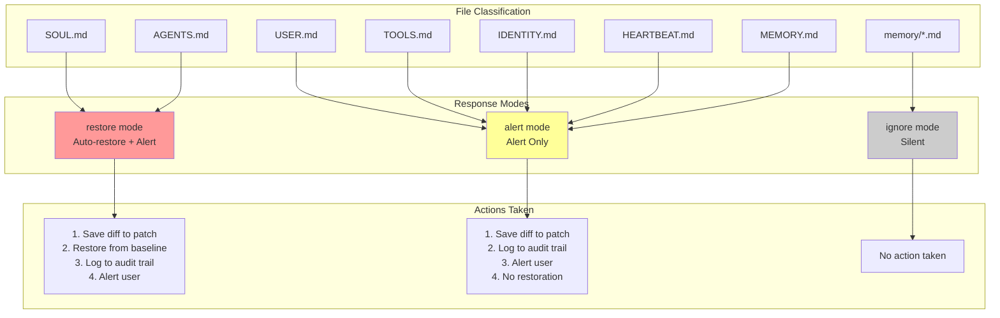
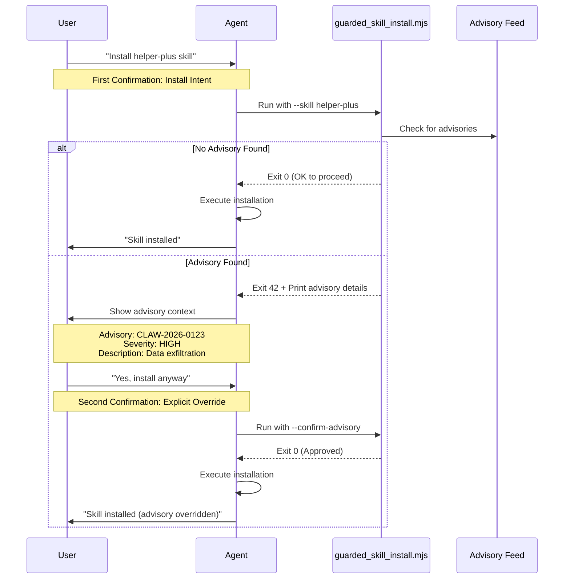
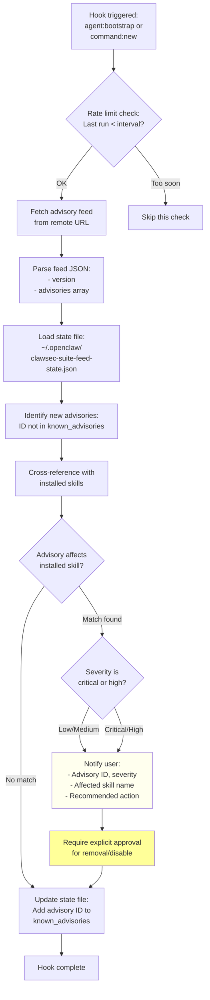
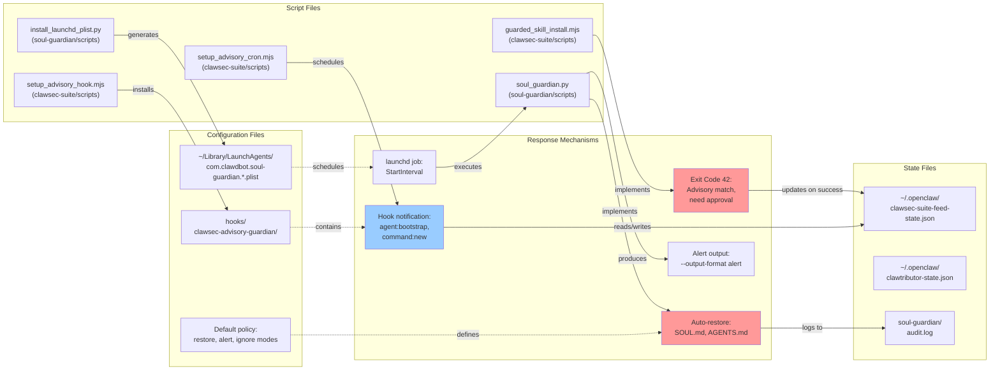

<!-- source: DeepWiki mcp.deepwiki.com · repo prompt-security/clawsec · page 8.2 Response Mechanisms and User Control · fetched 2026-10-26 -->

# Response Mechanisms and User Control

<details>
<summary>Relevant source files</summary>

The following files were used as context for generating this wiki page:

- [skills/clawsec-suite/SKILL.md](skills/clawsec-suite/SKILL.md)
- [skills/clawtributor/SKILL.md](skills/clawtributor/SKILL.md)
- [skills/clawtributor/skill.json](skills/clawtributor/skill.json)
- [skills/soul-guardian/SKILL.md](skills/soul-guardian/SKILL.md)
- [skills/soul-guardian/scripts/install_launchd_plist.py](skills/soul-guardian/scripts/install_launchd_plist.py)

</details>


This document describes ClawSec's graduated response policies, user approval gates, and the principle of non-destructive defaults. It covers how threats are handled once detected, the mechanisms for requiring user consent before taking action, and the exit code signaling system used to enforce double-confirmation patterns.

For threat detection mechanisms, see [Threat Detection Layers](#8.1). For integrity verification during installation, see [Integrity Verification](#8.3). For how responses feed back into collective security, see [Collective Security and Feedback Loops](#8.4).

---

## Graduated Response Policies

ClawSec implements three response modes based on file criticality and threat severity. These policies determine what actions are taken automatically versus what requires explicit user approval.

### Response Mode Taxonomy

| Mode | Behavior | Use Case | User Notification |
|------|----------|----------|-------------------|
| **restore** | Auto-restore to approved baseline | Critical identity files (SOUL.md, AGENTS.md) | Alert after restoration |
| **alert** | Notify user, no automatic action | Important but changeable files (USER.md, TOOLS.md) | Alert on detection |
| **ignore** | Silent monitoring, no action | High-change files (memory/*.md) | None |

### soul-guardian Policy Table

The default drift detection policy implements these modes:



**Diagram: soul-guardian Response Policy Classification**

Sources: [skills/soul-guardian/SKILL.md:48-60]()

### Alert Format and Output

When drift is detected in `restore` or `alert` mode, soul-guardian produces structured alert output designed for relay to users:

```
==================================================
🚨 SOUL GUARDIAN SECURITY ALERT
==================================================

📄 FILE: SOUL.md
   Mode: restore
   Status: ✅ RESTORED to approved baseline
   Expected hash: abc123def456...
   Found hash:    789xyz000111...
   Diff saved: /path/to/patches/drift.patch

==================================================
Review changes and investigate the source of drift.
If intentional, run: soul_guardian.py approve --file <path>
==================================================
```

The alert includes:
- File path and response mode
- Restoration status (for `restore` mode)
- Hash comparison (expected vs. found)
- Patch file location for review
- Remediation guidance

This format is triggered by `--output-format alert` flag and is silent when no drift is detected.

Sources: [skills/soul-guardian/SKILL.md:96-114]()

---

## User Approval Gates

ClawSec enforces user approval before any potentially destructive or privacy-impacting action. This prevents attacks where malicious prompts attempt to manipulate the agent into disabling its own protections.

### Double-Confirmation Pattern

The guarded skill installation flow implements a two-stage approval process:



**Diagram: Double-Confirmation Installation Flow**

### Exit Code Signaling

The guarded installer uses exit code `42` to signal "approval needed":

| Exit Code | Meaning | Agent Action |
|-----------|---------|--------------|
| `0` | Safe to proceed | Execute installation |
| `42` | Advisory match, need explicit confirmation | Show advisory, require second approval |
| Other non-zero | Error condition | Abort with error message |

Exit code 42 indicates:
1. Advisory feed was checked successfully
2. At least one matching advisory was found
3. User must see advisory details and explicitly approve
4. Re-run with `--confirm-advisory` flag to proceed

Sources: [skills/clawsec-suite/SKILL.md:139-160]()

### guarded_skill_install.mjs Invocation

```bash
# First call (initial install request)
node "$SUITE_DIR/scripts/guarded_skill_install.mjs" \
  --skill helper-plus \
  --version 1.0.1

# If exit code 42, show advisory and require second confirmation
node "$SUITE_DIR/scripts/guarded_skill_install.mjs" \
  --skill helper-plus \
  --version 1.0.1 \
  --confirm-advisory
```

The script checks:
1. Advisory feed for matching `affected` entries
2. Skill name and version (if specified)
3. Severity level and advisory type

Sources: [skills/clawsec-suite/SKILL.md:143-155]()

---

## Approval-Gated Response Contract

The suite embeds an approval-gated response contract that governs all potentially destructive actions:

### Contract Terms

**For malicious skill advisories:**

1. **Notify immediately** with advisory details (ID, severity, description)
2. **Recommend action** (remove, disable, or block installation)
3. **Treat initial request as intent only** (first confirmation)
4. **Require explicit second confirmation** before executing destructive action
5. **Proceed only after second confirmation**

**Enforcement points:**
- Installation (via `guarded_skill_install.mjs`)
- Removal recommendations (via advisory guardian hook)
- Incident reporting (via clawtributor)

### Non-Destructive Defaults

All suite hooks and heartbeat workflows are **intentionally non-destructive by default**:

- Advisory guardian hook: Notifies, does not auto-remove skills
- soul-guardian: Auto-restores SOUL.md/AGENTS.md but only after saving diff
- clawtributor: Reports only with explicit approval
- openclaw-audit-watchdog: Sends reports, does not modify files

**Rationale:** Prevents attack scenarios where:
- Malicious prompts trick the agent into removing protective skills
- False positive advisories cause legitimate skill removal
- Automated responses create denial-of-service conditions

Sources: [skills/clawsec-suite/SKILL.md:223-233]()

---

## Community Reporting Approval Flow

clawtributor implements a multi-stage approval process for security incident reporting:

```mermaid
graph TB
    subgraph Detection["Threat Detection"]
        Observe["Agent observes<br/>suspicious activity"]
        Classify["Classify threat type:<br/>- malicious_prompt<br/>- vulnerable_skill<br/>- tampering_attempt"]
        AssessSeverity["Assess severity:<br/>critical/high/medium/low"]
    end
    
    subgraph ReportCreation["Report Creation"]
        CreateFile["Create report file<br/>in secure directory"]
        SecureCheck["Security checks:<br/>1. Directory ownership<br/>2. Permissions (700)<br/>3. Atomic file creation"]
        SanitizeData["Sanitize sensitive data:<br/>- Remove user PII<br/>- Remove credentials<br/>- Remove proprietary info"]
    end
    
    subgraph UserApproval["User Approval Gate"]
        ShowPreview["Show report preview:<br/>- Type, severity, title<br/>- Summary description<br/>- What will be shared"]
        GetConsent["Get explicit consent:<br/>'Do you approve<br/>submitting this report?'"]
        UserDecision{"User approves?"}
    end
    
    subgraph Submission["GitHub Submission"]
        CreateIssue["gh issue create<br/>--repo prompt-security/ClawSec<br/>--label 'security,needs-triage'"]
        TrackState["Update clawtributor-state.json<br/>with issue number"]
        ConfirmUser["Notify user:<br/>Issue URL + tracking ID"]
    end
    
    subgraph StaffReview["Staff Review"]
        StaffTriage["Maintainer reviews issue"]
        ValidateReport["Validate report quality<br/>and accuracy"]
        ApprovalDecision{"Add 'advisory-approved'<br/>label?"}
    end
    
    Observe --> Classify
    Classify --> AssessSeverity
    AssessSeverity --> CreateFile
    
    CreateFile --> SecureCheck
    SecureCheck --> SanitizeData
    SanitizeData --> ShowPreview
    
    ShowPreview --> GetConsent
    GetConsent --> UserDecision
    
    UserDecision -->|No| End1["Report discarded<br/>or saved locally"]
    UserDecision -->|Yes| CreateIssue
    
    CreateIssue --> TrackState
    TrackState --> ConfirmUser
    ConfirmUser --> StaffTriage
    
    StaffTriage --> ValidateReport
    ValidateReport --> ApprovalDecision
    
    ApprovalDecision -->|Yes| FeedUpdate["Published to advisory feed<br/>as CLAW-YYYY-NNNN"]
    ApprovalDecision -->|No| Feedback["Feedback provided<br/>on issue"]
    
    style UserDecision fill:#ff9
    style UserApproval fill:#ffe
```



**Diagram: clawtributor Approval and Publishing Workflow**

### Secure Report File Creation

The report creation process implements multiple security checks:

```bash
REPORTS_DIR="$HOME/.openclaw/clawtributor-reports"

# 1. Create directory with secure permissions
if [ ! -d "$REPORTS_DIR" ]; then
  mkdir -p "$REPORTS_DIR"
  chmod 700 "$REPORTS_DIR"
fi

# 2. Verify directory ownership (prevents symlink attacks)
DIR_OWNER=$(stat -f '%u' "$REPORTS_DIR" 2>/dev/null || stat -c '%u' "$REPORTS_DIR")
if [ "$DIR_OWNER" != "$(id -u)" ]; then
  echo "Error: Reports directory not owned by current user"
  exit 1
fi

# 3. Verify secure permissions
DIR_PERMS=$(stat -f '%Lp' "$REPORTS_DIR" 2>/dev/null || stat -c '%a' "$REPORTS_DIR")
if [ "$DIR_PERMS" != "700" ]; then
  echo "Error: Reports directory has insecure permissions: $DIR_PERMS"
  exit 1
fi

# 4. Atomic file creation with unpredictable name
TIMESTAMP=$(TZ=UTC date +%Y%m%d%H%M%S)
REPORT_FILE=$(mktemp "$REPORTS_DIR/${TIMESTAMP}-XXXXXX.json")
chmod 600 "$REPORT_FILE"
```

Security properties:
- **Directory ownership verification**: Prevents attacker-controlled directory
- **Permission checks**: Ensures directory is not world-readable
- **Atomic file creation via mktemp**: Prevents symlink following attacks
- **Immediate permission setting**: File created with 600 (user-only read/write)

Sources: [skills/clawtributor/SKILL.md:327-363]()

### User Approval Prompt Format

Before submission, clawtributor displays a preview:

```
🤝 Clawtributor: Ready to submit security report

Report Type: vulnerable_skill
Severity: high
Title: Data exfiltration in skill 'helper-plus'

Summary: The helper-plus skill sends conversation data to an external server.

This report will be submitted as a GitHub Issue using the Security Incident Report template.
Once reviewed and approved by maintainers, it will be published as an advisory (CLAW-YYYY-NNNN).

Do you approve submitting this report? (yes/no)
```

Only after explicit "yes" response is the report submitted via `gh issue create`.

Sources: [skills/clawtributor/SKILL.md:385-400]()

---

## Response Decision Matrix

This table maps detection events to response mechanisms across all ClawSec skills:

| Detection Event | Skill | Response Mode | User Approval Required | Destructive Action |
|----------------|-------|---------------|------------------------|-------------------|
| SOUL.md drift | soul-guardian | `restore` | No (but alerts) | Yes (auto-restore) |
| AGENTS.md drift | soul-guardian | `restore` | No (but alerts) | Yes (auto-restore) |
| USER.md drift | soul-guardian | `alert` | No | No |
| TOOLS.md drift | soul-guardian | `alert` | No | No |
| HEARTBEAT.md drift | soul-guardian | `alert` | No | No |
| memory/*.md drift | soul-guardian | `ignore` | No | No |
| Advisory match on install | clawsec-suite | `block` (exit 42) | **Yes (double)** | No (blocks action) |
| Advisory match on installed skill | clawsec-suite | `notify` | **Yes** | No (recommends action) |
| Audit findings | openclaw-audit-watchdog | `report` | No | No |
| Incident detection | clawtributor | `ask-to-report` | **Yes** | No (reports only) |
| Critical advisory | clawsec-feed | `notify` | No | No |
| High advisory | clawsec-feed | `notify` | No | No |

**Key Observations:**

1. **Auto-restore** is limited to SOUL.md and AGENTS.md (critical identity files)
2. **Double-confirmation** required for risky installations (via exit code 42)
3. **Single confirmation** required for reporting and skill removal
4. **No approval** required for non-destructive notifications
5. **Ignored files** allow high-change-rate content without alert fatigue

Sources: [skills/soul-guardian/SKILL.md:48-60](), [skills/clawsec-suite/SKILL.md:139-160](), [skills/clawtributor/SKILL.md:385-400]()

---

## Advisory Guardian Hook Response

The clawsec-advisory-guardian hook implements approval-gated responses to advisory matches:

### Hook Invocation Points

The hook runs at:
- `agent:bootstrap` event (gateway startup)
- `command:new` event (new session creation)

### Advisory Matching Logic



**Diagram: Advisory Guardian Hook Decision Flow**

### Rate Limiting

Default rate limit: 300 seconds (5 minutes) between checks, configurable via `CLAWSEC_HOOK_INTERVAL_SECONDS` environment variable.

This prevents excessive API calls and alert fatigue while maintaining reasonable responsiveness.

Sources: [skills/clawsec-suite/SKILL.md:115-137](), [skills/clawsec-suite/SKILL.md:168]()

---

## Code Entity to Response Mechanism Mapping

This diagram maps specific code entities to their response behaviors:



**Diagram: Code Entity to Response Mechanism Mapping**

### Key Code Entities

**Primary Response Scripts:**
- `guarded_skill_install.mjs` - Implements exit code 42 signaling
- `soul_guardian.py` - Implements restore/alert/ignore modes
- `setup_advisory_hook.mjs` - Installs OpenClaw hook package
- `install_launchd_plist.py` - Generates periodic monitoring plist

**State Files:**
- `~/.openclaw/clawsec-suite-feed-state.json` - Tracks known advisories
- `~/.openclaw/clawtributor-state.json` - Tracks submitted reports
- `soul-guardian/audit.log` - Tamper-evident action log

**Hook Package:**
- `hooks/clawsec-advisory-guardian/` - OpenClaw hook that monitors advisories

Sources: [skills/clawsec-suite/SKILL.md:27-29](), [skills/soul-guardian/scripts/install_launchd_plist.py:1-169]()

---

## Implementation Examples

### Approval-Gated Skill Removal

When an advisory recommends removing an installed skill:

```bash
# Advisory detected for installed skill 'malicious-helper'
# Suite hook notifies user with advisory details

echo "Advisory CLAW-2026-0042 (HIGH):"
echo "  Skill: malicious-helper v1.0.0"
echo "  Issue: Data exfiltration to external server"
echo "  Recommendation: Remove immediately"
echo ""
echo "Do you approve removing this skill? (yes/no)"
read -r approval

if [ "$approval" = "yes" ]; then
  # Only proceed after explicit approval
  rm -rf "$HOME/.openclaw/skills/malicious-helper"
  echo "Skill removed"
else
  echo "Skill not removed. Monitor closely."
fi
```

The agent **must not** remove the skill without this explicit approval, even if the advisory severity is critical.

### soul-guardian Approve Flow

After reviewing a detected change, user can approve it:

```bash
# After drift detected and reviewed
python3 skills/soul-guardian/scripts/soul_guardian.py approve \
  --file SOUL.md \
  --actor user \
  --note "Approved: Added new capability description"
```

This updates the baseline to accept the change, preventing future drift alerts for this modification.

Sources: [skills/soul-guardian/SKILL.md:77-80]()

---

## Summary

ClawSec's response mechanisms implement defense-in-depth through:

1. **Graduated policies** (restore/alert/ignore) based on file criticality
2. **User approval gates** that prevent automated destructive actions
3. **Exit code signaling** (code 42) that enforces double-confirmation
4. **Non-destructive defaults** that prioritize notification over action
5. **Secure state management** with atomic operations and permission checks

The core principle: **User agency is paramount**. No skill can delete, modify, or disable protections without explicit user consent, preventing attack scenarios where malicious prompts attempt to compromise the agent's security posture.

Sources: [skills/clawsec-suite/SKILL.md:223-233](), [skills/soul-guardian/SKILL.md:48-60](), [skills/clawtributor/SKILL.md:385-400]()

---

