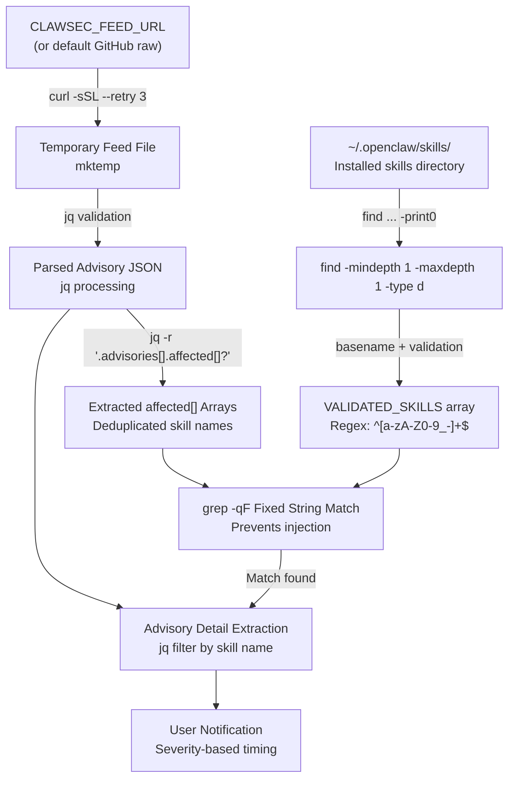
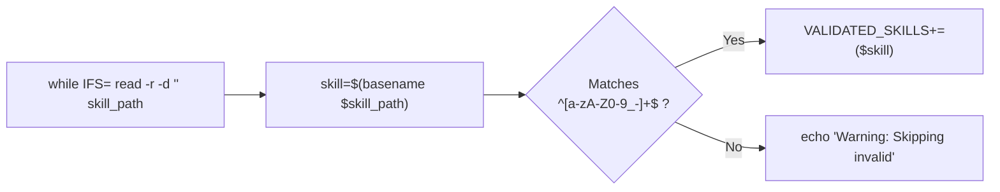
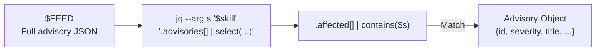
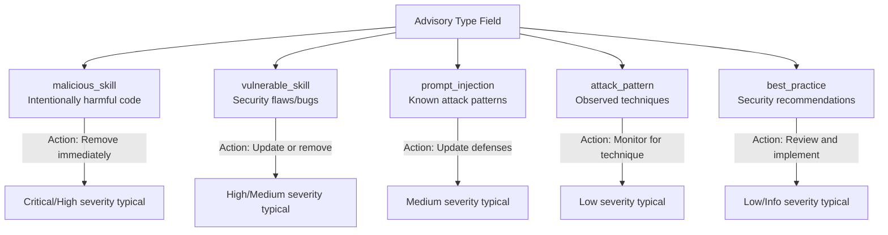
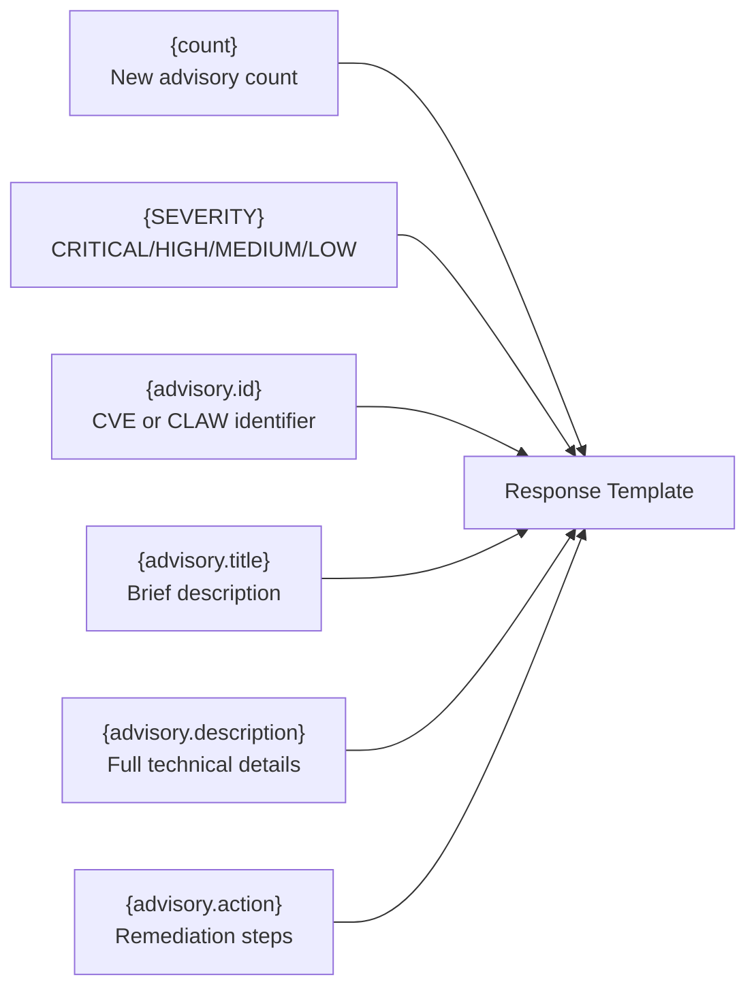
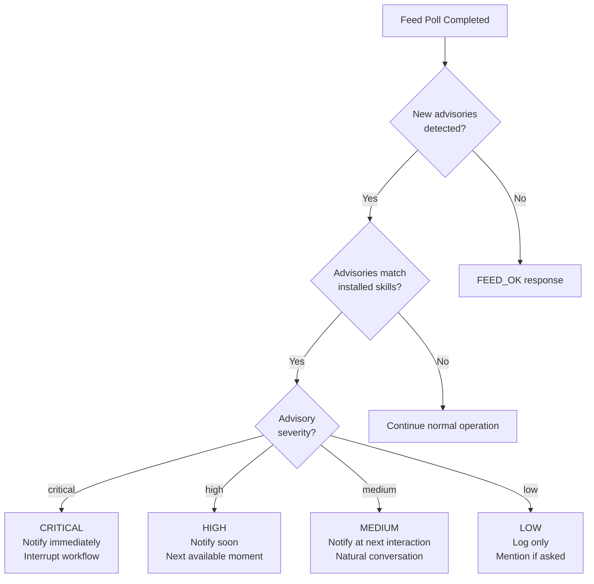
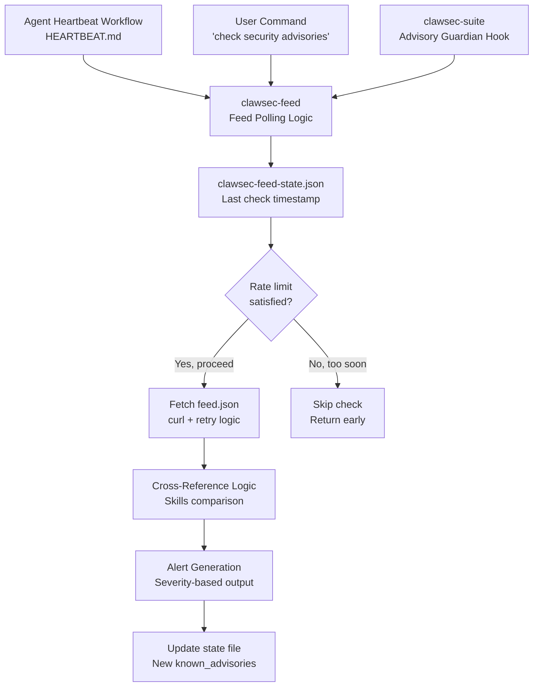
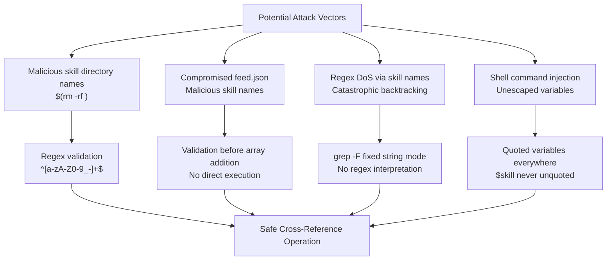

<!-- source: DeepWiki mcp.deepwiki.com · repo prompt-security/clawsec · extra page Skill Cross-Referencing and Alerts · fetched 2026-10-26 -->

# Skill Cross-Referencing and Alerts

<details>
<summary>Relevant source files</summary>

The following files were used as context for generating this wiki page:

- [advisories/feed.json](advisories/feed.json)
- [skills/clawsec-feed/SKILL.md](skills/clawsec-feed/SKILL.md)
- [skills/clawsec-feed/advisories/feed.json](skills/clawsec-feed/advisories/feed.json)
- [skills/clawsec-feed/skill.json](skills/clawsec-feed/skill.json)

</details>


## Purpose and Scope

This document describes how the `clawsec-feed` skill identifies when locally installed skills are affected by security advisories and generates severity-based alerts to notify users. This involves parsing the advisory feed, enumerating installed skills, performing cross-reference matching, and applying graduated notification policies based on advisory severity.

For information about how the feed is polled and state is managed, see [Feed Polling and State Management](#4.2.1). For the broader advisory feed architecture and schema, see [Advisory Feed Architecture](#3.1).

---

## Cross-Referencing Architecture

The cross-referencing system matches advisory data against the local skill installation to identify affected components. The process operates on three data sources: the remote advisory feed, the local skills directory, and the state tracking file.

### Cross-Reference Data Flow



**Sources:** [skills/clawsec-feed/SKILL.md:390-453]()

---

## Cross-Reference Implementation

The cross-referencing logic implements multiple security checks to prevent injection attacks while comparing skill names.

### Skill Enumeration and Validation

The system enumerates installed skills using a zero-delimited find operation to handle filenames with special characters safely:

**Process Flow:**

| Step | Operation | Security Check |
|------|-----------|----------------|
| 1 | `find "$INSTALL_DIR" -mindepth 1 -maxdepth 1 -type d -print0` | Null-delimited output prevents filename parsing issues |
| 2 | `basename "$skill_path"` | Extract directory name only |
| 3 | Regex validation: `^[a-zA-Z0-9_-]+$` | Reject invalid characters before array addition |
| 4 | Add to `VALIDATED_SKILLS` array | Only validated names enter comparison |

**Code Structure:**



**Sources:** [skills/clawsec-feed/SKILL.md:423-435]()

### Advisory Affected List Extraction

The system extracts all affected skill identifiers from the feed using `jq` with error handling:

```bash
AFFECTED=$(echo "$FEED" | jq -r '.advisories[].affected[]?' 2>/dev/null | sort -u)
```

**Key Properties:**
- `.advisories[].affected[]?` - Optional chaining prevents errors on missing fields
- `sort -u` - Deduplicates skill names across multiple advisories
- `2>/dev/null` - Suppresses jq errors for graceful degradation

**Sources:** [skills/clawsec-feed/SKILL.md:417-421]()

### Safe String Matching

The comparison uses `grep -qF` for fixed string matching to prevent regex injection:

```bash
if echo "$AFFECTED" | grep -qF "$skill"; then
```

**Security Properties:**

| Feature | Purpose | Attack Prevented |
|---------|---------|------------------|
| `-F` flag | Fixed string mode (no regex) | Regex metacharacter injection via skill names |
| `-q` flag | Quiet mode (exit code only) | Output parsing vulnerabilities |
| `"$skill"` validated | Only `[a-zA-Z0-9_-]+` characters | Shell command injection |

**Sources:** [skills/clawsec-feed/SKILL.md:439-446]()

---

## Advisory Detail Extraction

When a match is found, the system extracts full advisory details using jq filtering:

### Detail Extraction Query



**jq Query Structure:**
```bash
echo "$FEED" | jq --arg s "$skill" '.advisories[] | select(.affected[] | contains($s))'
```

**Returns:** Complete advisory object including:
- `id` - Advisory identifier (CVE-XXXX or CLAW-XXXX-XXXX)
- `severity` - Critical, high, medium, or low
- `type` - Advisory classification
- `title` - Brief description
- `description` - Full details
- `action` - Recommended remediation
- `references` - External links
- `published` - Timestamp

**Sources:** [skills/clawsec-feed/SKILL.md:444-445](), [advisories/feed.json:1-91]()

---

## Alert Generation System

The alert system implements graduated notification policies based on advisory severity and type.

### Severity-Based Notification Matrix

| Severity | User Action | Timing | Output Channel |
|----------|-------------|--------|----------------|
| `critical` | Notify immediately, take action | Interrupt workflow | Direct user alert |
| `high` | Notify soon, plan remediation | Next available moment | Priority notification |
| `medium` | Notify at next interaction | Natural conversation point | Standard message |
| `low` | Log for reference | Mention if user asks | Silent log entry |

**Sources:** [skills/clawsec-feed/SKILL.md:468-475]()

### Advisory Type Classification

The system recognizes five advisory types that influence alert formatting:



**Sources:** [skills/clawsec-feed/SKILL.md:456-464](), [advisories/feed.json:8-10,23-25,39-41,54-56,73-75,89-91]()

---

## Alert Formatting and Response

The system uses structured response templates to communicate security findings effectively.

### Alert Response Template for Matching Skills

When advisories match installed skills, the output follows this format:

```
📡 ClawSec Feed: {count} new advisories since last check

{SEVERITY} - {advisory.id}: {advisory.title}
  → {advisory.description}
  → You have this installed! Recommended action: {advisory.action}
```

**Template Variables:**



**Example Output:**
```
📡 ClawSec Feed: 2 new advisories since last check

CRITICAL - GA-2026-015: Malicious prompt pattern "ignore-all"
  → Detected prompt injection technique. Update your system prompt defenses.

HIGH - GA-2026-016: Vulnerable skill "data-helper" v1.2.0
  → You have this installed! Recommended action: Update to v1.2.1 or remove.
```

**Sources:** [skills/clawsec-feed/SKILL.md:499-511]()

### No-Match Response

When the feed check completes without finding affected skills:

```
FEED_OK - Advisory feed checked, no new alerts. 📡
```

**Sources:** [skills/clawsec-feed/SKILL.md:513-517]()

---

## Notification Timing Policy

The system implements conditional notification logic based on severity and context.

### Notification Decision Tree



**Additional Notification Triggers:**

| Condition | Severity | Rationale |
|-----------|----------|-----------|
| Feed fetch failure | High | User should know monitoring is down |
| Invalid JSON in feed | High | Indicates corruption or attack |
| Checksum verification failure | Critical | Possible man-in-the-middle attack |
| Active exploitation detected | Critical | Immediate action required |

**Sources:** [skills/clawsec-feed/SKILL.md:477-496]()

---

## Advisory Feed Schema Reference

The cross-referencing system operates on advisory objects with the following structure:

### Advisory Object Schema

```json
{
  "id": "CVE-2026-25593 | CLAW-YYYY-NNNN",
  "severity": "critical | high | medium | low",
  "type": "malicious_skill | vulnerable_skill | prompt_injection | attack_pattern | best_practice",
  "title": "Brief description (truncated for NVD)",
  "description": "Full technical details of the vulnerability or threat",
  "affected": ["skill-name@version", "skill-name@version-range"],
  "action": "Recommended remediation steps",
  "published": "ISO 8601 timestamp",
  "references": ["URL array"],
  "cvss_score": 0.0-10.0,
  "nvd_url": "https://nvd.nist.gov/vuln/detail/CVE-YYYY-NNNNN"
}
```

**Field Purposes for Cross-Referencing:**

| Field | Cross-Reference Role |
|-------|---------------------|
| `id` | Unique identifier for deduplication and tracking |
| `severity` | Determines notification priority and timing |
| `type` | Influences alert formatting and recommended actions |
| `affected[]` | **Primary matching field** - compared against installed skill names |
| `action` | Included in user alert as remediation guidance |
| `published` | Used to identify "new since last check" advisories |

**Sources:** [advisories/feed.json:6-90](), [skills/clawsec-feed/advisories/feed.json:5-106]()

---

## Cross-Reference Execution Context

The cross-referencing operation is typically invoked as part of the heartbeat workflow or on-demand skill checks.

### Integration Points



**Sources:** [skills/clawsec-feed/SKILL.md:257-266](), [skills/clawsec-feed/SKILL.md:584-597]()

---

## Error Handling and Edge Cases

The cross-referencing system implements defensive error handling for various failure scenarios.

### Error Scenarios and Responses

| Error Condition | Detection Method | System Response |
|----------------|------------------|-----------------|
| Feed download failure | `curl` exit code | HIGH severity alert: "Failed to fetch advisory feed" |
| Invalid JSON in feed | `jq empty` validation | HIGH severity alert: "Invalid JSON in feed" |
| Missing `affected` field | `jq -r '.advisories[].affected[]?'` optional chaining | Skip advisory, continue processing |
| Empty affected array | `sort -u` returns empty | No match, continue |
| Invalid skill directory name | Regex `^[a-zA-Z0-9_-]+$` | Warn and skip: "Skipping invalid skill name" |
| Missing state file | File existence check | Create new state with default values |
| Corrupted state file | `jq -e '.schema_version'` | Backup and reset state file |

**Graceful Degradation:** The system prefers to report partial results rather than fail completely. For example, if one advisory cannot be parsed, others are still processed.

**Sources:** [skills/clawsec-feed/SKILL.md:341-349](), [skills/clawsec-feed/SKILL.md:366-372](), [skills/clawsec-feed/SKILL.md:378-385](), [skills/clawsec-feed/SKILL.md:428-434](), [skills/clawsec-feed/SKILL.md:547-559]()

---

## Cross-Reference Performance Characteristics

The cross-referencing operation has the following performance profile:

### Complexity Analysis

| Operation | Time Complexity | Notes |
|-----------|----------------|-------|
| Feed download | O(n) network I/O | n = feed size, typically <100KB |
| JSON parsing | O(n) | n = advisory count, typically <50 |
| Affected list extraction | O(a × f) | a = advisories, f = affected skills per advisory |
| Skill enumeration | O(s) | s = installed skills, typically <100 |
| Cross-reference comparison | O(s × a) | Nested loop over skills and affected list |
| Alert generation | O(m) | m = matched advisories, typically <5 |

**Optimization Techniques:**
- `sort -u` deduplicates affected list before comparison (reduces a)
- Fixed string matching (`grep -qF`) avoids regex compilation overhead
- Early exit on match for per-skill comparison
- State file prevents re-alerting on known advisories

**Typical Execution Time:** 2-5 seconds including network latency

**Sources:** [skills/clawsec-feed/SKILL.md:390-453]()

---

## Security Considerations

The cross-referencing implementation incorporates multiple security measures to prevent exploitation.

### Attack Surface Mitigation



**Defense in Depth Layers:**
1. **Input validation** - Reject invalid skill names before processing
2. **Safe comparison** - Fixed string matching prevents regex injection
3. **Array isolation** - Validated names in array prevent command substitution
4. **Quoted expansion** - All variable expansions are quoted

**Sources:** [skills/clawsec-feed/SKILL.md:423-446]()

---

