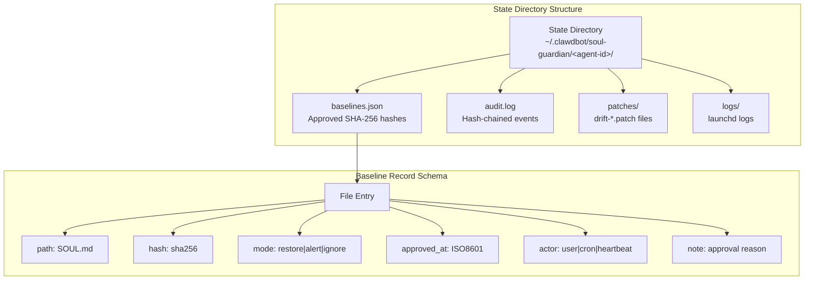
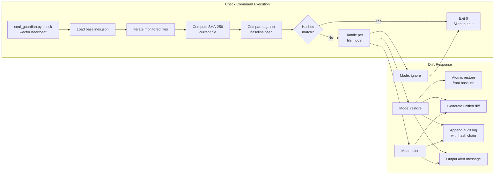
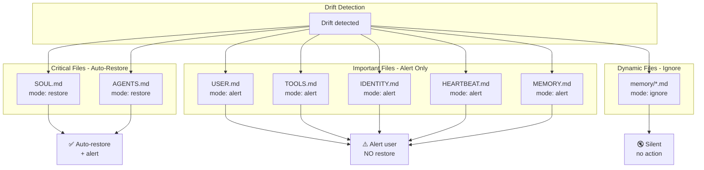
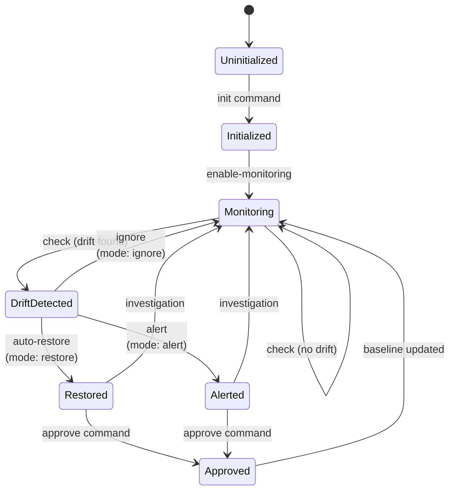
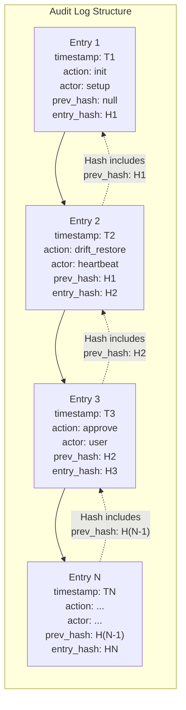
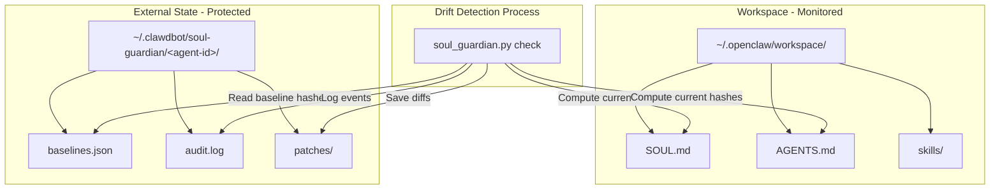

<!-- source: DeepWiki mcp.deepwiki.com · repo prompt-security/clawsec · extra page Baseline Management and Drift Detection · fetched 2026-10-26 -->

# Baseline Management and Drift Detection

<details>
<summary>Relevant source files</summary>

The following files were used as context for generating this wiki page:

- [skills/soul-guardian/SKILL.md](skills/soul-guardian/SKILL.md)
- [skills/soul-guardian/scripts/install_launchd_plist.py](skills/soul-guardian/scripts/install_launchd_plist.py)

</details>


## Purpose and Scope

This page documents the baseline management and drift detection mechanisms implemented by the `soul-guardian` skill. It covers how SHA-256 file baselines are created and maintained, the drift detection algorithm, graduated response policies (restore vs alert vs ignore), and the tamper-evident audit trail system.

For information about the macOS launchd integration for automated periodic checks, see [macOS launchd Integration](#4.3.2). For the overall soul-guardian skill architecture, see [soul-guardian: Drift Detection and File Integrity](#4.3).

---

## Baseline Architecture

Soul-guardian maintains a cryptographic baseline of monitored workspace files using SHA-256 hashes. Each monitored file has an associated baseline record that includes the approved hash, file mode (restore/alert/ignore), and metadata about when and by whom the baseline was established.

### State Directory Structure

Baselines and operational state are stored in a state directory that can be external to the workspace for improved resilience against tampering:

| Directory/File | Purpose |
|---------------|---------|
| `<state-dir>/baselines.json` | Current approved SHA-256 hashes for monitored files |
| `<state-dir>/audit.log` | Tamper-evident hash-chained audit trail |
| `<state-dir>/patches/` | Unified diffs capturing detected drift |
| `<state-dir>/logs/` | launchd stdout/stderr logs (macOS only) |

The default state directory follows the pattern `~/.clawdbot/soul-guardian/<agent-id>/`, where `<agent-id>` defaults to the workspace folder name. This external storage ensures that even if the workspace is compromised, the baseline state remains intact for detection.

**Baseline Storage Format**



**Sources:** [skills/soul-guardian/SKILL.md:1-164](), [skills/soul-guardian/scripts/install_launchd_plist.py:33-34](), [skills/soul-guardian/scripts/install_launchd_plist.py:96-100]()

---

## Drift Detection Mechanism

Drift detection operates by computing the current SHA-256 hash of each monitored file and comparing it against the approved baseline hash stored in `baselines.json`. The detection process is deterministic and occurs during `check` command execution.

### Hash Computation Flow



**Exit Codes:**
- `0`: No drift detected, silent operation
- `2`: Drift detected and handled according to policy

The check command implements "silent on success" behavior, producing no output when all files match their baselines. This design enables seamless integration into heartbeat workflows and periodic cron jobs without generating noise.

**Sources:** [skills/soul-guardian/SKILL.md:63-70](), [skills/soul-guardian/scripts/install_launchd_plist.py:5-8]()

---

## Graduated Response Policy

Soul-guardian implements three response modes that determine how drift is handled when detected. The mode is configured per file in the baselines and defines the automation level.

### Response Mode Matrix

| Mode | Behavior | Use Case |
|------|----------|----------|
| **restore** | Auto-restore file to baseline + alert | Critical identity files that should never change without explicit approval |
| **alert** | Alert user but do NOT restore | Important files where drift should be noticed but auto-restore may be destructive |
| **ignore** | No action, no alert | Files expected to change frequently (e.g., memory logs) |

### Default File Policy

The skill ships with a default policy that balances security with usability:



**Rationale:**
- **SOUL.md** and **AGENTS.md** define agent identity and behavior. Unauthorized changes to these files represent potential prompt injection or configuration tampering, warranting automatic restoration.
- **USER.md**, **TOOLS.md**, etc. are important but may legitimately change during operation. Alerts allow user awareness without risking data loss from incorrect restoration.
- **memory/*.md** files are transient by nature and expected to change constantly, so monitoring them would generate excessive false positives.

**Sources:** [skills/soul-guardian/SKILL.md:48-60]()

---

## Alert Output Format

When drift is detected, the `check` command with `--output-format alert` produces structured human-readable output designed for relay to users via TUI, chat, or notification systems.

### Alert Message Structure

```
==================================================
🚨 SOUL GUARDIAN SECURITY ALERT
==================================================

📄 FILE: SOUL.md
   Mode: restore
   Status: ✅ RESTORED to approved baseline
   Expected hash: abc123def456...
   Found hash:    789xyz000111...
   Diff saved: /path/to/patches/drift-20260115-143025.patch

==================================================
Review changes and investigate the source of drift.
If intentional, run: soul_guardian.py approve --file <path>
==================================================
```

The alert includes:
- **File path**: Which file experienced drift
- **Mode**: Response policy applied (restore/alert/ignore)
- **Status**: Action taken (RESTORED vs ALERT ONLY)
- **Hashes**: Expected vs found SHA-256 for forensic verification
- **Diff location**: Path to unified diff file for change review
- **Remediation**: Command to approve if change was intentional

**Sources:** [skills/soul-guardian/SKILL.md:94-117]()

---

## Baseline Lifecycle Operations

Baselines progress through a lifecycle from initialization to approval as changes occur.



### Command Reference

| Command | Purpose | Actor Parameter | Note Parameter |
|---------|---------|----------------|----------------|
| `init` | Create initial baselines for all monitored files | `--actor setup` | `--note "initial baseline"` |
| `check` | Detect drift and apply response policy | `--actor heartbeat\|cron\|manual` | `--note "periodic check"` |
| `approve` | Update baseline to current file state | `--actor user` | `--note "intentional update"` |
| `status` | Display current baseline state | N/A | N/A |
| `verify-audit` | Verify audit log hash chain integrity | N/A | N/A |
| `watch` | Continuous monitoring loop | `--actor watch` | `--note "interval=<seconds>"` |

### Initialization Flow

```bash
# Step 1: Initialize baselines
cd ~/.openclaw/workspace
python3 skills/soul-guardian/scripts/soul_guardian.py init \
  --actor setup \
  --note "initial baseline"

# Step 2: Enable monitoring (shows integration instructions)
python3 skills/soul-guardian/scripts/soul_guardian.py enable-monitoring

# Step 3: Add to HEARTBEAT.md for automatic checks
```

The `init` command scans the workspace for known files, computes their SHA-256 hashes, and writes the initial `baselines.json`. This operation requires the workspace to be in a known-good state.

**Sources:** [skills/soul-guardian/SKILL.md:19-45](), [skills/soul-guardian/SKILL.md:61-90]()

---

## Audit Trail and Tamper Evidence

Soul-guardian maintains a tamper-evident audit log using hash chaining, where each audit entry includes the SHA-256 hash of the previous entry. This creates a cryptographic chain that makes retrospective log modification detectable.

### Hash Chain Architecture



**Verification:**
The `verify-audit` command recomputes the hash chain from the first entry to the last, detecting any modifications:
```bash
python3 skills/soul-guardian/scripts/soul_guardian.py verify-audit
```

If any entry has been tampered with, the hash chain breaks, revealing the integrity violation.

**Audit Event Types:**
- `init`: Baseline initialization
- `drift_detected`: File hash mismatch found
- `drift_restore`: Auto-restore performed (mode: restore)
- `drift_alert`: Alert-only notification (mode: alert)
- `approve`: User approved baseline update
- `manual_restore`: Manual restoration from baseline

Each entry includes:
- **timestamp**: ISO8601 timestamp
- **action**: Event type
- **actor**: Who/what triggered the action (user/heartbeat/cron/manual)
- **note**: Human-readable context
- **file**: Affected file path
- **old_hash**: Previous baseline hash (if applicable)
- **new_hash**: New baseline hash (if applicable)
- **prev_hash**: Hash of previous audit entry
- **entry_hash**: SHA-256 of current entry content

**Sources:** [skills/soul-guardian/SKILL.md:87-90](), [skills/soul-guardian/SKILL.md:120-135]()

---

## State Management and Security Properties

### External State Directory

The state directory should be stored outside the monitored workspace to prevent attackers from tampering with both files and baselines simultaneously:



**Configuration:**
```bash
# Default: state in workspace (less secure)
python3 skills/soul-guardian/scripts/soul_guardian.py init

# Recommended: external state directory
python3 skills/soul-guardian/scripts/soul_guardian.py init \
  --state-dir ~/.clawdbot/soul-guardian/my-agent
```

The `install_launchd_plist.py` script defaults to external state storage at `~/.clawdbot/soul-guardian/<agent-id>/`, implementing this best practice automatically.

**Sources:** [skills/soul-guardian/scripts/install_launchd_plist.py:33-34](), [skills/soul-guardian/scripts/install_launchd_plist.py:85-87](), [skills/soul-guardian/SKILL.md:130-135]()

---

## Security Properties and Limitations

### What soul-guardian Provides

| Property | Implementation |
|----------|---------------|
| **Drift detection** | SHA-256 hash comparison against baseline |
| **Tamper evidence** | Hash-chained audit log with `verify-audit` command |
| **Atomic restoration** | Atomic file writes prevent partial restores |
| **Symlink protection** | Refuses to operate on symlinks to prevent traversal |
| **Forensic diffs** | Unified diffs saved to patches/ for investigation |
| **Silent operation** | Zero output when no drift (cron/heartbeat friendly) |

### Known Limitations

| Limitation | Explanation |
|------------|-------------|
| **Actor metadata is best-effort** | Cannot cryptographically prove WHO made a change, only record claimed actor |
| **Requires external state for security** | If attacker controls workspace AND state directory, they can modify both files and baselines |
| **Not a backup system** | Baselines only store hashes, not file content (except in patches) |
| **Symlink targets not monitored** | Only symlink presence is hashed, not target content |

**Recommendation:** Combine soul-guardian with:
- External state directory (`--state-dir` outside workspace)
- Regular backups of workspace files
- Comprehensive audit monitoring ([openclaw-audit-watchdog](#4.4))
- Advisory feed monitoring ([clawsec-feed](#4.2))

**Sources:** [skills/soul-guardian/SKILL.md:120-135]()

---

## Integration with Heartbeat Workflow

Soul-guardian integrates into the portable HEARTBEAT.md workflow for periodic security checks. The recommended integration uses the alert output format:

```markdown
## Soul Guardian Check
- Run `python3 skills/soul-guardian/scripts/soul_guardian.py check --actor heartbeat --output-format alert`
- If any output is produced, relay it to the user immediately as a security alert
```

This integration ensures:
- **Zero overhead on normal operation**: Silent when no drift
- **Immediate user notification**: Alerts appear in agent chat/TUI
- **Forensic context**: Full alert with hashes and patch location
- **Action guidance**: Clear instructions for approving intentional changes

The `--actor heartbeat` parameter tags audit log entries for traceability, allowing later analysis of which checks detected which drift.

**Sources:** [skills/soul-guardian/SKILL.md:31-45](), [skills/soul-guardian/SKILL.md:63-70]()

---

