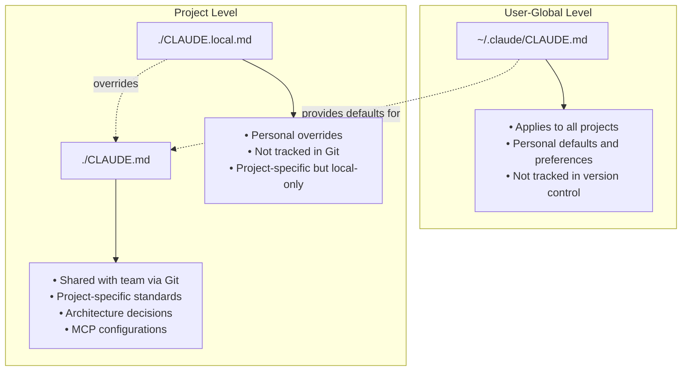
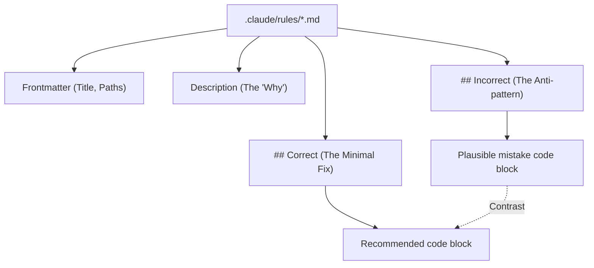
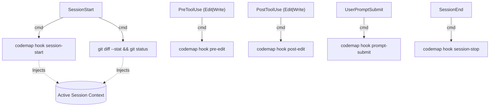
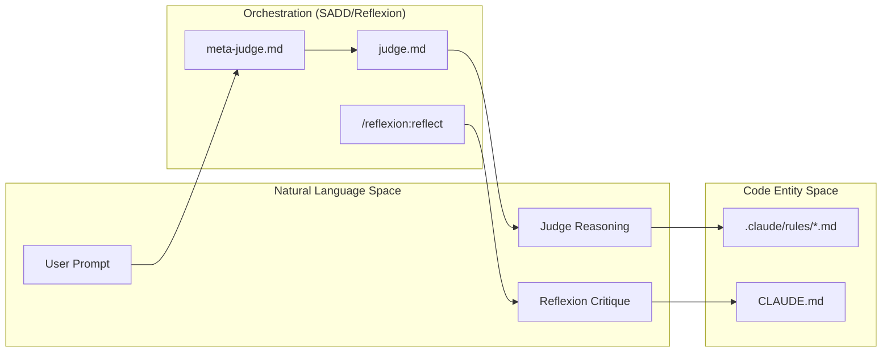

<!-- source: DeepWiki mcp.deepwiki.com · repo NeoLabHQ/context-engineering-kit · page 2.2 Configuration & Context Management · fetched 2026-10-26 -->

# Configuration & Context Management

Relevant source files

The following files were used as context for generating this wiki page:

- [.claude/commands/bump-plugin.md](.claude/commands/bump-plugin.md)
- [CLAUDE.md](CLAUDE.md)
- [docs/concepts.md](docs/concepts.md)
- [docs/plugins/README.md](docs/plugins/README.md)
- [docs/plugins/ddd/README.md](docs/plugins/ddd/README.md)
- [docs/plugins/ddd/usage-examples.md](docs/plugins/ddd/usage-examples.md)
- [docs/plugins/mcp/README.md](docs/plugins/mcp/README.md)
- [plugins/customaize-agent/skills/create-rule/SKILL.md](plugins/customaize-agent/skills/create-rule/SKILL.md)
- [plugins/ddd/README.md](plugins/ddd/README.md)
- [plugins/mcp/README.md](plugins/mcp/README.md)
- [plugins/sadd/agents/judge.md](plugins/sadd/agents/judge.md)
- [plugins/sadd/agents/meta-judge.md](plugins/sadd/agents/meta-judge.md)

This document details the three-tier configuration system used by the Context Engineering Kit (CEK) to manage persistent context across Claude Code sessions. It covers the `CLAUDE.md` file hierarchy, the role of the `.claude/rules/` system for behavioral guardrails, and session automation through lifecycle hooks.

## Three-Tier Configuration Hierarchy

The Context Engineering Kit uses a three-level configuration system to manage context that persists across sessions. This hierarchy allows for a balance between team-wide standards, project-specific local overrides, and universal user preferences.

Title: Configuration Hierarchy & Data Flow

**Sources:** [CLAUDE.md:1-27](), [plugins/mcp/README.md:21-27](), [docs/plugins/mcp/README.md:21-27]()

### Project-Shared Configuration (CLAUDE.md)

The project-shared `CLAUDE.md` file is located at the repository root and is tracked in version control. It contains team-wide context that all developers share. It is the primary target for **setup-commands** which establish persistent project context [CLAUDE.md:50-51]().

| Property | Value |
|----------|-------|
| **File Path** | `./CLAUDE.md` |
| **Git Tracking** | ✓ Tracked (committed to repository) |
| **Scope** | All team members, all sessions |
| **Purpose** | Shared project context, standards, architecture decisions |

**Key Sections in CLAUDE.md:**
- **Project Structure**: High-level map of the codebase [CLAUDE.md:7-27]().
- **Development Rules**: Hard constraints like "Commands over skills" [CLAUDE.md:44-51]().
- **MCP Configuration**: Recommended library IDs for Context7 or usage guidelines for Serena [CLAUDE.md:93-111]().
- **Task Tracking**: Standards for using tools like Minibeads [CLAUDE.md:139-161]().

**Sources:** [CLAUDE.md:1-161](), [docs/plugins/mcp/README.md:21-27]()

### Project-Personal and User-Global

- **Project-Personal (`CLAUDE.local.md`)**: Local configuration not tracked in git. Used for personal overrides or API keys that shouldn't be shared [plugins/mcp/README.md:24]().
- **User-Global (`~/.claude/CLAUDE.md`)**: Applies to all projects on the user's machine. Ideal for cross-project personal preferences [plugins/mcp/README.md:25]().

## Persistent Behavioral Guidelines (.claude/rules)

While `CLAUDE.md` provides broad project context, the `.claude/rules/` system provides granular, modular, and always-loaded behavioral guardrails. Rules act as "standing orders" that every agent session inherits automatically [plugins/customaize-agent/skills/create-rule/SKILL.md:10-18]().

### The Contrastive Pattern

The most critical technical requirement for rules in the CEK is the **Contrastive Pattern**. Research within the kit shows that rules with both positive and negative examples are significantly more discriminative [plugins/customaize-agent/skills/create-rule/SKILL.md:132-139]().

Title: Rule Structure and Contrastive Logic

**Sources:** [plugins/customaize-agent/skills/create-rule/SKILL.md:94-126]()

### Rule Types and Scoping

| Type | Implementation | Loading Behavior |
|------|----------------|------------------|
| **Global Rules** | No `paths` in frontmatter | Loaded every session [plugins/customaize-agent/skills/create-rule/SKILL.md:55-57]() |
| **Path-Scoped Rules**| `paths: ["src/**/*.ts"]` | Loaded only when working with matching files [plugins/customaize-agent/skills/create-rule/SKILL.md:66-69]() |
| **Priority Rules** | Evaluator/Judge guidance | Sets high-level evaluation priorities [plugins/customaize-agent/skills/create-rule/SKILL.md:82-84]() |

## Session Hooks and Automation

Automation is handled via `.claude/settings.json`, which allows executing shell commands at specific lifecycle events of a Claude Code session. This is extensively used by the **Codemap CLI** and other integration plugins to provide automatic project awareness.

Title: Session Hook Execution Flow

**Sources:** [CLAUDE.md:139-145](), [docs/plugins/mcp/README.md:53-54]()

## Token Management: Skills vs. Commands

A core design philosophy of the CEK is **Commands over Skills** to maintain token efficiency [CLAUDE.md:48]().

| Entity | Storage | Context Impact | Use Case |
|--------|---------|----------------|----------|
| **Commands** | `plugins/*/commands/*.md` | **On-demand**: Only loaded when explicitly called via `/` [docs/concepts.md:12-21]() | Complex, multi-step workflows |
| **Skills** | `plugins/*/skills/*.md` | **Default**: Descriptions load into context by default [CLAUDE.md:48]() | Procedural knowledge always needed |
| **Rules** | `.claude/rules/*.md` | **Always**: Loaded every session (or path-matched) [plugins/customaize-agent/skills/create-rule/SKILL.md:16-18]() | Behavioral guardrails |

**Sources:** [CLAUDE.md:46-51](), [plugins/customaize-agent/skills/create-rule/SKILL.md:27-36](), [docs/concepts.md:68-76]()

## Context Accumulation Flow

Context in the CEK is not static; it accumulates through development cycles. The **Reflexion** and **SADD** plugins are primary drivers of this accumulation, moving knowledge from "Natural Language Space" (feedback) to "Code Entity Space" (persistent rules).

Title: Context Accumulation Pipeline

**Sources:** [plugins/sadd/agents/judge.md:137-154](), [plugins/sadd/agents/meta-judge.md:37-56](), [plugins/customaize-agent/skills/create-rule/SKILL.md:2-4]()

1. **Implementation**: An agent performs a task.
2. **Evaluation**: The `judge` agent [plugins/sadd/agents/judge.md:2-6]() evaluates the result against a specification from `meta-judge` [plugins/sadd/agents/meta-judge.md:8-10]().
3. **Rule Generation**: If a gap is found, the `judge` generates a contrastive rule using the `issues` schema [plugins/sadd/agents/judge.md:137-150]().
4. **Memorization**: The `create-rule` skill or `/reflexion:memorize` command persists new patterns to `CLAUDE.md` or `.claude/rules/` [plugins/customaize-agent/skills/create-rule/SKILL.md:1-10]().

**Sources:** [plugins/sadd/agents/judge.md:137-150](), [plugins/customaize-agent/skills/create-rule/SKILL.md:1-10](), [plugins/sadd/agents/meta-judge.md:37-56]()

---

