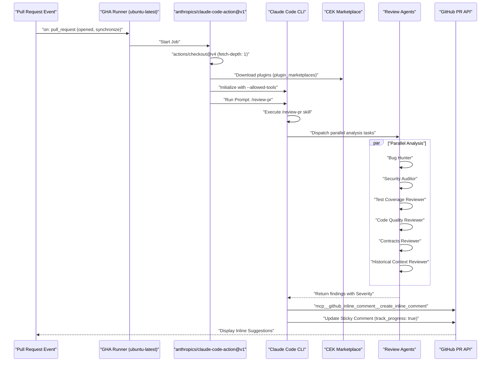
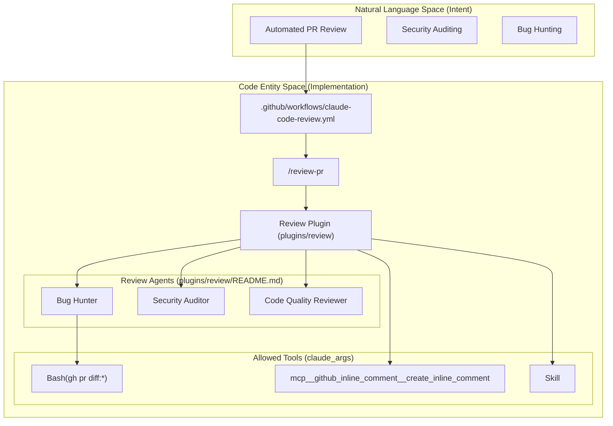

<!-- source: DeepWiki mcp.deepwiki.com · repo NeoLabHQ/context-engineering-kit · page 5.5 CI/CD Integration · fetched 2026-10-26 -->

# CI/CD Integration

<details>
<summary>Relevant source files</summary>

The following files were used as context for generating this wiki page:

- [docs/guides/README.md](docs/guides/README.md)
- [docs/guides/ci-integration.md](docs/guides/ci-integration.md)
- [docs/plugins/review/README.md](docs/plugins/review/README.md)

</details>


This page documents the integration of Context Engineering Kit (CEK) plugins with GitHub Actions for automated code reviews. It details the setup, configuration, and data flow of the `anthropics/claude-code-action@v1` GitHub Action, which executes the multi-agent Code Review plugin on pull requests.

---

## Overview

The CI/CD integration automates high-fidelity code reviews by triggering specialized AI agents on every pull request event. By leveraging the official `anthropics/claude-code-action@v1`, the system executes the `/review-pr` command within a secure GitHub Actions runner.

**Key capabilities:**
- **Automated Execution**: Runs `/review-pr` on PR `opened`, `synchronize`, `ready_for_review`, and `reopened` events [docs/guides/ci-integration.md:31-37]().
- **Multi-Agent Orchestration**: Dispatches six specialized agents (Bug Hunter, Security Auditor, etc.) to analyze changes in parallel [docs/guides/ci-integration.md:89-95](), [plugins/review/README.md:46-60]().
- **Sticky Comments**: Maintains a single, updating tracking comment to avoid PR timeline clutter [docs/guides/ci-integration.md:71, 97-98]().
- **Progress Tracking**: Provides real-time visual feedback of the review status in the PR [docs/guides/ci-integration.md:70-71]().
- **Granular Permissions**: Restricts tool access to a specific allow-list for security [docs/guides/ci-integration.md:78-79]().

**Sources:** [docs/guides/ci-integration.md:1-98](), [plugins/review/README.md:136-198]()

---

## Architecture

### GitHub Action Data Flow

The following diagram illustrates the sequence of events from a PR trigger to the posting of inline review comments.



**Sources:** [docs/guides/ci-integration.md:48-80](), [plugins/review/README.md:46-60](), [plugins/review/README.md:136-198]()

---

### Code Entity Space Mapping

This diagram maps the conceptual review process to the specific code entities, workflow files, and tools used in the integration.



**Sources:** [docs/guides/ci-integration.md:26-80](), [plugins/review/README.md:1-135](), [plugins/review/README.md:145-198]()

---

## Setup Process

### Step 1: Automated Credential Setup

The system provides a setup command to handle GitHub App registration and secret injection.

```bash
/install-github-app
```

This command automates:
1.  Creation of the `CLAUDE_CODE_OAUTH_TOKEN` secret in the repository [docs/guides/ci-integration.md:19-20]().
2.  Initial generation of the `claude-code-review.yml` workflow file [docs/guides/ci-integration.md:22]().

**Sources:** [docs/guides/ci-integration.md:14-23](), [plugins/review/README.md:142]()

---

### Step 2: Workflow Configuration

The workflow file `.github/workflows/claude-code-review.yml` configures the environment and the plugin execution parameters.

| Parameter | Configuration Value | Purpose |
| :--- | :--- | :--- |
| `on` | `pull_request` (opened, synchronize, etc.) | Triggers the review on code changes [docs/guides/ci-integration.md:31-37](). |
| `permissions` | `pull-requests: read`, `issues: write`, `id-token: write` | Grants necessary API access for commenting [docs/guides/ci-integration.md:52-57](). |
| `plugin_marketplaces` | `https://github.com/NeoLabHQ/context-engineering-kit.git` | Points the action to the CEK registry [docs/guides/ci-integration.md:73](). |
| `plugins` | `review@context-engineering-kit`, `git@...`, etc. | Specifies which plugins to pre-install in the runner [docs/guides/ci-integration.md:74](). |
| `prompt` | `/review-pr ${{ github.repository }}/pull/...` | The command string executed by the Claude CLI [docs/guides/ci-integration.md:76](). |

**Sources:** [docs/guides/ci-integration.md:28-80](), [plugins/review/README.md:145-198]()

---

## Configuration & Output Mode

### Allowed Tools Configuration

The `claude_args` parameter is used to define the security sandbox for the AI agents. Only tools explicitly listed in `--allowed-tools` can be invoked during the CI run.

```yaml
claude_args: '--allowed-tools "Skill,Bash,Glob,Grep,Read,Task,mcp__github_inline_comment__create_inline_comment,Bash(gh issue view:*),Bash(gh search:*),Bash(gh issue list:*),Bash(gh pr comment:*),Bash(gh pr edit:*),Bash(gh pr diff:*),Bash(gh pr view:*),Bash(gh pr list:*),Bash(gh api:*)" --system-prompt "Follow /review-pr skill EXACTLY!"'
```

- **Skill/Task**: Required for loading CEK skills and parallelizing agents [docs/guides/ci-integration.md:78-79]().
- **Bash (gh CLI)**: Used for fetching diffs (`gh pr diff`), viewing PRs, and posting comments [docs/guides/ci-integration.md:79]().
- **MCP Inline Comment**: Specialized tool for posting suggestions directly to PR lines [docs/guides/ci-integration.md:79]().

### JSON Output Mode & Filtering

While the PR review typically posts inline comments, the underlying engine supports programmatic filtering.

- **Filtering**: The `--min-impact` flag (e.g., `critical`, `high`, `medium`) filters which issues are reported [plugins/review/README.md:31-38]().
- **Output Formats**:
    - **Local Review**: Produces a structured Markdown report with an Executive Summary and Action Items [plugins/review/README.md:204-227]().
    - **PR Review**: Posts inline comments with evidence and suggestions directly to the GitHub PR [plugins/review/README.md:229-241]().

**Sources:** [plugins/review/README.md:31-38](), [plugins/review/README.md:200-243](), [docs/guides/ci-integration.md:78-79]()

---

## Review Agent Specialization

The CI workflow triggers six agents, each with a specific domain focus defined in the `review` plugin.

| Agent | Focus | Key Detections |
| :--- | :--- | :--- |
| **Bug Hunter** | Logic & Stability | Race conditions, memory leaks, unhandled errors, null pointers [plugins/review/README.md:70-81](). |
| **Security Auditor** | Vulnerabilities | SQLi, XSS, exposed secrets, insecure cryptography [plugins/review/README.md:82-93](). |
| **Test Coverage** | Verification | Missing edge cases, integration test needs, test quality [plugins/review/README.md:94-103](). |
| **Code Quality** | Maintainability | Naming conventions, code smells, complexity, design patterns [plugins/review/README.md:104-114](). |
| **Contracts** | Interfaces | Breaking API changes, type safety, backward compatibility [plugins/review/README.md:115-125](). |
| **Historical Context** | Consistency | Architectural drift, previous bug patterns, technical debt [plugins/review/README.md:126-135](). |

**Sources:** [plugins/review/README.md:68-135](), [docs/guides/ci-integration.md:89-95]()

---

