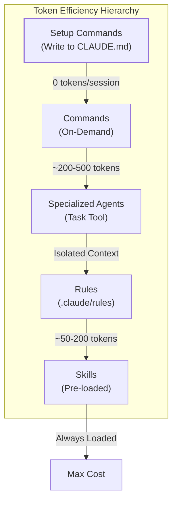
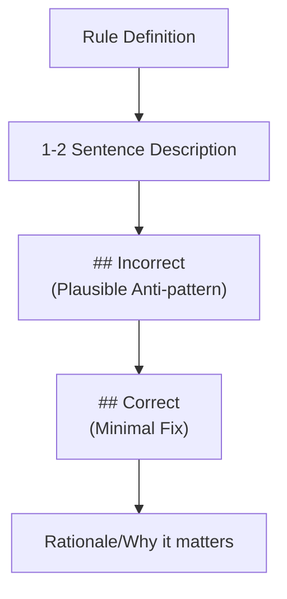
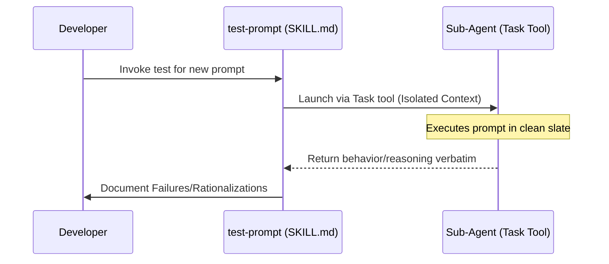
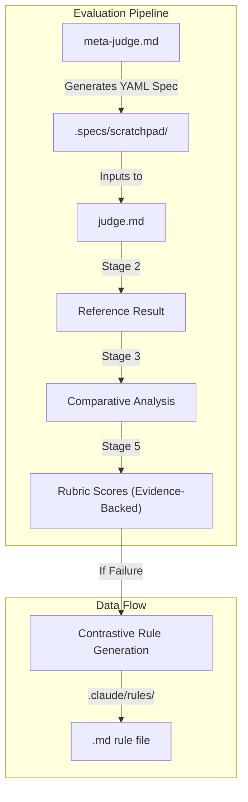

<!-- source: DeepWiki mcp.deepwiki.com · repo NeoLabHQ/context-engineering-kit · page 6.2 Quality Standards & Best Practices · fetched 2026-10-26 -->

# Quality Standards & Best Practices

Relevant source files

The following files were used as context for generating this wiki page:

- [plugins/customaize-agent/skills/apply-anthropic-skill-best-practices/SKILL.md](plugins/customaize-agent/skills/apply-anthropic-skill-best-practices/SKILL.md)
- [plugins/customaize-agent/skills/create-agent/SKILL.md](plugins/customaize-agent/skills/create-agent/SKILL.md)
- [plugins/customaize-agent/skills/create-command/SKILL.md](plugins/customaize-agent/skills/create-command/SKILL.md)
- [plugins/customaize-agent/skills/create-rule/SKILL.md](plugins/customaize-agent/skills/create-rule/SKILL.md)
- [plugins/customaize-agent/skills/create-workflow-command/SKILL.md](plugins/customaize-agent/skills/create-workflow-command/SKILL.md)
- [plugins/customaize-agent/skills/prompt-engineering/SKILL.md](plugins/customaize-agent/skills/prompt-engineering/SKILL.md)
- [plugins/customaize-agent/skills/test-prompt/SKILL.md](plugins/customaize-agent/skills/test-prompt/SKILL.md)
- [plugins/customaize-agent/skills/test-skill/SKILL.md](plugins/customaize-agent/skills/test-skill/SKILL.md)
- [plugins/sadd/agents/judge.md](plugins/sadd/agents/judge.md)
- [plugins/sadd/agents/meta-judge.md](plugins/sadd/agents/meta-judge.md)

This document defines the quality standards and best practices for developing plugins in the Context Engineering Kit. These standards ensure plugins maintain token efficiency, produce high-quality agent outputs, and integrate seamlessly with the existing plugin ecosystem.

---

## Core Design Principles

The Context Engineering Kit is built around three fundamental principles that guide all plugin development:

### 1. Token Efficiency Hierarchy
Token efficiency is the most critical technical constraint. Developers must choose the implementation strategy that minimizes persistent context bloat. Commands are preferred over skills because they load on-demand, whereas skill descriptions are often loaded by default, consuming the attention budget.

**Sources:** [plugins/customaize-agent/skills/create-rule/SKILL.md:29-36](), [plugins/customaize-agent/skills/prompt-engineering/SKILL.md:200-206](), [plugins/customaize-agent/skills/apply-anthropic-skill-best-practices/SKILL.md:17-18]()

### 2. Context Isolation vs. Bloat
Multi-agent architectures address single-agent context limitations by partitioning work across multiple context windows. Each agent operates in a clean context focused on its subtask. This prevents "context poisoning" and the "lost-in-middle" effect where performance degrades as context grows.

*   **Orchestrator/Supervisor**: Lean (~50-100 tokens per step) used for dispatching and synthesis via `Task` tool [plugins/customaize-agent/skills/create-workflow-command/SKILL.md:26-34]().
*   **Specialized Agents**: Carry only the specific system prompts and tools needed for their domain, preventing combinatorial explosion of instructions [plugins/customaize-agent/skills/create-agent/SKILL.md:21-26]().

**Sources:** [plugins/customaize-agent/skills/create-workflow-command/SKILL.md:38-47](), [plugins/customaize-agent/skills/create-agent/SKILL.md:153-168]()

---

## Implementation Patterns

### Contrastive Rule Pattern
When creating behavioral guardrails in `.claude/rules/`, developers MUST use the **Incorrect vs. Correct** pattern. This eliminates ambiguity by showing the agent the exact boundary of acceptable behavior.

**Sources:** [plugins/customaize-agent/skills/create-rule/SKILL.md:94-130](), [plugins/customaize-agent/skills/create-rule/SKILL.md:132-139]()

### Specialized Agent Orchestration
Complex tasks should be decomposed into specialized agents. This allows the orchestrator to remain predictable and stable.

| Agent Role | Responsibility | Implementation File |
| :--- | :--- | :--- |
| **Judge** | Ruthless quality gatekeeper using structured rubrics | [plugins/sadd/agents/judge.md]() |
| **Meta-Judge** | Architect of evaluation specifications and rubrics | [plugins/sadd/agents/meta-judge.md]() |
| **Workflow Orchestrator** | Lean dispatcher using file-based task prompts | [plugins/customaize-agent/skills/create-workflow-command/SKILL.md:132-192]() |

**Sources:** [plugins/sadd/agents/judge.md:8-16](), [plugins/sadd/agents/meta-judge.md:8-18](), [plugins/customaize-agent/skills/create-workflow-command/SKILL.md:19-34]()

---

## Quality Standards for Components

### 1. Agent & Skill Metadata
Every agent and skill must follow strict naming and description conventions to ensure discovery.

*   **Naming**: Use gerund form (e.g., "Processing PDFs") for skills [plugins/customaize-agent/skills/apply-anthropic-skill-best-practices/SKILL.md:42-53]().
*   **Agent Triggers**: Agent descriptions MUST start with "Use this agent when..." and include `<example>` blocks [plugins/customaize-agent/skills/create-agent/SKILL.md:97-120]().

**Sources:** [plugins/customaize-agent/skills/apply-anthropic-skill-best-practices/SKILL.md:72-88](), [plugins/customaize-agent/skills/create-agent/SKILL.md:78-96]()

### 2. Prompt Engineering Best Practices
*   **Few-Shot Learning**: Include 2-5 input-output pairs for consistent formatting and edge case handling [plugins/customaize-agent/skills/prompt-engineering/SKILL.md:12-28]().
*   **Chain-of-Thought (CoT)**: Request step-by-step reasoning (e.g., "Think step by step") for complex logic [plugins/customaize-agent/skills/prompt-engineering/SKILL.md:30-47]().
*   **Instruction Hierarchy**: Follow the pattern `[System Context] → [Task Instruction] → [Examples] → [Input Data] → [Output Format]` [plugins/customaize-agent/skills/prompt-engineering/SKILL.md:134-138]().

**Sources:** [plugins/customaize-agent/skills/prompt-engineering/SKILL.md:118-132](), [plugins/customaize-agent/skills/prompt-engineering/SKILL.md:200-213]()

---

## Evaluation & Testing

Developers should use the **RED-GREEN-REFACTOR** cycle for process documentation and prompt testing.

### The Skill Testing Cycle
| TDD Phase | Skill Testing | Implementation |
| :--- | :--- | :--- |
| **RED** | Baseline test | Run scenario WITHOUT skill, watch agent fail [plugins/customaize-agent/skills/test-skill/SKILL.md:50-62]() |
| **GREEN** | Write skill | Address specific baseline failures observed [plugins/customaize-agent/skills/test-skill/SKILL.md:90-96]() |
| **REFACTOR** | Plug holes | Capture new rationalizations and add counters [plugins/customaize-agent/skills/test-skill/SKILL.md:176-191]() |

**Sources:** [plugins/customaize-agent/skills/test-skill/SKILL.md:37-48](), [plugins/customaize-agent/skills/test-prompt/SKILL.md:53-63]()

### Testing with Subagents
To bridge "Natural Language Space" (instructions) to "Code Entity Space" (execution), use subagents to verify prompt robustness.

**Sources:** [plugins/customaize-agent/skills/test-prompt/SKILL.md:64-80](), [plugins/customaize-agent/skills/test-prompt/SKILL.md:188-204]()

---

## Agent Performance Architecture

When designing agents, prioritize structured evaluation and evidence-backed scoring.

**Sources:** [plugins/sadd/agents/meta-judge.md:37-56](), [plugins/sadd/agents/judge.md:68-135](), [plugins/sadd/agents/judge.md:137-154]()

---

## Best Practices Checklist

| Category | Requirement | Source |
| :--- | :--- | :--- |
| **Design** | Prefer Commands over Skills for on-demand loading. | [plugins/customaize-agent/skills/create-rule/SKILL.md:14-15]() |
| **Structure** | All commands MUST begin with YAML frontmatter. | [plugins/customaize-agent/skills/create-command/SKILL.md:65-73]() |
| **Prompts** | Use Pressure Scenarios (Time, Sunk Cost, Authority) to test compliance. | [plugins/customaize-agent/skills/test-skill/SKILL.md:104-155]() |
| **Agents** | Use `inherit` for model unless a specific reasoning level is required. | [plugins/customaize-agent/skills/create-agent/SKILL.md:130-142]() |
| **Efficiency** | Keep `SKILL.md` body under 500 lines; split into separate files if needed. | [plugins/customaize-agent/skills/apply-anthropic-skill-best-practices/SKILL.md:128-130]() |
| **Evaluation** | Produce reasoning FIRST, then score to improve stability. | [plugins/sadd/agents/judge.md:16-17]() |

---

