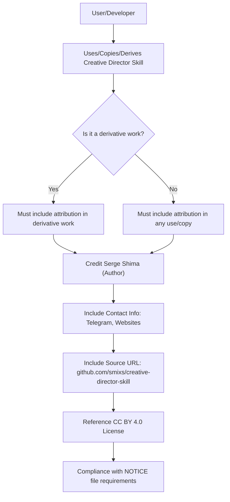

<!-- source: DeepWiki mcp.deepwiki.com · repo smixs/creative-director-skill · page 1.2 Licensing and Attribution · fetched 2026-10-26 -->

# Licensing and Attribution

<details>
<summary>Relevant source files</summary>

The following files were used as context for generating this wiki page:

- [.mailmap](.mailmap)
- [LICENSE](LICENSE)
- [NOTICE](NOTICE)

</details>


This page details the licensing terms for the Creative Director Skill codebase and its associated assets, including the 571-case legendary campaigns library. It also covers the attribution requirements and the `.mailmap` configuration used for consolidating author identities in the Git history.

## Creative Commons Attribution 4.0 International (CC BY 4.0)

The Creative Director Skill, including all its code and the comprehensive 571-case legendary campaigns library, is licensed under the Creative Commons Attribution 4.0 International Public License (CC BY 4.0) [LICENSE:1-396](). This license permits users to share and adapt the material for any purpose, even commercially, provided that appropriate attribution is given.

The key terms of the CC BY 4.0 license include:
*   **Attribution**: You must give appropriate credit, provide a link to the license, and indicate if changes were made. You may do so in any reasonable manner, but not in any way that suggests the licensor endorses you or your use.
*   **No additional restrictions**: You may not apply legal terms or technological measures that legally restrict others from doing anything the license permits.

For the full text of the license, refer to the `LICENSE` file in the repository [LICENSE:1-396]() or visit [https://creativecommons.org/licenses/by/4.0/](https://creativecommons.org/licenses/by/4.0).

Sources:
*   [LICENSE:1-396]()

## Attribution Requirements (NOTICE)

In addition to the general CC BY 4.0 requirements, specific attribution details are provided in the `NOTICE` file [NOTICE:1-11](). Any use, copy, or derivative of this skill, including the 571-case legendary campaigns library, *must* credit the author as specified.

The required attribution details are:
*   **Author**: Serge Shima
*   **Contact Information**:
    *   Telegram: `https://t.me/aimastersme`
    *   Website: `https://sergeshima.com`
    *   Website: `https://aimasters.me`
*   **Source**: `https://github.com/smixs/creative-director-skill`

This information is explicitly stated in the `NOTICE` file [NOTICE:1-11]().

### Attribution Flow

Sources:
*   [NOTICE:1-11]()

## Git Author Identity Consolidation (.mailmap)

The repository uses a `.mailmap` file [mailmap:1-3]() to consolidate various author identities that may appear in the Git history. This ensures that contributions from the same individual or entity are correctly attributed to a single, canonical identity in tools like `git log` or `git shortlog`.

The `.mailmap` file maps different email addresses and names to a preferred canonical name and email. For this repository, it consolidates contributions from different aliases of the primary author and the AI assistant used during development.

### Current `.mailmap` Configuration

The `.mailmap` file contains the following mappings:
*   `smixs <mixshima@gmail.com>` is the canonical identity for `Claude <noreply@anthropic.com>` [mailmap:1]().
*   `smixs <mixshima@gmail.com>` is the canonical identity for `claude <noreply@anthropic.com>` [mailmap:2]().

This means that any commits made by `Claude <noreply@anthropic.com>` or `claude <noreply@anthropic.com>` will be displayed as `smixs <mixshima@gmail.com>` when Git history is viewed with `--use-mailmap`.

### `.mailmap` Consolidation Process
```mermaid
graph TD
    A[Git Commit Author: "Claude <noreply@anthropic.com>"] --> B{Git Log --use-mailmap}
    C[Git Commit Author: "claude <noreply@anthropic.com>"] --> B
    D[Git Commit Author: "smixs <mixshima@gmail.com>"] --> B
    B --> E[Read .mailmap file]
    E --> F{Mapping Rules}
    F -- "smixs <mixshima@gmail.com> <== Claude <noreply@anthropic.com>" --> G[Canonical Author: "smixs <mixshima@gmail.com>"]
    F -- "smixs <mixshima@gmail.com> <== claude <noreply@anthropic.com>" --> G
    F -- "No mapping needed" --> G
    G --> H[Consolidated Git History Output]

    style A fill:#f9f,stroke:#333,stroke-width:2px
    style C fill:#f9f,stroke:#333,stroke-width:2px
    style D fill:#9cf,stroke:#333,stroke-width:2px
    style G fill:#9cf,stroke:#333,stroke-width:2px
```
Sources:
*   [mailmap:1-3]()

---

