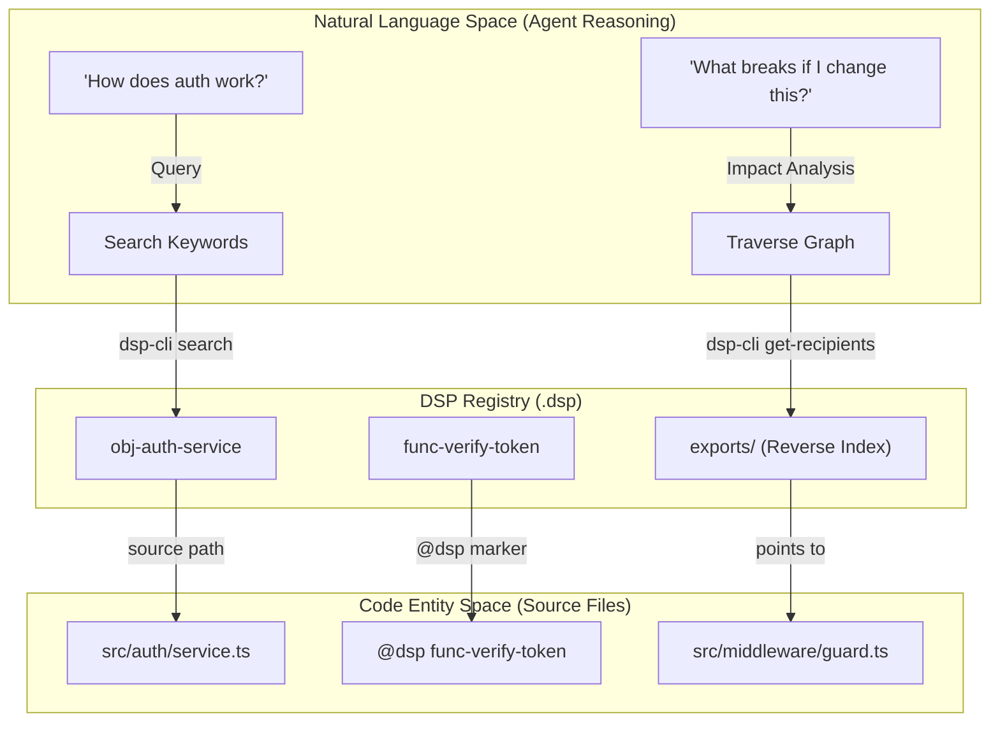
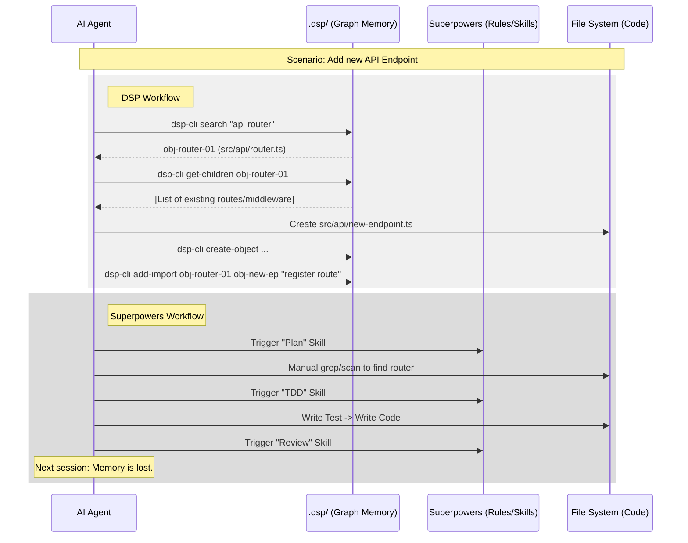

<!-- source: DeepWiki mcp.deepwiki.com · repo k-kolomeitsev/data-structure-protocol · page 8.2 DSP vs Superpowers · fetched 2026-10-26 -->

# DSP vs Superpowers

Relevant source files

The following files were used as context for generating this wiki page:

- [article.md](article.md)
- [docs/comparisons/dsp-vs-superpowers.md](docs/comparisons/dsp-vs-superpowers.md)

This page provides a detailed technical comparison between the **Data Structure Protocol (DSP)** and the **Superpowers** framework. It explores the fundamental shift from enforcing engineering discipline (TDD, planning, review) to providing **persistent structural memory**. While Superpowers focuses on *how* an agent should work, DSP focuses on *what* the agent knows about the project architecture across sessions.

## The Real Question: Discipline vs. Memory

The core thesis of DSP is that modern Large Language Models (LLMs) like Claude 3.5 Sonnet or GPT-4o already possess inherent engineering discipline. They understand TDD (Red-Green-Refactor), planning, and self-review natively from their training data [docs/comparisons/dsp-vs-superpowers.md:7-13]().

What these models lack is **project-specific memory**. Every new chat session is a "blank slate" where the agent must re-discover the entry points, dependency graphs, and architectural decisions of a codebase [docs/comparisons/dsp-vs-superpowers.md:11-13](). DSP solves this by externalizing the project map into a versioned, language-agnostic graph in the `.dsp/` directory [article.md:4-5]().

### Conceptual Mapping: Natural Language to Code Entities

The following diagram illustrates how DSP bridges the gap between high-level architectural understanding (Natural Language Space) and the actual implementation (Code Entity Space) using the `dsp-cli.py` tool.

**Diagram: DSP Structural Context Bridge**

Sources: [article.md:27-33](), [article.md:61-65](), [article.md:53-54]()

## Feature Comparison Table

| Feature | Data Structure Protocol (DSP) | Superpowers |
| :--- | :--- | :--- |
| **Core Philosophy** | Persistent structural memory [docs/comparisons/dsp-vs-superpowers.md:27]() | Engineering discipline enforcement [docs/comparisons/dsp-vs-superpowers.md:27]() |
| **Primary Artifact** | Graph database in `.dsp/` [article.md:27]() | Composable skill/rule files [docs/comparisons/dsp-vs-superpowers.md:30]() |
| **Persistence** | Full graph persists across sessions/tools [article.md:18]() | No persistent project memory [docs/comparisons/dsp-vs-superpowers.md:31]() |
| **Brownfield Support** | DFS bootstrap for existing code [article.md:96-102]() | No explicit bootstrap workflow [docs/comparisons/dsp-vs-superpowers.md:32]() |
| **Impact Analysis** | Built-in via `get-recipients` [article.md:74]() | Not available [docs/comparisons/dsp-vs-superpowers.md:33]() |
| **TDD** | Agent handles natively [docs/comparisons/dsp-vs-superpowers.md:34]() | Core selling point (Enforced) [docs/comparisons/dsp-vs-superpowers.md:34]() |
| **Overhead** | Low (Update on change) [docs/comparisons/dsp-vs-superpowers.md:35]() | Medium (Mandatory cycles) [docs/comparisons/dsp-vs-superpowers.md:35]() |
| **Tool Support** | Claude Code, Cursor, Codex [article.md:80-91]() | Primarily Claude Code and Cursor [docs/comparisons/dsp-vs-superpowers.md:40]() |

Sources: [docs/comparisons/dsp-vs-superpowers.md:25-41](), [article.md:27-41]()

## Implementation and Data Flow

In DSP, the agent interacts with the `scripts/dsp-cli.py` utility to maintain the graph. This creates a feedback loop where every code change is reflected in the structural memory.

**Diagram: Data Flow - DSP vs Superpowers Workflow**

Sources: [docs/comparisons/dsp-vs-superpowers.md:65-105](), [article.md:59-65]()

## The Argument Against Mandatory Discipline

DSP argues that "discipline enforcement" (the core of Superpowers) is increasingly redundant for high-tier models [docs/comparisons/dsp-vs-superpowers.md:42-52]():

1.  **TDD**: A single line in a system prompt ("Follow TDD") is often as effective as a complex skill framework [docs/comparisons/dsp-vs-superpowers.md:48]().
2.  **Planning**: Agents plan naturally for complex tasks; forcing it for trivial changes (like fixing a typo) creates unnecessary token overhead [docs/comparisons/dsp-vs-superpowers.md:49]().
3.  **Review**: Modern agents can execute linters and tests directly. An external "review skill" adds latency for checks the agent is already performing [docs/comparisons/dsp-vs-superpowers.md:50-51]().

### What Agents Genuinely Cannot Do
Without DSP, agents struggle with:
*   **Dependency Recall**: Knowing that `PaymentService` depends on `StripeClient` without reading both files [docs/comparisons/dsp-vs-superpowers.md:54]().
*   **Change Impact**: Understanding that a change in a common config fragment affects 12 specific modules [docs/comparisons/dsp-vs-superpowers.md:55]().
*   **Multi-root Navigation**: Moving between backend and frontend codebases in a monorepo without reading hundreds of files to find the connection [docs/comparisons/dsp-vs-superpowers.md:57]().

## Synergy: Using Both Together

While DSP positions itself as a more critical infrastructure layer than Superpowers, they are not mutually exclusive. If a team requires strict TDD enforcement, Superpowers can provide the workflow, while DSP provides the **structural context** to make those skills more accurate [docs/comparisons/dsp-vs-superpowers.md:113-118]().

*   **Brainstorming Skill**: Becomes more effective when it knows the existing architecture via `dsp-cli search` [docs/comparisons/dsp-vs-superpowers.md:115]().
*   **Planning Skill**: Can perform real impact analysis using `get-recipients` before proposing changes [docs/comparisons/dsp-vs-superpowers.md:115]().

Sources: [docs/comparisons/dsp-vs-superpowers.md:113-118]()

---

