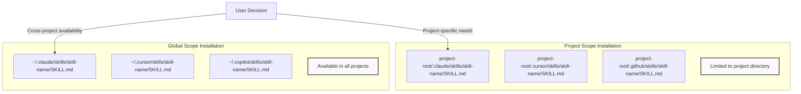
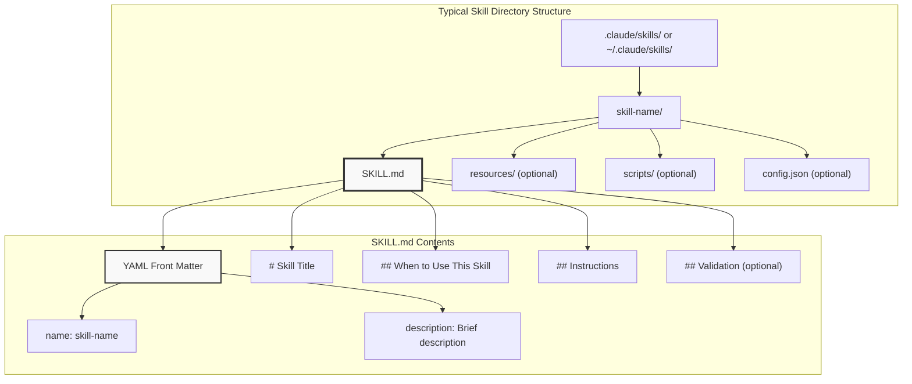
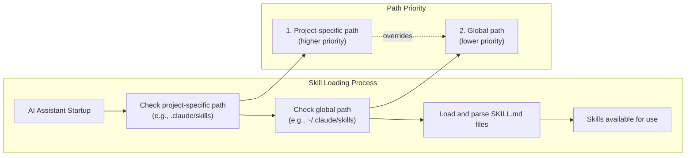
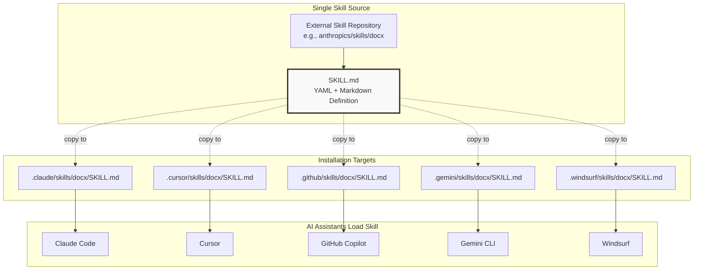

<!-- source: DeepWiki mcp.deepwiki.com · repo VoltAgent/awesome-agent-skills · page 2.1 Installing Skills · fetched 2026-10-26 -->

# Installing Skills

<details>
<summary>Relevant source files</summary>

The following files were used as context for generating this wiki page:

- [README.md](README.md)

</details>


This document provides detailed instructions for installing Agent Skills across different AI coding assistants. It covers the file system paths, directory structures, and installation procedures for all supported AI assistants including Claude Code, Cursor, GitHub Copilot, Gemini CLI, Windsurf, and others.

For information about discovering and using skills after installation, see [Using Your First Skill](#2.2). For technical details about how AI assistants load and execute skills, see [AI Assistant Integration](#3.2).

**Sources:** [README.md:76-88]()

## Installation Overview

Agent Skills are installed by copying skill definition files to specific directories on your file system. Each AI coding assistant monitors designated paths for skill files and automatically loads them when detected. Skills use a standardized format (YAML front matter + Markdown content) that works across all supported AI assistants.

The installation process involves three steps:

1. **Locate the skill** - Find the skill repository from the collection
2. **Copy skill files** - Download or clone the skill definition files
3. **Place in target directory** - Move files to the appropriate path for your AI assistant

Skills can be installed either project-specifically (scoped to a single project) or globally (available across all projects).

**Sources:** [README.md:33-37](), [README.md:76-88]()

## Installation Scope: Project vs Global Paths

Each AI coding assistant supports two types of installation paths:

### Project-Specific Paths

Project-specific paths install skills only for a particular project directory. Skills are placed in a hidden subdirectory within the project root (e.g., `.claude/skills/` or `.cursor/skills/`). These skills are only available when working within that specific project.

**Use project-specific paths when:**
- The skill is relevant only to a specific codebase
- You want different skill configurations per project
- Team members need to share skills via version control

### Global Paths

Global paths install skills in user home directories (e.g., `~/.claude/skills/` or `~/.cursor/skills/`). These skills are available across all projects for the current user.

**Use global paths when:**
- The skill applies to all your development work
- You want skills available in any project directory
- You're installing personal productivity or utility skills

**Sources:** [README.md:78-87]()



**Sources:** [README.md:78-87]()

## Installation Paths by AI Assistant

The following table provides complete installation paths for all supported AI coding assistants. Each assistant has specific project and global directory conventions.

| AI Assistant | Project Path | Global Path | Documentation Reference |
|--------------|-------------|-------------|------------------------|
| **Antigravity** | `.agent/skills/` | `~/.gemini/antigravity/skills/` | [README.md:80]() |
| **Claude Code** | `.claude/skills/` | `~/.claude/skills/` | [README.md:81]() |
| **Codex** | `.codex/skills/` | `~/.codex/skills/` | [README.md:82]() |
| **Cursor** | `.cursor/skills/` | `~/.cursor/skills/` | [README.md:83]() |
| **Gemini CLI** | `.gemini/skills/` | `~/.gemini/skills/` | [README.md:84]() |
| **GitHub Copilot** | `.github/skills/` | `~/.copilot/skills/` | [README.md:85]() |
| **OpenCode** | `.opencode/skills/` | `~/.config/opencode/skills/` | [README.md:86]() |
| **Windsurf** | `.windsurf/skills/` | `~/.codeium/windsurf/skills/` | [README.md:87]() |

**Sources:** [README.md:76-87]()

## Skill File System Structure

Skills are organized in a standardized directory structure. Each skill consists of a primary skill definition file and optional supporting resources.



**Sources:** [README.md:44-72]()

### Minimal Skill Example

A basic skill file (`SKILL.md`) contains YAML metadata followed by Markdown instructions:

```yaml
---
name: api-tester
description: Test REST APIs and validate responses
---

# API Tester

Test HTTP endpoints and validate response structures.

## When to Use This Skill

Use this skill when you need to test API endpoints and verify response data.

## Instructions

When testing an API:

1. Send a request to the specified endpoint
2. Check the response status code
3. Validate the response body structure
4. Report any errors or unexpected results

## Response Validation

- Verify required fields exist
- Check data types match expected values
- Confirm nested objects have correct structure
```

**Sources:** [README.md:44-72]()

## Installation Procedure

### Step 1: Create the Skills Directory

For project-specific installation, create the skills directory in your project root:

```bash
# For Claude Code (project-specific)
mkdir -p .claude/skills

# For Cursor (project-specific)
mkdir -p .cursor/skills

# For GitHub Copilot (project-specific)
mkdir -p .github/skills
```

For global installation, create the directory in your home directory:

```bash
# For Claude Code (global)
mkdir -p ~/.claude/skills

# For Cursor (global)
mkdir -p ~/.cursor/skills

# For GitHub Copilot (global)
mkdir -p ~/.copilot/skills
```

**Sources:** [README.md:78-87]()

### Step 2: Obtain the Skill

Skills are hosted in external repositories. To install a skill:

1. Navigate to the skill repository (links provided in the collection at [README.md:97-372]())
2. Download or clone the skill files
3. Locate the skill definition file (typically `SKILL.md` or similar)

Example for installing the Anthropic `docx` skill:

```bash
# Clone the entire skills repository
git clone https://github.com/anthropics/skills.git

# Or download just the specific skill folder
# Navigate to: https://github.com/anthropics/skills/tree/main/skills/docx
```

**Sources:** [README.md:101-105](), [README.md:33-37]()

### Step 3: Copy Skill Files to Target Directory

Copy the skill directory into your chosen skills path:

```bash
# Project-specific installation (Claude Code)
cp -r path/to/downloaded/skill .claude/skills/skill-name/

# Global installation (Claude Code)
cp -r path/to/downloaded/skill ~/.claude/skills/skill-name/
```

Ensure the skill directory contains at minimum a `SKILL.md` file with valid YAML front matter and Markdown content.

**Sources:** [README.md:44-72]()

## Installation Path Resolution

AI coding assistants follow a specific path resolution order when loading skills. Understanding this order helps troubleshoot installation issues.



**Sources:** [README.md:78-87]()

When the same skill exists in both project-specific and global paths, the project-specific version typically takes precedence. This allows project-level customization of global skills.

## Multi-Assistant Installation

A single skill can be installed for multiple AI assistants by copying it to each assistant's designated path. The skill format is standardized across all assistants.



**Sources:** [README.md:37](), [README.md:76-87]()

## Verification Steps

After installing a skill, verify that it has been properly loaded by your AI assistant:

1. **Check file permissions** - Ensure the skill files are readable by your user account
2. **Validate YAML syntax** - Confirm the front matter has valid YAML structure with required `name` and `description` fields
3. **Restart the AI assistant** - Some assistants require a restart to detect new skills
4. **Query the assistant** - Ask your AI assistant to list available skills or attempt to use the newly installed skill

**Sources:** [README.md:44-72]()

## Directory Structure Examples

### Example 1: Claude Code Project Installation

```
my-project/
├── .claude/
│   └── skills/
│       ├── docx/
│       │   └── SKILL.md
│       ├── pdf/
│       │   └── SKILL.md
│       └── web-artifacts-builder/
│           ├── SKILL.md
│           └── resources/
│               └── templates/
├── src/
└── package.json
```

### Example 2: Global Installation for Multiple Assistants

```
~/
├── .claude/
│   └── skills/
│       ├── api-tester/
│       │   └── SKILL.md
│       └── terraform-skill/
│           └── SKILL.md
├── .cursor/
│   └── skills/
│       ├── api-tester/
│       │   └── SKILL.md
│       └── terraform-skill/
│           └── SKILL.md
└── .copilot/
    └── skills/
        ├── api-tester/
        │   └── SKILL.md
        └── terraform-skill/
            └── SKILL.md
```

**Sources:** [README.md:78-87](), [README.md:44-72]()

## Common Installation Patterns

### Pattern 1: Installing Official Team Skills

Official skills from teams like Anthropic, Vercel, or Cloudflare are maintained in dedicated repositories:

```bash
# Install Anthropic's docx skill (global)
git clone https://github.com/anthropics/skills.git /tmp/anthropic-skills
cp -r /tmp/anthropic-skills/skills/docx ~/.claude/skills/
```

**Sources:** [README.md:97-130]()

### Pattern 2: Installing Community Skills

Community skills may have different repository structures:

```bash
# Install a community skill (project-specific)
git clone https://github.com/username/skill-name.git /tmp/skill-name
cp -r /tmp/skill-name/.claude/skills/skill-name .claude/skills/
```

**Sources:** [README.md:262-372]()

### Pattern 3: Batch Installation Script

For installing multiple skills across multiple assistants:

```bash
#!/bin/bash
SKILL_SOURCE="/path/to/skill-directory"
SKILL_NAME="my-skill"

# Install for Claude Code
mkdir -p .claude/skills
cp -r "${SKILL_SOURCE}" .claude/skills/"${SKILL_NAME}"

# Install for Cursor
mkdir -p .cursor/skills
cp -r "${SKILL_SOURCE}" .cursor/skills/"${SKILL_NAME}"

# Install for GitHub Copilot
mkdir -p .github/skills
cp -r "${SKILL_SOURCE}" .github/skills/"${SKILL_NAME}"
```

**Sources:** [README.md:76-87]()

## Troubleshooting Installation Issues

### Skill Not Detected

If your AI assistant doesn't recognize an installed skill:

1. Verify the file is named `SKILL.md` (case-sensitive)
2. Check that YAML front matter uses three dashes (`---`) as delimiters
3. Confirm `name` and `description` fields are present in YAML front matter
4. Ensure the file is in the correct directory path for your AI assistant
5. Restart your AI assistant to reload skill definitions

**Sources:** [README.md:44-72](), [README.md:78-87]()

### Path Resolution Conflicts

If a skill behaves unexpectedly:

1. Check for duplicate installations in both project and global paths
2. Remember project-specific skills override global skills
3. Use unique skill names to avoid naming conflicts
4. Review file permissions on skill directories

### Invalid Skill Format

If the AI assistant reports a parsing error:

1. Validate YAML syntax using a YAML linter
2. Ensure there are no tabs in the YAML front matter (use spaces)
3. Confirm the YAML front matter is closed with `---`
4. Check that Markdown content starts after the closing `---`

**Sources:** [README.md:44-72]()

## Next Steps

After successfully installing skills, proceed to [Using Your First Skill](#2.2) to learn how to invoke and execute skills within your AI coding assistant. For advanced configuration and integration details, see [AI Assistant Integration](#3.2).

To discover available skills for installation, browse the [Skill Catalog](#4). For information about creating your own skills, see [Contribution Guidelines](#5.1).

**Sources:** [README.md:1-309]()

---

