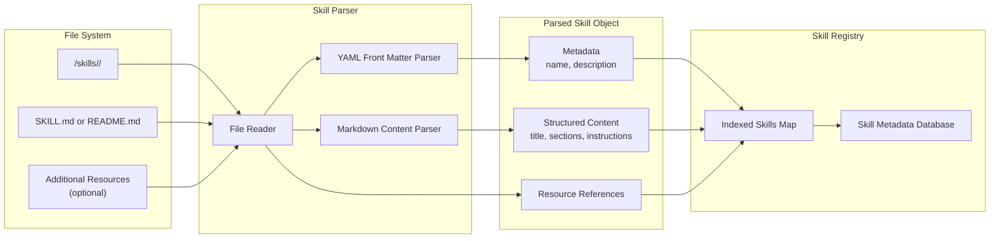
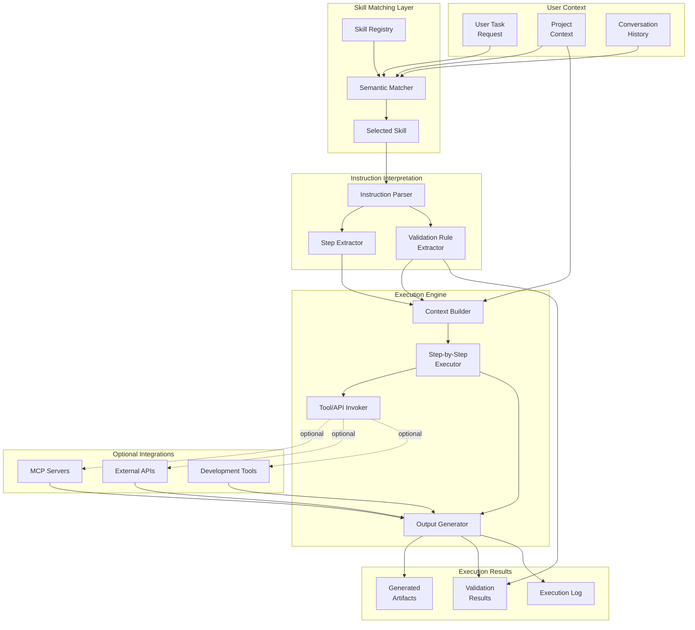
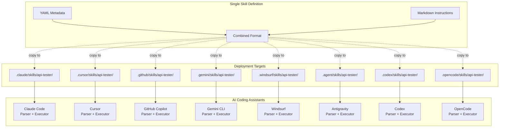
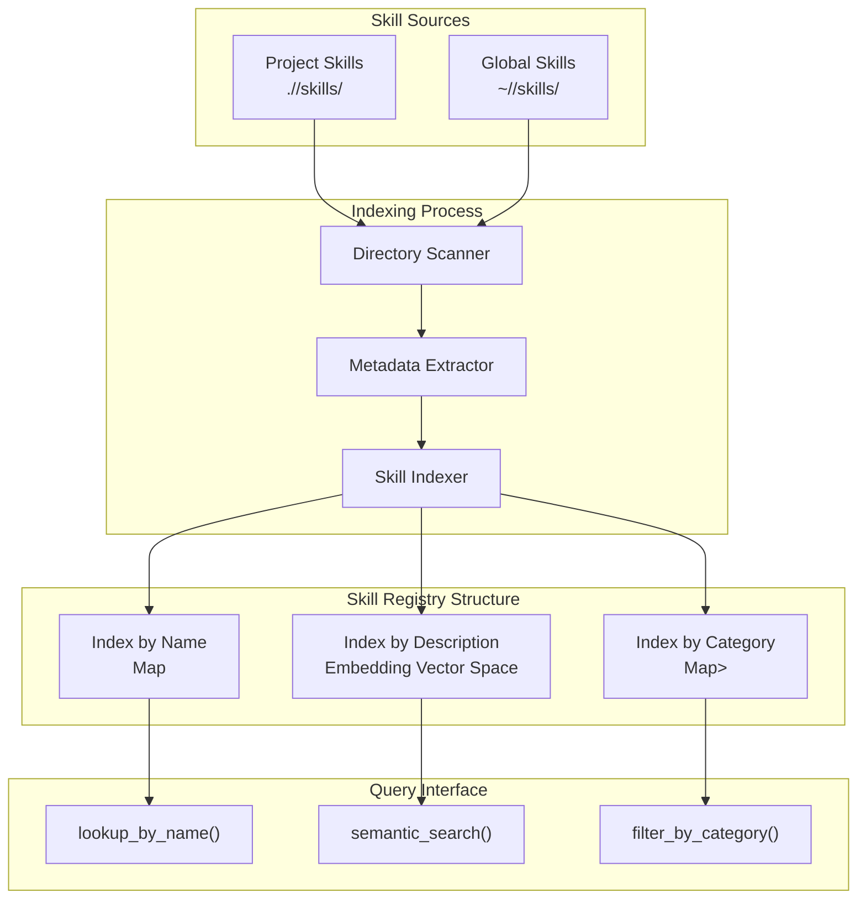
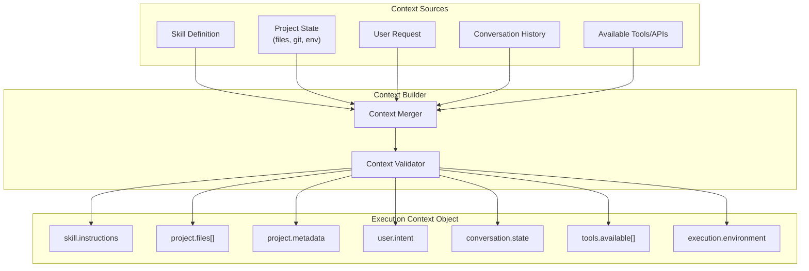

<!-- source: DeepWiki mcp.deepwiki.com · repo VoltAgent/awesome-agent-skills · page 3.2 AI Assistant Integration · fetched 2026-10-26 -->

# AI Assistant Integration

<details>
<summary>Relevant source files</summary>

The following files were used as context for generating this wiki page:

- [README.md](README.md)

</details>


This document explains the technical architecture by which AI coding assistants discover, load, and execute Agent Skills. It covers the file system conventions, parsing mechanisms, and execution models that enable a single skill definition to work across multiple AI assistants.

For information about the skill definition format itself (YAML front matter and Markdown structure), see [Skill Definition Format](#3.1). For details on how skills integrate with external services via MCP servers, see [MCP Server Integration](#3.3).

**Sources:** [README.md:1-87]()

---

## Discovery Architecture

AI coding assistants discover skills through standardized file system paths. Each assistant monitors specific directories for skill definitions, supporting both project-scoped and user-scoped installations.

### File System Path Conventions

The skill discovery mechanism relies on convention-based directory structures. Skills are stored as files or directories within designated paths that follow a predictable pattern:

```
<scope>/<assistant>/skills/<skill-name>/
```

Where:
- `<scope>` is either the project root (`.`) or user home (`~`)
- `<assistant>` is the assistant-specific directory name
- `<skill-name>` is the individual skill identifier

**Sources:** [README.md:76-87]()

### Supported AI Assistants and Paths

The following table documents all supported AI coding assistants with their respective discovery paths:

| Assistant | Project Path | Global Path | Documentation Link |
|-----------|-------------|-------------|-------------------|
| Antigravity | `.agent/skills/` | `~/.gemini/antigravity/skills/` | [Antigravity Skills](https://antigravity.google/docs/skills) |
| Claude Code | `.claude/skills/` | `~/.claude/skills/` | [Claude Code Skills](https://docs.anthropic.com/en/docs/claude-code/skills) |
| Codex | `.codex/skills/` | `~/.codex/skills/` | [Codex Skills](https://developers.openai.com/codex/skills) |
| Cursor | `.cursor/skills/` | `~/.cursor/skills/` | [Cursor Skills](https://cursor.com/docs/context/skills) |
| Gemini CLI | `.gemini/skills/` | `~/.gemini/skills/` | [Gemini CLI Skills](https://geminicli.com/docs/cli/skills) |
| GitHub Copilot | `.github/skills/` | `~/.copilot/skills/` | [Copilot Skills](https://docs.github.com/en/copilot/concepts/agents/about-agent-skills) |
| OpenCode | `.opencode/skills/` | `~/.config/opencode/skills/` | [OpenCode Skills](https://opencode.ai/docs/skills) |
| Windsurf | `.windsurf/skills/` | `~/.codeium/windsurf/skills/` | [Windsurf Cascade Skills](https://docs.windsurf.com/windsurf/cascade/skills) |

**Sources:** [README.md:78-87]()

---

## Path Resolution and Scoping

```mermaid
graph TB
    subgraph UserRequest["User Request Processing"]
        Request["User Task Request"]
        Match["Skill Matcher"]
    end
    
    subgraph ProjectScope["Project-Scoped Paths"]
        ProjectClaudeDir[".claude/skills/"]
        ProjectCursorDir[".cursor/skills/"]
        ProjectCopilotDir[".github/skills/"]
        ProjectGeminiDir[".gemini/skills/"]
        ProjectWindsurfDir[".windsurf/skills/"]
        ProjectAntigravityDir[".agent/skills/"]
        ProjectCodexDir[".codex/skills/"]
        ProjectOpenCodeDir[".opencode/skills/"]
    end
    
    subgraph GlobalScope["User-Scoped Paths"]
        GlobalClaudeDir["~/.claude/skills/"]
        GlobalCursorDir["~/.cursor/skills/"]
        GlobalCopilotDir["~/.copilot/skills/"]
        GlobalGeminiDir["~/.gemini/skills/"]
        GlobalWindsurfDir["~/.codeium/windsurf/skills/"]
        GlobalAntigravityDir["~/.gemini/antigravity/skills/"]
        GlobalCodexDir["~/.codex/skills/"]
        GlobalOpenCodeDir["~/.config/opencode/skills/"]
    end
    
    subgraph Resolution["Path Resolution Logic"]
        SearchProject["Search Project Path"]
        SearchGlobal["Search Global Path"]
        MergeSkills["Merge Available Skills"]
    end
    
    Request --> Match
    Match --> SearchProject
    Match --> SearchGlobal
    
    SearchProject --> ProjectClaudeDir
    SearchProject --> ProjectCursorDir
    SearchProject --> ProjectCopilotDir
    SearchProject --> ProjectGeminiDir
    SearchProject --> ProjectWindsurfDir
    SearchProject --> ProjectAntigravityDir
    SearchProject --> ProjectCodexDir
    SearchProject --> ProjectOpenCodeDir
    
    SearchGlobal --> GlobalClaudeDir
    SearchGlobal --> GlobalCursorDir
    SearchGlobal --> GlobalCopilotDir
    SearchGlobal --> GlobalGeminiDir
    SearchGlobal --> GlobalWindsurfDir
    SearchGlobal --> GlobalAntigravityDir
    SearchGlobal --> GlobalCodexDir
    SearchGlobal --> GlobalOpenCodeDir
    
    ProjectClaudeDir --> MergeSkills
    ProjectCursorDir --> MergeSkills
    ProjectCopilotDir --> MergeSkills
    ProjectGeminiDir --> MergeSkills
    ProjectWindsurfDir --> MergeSkills
    ProjectAntigravityDir --> MergeSkills
    ProjectCodexDir --> MergeSkills
    ProjectOpenCodeDir --> MergeSkills
    
    GlobalClaudeDir --> MergeSkills
    GlobalCursorDir --> MergeSkills
    GlobalCopilotDir --> MergeSkills
    GlobalGeminiDir --> MergeSkills
    GlobalWindsurfDir --> MergeSkills
    GlobalAntigravityDir --> MergeSkills
    GlobalCodexDir --> MergeSkills
    GlobalOpenCodeDir --> MergeSkills
    
    MergeSkills --> Match
```



### Scoping Semantics

**Project-Scoped Skills** (`./<assistant>/skills/`)
- Located in the project repository root
- Scoped to the current project context
- Typically version-controlled with the project
- Take precedence over global skills with the same name
- Examples: project-specific coding standards, framework-specific patterns

**User-Scoped Skills** (`~/<assistant>/skills/`)
- Located in the user's home directory
- Available across all projects for that user
- Persist across different projects and repositories
- Examples: personal productivity workflows, general-purpose utilities

AI assistants typically merge skills from both scopes, with project-scoped skills overriding global skills when naming conflicts occur.

**Sources:** [README.md:78-87]()

---

## Skill Loading Mechanism



### File Format Structure

Skills follow a standardized file format consisting of YAML front matter followed by Markdown content:

```
---
name: skill-identifier
description: Brief description (≤10 words)
---

# Skill Title

Markdown content with structured sections...
```

The skill file is typically named `SKILL.md` or `README.md` within the skill directory.

**Sources:** [README.md:44-72]()

### Parsing Stages

1. **File Discovery**: Assistant scans both project and global skill directories
2. **File Reading**: Loads skill file content into memory
3. **YAML Parsing**: Extracts metadata from front matter block
4. **Markdown Parsing**: Parses structured content sections
5. **Validation**: Verifies required fields and structure
6. **Registration**: Adds skill to internal registry with metadata index

**Sources:** [README.md:44-72]()

---

## Execution Architecture



### Execution Flow

1. **Skill Selection**: AI assistant matches user request to appropriate skill using semantic similarity and metadata
2. **Context Building**: Assembles execution context from project state, conversation history, and skill instructions
3. **Instruction Interpretation**: Parses skill's Markdown sections to extract actionable steps
4. **Step Execution**: Executes instructions sequentially, potentially invoking external tools
5. **Validation**: Applies validation rules specified in skill definition
6. **Output Generation**: Produces artifacts (documents, code, designs) and execution results

**Sources:** [README.md:44-72](), [README.md:97-261]()

### Instruction Interpretation Model

AI assistants interpret skill instructions from Markdown sections:

- **When to Use This Skill**: Conditions that trigger skill activation
- **Instructions**: Step-by-step procedures to execute
- **Response Validation**: Rules for verifying outputs
- **Examples**: Reference implementations (if provided)

The assistant uses these structured sections to guide task execution, treating them as executable procedures rather than mere documentation.

**Sources:** [README.md:44-72]()

---

## Cross-Assistant Portability

### Standardization Principle

The Agent Skills ecosystem achieves portability through a **write-once, run-anywhere** architecture. A single skill definition works across all supported AI assistants without modification.



### Portability Requirements

For a skill to be portable across assistants, it must:

1. **Use standard YAML front matter** with `name` and `description` fields
2. **Structure content in Markdown** with conventional section headings
3. **Avoid assistant-specific APIs** unless explicitly documented as optional
4. **Reference external tools generically** rather than with hardcoded paths
5. **Document tool dependencies** clearly in skill content

**Sources:** [README.md:44-72](), [README.md:76-87]()

---

## Integration Patterns

### Pattern 1: Project-Specific Skill

Used when a skill is tightly coupled to a specific codebase or project:

```
my-project/
├── .claude/
│   └── skills/
│       └── project-conventions/
│           └── SKILL.md
├── .cursor/
│   └── skills/
│       └── project-conventions/
│           └── SKILL.md
└── src/
    └── ...
```

The same `project-conventions` skill is copied to both `.claude/skills/` and `.cursor/skills/` to work with multiple assistants within the project.

**Sources:** [README.md:78-87]()

### Pattern 2: User-Wide Skill

Used for general-purpose skills that apply across multiple projects:

```
~/.claude/
└── skills/
    └── api-tester/
        └── SKILL.md

~/.cursor/
└── skills/
    └── api-tester/
        └── SKILL.md
```

The `api-tester` skill is installed globally for each assistant, making it available in all projects.

**Sources:** [README.md:78-87]()

### Pattern 3: Multi-Assistant Bundle

A repository containing skills for multiple assistants with shared resources:

```
my-skills-repo/
├── skills/
│   └── api-tester/
│       ├── SKILL.md          # Standardized definition
│       ├── examples/
│       │   └── test-example.json
│       └── scripts/
│           └── validate.sh
└── install.sh                 # Installation script
```

Installation script copies the skill to appropriate paths for all detected assistants.

**Sources:** [README.md:44-72](), [README.md:97-261]()

---

## Skill Registry and Indexing

AI assistants maintain an internal registry of available skills for efficient matching:



### Registry Operations

**Initialization**
- Scans skill directories on assistant startup
- Parses metadata from all discovered skills
- Builds multiple indices for fast lookup

**Query Operations**
- `lookup_by_name(skill_name)`: Direct name-based retrieval
- `semantic_search(user_request)`: Finds skills matching user intent via embedding similarity
- `filter_by_category(category)`: Retrieves skills in a specific domain

**Update Operations**
- Watches skill directories for file system changes
- Incrementally updates registry when skills are added/modified
- Invalidates cache for deleted skills

**Sources:** [README.md:44-72]()

---

## Skill Execution Context

When executing a skill, AI assistants construct a rich context object:



### Context Components

**Skill Instructions** (`skill.instructions`)
- Parsed steps from skill's Markdown content
- Validation rules
- Examples and templates

**Project State** (`project.*`)
- File tree structure
- Git repository status
- Environment variables
- Build system configuration

**User Context** (`user.intent`, `conversation.state`)
- Current user request
- Previous conversation turns
- User preferences and settings

**Tool Availability** (`tools.available[]`)
- Detected development tools (git, npm, python, etc.)
- Configured MCP servers
- External API credentials

**Execution Environment** (`execution.environment`)
- Working directory
- Shell environment
- Permissions and capabilities

**Sources:** [README.md:44-72]()

---

## Official Documentation References

Each AI assistant provides official documentation for skill integration:

| Assistant | Documentation URL |
|-----------|------------------|
| Antigravity | https://antigravity.google/docs/skills |
| Claude Code | https://docs.anthropic.com/en/docs/claude-code/skills |
| Codex | https://developers.openai.com/codex/skills |
| Cursor | https://cursor.com/docs/context/skills |
| Gemini CLI | https://geminicli.com/docs/cli/skills/ |
| GitHub Copilot | https://docs.github.com/en/copilot/concepts/agents/about-agent-skills |
| OpenCode | https://opencode.ai/docs/skills |
| Windsurf | https://docs.windsurf.com/windsurf/cascade/skills |

These resources provide assistant-specific implementation details, advanced features, and troubleshooting guidance.

**Sources:** [README.md:78-87]()

---

## Implementation Considerations

### Skill Naming Conventions

Use lowercase, hyphenated names for skill identifiers:
- ✅ `api-tester`, `web-design-guidelines`, `mcp-builder`
- ❌ `API_Tester`, `webDesignGuidelines`, `MCP Builder`

This ensures cross-platform compatibility and predictable directory paths.

### File System Watching

Most AI assistants implement file system watching to detect skill changes:
- Adding a new skill triggers immediate indexing
- Modifying a skill invalidates cached versions
- Deleting a skill removes it from the registry

This enables live-editing workflows where skill updates take effect without restarting the assistant.

### Performance Optimization

Assistants typically optimize skill loading through:
- **Lazy loading**: Skills are fully parsed only when selected for execution
- **Metadata caching**: Skill metadata is cached for fast lookup
- **Incremental indexing**: Only changed skills trigger re-indexing

**Sources:** [README.md:44-87]()

---

## Compatibility Matrix

The following features are supported across different AI assistants:

| Feature | Claude Code | Cursor | Copilot | Gemini CLI | Windsurf | Others |
|---------|------------|--------|---------|-----------|----------|--------|
| YAML front matter | ✓ | ✓ | ✓ | ✓ | ✓ | ✓ |
| Markdown instructions | ✓ | ✓ | ✓ | ✓ | ✓ | ✓ |
| Project-scoped skills | ✓ | ✓ | ✓ | ✓ | ✓ | ✓ |
| Global skills | ✓ | ✓ | ✓ | ✓ | ✓ | ✓ |
| File system watching | ✓ | ✓ | ✓ | ✓ | ✓ | Varies |
| MCP server integration | ✓ | ✓ | ✓ | ✓ | ✓ | Varies |
| External API calls | ✓ | ✓ | ✓ | ✓ | ✓ | Varies |
| Custom validation rules | ✓ | ✓ | Partial | ✓ | ✓ | Varies |

For assistant-specific capabilities, consult the official documentation referenced in the table above.

**Sources:** [README.md:37-87]()

---

