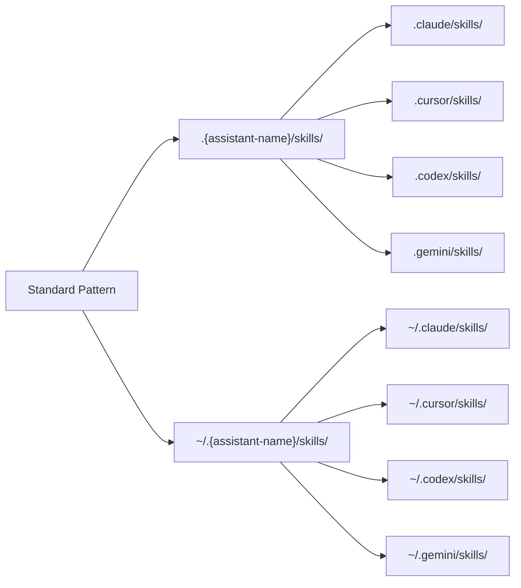
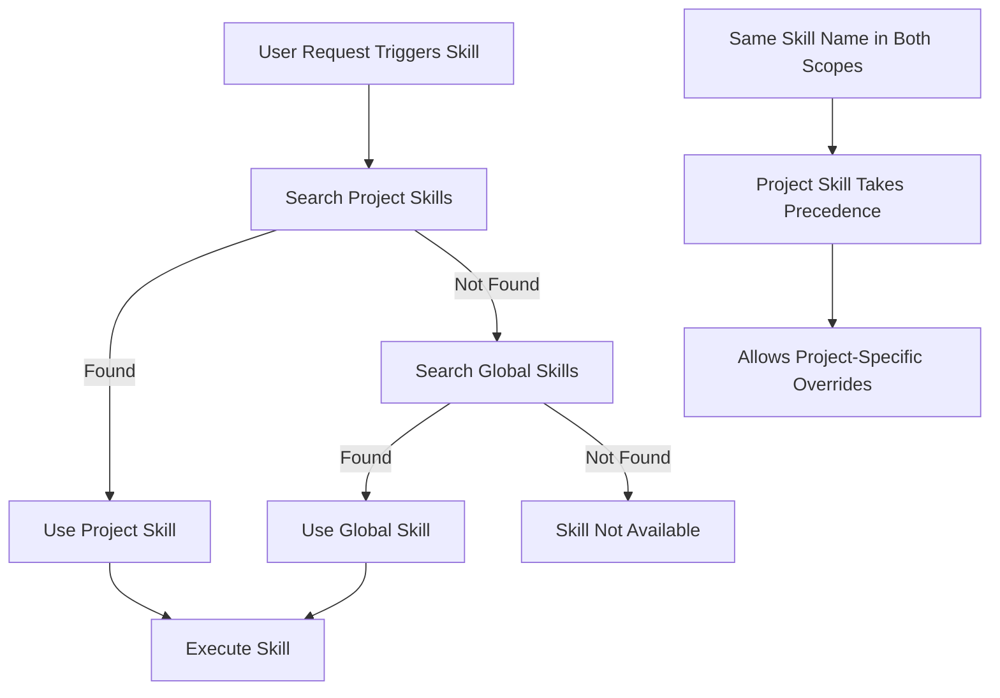
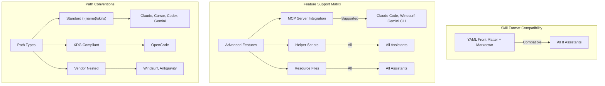

<!-- source: DeepWiki mcp.deepwiki.com · repo VoltAgent/awesome-agent-skills · page 6.1 AI Assistant Compatibility Matrix · fetched 2026-10-26 -->

# AI Assistant Compatibility Matrix

<details>
<summary>Relevant source files</summary>

The following files were used as context for generating this wiki page:

- [README.md](README.md)

</details>


This page provides a complete technical reference for all AI coding assistants that support Agent Skills, including their file system paths, path resolution behavior, and installation conventions. This is the authoritative reference for path configurations across the entire Agent Skills ecosystem.

For step-by-step installation instructions, see [Installing Skills](#2.1). For details on how AI assistants load and execute skills, see [AI Assistant Integration](#3.2).

## Overview

The Agent Skills standard is supported by 8+ AI coding assistants as of the latest update. Each assistant implements a dual-path system: project-specific paths (scoped to individual repositories) and global paths (available across all projects for a user). All assistants share the same skill definition format (YAML front matter + Markdown content), enabling write-once, run-anywhere portability.

**Sources**: [README.md:76-87]()

## Supported AI Coding Assistants

The following table provides the complete path configuration for each supported AI coding assistant:

| Assistant | Project Path | Global Path | Official Documentation | Notes |
|-----------|-------------|-------------|------------------------|-------|
| **Antigravity** | `.agent/skills/` | `~/.gemini/antigravity/skills/` | [Antigravity Skills](https://antigravity.google/docs/skills) | Part of Google Labs ecosystem |
| **Claude Code** | `.claude/skills/` | `~/.claude/skills/` | [Claude Code Skills](https://docs.anthropic.com/en/docs/claude-code/skills) | Reference implementation by Anthropic |
| **Codex** | `.codex/skills/` | `~/.codex/skills/` | [Codex Skills](https://developers.openai.com/codex/skills) | OpenAI's coding assistant |
| **Cursor** | `.cursor/skills/` | `~/.cursor/skills/` | [Cursor Skills](https://cursor.com/docs/context/skills) | Popular VS Code fork |
| **Gemini CLI** | `.gemini/skills/` | `~/.gemini/skills/` | [Gemini CLI Skills](https://geminicli.com/docs/cli/skills) | Google's command-line interface |
| **GitHub Copilot** | `.github/skills/` | `~/.copilot/skills/` | [Copilot Skills](https://docs.github.com/en/copilot/concepts/agents/about-agent-skills) | Microsoft/GitHub integration |
| **OpenCode** | `.opencode/skills/` | `~/.config/opencode/skills/` | [OpenCode Skills](https://opencode.ai/docs/skills) | Uses XDG Base Directory spec |
| **Windsurf** | `.windsurf/skills/` | `~/.codeium/windsurf/skills/` | [Windsurf Cascade Skills](https://docs.windsurf.com/windsurf/cascade/skills) | Codeium's assistant platform |

**Sources**: [README.md:76-87]()

## File System Architecture

### Directory Structure Pattern

```mermaid
graph TB
    subgraph "Project-Scoped Skills"
        ProjectRoot["Project Root Directory"]
        ProjectRoot --> Claude[".claude/skills/"]
        ProjectRoot --> Cursor[".cursor/skills/"]
        ProjectRoot --> Copilot[".github/skills/"]
        ProjectRoot --> Gemini[".gemini/skills/"]
        ProjectRoot --> Windsurf[".windsurf/skills/"]
        ProjectRoot --> Agent[".agent/skills/"]
        ProjectRoot --> Codex[".codex/skills/"]
        ProjectRoot --> OpenCode[".opencode/skills/"]
        
        Claude --> ClaudeSkill1["skill-name.md"]
        Claude --> ClaudeSkill2["another-skill/"]
    end
    
    subgraph "User-Scoped Skills"
        UserHome["User Home Directory (~)"]
        UserHome --> ClaudeGlobal["~/.claude/skills/"]
        UserHome --> CursorGlobal["~/.cursor/skills/"]
        UserHome --> CopilotGlobal["~/.copilot/skills/"]
        UserHome --> GeminiGlobal["~/.gemini/skills/"]
        UserHome --> WindsurfGlobal["~/.codeium/windsurf/skills/"]
        UserHome --> AntigravityGlobal["~/.gemini/antigravity/skills/"]
        UserHome --> CodexGlobal["~/.codex/skills/"]
        UserHome --> OpenCodeGlobal["~/.config/opencode/skills/"]
        
        ClaudeGlobal --> GlobalSkill1["global-skill.md"]
    end
    
    subgraph "Path Resolution"
        AssistantEngine["AI Assistant Engine"]
        AssistantEngine -->|"1. Load project skills"| ProjectRoot
        AssistantEngine -->|"2. Load global skills"| UserHome
        AssistantEngine --> MergedContext["Merged Skill Context"]
    end
```



**Path Resolution Logic**: AI assistants typically load project-specific skills first, then merge in global skills. Project-scoped skills take precedence when there are naming conflicts. This allows project-specific overrides of global defaults.

**Sources**: [README.md:76-87]()

## Path Conventions by Assistant

### Standard Pattern Assistants

Most assistants follow a consistent naming pattern:



**Sources**: [README.md:78-87]()

### Non-Standard Patterns

Three assistants deviate from the standard pattern:

#### GitHub Copilot
```
Project: .github/skills/
Global:  ~/.copilot/skills/
```
Uses `.github/` for project path (consistent with GitHub's existing `.github/workflows/` convention) but `~/.copilot/` for global path.

#### OpenCode
```
Project: .opencode/skills/
Global:  ~/.config/opencode/skills/
```
Follows the XDG Base Directory Specification, placing configuration in `~/.config/` rather than directly in the home directory.

#### Windsurf
```
Project: .windsurf/skills/
Global:  ~/.codeium/windsurf/skills/
```
Global path includes vendor namespace `codeium` to organize under the parent company's configuration directory.

#### Antigravity
```
Project: .agent/skills/
Global:  ~/.gemini/antigravity/skills/
```
Uses generic `.agent/` for project path but nests under `~/.gemini/antigravity/` for global path (Google Labs product hierarchy).

**Sources**: [README.md:80-87]()

## Cross-Platform Path Resolution

```mermaid
graph TB
    subgraph "Unix-like Systems (Linux, macOS)"
        UnixHome["Home Directory Resolution"]
        UnixHome --> HomeEnv["$HOME environment variable"]
        UnixHome --> TildeExpansion["~ shell expansion"]
        
        HomeEnv --> UnixPath["/home/username/.claude/skills/"]
        TildeExpansion --> UnixPath
    end
    
    subgraph "Windows Systems"
        WinHome["Home Directory Resolution"]
        WinHome --> UserProfile["%USERPROFILE% environment variable"]
        WinHome --> HomeDrive["%HOMEDRIVE%%HOMEPATH%"]
        
        UserProfile --> WinPath["C:\Users\username\.claude\skills\"]
        HomeDrive --> WinPath
    end
    
    subgraph "Project Paths (Platform-Independent)"
        ProjectPath["Relative to Project Root"]
        ProjectPath --> Git[".git directory parent"]
        ProjectPath --> WorkspaceRoot["Workspace/IDE root"]
        
        Git --> ResolvedPath["./project/.claude/skills/"]
        WorkspaceRoot --> ResolvedPath
    end
```



**Platform Considerations**:
- **Unix-like**: Global paths resolve via `$HOME` environment variable, typically `/home/username/` or `/Users/username/`
- **Windows**: Global paths resolve via `%USERPROFILE%`, typically `C:\Users\username\`
- **Project paths**: Always relative, use native path separators (`/` on Unix, `\` on Windows)
- **OpenCode exception**: Uses `~/.config/` on Unix/macOS, `%APPDATA%\opencode\` on Windows

**Sources**: [README.md:76-87]()

## Skill File Structure

Within each `skills/` directory, individual skills can be organized as:

### Single-File Skills
```
.claude/skills/
├── api-tester.md
├── code-reviewer.md
└── test-generator.md
```

### Directory-Based Skills
```
.claude/skills/
├── complex-skill/
│   ├── SKILL.md          # Main skill definition
│   ├── examples/         # Optional examples
│   ├── scripts/          # Optional helper scripts
│   └── resources/        # Optional resources
└── another-skill/
    └── SKILL.md
```

Both structures are supported by all assistants. The file must contain YAML front matter followed by Markdown content as specified in [Skill Definition Format](#3.1).

**Sources**: [README.md:44-72]()

## Path Priority and Conflict Resolution



**Precedence Rules**:
1. Project-scoped skills override global skills with the same name
2. Skills are matched by filename (without extension) or directory name
3. Project path is searched before global path
4. If no skill is found in either location, the assistant reports skill unavailability

This precedence model enables:
- **Global defaults**: Common skills available in all projects
- **Project customization**: Override global skills for project-specific needs
- **Team standards**: Check project skills into version control
- **Personal tools**: Keep experimental skills in global scope

**Sources**: [README.md:76-87]()

## Assistant-Specific Implementation Notes

### Claude Code (Reference Implementation)
- **Path detection**: Searches for `.claude/skills/` from current directory upward to find project root
- **Skill format**: Supports both `.md` files and directory-based skills with `SKILL.md`
- **Documentation**: [README.md:81]()

### Cursor
- **Integration**: Deeply integrated with VS Code workspace concept
- **Path**: Uses workspace root as project root for `.cursor/skills/`
- **Documentation**: [README.md:83]()

### GitHub Copilot
- **Convention**: Leverages existing `.github/` directory convention
- **Integration**: Works with GitHub repositories and local projects
- **Documentation**: [README.md:85]()

### Windsurf (Codeium)
- **Vendor namespace**: Global path under `~/.codeium/` for brand consistency
- **Documentation**: [README.md:87]()

### OpenCode
- **XDG compliance**: Follows XDG Base Directory specification on Unix systems
- **Cross-platform**: Adapts to platform-specific config directories
- **Documentation**: [README.md:86]()

### Antigravity (Google Labs)
- **Generic project path**: Uses `.agent/` rather than `.antigravity/`
- **Google ecosystem**: Nested under `~/.gemini/` for Google product family
- **Documentation**: [README.md:80]()

**Sources**: [README.md:76-87]()

## Compatibility Matrix Summary



**Key Compatibility Points**:
- **100% skill format compatibility**: All assistants use identical YAML + Markdown format
- **Path discovery**: Each assistant implements its own path resolution, but follows consistent precedence (project > global)
- **MCP integration**: Not all assistants support MCP servers; check documentation for specific capabilities
- **Cross-assistant portability**: Skills written for one assistant work on all others when copied to appropriate paths

**Sources**: [README.md:37-87]()

## Migration and Multi-Assistant Usage

For developers using multiple AI assistants on the same project:

### Option 1: Symlinks (Unix-like systems)
```bash
# Create skills in one location
mkdir -p .claude/skills/

# Symlink from other assistant directories
ln -s .claude/skills .cursor/skills
ln -s .claude/skills .github/skills
```

### Option 2: Skill Distribution Scripts
```bash
# Copy shared skills to all assistant directories
for dir in .claude .cursor .github .gemini .windsurf; do
  mkdir -p "$dir/skills"
  cp shared-skills/* "$dir/skills/"
done
```

### Option 3: Version Control Strategy
```
.gitignore:
  # Ignore assistant-specific directories except one
  /.cursor/
  /.github/
  /.windsurf/
  
.claude/skills/  # Track only Claude skills in version control
```

**Sources**: [README.md:76-87]()

## Official Documentation Links

Each AI assistant maintains its own official documentation for skills:

- **Antigravity**: https://antigravity.google/docs/skills
- **Claude Code**: https://docs.anthropic.com/en/docs/claude-code/skills
- **Codex**: https://developers.openai.com/codex/skills
- **Cursor**: https://cursor.com/docs/context/skills
- **Gemini CLI**: https://geminicli.com/docs/cli/skills/
- **GitHub Copilot**: https://docs.github.com/en/copilot/concepts/agents/about-agent-skills
- **OpenCode**: https://opencode.ai/docs/skills
- **Windsurf**: https://docs.windsurf.com/windsurf/cascade/skills

Consult assistant-specific documentation for:
- Installation procedures
- Feature-specific capabilities (e.g., MCP support)
- Path resolution edge cases
- Platform-specific considerations
- Version-specific changes

**Sources**: [README.md:76-87]()

---

