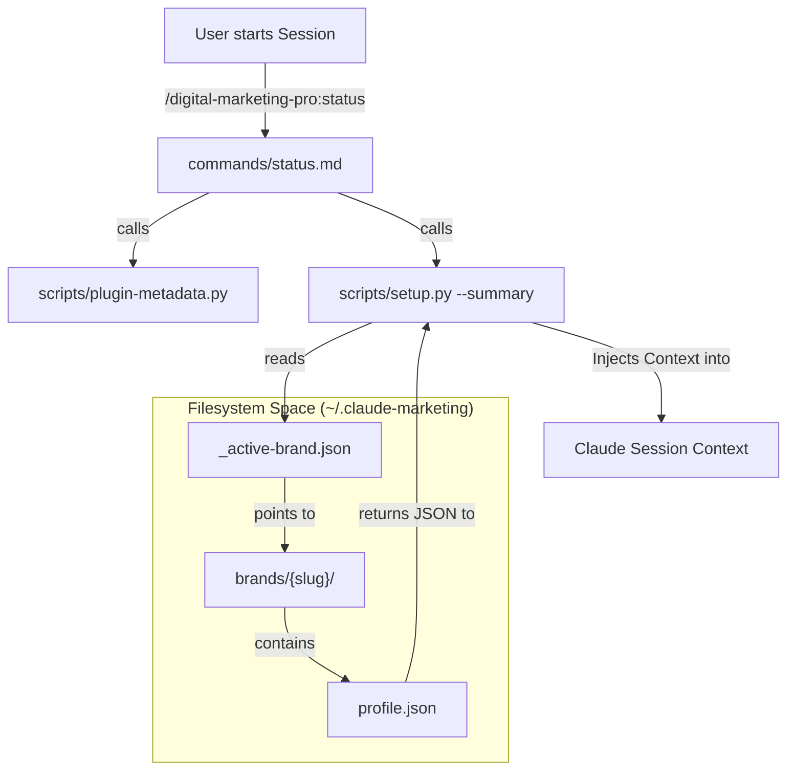
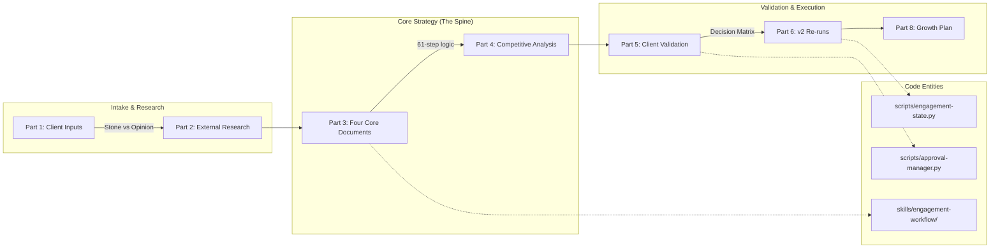

<!-- source: DeepWiki mcp.deepwiki.com · repo indranilbanerjee/digital-marketing-pro · page 1.1 Getting Started · fetched 2026-10-26 -->

# Getting Started

<details>
<summary>Relevant source files</summary>

The following files were used as context for generating this wiki page:

- [README.md](README.md)
- [TESTING-GUIDE.md](TESTING-GUIDE.md)
- [docs/architecture.md](docs/architecture.md)
- [docs/claude-interfaces.md](docs/claude-interfaces.md)
- [docs/engagement-methodology.md](docs/engagement-methodology.md)
- [docs/getting-started.md](docs/getting-started.md)
- [docs/integrations-guide.md](docs/integrations-guide.md)
- [docs/multi-brand-guide.md](docs/multi-brand-guide.md)
- [skills/help/SKILL.md](skills/help/SKILL.md)

</details>


This page provides a technical step-by-step guide for onboarding new users to **Digital Marketing Pro v3.15.0**. It covers prerequisites, installation across supported platforms, initial brand configuration, and the execution of the first marketing task using the 12-Part Engagement Methodology.

## 1. Prerequisites

To use Digital Marketing Pro, you must have one of the following agent harnesses installed:

*   **Claude Code**: CLI-based agent for terminal and IDE use [docs/getting-started.md:30-30]().
*   **Claude Cowork**: Agentic desktop assistant (macOS/Windows) [docs/getting-started.md:31-31]().
*   **Other Supported Platforms**: GitHub Copilot CLI, Cursor 2.5+, Google Antigravity 2.0, Hermes, or OpenClaw [README.md:7-7]().

### Optional Enhancements
*   **Python 3.8+**: Unlocks advanced scoring (readability, brand voice analysis) via the `scripts/` layer [docs/getting-started.md:37-37]().
*   **MCP Connectors**: Optional real-time data access (GA4, HubSpot, etc.). The plugin ships with an empty `.mcp.json` by default to ensure "honestly opt-in" connectivity [README.md:20-20](), [docs/integrations-guide.md:53-53]().

**Sources:** [README.md:7-20](), [docs/getting-started.md:26-40](), [docs/integrations-guide.md:51-56]()

---

## 2. Installation

### Option A: Claude Code (Local/Registry)
Run the following commands in your terminal to install from the local directory or the marketplace:

```bash
# Install from local directory
claude plugin add /path/to/digital-marketing-pro

# Install from marketplace
/plugin marketplace add indranilbanerjee/neels-plugins
/plugin install digital-marketing-pro@neels-plugins
```
[README.md:24-28](), [docs/getting-started.md:48-68]()

### Option B: Claude Cowork
1. Compress the `digital-marketing-pro/` folder into a `.zip` file [docs/getting-started.md:74-74]().
2. In Claude Desktop, navigate to **Plugin** -> **+** -> **Upload** [docs/getting-started.md:76-78]().
3. **Note**: Cowork runs in a sandbox. To persist brand data to your host machine, run `/digital-marketing-pro:cowork-setup` to route state through a Google Drive MCP [README.md:38-38](), [docs/claude-interfaces.md:125-125]().

### Verification
Upon successful installation, the system registers:
*   **158 Skills**: Defined in `skills/*/SKILL.md` [README.md:7-7]().
*   **24 Specialist Agents**: Defined in `agents/*.md` [docs/architecture.md:22-46]().
*   **18 Top-level Commands**: Prefixed with `/digital-marketing-pro:` [docs/claude-interfaces.md:11-11]().

**Sources:** [README.md:24-28](), [docs/getting-started.md:44-102](), [docs/claude-interfaces.md:11-13](), [docs/architecture.md:11-46]()

---

## 3. System Initialization & Data Flow

When a session starts, the system attempts to load the **Active Brand**.

### Brand Initialization Diagram
This diagram shows how the system transitions from the `Natural Language Space` (user intent) to the `Code Entity Space` (scripts and filesystem).

Title: Brand Context Loading Flow

**Sources:** [docs/getting-started.md:114-153](), [docs/architecture.md:48-48](), [docs/multi-brand-guide.md:80-91](), [skills/help/SKILL.md:23-25]()

---

## 4. First Brand Setup

A brand profile is mandatory to ground AI outputs in specific voice, industry, and compliance constraints [docs/multi-brand-guide.md:91-91]().

1.  **Run Command**: `/digital-marketing-pro:brand-setup` [docs/getting-started.md:100-100]().
2.  **Mode Selection**:
    *   **Quick**: 5 questions for immediate tasks [docs/engagement-methodology.md:120-120]().
    *   **Full**: 17 questions for deep strategic engagements [docs/getting-started.md:123-123]().
3.  **Output**: The system creates a directory at `~/.claude-marketing/brands/{slug}/` containing `profile.json`, `audiences.json`, and `competitors.json` [docs/multi-brand-guide.md:20-28]().

### Brand Profile Schema (Key Fields)
| Field | Purpose | Code Reference |
| :--- | :--- | :--- |
| `voice` | 1-10 floats for Formality, Energy, Humor, Authority | [docs/multi-brand-guide.md:69-73]() |
| `industry` | Maps to compliance rules (e.g., GDPR, FTC) | [docs/multi-brand-guide.md:68-68]() |
| `slug` | Unique filesystem identifier (e.g., `acme-corp`) | [docs/multi-brand-guide.md:20-20]() |

**Sources:** [docs/getting-started.md:116-132](), [docs/multi-brand-guide.md:18-79]()

---

## 5. Running Your First Marketing Task

Digital Marketing Pro supports two execution paths: **One-off Tasks** and **Full Engagements** [docs/engagement-methodology.md:68-69]().

### Path A: One-off Task (The 5-Minute Start)
For immediate deliverables, use specific command modules:
*   **SEO Audit**: `/digital-marketing-pro:seo-audit <url>` [TESTING-GUIDE.md:142-142]().
*   **Content**: `/digital-marketing-pro:content-engine` [TESTING-GUIDE.md:155-155]().
*   **Ad Copy**: "Write a LinkedIn ad for our new product" (triggers `content-creator.md` agent) [TESTING-GUIDE.md:157-157]().

### Path B: The 12-Part Engagement (Technical Workflow)
This is the recommended path for comprehensive strategy. It orchestrates multiple agents and scripts in a stateful sequence.

Title: 12-Part Methodology Execution Flow

**Sources:** [docs/engagement-methodology.md:47-64](), [docs/architecture.md:83-84](), [docs/architecture.md:111-111]()

### Execution Commands
*   **Start**: `/digital-marketing-pro:engagement start <brand-slug> <engagement-id>` [docs/engagement-methodology.md:93-93]().
*   **Resume**: If a session times out, use `/digital-marketing-pro:resume` to pick up from the last checkpoint stored in `_engagement.json` [docs/engagement-methodology.md:126-126]().
*   **Quality Gate**: Run `/digital-marketing-pro:check` before publishing to trigger `hallucination-detector.py` and `brand-voice-scorer.py` [docs/engagement-methodology.md:5-5](), [docs/architecture.md:105-105]().

**Sources:** [docs/engagement-methodology.md:5-126](), [TESTING-GUIDE.md:116-199](), [docs/architecture.md:83-105]()

---

