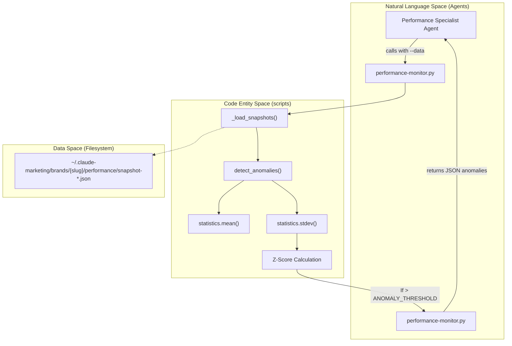
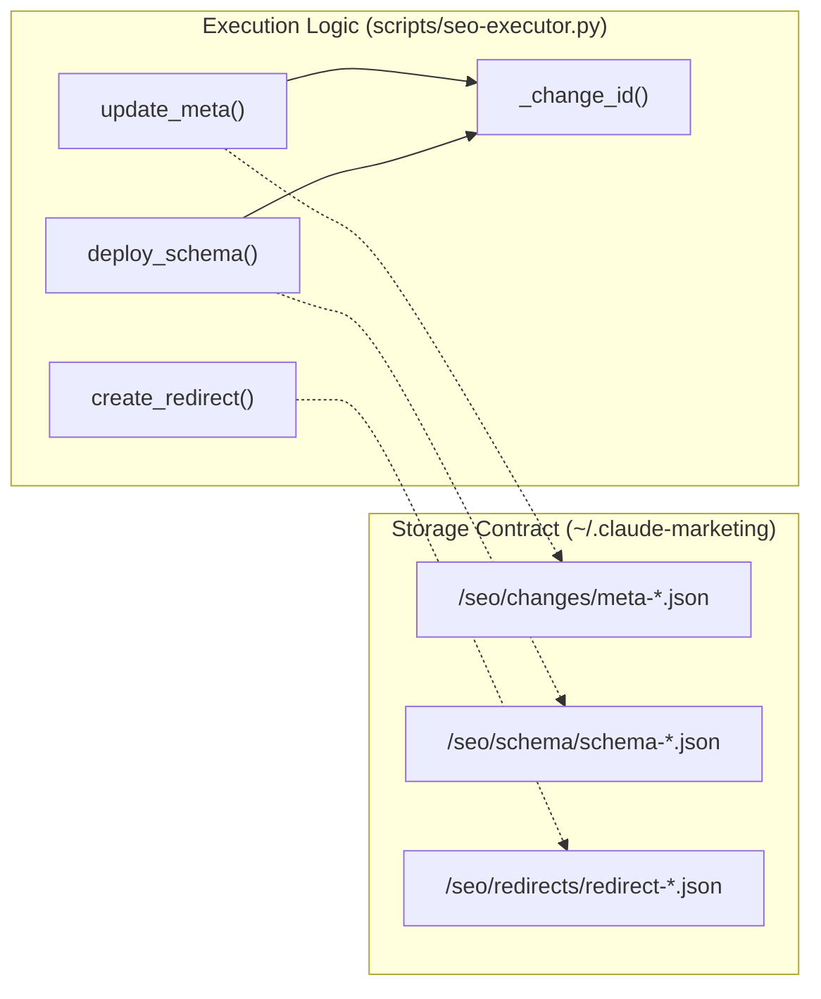

<!-- source: DeepWiki mcp.deepwiki.com · repo indranilbanerjee/digital-marketing-pro · page 2.3 Python Scripts Layer · fetched 2026-10-26 -->

# Python Scripts Layer

Relevant source files

The following files were used as context for generating this wiki page:

- [scripts/approval-manager.py](scripts/approval-manager.py)
- [scripts/audience-simulator.py](scripts/audience-simulator.py)
- [scripts/campaign-health-monitor.py](scripts/campaign-health-monitor.py)
- [scripts/churn-predictor.py](scripts/churn-predictor.py)
- [scripts/competitor-scraper.py](scripts/competitor-scraper.py)
- [scripts/competitor-tracker.py](scripts/competitor-tracker.py)
- [scripts/connector-status.py](scripts/connector-status.py)
- [scripts/crm-sync.py](scripts/crm-sync.py)
- [scripts/execution-tracker.py](scripts/execution-tracker.py)
- [scripts/intelligence-graph.py](scripts/intelligence-graph.py)
- [scripts/journey-engine.py](scripts/journey-engine.py)
- [scripts/macro-signal-tracker.py](scripts/macro-signal-tracker.py)
- [scripts/memory-manager.py](scripts/memory-manager.py)
- [scripts/performance-monitor.py](scripts/performance-monitor.py)
- [scripts/readability-analyzer.py](scripts/readability-analyzer.py)
- [scripts/report-generator.py](scripts/report-generator.py)
- [scripts/requirements.txt](scripts/requirements.txt)
- [scripts/seo-executor.py](scripts/seo-executor.py)
- [scripts/setup.py](scripts/setup.py)
- [scripts/team-manager.py](scripts/team-manager.py)
- [skills/attribution-model/SKILL.md](skills/attribution-model/SKILL.md)
- [skills/client-onboarding/SKILL.md](skills/client-onboarding/SKILL.md)
- [skills/content-engine/video-scripting.md](skills/content-engine/video-scripting.md)

The **Python Scripts Layer** consists of 89 deterministic scripts located in the `scripts/` directory. These scripts serve as the "hands" of the Digital Marketing Pro system, providing a reliable execution layer that separates probabilistic AI reasoning from structured data manipulation and system operations.

## Design Philosophy

The scripting layer follows a strict architectural contract to ensure stability across different agent harnesses (Claude Code, Cursor, etc.):

*   **Stdlib-First:** Scripts prioritize the Python Standard Library to minimize dependency overhead. External libraries like `textstat`, `beautifulsoup4`, or `requests` are treated as optional or "lite" dependencies [scripts/setup.py:29-45]().
*   **JSON I/O Contract:** All scripts are designed to be called via CLI and return structured JSON to `stdout`. This allows agents to parse results programmatically without dealing with "chatty" console output [scripts/readability-analyzer.py:28-35]().
*   **Graceful Degradation:** If a dependency is missing, scripts return a "fallback" JSON object explaining the requirement rather than crashing [scripts/competitor-scraper.py:19-25]().
*   **Stateless Execution:** Scripts generally rely on the brand's filesystem structure for state, rather than long-running processes [scripts/seo-executor.py:11-12]().

### Shared Utility: `_common.py`
Most scripts import `_common.py` to handle environment-agnostic path resolution and atomic file operations. Key functions include:
*   `_common.brands_root()`: Resolves the persistent storage location at `~/.claude-marketing/brands/` [scripts/seo-executor.py:34]().
*   `_common.get_brand_dir(slug)`: Normalizes brand names into filesystem-safe slugs [scripts/seo-executor.py:42-46]().
*   `_common.atomic_write_json()`: Ensures data integrity by writing to a temporary file before replacing the target [scripts/execution-tracker.py:76]().

## Script Categories & Data Flow

### 1. State & Execution Management
These scripts maintain the "Audit Trail" of the system, ensuring that every AI-driven action is recorded for compliance and historical reference.

| Script | Purpose | Key Functionality |
| :--- | :--- | :--- |
| `setup.py` | Environment Init | Creates `~/.claude-marketing/` and installs deps [scripts/setup.py:48-71](). |
| `execution-tracker.py` | Audit Logging | Records all publishes, sends, and syncs [scripts/execution-tracker.py:79-138](). |
| `approval-manager.py` | Human-in-the-loop | Manages the `PENDING_APPROVAL` state for high-stakes actions. |

### 2. SEO & Performance Execution
Deterministic tools for technical marketing tasks that require precision.

| Script | Purpose | Implementation Detail |
| :--- | :--- | :--- |
| `seo-executor.py` | SEO Implementation | Tracks meta updates, schema deployments, and redirects [scripts/seo-executor.py:5-9](). |
| `performance-monitor.py` | Anomaly Detection | Uses Z-scores to flag metrics deviating from the 30-day baseline [scripts/performance-monitor.py:163-222](). |
| `readability-analyzer.py` | Content Quality | Computes Flesch-Kincaid and Gunning Fog scores [scripts/readability-analyzer.py:142-200](). |

### 3. Integration & Sync
Manages the local state for external MCP (Model Context Protocol) connectors.

| Script | Purpose | Key Functionality |
| :--- | :--- | :--- |
| `connector-status.py` | Registry Check | Reports which MCP servers are active/available [scripts/connector-status.py:46-100](). |
| `crm-sync.py` | Data Prep | Maps local contact data to HubSpot/Salesforce schemas [scripts/crm-sync.py:86-119](). |

## Technical Implementation Diagrams

### Logic Flow: Performance Anomaly Detection
This diagram illustrates how `performance-monitor.py` bridges the gap between raw data and the AI's "Performance Specialist" agent.

Title: Performance Monitoring Data Flow

Sources: [scripts/performance-monitor.py:35](), [scripts/performance-monitor.py:45-56](), [scripts/performance-monitor.py:163-222]()

### SEO Execution & Audit Trail
This diagram shows the relationship between the `seo-executor.py` logic and the persistent storage of brand changes.

Title: SEO Execution and State Persistence

Sources: [scripts/seo-executor.py:49-53](), [scripts/seo-executor.py:81-82](), [scripts/seo-executor.py:145-146](), [scripts/seo-executor.py:179-180]()

## Key Implementation Details

### JSON-LD Schema Deployment
The `seo-executor.py` script validates schema types against a whitelist (`Organization`, `Product`, `FAQ`, etc.) before recording them [scripts/seo-executor.py:36-39](). It ensures that the AI does not generate invalid schema types that would fail search engine validation [scripts/seo-executor.py:137-138]().

### CRM Data Normalization
The `crm-sync.py` script acts as a transformation layer. It takes a generic "contact" object and maps it to specific fields required by different CRM platforms [scripts/crm-sync.py:86-119]():
*   **HubSpot:** Maps `first_name` to `firstname`.
*   **Salesforce:** Maps `first_name` to `FirstName`.
*   **Pipedrive:** Aggregates `name` and wraps email in a list structure.

### Execution Indexing
To prevent the audit trail from becoming unreadable as it grows, `execution-tracker.py` maintains an `_index.json` file. If this index is corrupted or deleted, the script includes a self-healing `_rebuild_index_from_files()` function that rescans all individual execution logs to restore the summary [scripts/execution-tracker.py:40-58]().

Sources:
*   [scripts/seo-executor.py:1-222]()
*   [scripts/connector-status.py:1-167]()
*   [scripts/execution-tracker.py:1-177]()
*   [scripts/crm-sync.py:1-204]()
*   [scripts/performance-monitor.py:1-222]()
*   [scripts/setup.py:1-173]()
*   [scripts/readability-analyzer.py:1-200]()
*   [scripts/competitor-scraper.py:1-152]()

---

