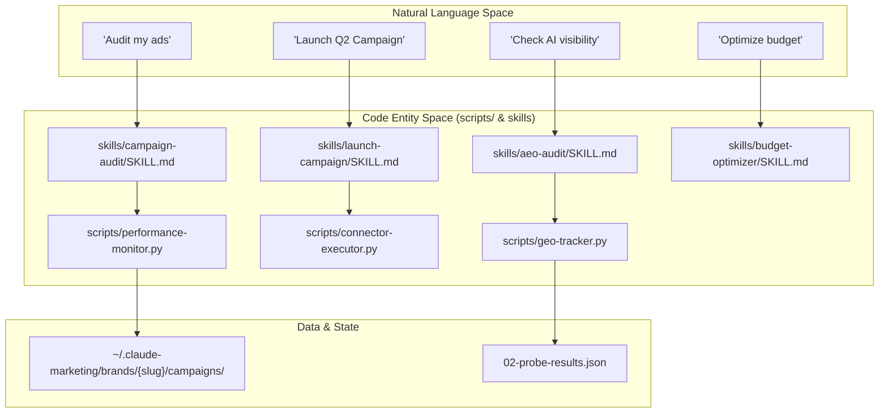
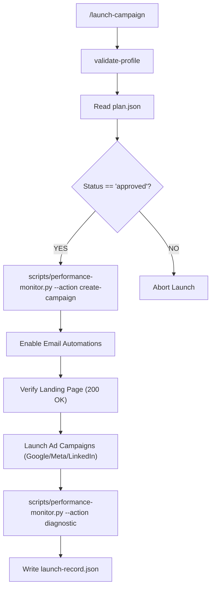

<!-- source: DeepWiki mcp.deepwiki.com · repo indranilbanerjee/digital-marketing-pro · page 6.3 Paid Advertising & Campaign Skills · fetched 2026-10-26 -->

# Paid Advertising & Campaign Skills

Relevant source files

The following files were used as context for generating this wiki page:

- [commands/campaign-plan.md](commands/campaign-plan.md)
- [commands/check.md](commands/check.md)
- [commands/content-engine.md](commands/content-engine.md)
- [skills/aeo-audit/SKILL.md](skills/aeo-audit/SKILL.md)
- [skills/aeo-geo/SKILL.md](skills/aeo-geo/SKILL.md)
- [skills/analytics-insights/SKILL.md](skills/analytics-insights/SKILL.md)
- [skills/audience-profile/SKILL.md](skills/audience-profile/SKILL.md)
- [skills/campaign-audit/SKILL.md](skills/campaign-audit/SKILL.md)
- [skills/campaign-plan/SKILL.md](skills/campaign-plan/SKILL.md)
- [skills/check/SKILL.md](skills/check/SKILL.md)
- [skills/competitor-analysis/SKILL.md](skills/competitor-analysis/SKILL.md)
- [skills/content-calendar/SKILL.md](skills/content-calendar/SKILL.md)
- [skills/context-engine/eu-code-of-practice.md](skills/context-engine/eu-code-of-practice.md)
- [skills/crisis-response/SKILL.md](skills/crisis-response/SKILL.md)
- [skills/funnel-audit/SKILL.md](skills/funnel-audit/SKILL.md)
- [skills/gsc-ai-performance/SKILL.md](skills/gsc-ai-performance/SKILL.md)
- [skills/launch-campaign/SKILL.md](skills/launch-campaign/SKILL.md)
- [skills/paid-advertising/SKILL.md](skills/paid-advertising/SKILL.md)
- [skills/paid-advertising/google-ads.md](skills/paid-advertising/google-ads.md)
- [skills/paid-advertising/media-planning.md](skills/paid-advertising/media-planning.md)
- [skills/status/SKILL.md](skills/status/SKILL.md)
- [skills/validate-profile/SKILL.md](skills/validate-profile/SKILL.md)

This section details the technical implementation and orchestration of paid advertising and multi-channel campaigns within the Digital Marketing Pro system. It covers the integration with modern ad platforms (Google Ads v24.2), AI-driven search surfaces (AEO/GEO), and the deterministic execution pipeline for launching and auditing complex marketing initiatives.

## Overview of Paid Advertising Architecture

The system treats paid advertising as a data-driven execution layer that sits atop the strategic brand context. It leverages a "Modern Simplified Structure" that prioritizes feeding data to automated bidding algorithms (Smart Bidding) over granular manual controls [skills/paid-advertising/google-ads.md:61-81]().

### Core Components
*   **Google Ads v24.2 Integration**: Support for the latest API features including Local Services Ads (LSA), Demand Gen, and AI Max experiments [skills/paid-advertising/google-ads.md:3-16]().
*   **AEO/GEO Engine**: A specialized audit and optimization suite for AI-native search surfaces like ChatGPT, Perplexity, and Google AI Mode [skills/aeo-audit/SKILL.md:9-13]().
*   **Campaign Orchestrator**: A stateful execution engine that manages dependencies across 14 distinct launch actions [skills/launch-campaign/SKILL.md:67-84]().

## Natural Language to Code Entity Mapping

The following diagram bridges user-facing marketing concepts to the underlying technical scripts and skill definitions.

**Diagram: Advertising & Campaign Entity Map**

Sources: [skills/campaign-audit/SKILL.md:76-88](), [skills/launch-campaign/SKILL.md:15-17](), [skills/aeo-audit/SKILL.md:86-91]().

## Campaign Orchestration & Parallel Dispatch

The `launch-campaign` skill acts as a central coordinator. It enforces a strict dependency order to ensure that tracking and compliance (especially EU AI Act Article 50) are verified before any spend occurs [skills/launch-campaign/SKILL.md:92-102]().

### The Launch Pipeline
1.  **Validation Gate**: Runs `/digital-marketing-pro:validate-profile` and checks `plan.json` for `approved` status [skills/launch-campaign/SKILL.md:37-44]().
2.  **Asset Readiness**: Verifies all creative assets and C2PA signatures for AI-generated content [skills/launch-campaign/SKILL.md:47-49]().
3.  **Sequential Execution**:
    *   **CRM Setup**: Creates campaign objects in HubSpot/Salesforce first to provide IDs for attribution [skills/launch-campaign/SKILL.md:98-99]().
    *   **Channel Activation**: Parallel dispatch to Google Ads, Meta, and Email platforms via `connector-executor.py`.
    *   **Monitoring**: Activates `performance-check` watchdogs for Day-1 telemetry [skills/launch-campaign/SKILL.md:81-81]().

**Diagram: Campaign Launch Dependency Flow**

Sources: [skills/launch-campaign/SKILL.md:57-90](), [skills/launch-campaign/SKILL.md:92-102]().

## AEO/GEO: AI Search Optimization

As of May 2026, the system distinguishes between **Google AI Overviews** (SERP summaries) and **Google AI Mode** (conversational Gemini 3.5 Flash interface) [skills/aeo-audit/SKILL.md:13-15]().

### Audit Methodology
The `aeo-audit` skill performs synthetic probing across 6 canonical platforms: Google AI Mode, Google AI Overviews, ChatGPT, Perplexity, Gemini, and Microsoft Copilot [skills/aeo-audit/SKILL.md:90-91]().

| Output File | Content |
| :--- | :--- |
| `02-probe-results.json` | Raw data layer from `scripts/geo-tracker.py` [skills/aeo-audit/SKILL.md:62-62]() |
| `03-platform-scorecard.md` | 1-10 visibility score per platform [skills/aeo-audit/SKILL.md:63-63]() |
| `04-citation-accuracy.md` | Fact-check of AI descriptions vs Brand Profile [skills/aeo-audit/SKILL.md:64-64]() |

Sources: [skills/aeo-audit/SKILL.md:57-71](), [skills/aeo-geo/SKILL.md:22-29]().

## Paid Advertising Technical Standards

### Google Ads API (v24.2)
The system targets `v24.2` (released June 2026) for all programmatic interactions. Key technical requirements include:
*   **Mandatory Fields**: `videos`, `logo_images`, and `business_name` are required for Responsive Ads [skills/paid-advertising/google-ads.md:30-33]().
*   **AI Max Migration**: Utilization of the `ADOPT_AI_MAX` experiment type for measuring lift during AI transitions [skills/paid-advertising/google-ads.md:23-23]().
*   **Bidding**: Automatic selection between `tCPA` (30+ conversions) and `tROAS` (50+ conversions) based on business model [skills/paid-advertising/google-ads.md:108-115]().

### Quality & Compliance Gates
Before any ad copy is published, the `/digital-marketing-pro:check` command executes the `eval-runner.py` suite:
1.  **Hallucination Detection**: Flags unattributed statistics and placeholder URLs [skills/check/SKILL.md:39-39]().
2.  **C2PA Verification**: Mandatory for AI assets targeting EU markets (Article 50 compliance) [skills/check/SKILL.md:43-43]().
3.  **Brand Voice Scoring**: Uses `brand-voice-scorer.py` to ensure ad copy matches the 4-dimension voice profile (Formality, Energy, Humor, Authority) [skills/check/SKILL.md:41-41]().

Sources: [skills/paid-advertising/google-ads.md:5-17](), [skills/check/SKILL.md:35-45](), [skills/validate-profile/SKILL.md:34-46]().

---

