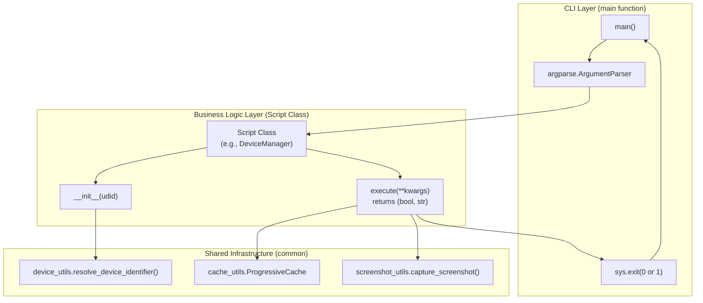
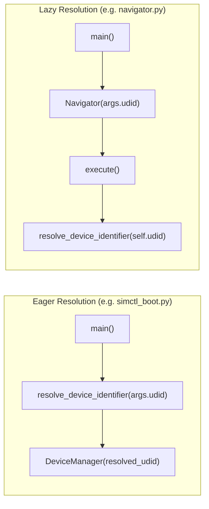
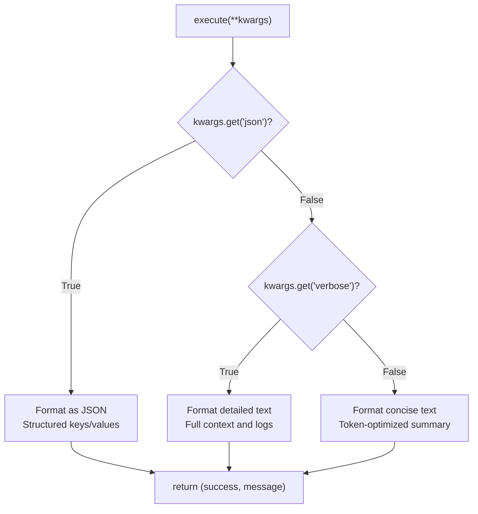

<!-- source: DeepWiki mcp.deepwiki.com · repo conorluddy/ios-simulator-skill · page 3.6 Class-Based Script Architecture · fetched 2026-10-26 -->

# Class-Based Script Architecture

<details>
<summary>Relevant source files</summary>

The following files were used as context for generating this wiki page:

- [CLAUDE.md](CLAUDE.md)
- [DEV.md](DEV.md)

</details>


This page describes the standard class-based design pattern used across all 22 production scripts in the `ios-simulator-skill`. This pattern provides a consistent structure for script initialization, execution, and CLI integration, with a primary focus on enhancing testability, code reusability, and token efficiency. [CLAUDE.md:57-76](), [CLAUDE.md:9-14]()

---

## Pattern Overview

All scripts in the `ios-simulator-skill` follow a three-part architecture:

1.  **Script Class**: Encapsulates core logic with device state.
2.  **`execute()` Method**: Returns a `(bool, str)` tuple representing success and output.
3.  **`main()` Function**: Handles CLI argument parsing and exit codes.

This separation enables unit testing of business logic without invoking the CLI layer, while maintaining a consistent interface for end users and AI agents. [CLAUDE.md:57-76]()

**Standard Template Structure**



Sources: [CLAUDE.md:57-76](), [CLAUDE.md:149-163]()

---

## Class Constructor Pattern

Every script class follows a standard constructor signature that accepts an optional device identifier. [CLAUDE.md:61-64]()

```python
class DeviceManager:
    def __init__(self, udid: str | None = None):
        self.udid = udid
```

| Parameter | Type | Default | Purpose |
|-----------|------|---------|---------|
| `udid` | `str \| None` | `None` | Device UDID, name, or None for auto-detection |

**Device Resolution Strategy**

The constructor typically stores the raw `udid` parameter. Resolution to a concrete UDID happens in one of two places depending on the script's requirements:

1.  **In `main()`**: Before class instantiation, using `resolve_device_identifier()`. This is common for scripts that require a specific target to exist before starting. [CLAUDE.md:78-88]()
2.  **In `execute()`**: Lazy resolution when first needed. This allows the script to adapt if the target is determined during runtime (e.g., auto-detecting the currently booted device). [CLAUDE.md:151-152]()

**Resolution Timing Comparison**



Sources: [CLAUDE.md:78-88](), [CLAUDE.md:151-152]()

---

## Execute Method Contract

The `execute()` method is the functional core of every script class. It implements the primary operation and returns a standardized tuple. [CLAUDE.md:66-68]()

```python
def execute(self, **kwargs) -> tuple[bool, str]:
    """
    Execute the script's primary operation.
    
    Returns:
        tuple[bool, str]: (success, message)
    """
```

**Return Tuple Contract**

| Index | Type | Name | Purpose |
|-------|------|------|---------|
| 0 | `bool` | success | `True` for success (exit code 0), `False` for failure (exit code 1). |
| 1 | `str` | message | Formatted output string respecting `--json` or `--verbose` flags. |

**Output String Formatting**

The `message` string must adhere to the skill's token optimization strategy, typically providing a 96% reduction in output size compared to raw tool logs. [CLAUDE.md:174-182]()

*   **Default**: Concise (3-5 lines), often including a `cache_id` for large data. [CLAUDE.md:95-96]()
*   **Verbose**: Detailed text output (50+ lines) for human debugging. [CLAUDE.md:98-101]()
*   **JSON**: Structured data (20-30 lines) for machine parsing. [CLAUDE.md:103-104]()



Sources: [CLAUDE.md:90-105](), [CLAUDE.md:174-182]()

---

## CLI Integration via main()

The `main()` function serves as the entry point. It translates command-line arguments into the class-based execution flow. [CLAUDE.md:70-76]()

**Standard main() Structure**

1.  **Parse Arguments**: Uses `argparse` to define flags like `--udid`, `--json`, and `--verbose`. [CLAUDE.md:71-71]()
2.  **Resolve Device**: (Optional) Calls `resolve_device_identifier()` if a UDID is required. [CLAUDE.md:83-84]()
3.  **Instantiate Class**: Creates the manager object with the (potentially resolved) UDID. [CLAUDE.md:72-72]()
4.  **Call Execute**: Invokes the logic with parameters extracted from `args`. [CLAUDE.md:73-73]()
5.  **Exit**: Prints the message and exits with the appropriate status code. [CLAUDE.md:74-75]()

**Argument Conversion Example**

```python
# Typical pattern in main()
def main():
    parser = argparse.ArgumentParser()
    # ... add arguments ...
    args = parser.parse_args()
    
    manager = DeviceManager(args.udid)
    success, message = manager.execute(verbose=args.verbose, json=args.json)
    print(message)
    sys.exit(0 if success else 1)
```

Sources: [CLAUDE.md:70-76]()

---

## Benefits for Testability

The class-based architecture is designed for 100% test coverage of new features. [CLAUDE.md:14-14]()

*   **Logic Isolation**: Tests can instantiate the class and call `execute()` directly without simulating `sys.argv` or capturing `stdout`. [CLAUDE.md:57-59]()
*   **State Management**: Each test creates a fresh class instance, preventing state leakage.
*   **Mocking**: Shared utilities like `idb_utils.py` or `screenshot_utils.py` can be easily mocked when passed into or used by the class. [CLAUDE.md:164-172]()

Sources: [CLAUDE.md:57-76](), [CLAUDE.md:186-194]()

---

## Integration with Shared Utilities

Scripts rely on modular components in the `common/` directory to maintain the architecture.

| Component | File Path | Role in Architecture |
|-----------|-----------|----------------------|
| **Device Resolution** | `common/device_utils.py` | Provides `resolve_device_identifier()` for `main()` or `execute()`. [CLAUDE.md:151-152]() |
| **Caching** | `common/cache_utils.py` | Provides `ProgressiveCache` for token-efficient `execute()` returns. [CLAUDE.md:161-162]() |
| **Screenshots** | `common/screenshot_utils.py` | Handles `capture_screenshot()` and resizing for token optimization. [CLAUDE.md:156-159]() |

Sources: [CLAUDE.md:149-163]()

---

## Pattern Enforcement

All new scripts contributed to the repository must follow these standards:
1.  Use class-based design for logic > 50 lines. [CLAUDE.md:187-187]()
2.  Support `--udid` with auto-detection. [CLAUDE.md:188-188]()
3.  Support `--json` output mode. [CLAUDE.md:189-189]()
4.  Provide `--help` documentation via `argparse`. [CLAUDE.md:190-190]()

Sources: [CLAUDE.md:184-194]()

---

