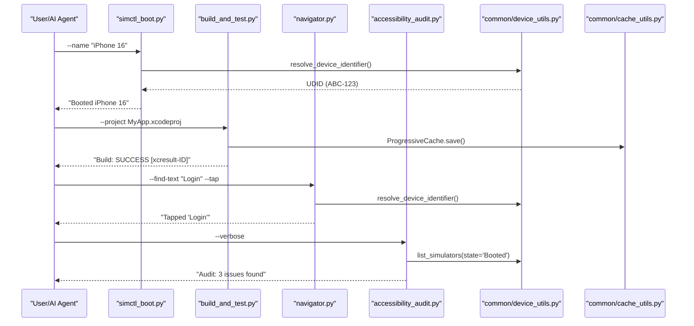

<!-- source: DeepWiki mcp.deepwiki.com · repo conorluddy/ios-simulator-skill · page 4 Script Categories Overview · fetched 2026-10-26 -->

# Script Categories Overview

Relevant source files

The following files were used as context for generating this wiki page:

- [CLAUDE.md](CLAUDE.md)
- [README.md](README.md)
- [ios-simulator-skill/skills/ios-simulator-skill/SKILL.md](ios-simulator-skill/skills/ios-simulator-skill/SKILL.md)

This document provides an overview of the 22 production scripts in the `ios-simulator-skill` package and how they are organized into 5 functional categories. Each category serves a distinct phase in iOS automation workflows, from device lifecycle management to testing and analysis.

**Sources:** [README.md:91-141](), [ios-simulator-skill/skills/ios-simulator-skill/SKILL.md:43-184](), [CLAUDE.md:112-144]()

## Category Organization

The 22 scripts are organized into 5 functional categories based on their role in the automation lifecycle.

| Category | Script Count | Primary Purpose | Typical Usage Phase |
|----------|--------------|-----------------|---------------------|
| **Build & Development** | 2 | Compile Xcode projects and monitor logs | Initial development cycle |
| **Navigation & Interaction** | 5 | Control UI elements and simulate user actions | Active testing and automation |
| **Testing & Analysis** | 6 | Verify behavior and capture debugging data | Quality assurance and debugging |
| **Advanced Testing** | 4 | Test edge cases (permissions, notifications, clipboard) | Specialized testing scenarios |
| **Device Lifecycle** | 5 | Manage simulator creation, boot, and deletion | Setup and teardown phases |

**Sources:** [README.md:91-141](), [ios-simulator-skill/skills/ios-simulator-skill/SKILL.md:43-184](), [CLAUDE.md:112-144]()

## Script Organization by Category

The following diagram bridges the **Natural Language Space** (Category Names) to the **Code Entity Space** (Script filenames and utility modules).

```mermaid
graph TB
    subgraph Category1["Build & Development (2)"]
        BT["build_and_test.py"]
        LM["log_monitor.py"]
    end
    
    subgraph Category2["Navigation & Interaction (5)"]
        SM["screen_mapper.py"]
        NAV["navigator.py"]
        GEST["gesture.py"]
        KB["keyboard.py"]
        AL["app_launcher.py"]
    end
    
    subgraph Category3["Testing & Analysis (6)"]
        AA["accessibility_audit.py"]
        VD["visual_diff.py"]
        TR["test_recorder.py"]
        ASC["app_state_capture.py"]
        HC["sim_health_check.sh"]
        MI["model_inspector.py"]
    end
    
    subgraph Category4["Advanced Testing (4)"]
        CB["clipboard.py"]
        SB["status_bar.py"]
        PN["push_notification.py"]
        PM["privacy_manager.py"]
    end
    
    subgraph Category5["Device Lifecycle (5)"]
        BOOT["simctl_boot.py"]
        SHUT["simctl_shutdown.py"]
        CREATE["simctl_create.py"]
        DELETE["simctl_delete.py"]
        ERASE["simctl_erase.py"]
    end
    
    subgraph Utils["Shared Utilities (common)"]
        DU["device_utils.py"]
        SU["screenshot_utils.py"]
        CU["cache_utils.py"]
    end
    
    BT --> DU
    BT --> CU
    SM --> DU
    SM --> CU
    NAV --> DU
    NAV --> SU
    AL --> DU
    AA --> DU
    TR --> DU
    TR --> SU
    ASC --> DU
    ASC --> SU
    MI --> DU
    BOOT --> DU
    SHUT --> DU
    CREATE --> DU
    DELETE --> DU
    ERASE --> DU
```

**Sources:** [CLAUDE.md:18-45](), [ios-simulator-skill/skills/ios-simulator-skill/SKILL.md:43-184]()

## Typical Automation Workflow

This diagram illustrates how a user or AI agent interacts with different scripts and how those scripts utilize internal functions from `common/` modules.

**Sources:** [README.md:51-65](), [ios-simulator-skill/skills/ios-simulator-skill/SKILL.md:11-28](), [CLAUDE.md:147-159]()

## Category Purposes and Key Scripts

### 1. Build & Development

**Purpose:** Compile Xcode projects, run tests, and monitor application logs during development.

**Key Scripts:**
- `build_and_test.py`: Wraps `xcodebuild` with progressive disclosure, caching build logs and errors. It uses `common/cache_utils.py` to store large outputs. [ios-simulator-skill/skills/ios-simulator-skill/SKILL.md:47-51]()
- `log_monitor.py`: Streams simulator logs with filtering by severity (`--severity error`). [ios-simulator-skill/skills/ios-simulator-skill/SKILL.md:53-57]()

**Sources:** [README.md:95-100](), [CLAUDE.md:114-116]()

### 2. Navigation & Interaction

**Purpose:** Control the simulator UI through semantic navigation based on iOS accessibility APIs.

**Key Scripts:**
- `screen_mapper.py`: Analyzes the accessibility tree to provide a token-efficient list of interactive elements. [ios-simulator-skill/skills/ios-simulator-skill/SKILL.md:61-65]()
- `navigator.py`: Finds elements by `--find-text`, `--find-type`, or `--find-id`, then executes `--tap` or `--enter-text`. [ios-simulator-skill/skills/ios-simulator-skill/SKILL.md:67-72]()
- `app_launcher.py`: Manages app lifecycle using `xcrun simctl launch` and `terminate`. [ios-simulator-skill/skills/ios-simulator-skill/SKILL.md:89-96]()
- `gesture.py`: Performs swipes, scrolls, and pinches via `idb ui` commands. [ios-simulator-skill/skills/ios-simulator-skill/SKILL.md:74-80]()
- `keyboard.py`: Types text and simulates hardware buttons (home, lock, volume). [ios-simulator-skill/skills/ios-simulator-skill/SKILL.md:82-87]()

**Sources:** [README.md:102-110](), [CLAUDE.md:118-124]()

### 3. Testing & Analysis

**Purpose:** Verify application quality through accessibility audits, visual comparison, and debugging snapshots.

**Key Scripts:**
- `accessibility_audit.py`: Checks WCAG compliance (missing labels, small touch targets). [ios-simulator-skill/skills/ios-simulator-skill/SKILL.md:100-104]()
- `visual_diff.py`: Pixel comparison of screenshots using the Pillow library. [ios-simulator-skill/skills/ios-simulator-skill/SKILL.md:106-110]()
- `test_recorder.py`: Captures screenshots and accessibility trees at each test step for documentation. [ios-simulator-skill/skills/ios-simulator-skill/SKILL.md:112-115]()
- `app_state_capture.py`: Creates a comprehensive snapshot (screenshot + UI tree + logs + device info). [ios-simulator-skill/skills/ios-simulator-skill/SKILL.md:117-120]()
- `model_inspector.py`: Inspects Core Data and SwiftData models from project files. [ios-simulator-skill/skills/ios-simulator-skill/SKILL.md:127-132]()
- `sim_health_check.sh`: Validates environment (`xcrun`, `idb`, Python packages). [ios-simulator-skill/skills/ios-simulator-skill/SKILL.md:122-125]()

**Sources:** [README.md:112-121](), [CLAUDE.md:125-131]()

### 4. Advanced Testing

**Purpose:** Test specialized scenarios including permissions, push notifications, clipboard, and status bar appearance.

**Key Scripts:**
- `privacy_manager.py`: Manages 13 permission types (camera, location, etc.) via `xcrun simctl privacy`. [ios-simulator-skill/skills/ios-simulator-skill/SKILL.md:152-156]()
- `push_notification.py`: Sends test notifications using `xcrun simctl push`. [ios-simulator-skill/skills/ios-simulator-skill/SKILL.md:146-150]()
- `status_bar.py`: Overrides status bar with `xcrun simctl status_bar override`. [ios-simulator-skill/skills/ios-simulator-skill/SKILL.md:141-144]()
- `clipboard.py`: Sets simulator clipboard for paste testing. [ios-simulator-skill/skills/ios-simulator-skill/SKILL.md:136-139]()

**Sources:** [README.md:123-130](), [CLAUDE.md:133-137]()

### 5. Device Lifecycle

**Purpose:** Manage simulator creation, booting, shutdown, deletion, and factory reset operations.

**Key Scripts:**
- `simctl_boot.py`: Boots simulators and supports `--wait-ready` polling. [ios-simulator-skill/skills/ios-simulator-skill/SKILL.md:160-165]()
- `simctl_shutdown.py`: Shuts down via `xcrun simctl shutdown`. [ios-simulator-skill/skills/ios-simulator-skill/SKILL.md:167-171]()
- `simctl_create.py`: Creates simulators by device type and OS version. [ios-simulator-skill/skills/ios-simulator-skill/SKILL.md:173-175]()
- `simctl_delete.py`: Deletes via `xcrun simctl delete`, supports `--old N` for cleanup. [ios-simulator-skill/skills/ios-simulator-skill/SKILL.md:177-180]()
- `simctl_erase.py`: Factory resets with `xcrun simctl erase`. [ios-simulator-skill/skills/ios-simulator-skill/SKILL.md:182-184]()

**Sources:** [README.md:132-140](), [CLAUDE.md:139-144]()

## Script Dependencies on Shared Utilities

The following table shows which scripts depend on core shared utility modules in `common/`.

| Script | `device_utils.py` | `screenshot_utils.py` | `cache_utils.py` |
|--------|----------------|---------------------|----------------|
| `build_and_test.py` | ✓ (UDID resolution) | - | ✓ (Progressive Disclosure) |
| `screen_mapper.py` | ✓ (Device detection) | - | ✓ (UI Tree caching) |
| `navigator.py` | ✓ (UDID resolution) | ✓ (Coordinate mapping) | - |
| `test_recorder.py` | ✓ (UDID resolution) | ✓ (Step capture) | - |
| `app_state_capture.py` | ✓ (Device info) | ✓ (Debug image) | - |
| `simctl_boot.py` | ✓ (Name→UDID) | - | - |

**Sources:** [CLAUDE.md:147-159](), [README.md:79-83]()

## Category-Specific CLI Patterns

Each category follows consistent CLI flag patterns to ensure a predictable interface for both developers and AI agents.

| Category | Common Flags | Example |
|----------|-------------|---------|
| Build & Development | `--project`, `--scheme`, `--test`, `--get-errors` | `build_and_test.py --get-errors [id]` |
| Navigation & Interaction | `--find-text`, `--find-type`, `--tap`, `--enter-text` | `navigator.py --find-text "Login" --tap` |
| Testing & Analysis | `--output`, `--verbose`, `--json`, `--threshold` | `visual_diff.py --threshold 0.05` |
| Advanced Testing | `--bundle-id`, `--grant`, `--revoke`, `--preset` | `privacy_manager.py --grant camera` |
| Device Lifecycle | `--udid`, `--name`, `--all`, `--type`, `--wait-ready` | `simctl_boot.py --wait-ready` |

**Universal Flags:**
- `--help`: Display script-specific usage documentation. [ios-simulator-skill/skills/ios-simulator-skill/SKILL.md:30]()
- `--json`: Output machine-readable JSON for automated parsing. [CLAUDE.md:185]()
- `--verbose`: Enable detailed logging, bypassing token optimization. [CLAUDE.md:94-97]()

**Sources:** [ios-simulator-skill/skills/ios-simulator-skill/SKILL.md:30-31](), [CLAUDE.md:89-101]()

---

