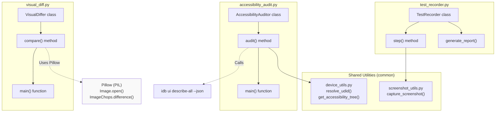
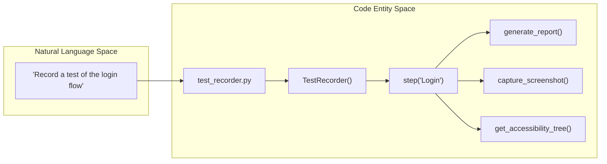

<!-- source: DeepWiki mcp.deepwiki.com · repo conorluddy/ios-simulator-skill · page 7 Testing & Analysis Scripts · fetched 2026-10-26 -->

# Testing & Analysis Scripts

Relevant source files

The following files were used as context for generating this wiki page:

- [ios-simulator-skill/skills/ios-simulator-skill/scripts/accessibility_audit.py](ios-simulator-skill/skills/ios-simulator-skill/scripts/accessibility_audit.py)
- [ios-simulator-skill/skills/ios-simulator-skill/scripts/visual_diff.py](ios-simulator-skill/skills/ios-simulator-skill/scripts/visual_diff.py)

## Purpose and Scope

This page covers the scripts in the **Testing & Analysis** category, which provide capabilities for quality assurance, regression testing, debugging, environment validation, and data model inspection. These tools enable WCAG compliance checking, visual regression detection, automated test documentation, comprehensive debugging snapshots, environment health verification, and Core Data/SwiftData schema analysis.

For information about building and testing Xcode projects, see [Build & Development Scripts](#5). For information about interacting with UI elements during tests, see [Navigation & Interaction Scripts](#6).

**Sources:** [README.md:101-119](), [SKILL.md:98-126]()

---

## Category Overview

The Testing & Analysis category contains six production scripts organized by testing and inspection concern:

| Script | Purpose | Primary Output | Key Dependencies |
|--------|---------|----------------|------------------|
| `accessibility_audit.py` | WCAG compliance validation | Issues by severity (critical/warning/info) | IDB accessibility APIs |
| `visual_diff.py` | Screenshot comparison | Difference percentage, diff image | Pillow image processing |
| `test_recorder.py` | Test execution documentation | Markdown report, timestamped screenshots | `screenshot_utils.py`, IDB |
| `app_state_capture.py` | Debugging snapshot creation | Multi-file snapshot (screenshot, logs, hierarchy) | `screenshot_utils.py`, `device_utils.py` |
| `model_inspector.py` | Data model schema extraction | Entity/Attribute list (Core Data/SwiftData) | Python stdlib (xml, re) |
| `sim_health_check.sh` | Environment verification | Health status report | Shell, `xcrun simctl`, `idb_companion` |

All Python scripts follow the class-based architecture pattern and support `--json` output for CI/CD integration.

**Sources:** [SKILL.md:98-126](), [README.md:114-119](), [scripts/accessibility_audit.py:1-9](), [scripts/visual_diff.py:1-9](), [scripts/test_recorder.py:1-11]()

---

## Script Architecture Pattern

**Architecture Analysis:**

The Python scripts in this category implement a consistent class-based pattern:
- **`AccessibilityAuditor`**: Uses `get_accessibility_tree` [scripts/accessibility_audit.py:63-65]() and `flatten_tree` [scripts/accessibility_audit.py:75-77]() from `common` to analyze WCAG compliance.
- **`VisualDiffer`**: Wraps `PIL` (Pillow) to perform pixel-by-pixel comparison via `ImageChops.difference()` [scripts/visual_diff.py:73-73]() and generate diff images [scripts/visual_diff.py:102-122]().
- **`TestRecorder`**: Orchestrates state capture during a test sequence, utilizing `capture_screenshot` and `get_accessibility_tree` to document each `step()` [scripts/test_recorder.py:82-118]().
- **`sim_health_check.sh`**: A Bash script that directly invokes shell commands for environment verification.

**Sources:** [scripts/accessibility_audit.py:18-77](), [scripts/visual_diff.py:17-122](), [scripts/test_recorder.py:20-150]()

---

## Child Pages

### [accessibility_audit.py](#7.1)
Scans the current simulator screen for accessibility compliance issues using IDB. It checks for critical issues like `missing_label` or `empty_button` [scripts/accessibility_audit.py:40-45](), warnings such as `missing_hint` [scripts/accessibility_audit.py:48-51](), and info-level suggestions like `no_identifier` [scripts/accessibility_audit.py:54-57](). It returns a token-optimized summary of issues found [scripts/accessibility_audit.py:181-190]().
For details, see [accessibility_audit.py](#7.1).

### [visual_diff.py](#7.2)
Compares two screenshots to detect visual regressions. It supports a `--threshold` parameter to define acceptable pixel variance [scripts/visual_diff.py:154-158]() and can generate a `diff.png` highlighting changes in red [scripts/visual_diff.py:117-117]() or a `side-by-side.png` comparison [scripts/visual_diff.py:124-141]().
For details, see [visual_diff.py](#7.2).

### [test_recorder.py](#7.3)
Automates the documentation of test runs. It initializes with a `test_name` and `output_dir` [scripts/test_recorder.py:32-65](), then captures screenshots and accessibility tree snapshots at every `step()` [scripts/test_recorder.py:82-118](), culminating in a structured Markdown report via `generate_report()` [scripts/test_recorder.py:193-208]().
For details, see [test_recorder.py](#7.3).

### [app_state_capture.py](#7.4)
Creates a comprehensive debugging snapshot by combining a screenshot, the current UI hierarchy, and recent system/app logs into a single artifact for bug reporting.
For details, see [app_state_capture.py](#7.4).

### [model_inspector.py](#7.5)
Inspects Core Data and SwiftData models by scanning the project directory for `.xcdatamodeld` packages and `@Model` Swift declarations. It can output structured JSON or raw source code for specific entities.
For details, see [model_inspector.py](#7.5).

### [sim_health_check.sh](#7.6)
Verifies the local development environment by checking for macOS, Xcode, `simctl`, `idb`, Python 3, and available simulators to ensure the skill can operate correctly.
For details, see [sim_health_check.sh](#7.6).

---

## Testing Workflow Architecture

**Testing Process:**

The `test_recorder.py` script bridges high-level test requests with automated documentation:
1. **Initialization**: Creates a timestamped directory structure for artifacts [scripts/test_recorder.py:61-75]().
2. **Step Capture**: For every logical step, it triggers a screenshot through `capture_screenshot` [scripts/test_recorder.py:104-111]() and an accessibility snapshot via `get_accessibility_tree` [scripts/test_recorder.py:114-118]().
3. **Report Generation**: Aggregates all captured `steps` into a `report.md` containing metadata and references to saved images [scripts/test_recorder.py:193-208]().

**Sources:** [scripts/test_recorder.py:29-208]()

---

## Output Formats and Token Optimization

All scripts in this category implement strategies to minimize token usage while providing actionable data:

*   **Accessibility Audit**: Returns a summary of issue counts by severity and only lists the specific elements that failed checks [scripts/accessibility_audit.py:181-190]().
*   **Visual Diff**: Returns a simple "PASS/FAIL" verdict with a percentage [scripts/visual_diff.py:83-91](), avoiding a full pixel map unless `--details` is requested [scripts/visual_diff.py:193-208]().
*   **Test Recorder**: Provides single-line console feedback for each step to keep the LLM informed without flooding the context [scripts/test_recorder.py:152-159]().

**Sources:** [scripts/accessibility_audit.py:181-190](), [scripts/visual_diff.py:83-91](), [scripts/visual_diff.py:193-208](), [scripts/test_recorder.py:152-159]()

---

