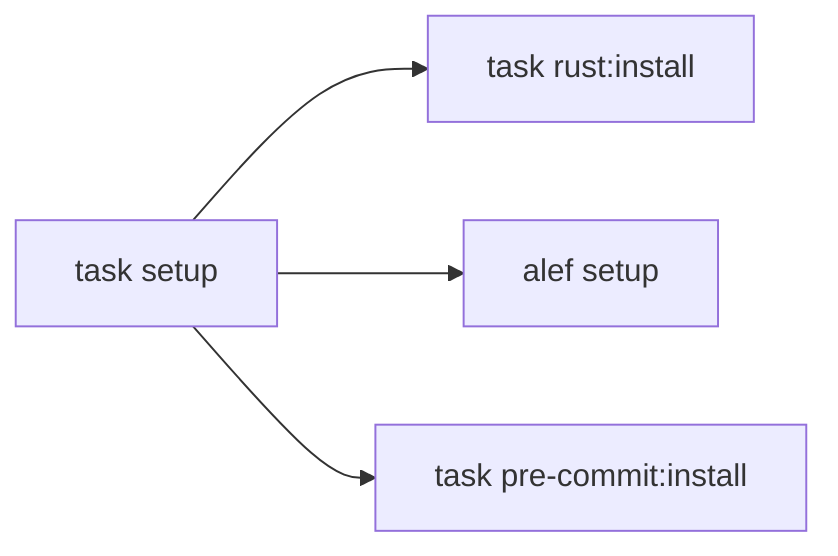
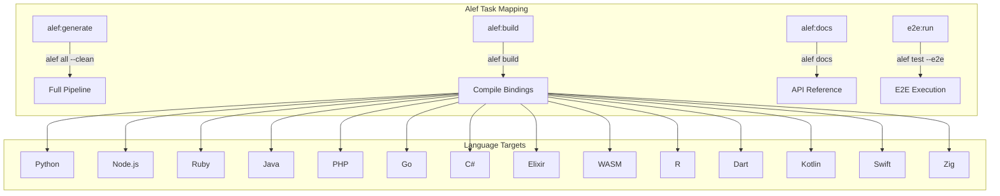
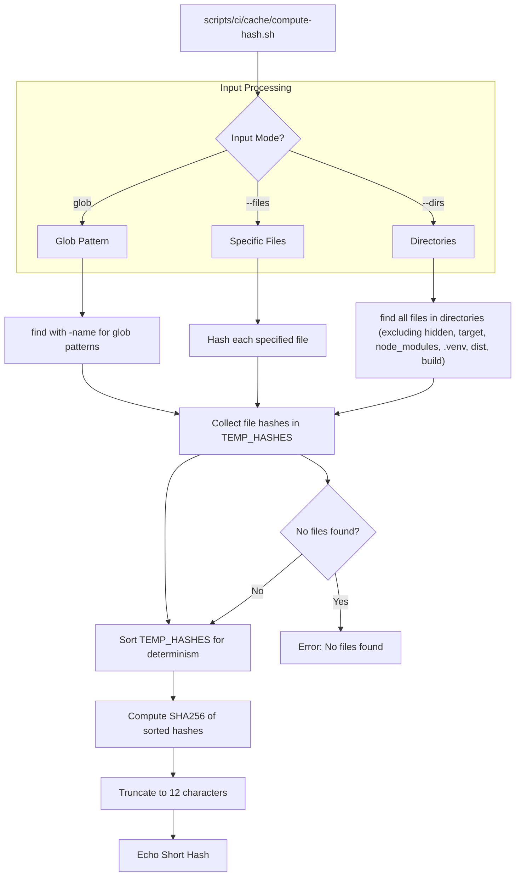

<!-- source: DeepWiki mcp.deepwiki.com · repo kreuzberg-dev/kreuzberg · page 6.2 Task Orchestration System · fetched 2026-10-26 -->

# Task Orchestration System

Relevant source files

The following files were used as context for generating this wiki page:

- [.task/languages/csharp.yml](.task/languages/csharp.yml)
- [.task/languages/dart.yml](.task/languages/dart.yml)
- [.task/languages/elixir.yml](.task/languages/elixir.yml)
- [.task/languages/go.yml](.task/languages/go.yml)
- [.task/languages/java.yml](.task/languages/java.yml)
- [.task/languages/kotlin_android.yml](.task/languages/kotlin_android.yml)
- [.task/languages/node.yml](.task/languages/node.yml)
- [.task/languages/php.yml](.task/languages/php.yml)
- [.task/languages/python.yml](.task/languages/python.yml)
- [.task/languages/r.yml](.task/languages/r.yml)
- [.task/languages/ruby.yml](.task/languages/ruby.yml)
- [.task/languages/swift.yml](.task/languages/swift.yml)
- [Taskfile.yml](Taskfile.yml)
- [scripts/ci/cache/compute-hash.sh](scripts/ci/cache/compute-hash.sh)

The Task Orchestration System provides a unified command interface for building, testing, and managing the Kreuzberg polyglot codebase. It abstracts the complexity of coordinating 15+ languages, multiple build tools, and cross-platform requirements behind a consistent `task` CLI. This system is used by both developers locally and by the CI/CD pipeline for automated workflows.

For information about the CI/CD workflows that consume these tasks, see [CI Pipeline Overview](#8.1). For details about setting up the development environment before running tasks, see [Development Environment Setup](#6.1).

---

## System Overview

The task orchestration is built on [go-task/task](https://taskfile.dev), a task runner and build tool that uses YAML configuration files. The system is organized hierarchically with a root `Taskfile.yml` that delegates specific operations to specialized taskfiles and the `alef` build tool.

### Orchestration Architecture

```mermaid
graph TB
    subgraph "Entry Point"
        ROOT["Taskfile.yml<br/>Root Orchestrator"]
    end
    
    subgraph "Internal Taskfiles (.task)"
        RUST["languages/rust.yml<br/>Cargo builds"]
        PYTHON_LANG["languages/python.yml"]
        NODE_LANG["languages/node.yml"]
        RUBY_LANG["languages/ruby.yml"]
        PHP_LANG["languages/php.yml"]
        GO_LANG["languages/go.yml"]
        JAVA_LANG["languages/java.yml"]
        CSHARP_LANG["languages/csharp.yml"]
        ELIXIR_LANG["languages/elixir.yml"]
        DART_LANG["languages/dart.yml"]
        SWIFT_LANG["languages/swift.yml"]
        KOTLIN_LANG["languages/kotlin_android.yml"]
        R_LANG["languages/r.yml"]
        ZIG_LANG["languages/zig.yml"]
        VERSION["tools/version-sync.yml<br/>Version management"]
        BENCH["workflows/benchmark.yml<br/>Performance testing"]
        DOCS["tools/docs.yml<br/>Documentation"]
        DEMO["tools/demo.yml"]
        FIXTURES["tools/fixtures.yml"]
        GEN["tools/general.yml<br/>Utilities"]
    end
    
    subgraph "External Orchestrator"
        ALEF["alef v0.15.48<br/>Multi-language binding<br/>lifecycle manager"]
    end
    
    ROOT --> RUST
    ROOT --> PYTHON_LANG
    ROOT --> NODE_LANG
    ROOT --> RUBY_LANG
    ROOT --> PHP_LANG
    ROOT --> GO_LANG
    ROOT --> JAVA_LANG
    ROOT --> CSHARP_LANG
    ROOT --> ELIXIR_LANG
    ROOT --> DART_LANG
    ROOT --> SWIFT_LANG
    ROOT --> KOTLIN_LANG
    ROOT --> R_LANG
    ROOT --> ZIG_LANG
    ROOT --> VERSION
    ROOT --> BENCH
    ROOT --> DOCS
    ROOT --> DEMO
    ROOT --> FIXTURES
    ROOT --> GEN
    
    ROOT -- "Delegates bindings to" --> ALEF
    
    ALEF -- "Manages" --> PYTHON["Python (Maturin)"]
    ALEF -- "Manages" --> NODE["Node.js (NAPI)"]
    ALEF -- "Manages" --> RUBY["Ruby (Magnus)"]
    ALEF -- "Manages" --> JAVA["Java (Panama)"]
    ALEF -- "Manages" --> GO["Go (Cgo)"]
    ALEF -- "Manages" --> OTHERS["PHP, Elixir, WASM, R, Dart, Kotlin, Swift, Zig"]
```

**Sources:** [Taskfile.yml:1-41](), [Taskfile.yml:54-249]()

---

## Root Taskfile Structure

The root `Taskfile.yml` serves as the central orchestrator. While Rust core tasks are delegated to `.task/languages/rust.yml`, all binding language operations (setup, build, test, lint, format, clean, update, upgrade, publish) are handled by the `alef` tool [Taskfile.yml:6-8]().

### Include Declarations

The taskfile includes are organized into functional categories:

| Include Name | Path | Purpose |
|--------------|------|---------|
| `rust` | `.task/languages/rust.yml` | Rust-specific compilation and linting [Taskfile.yml:42-44]() |
| `python` | `.task/languages/python.yml` | Python-specific tasks [Taskfile.yml:45-47]() |
| `node` | `.task/languages/node.yml` | Node.js/TypeScript-specific tasks [Taskfile.yml:48-50]() |
| `ruby` | `.task/languages/ruby.yml` | Ruby-specific tasks [Taskfile.yml:51-53]() |
| `php` | `.task/languages/php.yml` | PHP-specific tasks [Taskfile.yml:54-56]() |
| `go` | `.task/languages/go.yml` | Go-specific tasks [Taskfile.yml:57-59]() |
| `java` | `.task/languages/java.yml` | Java-specific tasks [Taskfile.yml:60-62]() |
| `csharp` | `.task/languages/csharp.yml` | C#-specific tasks [Taskfile.yml:63-65]() |
| `elixir` | `.task/languages/elixir.yml` | Elixir-specific tasks [Taskfile.yml:66-68]() |
| `dart` | `.task/languages/dart.yml` | Dart-specific tasks [Taskfile.yml:69-71]() |
| `swift` | `.task/languages/swift.yml` | Swift-specific tasks [Taskfile.yml:72-74]() |
| `kotlin-android` | `.task/languages/kotlin_android.yml` | Kotlin/Android-specific tasks [Taskfile.yml:65-66]() |
| `r` | `.task/languages/r.yml` | R-specific tasks [Taskfile.yml:67-68]() |
| `zig` | `.task/languages/zig.yml` | Zig-specific tasks [Taskfile.yml:69-70]() |
| `version` | `.task/tools/version-sync.yml` | Version synchronization across manifests [Taskfile.yml:70-72]() |
| `benchmark` | `.task/workflows/benchmark.yml` | Performance testing harness [Taskfile.yml:73-75]() |
| `docs` | `.task/tools/docs.yml` | Documentation generation [Taskfile.yml:76-78]() |
| `demo` | `.task/tools/demo.yml` | Demo tasks [Taskfile.yml:79-81]() |
| `fixtures` | `.task/tools/fixtures.yml` | Fixture management [Taskfile.yml:82-84]() |
| `_tools` | `.task/tools/general.yml` | General utility tasks (flattened) [Taskfile.yml:85-88]() |

**Sources:** [Taskfile.yml:42-88]()

---

## Composite High-Level Tasks

The root taskfile defines developer-facing composite tasks that orchestrate both Rust-specific commands and `alef` binding commands.

### Setup and Environment

The `setup` task initializes the development environment by installing the Rust toolchain, binding dependencies, and pre-commit hooks.

**Sources:** [Taskfile.yml:91-98]()

### Build Pipeline

The system distinguishes between building the Rust core and the language bindings.

| Task | Command(s) | Description |
|------|------------|-------------|
| `build` | `task build:core` | Debug build of Rust core library only [Taskfile.yml:100-103]() |
| `build:release` | `task rust:build:release` | Optimized build of Rust core library only [Taskfile.yml:105-108]() |
| `build:ci` | `task rust:build:ci` | Build Rust core library in CI mode [Taskfile.yml:110-113]() |
| `build:core` | `task rust:build:dev` | Debug build of Rust core library only [Taskfile.yml:115-118]() |
| `build:bindings` | `task alef:build` | Build all language bindings [Taskfile.yml:120-123]() |
| `build:all` | `task build:core`, `task build:bindings` | Build Rust core library and all language bindings (debug) [Taskfile.yml:125-129]() |
| `build:cli` | `task rust:cli:build` | Build the `kreuzberg` CLI binary [Taskfile.yml:131-134]() |

**Sources:** [Taskfile.yml:100-134]()

### Test Execution

Testing is split between Rust unit tests and binding-specific test suites.

*   **`task test`**: Runs Rust core tests via `task rust:test` [Taskfile.yml:137-140]().
*   **`task test:all`**: Runs all test suites, including Rust core (`task test`) and bindings (`alef test`) [Taskfile.yml:142-146]().
*   **`task test:bindings`**: Runs binding test suites only, skipping the Rust core tests (`alef test`) [Taskfile.yml:148-151]().
*   **`task test:cov`**: Executes tests with coverage instrumentation for both Rust (`task rust:test:ci`) and bindings (`alef test --coverage`) [Taskfile.yml:153-157]().
*   **`task test:ci`**: Alias for `task test:cov` [Taskfile.yml:159-162]().

**Sources:** [Taskfile.yml:137-162]()

### Lint & Format

The system provides tasks for code quality checks.

*   **`task lint`**: Lints all code via `prek` (pre-commit framework) [Taskfile.yml:165-168]().
*   **`task lint:check`**: Lints all code without auto-fix (check-only, Rust + bindings) via `task rust:lint:check` and `alef lint` [Taskfile.yml:170-174]().
*   **`task format`**: Formats Rust code via `task rust:format` [Taskfile.yml:176-179]().
*   **`task format:check`**: Checks code formatting without modifications via `task rust:format:check` [Taskfile.yml:181-184]().
*   **`task check`**: Runs all checks (format + lint, no modifications) via `task format:check` and `task lint:check` [Taskfile.yml:186-190]().
*   **`task check:android`**: Runs `cargo check` for `kreuzberg-dart` + `kreuzberg-ffi` for Android ABIs via `task rust:check:android` [Taskfile.yml:192-195]().
*   **`task check:ios`**: Runs `cargo check` for `kreuzberg-dart` + `kreuzberg-swift` for iOS targets (macOS only) via `task rust:check:ios` [Taskfile.yml:197-200]().
*   **`task check:mobile`**: Runs `cargo check` for Android + iOS mobile targets via `task rust:check:mobile` [Taskfile.yml:202-205]().

**Sources:** [Taskfile.yml:165-205]()

---

## Language-Specific Delegation

The root `Taskfile.yml` delegates language-specific operations to dedicated taskfiles within the `.task/languages/` directory. These internal taskfiles are marked `internal: true` [Taskfile.yml:42-70](), meaning they are not directly callable from the root but are included and used by other tasks.

### Rust

The Rust taskfile (`.task/languages/rust.yml`) provides granular control over the Cargo workspace. It includes platform-specific logic to handle differences between Linux, macOS, and Windows.

### Python

The Python taskfile (`.task/languages/python.yml`) defines tasks for managing Python dependencies.
*   **`update`**: Updates Python dependencies within major versions using `uv sync --upgrade-package "*"` [packages/python/.task/languages/python.yml:8-14]().
*   **`upgrade`**: Upgrades Python dependencies to the latest versions, including breaking changes, using `uv sync --upgrade` [packages/python/.task/languages/python.yml:16-22]().

**Sources:** [.task/languages/python.yml:1-22]()

### Node.js

The Node.js taskfile (`.task/languages/node.yml`) defines tasks for managing Node.js dependencies.
*   **`update`**: Updates Node.js dependencies within major versions using `pnpm up` [.task/languages/node.yml:8-12]().
*   **`upgrade`**: Upgrades Node.js dependencies to the latest versions, including breaking changes, using `pnpm up --latest` [.task/languages/node.yml:14-18]().

**Sources:** [.task/languages/node.yml:1-20]()

### Ruby

The Ruby taskfile (`.task/languages/ruby.yml`) defines tasks for managing Ruby dependencies.
*   **`update`**: Updates Ruby dependencies within major versions using `bundle update --conservative` [.task/languages/ruby.yml:8-12]().
*   **`upgrade`**: Upgrades Ruby dependencies to the latest versions, including breaking changes, using `bundle update` [.task/languages/ruby.yml:14-20]().

**Sources:** [.task/languages/ruby.yml:1-21]()

### PHP

The PHP taskfile (`.task/languages/php.yml`) defines tasks for managing PHP dependencies.
*   **`update`**: Updates PHP dependencies within major versions using `composer update` [.task/languages/php.yml:8-12]().
*   **`upgrade`**: Upgrades PHP dependencies to the latest versions, including breaking changes, using `composer update --with-all-dependencies` [.task/languages/php.yml:14-20]().

**Sources:** [.task/languages/php.yml:1-21]()

### Go

The Go taskfile (`.task/languages/go.yml`) defines tasks for managing Go dependencies.
*   **`update`**: Updates Go dependencies within major versions using `go get -u=patch ./... && go mod tidy` [.task/languages/go.yml:8-12]().
*   **`upgrade`**: Upgrades Go dependencies to the latest versions, including breaking changes, using `go get -u ./... && go mod tidy` [.task/languages/go.yml:14-20]().

**Sources:** [.task/languages/go.yml:1-21]()

### Java

The Java taskfile (`.task/languages/java.yml`) defines tasks for managing Java dependencies.
*   **`update`**: Updates Java dependencies within major versions using `mvn versions:use-next-versions` [.task/languages/java.yml:8-12]().
*   **`upgrade`**: Upgrades Java dependencies to the latest versions, including breaking changes, using `mvn versions:use-latest-releases` [.task/languages/java.yml:14-19]().

**Sources:** [.task/languages/java.yml:1-20]()

### C#

The C# taskfile (`.task/languages/csharp.yml`) defines tasks for managing C# dependencies.
*   **`update`**: Updates C# dependencies within major versions using `dotnet outdated -u --version-lock Minor` [.task/languages/csharp.yml:8-12]().
*   **`upgrade`**: Upgrades C# dependencies to the latest versions, including breaking changes, using `dotnet outdated -u` [.task/languages/csharp.yml:14-20]().

**Sources:** [.task/languages/csharp.yml:1-21]()

### Elixir

The Elixir taskfile (`.task/languages/elixir.yml`) defines tasks for managing Elixir dependencies.
*   **`update`**: Updates Elixir dependencies within major versions using `mix deps.update --all` [.task/languages/elixir.yml:8-12]().
*   **`upgrade`**: Upgrades Elixir dependencies to the latest versions, including breaking changes, using `mix hex.outdated --all || true && mix deps.update --all` [.task/languages/elixir.yml:14-20]().

**Sources:** [.task/languages/elixir.yml:1-21]()

### Dart

The Dart taskfile (`.task/languages/dart.yml`) defines tasks for managing Dart dependencies.
*   **`update`**: Updates Dart dependencies within major versions using `dart pub upgrade` [.task/languages/dart.yml:8-12]().
*   **`upgrade`**: Upgrades Dart dependencies to the latest versions, including breaking changes, using `dart pub upgrade --major-versions` [.task/languages/dart.yml:14-19]().

**Sources:** [.task/languages/dart.yml:1-20]()

### Swift

The Swift taskfile (`.task/languages/swift.yml`) defines tasks for managing Swift dependencies.
*   **`update`**: Updates Swift dependencies using `swift package update` [.task/languages/swift.yml:8-12]().
*   **`upgrade`**: Upgrades Swift dependencies using `swift package update` [.task/languages/swift.yml:14-20]().

**Sources:** [.task/languages/swift.yml:1-21]()

### Kotlin (Android)

The Kotlin (Android) taskfile (`.task/languages/kotlin_android.yml`) defines tasks for managing Kotlin/Android dependencies.
*   **`update`**: Updates Kotlin/Android dependencies within major versions using `gradle update` [.task/languages/kotlin_android.yml:8-12]().
*   **`upgrade`**: Upgrades Kotlin/Android dependencies to the latest versions, including breaking changes, using `gradle upgrade` [.task/languages/kotlin_android.yml:14-19]().

**Sources:** [.task/languages/kotlin_android.yml:1-20]()

### R

The R taskfile (`.task/languages/r.yml`) defines tasks for managing R dependencies.
*   **`update`**: Updates R dependencies within major versions using `devtools::update_packages(check.built = TRUE)` [.task/languages/r.yml:8-12]().
*   **`upgrade`**: Upgrades R dependencies to the latest versions, including breaking changes, using `update.packages(ask = FALSE)` [.task/languages/r.yml:14-20]().

**Sources:** [.task/languages/r.yml:1-21]()

### Zig

The Zig taskfile (`.task/languages/zig.yml`) defines tasks for managing Zig dependencies.
*   **`update`**: Updates Zig dependencies within major versions using `zig build update-deps` [.task/languages/zig.yml:8-12]().
*   **`upgrade`**: Upgrades Zig dependencies to the latest versions, including breaking changes, using `zig build upgrade-deps` [.task/languages/zig.yml:14-19]().

**Sources:** [.task/languages/zig.yml:1-20]()

---

## Binding Delegation: Alef

While Rust tasks are handled via standard Taskfile includes, the 15+ language bindings are managed by `alef`.

**Sources:** [Taskfile.yml:203-249]()

---

## Utility and Maintenance Tasks

### Dependency Management

The system provides two levels of dependency updates:
1.  **`update`**: Compatible updates only via `task rust:update`, individual language `task <lang>:update` commands, `alef update`, and `prek autoupdate` [Taskfile.yml:208-227]().
2.  **`upgrade`**: Aggressive, potentially breaking updates using `rustup update stable`, `task rust:upgrade`, individual language `task <lang>:upgrade` commands, and `alef update --latest` [Taskfile.yml:229-247]().

**Sources:** [Taskfile.yml:208-247]()

### Artifact Cleanup

The `clean` task removes all build artifacts [Taskfile.yml:249-252](). For CI environments, a specialized `rust:cache:cleanup` task removes large `.rlib`, `.so`, and `.dylib` files (over 10MB) to optimize GitHub Actions cache size [.task/languages/rust.yml:168-184]().

**Sources:** [Taskfile.yml:249-252](), [.task/languages/rust.yml:168-184]()

### Version Synchronization

The `versions:sync` task (aliased as `alef:sync`) ensures the version defined in the root `Cargo.toml` is propagated to all package manifests (e.g., `package.json`, `Gemfile`, `pom.xml`) [Taskfile.yml:254-258]().

**Sources:** [Taskfile.yml:254-258]()

---

## Integration Scripts

Beyond the YAML definitions, the system utilizes shell scripts for complex staging and environment setup.

### Cache Hash Computation

The `scripts/ci/cache/compute-hash.sh` script generates a deterministic hash for cache key generation in CI. It supports glob patterns, explicit files, or directories as input. It uses `sha256sum` or `shasum -a 256` to hash file contents, sorts the hashes for determinism, and then hashes the combined result, truncating it to 12 characters for a short cache key [scripts/ci/cache/compute-hash.sh:1-159]().

**Sources:** [scripts/ci/cache/compute-hash.sh:1-159]()

### C# Native Staging

The script `scripts/stage_csharp_native_local.sh` detects the host OS and architecture to stage `libkreuzberg_ffi` into the correct C# runtime directory (e.g., `packages/csharp/Kreuzberg/runtimes/osx-arm64/native`). This allows `dotnet test` to resolve the native library correctly [scripts/stage_csharp_native_local.sh:12-49]().

### CI Unit Testing

The `scripts/ci/rust/run-unit-tests.sh` script is the primary entry point for CI testing, handling the setup of `tessdata` and executing `cargo test` with the `full` feature flag [.task/languages/rust.yml:106-119]().

**Sources:** [scripts/stage_csharp_native_local.sh:1-52](), [.task/languages/rust.yml:106-119]()

---

