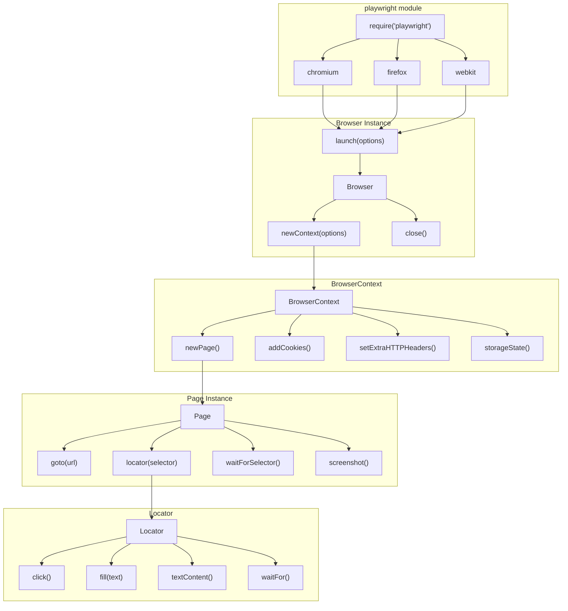
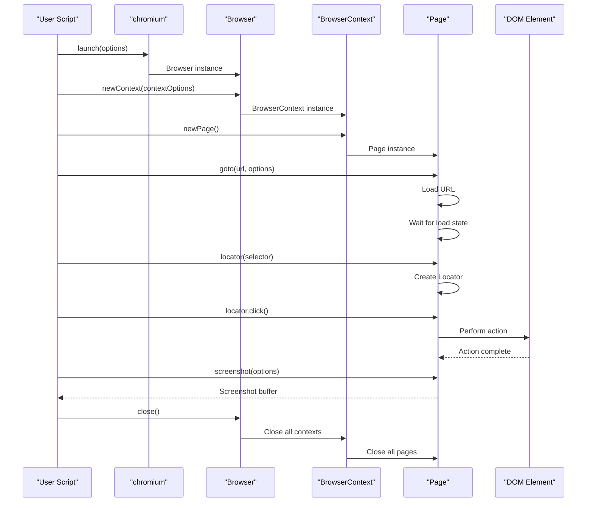
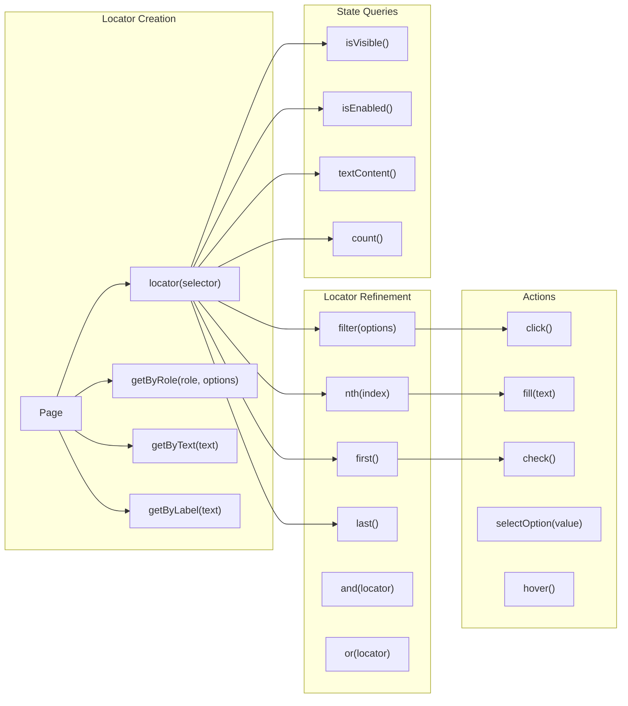

<!-- source: DeepWiki mcp.deepwiki.com · repo lackeyjb/playwright-skill · page 6.1 Playwright Core API · fetched 2026-10-26 -->

# Playwright Core API

<details>
<summary>Relevant source files</summary>

The following files were used as context for generating this wiki page:

- [API_REFERENCE.md](API_REFERENCE.md)
- [skills/playwright-skill/SKILL.md](skills/playwright-skill/SKILL.md)

</details>


This page documents the core Playwright API that powers browser automation in this skill. It covers the fundamental objects (`Browser`, `BrowserContext`, `Page`, `Locator`), launch configuration, navigation methods, actions, waiting strategies, and assertions. This is the native Playwright API surface that Claude uses when generating automation scripts.

For custom utility functions built on top of Playwright, see [Helper Functions API](#6.2). For detailed selector strategies and best practices, see [Selectors and Locators](#6.3). For network interception and API testing capabilities, see [Network and API Testing](#6.4).

## Core Architecture

Playwright organizes browser automation into a three-tier hierarchy: browsers launch contexts, contexts create pages, and pages contain locators for interacting with elements.

### Object Hierarchy



**Sources:** [skills/playwright-skill/SKILL.md:66-84](), [API_REFERENCE.md:78-107]()

### Execution Lifecycle



**Sources:** [skills/playwright-skill/SKILL.md:66-84](), [API_REFERENCE.md:82-106]()

## Browser Launch

The `launch()` method creates a new browser instance. The skill defaults to Chromium with visible browser and slow motion for observability.

### Launch Options

| Option | Type | Default | Description |
|--------|------|---------|-------------|
| `headless` | `boolean` | `false` | Whether to run browser in headless mode |
| `slowMo` | `number` | `100` | Slow down operations by N milliseconds |
| `timeout` | `number` | `30000` | Maximum time to wait for browser launch |
| `args` | `string[]` | `[]` | Additional browser arguments |
| `downloadsPath` | `string` | `undefined` | Path for downloads |
| `executablePath` | `string` | `undefined` | Path to browser executable |

```javascript
const { chromium } = require('playwright');

// Default configuration (visible browser, slow motion)
const browser = await chromium.launch({
  headless: false,
  slowMo: 100
});

// Headless mode for CI/CD
const browser = await chromium.launch({
  headless: true,
  args: ['--no-sandbox', '--disable-setuid-sandbox']
});
```

**Sources:** [skills/playwright-skill/SKILL.md:73-74](), [API_REFERENCE.md:86-89]()

### Browser Methods

| Method | Return Type | Description |
|--------|-------------|-------------|
| `newContext(options?)` | `Promise<BrowserContext>` | Creates isolated browser context |
| `contexts()` | `BrowserContext[]` | Returns all active contexts |
| `close()` | `Promise<void>` | Closes browser and all contexts |
| `isConnected()` | `boolean` | Whether browser is connected |
| `version()` | `string` | Browser version string |

**Sources:** [API_REFERENCE.md:82-106]()

## Browser Context

`BrowserContext` provides isolated sessions with independent cookies, storage, and cache. Contexts enable parallel testing and authentication state management.

### Context Configuration

```javascript
const context = await browser.newContext({
  viewport: { width: 1280, height: 720 },
  userAgent: 'Mozilla/5.0 (Windows NT 10.0; Win64; x64)',
  locale: 'en-US',
  timezoneId: 'America/New_York',
  permissions: ['geolocation'],
  geolocation: { latitude: 37.7749, longitude: -122.4194 },
  colorScheme: 'dark',
  hasTouch: false,
  isMobile: false,
  deviceScaleFactor: 1
});
```

**Sources:** [API_REFERENCE.md:91-94](), [API_REFERENCE.md:436-444]()

### Context Options

| Option | Type | Description |
|--------|------|-------------|
| `viewport` | `{width: number, height: number}` | Browser viewport size |
| `userAgent` | `string` | User agent string |
| `locale` | `string` | Locale identifier (e.g., 'en-US') |
| `timezoneId` | `string` | Timezone identifier |
| `permissions` | `string[]` | Granted permissions |
| `geolocation` | `{latitude: number, longitude: number}` | Geolocation coordinates |
| `httpCredentials` | `{username: string, password: string}` | HTTP authentication |
| `offline` | `boolean` | Emulate offline network |
| `storageState` | `string \| object` | Load authentication state |

**Sources:** [API_REFERENCE.md:91-94]()

### Context Methods

| Method | Return Type | Description |
|--------|-------------|-------------|
| `newPage()` | `Promise<Page>` | Creates new page in context |
| `pages()` | `Page[]` | Returns all pages in context |
| `cookies(urls?)` | `Promise<Cookie[]>` | Gets cookies for URLs |
| `addCookies(cookies)` | `Promise<void>` | Adds cookies to context |
| `clearCookies()` | `Promise<void>` | Clears all cookies |
| `setExtraHTTPHeaders(headers)` | `Promise<void>` | Sets extra HTTP headers |
| `storageState(options?)` | `Promise<object>` | Exports authentication state |
| `close()` | `Promise<void>` | Closes context and all pages |

**Sources:** [API_REFERENCE.md:82-106]()

## Page Navigation

The `Page` object represents a browser tab and provides methods for navigation, interaction, and inspection.

### Navigation Methods

```javascript
// Basic navigation
await page.goto('https://example.com');

// With options
await page.goto('https://example.com', {
  waitUntil: 'networkidle',  // 'load', 'domcontentloaded', 'networkidle'
  timeout: 10000
});

// Navigate with URL matching
await page.goto('https://example.com');
await page.waitForURL('**/dashboard');

// Go back/forward
await page.goBack();
await page.goForward();
await page.reload();
```

**Sources:** [skills/playwright-skill/SKILL.md:76-77](), [API_REFERENCE.md:99-101]()

### Wait Until States

| State | Description |
|-------|-------------|
| `load` | Wait for `load` event (default) |
| `domcontentloaded` | Wait for `DOMContentLoaded` event |
| `networkidle` | Wait until no network connections for 500ms |
| `commit` | Wait for network response and HTML parsing |

**Sources:** [API_REFERENCE.md:99-101](), [skills/playwright-skill/SKILL.md:218-221]()

### Page Properties and Methods

| Property/Method | Return Type | Description |
|-----------------|-------------|-------------|
| `url()` | `string` | Current page URL |
| `title()` | `Promise<string>` | Page title |
| `content()` | `Promise<string>` | Full HTML content |
| `context()` | `BrowserContext` | Owning context |
| `mainFrame()` | `Frame` | Main frame |
| `frames()` | `Frame[]` | All frames |

**Sources:** [skills/playwright-skill/SKILL.md:77](), [API_REFERENCE.md:99-101]()

## Locators

Locators represent a way to find elements on the page. They are lazy - the element is located when an action is performed.

### Locator Creation

```javascript
// CSS selector
const button = page.locator('button.submit');

// Data attribute (preferred)
const input = page.locator('[data-testid="username"]');

// Role-based (accessible)
const submitBtn = page.getByRole('button', { name: 'Submit' });
const emailInput = page.getByRole('textbox', { name: 'Email' });

// Text content
const link = page.getByText('Sign in');
const heading = page.getByText(/welcome back/i);

// Label association
const nameInput = page.getByLabel('Full Name');

// Placeholder
const searchInput = page.getByPlaceholder('Search...');

// Combined
const row = page.locator('tr').filter({ hasText: 'John Doe' });
const editBtn = row.locator('button.edit');
```

**Sources:** [API_REFERENCE.md:136-161](), [skills/playwright-skill/SKILL.md:134-136]()

### Locator Methods



**Sources:** [API_REFERENCE.md:136-180]()

### Locator Action Methods

| Method | Parameters | Description |
|--------|-----------|-------------|
| `click(options?)` | `button`, `clickCount`, `delay`, `position` | Clicks element |
| `dblclick(options?)` | Same as click | Double-clicks element |
| `fill(value, options?)` | `value: string` | Fills input with text |
| `clear(options?)` | None | Clears input |
| `type(text, options?)` | `text: string`, `delay` | Types text with delay |
| `check(options?)` | None | Checks checkbox/radio |
| `uncheck(options?)` | None | Unchecks checkbox |
| `selectOption(values, options?)` | `value`, `label`, `index` | Selects option(s) |
| `hover(options?)` | `position`, `force` | Hovers over element |
| `focus(options?)` | None | Focuses element |
| `press(key, options?)` | `key: string`, `delay` | Presses key |
| `setInputFiles(files, options?)` | `files: string \| string[]` | Sets file input |
| `dragTo(target, options?)` | `target: Locator` | Drags to target |

**Sources:** [API_REFERENCE.md:183-256](), [skills/playwright-skill/SKILL.md:134-136]()

### Locator State Methods

| Method | Return Type | Description |
|--------|-------------|-------------|
| `isVisible()` | `Promise<boolean>` | Whether element is visible |
| `isHidden()` | `Promise<boolean>` | Whether element is hidden |
| `isEnabled()` | `Promise<boolean>` | Whether element is enabled |
| `isDisabled()` | `Promise<boolean>` | Whether element is disabled |
| `isChecked()` | `Promise<boolean>` | Whether checkbox is checked |
| `textContent()` | `Promise<string \| null>` | Text content |
| `innerText()` | `Promise<string>` | Inner text |
| `innerHTML()` | `Promise<string>` | Inner HTML |
| `getAttribute(name)` | `Promise<string \| null>` | Attribute value |
| `count()` | `Promise<number>` | Number of matched elements |
| `all()` | `Promise<Locator[]>` | All matching locators |

**Sources:** [API_REFERENCE.md:163-180]()

## Actions

Actions are performed on `Locator` objects and include auto-waiting and actionability checks.

### Form Interactions

```javascript
// Text input
await page.getByLabel('Email').fill('user@example.com');
await page.locator('#username').clear();
await page.locator('#username').type('newuser', { delay: 100 });

// Checkbox/Radio
await page.getByLabel('I agree').check();
await page.getByLabel('Subscribe').uncheck();
await page.getByLabel('Option 2').check();

// Select dropdown
await page.selectOption('select#country', 'usa');
await page.selectOption('select#country', { label: 'United States' });
await page.selectOption('select#country', { index: 2 });

// Multi-select
await page.selectOption('select#colors', ['red', 'blue', 'green']);

// File upload
await page.setInputFiles('input[type="file"]', 'path/to/file.pdf');
await page.setInputFiles('input[type="file"]', ['file1.pdf', 'file2.pdf']);
```

**Sources:** [API_REFERENCE.md:184-216](), [skills/playwright-skill/SKILL.md:134-163]()

### Mouse Actions

```javascript
// Click variations
await page.click('button');                        // Left click
await page.click('button', { button: 'right' });  // Right click
await page.dblclick('button');                     // Double click
await page.click('button', { clickCount: 3 });    // Triple click
await page.click('button', { position: { x: 10, y: 10 } });  // Specific position

// Hover
await page.hover('.menu-item');

// Drag and drop
await page.dragAndDrop('#source', '#target');

// Manual drag
await page.locator('#source').hover();
await page.mouse.down();
await page.locator('#target').hover();
await page.mouse.up();
```

**Sources:** [API_REFERENCE.md:218-238]()

### Keyboard Actions

```javascript
// Type with delay
await page.keyboard.type('Hello World', { delay: 100 });

// Key combinations
await page.keyboard.press('Control+A');
await page.keyboard.press('Control+C');
await page.keyboard.press('Control+V');

// Special keys
await page.keyboard.press('Enter');
await page.keyboard.press('Tab');
await page.keyboard.press('Escape');
await page.keyboard.press('ArrowDown');
await page.keyboard.press('PageDown');
await page.keyboard.press('Home');
await page.keyboard.press('End');
```

**Sources:** [API_REFERENCE.md:240-256]()

## Waiting Strategies

Playwright provides auto-waiting for most actions, but explicit waits are available for complex scenarios.

### Auto-Waiting

Playwright automatically waits for elements to be actionable before performing actions. This includes:

- Element is attached to DOM
- Element is visible
- Element is stable (not animating)
- Element receives events (not obscured)
- Element is enabled (for form controls)

**Sources:** [skills/playwright-skill/SKILL.md:347](), [API_REFERENCE.md:258-299]()

### Explicit Waits

```javascript
// Wait for element states
await page.locator('button').waitFor({ state: 'visible' });
await page.locator('.spinner').waitFor({ state: 'hidden' });
await page.locator('button').waitFor({ state: 'attached' });
await page.locator('button').waitFor({ state: 'detached' });

// Wait for URL
await page.waitForURL('**/success');
await page.waitForURL(url => url.pathname === '/dashboard');
await page.waitForURL(/.*dashboard);

// Wait for load state
await page.waitForLoadState('networkidle');
await page.waitForLoadState('domcontentloaded');
await page.waitForLoadState('load');

// Wait for selector
await page.waitForSelector('.element', { timeout: 10000 });
await page.waitForSelector('.element', { state: 'hidden' });

// Wait for function
await page.waitForFunction(() => document.querySelector('.loaded'));
await page.waitForFunction(
  text => document.body.innerText.includes(text),
  'Content loaded'
);

// Wait for response
const responsePromise = page.waitForResponse('**/api/users');
await page.click('button#load-users');
const response = await responsePromise;

// Wait for request
await page.waitForRequest(request =>
  request.url().includes('/api/') && request.method() === 'POST'
);

// Wait for timeout (avoid when possible)
await page.waitForTimeout(1000);
```

**Sources:** [API_REFERENCE.md:262-299](), [skills/playwright-skill/SKILL.md:138-142]()

### Wait For Options

| Option | Type | Description |
|--------|------|-------------|
| `state` | `'visible' \| 'hidden' \| 'attached' \| 'detached'` | Element state to wait for |
| `timeout` | `number` | Maximum wait time in milliseconds |

**Sources:** [API_REFERENCE.md:262-299]()

## Assertions

Playwright Test provides web-first assertions that auto-retry until the condition is met or timeout occurs.

### Page Assertions

```javascript
import { expect } from '@playwright/test';

// URL and title
await expect(page).toHaveTitle('My App');
await expect(page).toHaveTitle(/Dashboard);
await expect(page).toHaveURL('https://example.com/dashboard');
await expect(page).toHaveURL(/.*dashboard);
```

**Sources:** [API_REFERENCE.md:301-340]()

### Element Assertions

```javascript
// Visibility
await expect(page.locator('.message')).toBeVisible();
await expect(page.locator('.spinner')).toBeHidden();
await expect(page.locator('.spinner')).not.toBeVisible();

// State
await expect(page.locator('button')).toBeEnabled();
await expect(page.locator('input')).toBeDisabled();
await expect(page.locator('input')).toBeEditable();
await expect(page.locator('input')).toBeEmpty();
await expect(page.locator('input[type="checkbox"]')).toBeChecked();

// Text content
await expect(page.locator('h1')).toHaveText('Welcome');
await expect(page.locator('h1')).toHaveText(/welcome/i);
await expect(page.locator('.message')).toContainText('success');
await expect(page.locator('.items')).toHaveText(['Item 1', 'Item 2', 'Item 3']);

// Attributes
await expect(page.locator('button')).toHaveAttribute('type', 'submit');
await expect(page.locator('button')).toHaveAttribute('disabled');
await expect(page.locator('img')).toHaveAttribute('src', /.*\.png);

// Values
await expect(page.locator('input')).toHaveValue('test@example.com');
await expect(page.locator('input')).toHaveValue(/.*@example\.com);
await expect(page.locator('input')).toBeEmpty();

// CSS
await expect(page.locator('.error')).toHaveCSS('color', 'rgb(255, 0, 0)');
await expect(page.locator('.error')).toHaveCSS('display', 'block');

// Count
await expect(page.locator('.item')).toHaveCount(5);
await expect(page.locator('.item')).toHaveCount(0);
```

**Sources:** [API_REFERENCE.md:313-340]()

### Assertion Methods

| Method | Description |
|--------|-------------|
| `toBeVisible()` | Element is visible |
| `toBeHidden()` | Element is hidden |
| `toBeEnabled()` | Element is enabled |
| `toBeDisabled()` | Element is disabled |
| `toBeEditable()` | Element is editable |
| `toBeEmpty()` | Input is empty |
| `toBeChecked()` | Checkbox/radio is checked |
| `toHaveText(text)` | Element has exact text |
| `toContainText(text)` | Element contains text |
| `toHaveValue(value)` | Input has value |
| `toHaveAttribute(name, value?)` | Element has attribute |
| `toHaveCSS(name, value)` | Element has CSS property |
| `toHaveCount(count)` | Number of matched elements |
| `toHaveURL(url)` | Page has URL |
| `toHaveTitle(title)` | Page has title |
| `toHaveScreenshot(name?)` | Visual comparison matches |

**Sources:** [API_REFERENCE.md:301-340]()

## Screenshots and Visual Artifacts

The `Page` and `Locator` objects provide screenshot capture for visual testing and debugging.

### Screenshot Methods

```javascript
// Full page screenshot
await page.screenshot({
  path: '/tmp/screenshot.png',
  fullPage: true
});

// Viewport screenshot
await page.screenshot({
  path: '/tmp/viewport.png',
  fullPage: false
});

// Element screenshot
await page.locator('.chart').screenshot({
  path: '/tmp/chart.png'
});

// Screenshot to buffer
const buffer = await page.screenshot();

// Screenshot with options
await page.screenshot({
  path: '/tmp/screenshot.png',
  fullPage: true,
  type: 'png',  // 'png' | 'jpeg'
  quality: 90,  // For JPEG only
  clip: { x: 0, y: 0, width: 800, height: 600 },
  timeout: 10000
});
```

**Sources:** [skills/playwright-skill/SKILL.md:79-80](), [API_REFERENCE.md:416-429]()

### Screenshot Options

| Option | Type | Description |
|--------|------|-------------|
| `path` | `string` | Save path (saves to disk) |
| `fullPage` | `boolean` | Capture full scrollable page |
| `type` | `'png' \| 'jpeg'` | Image type |
| `quality` | `number` | JPEG quality (0-100) |
| `clip` | `object` | Capture specific area |
| `timeout` | `number` | Maximum time to wait |

**Sources:** [skills/playwright-skill/SKILL.md:79-80](), [API_REFERENCE.md:416-429]()

## Error Handling

Proper error handling ensures robust automation scripts.

### Try-Catch Pattern

```javascript
const { chromium } = require('playwright');

(async () => {
  const browser = await chromium.launch({ headless: false });
  const page = await browser.newPage();

  try {
    await page.goto('http://localhost:3000', {
      waitUntil: 'networkidle',
      timeout: 10000
    });

    await page.screenshot({
      path: '/tmp/screenshot.png',
      fullPage: true
    });

    console.log('📸 Screenshot saved to /tmp/screenshot.png');
  } catch (error) {
    console.error('❌ Error:', error.message);
    
    // Take error screenshot for debugging
    await page.screenshot({ path: '/tmp/error.png' });
  } finally {
    await browser.close();
  }
})();
```

**Sources:** [skills/playwright-skill/SKILL.md:217-235](), [skills/playwright-skill/SKILL.md:348]()

### Common Exceptions

| Exception | Cause | Solution |
|-----------|-------|----------|
| `TimeoutError` | Element not found or action timeout | Increase timeout, verify selector |
| `TargetClosedError` | Page/context closed during operation | Check for navigation or popup |
| `Error: elementHandle.click: Element is not visible` | Element not in viewport or hidden | Scroll element into view, wait for visibility |
| `Error: Navigation failed` | Network error or invalid URL | Check URL, network connectivity |

**Sources:** [API_REFERENCE.md:599-606]()

## Module Import Patterns

The skill uses CommonJS module imports with the `run.js` executor handling module resolution.

### Basic Import

```javascript
const { chromium } = require('playwright');
const { firefox } = require('playwright');
const { webkit } = require('playwright');
const { devices } = require('playwright');

// All browser types
const playwright = require('playwright');
await playwright.chromium.launch();
```

**Sources:** [skills/playwright-skill/SKILL.md:67](), [API_REFERENCE.md:82]()

### With Helper Functions

```javascript
const { chromium } = require('playwright');
const helpers = require('./lib/helpers');

(async () => {
  // Detect dev servers
  const servers = await helpers.detectDevServers();
  console.log('Found servers:', servers);

  // Launch and automate
  const browser = await chromium.launch({ headless: false });
  const page = await browser.newPage();
  
  await page.goto(servers[0].url);
  await helpers.safeClick(page, 'button.submit', { retries: 3 });
  
  await browser.close();
})();
```

**Sources:** [skills/playwright-skill/SKILL.md:301-323]()

## Configuration Reference

### Browser Launch Configuration

```javascript
await chromium.launch({
  headless: false,           // Visible browser
  slowMo: 100,              // Slow down by 100ms
  timeout: 30000,           // Launch timeout
  devtools: false,          // Open DevTools
  args: [],                 // Browser arguments
  downloadsPath: '/tmp',    // Download location
  proxy: {                  // Proxy settings
    server: 'http://proxy:8080',
    username: 'user',
    password: 'pass'
  }
});
```

**Sources:** [API_REFERENCE.md:86-89](), [skills/playwright-skill/SKILL.md:73-74]()

### Context Configuration

```javascript
await browser.newContext({
  viewport: { width: 1280, height: 720 },  // Viewport size
  userAgent: 'custom UA',                   // User agent
  locale: 'en-US',                          // Locale
  timezoneId: 'America/New_York',          // Timezone
  permissions: ['geolocation'],             // Permissions
  geolocation: { latitude: 0, longitude: 0 },  // Location
  colorScheme: 'dark',                      // Color scheme
  reducedMotion: 'reduce',                  // Motion preference
  forcedColors: 'none',                     // Forced colors
  acceptDownloads: true,                    // Allow downloads
  httpCredentials: { username: 'u', password: 'p' },  // Auth
  offline: false,                           // Network state
  storageState: 'auth.json'                 // Load auth state
});
```

**Sources:** [API_REFERENCE.md:91-94](), [API_REFERENCE.md:436-444]()

### Navigation Configuration

```javascript
await page.goto('https://example.com', {
  waitUntil: 'networkidle',  // 'load', 'domcontentloaded', 'networkidle', 'commit'
  timeout: 10000,            // Navigation timeout
  referer: 'https://google.com'  // Referer header
});
```

**Sources:** [skills/playwright-skill/SKILL.md:218-221](), [API_REFERENCE.md:99-101]()

---

