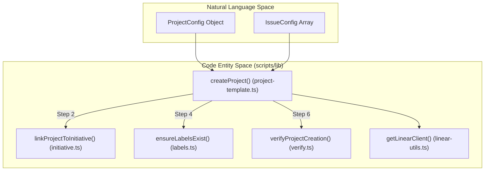
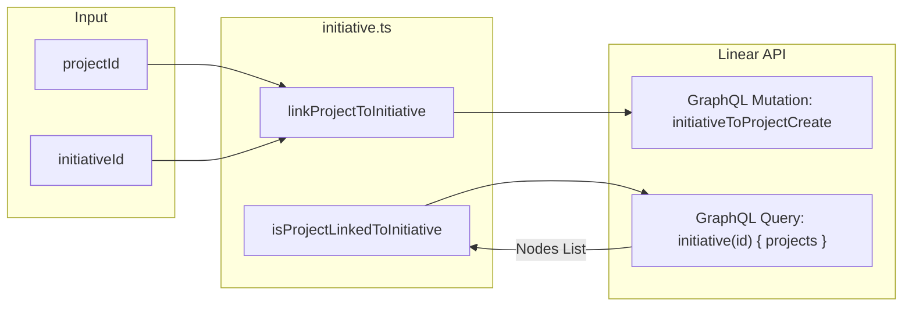

<!-- source: DeepWiki mcp.deepwiki.com · repo wrsmith108/linear-claude-skill · page 3.4 Project Template & Verification · fetched 2026-10-26 -->

# Project Template & Verification

Relevant source files

The following files were used as context for generating this wiki page:

- [projects.md](projects.md)
- [scripts/lib/initiative.ts](scripts/lib/initiative.ts)
- [scripts/lib/project-template.ts](scripts/lib/project-template.ts)
- [scripts/lib/verify.ts](scripts/lib/verify.ts)

This section covers the mandatory workflows and library functions used to create, link, and verify Linear projects and initiatives. The system enforces a strict 6-step template to ensure data consistency across the Linear workspace.

## Project Creation Workflow

The `createProject` function in `scripts/lib/project-template.ts` is the authoritative entry point for project creation [scripts/lib/project-template.ts:68-71](). It orchestrates a multi-step process that ensures projects are not just created, but correctly documented and linked to the broader roadmap.

### The 6-Step Template

| Step | Action | Implementation |
| :--- | :--- | :--- |
| 1 | **Create/Find** | Checks for existing project by name; creates if missing [scripts/lib/project-template.ts:97-121](). |
| 2 | **Link Initiative** | Connects project to a parent initiative via `initiativeToProjectCreate` [scripts/lib/project-template.ts:127-135](). |
| 3 | **Set Content** | Sets full markdown `content` and short `description` [scripts/lib/project-template.ts:138-175](). |
| 4 | **Ensure Labels** | Scans all planned issues and ensures required labels exist in the team [scripts/lib/project-template.ts:178-190](). |
| 5 | **Create Issues** | Populates the project with issues including labels, priority, and estimates [scripts/lib/project-template.ts:192-232](). |
| 6 | **Verify** | Performs post-creation checks to ensure all entities are correctly linked [scripts/lib/project-template.ts:235-241](). |

### Logic Flow: Project Template Execution

The following diagram illustrates the transition from natural language configuration to the execution of code entities within the library.

"Project Creation Pipeline"

Sources: [scripts/lib/project-template.ts:17-32](), [scripts/lib/project-template.ts:68-71](), [scripts/lib/initiative.ts:25-28](), [scripts/lib/verify.ts:40-45]()

---

## Initiative Management

Initiatives in Linear serve as containers for projects. The skill mandates that every project be linked to an initiative to maintain organizational hierarchy [scripts/lib/initiative.ts:4-5]().

### Key Functions
- `linkProjectToInitiative`: Uses a raw GraphQL mutation `initiativeToProjectCreate` [scripts/lib/initiative.ts:31-42](). This is the only supported method, as direct `initiativeId` fields on project creation are deprecated [scripts/lib/initiative.ts:21-24]().
- `isProjectLinkedToInitiative`: Verifies the edge exists by querying the initiative's project nodes [scripts/lib/initiative.ts:78-81]().
- `getProjectInitiativeStatus`: Returns a list of all projects and their associated initiative names [scripts/lib/initiative.ts:123-125]().

### Initiative Data Flow
"Initiative Linking Logic"

Sources: [scripts/lib/initiative.ts:25-42](), [scripts/lib/initiative.ts:84-95]()

---

## Verification System

The verification system provides a "trust but verify" layer after complex operations. It is used both automatically at the end of project creation and manually via CLI commands.

### Project Verification (`verifyProjectCreation`)
This function checks the state of a project against expected parameters [scripts/lib/verify.ts:40-45]():
1. **Existence**: Finds the project by name [scripts/lib/verify.ts:70-76]().
2. **Metadata**: Validates that `description` is present and exceeds a minimum length (10 chars) [scripts/lib/verify.ts:88-89]().
3. **Hierarchy**: Confirms the link to the `DEFAULT_INITIATIVE_ID` [scripts/lib/verify.ts:92-95]().
4. **Issue Count**: Compares the number of issues found in the project against the `expectedIssueCount` [scripts/lib/verify.ts:113-115]().
5. **Labels**: (Optional) Verifies specific labels are applied to specific issue identifiers [scripts/lib/verify.ts:123-144]().

### Initiative Verification (`verifyProjectsForInitiative`)
Iterates through all projects associated with an initiative (or filtered by name) and runs the full project verification suite on each [scripts/lib/verify.ts:155-157](). It produces a summary report indicating total passed/failed projects [scripts/lib/verify.ts:174-179]().

### Critical Field Distinction
A common failure point in Linear integrations is the confusion between `description` and `content`. The verification system and project template strictly enforce both:

| Field | Purpose | Verification Rule |
| :--- | :--- | :--- |
| `description` | 255-char summary for list views | Must be > 10 chars [scripts/lib/verify.ts:89]() |
| `content` | Full markdown for main detail panel | Set via `projectUpdate` mutation [scripts/lib/project-template.ts:141-146]() |

Sources: [projects.md:70-78](), [scripts/lib/verify.ts:14-35](), [scripts/lib/verify.ts:40-67](), [scripts/lib/verify.ts:155-166]()

---

