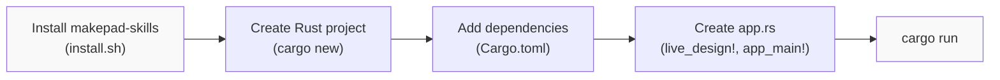
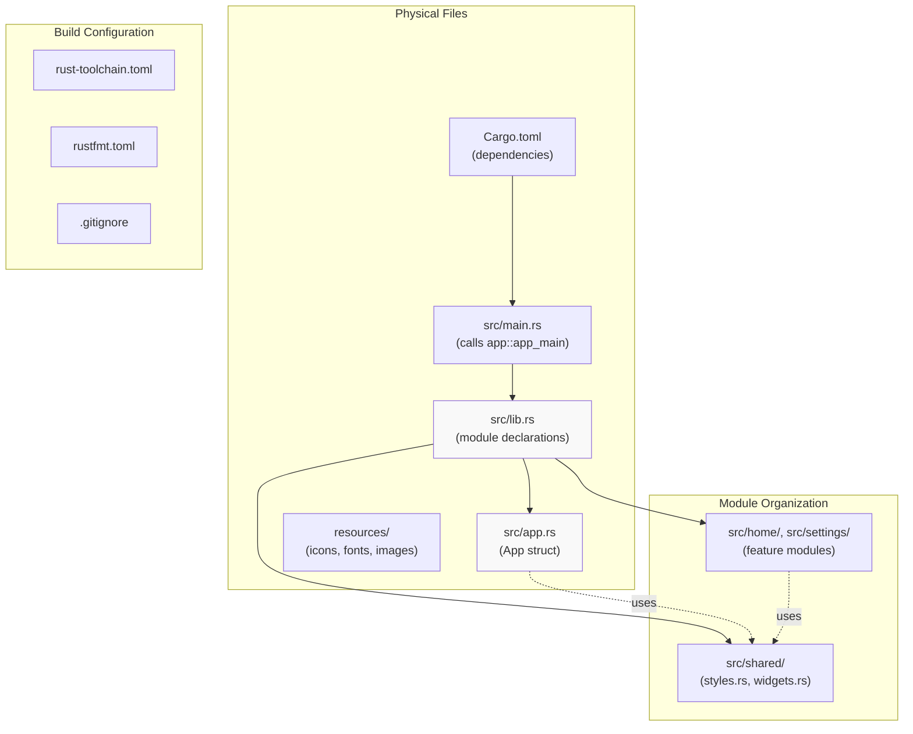
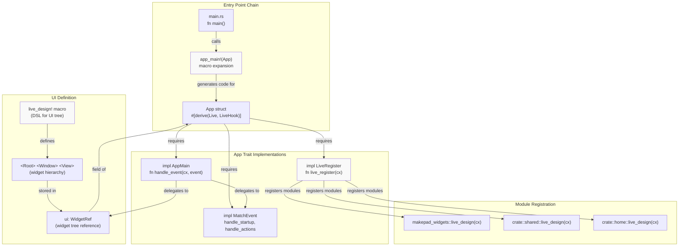
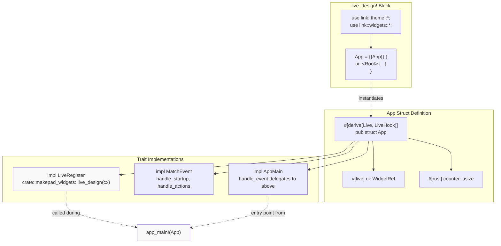
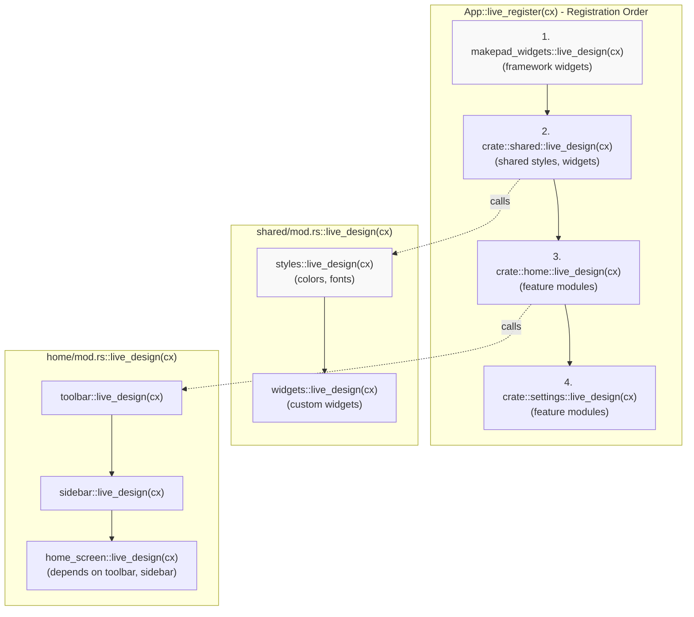

<!-- source: DeepWiki mcp.deepwiki.com · repo ZhangHanDong/makepad-skills · page 2 Getting Started · fetched 2026-10-26 -->

# Getting Started

<details>
<summary>Relevant source files</summary>

The following files were used as context for generating this wiki page:

- [skills/00-getting-started/SKILL.md](skills/00-getting-started/SKILL.md)
- [skills/00-getting-started/init.md](skills/00-getting-started/init.md)
- [skills/00-getting-started/project-structure.md](skills/00-getting-started/project-structure.md)

</details>


This document introduces the `00-getting-started` skill category and provides an overview of the fundamental steps for creating and organizing a Makepad application. It covers the initial project setup workflow, core project structure concepts, and the essential code patterns required to bootstrap a functional application.

For detailed information about specific widgets and layout systems, see [Core Development Concepts](#3). For graphics and animation capabilities, see [Graphics and Animation](#5). For production deployment, see section 5 in the deployment documentation.

---

## The 00-getting-started Skill Category

The `00-getting-started` category serves as the entry point for Makepad development. It contains two primary skills:

| Skill | Purpose | Key Topics |
|-------|---------|------------|
| `init.md` | Project scaffolding | Templates, boilerplate, `Cargo.toml` configuration |
| `project-structure.md` | Organization patterns | Directory layout, module system, resource management |

This category answers: "How do I create a new Makepad project?" and "How should I organize my code?"

**Sources:** [skills/00-getting-started/SKILL.md:1-49]()

---

## Quick Start Workflow



**Minimal setup steps:**

1. Create project: `cargo new my_app`
2. Add dependency to `Cargo.toml`:
   ```toml
   [dependencies]
   makepad-widgets = { git = "https://github.com/makepad/makepad", branch = "rik" }
   ```
3. Create `src/app.rs` with `live_design!` and `app_main!` macros
4. Run: `cargo run`

**Sources:** [skills/00-getting-started/SKILL.md:29-42](), [skills/00-getting-started/init.md:1-44]()

---

## Project Structure Overview



**Directory structure:**

```
my_app/
├── Cargo.toml                    # Dependencies, build profiles
├── src/
│   ├── main.rs                   # Entry point
│   ├── lib.rs                    # Module declarations
│   ├── app.rs                    # App struct, LiveRegister, AppMain
│   ├── shared/                   # Reusable components
│   │   ├── mod.rs                # live_design() registration
│   │   ├── styles.rs             # Colors, fonts, icons
│   │   └── widgets.rs            # Custom widgets
│   └── home/                     # Feature module
│       ├── mod.rs                # Submodule registration
│       └── home_screen.rs        # Screen implementation
├── resources/                    # Assets
│   ├── icons/                    # SVG icons
│   └── img/                      # Images
└── rust-toolchain.toml           # Rust version
```

**Sources:** [skills/00-getting-started/project-structure.md:13-67]()

---

## Core Code Entities: From Project to Running App



### Key Code Entities

| Entity | Purpose | Location |
|--------|---------|----------|
| `app_main!(App)` | Macro that generates entry point boilerplate | End of `src/app.rs` |
| `App` struct | Main application orchestrator with `#[live] ui: WidgetRef` | `src/app.rs` |
| `LiveRegister` trait | Registers all `live_design!` blocks with framework | `impl LiveRegister for App` |
| `MatchEvent` trait | Handles application-level events (startup, actions) | `impl MatchEvent for App` |
| `AppMain` trait | Main event loop entry point | `impl AppMain for App` |
| `live_design!` macro | DSL for defining UI hierarchy and styles | Throughout `.rs` files |
| `WidgetRef` | Type-erased reference to widget tree | `ui: WidgetRef` field |

**Sources:** [skills/00-getting-started/init.md:46-134](), [skills/00-getting-started/project-structure.md:436-622]()

---

## Simple App Template Walkthrough

### File: src/main.rs

```rust
fn main() {
    my_app::app::app_main()
}
```

Calls the generated entry point from `app_main!` macro.

**Sources:** [skills/00-getting-started/init.md:46-52]()

### File: src/lib.rs

```rust
pub use makepad_widgets;
pub mod app;
```

Re-exports `makepad_widgets` for dependency injection and declares the `app` module.

**Sources:** [skills/00-getting-started/init.md:54-59]()

### File: src/app.rs (Core Pattern)



**Key sections:**

1. **`live_design!` block** ([skills/00-getting-started/init.md:66-98]()): Defines UI tree using DSL
   - `App = {{App}}`: Associates DSL definition with Rust struct
   - `ui: <Root> { ... }`: Root widget containing `<Window>` and child widgets
   - Widget IDs: `button1`, `counter_label` for programmatic access

2. **`app_main!(App)` macro** ([skills/00-getting-started/init.md:100]()): Generates main loop

3. **App struct** ([skills/00-getting-started/init.md:102-106]()):
   - `#[live] ui: WidgetRef`: Binds to `live_design!` UI tree
   - `#[rust] counter: usize`: Pure Rust state (not in DSL)

4. **`impl LiveRegister`** ([skills/00-getting-started/init.md:108-112]()): Registers all `live_design!` blocks
   - Must call `makepad_widgets::live_design(cx)` for framework widgets
   - Must call `crate::module::live_design(cx)` for each feature module

5. **`impl MatchEvent`** ([skills/00-getting-started/init.md:114-126]()):
   - `handle_startup(&mut self, cx)`: Initialization logic
   - `handle_actions(&mut self, cx, actions)`: Responds to widget actions
   - Uses `self.ui.button(ids!(button1))` to access widgets by ID

6. **`impl AppMain`** ([skills/00-getting-started/init.md:128-133]()):
   - `handle_event(&mut self, cx, event)`: Main event loop
   - Delegates to `self.match_event()` and `self.ui.handle_event()`

**Sources:** [skills/00-getting-started/init.md:61-134]()

---

## Module Registration Pattern



**Critical rules:**

1. **Order matters**: Dependencies must be registered before dependents
2. **Framework first**: Always call `makepad_widgets::live_design(cx)` first
3. **Shared second**: Register shared styles/widgets before features
4. **Features last**: Register feature modules in dependency order

**Example from production app:**

```rust
impl LiveRegister for App {
    fn live_register(cx: &mut Cx) {
        makepad_widgets::live_design(cx);        // 1. Framework
        crate::shared::live_design(cx);          // 2. Shared
        crate::login::live_design(cx);           // 3. Features
        crate::home::live_design(cx);
        crate::settings::live_design(cx);
    }
}
```

**Sources:** [skills/00-getting-started/project-structure.md:117-142](), [skills/00-getting-started/project-structure.md:531-542](), [skills/00-getting-started/project-structure.md:797-805]()

---

## Production App Template

For larger applications, use a more structured approach:

### Directory Structure

```
my_app/
├── src/
│   ├── main.rs
│   ├── lib.rs
│   ├── app.rs                    # App orchestrator
│   ├── home/                     # Feature: Home screen
│   │   ├── mod.rs                # Module registration
│   │   ├── home_screen.rs        # Main screen widget
│   │   ├── sidebar.rs            # Sidebar component
│   │   └── content_view.rs       # Content area
│   ├── settings/                 # Feature: Settings
│   │   ├── mod.rs
│   │   └── settings_screen.rs
│   └── shared/                   # Reusable components
│       ├── mod.rs
│       ├── styles.rs             # Colors, fonts, spacing constants
│       └── widgets.rs            # Custom widgets (Card, Divider)
├── resources/
│   ├── icons/                    # SVG icons
│   └── img/                      # Images
└── Cargo.toml
```

**Sources:** [skills/00-getting-started/init.md:156-177](), [skills/00-getting-started/project-structure.md:13-67]()

### Key Patterns

**1. Shared Styles Pattern** ([skills/00-getting-started/init.md:306-363]()):

```rust
// src/shared/styles.rs
live_design! {
    // Color palette
    pub COLOR_BG = #1a1a2e
    pub COLOR_PRIMARY = #0f3460
    pub COLOR_ACCENT = #e94560
    
    // Spacing constants
    pub SPACING_MD = 16.0
    pub SPACING_LG = 24.0
    
    // Reusable button style
    pub PrimaryButton = <Button> {
        draw_bg: {
            color: (COLOR_ACCENT)
            radius: (RADIUS_SM)
        }
    }
}
```

**2. Feature Module Pattern** ([skills/00-getting-started/init.md:404-414]()):

```rust
// src/home/mod.rs
pub mod home_screen;
pub mod sidebar;
pub mod content_view;

pub fn live_design(cx: &mut Cx) {
    sidebar::live_design(cx);          // Base components first
    content_view::live_design(cx);
    home_screen::live_design(cx);      // Composite last
}
```

**3. Custom Widget Pattern** ([skills/00-getting-started/init.md:416-484]()):

```rust
// src/home/home_screen.rs
live_design! {
    use crate::shared::styles::*;
    use crate::shared::widgets::*;
    
    pub HomeScreen = {{HomeScreen}} {
        width: Fill, height: Fill
        flow: Down
        spacing: (SPACING_LG)
        
        <Card> {
            action_button = <PrimaryButton> {
                text: "Get Started"
            }
        }
    }
}

#[derive(Live, LiveHook, Widget)]
pub struct HomeScreen {
    #[deref] view: View,
}

impl Widget for HomeScreen {
    fn handle_event(&mut self, cx: &mut Cx, event: &Event, scope: &mut Scope) {
        self.view.handle_event(cx, event, scope);
        self.widget_match_event(cx, event, scope);
    }
    
    fn draw_walk(&mut self, cx: &mut Cx2d, scope: &mut Scope, walk: Walk) -> DrawStep {
        self.view.draw_walk(cx, scope, walk)
    }
}
```

**Sources:** [skills/00-getting-started/project-structure.md:220-432]()

---

## Build Configuration

### Cargo.toml Profiles

```toml
[profile.dev]
opt-level = 0                          # Fast compilation

[profile.dev.package."*"]
opt-level = 3                          # Optimize dependencies

[profile.release]
opt-level = 3
lto = "thin"                           # Link-time optimization

[profile.release-lto]
inherits = "release"
lto = "fat"                            # Maximum optimization
codegen-units = 1

[profile.distribution]
inherits = "release"
lto = "fat"
codegen-units = 1
strip = true                           # Remove debug symbols
```

**Build commands:**

```bash
cargo run                              # Development (fast compile)
cargo run --release                    # Optimized build
cargo run --profile release-lto        # Pre-production
cargo build --profile distribution     # Final distribution
```

**Sources:** [skills/00-getting-started/project-structure.md:715-736](), [skills/00-getting-started/init.md:206-212]()

---

## Running the Application

### Desktop

```bash
cargo run --release
```

### Mobile (requires cargo-makepad CLI)

```bash
# Install cargo-makepad
cargo install --force --git https://github.com/makepad/makepad.git \
  --branch rik cargo-makepad

# Android
cargo makepad android run -p my-app --release

# iOS Simulator
cargo makepad apple ios run-sim -p my-app --release
```

**Sources:** [skills/00-getting-started/init.md:494-513]()

---

## Project Checklist

When initializing a new Makepad project, ensure:

- [ ] `Cargo.toml` specifies `makepad-widgets` dependency with correct branch
- [ ] `lib.rs` re-exports `makepad_widgets` and declares all modules
- [ ] `main.rs` calls `app::app_main()`
- [ ] `app.rs` contains `app_main!(App)` macro at end of file
- [ ] `App` struct has `#[live] ui: WidgetRef` field
- [ ] `impl LiveRegister` registers all modules in correct order
- [ ] `impl MatchEvent` implements `handle_startup` and `handle_actions`
- [ ] `impl AppMain` delegates to `match_event` and `ui.handle_event`
- [ ] `.gitignore` excludes `/target` directory
- [ ] `rust-toolchain.toml` specifies Rust channel

**Sources:** [skills/00-getting-started/init.md:556-567]()

---

## Next Steps

After setting up your project structure:

- **Learn layout and widgets**: See [Core Development Concepts](#3) for `flow`, `padding`, `align`, and widget creation
- **Explore built-in components**: See [Component Gallery](#4) for `Button`, `TextInput`, `ScrollView`, etc.
- **Add visual effects**: See [Graphics and Animation](#5) for shaders, SDF drawing, and animations
- **Apply production patterns**: Refer to [04-patterns](skills/04-patterns) for state management, async operations, and responsive design

**References:**
- [Makepad Examples](https://github.com/makepad/makepad/tree/main/examples)
- [Robrix](https://github.com/project-robius/robrix) - Production Matrix client
- [Moly](https://github.com/moxin-org/moly) - Production AI model manager

**Sources:** [skills/00-getting-started/SKILL.md:16-27](), [skills/00-getting-started/init.md:568-572]()

---

