# Page: Overview

# Overview

<details>
<summary>Relevant source files</summary>

The following files were used as context for generating this wiki page:

- [README.ja.md](README.ja.md)
- [README.md](README.md)
- [README.zh-CN.md](README.zh-CN.md)
- [skills/.claude-plugin/plugin.json](skills/.claude-plugin/plugin.json)

</details>


The **makepad-skills** repository is a structured knowledge base designed to enable Claude Code AI to assist developers in building cross-platform UI applications using the [Makepad](https://github.com/makepad/makepad) framework in Rust. This system provides atomic, modular documentation organized into skill categories that cover project initialization, core development concepts, component usage, graphics programming, production patterns, deployment, and troubleshooting.

The skills are installed into a developer's project at [.claude/skills/]() and are automatically discovered by Claude Code through the plugin metadata at [.claude-plugin/plugin.json](). This overview describes the high-level architecture of the skill system, its installation mechanism, and how it integrates with Claude Code for intelligent code generation and assistance.

For details on the atomic skill structure that enables collaborative development, see [Atomic Skill Structure](#1.1). For information on capturing patterns during development, see [Self-Evolution System](#1.2). For installation instructions, see [Installation](#1.3).

## Repository Structure and File Organization

The makepad-skills repository is organized as a hierarchical skill system with the following directory structure:

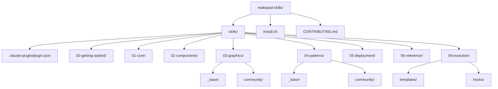

**Sources:** [README.md:71-95](), [skills/.claude-plugin/plugin.json:1-81]()

### Directory Naming Convention

Skill categories use a two-digit prefix for ordering:

| Prefix | Category | Purpose |
|--------|----------|---------|
| `00-` | Getting Started | Project scaffolding and structure |
| `01-` | Core | Fundamental Makepad concepts (layout, widgets, events) |
| `02-` | Components | Built-in widget gallery reference |
| `03-` | Graphics | Shader programming, SDF drawing, animation |
| `04-` | Patterns | Production-ready application patterns |
| `05-` | Deployment | Platform-specific build and packaging |
| `06-` | Reference | Troubleshooting and code quality guidance |
| `99-` | Evolution | Self-improvement templates and hooks |

**Sources:** [README.md:230-293](), [README.md:99-123]()

## Installation and Integration Flow

The skills are installed into a target Makepad project using either the automated [install.sh]() script or manual file copying. The following diagram shows the complete installation and integration process:

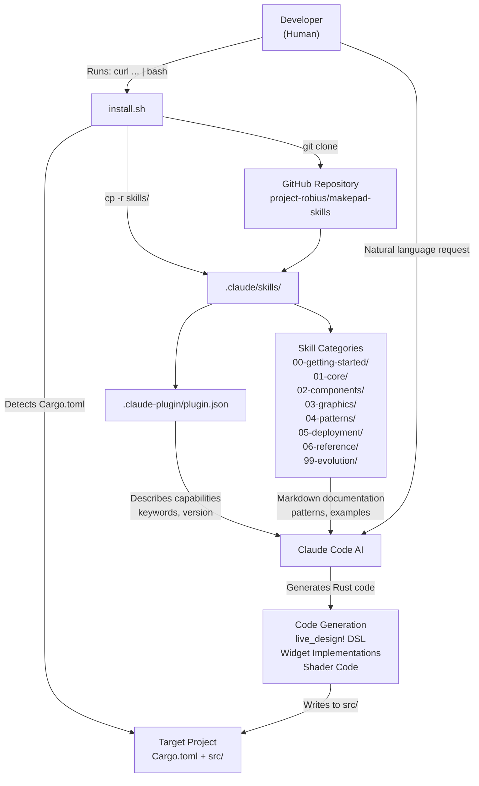

**Sources:** [install.sh]() (referenced in [README.md:32-60]()), [README.md:71-95]()

### Install Script Detection Logic

The [install.sh]() script performs automatic project detection before installation:

| Check | Purpose |
|-------|---------|
| `Cargo.toml` exists | Validates Rust project |
| `--target DIR` option | Allows custom installation directory |
| Existing `.claude/skills/` | Creates backup before overwriting |
| `--with-hooks` flag | Copies self-evolution hooks from [99-evolution/hooks/]() |

**Sources:** [README.md:45-51](), [README.md:141-151]()

## Plugin Metadata and Skill Discovery

Claude Code discovers the skills through the metadata file at [skills/.claude-plugin/plugin.json](). This file defines:

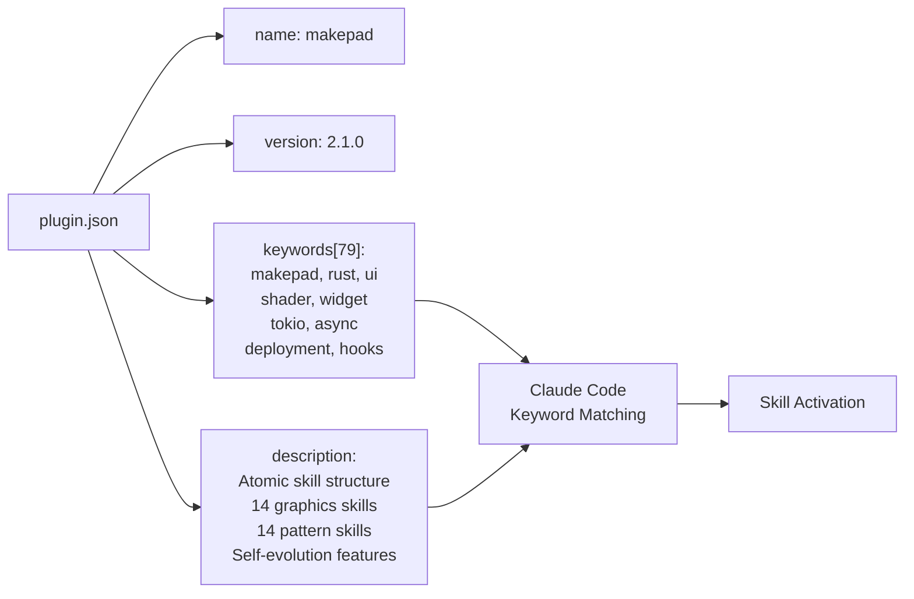

**Sources:** [skills/.claude-plugin/plugin.json:1-81]()

### Key Metadata Fields

| Field | Content | Purpose |
|-------|---------|---------|
| `name` | `"makepad"` | Plugin identifier |
| `version` | `"2.1.0"` | Tracks atomic structure version |
| `description` | Atomic skill structure description | High-level capability summary |
| `keywords[79]` | makepad, rust, ui, shader, widget, tokio, async, deployment, hooks, etc. | Enables Claude to match user queries to relevant skills |

**Sources:** [skills/.claude-plugin/plugin.json:2-80]()

## Atomic Skill Architecture

Version 2.1 introduced an **atomic skill structure** that separates official skills from community contributions to enable parallel development without merge conflicts:

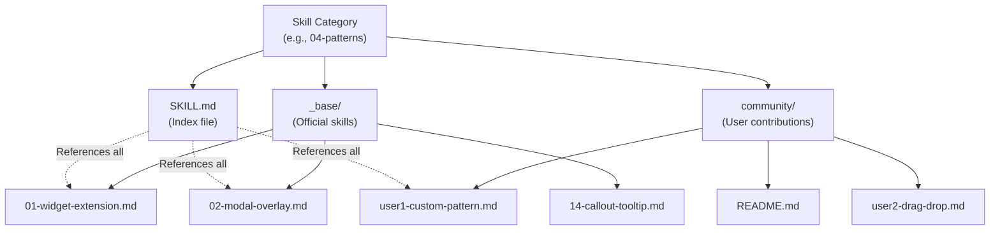

**Sources:** [README.md:99-123](), [README.md:106-116]()

### Atomic Structure Benefits

| Benefit | Implementation |
|---------|----------------|
| **No merge conflicts** | Community files at [community/{github-handle}-{name}.md]() never conflict with official files at [_base/{number}-{name}.md]() |
| **Parallel development** | Multiple contributors can add files simultaneously without coordination |
| **Clear attribution** | GitHub username in filename provides automatic credit |
| **Progressive disclosure** | [SKILL.md]() index provides overview, individual files provide details |

**Sources:** [README.md:118-122]()

## Skill Category Details

### Core Categories (00-06)

The following table describes each skill category and its key files:

| Category | Key Files | Primary Use Cases |
|----------|-----------|-------------------|
| **00-getting-started** | [init.md](), [project-structure.md]() | "Create new Makepad app", "How to organize project?" |
| **01-core** | [layout.md](), [widgets.md](), [events.md](), [styling.md]() | "Arrange UI elements", "Handle click events", "Add icons" |
| **02-components** | [SKILL.md]() (widget gallery reference) | "Use Button", "Add ScrollView", "Implement PortalList" |
| **03-graphics** | [_base/01-shader-structure.md]() through [_base/14-toggle-checkbox.md]() | "Write custom shader", "Draw SDF shapes", "Animate elements" |
| **04-patterns** | [_base/01-widget-extension.md]() through [_base/14-callout-tooltip.md]() | "Extend existing widget", "Show modal dialog", "Integrate tokio async" |
| **05-deployment** | Build and packaging guides | "Build for Android", "Package for macOS", "Deploy to web" |
| **06-reference** | [troubleshooting.md](), [code-quality.md](), [adaptive-layout.md]() | "Fix compilation error", "Refactor code", "Support desktop and mobile" |

**Sources:** [README.md:230-286]()

### Atomic Skills in 03-graphics

The [03-graphics/]() category contains 14 atomic skills in [_base/]():

| Skill File | Focus Area |
|------------|------------|
| `01-shader-structure.md` | Shader anatomy, instance/uniform/varying variables |
| `02-shader-math.md` | Color operations, transformations, vec4 math |
| `03-sdf-shapes.md` | Sdf2d primitives (circle, box, hexagon, rect) |
| `04-sdf-drawing.md` | fill, stroke, path operations |
| `05-progress-track.md` | Circular/linear progress indicators |
| `06-animator-basics.md` | Animation state machine, play/cut/snap |
| `07-easing-functions.md` | OutQuad, InQuad, ExpDecay easing |
| `08-keyframe-animation.md` | Multi-value keyframe sequences |
| `09-loading-spinner.md` | Rotating loading indicators |
| `10-hover-effect.md` | Interactive hover states |
| `11-gradient-effects.md` | Linear/radial gradients |
| `12-shadow-glow.md` | Drop shadows and glow effects |
| `13-disabled-state.md` | Disabled widget appearance |
| `14-toggle-checkbox.md` | Checkbox/toggle animations |

**Sources:** [README.md:250-260]()

### Atomic Patterns in 04-patterns

The [04-patterns/]() category contains 14 atomic patterns in [_base/]():

| Pattern File | Application Scenario |
|--------------|---------------------|
| `01-widget-extension.md` | Extending built-in widgets with custom behavior |
| `02-modal-overlay.md` | Overlay dialogs with backdrop |
| `03-collapsible.md` | Expandable/collapsible sections |
| `04-list-template.md` | Dynamic list rendering patterns |
| `05-lru-view-cache.md` | Caching rendered views for performance |
| `06-global-registry.md` | Singleton pattern for app-wide state |
| `07-radio-navigation.md` | Mutually exclusive navigation states |
| `08-async-loading.md` | Loading data asynchronously with state management |
| `09-streaming-results.md` | Handling streaming/chunked data |
| `10-state-machine.md` | Explicit state machine implementation |
| `11-theme-switching.md` | Runtime theme/appearance changes |
| `12-local-persistence.md` | Saving application state to disk |
| `13-tokio-integration.md` | Integrating tokio runtime with Makepad |
| `14-callout-tooltip.md` | Contextual tooltips with positioning |

**Sources:** [README.md:263-272]()

## Self-Evolution System (99-evolution)

The [99-evolution/]() category enables continuous improvement by capturing patterns discovered during development:

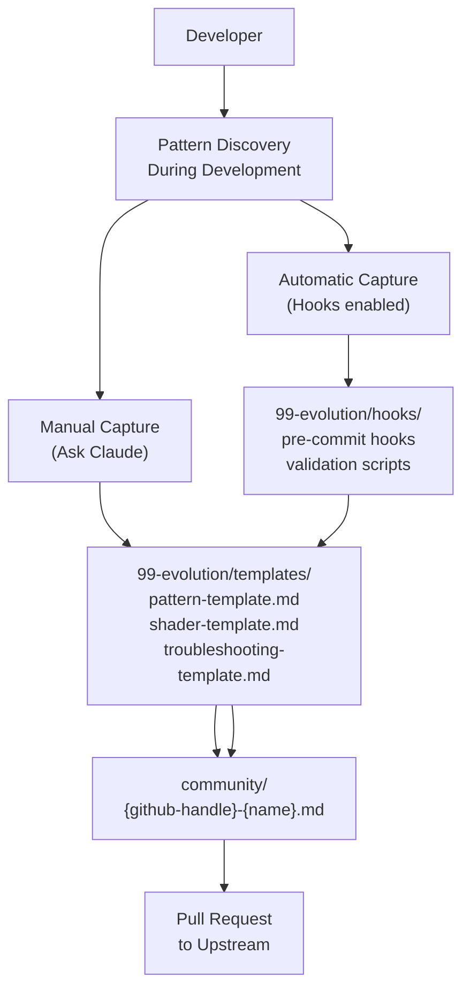

**Sources:** [README.md:124-165](), [README.md:287-292]()

### Evolution Components

| Component | Location | Purpose |
|-----------|----------|---------|
| **Templates** | [99-evolution/templates/]() | Standardized formats for pattern, shader, and troubleshooting contributions |
| **Hooks** | [99-evolution/hooks/]() | Optional automation scripts for error detection and pattern capture |
| **Settings Example** | [99-evolution/hooks/settings.example.json]() | Configuration template for enabling hooks |

**Sources:** [README.md:141-151](), [README.md:289-292]()

## Claude Code Integration Pattern

The following diagram illustrates how Claude Code consumes skills to generate Makepad code:

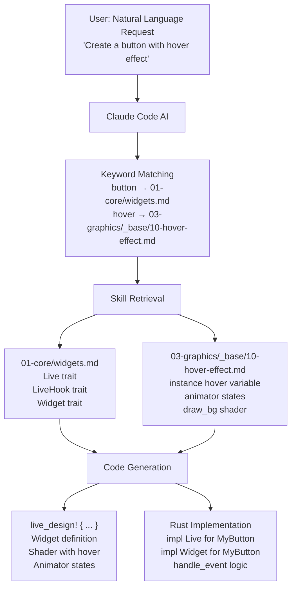

**Sources:** [skills/.claude-plugin/plugin.json:11-80](), [README.md:294-318]()

### Integration Points

| Integration Point | Mechanism | Code Location |
|-------------------|-----------|---------------|
| **Skill Discovery** | Claude reads [.claude-plugin/plugin.json]() on project load | `.claude/skills/.claude-plugin/plugin.json` |
| **Keyword Matching** | User query keywords matched against `keywords[]` array | [plugin.json:11-80]() |
| **Skill Loading** | Markdown files parsed from skill category directories | `.claude/skills/00-getting-started/`, `.claude/skills/01-core/`, etc. |
| **Code Generation** | Claude synthesizes examples from multiple skill files into user's `src/` directory | User project `src/` directory |

**Sources:** [README.md:71-95](), [skills/.claude-plugin/plugin.json:1-81]()

## Community Contribution Workflow

Users can contribute new patterns and skills back to the repository:

```mermaid
graph LR
    LocalDev["Local Development<br/>Discover useful pattern"]
    
    CreateFile["Create File<br/>04-patterns/community/<br/>{github-handle}-pattern.md"]
    
    FillTemplate["Use Template<br/>99-evolution/templates/<br/>pattern-template.md"]
    
    Frontmatter["Add Frontmatter<br/>name, author, source<br/>date, tags, level"]
    
    Fork["Fork Repository<br/>On GitHub"]
    
    Commit["Commit to Fork"]
    
    PullRequest["Submit Pull Request<br/>To project-robius/makepad-skills"]
    
    Review["Maintainer Review"]
    
    Promotion["Optional Promotion<br/>community/ → _base/<br/>With attribution"]
    
    LocalDev --> CreateFile
    CreateFile --> FillTemplate
    FillTemplate --> Frontmatter
    Frontmatter --> Fork
    Fork --> Commit
    Commit --> PullRequest
    PullRequest --> Review
    Review --> Promotion
```

**Sources:** [README.md:166-227]()

### Contribution File Naming

| Category | Naming Pattern | Example |
|----------|----------------|---------|
| Pattern | `{github-handle}-{pattern-name}.md` | `johndoe-infinite-scroll.md` |
| Shader/Effect | `{github-handle}-{effect-name}.md` | `johndoe-custom-blur.md` |
| Troubleshooting | `{error-name}.md` | `no-matching-field-font.md` |

All community contributions are placed in [community/]() subdirectories within their respective skill categories.

**Sources:** [README.md:169-207]()

## System Version and Maintenance

| Attribute | Current Value | Notes |
|-----------|---------------|-------|
| **Version** | `2.1.0` | Atomic skill structure introduced in v2.1 |
| **License** | MIT | Permissive open source license |
| **Repository** | `project-robius/makepad-skills` | Main upstream repository |
| **Branch** | `main` | Default installation branch (customizable via `--branch` flag) |

The [install.sh:1-end]() script supports installing from specific branches using the `--branch` option.

**Sources:** [skills/.claude-plugin/plugin.json:1-11](), [README.md:58]()

---

# Page: Atomic Skill Structure

# Atomic Skill Structure

<details>
<summary>Relevant source files</summary>

The following files were used as context for generating this wiki page:

- [README.ja.md](README.ja.md)
- [README.md](README.md)
- [README.zh-CN.md](README.zh-CN.md)

</details>


This document describes the atomic skill architecture used in makepad-skills v2.1+, which organizes skills into `_base/` (official) and `community/` (user contributions) directories to enable parallel development without merge conflicts. For information about how patterns are captured during development, see [Self-Evolution System](#1.2). For installation procedures, see [Installation](#1.3).

## Purpose and Scope

The atomic skill structure is a file organization pattern that separates official skills from community contributions within skill categories. This architecture enables multiple developers to contribute simultaneously to the skills repository without coordination overhead or merge conflicts. The structure applies to categories `03-graphics` and `04-patterns`, which contain domain-specific knowledge organized as independent, atomic units.

## Directory Organization

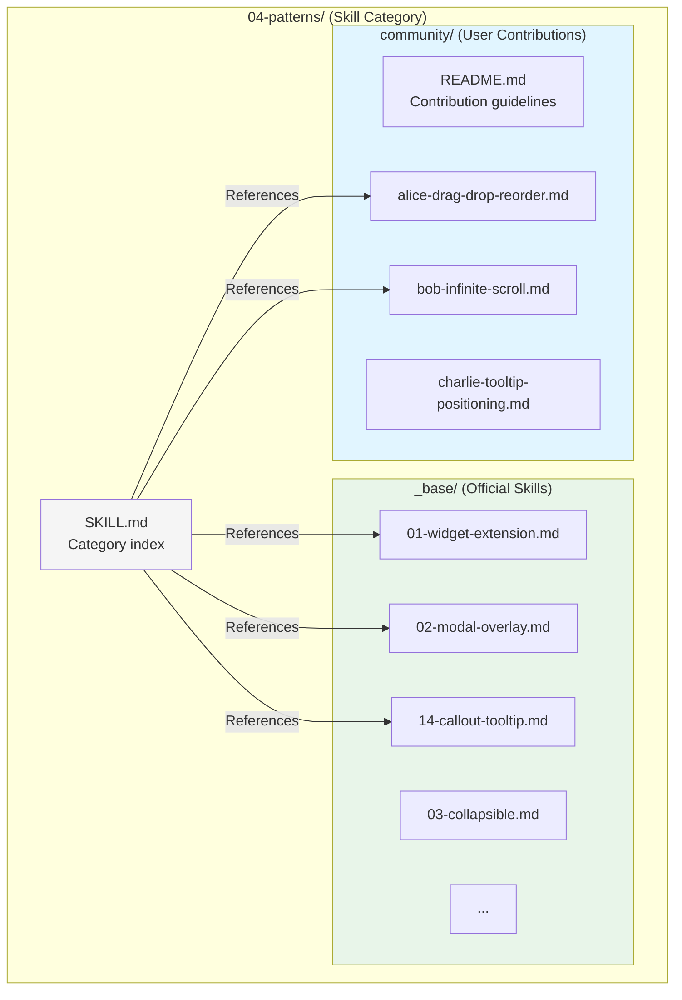

**Sources:** [README.md:99-123](), [README.zh-CN.md:99-123](), [README.ja.md:99-123]()

### Base Directory (`_base/`)

The `_base/` directory contains official, curated skills that are numbered sequentially. Each skill file represents an atomic unit of knowledge that can be consumed independently by Claude Code.

**Characteristics:**
- Sequential numbering: `01-`, `02-`, ..., `14-`
- Maintained by repository owners
- Tested and documented patterns
- Stable API surface

**Example structure for `03-graphics/_base/`:**
```
03-graphics/_base/
├── 01-shader-structure.md
├── 02-shader-math.md
├── 03-sdf-shapes.md
├── 04-sdf-drawing.md
├── 05-progress-track.md
├── 06-animator-basics.md
├── 07-easing-functions.md
├── 08-keyframe-animation.md
├── 09-loading-spinner.md
├── 10-hover-effect.md
├── 11-gradient-effects.md
├── 12-shadow-glow.md
├── 13-disabled-state.md
└── 14-toggle-checkbox.md
```

**Sources:** [README.md:250-260](), [README.zh-CN.md:250-260](), [README.ja.md:250-260]()

### Community Directory (`community/`)

The `community/` directory contains user-contributed skills using a collision-resistant naming scheme. Files follow the pattern `{github-handle}-{skill-name}.md`.

**Characteristics:**
- User-prefixed filenames prevent naming collisions
- Independent from `_base/` updates
- Attribution via filename
- Quality varies (not curated)

**Example structure for `04-patterns/community/`:**
```
04-patterns/community/
├── README.md
├── alice-drag-drop-reorder.md
├── bob-infinite-scroll.md
└── charlie-tooltip-positioning.md
```

**Sources:** [README.md:105-116](), [README.zh-CN.md:105-116](), [README.ja.md:105-116]()

## File Naming Conventions

| Location | Pattern | Example | Purpose |
|----------|---------|---------|---------|
| `_base/` | `{number}-{skill-name}.md` | `01-widget-extension.md` | Sequential official skills |
| `community/` | `{github-handle}-{skill-name}.md` | `alice-drag-drop-reorder.md` | User contributions |
| Category root | `SKILL.md` | `04-patterns/SKILL.md` | Category index |

### Frontmatter Requirements

Community contributions must include structured frontmatter for metadata:

```yaml
---
name: my-pattern-name
author: your-github-handle
source: project-where-you-discovered-this
date: 2024-01-15
tags: [tag1, tag2, tag3]
level: beginner|intermediate|advanced
---
```

**Sources:** [README.md:169-189](), [README.zh-CN.md:169-189](), [README.ja.md:169-189]()

## Merge Conflict Prevention Mechanism

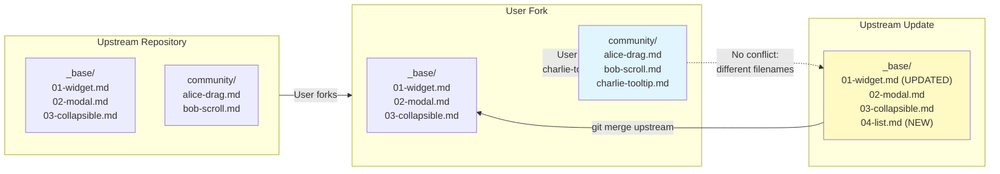

The atomic structure prevents merge conflicts through namespace separation:

1. **Official updates** modify only `_base/` files
2. **User contributions** create only `community/{handle}-*.md` files
3. **No filename overlap** between upstream `_base/` changes and user `community/` additions

This allows users to sync with upstream while preserving local contributions:

```bash
git fetch upstream
git merge upstream/main --no-edit
# community/ files won't conflict with _base/ changes
```

**Sources:** [README.md:209-218](), [README.zh-CN.md:209-218](), [README.ja.md:209-218]()

## Index File Integration (`SKILL.md`)

Each skill category contains a `SKILL.md` index file at the category root that references both `_base/` and `community/` skills. This provides progressive disclosure: users browse the index first, then drill into individual skills.

**Example `04-patterns/SKILL.md` structure:**

```markdown
# Production Patterns

## Official Patterns (_base)
- [01-widget-extension.md](_base/01-widget-extension.md)
- [02-modal-overlay.md](_base/02-modal-overlay.md)
...

## Community Patterns (community)
- [alice-drag-drop-reorder.md](community/alice-drag-drop-reorder.md)
- [bob-infinite-scroll.md](community/bob-infinite-scroll.md)
```

**Benefits:**
- Single entry point per category
- Equal visibility for official and community skills
- Claude Code can scan index or load individual skills as needed

**Sources:** [README.md:105-123](), [README.zh-CN.md:105-123](), [README.ja.md:105-123]()

## Promotion Path

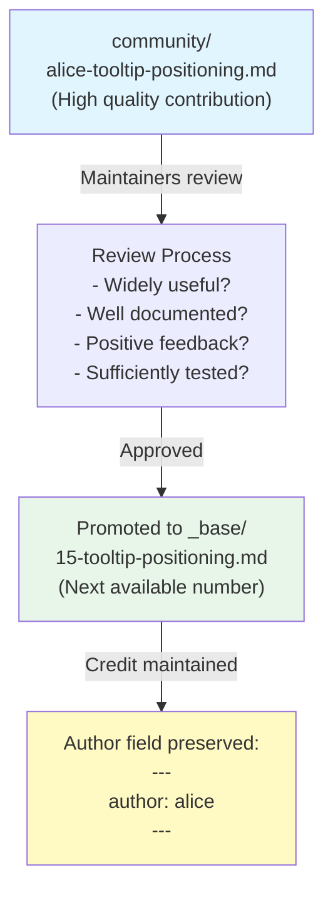

High-quality community contributions may be promoted to `_base/` through this process:

1. **Candidate identification**: Maintainers or community identify valuable patterns
2. **Quality assessment**: 
   - Pattern is broadly applicable (not project-specific)
   - Documentation is complete with examples
   - Community feedback is positive
   - Code has been tested in production
3. **Promotion**: File is moved to `_base/` with next sequential number
4. **Attribution preservation**: Original `author` field remains in frontmatter

**Example promotion:**
- Before: `community/alice-tooltip-positioning.md`
- After: `_base/15-tooltip-positioning.md` (with `author: alice` in frontmatter)

**Sources:** [README.md:220-227](), [README.zh-CN.md:220-227](), [README.ja.md:220-227]()

## Practical Usage Workflow

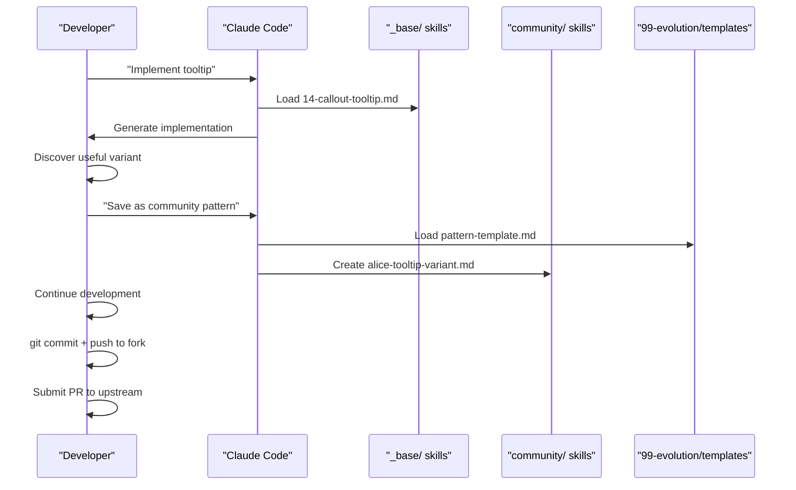

### Discovery and Consumption

When Claude Code searches for patterns, it scans both directories:

1. **Index scan**: Claude reads `SKILL.md` to discover available skills
2. **Skill loading**: Claude loads individual `.md` files as needed
3. **Pattern matching**: Claude identifies relevant skills based on user query

### Contribution Workflow

Developers contribute new patterns through these steps:

1. **Create file**: `04-patterns/community/{your-handle}-{pattern-name}.md`
2. **Use template**: Copy from `99-evolution/templates/pattern-template.md`
3. **Fill content**: Add frontmatter, description, code examples
4. **Local testing**: Verify Claude Code can consume the skill
5. **Submit PR**: Push to fork and create pull request

**Sources:** [README.md:152-165](), [README.zh-CN.md:152-165](), [README.ja.md:152-165]()

## Applicable Categories

The atomic structure currently applies to these categories:

| Category | `_base/` Count | Purpose |
|----------|----------------|---------|
| `03-graphics` | 14 skills | Shader structure, SDF drawing, animations, visual effects |
| `04-patterns` | 14 patterns | Widget patterns, data patterns, advanced patterns |

Other categories (`00-getting-started`, `01-core`, `02-components`, `05-deployment`, `06-reference`) use simpler flat structures because they contain foundational or reference material that requires central curation.

**Sources:** [README.md:250-273](), [README.zh-CN.md:250-273](), [README.ja.md:250-273]()

## Implementation in Repository

The physical file structure in the repository:

```
skills/
├── 03-graphics/
│   ├── SKILL.md                    # Category index
│   ├── _base/                      # 14 official skills
│   │   ├── 01-shader-structure.md
│   │   └── ...
│   └── community/                  # User contributions
│       ├── README.md
│       └── {handle}-{name}.md
├── 04-patterns/
│   ├── SKILL.md                    # Category index
│   ├── _base/                      # 14 official patterns
│   │   ├── 01-widget-extension.md
│   │   └── ...
│   └── community/                  # User contributions
│       ├── README.md
│       └── {handle}-{name}.md
└── 99-evolution/
    └── templates/                   # Templates for contributions
        ├── pattern-template.md
        ├── shader-template.md
        └── troubleshooting-template.md
```

**Sources:** [README.md:71-95](), [README.zh-CN.md:71-95](), [README.ja.md:71-95]()

---

# Page: Self-Evolution System

# Self-Evolution System

<details>
<summary>Relevant source files</summary>

The following files were used as context for generating this wiki page:

- [README.ja.md](README.ja.md)
- [README.md](README.md)
- [README.zh-CN.md](README.zh-CN.md)

</details>


The self-evolution system enables capturing useful patterns, shaders, and error solutions discovered during Makepad development and converting them into reusable skills. This creates a feedback loop where development experience enriches the skills repository, making Claude Code progressively more effective at helping with Makepad applications.

This document covers the self-evolution mechanism, including templates, hooks, and the workflow for creating community contributions. For information about the atomic skill structure that enables conflict-free collaboration, see [Atomic Skill Structure](#1.1). For details about initial project setup, see [Installation](#1.3).

## System Architecture

The self-evolution system consists of three main components: templates for standardized pattern documentation, optional hooks for automatic detection, and a community contribution structure that prevents merge conflicts.

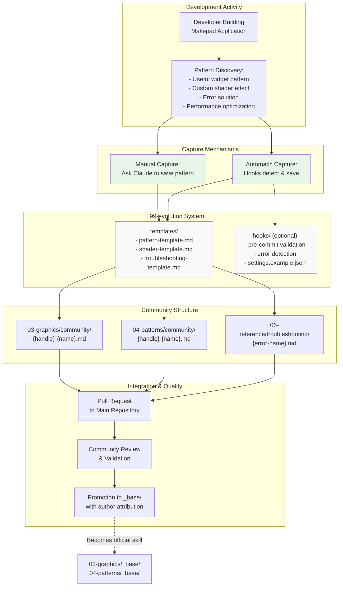

**Sources:** [README.md:99-293](), [README.zh-CN.md:99-293](), [README.ja.md:99-293]()

## Template System

The self-evolution system provides three standardized templates located in the `99-evolution/templates/` directory. These templates ensure consistent structure and metadata across all community contributions.

### Template File Structure

| Template File | Purpose | Target Location | Key Sections |
|--------------|---------|-----------------|--------------|
| `pattern-template.md` | Document reusable UI/application patterns | `04-patterns/community/` | Problem, Solution, Implementation, Trade-offs |
| `shader-template.md` | Document custom visual effects and shaders | `03-graphics/community/` | Effect description, Shader code, Parameters, Usage |
| `troubleshooting-template.md` | Document error solutions and workarounds | `06-reference/troubleshooting/` | Error symptoms, Root cause, Solution, Prevention |

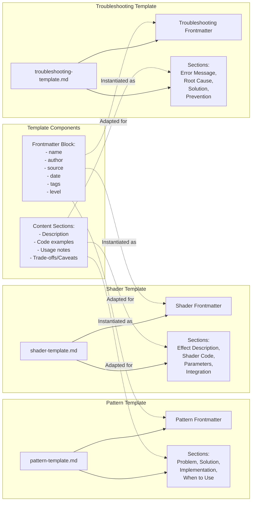

**Sources:** [README.md:152-165](), [README.md:192-208](), [README.zh-CN.md:152-165]()

### Frontmatter Requirements

All community contributions must include YAML frontmatter with specific metadata fields:

```yaml
---
name: my-pattern-name
author: your-github-handle
source: project-where-you-discovered-this
date: 2024-01-15
tags: [tag1, tag2, tag3]
level: beginner|intermediate|advanced
---
```

| Field | Required | Description | Example |
|-------|----------|-------------|---------|
| `name` | Yes | Kebab-case identifier for the pattern | `drag-drop-reorder` |
| `author` | Yes | GitHub username for attribution | `yourhandle` |
| `source` | Yes | Project or context where pattern was discovered | `robrix`, `my-chat-app` |
| `date` | Yes | Creation date in ISO format | `2024-01-15` |
| `tags` | Yes | Array of relevant keywords | `[widget, interaction, state]` |
| `level` | Yes | Complexity indicator | `beginner`, `intermediate`, `advanced` |

**Sources:** [README.md:177-187](), [README.zh-CN.md:177-187](), [README.ja.md:177-187]()

## Manual Pattern Capture Workflow

Manual pattern capture is the primary mechanism for saving discoveries. Developers explicitly ask Claude Code to document useful patterns using the appropriate template.

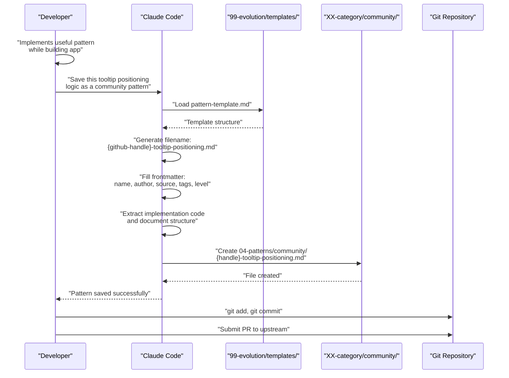

**Sources:** [README.md:153-165](), [README.zh-CN.md:153-165](), [README.ja.md:153-165]()

### Manual Capture Examples

**Capturing a Pattern:**
```
User: Save this infinite scroll implementation as a community pattern
Claude: [Creates 04-patterns/community/yourhandle-infinite-scroll.md using pattern-template.md]
```

**Capturing a Shader Effect:**
```
User: Document this ripple hover effect as a community shader
Claude: [Creates 03-graphics/community/yourhandle-ripple-hover.md using shader-template.md]
```

**Capturing an Error Solution:**
```
User: I just fixed the "Apply error: no matching field" issue. Save the solution.
Claude: [Creates or updates 06-reference/troubleshooting/apply-error-no-field.md]
```

**Sources:** [README.md:294-318](), [README.zh-CN.md:294-318](), [README.ja.md:294-318]()

## Hooks System (Optional)

The hooks system provides automatic pattern detection and validation. Hooks are shell scripts that integrate with development workflow to capture patterns without explicit user requests.

### Enabling Hooks

Hooks are optional and must be manually enabled:

```bash
# Copy hooks from 99-evolution to project
cp -r your-project/.claude/skills/99-evolution/hooks your-project/.claude/skills/hooks

# Make hooks executable
chmod +x your-project/.claude/skills/hooks/*.sh

# Configure hooks in .claude/settings.json
# Reference: skills/99-evolution/hooks/settings.example.json
```

**Sources:** [README.md:140-151](), [README.zh-CN.md:140-151](), [README.ja.md:140-151]()

### Hook Execution Flow

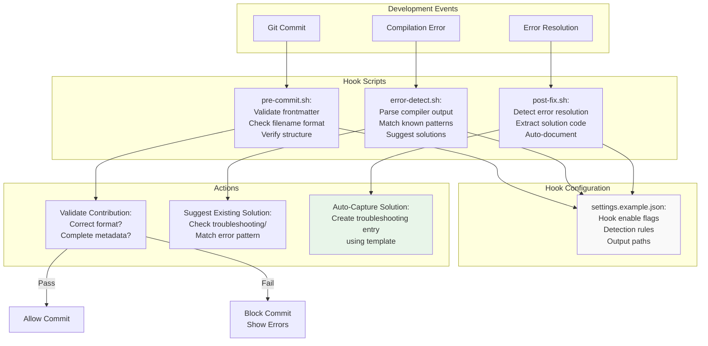

**Sources:** [README.md:138-151](), [install.sh:1-200]() (inferred from --with-hooks flag)

## File Organization and Naming Conventions

Community contributions follow strict naming conventions to prevent merge conflicts during upstream synchronization.

### Directory Structure

```
.claude/skills/
├── 03-graphics/
│   ├── _base/                    # Official skills (numbered)
│   │   ├── 01-shader-structure.md
│   │   ├── 02-shader-math.md
│   │   └── ...
│   └── community/                # Community contributions
│       ├── README.md
│       ├── {handle1}-custom-blur.md
│       ├── {handle2}-neon-glow.md
│       └── {handle3}-particle-system.md
├── 04-patterns/
│   ├── _base/                    # Official patterns (numbered)
│   │   ├── 01-widget-extension.md
│   │   ├── 02-modal-overlay.md
│   │   └── ...
│   └── community/                # Community contributions
│       ├── README.md
│       ├── {handle1}-drag-drop.md
│       ├── {handle2}-virtual-scroll.md
│       └── {handle3}-data-grid.md
├── 06-reference/
│   └── troubleshooting/          # Mixed official and community
│       ├── apply-error.md
│       ├── shader-compile-error.md
│       └── {error-name}.md
└── 99-evolution/
    ├── templates/
    │   ├── pattern-template.md
    │   ├── shader-template.md
    │   └── troubleshooting-template.md
    └── hooks/
        ├── pre-commit.sh
        ├── error-detect.sh
        └── settings.example.json
```

**Sources:** [README.md:73-95](), [README.md:99-123](), [README.zh-CN.md:73-95]()

### Naming Convention Rules

| Category | File Location | Naming Pattern | Example |
|----------|--------------|----------------|---------|
| Pattern | `04-patterns/community/` | `{github-handle}-{pattern-name}.md` | `johndoe-infinite-scroll.md` |
| Shader/Effect | `03-graphics/community/` | `{github-handle}-{effect-name}.md` | `janedoe-ripple-effect.md` |
| Troubleshooting | `06-reference/troubleshooting/` | `{error-name}.md` | `apply-error-no-field.md` |

**Key Rules:**
- GitHub handle in filename provides automatic attribution
- Kebab-case for all names (lowercase, hyphens between words)
- Community files never conflict with numbered `_base/` files
- Troubleshooting files use error name, not author name (shared resource)

**Sources:** [README.md:169-208](), [README.zh-CN.md:169-208](), [README.ja.md:169-208]()

## Contribution and Promotion Workflow

Community contributions follow a standard Git workflow with potential promotion to official skills.

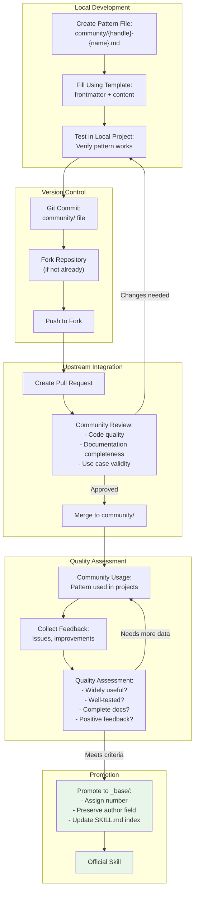

**Sources:** [README.md:220-227](), [README.zh-CN.md:220-227](), [README.ja.md:220-227]()

### Promotion Criteria

High-quality community contributions may be promoted to `_base/` directories when they meet these criteria:

| Criterion | Description | Validation Method |
|-----------|-------------|-------------------|
| **Wide Utility** | Pattern solves common problems across multiple projects | Usage in 3+ different projects |
| **Well-Tested** | Pattern proven stable in production environments | No critical issues reported |
| **Complete Documentation** | All sections filled, examples provided, trade-offs documented | Documentation review |
| **Positive Feedback** | Community finds pattern valuable and correct | GitHub reactions, comments |
| **Code Quality** | Follows Makepad best practices, idiomatic Rust | Code review |

**Promotion Process:**
1. Maintainers identify high-quality community contribution
2. Assign next available number in `_base/` sequence
3. Move file from `community/` to `_base/` with new number prefix
4. Preserve `author` field in frontmatter for attribution
5. Update category `SKILL.md` index file
6. Add reference in parent README

**Sources:** [README.md:220-227](), [README.zh-CN.md:220-227](), [README.ja.md:220-227]()

### Syncing with Upstream

Developers can sync their local skills with upstream updates while preserving their community contributions:

```bash
# Fork workflow: sync without conflicts
git fetch upstream
git merge upstream/main --no-edit
# Community files in community/ never conflict with _base/ updates
```

The atomic structure ensures:
- Official `_base/` files are numbered (e.g., `01-widget-extension.md`)
- Community files use author handles (e.g., `johndoe-custom-pattern.md`)
- No filename overlaps = no merge conflicts
- Upstream can add new `_base/` files without affecting community contributions

**Sources:** [README.md:209-218](), [README.zh-CN.md:209-218](), [README.ja.md:209-218]()

## Integration with Claude Code

The self-evolution system integrates seamlessly with Claude Code's skill consumption mechanism.

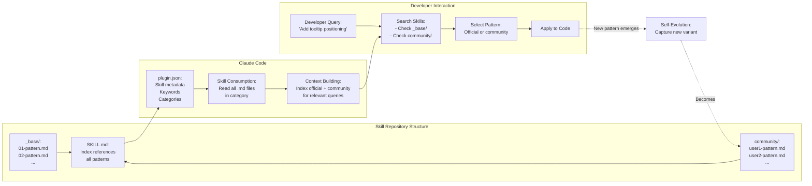

**Sources:** [README.md:99-123](), [skills/.claude-plugin/plugin.json:1-50]() (inferred)

The self-evolution system ensures that knowledge captured during development becomes immediately available to Claude Code for future assistance, creating a virtuous cycle of continuous improvement.

---

# Page: Installation

# Installation

<details>
<summary>Relevant source files</summary>

The following files were used as context for generating this wiki page:

- [README.md](README.md)
- [install.sh](install.sh)

</details>


This document explains how to install the makepad-skills repository into a Makepad project using either the automated install script or manual methods. The installation places skill files into the `.claude/skills/` directory where Claude Code can discover and use them.

For information about the atomic skill structure and community contributions, see [Atomic Skill Structure](#1.1). For details on the self-evolution system and hooks, see [Self-Evolution System](#1.2).

---

## Installation Overview

The makepad-skills system provides two installation methods:

1. **Quick Install** (recommended): Automated via `install.sh` script with project detection and backup
2. **Manual Install**: Git clone and manual file copying

Both methods install skills to `.claude/skills/` in the target project directory. The installation includes the `.claude-plugin/plugin.json` metadata file that describes the skills to Claude Code.

**Sources:** [README.md:28-98](), [install.sh:1-243]()

---

## Installation Flow

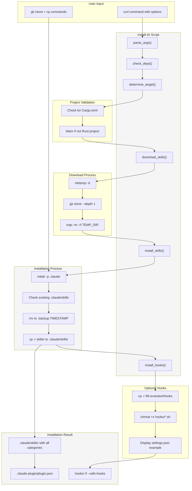

**Installation Flow Diagram**: Shows the complete installation process from user input through script execution to final result. The script validates the project, downloads skills to a temporary directory, backs up existing installations, and copies files to `.claude/skills/`.

**Sources:** [install.sh:66-91](), [install.sh:94-102](), [install.sh:105-124](), [install.sh:127-137](), [install.sh:140-159](), [install.sh:162-186]()

---

## Quick Install Method

### Basic Installation

The recommended installation method uses the `install.sh` script via curl:

```bash
# Install to current directory
curl -fsSL https://raw.githubusercontent.com/project-robius/makepad-skills/main/install.sh | bash
```

The script performs the following operations:

1. **Dependency Check**: Verifies git is installed via `check_deps()` [install.sh:94-102]()
2. **Project Detection**: Runs `determine_target()` to validate the directory contains `Cargo.toml` [install.sh:105-124]()
3. **Download**: Clones repository to temporary directory via `download_skills()` [install.sh:127-137]()
4. **Backup**: Creates timestamped backup of existing `.claude/skills/` if present [install.sh:149-153]()
5. **Installation**: Copies skills to `.claude/skills/` via `install_skills()` [install.sh:140-159]()

**Sources:** [README.md:30-50](), [install.sh:94-159]()

### Script Options

The install script accepts the following command-line options:

| Option | Description | Default | Example |
|--------|-------------|---------|---------|
| `--target DIR` | Install to specific directory | Current directory | `--target /path/to/project` |
| `--with-hooks` | Install self-evolution hooks | Not enabled | `--with-hooks` |
| `--branch NAME` | Use specific git branch | `main` | `--branch develop` |
| `--help` | Display usage information | N/A | `--help` |

**Sources:** [README.md:52-59](), [install.sh:45-64](), [install.sh:66-91]()

### Installation with Hooks

To enable the self-evolution system, install with hooks:

```bash
curl -fsSL https://raw.githubusercontent.com/project-robius/makepad-skills/main/install.sh | bash -s -- --with-hooks
```

This executes `install_hooks()` which:
1. Copies `99-evolution/hooks/` to `.claude/skills/hooks/`
2. Runs `chmod +x` on all `.sh` files in hooks directory
3. Displays example `settings.json` configuration from `hooks/settings.example.json`

The hooks require manual configuration in `.claude/settings.json` after installation.

**Sources:** [README.md:38-39](), [install.sh:162-186]()

### Install to Specific Project

To install to a project in a different directory:

```bash
curl -fsSL https://raw.githubusercontent.com/project-robius/makepad-skills/main/install.sh | bash -s -- --target /path/to/project
```

The script resolves the target to an absolute path and validates it exists before proceeding [install.sh:110-111]().

**Sources:** [README.md:41-43](), [install.sh:105-124]()

---

## Manual Installation Method

For users who prefer manual control or cannot use the install script:

### Step 1: Clone Repository

```bash
git clone https://github.com/project-robius/makepad-skills.git
```

This clones the entire repository including all skill categories, templates, and metadata.

### Step 2: Copy Skills Directory

```bash
cp -r makepad-skills/skills your-project/.claude/skills
```

This copies the complete `skills/` directory structure to `.claude/skills/` in the target project.

**Sources:** [README.md:61-69]()

---

## Post-Installation Directory Structure

After installation, the project contains the following structure:

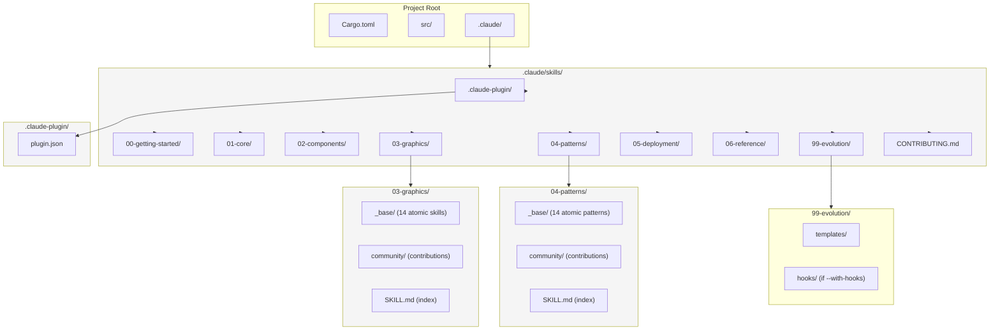

**Post-Installation Structure Diagram**: Shows the complete directory hierarchy after installation. The `.claude/skills/` directory contains skill categories (00-99), metadata in `.claude-plugin/`, and the atomic structure with `_base/` and `community/` directories in categories 03 and 04.

**Sources:** [README.md:71-97](), [install.sh:189-211]()

### Directory Hierarchy Table

| Path | Description | Contents |
|------|-------------|----------|
| `.claude/skills/.claude-plugin/` | Plugin metadata | `plugin.json` with skill descriptions and keywords |
| `.claude/skills/00-getting-started/` | Project setup | `init.md`, `project-structure.md` |
| `.claude/skills/01-core/` | Core concepts | `layout.md`, `widgets.md`, `events.md`, `styling.md` |
| `.claude/skills/02-components/` | Widget gallery | Built-in component references |
| `.claude/skills/03-graphics/` | Graphics skills | `_base/` (14 atomic skills), `community/`, `SKILL.md` |
| `.claude/skills/04-patterns/` | Production patterns | `_base/` (14 atomic patterns), `community/`, `SKILL.md` |
| `.claude/skills/05-deployment/` | Build & package | Platform-specific build instructions |
| `.claude/skills/06-reference/` | Reference materials | `troubleshooting.md`, `code-quality.md`, `adaptive-layout.md` |
| `.claude/skills/99-evolution/` | Self-improvement | `templates/`, `hooks/` (optional) |
| `.claude/skills/CONTRIBUTING.md` | Contribution guide | Community contribution instructions |

**Sources:** [README.md:73-95](), [install.sh:199-211]()

---

## Project Detection and Validation

The install script validates the target directory using `determine_target()`:

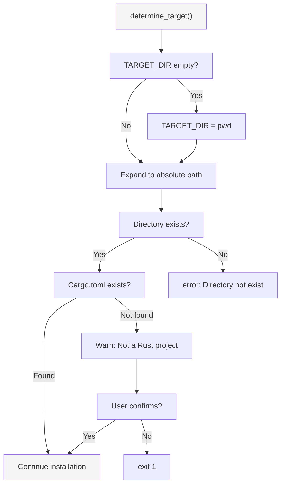

**Project Detection Flow**: The `determine_target()` function validates the installation directory, checks for `Cargo.toml`, and prompts for confirmation if not found.

The validation logic:
1. Uses current directory if `--target` not specified [install.sh:106-108]()
2. Expands to absolute path [install.sh:111]()
3. Checks for `Cargo.toml` file [install.sh:116]()
4. Prompts user for confirmation if not a Rust project [install.sh:117-123]()

**Sources:** [install.sh:105-124]()

---

## Backup Mechanism

When an existing `.claude/skills/` directory is detected, the script creates a timestamped backup:

```bash
# Backup logic from install_skills()
if [[ -d "$SKILLS_DIR" ]]; then
    local BACKUP_DIR="$SKILLS_DIR.backup.$(date +%Y%m%d%H%M%S)"
    mv "$SKILLS_DIR" "$BACKUP_DIR"
fi
```

The backup directory follows the naming pattern `.claude/skills.backup.YYYYMMDDHHMMSS`, where the timestamp ensures unique backup names for multiple installations.

**Sources:** [install.sh:149-153]()

---

## Hooks Configuration

When installed with `--with-hooks`, the hooks require manual configuration in `.claude/settings.json`. The script displays an example configuration from `hooks/settings.example.json` [install.sh:179-182]().

The hooks system:
1. **Location**: Copied from `99-evolution/hooks/` to `.claude/skills/hooks/`
2. **Permissions**: All `.sh` files made executable with `chmod +x`
3. **Activation**: Requires adding hook configuration to `.claude/settings.json`

See [Self-Evolution System](#1.2) for detailed hook configuration and usage.

**Sources:** [install.sh:162-186](), [README.md:140-151]()

---

## Verification

After installation completes, verify the installation by checking:

1. **Skills directory exists**: `.claude/skills/` contains skill categories
2. **Plugin metadata present**: `.claude-plugin/plugin.json` exists
3. **Directory permissions**: All files readable by Claude Code
4. **Hooks executable** (if installed): `.claude/skills/hooks/*.sh` have execute permission

The script's `print_summary()` function displays the complete directory structure and next steps [install.sh:189-228]().

**Sources:** [install.sh:189-228]()

---

## Troubleshooting Installation

### Common Issues

| Issue | Cause | Solution |
|-------|-------|----------|
| `git is required but not installed` | Missing git dependency | Install git via system package manager |
| `Failed to clone repository` | Network connectivity | Check internet connection and firewall |
| `Target directory does not exist` | Invalid `--target` path | Verify path exists or omit for current directory |
| `No Cargo.toml found` | Not a Rust project | Confirm target directory or use manual installation |

### Repository Access

The script clones from `https://github.com/project-robius/makepad-skills` using shallow clone (`--depth 1`) to minimize download size [install.sh:133]().

If the repository URL changes, update the `REPO_URL` variable [install.sh:22]() or use a forked repository with the same structure.

**Sources:** [install.sh:22](), [install.sh:94-137]()

---

## Script Configuration

The install script defines configuration at the top of the file:

| Variable | Default | Purpose |
|----------|---------|---------|
| `REPO_URL` | `https://github.com/project-robius/makepad-skills` | Repository to clone |
| `BRANCH` | `main` | Git branch to use |
| `TARGET_DIR` | Current directory | Installation target |
| `WITH_HOOKS` | `false` | Enable hooks installation |

These can be modified by editing `install.sh` or using command-line options (`--branch`, `--target`, `--with-hooks`).

**Sources:** [install.sh:21-26](), [install.sh:66-91]()

---

# Page: Getting Started

# Getting Started

<details>
<summary>Relevant source files</summary>

The following files were used as context for generating this wiki page:

- [skills/00-getting-started/SKILL.md](skills/00-getting-started/SKILL.md)
- [skills/00-getting-started/init.md](skills/00-getting-started/init.md)
- [skills/00-getting-started/project-structure.md](skills/00-getting-started/project-structure.md)

</details>


This document introduces the `00-getting-started` skill category and provides an overview of the fundamental steps for creating and organizing a Makepad application. It covers the initial project setup workflow, core project structure concepts, and the essential code patterns required to bootstrap a functional application.

For detailed information about specific widgets and layout systems, see [Core Development Concepts](#3). For graphics and animation capabilities, see [Graphics and Animation](#5). For production deployment, see section 5 in the deployment documentation.

---

## The 00-getting-started Skill Category

The `00-getting-started` category serves as the entry point for Makepad development. It contains two primary skills:

| Skill | Purpose | Key Topics |
|-------|---------|------------|
| `init.md` | Project scaffolding | Templates, boilerplate, `Cargo.toml` configuration |
| `project-structure.md` | Organization patterns | Directory layout, module system, resource management |

This category answers: "How do I create a new Makepad project?" and "How should I organize my code?"

**Sources:** [skills/00-getting-started/SKILL.md:1-49]()

---

## Quick Start Workflow

```mermaid
graph LR
    Install["Install makepad-skills<br/>(install.sh)"]
    Create["Create Rust project<br/>(cargo new)"]
    AddDeps["Add dependencies<br/>(Cargo.toml)"]
    Scaffold["Create app.rs<br/>(live_design!, app_main!)"]
    Run["cargo run"]
    
    Install --> Create
    Create --> AddDeps
    AddDeps --> Scaffold
    Scaffold --> Run
    
    style Install fill:#f9f9f9
    style Run fill:#f9f9f9
```

**Minimal setup steps:**

1. Create project: `cargo new my_app`
2. Add dependency to `Cargo.toml`:
   ```toml
   [dependencies]
   makepad-widgets = { git = "https://github.com/makepad/makepad", branch = "rik" }
   ```
3. Create `src/app.rs` with `live_design!` and `app_main!` macros
4. Run: `cargo run`

**Sources:** [skills/00-getting-started/SKILL.md:29-42](), [skills/00-getting-started/init.md:1-44]()

---

## Project Structure Overview

```mermaid
graph TB
    subgraph "Physical Files"
        CargoToml["Cargo.toml<br/>(dependencies)"]
        MainRs["src/main.rs<br/>(calls app::app_main)"]
        LibRs["src/lib.rs<br/>(module declarations)"]
        AppRs["src/app.rs<br/>(App struct)"]
        Resources["resources/<br/>(icons, fonts, images)"]
    end
    
    subgraph "Module Organization"
        SharedMod["src/shared/<br/>(styles.rs, widgets.rs)"]
        FeatureMods["src/home/, src/settings/<br/>(feature modules)"]
    end
    
    subgraph "Build Configuration"
        RustToolchain["rust-toolchain.toml"]
        Rustfmt["rustfmt.toml"]
        GitIgnore[".gitignore"]
    end
    
    CargoToml --> MainRs
    MainRs --> LibRs
    LibRs --> AppRs
    LibRs --> SharedMod
    LibRs --> FeatureMods
    AppRs -.->|uses| SharedMod
    FeatureMods -.->|uses| SharedMod
    
    style AppRs fill:#f9f9f9
    style LibRs fill:#f9f9f9
```

**Directory structure:**

```
my_app/
├── Cargo.toml                    # Dependencies, build profiles
├── src/
│   ├── main.rs                   # Entry point
│   ├── lib.rs                    # Module declarations
│   ├── app.rs                    # App struct, LiveRegister, AppMain
│   ├── shared/                   # Reusable components
│   │   ├── mod.rs                # live_design() registration
│   │   ├── styles.rs             # Colors, fonts, icons
│   │   └── widgets.rs            # Custom widgets
│   └── home/                     # Feature module
│       ├── mod.rs                # Submodule registration
│       └── home_screen.rs        # Screen implementation
├── resources/                    # Assets
│   ├── icons/                    # SVG icons
│   └── img/                      # Images
└── rust-toolchain.toml           # Rust version
```

**Sources:** [skills/00-getting-started/project-structure.md:13-67]()

---

## Core Code Entities: From Project to Running App

```mermaid
graph TB
    subgraph "Entry Point Chain"
        main_rs["main.rs<br/>fn main()"]
        app_main_macro["app_main!(App)<br/>macro expansion"]
        AppStruct["App struct<br/>#[derive(Live, LiveHook)]"]
    end
    
    subgraph "App Trait Implementations"
        LiveRegister["impl LiveRegister<br/>fn live_register(cx)"]
        MatchEvent["impl MatchEvent<br/>handle_startup, handle_actions"]
        AppMain["impl AppMain<br/>fn handle_event(cx, event)"]
    end
    
    subgraph "UI Definition"
        live_design["live_design! macro<br/>(DSL for UI tree)"]
        WidgetRef["ui: WidgetRef<br/>(widget tree reference)"]
        Root["&lt;Root&gt; &lt;Window&gt; &lt;View&gt;<br/>(widget hierarchy)"]
    end
    
    subgraph "Module Registration"
        makepad_live["makepad_widgets::live_design(cx)"]
        shared_live["crate::shared::live_design(cx)"]
        feature_live["crate::home::live_design(cx)"]
    end
    
    main_rs -->|calls| app_main_macro
    app_main_macro -->|generates code for| AppStruct
    
    AppStruct -->|requires| LiveRegister
    AppStruct -->|requires| MatchEvent
    AppStruct -->|requires| AppMain
    
    LiveRegister -->|registers modules| makepad_live
    LiveRegister -->|registers modules| shared_live
    LiveRegister -->|registers modules| feature_live
    
    live_design -->|defines| Root
    Root -->|stored in| WidgetRef
    WidgetRef -->|field of| AppStruct
    
    AppMain -->|delegates to| MatchEvent
    AppMain -->|delegates to| WidgetRef
    
    style app_main_macro fill:#f9f9f9
    style LiveRegister fill:#f9f9f9
    style live_design fill:#f9f9f9
```

### Key Code Entities

| Entity | Purpose | Location |
|--------|---------|----------|
| `app_main!(App)` | Macro that generates entry point boilerplate | End of `src/app.rs` |
| `App` struct | Main application orchestrator with `#[live] ui: WidgetRef` | `src/app.rs` |
| `LiveRegister` trait | Registers all `live_design!` blocks with framework | `impl LiveRegister for App` |
| `MatchEvent` trait | Handles application-level events (startup, actions) | `impl MatchEvent for App` |
| `AppMain` trait | Main event loop entry point | `impl AppMain for App` |
| `live_design!` macro | DSL for defining UI hierarchy and styles | Throughout `.rs` files |
| `WidgetRef` | Type-erased reference to widget tree | `ui: WidgetRef` field |

**Sources:** [skills/00-getting-started/init.md:46-134](), [skills/00-getting-started/project-structure.md:436-622]()

---

## Simple App Template Walkthrough

### File: src/main.rs

```rust
fn main() {
    my_app::app::app_main()
}
```

Calls the generated entry point from `app_main!` macro.

**Sources:** [skills/00-getting-started/init.md:46-52]()

### File: src/lib.rs

```rust
pub use makepad_widgets;
pub mod app;
```

Re-exports `makepad_widgets` for dependency injection and declares the `app` module.

**Sources:** [skills/00-getting-started/init.md:54-59]()

### File: src/app.rs (Core Pattern)

```mermaid
graph TB
    subgraph "live_design! Block"
        imports["use link::theme::*;<br/>use link::widgets::*;"]
        AppDef["App = {{App}} {<br/>  ui: &lt;Root&gt; {...}<br/>}"]
    end
    
    subgraph "App Struct Definition"
        AppStructDef["#[derive(Live, LiveHook)]<br/>pub struct App"]
        ui_field["#[live] ui: WidgetRef"]
        rust_field["#[rust] counter: usize"]
    end
    
    subgraph "Trait Implementations"
        LiveRegImpl["impl LiveRegister<br/>crate::makepad_widgets::live_design(cx)"]
        MatchEventImpl["impl MatchEvent<br/>handle_startup, handle_actions"]
        AppMainImpl["impl AppMain<br/>handle_event delegates to above"]
    end
    
    app_main_call["app_main!(App)"]
    
    imports --> AppDef
    AppDef -.->|instantiates| AppStructDef
    AppStructDef --> ui_field
    AppStructDef --> rust_field
    
    AppStructDef --> LiveRegImpl
    AppStructDef --> MatchEventImpl
    AppStructDef --> AppMainImpl
    
    LiveRegImpl -.->|called during| app_main_call
    AppMainImpl -.->|entry point from| app_main_call
    
    style app_main_call fill:#f9f9f9
    style LiveRegImpl fill:#f9f9f9
```

**Key sections:**

1. **`live_design!` block** ([skills/00-getting-started/init.md:66-98]()): Defines UI tree using DSL
   - `App = {{App}}`: Associates DSL definition with Rust struct
   - `ui: <Root> { ... }`: Root widget containing `<Window>` and child widgets
   - Widget IDs: `button1`, `counter_label` for programmatic access

2. **`app_main!(App)` macro** ([skills/00-getting-started/init.md:100]()): Generates main loop

3. **App struct** ([skills/00-getting-started/init.md:102-106]()):
   - `#[live] ui: WidgetRef`: Binds to `live_design!` UI tree
   - `#[rust] counter: usize`: Pure Rust state (not in DSL)

4. **`impl LiveRegister`** ([skills/00-getting-started/init.md:108-112]()): Registers all `live_design!` blocks
   - Must call `makepad_widgets::live_design(cx)` for framework widgets
   - Must call `crate::module::live_design(cx)` for each feature module

5. **`impl MatchEvent`** ([skills/00-getting-started/init.md:114-126]()):
   - `handle_startup(&mut self, cx)`: Initialization logic
   - `handle_actions(&mut self, cx, actions)`: Responds to widget actions
   - Uses `self.ui.button(ids!(button1))` to access widgets by ID

6. **`impl AppMain`** ([skills/00-getting-started/init.md:128-133]()):
   - `handle_event(&mut self, cx, event)`: Main event loop
   - Delegates to `self.match_event()` and `self.ui.handle_event()`

**Sources:** [skills/00-getting-started/init.md:61-134]()

---

## Module Registration Pattern

```mermaid
graph TD
    subgraph "App::live_register(cx) - Registration Order"
        step1["1. makepad_widgets::live_design(cx)<br/>(framework widgets)"]
        step2["2. crate::shared::live_design(cx)<br/>(shared styles, widgets)"]
        step3["3. crate::home::live_design(cx)<br/>(feature modules)"]
        step4["4. crate::settings::live_design(cx)<br/>(feature modules)"]
    end
    
    subgraph "shared/mod.rs::live_design(cx)"
        shared_step1["styles::live_design(cx)<br/>(colors, fonts)"]
        shared_step2["widgets::live_design(cx)<br/>(custom widgets)"]
    end
    
    subgraph "home/mod.rs::live_design(cx)"
        home_step1["toolbar::live_design(cx)"]
        home_step2["sidebar::live_design(cx)"]
        home_step3["home_screen::live_design(cx)<br/>(depends on toolbar, sidebar)"]
    end
    
    step1 --> step2
    step2 --> step3
    step3 --> step4
    
    step2 -.->|calls| shared_step1
    shared_step1 --> shared_step2
    
    step3 -.->|calls| home_step1
    home_step1 --> home_step2
    home_step2 --> home_step3
    
    style step1 fill:#f9f9f9
    style shared_step1 fill:#f9f9f9
```

**Critical rules:**

1. **Order matters**: Dependencies must be registered before dependents
2. **Framework first**: Always call `makepad_widgets::live_design(cx)` first
3. **Shared second**: Register shared styles/widgets before features
4. **Features last**: Register feature modules in dependency order

**Example from production app:**

```rust
impl LiveRegister for App {
    fn live_register(cx: &mut Cx) {
        makepad_widgets::live_design(cx);        // 1. Framework
        crate::shared::live_design(cx);          // 2. Shared
        crate::login::live_design(cx);           // 3. Features
        crate::home::live_design(cx);
        crate::settings::live_design(cx);
    }
}
```

**Sources:** [skills/00-getting-started/project-structure.md:117-142](), [skills/00-getting-started/project-structure.md:531-542](), [skills/00-getting-started/project-structure.md:797-805]()

---

## Production App Template

For larger applications, use a more structured approach:

### Directory Structure

```
my_app/
├── src/
│   ├── main.rs
│   ├── lib.rs
│   ├── app.rs                    # App orchestrator
│   ├── home/                     # Feature: Home screen
│   │   ├── mod.rs                # Module registration
│   │   ├── home_screen.rs        # Main screen widget
│   │   ├── sidebar.rs            # Sidebar component
│   │   └── content_view.rs       # Content area
│   ├── settings/                 # Feature: Settings
│   │   ├── mod.rs
│   │   └── settings_screen.rs
│   └── shared/                   # Reusable components
│       ├── mod.rs
│       ├── styles.rs             # Colors, fonts, spacing constants
│       └── widgets.rs            # Custom widgets (Card, Divider)
├── resources/
│   ├── icons/                    # SVG icons
│   └── img/                      # Images
└── Cargo.toml
```

**Sources:** [skills/00-getting-started/init.md:156-177](), [skills/00-getting-started/project-structure.md:13-67]()

### Key Patterns

**1. Shared Styles Pattern** ([skills/00-getting-started/init.md:306-363]()):

```rust
// src/shared/styles.rs
live_design! {
    // Color palette
    pub COLOR_BG = #1a1a2e
    pub COLOR_PRIMARY = #0f3460
    pub COLOR_ACCENT = #e94560
    
    // Spacing constants
    pub SPACING_MD = 16.0
    pub SPACING_LG = 24.0
    
    // Reusable button style
    pub PrimaryButton = <Button> {
        draw_bg: {
            color: (COLOR_ACCENT)
            radius: (RADIUS_SM)
        }
    }
}
```

**2. Feature Module Pattern** ([skills/00-getting-started/init.md:404-414]()):

```rust
// src/home/mod.rs
pub mod home_screen;
pub mod sidebar;
pub mod content_view;

pub fn live_design(cx: &mut Cx) {
    sidebar::live_design(cx);          // Base components first
    content_view::live_design(cx);
    home_screen::live_design(cx);      // Composite last
}
```

**3. Custom Widget Pattern** ([skills/00-getting-started/init.md:416-484]()):

```rust
// src/home/home_screen.rs
live_design! {
    use crate::shared::styles::*;
    use crate::shared::widgets::*;
    
    pub HomeScreen = {{HomeScreen}} {
        width: Fill, height: Fill
        flow: Down
        spacing: (SPACING_LG)
        
        <Card> {
            action_button = <PrimaryButton> {
                text: "Get Started"
            }
        }
    }
}

#[derive(Live, LiveHook, Widget)]
pub struct HomeScreen {
    #[deref] view: View,
}

impl Widget for HomeScreen {
    fn handle_event(&mut self, cx: &mut Cx, event: &Event, scope: &mut Scope) {
        self.view.handle_event(cx, event, scope);
        self.widget_match_event(cx, event, scope);
    }
    
    fn draw_walk(&mut self, cx: &mut Cx2d, scope: &mut Scope, walk: Walk) -> DrawStep {
        self.view.draw_walk(cx, scope, walk)
    }
}
```

**Sources:** [skills/00-getting-started/project-structure.md:220-432]()

---

## Build Configuration

### Cargo.toml Profiles

```toml
[profile.dev]
opt-level = 0                          # Fast compilation

[profile.dev.package."*"]
opt-level = 3                          # Optimize dependencies

[profile.release]
opt-level = 3
lto = "thin"                           # Link-time optimization

[profile.release-lto]
inherits = "release"
lto = "fat"                            # Maximum optimization
codegen-units = 1

[profile.distribution]
inherits = "release"
lto = "fat"
codegen-units = 1
strip = true                           # Remove debug symbols
```

**Build commands:**

```bash
cargo run                              # Development (fast compile)
cargo run --release                    # Optimized build
cargo run --profile release-lto        # Pre-production
cargo build --profile distribution     # Final distribution
```

**Sources:** [skills/00-getting-started/project-structure.md:715-736](), [skills/00-getting-started/init.md:206-212]()

---

## Running the Application

### Desktop

```bash
cargo run --release
```

### Mobile (requires cargo-makepad CLI)

```bash
# Install cargo-makepad
cargo install --force --git https://github.com/makepad/makepad.git \
  --branch rik cargo-makepad

# Android
cargo makepad android run -p my-app --release

# iOS Simulator
cargo makepad apple ios run-sim -p my-app --release
```

**Sources:** [skills/00-getting-started/init.md:494-513]()

---

## Project Checklist

When initializing a new Makepad project, ensure:

- [ ] `Cargo.toml` specifies `makepad-widgets` dependency with correct branch
- [ ] `lib.rs` re-exports `makepad_widgets` and declares all modules
- [ ] `main.rs` calls `app::app_main()`
- [ ] `app.rs` contains `app_main!(App)` macro at end of file
- [ ] `App` struct has `#[live] ui: WidgetRef` field
- [ ] `impl LiveRegister` registers all modules in correct order
- [ ] `impl MatchEvent` implements `handle_startup` and `handle_actions`
- [ ] `impl AppMain` delegates to `match_event` and `ui.handle_event`
- [ ] `.gitignore` excludes `/target` directory
- [ ] `rust-toolchain.toml` specifies Rust channel

**Sources:** [skills/00-getting-started/init.md:556-567]()

---

## Next Steps

After setting up your project structure:

- **Learn layout and widgets**: See [Core Development Concepts](#3) for `flow`, `padding`, `align`, and widget creation
- **Explore built-in components**: See [Component Gallery](#4) for `Button`, `TextInput`, `ScrollView`, etc.
- **Add visual effects**: See [Graphics and Animation](#5) for shaders, SDF drawing, and animations
- **Apply production patterns**: Refer to [04-patterns](skills/04-patterns) for state management, async operations, and responsive design

**References:**
- [Makepad Examples](https://github.com/makepad/makepad/tree/main/examples)
- [Robrix](https://github.com/project-robius/robrix) - Production Matrix client
- [Moly](https://github.com/moxin-org/moly) - Production AI model manager

**Sources:** [skills/00-getting-started/SKILL.md:16-27](), [skills/00-getting-started/init.md:568-572]()

---

# Page: Project Initialization

# Project Initialization

<details>
<summary>Relevant source files</summary>

The following files were used as context for generating this wiki page:

- [skills/00-getting-started/init.md](skills/00-getting-started/init.md)

</details>


This document details the process of creating new Makepad projects from templates. It covers the two primary initialization approaches (simple and production), the file structure, key code entities (`live_design!`, `app_main!`, `App` struct, trait implementations), and the registration system that connects all modules.

For information about organizing code within an existing project, see [Project Structure](#2.2). For details about the `live_design!` DSL syntax used in widgets and styling, see [Widget System](#3.2) and [Styling: Fonts and Icons](#3.4).

## Initialization Approaches

Makepad projects can be initialized using two template structures based on project complexity:

| Template Type | Use Case | File Count | Module Organization |
|--------------|----------|------------|---------------------|
| **Simple App** | Learning, prototyping, single-file applications | 5 core files | Flat structure with `app.rs` only |
| **Production App** | Multi-screen applications, team projects, cross-platform apps | 10+ files | Modular structure with `shared/`, `home/`, feature modules |

Both templates produce runnable applications with identical core functionality but differ in their extensibility and organization patterns.

**Sources**: [skills/00-getting-started/init.md:10-15]()

## Simple App Template Structure

### File Organization

The simple template creates a minimal project structure focused on rapid prototyping:

```mermaid
graph TB
    Root["my_app/"]
    Cargo["Cargo.toml<br/>Dependencies & metadata"]
    SrcDir["src/"]
    MainRs["main.rs<br/>Entry point"]
    LibRs["lib.rs<br/>Module exports"]
    AppRs["app.rs<br/>Application logic"]
    ResourcesDir["resources/<br/>Optional assets"]
    GitIgnore[".gitignore"]
    Toolchain["rust-toolchain.toml"]
    
    Root --> Cargo
    Root --> SrcDir
    Root --> ResourcesDir
    Root --> GitIgnore
    Root --> Toolchain
    
    SrcDir --> MainRs
    SrcDir --> LibRs
    SrcDir --> AppRs
    
    MainRs -.->|"calls"| AppRs
    LibRs -.->|"exports"| AppRs
```

**Sources**: [skills/00-getting-started/init.md:18-30]()

### Core Code Entities

The simple template demonstrates the minimum required code entities for a Makepad application:

```mermaid
graph TB
    subgraph "main.rs Entry Point"
        MainFn["fn main()"]
    end
    
    subgraph "lib.rs Module Exports"
        PubUse["pub use makepad_widgets"]
        PubMod["pub mod app"]
    end
    
    subgraph "app.rs Application Definition"
        LiveDesignMacro["live_design! {<br/>  App = {{App}} {...}<br/>}"]
        AppMainMacro["app_main!(App)"]
        AppStruct["#[derive(Live, LiveHook)]<br/>pub struct App"]
        FieldUI["#[live] ui: WidgetRef"]
        FieldCounter["#[rust] counter: usize"]
    end
    
    subgraph "Trait Implementations"
        LiveRegisterTrait["impl LiveRegister for App"]
        LiveRegisterFn["fn live_register(cx: &mut Cx)"]
        MatchEventTrait["impl MatchEvent for App"]
        HandleStartup["fn handle_startup()"]
        HandleActions["fn handle_actions()"]
        AppMainTrait["impl AppMain for App"]
        HandleEvent["fn handle_event()"]
    end
    
    MainFn -->|"calls"| AppMainMacro
    AppMainMacro -->|"initializes"| AppStruct
    
    LiveDesignMacro -->|"defines UI for"| AppStruct
    AppStruct --> FieldUI
    AppStruct --> FieldCounter
    
    AppStruct -->|"implements"| LiveRegisterTrait
    AppStruct -->|"implements"| MatchEventTrait
    AppStruct -->|"implements"| AppMainTrait
    
    LiveRegisterTrait --> LiveRegisterFn
    MatchEventTrait --> HandleStartup
    MatchEventTrait --> HandleActions
    AppMainTrait --> HandleEvent
    
    HandleEvent -->|"delegates to"| HandleActions
```

**Sources**: [skills/00-getting-started/init.md:46-134]()

### Dependency Configuration

The `Cargo.toml` declares the `makepad-widgets` dependency from the upstream repository:

[skills/00-getting-started/init.md:34-44]()

Key configuration points:
- **Package metadata**: Name, version, edition, description, license
- **Dependency**: `makepad-widgets` from GitHub on the `rik` branch
- No additional dependencies in the simple template

### Application Entry Flow

```mermaid
sequenceDiagram
    participant main.rs
    participant app_main!
    participant Cx
    participant App
    participant LiveRegister
    participant UI
    
    main.rs->>app_main!: "my_app::app::app_main()"
    app_main!->>Cx: "Create Cx context"
    app_main!->>LiveRegister: "App::live_register(&mut cx)"
    LiveRegister->>Cx: "crate::makepad_widgets::live_design(cx)"
    LiveRegister-->>app_main!: "Registration complete"
    app_main!->>App: "Create App instance from live_design!"
    app_main!->>App: "handle_event() event loop"
    loop Event Loop
        App->>App: "match_event(cx, event)"
        App->>UI: "ui.handle_event(cx, event, scope)"
    end
```

**Sources**: [skills/00-getting-started/init.md:46-134]()

### Key Code Patterns

The simple template establishes fundamental patterns used throughout Makepad development:

**live_design! macro usage** [skills/00-getting-started/init.md:66-98]():
- Imports framework components via `use link::theme::*`, `use link::shaders::*`, `use link::widgets::*`
- Defines the `App` struct template with `App = {{App}}`
- Nests widgets in a hierarchy: `Root > Window > View > Label, Button`
- Uses identifiers like `button1`, `counter_label` for widget references

**app_main! macro** [skills/00-getting-started/init.md:100]():
- Generates the application entry point and event loop
- Takes the `App` struct as its argument
- Creates platform-specific window and rendering contexts

**App struct definition** [skills/00-getting-started/init.md:102-106]():
- `#[derive(Live, LiveHook)]`: Enables live reloading and DSL integration
- `#[live] ui: WidgetRef`: Widget tree root, populated from `live_design!`
- `#[rust] counter: usize`: Rust-only state not exposed to DSL

**LiveRegister trait** [skills/00-getting-started/init.md:108-112]():
- Registers all `live_design!` blocks with the `Cx` context
- Must call `crate::makepad_widgets::live_design(cx)` to register framework widgets
- Called once during application initialization

**MatchEvent trait** [skills/00-getting-started/init.md:114-126]():
- `handle_startup()`: Initialization logic after UI is created
- `handle_actions()`: Responds to widget actions (button clicks, input changes)
- Uses `self.ui.button(ids!(button1)).clicked(&actions)` to detect specific widget events

**AppMain trait** [skills/00-getting-started/init.md:128-133]():
- `handle_event()`: Main event dispatch method
- Delegates to `match_event()` for application logic
- Forwards events to UI tree via `self.ui.handle_event()`

## Production App Template Structure

### Directory Organization

The production template introduces a modular structure for scalable applications:

```mermaid
graph TB
    Root["my_app/"]
    Cargo["Cargo.toml<br/>Enhanced with profiles"]
    SrcDir["src/"]
    MainRs["main.rs"]
    LibRs["lib.rs<br/>pub mod app, home, shared"]
    AppRs["app.rs<br/>Main orchestrator"]
    
    HomeDir["home/<br/>Feature module"]
    HomeMod["mod.rs<br/>live_design registration"]
    HomeScreen["home_screen.rs<br/>HomeScreen widget"]
    
    SharedDir["shared/<br/>Common code"]
    SharedMod["mod.rs"]
    Styles["styles.rs<br/>Color palette, text styles"]
    Widgets["widgets.rs<br/>Card, Divider, IconButton"]
    
    ResourcesDir["resources/<br/>icons/"]
    
    Root --> Cargo
    Root --> SrcDir
    Root --> ResourcesDir
    
    SrcDir --> MainRs
    SrcDir --> LibRs
    SrcDir --> AppRs
    SrcDir --> HomeDir
    SrcDir --> SharedDir
    
    HomeDir --> HomeMod
    HomeDir --> HomeScreen
    
    SharedDir --> SharedMod
    SharedDir --> Styles
    SharedDir --> Widgets
    
    AppRs -.->|"imports & uses"| Styles
    AppRs -.->|"instantiates"| HomeScreen
    HomeMod -.->|"registers"| HomeScreen
    SharedMod -.->|"registers"| Styles
    SharedMod -.->|"registers"| Widgets
```

**Sources**: [skills/00-getting-started/init.md:156-177]()

### Enhanced Cargo Configuration

The production `Cargo.toml` adds several features:

[skills/00-getting-started/init.md:179-215]()

| Section | Purpose | Key Additions |
|---------|---------|---------------|
| `[package]` | Enhanced metadata | `authors`, `repository` fields |
| `[dependencies]` | Common utilities | `anyhow`, `serde`, `serde_json` (commented `robius-*` options) |
| `[features]` | Feature flags | Placeholder for conditional compilation |
| `[profile.release]` | Standard release | `opt-level = 3` |
| `[profile.release-lto]` | LTO optimization | `lto = "thin"` for smaller binaries |
| `[lints.clippy]` | Lint configuration | `too_many_arguments = "allow"` for Makepad patterns |

### Module Registration Flow

The production template demonstrates hierarchical module registration:

```mermaid
graph TB
    subgraph "main.rs"
        Main["fn main()"]
    end
    
    subgraph "app.rs App Struct"
        AppLiveReg["impl LiveRegister for App"]
        AppLiveRegFn["fn live_register(cx: &mut Cx)"]
    end
    
    subgraph "shared/mod.rs"
        SharedFn["pub fn live_design(cx: &mut Cx)"]
        StylesCall["self::styles::live_design(cx)"]
        WidgetsCall["self::widgets::live_design(cx)"]
    end
    
    subgraph "shared/styles.rs"
        StylesLiveDesign["live_design! {<br/>  pub COLOR_BG = #1a1a2e<br/>  pub TextRegular = <Label> {...}<br/>}"]
    end
    
    subgraph "shared/widgets.rs"
        WidgetsLiveDesign["live_design! {<br/>  pub Card = <RoundedView> {...}<br/>  pub Divider = <View> {...}<br/>}"]
    end
    
    subgraph "home/mod.rs"
        HomeFn["pub fn live_design(cx: &mut Cx)"]
        HomeScreenCall["self::home_screen::live_design(cx)"]
    end
    
    subgraph "home/home_screen.rs"
        HomeScreenLiveDesign["live_design! {<br/>  pub HomeScreen = {{HomeScreen}} {...}<br/>}"]
    end
    
    Main -->|"calls app_main!(App)"| AppLiveReg
    AppLiveRegFn -->|"1. Register framework"| FwCall["crate::makepad_widgets::live_design(cx)"]
    AppLiveRegFn -->|"2. Register shared"| SharedFn
    AppLiveRegFn -->|"3. Register home"| HomeFn
    
    SharedFn --> StylesCall
    SharedFn --> WidgetsCall
    StylesCall --> StylesLiveDesign
    WidgetsCall --> WidgetsLiveDesign
    
    HomeFn --> HomeScreenCall
    HomeScreenCall --> HomeScreenLiveDesign
```

**Sources**: [skills/00-getting-started/init.md:217-290](), [skills/00-getting-started/init.md:292-304](), [skills/00-getting-started/init.md:404-414]()

### Shared Module Architecture

The `shared/` module provides reusable design tokens and components:

**shared/styles.rs** [skills/00-getting-started/init.md:307-363]():
- **Color palette**: Constants like `COLOR_BG`, `COLOR_PRIMARY`, `COLOR_ACCENT` defined with hex values
- **Spacing constants**: `SPACING_SM`, `SPACING_MD`, `SPACING_LG` for consistent layout
- **Border radius constants**: `RADIUS_SM`, `RADIUS_MD`, `RADIUS_LG`
- **Text style templates**: `TextRegular`, `TextTitle`, `TextSubtitle` with pre-configured fonts and colors
- **Button templates**: `PrimaryButton` with accent color and styling

**shared/widgets.rs** [skills/00-getting-started/init.md:366-402]():
- **Card**: `<RoundedView>` with padding, background color, and rounded corners
- **Divider**: Horizontal line widget with `height: 1` and dimmed color
- **IconButton**: Square button with transparent background and circular radius

Both files use `pub` declarations to export components for use in other modules via `use crate::shared::styles::*` and `use crate::shared::widgets::*`.

### Feature Module Pattern

The `home/` directory demonstrates the feature module pattern:

**home/mod.rs** [skills/00-getting-started/init.md:404-414]():
- Declares submodules: `pub mod home_screen;`
- Provides aggregated `live_design()` function that calls all submodule registrations
- Follows the same pattern used in `shared/mod.rs`

**home/home_screen.rs** [skills/00-getting-started/init.md:416-484]():

Widget definition structure:
1. `live_design!` block with `pub HomeScreen = {{HomeScreen}}` template
2. Struct definition: `#[derive(Live, LiveHook, Widget)] pub struct HomeScreen`
3. `#[deref] view: View` field for view delegation
4. `impl Widget` with `handle_event()` and `draw_walk()` methods
5. `impl WidgetMatchEvent` with `handle_actions()` for event handling

This pattern allows the `HomeScreen` widget to be used in `app.rs` like any built-in widget: `<HomeScreen> {}`.

### App Orchestrator Role

The production `app.rs` serves as the main orchestrator:

[skills/00-getting-started/init.md:228-290]()

Key differences from simple template:
- **Imports shared styles**: `use crate::shared::styles::*;` in both Rust and `live_design!`
- **Imports feature widgets**: `use crate::home::home_screen::HomeScreen;` in `live_design!`
- **Minimal state**: Only `#[live] ui: WidgetRef`, no application-specific state
- **Delegates to widgets**: `handle_actions()` is empty; widgets handle their own actions
- **Comprehensive registration**: Calls `shared::live_design()` and `home::live_design()` in `LiveRegister`

This design allows the `App` struct to remain simple while feature complexity grows in dedicated modules.

## Template Comparison

| Aspect | Simple Template | Production Template |
|--------|----------------|---------------------|
| **File count** | 5 files | 10+ files |
| **App state** | Stored in `App` struct | Distributed across feature widgets |
| **Event handling** | Centralized in `App::handle_actions()` | Delegated to widget modules |
| **Styling** | Inline in widgets | Centralized in `shared/styles.rs` |
| **Module structure** | Flat (`app.rs` only) | Hierarchical (`home/`, `shared/`) |
| **Registration** | Single `live_design(cx)` call | Cascading calls through `mod.rs` files |
| **Extensibility** | Add code to `app.rs` | Add new directories under `src/` |
| **Widget reuse** | Copy-paste within `app.rs` | Import from `shared/widgets.rs` |
| **Team collaboration** | Limited (single file conflicts) | High (separate feature directories) |

**Sources**: [skills/00-getting-started/init.md:10-493]()

## Running and Building

### Desktop Execution

Both templates use standard Cargo commands:

[skills/00-getting-started/init.md:496-500]()

```bash
cargo run --release
```

The `--release` flag is recommended for performance, as debug builds can be slow for graphics-intensive applications.

### Mobile Platforms

Mobile builds require the `cargo-makepad` CLI tool:

[skills/00-getting-started/init.md:502-513]()

Installation:
```bash
cargo install --force --git https://github.com/makepad/makepad.git --branch rik cargo-makepad
```

Platform-specific commands:
- **Android**: `cargo makepad android run -p my-app --release`
- **iOS Simulator**: `cargo makepad apple ios run-sim -p my-app --release`

The `-p` flag specifies the package name from `Cargo.toml`.

## Extension Patterns

### Adding Screens

Process for adding a new feature screen:

[skills/00-getting-started/init.md:517-523]()

1. Create `src/screens/new_screen.rs` with widget definition
2. Add `pub mod new_screen;` to `src/screens/mod.rs`
3. Register in `mod.rs`: `self::new_screen::live_design(cx);`
4. Import in parent: `use crate::screens::new_screen::NewScreen;`
5. Instantiate in `live_design!`: `<NewScreen> {}`

### Resource Integration

**Images** [skills/00-getting-started/init.md:525-537]():
```rust
live_design! {
    IMG_LOGO = dep("crate://self/resources/logo.png")
    
    <Image> {
        source: (IMG_LOGO)
        width: 100, height: 100
    }
}
```

**Custom fonts** [skills/00-getting-started/init.md:539-554]():
```rust
live_design! {
    FONT_CUSTOM = dep("crate://self/resources/fonts/CustomFont.ttf")
    
    <Label> {
        draw_text: {
            text_style: {
                font: { path: (FONT_CUSTOM) }
                font_size: 16.0
            }
        }
    }
}
```

The `dep("crate://self/...")` syntax references files relative to the crate root during compilation.

## Initialization Checklist

When setting up a new project, verify these requirements:

[skills/00-getting-started/init.md:556-567]()

| Item | Requirement | Location |
|------|-------------|----------|
| Package metadata | Name, version, edition, description, license | `Cargo.toml` |
| Makepad dependency | Correct branch (`rik` or `dev`) | `Cargo.toml` `[dependencies]` |
| Widget re-export | `pub use makepad_widgets` | `lib.rs` |
| Entry point | `my_app::app::app_main()` call | `main.rs` |
| Module registration | All `live_design(cx)` calls in `LiveRegister` | `app.rs` |
| Git ignore | `/target` and IDE files | `.gitignore` |
| Rust version | Stable channel specified | `rust-toolchain.toml` |

Missing any of these can cause compilation errors or runtime panics during initialization.

## Reference Projects

Production applications using these patterns:

[skills/00-getting-started/init.md:569-573]()

- **Robrix**: Matrix client demonstrating multi-screen navigation, async networking, and cross-platform deployment
- **Moly**: AI application showing complex state management and GPU-accelerated rendering
- **Makepad Examples**: Official examples in the framework repository

These projects serve as reference implementations for production-grade architecture and advanced features.

**Sources**: [skills/00-getting-started/init.md:1-573]()

---

# Page: Project Structure

# Project Structure

<details>
<summary>Relevant source files</summary>

The following files were used as context for generating this wiki page:

- [skills/00-getting-started/project-structure.md](skills/00-getting-started/project-structure.md)

</details>


This document explains the recommended directory organization and module structure for Makepad applications. It covers source code layout, resource management, configuration files, and module registration patterns based on production applications like Robrix and Moly.

For information about creating a new project from scratch, see [Project Initialization](#2.1). For details about the core widget and event systems, see [Core Development Concepts](#3).

---

## Overview

A well-organized Makepad project follows a feature-based directory structure where each feature (screen or functional area) is contained in its own module. Shared components, styles, and utilities are separated into dedicated modules. The `App` struct in `app.rs` serves as the main orchestrator that registers all modules and coordinates navigation.

**Sources:** [skills/00-getting-started/project-structure.md:1-68]()

---

## Directory Structure

### Standard Layout

The recommended directory structure organizes code by feature modules, with separate directories for shared components and resources:

```mermaid
graph TB
    Root["my_app/"]
    
    Src["src/"]
    Resources["resources/"]
    Packaging["packaging/"]
    Config["Configuration Files"]
    
    AppRS["app.rs"]
    LibRS["lib.rs"]
    
    HomeDir["home/"]
    SettingsDir["settings/"]
    LoginDir["login/"]
    SharedDir["shared/"]
    UtilsRS["utils.rs"]
    
    HomeModRS["home/mod.rs"]
    HomeScreen["home_screen.rs"]
    Sidebar["sidebar.rs"]
    ContentView["content_view.rs"]
    
    SharedModRS["shared/mod.rs"]
    StylesRS["shared/styles.rs"]
    HelpersRS["shared/helpers.rs"]
    AvatarRS["shared/avatar.rs"]
    IconButtonRS["shared/icon_button.rs"]
    
    Icons["icons/"]
    Img["img/"]
    Fonts["fonts/"]
    
    MacOS["macos/"]
    Windows["windows/"]
    Linux["linux/"]
    
    CargoToml["Cargo.toml"]
    RustfmtToml["rustfmt.toml"]
    RustToolchain["rust-toolchain.toml"]
    
    Root --> Src
    Root --> Resources
    Root --> Packaging
    Root --> Config
    
    Src --> AppRS
    Src --> LibRS
    Src --> HomeDir
    Src --> SettingsDir
    Src --> LoginDir
    Src --> SharedDir
    Src --> UtilsRS
    
    HomeDir --> HomeModRS
    HomeDir --> HomeScreen
    HomeDir --> Sidebar
    HomeDir --> ContentView
    
    SharedDir --> SharedModRS
    SharedDir --> StylesRS
    SharedDir --> HelpersRS
    SharedDir --> AvatarRS
    SharedDir --> IconButtonRS
    
    Resources --> Icons
    Resources --> Img
    Resources --> Fonts
    
    Packaging --> MacOS
    Packaging --> Windows
    Packaging --> Linux
    
    Config --> CargoToml
    Config --> RustfmtToml
    Config --> RustToolchain
```

**Directory Purposes:**

| Directory | Purpose | Key Files |
|-----------|---------|-----------|
| `src/` | Rust source code | `app.rs`, `lib.rs` |
| `src/{feature}/` | Feature modules (home, settings, login) | `mod.rs`, widget files |
| `src/shared/` | Reusable components | `styles.rs`, widget components |
| `resources/icons/` | SVG icon files | `add.svg`, `close.svg`, `settings.svg` |
| `resources/img/` | Image assets | `logo.png`, `default_avatar.png` |
| `resources/fonts/` | Custom font files | `.ttf`, `.otf` files |
| `packaging/` | Platform-specific packaging configs | `macos/`, `windows/`, `linux/` |

**Sources:** [skills/00-getting-started/project-structure.md:12-68]()

---

## Module Organization

### lib.rs: Module Registry

The `lib.rs` file serves as the module registry and declares all feature modules, shared components, and utilities. It also defines application constants used for directory resolution:

```mermaid
graph TB
    LibRS["lib.rs"]
    
    FeatureMods["Feature Modules"]
    SharedMod["shared Module"]
    UtilsMod["utils Module"]
    Constants["App Constants"]
    ProjectDir["project_dir() Function"]
    
    AppMod["pub mod app"]
    HomeMod["pub mod home"]
    SettingsMod["pub mod settings"]
    LoginMod["pub mod login"]
    
    AppQual["APP_QUALIFIER"]
    AppOrg["APP_ORGANIZATION"]
    AppName["APP_NAME"]
    
    ProjectDirs["ProjectDirs"]
    AppDataDir["app_data_dir()"]
    
    LibRS --> FeatureMods
    LibRS --> SharedMod
    LibRS --> UtilsMod
    LibRS --> Constants
    LibRS --> ProjectDir
    
    FeatureMods --> AppMod
    FeatureMods --> HomeMod
    FeatureMods --> SettingsMod
    FeatureMods --> LoginMod
    
    Constants --> AppQual
    Constants --> AppOrg
    Constants --> AppName
    
    ProjectDir --> ProjectDirs
    ProjectDir --> AppDataDir
```

Key components in `lib.rs`:

- **Module declarations**: `pub mod app`, `pub mod home`, `pub mod settings`, etc.
- **App constants**: `APP_QUALIFIER`, `APP_ORGANIZATION`, `APP_NAME` used for persistent storage paths
- **Directory functions**: `project_dir()` and `app_data_dir()` using `robius-directories` crate
- **Optional feature-gated modules**: Using `#[cfg(feature = "analytics")]`

**Sources:** [skills/00-getting-started/project-structure.md:73-116]()

---

## Feature Module Pattern

### mod.rs Structure

Each feature module contains a `mod.rs` file that declares submodules and provides a `live_design()` function for registration. The registration order is critical - dependencies must be registered before dependents:

```mermaid
graph LR
    ModRS["home/mod.rs"]
    
    Declarations["Module Declarations"]
    Reexports["Re-exports"]
    LiveDesignFn["live_design(cx: &mut Cx)"]
    
    ToolbarMod["pub mod toolbar"]
    SidebarMod["pub mod sidebar"]
    ContentViewMod["pub mod content_view"]
    HomeScreenMod["pub mod home_screen"]
    
    ToolbarLD["toolbar::live_design(cx)"]
    SidebarLD["sidebar::live_design(cx)"]
    ContentViewLD["content_view::live_design(cx)"]
    HomeScreenLD["home_screen::live_design(cx)"]
    
    ModRS --> Declarations
    ModRS --> Reexports
    ModRS --> LiveDesignFn
    
    Declarations --> ToolbarMod
    Declarations --> SidebarMod
    Declarations --> ContentViewMod
    Declarations --> HomeScreenMod
    
    LiveDesignFn --> ToolbarLD
    LiveDesignFn --> SidebarLD
    LiveDesignFn --> ContentViewLD
    LiveDesignFn --> HomeScreenLD
    
    ToolbarLD --> SidebarLD
    SidebarLD --> ContentViewLD
    ContentViewLD --> HomeScreenLD
```

**Registration Order Rules:**

1. Base components must be registered first
2. Components that depend on others must be registered after their dependencies
3. Composite components (those that use multiple subcomponents) are registered last

**Sources:** [skills/00-getting-started/project-structure.md:118-142]()

---

## Widget Module Structure

### Widget Definition Pattern

Each widget module follows a standard structure that combines `live_design!` macro definitions with Rust implementations:

```mermaid
graph TB
    WidgetFile["sidebar.rs"]
    
    Imports["use makepad_widgets::*"]
    LiveDesignBlock["live_design! { ... }"]
    StructDef["#[derive(Live, LiveHook, Widget)]<br/>pub struct Sidebar"]
    TraitImpls["Widget Trait Implementation"]
    RefExt["WidgetRef Extension Trait"]
    
    UseStatements["use link::theme::*<br/>use crate::shared::styles::*"]
    WidgetDef["pub Sidebar = {{Sidebar}} { ... }"]
    
    ViewField["#[deref] view: View"]
    RustFields["#[rust] items: Vec<SidebarItem>"]
    
    HandleEvent["fn handle_event(...)"]
    DrawWalk["fn draw_walk(...)"]
    
    ExtTrait["pub trait SidebarWidgetRefExt"]
    SetItems["fn set_items(...)"]
    GetSelected["fn get_selected(...)"]
    
    WidgetFile --> Imports
    WidgetFile --> LiveDesignBlock
    WidgetFile --> StructDef
    WidgetFile --> TraitImpls
    WidgetFile --> RefExt
    
    LiveDesignBlock --> UseStatements
    LiveDesignBlock --> WidgetDef
    
    StructDef --> ViewField
    StructDef --> RustFields
    
    TraitImpls --> HandleEvent
    TraitImpls --> DrawWalk
    
    RefExt --> ExtTrait
    ExtTrait --> SetItems
    ExtTrait --> GetSelected
```

**Key Components:**

- **`live_design!` block**: Defines widget structure, styling, and child widgets
- **Struct definition**: Uses `#[derive(Live, LiveHook, Widget)]` with `#[deref] view: View` for base widget functionality
- **Widget trait implementation**: Implements `handle_event()` and `draw_walk()` methods
- **WidgetRef extension trait**: Provides type-safe API for accessing widget state (e.g., `SidebarWidgetRefExt`)

**Sources:** [skills/00-getting-started/project-structure.md:144-213]()

---

## Shared Components and Styles

### styles.rs Organization

The `styles.rs` file centralizes design tokens and reusable component styles. It is organized into sections for icons, colors, typography, spacing, sizes, and component styles:

```mermaid
graph TB
    StylesRS["shared/styles.rs"]
    
    Icons["ICONS"]
    Colors["COLORS"]
    Typography["TYPOGRAPHY"]
    Spacing["SPACING"]
    Sizes["COMPONENT SIZES"]
    Components["REUSABLE COMPONENT STYLES"]
    
    IconAdd["ICON_ADD = dep(crate://self/resources/icons/add.svg)"]
    IconClose["ICON_CLOSE = dep(crate://self/resources/icons/close.svg)"]
    IconSettings["ICON_SETTINGS = dep(crate://self/resources/icons/settings.svg)"]
    
    ColorPrimary["COLOR_PRIMARY = #2196F3"]
    ColorBg["COLOR_BG_PRIMARY = #FFFFFF"]
    ColorText["COLOR_TEXT_PRIMARY = #212121"]
    ColorDivider["COLOR_DIVIDER = #0000001F"]
    
    TextH1["TEXT_H1 = <THEME_FONT_BOLD>{ font_size: 24.0 }"]
    TextBody["TEXT_BODY = <THEME_FONT_REGULAR>{ font_size: 14.0 }"]
    TextButton["TEXT_BUTTON = <THEME_FONT_BOLD>{ font_size: 14.0 }"]
    
    SpacingXS["SPACING_XS = 4.0"]
    SpacingMD["SPACING_MD = 16.0"]
    SpacingXL["SPACING_XL = 32.0"]
    
    ButtonHeight["BUTTON_HEIGHT = 40.0"]
    InputHeight["INPUT_HEIGHT = 44.0"]
    IconSize["ICON_SIZE_MD = 24.0"]
    BorderRadius["BORDER_RADIUS = 8.0"]
    
    FilledButton["FilledButton = <Button> { ... }"]
    OutlinedButton["OutlinedButton = <Button> { ... }"]
    Card["Card = <RoundedView> { ... }"]
    Divider["Divider = <View> { ... }"]
    
    StylesRS --> Icons
    StylesRS --> Colors
    StylesRS --> Typography
    StylesRS --> Spacing
    StylesRS --> Sizes
    StylesRS --> Components
    
    Icons --> IconAdd
    Icons --> IconClose
    Icons --> IconSettings
    
    Colors --> ColorPrimary
    Colors --> ColorBg
    Colors --> ColorText
    Colors --> ColorDivider
    
    Typography --> TextH1
    Typography --> TextBody
    Typography --> TextButton
    
    Spacing --> SpacingXS
    Spacing --> SpacingMD
    Spacing --> SpacingXL
    
    Sizes --> ButtonHeight
    Sizes --> InputHeight
    Sizes --> IconSize
    Sizes --> BorderRadius
    
    Components --> FilledButton
    Components --> OutlinedButton
    Components --> Card
    Components --> Divider
```

**Design Token Categories:**

| Category | Naming Convention | Example |
|----------|------------------|---------|
| Icons | `ICON_{NAME}` | `ICON_ADD`, `ICON_SETTINGS` |
| Colors | `COLOR_{CATEGORY}_{VARIANT}` | `COLOR_PRIMARY`, `COLOR_TEXT_SECONDARY` |
| Typography | `TEXT_{STYLE}` | `TEXT_H1`, `TEXT_BODY` |
| Spacing | `SPACING_{SIZE}` | `SPACING_XS`, `SPACING_MD` |
| Sizes | `{COMPONENT}_{DIMENSION}` | `BUTTON_HEIGHT`, `ICON_SIZE_MD` |
| Components | `{StyleName}` | `FilledButton`, `OutlinedButton` |

**Sources:** [skills/00-getting-started/project-structure.md:217-391]()

---

## App Orchestrator

### App Structure and Registration Flow

The `App` struct in `app.rs` serves as the main application orchestrator. It implements `LiveRegister` to register all modules and `MatchEvent`/`AppMain` to handle events and lifecycle:

```mermaid
graph TB
    AppRS["app.rs"]
    
    LiveDesignBlock["live_design! { App = {{App}} { ... } }"]
    AppStruct["#[derive(Live, LiveHook)]<br/>pub struct App"]
    AppStateStruct["pub struct AppState"]
    
    LiveRegisterImpl["impl LiveRegister for App"]
    MatchEventImpl["impl MatchEvent for App"]
    AppMainImpl["impl AppMain for App"]
    AppImpl["impl App"]
    AppMainMacro["app_main!(App)"]
    
    LiveRegisterFn["fn live_register(cx: &mut Cx)"]
    
    MakepadWidgets["makepad_widgets::live_design(cx)"]
    SharedLD["crate::shared::live_design(cx)"]
    LoginLD["crate::login::live_design(cx)"]
    HomeLD["crate::home::live_design(cx)"]
    SettingsLD["crate::settings::live_design(cx)"]
    
    HandleStartup["fn handle_startup(...)"]
    HandleActions["fn handle_actions(...)"]
    
    HandleEvent["fn handle_event(...)"]
    
    NavigateTo["fn navigate_to(...)"]
    ShowModal["fn show_modal(...)"]
    HideModal["fn hide_modal(...)"]
    
    UIField["#[live] ui: WidgetRef"]
    StateField["#[rust] state: AppState"]
    
    CurrentScreen["current_screen: Screen"]
    UserField["user: Option<User>"]
    
    AppRS --> LiveDesignBlock
    AppRS --> AppStruct
    AppRS --> AppStateStruct
    AppRS --> LiveRegisterImpl
    AppRS --> MatchEventImpl
    AppRS --> AppMainImpl
    AppRS --> AppImpl
    AppRS --> AppMainMacro
    
    AppStruct --> UIField
    AppStruct --> StateField
    
    AppStateStruct --> CurrentScreen
    AppStateStruct --> UserField
    
    LiveRegisterImpl --> LiveRegisterFn
    
    LiveRegisterFn --> MakepadWidgets
    LiveRegisterFn --> SharedLD
    LiveRegisterFn --> LoginLD
    LiveRegisterFn --> HomeLD
    LiveRegisterFn --> SettingsLD
    
    MakepadWidgets --> SharedLD
    SharedLD --> LoginLD
    LoginLD --> HomeLD
    HomeLD --> SettingsLD
    
    MatchEventImpl --> HandleStartup
    MatchEventImpl --> HandleActions
    
    AppMainImpl --> HandleEvent
    
    AppImpl --> NavigateTo
    AppImpl --> ShowModal
    AppImpl --> HideModal
```

**Critical Registration Order:**

1. `makepad_widgets::live_design(cx)` - Framework widgets first
2. `crate::shared::live_design(cx)` - Shared components (styles, utilities)
3. Feature modules in dependency order (e.g., `login`, `home`, `settings`)

The `App` struct maintains application state through `AppState` and orchestrates screen navigation through the `navigate_to()` method which updates widget visibility.

**Sources:** [skills/00-getting-started/project-structure.md:436-622]()

---

## Resource Management

### Icon and Image Organization

Resources are organized by type and purpose. Icons use category-based subdirectories, while images use purpose-based naming:

```mermaid
graph TB
    ResourcesDir["resources/"]
    
    IconsDir["icons/"]
    ImgDir["img/"]
    FontsDir["fonts/"]
    
    ActionIcons["action/"]
    NavIcons["navigation/"]
    StatusIcons["status/"]
    SocialIcons["social/"]
    
    AddSVG["add.svg"]
    EditSVG["edit.svg"]
    DeleteSVG["delete.svg"]
    
    ArrowBack["arrow_back.svg"]
    Menu["menu.svg"]
    Close["close.svg"]
    
    Check["check.svg"]
    Error["error.svg"]
    Warning["warning.svg"]
    
    Person["person.svg"]
    Group["group.svg"]
    Chat["chat.svg"]
    
    LogoPNG["logo.png"]
    LogoDark["logo_dark.png"]
    DefaultAvatar["default_avatar.png"]
    EmptyState["empty_state.png"]
    Onboarding["onboarding/"]
    Providers["providers/"]
    
    ResourcesDir --> IconsDir
    ResourcesDir --> ImgDir
    ResourcesDir --> FontsDir
    
    IconsDir --> ActionIcons
    IconsDir --> NavIcons
    IconsDir --> StatusIcons
    IconsDir --> SocialIcons
    
    ActionIcons --> AddSVG
    ActionIcons --> EditSVG
    ActionIcons --> DeleteSVG
    
    NavIcons --> ArrowBack
    NavIcons --> Menu
    NavIcons --> Close
    
    StatusIcons --> Check
    StatusIcons --> Error
    StatusIcons --> Warning
    
    SocialIcons --> Person
    SocialIcons --> Group
    SocialIcons --> Chat
    
    ImgDir --> LogoPNG
    ImgDir --> LogoDark
    ImgDir --> DefaultAvatar
    ImgDir --> EmptyState
    ImgDir --> Onboarding
    ImgDir --> Providers
```

**Resource Loading in Code:**

Icons are referenced in `styles.rs` using the `dep()` function:
```
ICON_ADD = dep("crate://self/resources/icons/add.svg")
```

This path is then used in widget definitions to display icons.

**Sources:** [skills/00-getting-started/project-structure.md:626-668]()

---

## Build Configuration

### Cargo.toml Profile Settings

The `Cargo.toml` file configures build profiles optimized for different stages of development and deployment:

| Profile | Optimization Level | LTO | Codegen Units | Strip | Purpose |
|---------|-------------------|-----|---------------|-------|---------|
| `dev` | 0 | off | 16 | false | Fast compilation, debug builds |
| `dev.package."*"` | 3 | off | 16 | false | Optimize dependencies in dev mode |
| `release` | 3 | thin | 16 | false | Balanced release builds |
| `release-lto` | 3 | fat | 1 | false | Pre-production optimization |
| `distribution` | 3 | fat | 1 | true | Final production binaries |

**Key Dependencies:**

- `makepad-widgets` - Core framework from git repository
- `robius-directories` - Cross-platform directory paths
- `robius-open` - Opening URLs and files
- `tokio` - Async runtime (optional)
- `serde`, `serde_json` - Serialization
- `unicode-segmentation` - Unicode text handling
- `chrono` - Date/time operations

**Sources:** [skills/00-getting-started/project-structure.md:672-742]()

---

## Additional Configuration Files

### Development Tool Configuration

**rustfmt.toml** - Code formatting rules:
- `max_width = 100` - Maximum line width
- `tab_spaces = 4` - Indentation
- `reorder_imports = true` - Automatic import sorting
- `imports_granularity = "Crate"` - Group imports by crate
- `group_imports = "StdExternalCrate"` - Separate std, external, and local imports

**rust-toolchain.toml** - Rust version specification:
- `channel = "stable"` - Use stable Rust toolchain
- Can be changed to `"nightly"` for nightly features

**.gitignore** - Version control exclusions:
- `/target` - Build artifacts
- `/dist` - Distribution files
- `.idea/`, `.vscode/` - IDE configuration
- `.DS_Store`, `Thumbs.db` - OS files
- `*.log` - Log files
- `.env`, `.env.local` - Local configuration

**Sources:** [skills/00-getting-started/project-structure.md:744-791]()

---

## Quick Reference

### Module Registration Checklist

When adding new modules to your application, follow this registration order:

```
1. Declare module in lib.rs:           pub mod feature_name;
2. Create feature/mod.rs with:         pub fn live_design(cx: &mut Cx)
3. Register in App::live_register():   crate::feature_name::live_design(cx);
4. Register AFTER dependencies         (shared components must come before features)
```

**Sources:** [skills/00-getting-started/project-structure.md:795-804]()

---

### Naming Conventions

| Type | Convention | Example | Where Used |
|------|-----------|---------|------------|
| Module files | `snake_case` | `home_screen.rs` | File names |
| Widget structs | `PascalCase` | `HomeScreen` | Rust code |
| Widget in DSL | `PascalCase` | `<HomeScreen>` | `live_design!` |
| Action enums | `PascalCase + Action` | `HomeScreenAction` | Custom actions |
| Style constants | `SCREAMING_SNAKE` | `COLOR_PRIMARY` | Design tokens |
| Icon files | `snake_case` | `arrow_back.svg` | Resource files |
| Functions | `snake_case` | `navigate_to()` | Rust methods |

**Sources:** [skills/00-getting-started/project-structure.md:807-815]()

---

### Common Patterns

**Widget Extension Trait Pattern:**

```
1. Define trait:    pub trait MyWidgetRefExt
2. Add methods:     fn set_data(&mut self, data: MyData)
3. Implement for:   impl MyWidgetRefExt for MyWidgetRef
4. Use with:        self.ui.my_widget(id!(my_widget)).set_data(data)
```

**Feature Module Pattern:**

```
1. Create directory:     src/my_feature/
2. Add mod.rs:           Module declarations + live_design()
3. Add widget files:     my_screen.rs, my_component.rs
4. Register in lib.rs:   pub mod my_feature;
5. Register in app.rs:   crate::my_feature::live_design(cx);
```

**Resource Reference Pattern:**

```
1. Add file:          resources/icons/my_icon.svg
2. Define in styles:  ICON_MY = dep("crate://self/resources/icons/my_icon.svg")
3. Use in widget:     draw_icon: { svg_file: (ICON_MY) }
```

**Sources:** [skills/00-getting-started/project-structure.md:1-815]()

---

# Page: Core Development Concepts

# Core Development Concepts

<details>
<summary>Relevant source files</summary>

The following files were used as context for generating this wiki page:

- [skills/01-core/SKILL.md](skills/01-core/SKILL.md)
- [skills/01-core/events.md](skills/01-core/events.md)
- [skills/01-core/layout.md](skills/01-core/layout.md)
- [skills/01-core/styling.md](skills/01-core/styling.md)
- [skills/01-core/widgets.md](skills/01-core/widgets.md)

</details>


This document introduces the fundamental concepts of Makepad UI development covered in the 01-core skill category. It explains the declarative `live_design!` DSL, the core trait system (`LiveRegister`, `Widget`, `MatchEvent`, `AppMain`), and how these components work together to create reactive user interfaces. 

For detailed information on specific subsystems, see:
- Layout rules and spacing: [Layout System](#3.1)
- Widget creation and common widgets: [Widget System](#3.2)  
- Event handling and actions: [Event Handling](#3.3)
- Text styling and icons: [Styling: Fonts and Icons](#3.4)

For higher-level project organization, see [Project Structure](#2.2). For graphics and animation, see [Graphics and Animation](#5).

**Sources:** [skills/01-core/SKILL.md:1-132]()

## The live_design! Declarative System

Makepad uses a declarative macro system called `live_design!` to define UI layouts, widgets, and their properties. This system bridges the gap between DSL declarations and Rust structs through the `LiveRegister` trait.

### live_design! to Rust Connection

```mermaid
graph TB
    subgraph "DSL Layer (Declarative)"
        LiveDesign["live_design! { }"]
        WidgetDef["App = {{App}} { ui: <Root> }"]
        NestedWidgets["<Window> { <View> { <Button> } }"]
        Properties["width: Fill, flow: Down, padding: 20"]
    end
    
    subgraph "Registration Layer"
        LiveRegisterTrait["LiveRegister trait"]
        LiveRegisterImpl["impl LiveRegister for App"]
        CxLink["cx.link(live_id!(theme), ...)"]
        ModuleReg["Module live_design(cx) calls"]
    end
    
    subgraph "Runtime Layer (Rust Structs)"
        AppStruct["#[derive(Live, LiveHook)]<br/>pub struct App"]
        WidgetRefField["#[live] ui: WidgetRef"]
        CxContext["Cx context"]
        LiveHookTrait["LiveHook::after_apply()"]
    end
    
    subgraph "Widget Instantiation"
        WidgetRef["WidgetRef"]
        WidgetTrait["Widget trait"]
        ViewStruct["View struct"]
        DrawWalk["draw_walk() method"]
    end
    
    LiveDesign --> WidgetDef
    WidgetDef --> NestedWidgets
    NestedWidgets --> Properties
    
    WidgetDef -.->|"{{App}} links to"| AppStruct
    
    LiveRegisterTrait --> LiveRegisterImpl
    LiveRegisterImpl --> CxLink
    LiveRegisterImpl --> ModuleReg
    
    LiveRegisterImpl -.->|"Registers DSL"| CxContext
    AppStruct --> WidgetRefField
    AppStruct --> LiveHookTrait
    
    WidgetRefField -.->|"References instantiated"| WidgetRef
    WidgetRef --> WidgetTrait
    WidgetTrait --> ViewStruct
    ViewStruct --> DrawWalk
    
    CxContext -.->|"Provides to"| DrawWalk
```

**Diagram: live_design! DSL to Rust Struct Binding**

The `live_design!` macro defines UI structure declaratively. The `{{StructName}}` syntax binds DSL definitions to Rust structs. The `LiveRegister` trait's `live_register()` method registers all modules with the `Cx` context, enabling the runtime to instantiate widgets and resolve references.

**Sources:** [skills/01-core/SKILL.md:44-118]()

### DSL Syntax Reference

| Syntax | Purpose | Code Entity |
|--------|---------|-------------|
| `live_design! { }` | Declare UI elements | Macro from `makepad_widgets` |
| `<Widget>` | Instantiate widget type | Widget trait implementors |
| `name = <Widget>` | Named widget reference | Accessible via `ids!()` macro |
| `{{StructName}}` | Link to Rust struct | `#[derive(Live)]` struct |
| `use link::theme::*` | Import theme definitions | Theme module exports |
| `dep("crate://...")` | Resource dependency | Resource path resolver |

**Sources:** [skills/01-core/SKILL.md:75-86]()

## Core Trait Architecture

Makepad's architecture is built on four primary traits that define the lifecycle and behavior of applications and widgets.

### Primary Trait System

```mermaid
graph TB
    subgraph "Application Traits"
        AppMainTrait["AppMain trait"]
        HandleEvent["fn handle_event(&mut self, cx: &mut Cx, event: &Event)"]
        MatchEventTrait["MatchEvent trait"]
        HandleStartup["fn handle_startup(&mut self, cx: &mut Cx)"]
        HandleActions["fn handle_actions(&mut self, cx: &mut Cx, actions: &Actions)"]
        HandleNetworkResponses["fn handle_network_responses(&mut self, cx: &mut Cx, responses: &NetworkResponsesEvent)"]
        HandleSignal["fn handle_signal(&mut self, cx: &mut Cx)"]
        HandleTimer["fn handle_timer(&mut self, cx: &mut Cx, event: &TimerEvent)"]
    end
    
    subgraph "Widget Traits"
        WidgetTrait["Widget trait"]
        WidgetHandleEvent["fn handle_event(&mut self, cx: &mut Cx, event: &Event, scope: &mut Scope)"]
        WidgetDrawWalk["fn draw_walk(&mut self, cx: &mut Cx2d, scope: &mut Scope, walk: Walk) -> DrawStep"]
        WidgetMatchEventTrait["WidgetMatchEvent trait"]
        WidgetHandleActions["fn handle_actions(&mut self, cx: &mut Cx, actions: &Actions, scope: &mut Scope)"]
    end
    
    subgraph "Registration Traits"
        LiveRegisterTrait["LiveRegister trait"]
        LiveRegisterFn["fn live_register(cx: &mut Cx)"]
        LiveHookTrait["LiveHook trait"]
        AfterApply["fn after_apply(&mut self, cx: &mut Cx, apply: &mut Apply)"]
    end
    
    subgraph "Core Context"
        CxStruct["Cx context"]
        CxMethods["widget_action(), redraw(), http_request(),<br/>start_interval(), sweep_lock()"]
        Cx2dStruct["Cx2d rendering context"]
    end
    
    AppMainTrait --> HandleEvent
    HandleEvent -.->|"Delegates to"| MatchEventTrait
    
    MatchEventTrait --> HandleStartup
    MatchEventTrait --> HandleActions
    MatchEventTrait --> HandleNetworkResponses
    MatchEventTrait --> HandleSignal
    MatchEventTrait --> HandleTimer
    
    WidgetTrait --> WidgetHandleEvent
    WidgetTrait --> WidgetDrawWalk
    WidgetHandleEvent -.->|"Delegates to"| WidgetMatchEventTrait
    WidgetMatchEventTrait --> WidgetHandleActions
    
    LiveRegisterTrait --> LiveRegisterFn
    LiveHookTrait --> AfterApply
    
    CxStruct --> CxMethods
    CxStruct -.->|"Used in"| HandleEvent
    CxStruct -.->|"Used in"| WidgetHandleEvent
    Cx2dStruct -.->|"Used in"| WidgetDrawWalk
```

**Diagram: Core Trait System and Method Signatures**

The `AppMain` trait provides the main event loop entry point through `handle_event()`. This delegates to `MatchEvent` for specific event types. Similarly, `Widget` trait provides widget-level event handling and rendering, delegating to `WidgetMatchEvent` for action handling. The `Cx` context is passed to all methods, providing access to the framework's core functionality.

**Sources:** [skills/01-core/events.md:10-53](), [skills/01-core/widgets.md:132-149]()

### Trait Implementation Pattern

The standard pattern for implementing these traits on an application struct:

```rust
// Application struct with derive macros
#[derive(Live, LiveHook)]
pub struct App {
    #[live] ui: WidgetRef,
    #[rust] counter: i32,
}

// Registration lifecycle
impl LiveRegister for App {
    fn live_register(cx: &mut Cx) {
        makepad_widgets::live_design(cx);
        crate::module::live_design(cx);
    }
}

// Event handling lifecycle
impl MatchEvent for App {
    fn handle_startup(&mut self, cx: &mut Cx) { }
    fn handle_actions(&mut self, cx: &mut Cx, actions: &Actions) { }
}

// Main event loop
impl AppMain for App {
    fn handle_event(&mut self, cx: &mut Cx, event: &Event) {
        self.match_event(cx, event);
        self.ui.handle_event(cx, event, &mut Scope::empty());
    }
}

// Entry point
app_main!(App);
```

**Sources:** [skills/01-core/SKILL.md:98-118](), [skills/01-core/events.md:10-53]()

## Widget Composition Model

Makepad widgets follow a composition-based architecture where custom widgets wrap a base `View` and delegate behavior through the `#[deref]` attribute.

### Widget Structure and Delegation

```mermaid
graph TB
    subgraph "Custom Widget Definition"
        DeriveAttrs["#[derive(Live, LiveHook, Widget)]"]
        CustomStruct["pub struct MyWidget"]
        DerefView["#[deref] view: View"]
        LiveFields["#[live] property: f64"]
        RustFields["#[rust] internal_state: i32"]
    end
    
    subgraph "View Delegation Chain"
        ViewStruct["View struct"]
        ViewArea["fn area() -> Area"]
        ViewHandleEvent["fn handle_event()"]
        ViewDrawWalk["fn draw_walk()"]
    end
    
    subgraph "Common Base Widgets"
        LabelWidget["Label"]
        ButtonWidget["Button"]
        TextInputWidget["TextInput"]
        ScrollYViewWidget["ScrollYView"]
        RoundedViewWidget["RoundedView"]
        WindowWidget["Window"]
    end
    
    subgraph "Widget References"
        WidgetRefStruct["WidgetRef"]
        IdsMacro["ids!(widget_name)"]
        UIAccessor["self.ui.button(ids!(my_btn))"]
        WidgetMethods["clicked(), changed(), set_text(), apply_over()"]
    end
    
    DeriveAttrs --> CustomStruct
    CustomStruct --> DerefView
    CustomStruct --> LiveFields
    CustomStruct --> RustFields
    
    DerefView -.->|"Delegates to"| ViewStruct
    ViewStruct --> ViewArea
    ViewStruct --> ViewHandleEvent
    ViewStruct --> ViewDrawWalk
    
    ViewStruct -.->|"Base for"| LabelWidget
    ViewStruct -.->|"Base for"| ButtonWidget
    ViewStruct -.->|"Base for"| TextInputWidget
    ViewStruct -.->|"Base for"| ScrollYViewWidget
    ViewStruct -.->|"Base for"| RoundedViewWidget
    ViewStruct -.->|"Base for"| WindowWidget
    
    WidgetRefStruct --> IdsMacro
    IdsMacro --> UIAccessor
    UIAccessor --> WidgetMethods
```

**Diagram: Widget Composition and Reference System**

Custom widgets use `#[deref] view: View` to delegate core functionality. The `#[live]` attribute marks properties configurable from `live_design!`, while `#[rust]` marks internal state. At runtime, widgets are accessed through `WidgetRef` using the `ids!()` macro, which resolves names to widget instances.

**Sources:** [skills/01-core/widgets.md:132-193](), [skills/01-core/events.md:56-66]()

### Field Attributes Reference

| Attribute | Purpose | DSL Accessible | Example |
|-----------|---------|----------------|---------|
| `#[deref]` | Delegate to inner widget | No | `#[deref] view: View` |
| `#[live]` | DSL-configurable property | Yes | `#[live] border_radius: f64` |
| `#[rust]` | Rust-only state | No | `#[rust] counter: i32` |
| `#[animator]` | Animation state machine | Yes | `#[animator] animator: Animator` |
| `#[redraw]` | Auto-redraw on change | No | `#[redraw] #[rust] flag: bool` |
| `#[walk]` | Layout positioning | Yes | `#[walk] walk: Walk` |
| `#[layout]` | Layout rules | Yes | `#[layout] layout: Layout` |

**Sources:** [skills/01-core/widgets.md:152-163]()

## Event-Driven Programming Model

Makepad follows an event-driven architecture where user interactions generate `Event` instances that flow through the application hierarchy, triggering `Actions` that are handled by action handlers.

### Event Flow and Action System

```mermaid
graph TB
    subgraph "Event Sources"
        UserInput["User Input<br/>(Mouse, Keyboard, Touch)"]
        TimerEvent["Timer::start_interval()"]
        NetworkEvent["HttpRequest/NetworkResponsesEvent"]
        SignalEvent["SignalToUI::set_ui_signal()"]
    end
    
    subgraph "Event Routing (AppMain)"
        HandleEventMethod["App::handle_event(cx, event)"]
        MatchEventCall["self.match_event(cx, event)"]
        UIHandleEvent["self.ui.handle_event(cx, event, scope)"]
    end
    
    subgraph "Event Matching (MatchEvent)"
        HandleStartupMethod["handle_startup(cx)"]
        HandleActionsMethod["handle_actions(cx, actions)"]
        HandleTimerMethod["handle_timer(cx, event)"]
        HandleNetworkMethod["handle_network_responses(cx, responses)"]
        HandleSignalMethod["handle_signal(cx)"]
    end
    
    subgraph "Widget-Level Events"
        WidgetHandleEventMethod["Widget::handle_event(cx, event, scope)"]
        HitTest["event.hits(cx, area)"]
        HitTypes["Hit::FingerDown, Hit::FingerUp,<br/>Hit::FingerHoverIn, Hit::KeyDown"]
        WidgetMatchEventMethod["WidgetMatchEvent::handle_actions()"]
    end
    
    subgraph "Action System"
        CxWidgetAction["cx.widget_action(uid, path, action)"]
        ActionsCollection["Actions collection"]
        ActionCast["action.cast::<MyAction>()"]
        WidgetActionMethods["button.clicked(actions),<br/>text_input.changed(actions),<br/>text_input.returned(actions)"]
    end
    
    subgraph "UI Updates"
        ApplyOver["widget.apply_over(cx, live! { })"]
        SetText["widget.set_text(cx, text)"]
        Redraw["cx.redraw() / widget.redraw(cx)"]
    end
    
    UserInput --> HandleEventMethod
    TimerEvent --> HandleEventMethod
    NetworkEvent --> HandleEventMethod
    SignalEvent --> HandleEventMethod
    
    HandleEventMethod --> MatchEventCall
    HandleEventMethod --> UIHandleEvent
    
    MatchEventCall --> HandleStartupMethod
    MatchEventCall --> HandleActionsMethod
    MatchEventCall --> HandleTimerMethod
    MatchEventCall --> HandleNetworkMethod
    MatchEventCall --> HandleSignalMethod
    
    UIHandleEvent --> WidgetHandleEventMethod
    WidgetHandleEventMethod --> HitTest
    HitTest --> HitTypes
    WidgetHandleEventMethod --> WidgetMatchEventMethod
    
    WidgetMatchEventMethod --> CxWidgetAction
    CxWidgetAction --> ActionsCollection
    ActionsCollection --> HandleActionsMethod
    HandleActionsMethod --> ActionCast
    HandleActionsMethod --> WidgetActionMethods
    
    HandleActionsMethod --> ApplyOver
    HandleActionsMethod --> SetText
    ApplyOver --> Redraw
    SetText --> Redraw
```

**Diagram: Complete Event Flow from Input to UI Update**

Events originate from user input, timers, network responses, or background threads. The `AppMain::handle_event()` method routes events to `MatchEvent` handlers and the widget tree via `ui.handle_event()`. Widgets perform hit testing through `event.hits()` and emit actions via `cx.widget_action()`. These actions are collected and processed in `handle_actions()`, where widgets can be queried using methods like `button.clicked()`. State changes trigger `apply_over()` or `set_text()`, followed by `redraw()` to update the UI.

**Sources:** [skills/01-core/events.md:1-301](), [skills/01-core/widgets.md:226-276]()

### Key Code Patterns

#### ids! Macro for Widget Access

The `ids!()` macro converts named paths to `LiveId` values for widget lookup:

```rust
// Single widget reference
self.ui.button(ids!(submit_button))

// Nested path navigation  
self.ui.label(ids!(container.header.title))

// Multiple widget set (for radio buttons)
self.ui.radio_button_set(ids!(tab1, tab2, tab3))
```

**Sources:** [skills/01-core/events.md:56-66]()

#### Hit Testing Pattern

Widget event handlers use `event.hits()` to detect interaction types:

```rust
match event.hits(cx, self.view.area()) {
    Hit::FingerDown(fe) => { /* pointer/touch press */ }
    Hit::FingerUp(fe) => { /* pointer/touch release */ }
    Hit::FingerHoverIn(_) => { /* hover enter */ }
    Hit::FingerHoverOut(_) => { /* hover exit */ }
    Hit::KeyDown(ke) => { /* keyboard press */ }
    Hit::KeyFocusLost(_) => { /* lost focus */ }
    _ => {}
}
```

**Sources:** [skills/01-core/events.md:69-83]()

#### Action Handling Pattern

Actions are processed in `handle_actions()` using typed casting or widget-specific methods:

```rust
impl MatchEvent for App {
    fn handle_actions(&mut self, cx: &mut Cx, actions: &Actions) {
        // Method 1: Widget convenience methods
        if self.ui.button(ids!(my_button)).clicked(&actions) {
            self.on_button_click(cx);
        }
        
        // Method 2: Custom action casting
        for action in actions {
            if let MyWidgetAction::ValueChanged(val) = action.cast() {
                self.value = val;
            }
        }
    }
}
```

**Sources:** [skills/01-core/events.md:145-166](), [skills/01-core/events.md:170-191]()

## Core Concepts Summary

The Makepad framework is built on these interconnected systems:

| System | Key Traits/Macros | Primary Purpose |
|--------|------------------|-----------------|
| **Declarative UI** | `live_design!`, `LiveRegister`, `LiveHook` | Define UI structure and link to Rust structs |
| **Widget System** | `Widget`, `WidgetRef`, `ids!()` | Component composition and delegation |
| **Event System** | `AppMain`, `MatchEvent`, `Event`, `Actions` | Handle user interactions and routing |
| **State Updates** | `apply_over()`, `live!()`, `redraw()` | Dynamic UI modifications |
| **Context** | `Cx`, `Cx2d`, `Scope` | Framework services and rendering |

The workflow follows this pattern:
1. Define UI structure in `live_design!` blocks
2. Register modules via `LiveRegister::live_register()`  
3. Handle events in `AppMain::handle_event()` → `MatchEvent` methods
4. Widgets emit actions via `cx.widget_action()`
5. Process actions in `handle_actions()` to update state
6. Call `apply_over()` and `redraw()` to reflect changes

For detailed information on each subsystem:
- **Layout rules and flow control**: [Layout System](#3.1)
- **Creating custom widgets and using built-in components**: [Widget System](#3.2)
- **Event handling patterns and action routing**: [Event Handling](#3.3)
- **Text styling and SVG icon integration**: [Styling: Fonts and Icons](#3.4)

**Sources:** [skills/01-core/SKILL.md:1-132](), [skills/01-core/events.md:1-301](), [skills/01-core/widgets.md:1-350](), [skills/01-core/layout.md:1-402](), [skills/01-core/styling.md:1-479]()

---

# Page: Layout System

# Layout System

<details>
<summary>Relevant source files</summary>

The following files were used as context for generating this wiki page:

- [skills/01-core/layout.md](skills/01-core/layout.md)

</details>


## Purpose and Scope

This document explains Makepad's layout system, which controls how widgets are positioned and sized on screen. The layout system operates through declarative properties specified in `live_design!` blocks that define flow direction, sizing behavior, spacing, and alignment.

For information about creating custom widgets that participate in the layout system, see [Widget System](#3.2). For styling visual aspects like colors and fonts, see [Styling: Fonts and Icons](#3.4).

**Sources:** [skills/01-core/layout.md:1-6]()

---

## Layout Property Architecture

The layout system is built on four primary property categories that work together to position and size widgets:

```mermaid
graph TB
    subgraph "Layout Properties in live_design!"
        FlowProp["flow: Down | Right | Overlay | RightWrap"]
        SizeProp["width/height: Fill | Fit | Fixed | Percentage"]
        SpaceProp["padding: {...}<br/>margin: {...}<br/>spacing: N"]
        AlignProp["align: {x: 0.0-1.0, y: 0.0-1.0}"]
    end
    
    subgraph "Widget Tree"
        ParentView["View (Parent)"]
        ChildA["Child Widget A"]
        ChildB["Child Widget B"]
        ChildC["Child Widget C"]
    end
    
    subgraph "Layout Result"
        Position["Final Position<br/>(x, y coordinates)"]
        Size["Final Size<br/>(width, height pixels)"]
    end
    
    FlowProp -->|"Determines child arrangement"| ParentView
    SizeProp -->|"Controls dimensions"| ParentView
    SpaceProp -->|"Adds gaps/insets"| ParentView
    AlignProp -->|"Adjusts child placement"| ParentView
    
    ParentView --> ChildA
    ParentView --> ChildB
    ParentView --> ChildC
    
    ChildA --> Position
    ChildB --> Position
    ChildC --> Position
    
    ParentView --> Size
    ChildA --> Size
    ChildB --> Size
```

**Sources:** [skills/01-core/layout.md:8-155]()

---

## Flow Direction System

The `flow` property controls how child widgets are arranged within their parent container. This is the primary property that determines layout behavior.

### Flow Direction Types

| Flow Value | Layout Behavior | Use Case |
|------------|----------------|----------|
| `Down` | Vertical stack, top to bottom (default) | Lists, forms, vertical menus |
| `Right` | Horizontal row, left to right | Toolbars, button groups, horizontal navigation |
| `Overlay` | Stack on z-axis, all children at same position | Layered content, backgrounds with overlays |
| `RightWrap` | Horizontal with automatic line wrapping | Tag clouds, responsive button groups |

### Flow Direction Examples

```mermaid
graph LR
    subgraph "flow: Down"
        DownView["View"]
        DownView --> DownChild1["Label: First"]
        DownView --> DownChild2["Label: Second"]
        DownView --> DownChild3["Label: Third"]
    end
    
    subgraph "flow: Right"
        RightView["View"]
        RightView --> RightChild1["Button A"]
        RightView --> RightChild2["Button B"]
        RightView --> RightChild3["Button C"]
    end
    
    subgraph "flow: Overlay"
        OverlayView["View"]
        OverlayView --> OverlayLayer1["Image (bottom)"]
        OverlayView --> OverlayLayer2["GradientOverlay (middle)"]
        OverlayView --> OverlayLayer3["Label (top)"]
    end
    
    subgraph "flow: RightWrap"
        WrapView["View"]
        WrapView --> WrapChild1["Tag 1"]
        WrapView --> WrapChild2["Tag 2"]
        WrapView --> WrapChild3["Tag 3 (wraps to new line if needed)"]
    end
```

**Code Examples:**
- Vertical stack: [skills/01-core/layout.md:14-20]()
- Horizontal row: [skills/01-core/layout.md:23-28]()
- Overlay stack: [skills/01-core/layout.md:31-36]()
- Right wrap: [skills/01-core/layout.md:39-46]()

**Sources:** [skills/01-core/layout.md:8-55]()

---

## Sizing System

The `width` and `height` properties control how widgets determine their dimensions. Each widget can specify its sizing mode independently for each axis.

### Sizing Modes

| Mode | Behavior | Code Syntax | Common Usage |
|------|----------|-------------|--------------|
| Fill | Expand to consume available parent space | `width: Fill` | Content areas that should grow |
| Fit | Shrink to minimum size required by content | `width: Fit` | Labels, buttons with dynamic text |
| Fixed | Exact pixel value | `width: 200` | Fixed-size elements like icons |
| Percentage | Relative to parent dimension | `width: 50%` | Proportional layouts |
| All | Fill in both dimensions (shorthand) | `width: All, height: All` | Full-screen containers |

### Sizing Interaction with Flow

```mermaid
graph TB
    subgraph "flow: Down with Different Widths"
        Parent["View {flow: Down, width: Fill, height: Fill}"]
        ChildFill["View {width: Fill}"]
        ChildFit["Label {width: Fit, text: 'Short'}"]
        ChildFixed["View {width: 200}"]
        
        Parent --> ChildFill
        Parent --> ChildFit
        Parent --> ChildFixed
    end
    
    subgraph "Result"
        Result1["width: Fill → Takes full parent width"]
        Result2["width: Fit → Sized to text content width"]
        Result3["width: 200 → Exactly 200 pixels"]
    end
    
    ChildFill -.-> Result1
    ChildFit -.-> Result2
    ChildFixed -.-> Result3
```

**Important Behavior:**
- `width: Fill` in `flow: Right` parent: Widget takes remaining horizontal space
- `height: Fill` in `flow: Down` parent: Widget takes remaining vertical space
- Multiple `Fill` children: Space is divided equally among them
- `Fit` with no content: Widget collapses to minimum size (often 0)

**Code Examples:**
- Fill sizing: [skills/01-core/layout.md:61]()
- Fit sizing: [skills/01-core/layout.md:64]()
- Fixed sizing: [skills/01-core/layout.md:67]()
- Mixed sizing: [skills/01-core/layout.md:76-79]()

**Sources:** [skills/01-core/layout.md:56-90]()

---

## Spacing System

Three distinct spacing properties control gaps and insets: `padding`, `margin`, and `spacing`. Understanding their differences is critical for predictable layouts.

### Spacing Property Semantics

```mermaid
graph TB
    subgraph "Widget with Padding and Margin"
        Margin["margin<br/>(space OUTSIDE widget)"]
        Border["Widget Boundary"]
        Padding["padding<br/>(space INSIDE widget)"]
        Content["Widget Content/Children"]
        
        Margin --> Border
        Border --> Padding
        Padding --> Content
    end
    
    subgraph "Parent with Spacing"
        ParentContainer["View {spacing: 10}"]
        Child1["Child A"]
        Gap1["10px gap (from spacing)"]
        Child2["Child B"]
        Gap2["10px gap (from spacing)"]
        Child3["Child C"]
        
        ParentContainer --> Child1
        Child1 --> Gap1
        Gap1 --> Child2
        Child2 --> Gap2
        Gap2 --> Child3
    end
```

| Property | Affects | Direction | Typical Use |
|----------|---------|-----------|-------------|
| `padding` | Inside widget boundary | Inward from edges | Content inset from widget borders |
| `margin` | Outside widget boundary | Outward, between siblings | Spacing between adjacent widgets |
| `spacing` | Between child widgets | Along flow direction | Uniform gaps in lists/toolbars |

### Spacing Syntax

**Padding and Margin:**
```
// All sides
padding: 16
margin: 8

// Partial sides
padding: { left: 10, right: 10 }
margin: { top: 20 }

// All sides explicitly
padding: { top: 10, bottom: 10, left: 16, right: 16 }
```

**Spacing:**
```
// Applied to parent container
<View> {
    flow: Down
    spacing: 10    // 10px gap between each child
    
    <Button> { text: "A" }  // 10px gap after
    <Button> { text: "B" }  // 10px gap after
    <Button> { text: "C" }
}
```

**Code Examples:**
- Padding syntax: [skills/01-core/layout.md:97-100]()
- Margin syntax: [skills/01-core/layout.md:102-105]()
- Spacing syntax: [skills/01-core/layout.md:107-113]()

**Sources:** [skills/01-core/layout.md:91-122]()

---

## Alignment System

The `align` property positions children within their parent container using normalized coordinates (0.0 to 1.0) on each axis.

### Alignment Coordinate System

```mermaid
graph TB
    subgraph "Alignment Values"
        XAxis["x-axis alignment"]
        YAxis["y-axis alignment"]
        
        X0["x: 0.0 = Left"]
        X05["x: 0.5 = Center"]
        X1["x: 1.0 = Right"]
        
        Y0["y: 0.0 = Top"]
        Y05["y: 0.5 = Middle"]
        Y1["y: 1.0 = Bottom"]
        
        XAxis --> X0
        XAxis --> X05
        XAxis --> X1
        
        YAxis --> Y0
        YAxis --> Y05
        YAxis --> Y1
    end
    
    subgraph "Common Patterns"
        TopLeft["align: {x: 0.0, y: 0.0}<br/>Top-Left (default)"]
        Center["align: {x: 0.5, y: 0.5}<br/>Center-Center"]
        TopRight["align: {x: 1.0, y: 0.0}<br/>Top-Right"]
        BottomLeft["align: {x: 0.0, y: 1.0}<br/>Bottom-Left"]
    end
```

### Alignment Behavior

- Alignment is specified on the **parent** container
- Affects positioning of **child** widgets within the parent's available space
- Works independently on x and y axes
- Default is `{x: 0.0, y: 0.0}` (top-left)

### Alignment Examples

| Code | Visual Result |
|------|---------------|
| `align: { x: 0.5, y: 0.5 }` | Child centered both horizontally and vertically |
| `align: { x: 1.0, y: 0.0 }` | Child positioned at top-right corner |
| `align: { x: 0.5 }` | Child centered horizontally, top-aligned vertically |
| `align: { y: 0.5 }` | Child left-aligned horizontally, centered vertically |

**Code Examples:**
- Center alignment: [skills/01-core/layout.md:128-133]()
- Horizontal alignment: [skills/01-core/layout.md:136-140]()
- Vertical alignment: [skills/01-core/layout.md:143-147]()
- Common patterns: [skills/01-core/layout.md:150-153]()

**Sources:** [skills/01-core/layout.md:123-154]()

---

## Layout Computation Flow

Understanding how layout properties interact during rendering helps debug layout issues and create efficient designs.

```mermaid
graph TB
    Start["Widget Tree Traversal Begins"]
    
    ReadFlow["Read Parent flow Property<br/>(Down, Right, Overlay, RightWrap)"]
    ReadSize["Read Widget width/height<br/>(Fill, Fit, Fixed, %)"]
    ReadSpace["Read padding, margin, spacing"]
    ReadAlign["Read align Property"]
    
    CalcAvailable["Calculate Available Space<br/>(Parent size - padding - margins)"]
    
    DistributeFlow["Distribute Space Based on Flow<br/>Down: Vertical stack<br/>Right: Horizontal stack<br/>Overlay: All at same position"]
    
    ResolveFill["Resolve Fill Sizes<br/>(Divide remaining space)"]
    ResolveFit["Resolve Fit Sizes<br/>(Measure content)"]
    ResolveFixed["Apply Fixed Sizes<br/>(Use exact pixel values)"]
    
    ApplyAlign["Apply Alignment<br/>(Position within available space)"]
    ApplySpacing["Apply Spacing Gaps<br/>(Insert between children)"]
    
    FinalPos["Compute Final Positions<br/>(x, y coordinates)"]
    FinalSize["Compute Final Sizes<br/>(width, height in pixels)"]
    
    Render["Pass to draw_walk<br/>for rendering"]
    
    Start --> ReadFlow
    ReadFlow --> ReadSize
    ReadSize --> ReadSpace
    ReadSpace --> ReadAlign
    ReadAlign --> CalcAvailable
    
    CalcAvailable --> DistributeFlow
    DistributeFlow --> ResolveFixed
    ResolveFixed --> ResolveFit
    ResolveFit --> ResolveFill
    
    ResolveFill --> ApplyAlign
    ApplyAlign --> ApplySpacing
    ApplySpacing --> FinalPos
    ApplySpacing --> FinalSize
    
    FinalPos --> Render
    FinalSize --> Render
```

**Key Resolution Order:**
1. Fixed sizes are applied first (exact pixels, percentages)
2. Fit sizes are measured based on content
3. Fill sizes take remaining space after fixed and fit
4. Alignment adjusts final position within allocated space
5. Spacing adds gaps between positioned children

**Sources:** [skills/01-core/layout.md:8-155]()

---

## Common Layout Patterns

The following patterns demonstrate practical combinations of layout properties for typical UI structures.

### Card Layout

A vertically-stacked container with padding, spacing, and rounded corners.

```mermaid
graph TB
    Card["Card = View"]
    CardProps["flow: Down<br/>width: Fill, height: Fit<br/>padding: 16<br/>spacing: 12<br/>margin: {bottom: 12}"]
    
    Title["title = Label"]
    Body["body = Label"]
    
    Card --> CardProps
    Card --> Title
    Card --> Body
```

**Implementation:** [skills/01-core/layout.md:158-186]()

**Key Properties:**
- `width: Fill, height: Fit` - Takes full width, sizes to content height
- `flow: Down` - Stacks title and body vertically
- `padding: 16` - Insets content from edges
- `spacing: 12` - Gaps between title and body

---

### List Item (Row with Avatar)

Horizontal layout with left avatar, flexible middle content, and right metadata.

```mermaid
graph LR
    ListItem["ListItem = View<br/>{flow: Right, spacing: 12, align: {y: 0.5}}"]
    
    Avatar["avatar = Avatar<br/>{width: 48, height: 48}"]
    
    TextStack["View<br/>{flow: Down, width: Fill}"]
    Title["title = Label"]
    Subtitle["subtitle = Label"]
    
    Timestamp["timestamp = Label<br/>{width: Fit}"]
    
    ListItem --> Avatar
    ListItem --> TextStack
    TextStack --> Title
    TextStack --> Subtitle
    ListItem --> Timestamp
```

**Implementation:** [skills/01-core/layout.md:188-232]()

**Key Properties:**
- `flow: Right` - Horizontal arrangement
- `align: { y: 0.5 }` - Vertically center all children
- Avatar: Fixed `width: 48, height: 48`
- TextStack: `width: Fill` takes remaining space
- Timestamp: `width: Fit` only as wide as needed

---

### Split View (Sidebar + Content)

Fixed-width sidebar with flexible content area.

```mermaid
graph LR
    SplitView["SplitView = View<br/>{flow: Right, width: Fill, height: Fill}"]
    
    Sidebar["sidebar = View<br/>{width: 280, height: Fill}"]
    Content["content = View<br/>{width: Fill, height: Fill}"]
    
    SplitView --> Sidebar
    SplitView --> Content
```

**Implementation:** [skills/01-core/layout.md:266-295]()

**Key Properties:**
- Parent: `flow: Right` - Horizontal split
- Sidebar: `width: 280` - Fixed width
- Content: `width: Fill` - Takes remaining space
- Both: `height: Fill` - Full viewport height

---

### Header + Content + Footer

Three-section vertical layout with fixed header/footer and scrollable content.

```mermaid
graph TB
    PageLayout["PageLayout = View<br/>{flow: Down, width: Fill, height: Fill}"]
    
    Header["header = View<br/>{width: Fill, height: 56}"]
    Content["content = View<br/>{width: Fill, height: Fill}"]
    Footer["footer = View<br/>{width: Fill, height: 60}"]
    
    PageLayout --> Header
    PageLayout --> Content
    PageLayout --> Footer
```

**Implementation:** [skills/01-core/layout.md:297-336]()

**Key Properties:**
- Parent: `flow: Down` - Vertical stack
- Header: `height: 56` - Fixed height
- Footer: `height: 60` - Fixed height
- Content: `height: Fill` - Takes remaining vertical space

---

### Centered Content

Content centered both horizontally and vertically within viewport.

```mermaid
graph TB
    CenteredView["CenteredView = View<br/>{width: Fill, height: Fill, align: {x: 0.5, y: 0.5}}"]
    
    InnerCard["View<br/>{width: 400, height: Fit}"]
    CardContent["Card content: labels, buttons, etc."]
    
    CenteredView --> InnerCard
    InnerCard --> CardContent
```

**Implementation:** [skills/01-core/layout.md:338-357]()

**Key Properties:**
- Outer: `align: { x: 0.5, y: 0.5 }` - Centers child
- Inner: `width: 400` - Fixed width card
- Inner: `height: Fit` - Sizes to content

---

### Tag Cloud (RightWrap)

Horizontal layout with automatic wrapping for tag collections.

```mermaid
graph LR
    TagCloud["TagCloud = View<br/>{flow: RightWrap, spacing: 8}"]
    
    Tag1["Tag: Rust"]
    Tag2["Tag: Makepad"]
    Tag3["Tag: UI"]
    Tag4["Tag: GPU"]
    
    TagCloud --> Tag1
    TagCloud --> Tag2
    TagCloud --> Tag3
    TagCloud --> Tag4
```

**Implementation:** [skills/01-core/layout.md:359-385]()

**Key Properties:**
- `flow: RightWrap` - Horizontal with line wrapping
- `spacing: 8` - Uniform gap between tags
- Tags: `width: Fit, height: Fit` - Size to content

**Sources:** [skills/01-core/layout.md:156-385]()

---

## Layout Debugging

### Visualization Technique

Make layout boundaries visible by adding background colors to containers:

```
<View> {
    show_bg: true
    draw_bg: { color: #ff000033 }  // Semi-transparent red
    // ... children
}
```

**Code Reference:** [skills/01-core/layout.md:389-395]()

### Common Layout Issues

| Problem | Cause | Solution |
|---------|-------|----------|
| Children overlap | Missing `spacing` property | Add `spacing: N` to parent |
| Widget collapses to zero size | `width: Fill` with no parent width defined | Set explicit parent width or use `Fit` |
| Children take entire parent height | `height: Fill` in `flow: Down` parent | Use `height: Fit` or fixed height |
| Content not visible | Widget has no background and no content | Add `show_bg: true` or ensure children render |

**Sources:** [skills/01-core/layout.md:387-401]()

---

## Summary

The Makepad layout system provides a declarative model for positioning and sizing widgets through four primary property types:

1. **Flow** (`Down`, `Right`, `Overlay`, `RightWrap`) - Determines child arrangement
2. **Sizing** (`Fill`, `Fit`, Fixed, %) - Controls dimensions
3. **Spacing** (`padding`, `margin`, `spacing`) - Adds gaps and insets
4. **Alignment** (`x`, `y` from 0.0-1.0) - Positions within available space

These properties combine to create flexible, responsive layouts that work across desktop, mobile, and web platforms. The layout computation occurs during the widget tree traversal, resolving sizes in order (fixed → fit → fill) before applying alignment and spacing adjustments.

**Sources:** [skills/01-core/layout.md:1-401]()

---

# Page: Widget System

# Widget System

<details>
<summary>Relevant source files</summary>

The following files were used as context for generating this wiki page:

- [skills/01-core/widgets.md](skills/01-core/widgets.md)

</details>


## Purpose and Scope

This document describes Makepad's widget system, covering both built-in UI components and patterns for creating custom widgets. Topics include widget trait implementation, lifecycle methods, state management, dynamic UI updates, and integration with timers and background operations.

For layout configuration of widgets, see [Layout System](#3.1). For event handling patterns at the application level, see [Event Handling](#3.3). For a comprehensive list of all built-in components, see [Component Gallery](#4). For visual styling including fonts and icons, see [Styling: Fonts and Icons](#3.4).

**Sources:** [skills/01-core/widgets.md:1-350]()

---

## Widget Trait Architecture

The widget system is built on three core traits that work together to enable the `live_design!` DSL, runtime updates, and event handling.

### Core Traits

```mermaid
graph TB
    subgraph "Derive Macros"
        Live["#[derive(Live)]<br/>DSL Property Registration"]
        LiveHook["#[derive(LiveHook)]<br/>Runtime Updates"]
        Widget["#[derive(Widget)]<br/>UI Behavior"]
    end
    
    subgraph "Trait Methods"
        LiveApply["fn apply(cx, apply_from, index, nodes)"]
        LiveHookApply["fn apply_value_unknown(cx, apply_from, index, nodes)"]
        LiveHookBefore["fn before_apply(cx, apply_from, index, nodes)"]
        LiveHookAfter["fn after_apply(cx, apply_from, index, nodes)"]
        WidgetHandle["fn handle_event(cx, event, scope)"]
        WidgetDraw["fn draw_walk(cx, scope, walk)"]
    end
    
    subgraph "Field Attributes"
        LiveAttr["#[live]<br/>DSL-configurable"]
        RustAttr["#[rust]<br/>Internal state"]
        DerefAttr["#[deref]<br/>Delegation"]
        AnimatorAttr["#[animator]<br/>Animation"]
        RedrawAttr["#[redraw]<br/>Auto-redraw"]
        WalkAttr["#[walk]<br/>Positioning"]
        LayoutAttr["#[layout]<br/>Layout rules"]
    end
    
    subgraph "Widget Struct"
        MyWidget["struct MyWidget {<br/>view: View,<br/>properties,<br/>state<br/>}"]
    end
    
    Live --> LiveApply
    LiveHook --> LiveHookApply
    LiveHook --> LiveHookBefore
    LiveHook --> LiveHookAfter
    Widget --> WidgetHandle
    Widget --> WidgetDraw
    
    LiveAttr --> MyWidget
    RustAttr --> MyWidget
    DerefAttr --> MyWidget
    AnimatorAttr --> MyWidget
    RedrawAttr --> MyWidget
    WalkAttr --> MyWidget
    LayoutAttr --> MyWidget
    
    MyWidget --> Live
    MyWidget --> LiveHook
    MyWidget --> Widget
```

**Diagram: Widget Trait System Architecture**

| Trait | Purpose | Key Methods |
|-------|---------|-------------|
| `Live` | Registers struct with DSL system | `apply()` - processes DSL properties |
| `LiveHook` | Enables runtime property updates | `before_apply()`, `after_apply()`, `apply_value_unknown()` |
| `Widget` | Defines UI behavior and rendering | `handle_event()`, `draw_walk()` |

**Sources:** [skills/01-core/widgets.md:134-149]()

### Field Attributes

Field attributes control how struct fields integrate with the widget system:

| Attribute | Purpose | Example |
|-----------|---------|---------|
| `#[live]` | DSL-configurable property, can be set in `live_design!` | `#[live] color: Vec4` |
| `#[rust]` | Rust-only state, not accessible from DSL | `#[rust] counter: i32` |
| `#[deref]` | Delegates trait methods to inner widget | `#[deref] view: View` |
| `#[animator]` | Enables animation state machine | `#[animator] animator: Animator` |
| `#[redraw]` | Triggers automatic redraw when field changes | `#[redraw] visible: bool` |
| `#[walk]` | Layout positioning properties | `#[walk] walk: Walk` |
| `#[layout]` | Layout computation rules | `#[layout] layout: Layout` |

**Sources:** [skills/01-core/widgets.md:152-162]()

---

## Common Built-in Widgets

Makepad provides several built-in widgets for common UI patterns. Each widget can be configured in the `live_design!` DSL and manipulated at runtime.

### Label Widget

Displays static or dynamic text with configurable styling.

```rust
// DSL definition
my_label = <Label> {
    width: Fit
    draw_text: {
        text_style: <THEME_FONT_REGULAR>{ font_size: 16.0 }
        color: #ffffff
    }
    text: "Hello World"
}
```

**Key properties:**
- `text: String` - Display text
- `draw_text` - Text rendering properties including `text_style` and `color`
- Standard layout properties (`width`, `height`, `padding`, etc.)

**Sources:** [skills/01-core/widgets.md:10-21]()

### Button Widget

Interactive button with hover states and customizable appearance.

```rust
my_btn = <Button> {
    width: Fit
    height: 40
    padding: {left: 16, right: 16}
    text: "Submit"
    
    draw_bg: {
        color: #2196F3
        color_hover: #1976D2
        border_radius: 4.0
    }
    
    draw_text: {
        text_style: <THEME_FONT_BOLD>{ font_size: 14.0 }
        color: #ffffff
    }
}
```

**Key properties:**
- `text: String` - Button label
- `draw_bg` - Background styling with `color`, `color_hover`, `border_radius`
- `draw_text` - Text styling

**Sources:** [skills/01-core/widgets.md:23-43]()

### TextInput Widget

Single-line text input field with cursor and selection support.

```rust
my_input = <TextInput> {
    width: Fill
    height: Fit
    padding: {top: 12, bottom: 12, left: 10, right: 10}
    text: "Default value"
    
    draw_bg: {
        color: #1a1a1a
        border_radius: 4.0
    }
    
    draw_text: {
        text_style: <THEME_FONT_REGULAR>{ font_size: 18.0 }
        color: #00ff88
    }
    
    draw_cursor: {
        color: #00ff88
    }
}
```

**Runtime interaction:**
```rust
// Detect text changes
if let Some(text) = self.ui.text_input(id!(my_input)).changed(&actions) {
    // Process new text value
    if let Ok(value) = text.parse::<f64>() {
        self.amount = value;
    }
}
```

**Sources:** [skills/01-core/widgets.md:45-76]()

### Container Widgets

**ScrollYView** - Vertical scrolling container:
```rust
<ScrollYView> {
    width: Fill
    height: Fill
    flow: Down
    spacing: 10
    // Child widgets...
}
```

**RoundedView** - Container with rounded corners:
```rust
<RoundedView> {
    width: Fill
    height: Fit
    padding: 16
    draw_bg: {
        color: #1a1a26
        border_radius: 8.0
    }
    // Child widgets...
}
```

**Window** - Top-level application window:
```rust
ui: <Window> {
    window: {
        title: "My App"
        inner_size: vec2(400, 600)
    }
    show_bg: true
    draw_bg: { color: #1a1a1a }
    body = <View> {
        // Window content
    }
}
```

**Sources:** [skills/01-core/widgets.md:78-127]()

---

## Custom Widget Creation

Custom widgets follow a standard pattern using the three core traits and field attributes to integrate with Makepad's DSL and runtime systems.

### Basic Widget Pattern

```mermaid
graph TB
    subgraph "DSL Definition"
        LiveDesignDef["live_design! {<br/>MyWidget = MyWidget {<br/>some_prop: 1.0<br/>}<br/>}"]
    end
    
    subgraph "Struct Definition"
        StructDef["#[derive(Live, LiveHook, Widget)]<br/>struct MyWidget {<br/>#[deref] view: View<br/>#[live] some_prop: f64<br/>#[rust] internal_state: i32<br/>}"]
    end
    
    subgraph "Widget Trait Implementation"
        HandleEvent["fn handle_event(cx, event, scope) {<br/>self.view.handle_event(...)<br/>// Custom event logic<br/>}"]
        DrawWalk["fn draw_walk(cx, scope, walk) {<br/>self.view.draw_walk(...)<br/>}"]
    end
    
    subgraph "Runtime Usage"
        Instantiation["// In parent widget<br/>self.ui.widget(id!(my_widget))"]
        EventProp["// Events propagate<br/>widget.handle_event(...)"]
        RenderCall["// Rendering<br/>widget.draw_walk(...)"]
    end
    
    LiveDesignDef --> StructDef
    StructDef --> HandleEvent
    StructDef --> DrawWalk
    
    HandleEvent --> Instantiation
    DrawWalk --> Instantiation
    
    Instantiation --> EventProp
    Instantiation --> RenderCall
```

**Diagram: Custom Widget Creation Flow**

The basic pattern delegates behavior to an inner `View` widget while allowing custom properties and state:

```rust
#[derive(Live, LiveHook, Widget)]
pub struct MyWidget {
    #[deref] view: View,          // Delegate to parent widget
    #[live] some_prop: f64,       // DSL-configurable property
    #[rust] internal_state: i32,  // Rust-only state
}

impl Widget for MyWidget {
    fn handle_event(&mut self, cx: &mut Cx, event: &Event, scope: &mut Scope) {
        // Delegate to view first
        self.view.handle_event(cx, event, scope);
        
        // Custom event handling logic here
    }

    fn draw_walk(&mut self, cx: &mut Cx2d, scope: &mut Scope, walk: Walk) -> DrawStep {
        // Delegate rendering to view
        self.view.draw_walk(cx, scope, walk)
    }
}
```

**Key points:**
- `#[deref]` on `view: View` allows method delegation
- `#[live]` properties can be set in DSL and updated at runtime
- `#[rust]` fields maintain internal state not exposed to DSL
- Call `self.view.handle_event()` to delegate to parent widget
- Return `self.view.draw_walk()` to delegate rendering

**Sources:** [skills/01-core/widgets.md:132-149]()

---

## Widget Lifecycle and Event Handling

Widgets participate in event processing and rendering through two primary lifecycle methods.

### Lifecycle Methods

```mermaid
graph TB
    subgraph "Event Flow"
        UserEvent["User Interaction<br/>(Mouse, Keyboard, Touch)"]
        AppHandle["App::handle_event(cx, event)"]
        WidgetTree["Widget Tree Traversal"]
        WidgetHandle["Widget::handle_event(cx, event, scope)"]
    end
    
    subgraph "Widget Event Processing"
        HitTest["event.hits(cx, widget.area())<br/>Hit::FingerDown/Up/Hover"]
        StateUpdate["Update instance vars<br/>(hover, pressed, etc.)"]
        EmitAction["cx.widget_action(uid, path, action)"]
        MarkRedraw["widget.redraw(cx)"]
    end
    
    subgraph "Render Flow"
        RedrawTrigger["cx.redraw() called"]
        AppDraw["App::draw_walk(cx, scope, walk)"]
        WidgetDraw["Widget::draw_walk(cx, scope, walk)"]
        GPURender["GPU Rendering<br/>(Shaders, SDF)"]
    end
    
    UserEvent --> AppHandle
    AppHandle --> WidgetTree
    WidgetTree --> WidgetHandle
    
    WidgetHandle --> HitTest
    HitTest --> StateUpdate
    StateUpdate --> EmitAction
    EmitAction --> MarkRedraw
    
    MarkRedraw --> RedrawTrigger
    RedrawTrigger --> AppDraw
    AppDraw --> WidgetDraw
    WidgetDraw --> GPURender
```

**Diagram: Widget Lifecycle Flow**

#### handle_event

Processes user interactions and system events. Pattern for custom event handling with hit testing:

```rust
impl Widget for MyWidget {
    fn handle_event(&mut self, cx: &mut Cx, event: &Event, scope: &mut Scope) {
        // Delegate to inner widget first
        self.view.handle_event(cx, event, scope);
        
        // Hit test for this widget's area
        match event.hits(cx, self.view.area()) {
            Hit::FingerDown(_) => {
                // Handle press
                self.is_pressed = true;
                self.redraw(cx);
            }
            Hit::FingerUp(fe) => {
                if fe.is_over {
                    // Handle release over widget
                    self.handle_click(cx, scope);
                }
                self.is_pressed = false;
                self.redraw(cx);
            }
            Hit::FingerHoverIn(_) => {
                self.is_hovering = true;
                self.redraw(cx);
            }
            Hit::FingerHoverOut(_) => {
                self.is_hovering = false;
                self.redraw(cx);
            }
            _ => {}
        }
    }
}
```

**Sources:** [skills/01-core/widgets.md:142-149](), [skills/01-core/widgets.md:175-192]()

#### draw_walk

Renders the widget to the screen. Standard delegation pattern:

```rust
impl Widget for MyWidget {
    fn draw_walk(&mut self, cx: &mut Cx2d, scope: &mut Scope, walk: Walk) -> DrawStep {
        // Delegate to inner view
        self.view.draw_walk(cx, scope, walk)
    }
}
```

For custom rendering, widgets can directly draw using shaders and SDF (see [SDF Drawing](#5.2)).

**Sources:** [skills/01-core/widgets.md:146-148]()

---

## Custom Actions

Widgets can emit custom actions to communicate state changes to parent components.

### Action Definition and Emission

```mermaid
graph LR
    subgraph "Widget Layer"
        WidgetDef["Custom Widget<br/>(Button, Slider, etc.)"]
        ActionEnum["enum MyWidgetAction {<br/>Clicked,<br/>ValueChanged(f64),<br/>None<br/>}"]
        EmitAction["cx.widget_action(<br/>widget_uid,<br/>scope.path,<br/>action<br/>)"]
    end
    
    subgraph "Application Layer"
        AppHandle["App::handle_event"]
        ActionLoop["for action in actions"]
        MatchAction["if action.cast::<MyWidgetAction>()"]
        HandleAction["match action {<br/>Clicked => ...<br/>ValueChanged(v) => ...<br/>}"]
    end
    
    WidgetDef --> ActionEnum
    ActionEnum --> EmitAction
    EmitAction --> AppHandle
    AppHandle --> ActionLoop
    ActionLoop --> MatchAction
    MatchAction --> HandleAction
```

**Diagram: Custom Action Flow**

**Pattern:**

```rust
// 1. Define action enum
#[derive(Clone, Debug, DefaultNone)]
pub enum MyWidgetAction {
    Clicked,
    ValueChanged(f64),
    None,
}

// 2. Emit action from widget
impl Widget for MyWidget {
    fn handle_event(&mut self, cx: &mut Cx, event: &Event, scope: &mut Scope) {
        self.view.handle_event(cx, event, scope);
        
        match event.hits(cx, self.view.area()) {
            Hit::FingerDown(_) => {
                cx.widget_action(
                    self.widget_uid(),
                    &scope.path,
                    MyWidgetAction::Clicked
                );
            }
            Hit::FingerUp(fe) => {
                if fe.is_over {
                    cx.widget_action(
                        self.widget_uid(),
                        &scope.path,
                        MyWidgetAction::ValueChanged(1.0)
                    );
                }
            }
            _ => {}
        }
    }
}

// 3. Handle action in parent (App or container widget)
fn handle_actions(&mut self, cx: &mut Cx, actions: &Actions) {
    for action in actions {
        if let Some(action) = action.cast::<MyWidgetAction>() {
            match action {
                MyWidgetAction::Clicked => {
                    // Handle click
                }
                MyWidgetAction::ValueChanged(value) => {
                    // Handle value change
                    self.current_value = *value;
                }
                _ => {}
            }
        }
    }
}
```

**Key points:**
- Actions must derive `Clone`, `Debug`, and `DefaultNone`
- Use `cx.widget_action()` to emit from widget
- Use `action.cast::<T>()` to handle in parent
- Always pass `self.widget_uid()` and `&scope.path` when emitting

**Sources:** [skills/01-core/widgets.md:164-193]()

---

## State Management

Makepad provides two primary patterns for managing state: thread-local state for UI-only data and scope-based state for parent-to-child data passing.

### Thread-Local State

For data that only exists on the UI thread:

```rust
thread_local! {
    static APP_DATA: Rc<RefCell<AppData>> = Rc::new(RefCell::new(AppData::default()));
}

pub fn get_app_data(_cx: &mut Cx) -> Rc<RefCell<AppData>> {
    APP_DATA.with(Rc::clone)
}

// Usage in widget
fn handle_event(&mut self, cx: &mut Cx, event: &Event, scope: &mut Scope) {
    let app_data = get_app_data(cx);
    let mut data = app_data.borrow_mut();
    data.update_something();
}
```

**Sources:** [skills/01-core/widgets.md:197-207]()

### Scope-Based Data Passing

For passing data from parent to child widgets through the widget tree:

```mermaid
graph TB
    subgraph "Parent Widget"
        ParentState["Parent owns Store"]
        CreateScope["let mut scope = Scope::with_data(&mut self.store)"]
        PassDown["child.handle_event(cx, event, &mut scope)"]
    end
    
    subgraph "Scope Object"
        ScopeData["scope.data<br/>Contains type-erased data"]
    end
    
    subgraph "Child Widget"
        AccessScope["fn handle_event(cx, event, scope)"]
        GetData["if let Some(store) = scope.data.get_mut::<Store>()"]
        UseData["store.update_something()"]
    end
    
    ParentState --> CreateScope
    CreateScope --> ScopeData
    ScopeData --> PassDown
    PassDown --> AccessScope
    AccessScope --> GetData
    GetData --> UseData
```

**Diagram: Scope-Based Data Flow**

**Pattern:**

```rust
// Parent passes data
fn handle_event(&mut self, cx: &mut Cx, event: &Event, scope: &mut Scope) {
    let mut scope = Scope::with_data(&mut self.store);
    self.view.handle_event(cx, event, &mut scope);
}

// Child accesses data
fn handle_event(&mut self, cx: &mut Cx, event: &Event, scope: &mut Scope) {
    if let Some(store) = scope.data.get_mut::<Store>() {
        store.update_something();
    }
}
```

**Key points:**
- Use `Scope::with_data()` to attach data to scope
- Child widgets use `scope.data.get_mut::<T>()` to access
- Type-safe data passing without global state
- Data flows down the widget tree only

**Sources:** [skills/01-core/widgets.md:209-222]()

---

## Dynamic UI Updates

Widgets can be updated at runtime using the `apply_over` method to change properties defined in the DSL.

### Using apply_over

```mermaid
graph LR
    subgraph "Runtime State"
        AppState["Application State<br/>(theme, data, etc.)"]
        Trigger["State Change Event<br/>(user action, timer, network)"]
    end
    
    subgraph "Update Flow"
        GetRef["self.ui.widget(id!(name))"]
        ApplyOver["widget.apply_over(cx, live!{...})"]
        Redraw["widget.redraw(cx)<br/>or self.ui.redraw(cx)"]
    end
    
    subgraph "Result"
        UpdatedWidget["Widget Re-renders<br/>with new properties"]
    end
    
    Trigger --> AppState
    AppState --> GetRef
    GetRef --> ApplyOver
    ApplyOver --> Redraw
    Redraw --> UpdatedWidget
```

**Diagram: Dynamic UI Update Flow**

**Pattern:**

```rust
// Update text color
self.ui.label(id!(my_label)).apply_over(cx, live!{
    draw_text: { color: #ff0000 }
});

// Update background
self.ui.view(id!(my_view)).apply_over(cx, live!{
    show_bg: true
    draw_bg: { color: #ffffff }
});

// Update multiple properties
self.ui.button(id!(theme_btn)).apply_over(cx, live!{
    draw_text: { color: (accent_color) }
    draw_bg: { color: (bg_color) }
});

// Always redraw after updates
self.ui.redraw(cx);
```

**Key points:**
- Use `apply_over()` to update DSL properties at runtime
- Variables in `live!` blocks use parentheses: `(variable_name)`
- Always call `redraw(cx)` after applying changes
- Changes apply to nested properties like `draw_text.color`

**Sources:** [skills/01-core/widgets.md:224-250]()

### Using Variables in live!

```rust
let colors = self.current_theme.colors();

self.ui.label(id!(title)).apply_over(cx, live!{
    draw_text: { color: (colors.accent) }  // Parentheses for variables
});

self.ui.view(id!(card)).apply_over(cx, live!{
    draw_bg: { color: (colors.bg_card) }
});
```

**Sources:** [skills/01-core/widgets.md:252-264]()

### Updating Text

Special methods exist for text updates:

```rust
// Update label text
label.set_text(cx, "New text");
label.redraw(cx);

// Update input text
input.set_text(cx, "1000");
```

**Note:** Always pass `cx` as the first argument to text methods.

**Sources:** [skills/01-core/widgets.md:266-276]()

---

## Timer System

Timers enable periodic updates and animations without blocking the UI thread.

### Timer Setup and Handling

```rust
#[derive(Live, LiveHook)]
pub struct App {
    #[live] ui: WidgetRef,
    #[rust] refresh_timer: Timer,
    #[rust] countdown: i32,
}

impl MatchEvent for App {
    fn handle_startup(&mut self, cx: &mut Cx) {
        self.countdown = 30;
        self.refresh_timer = cx.start_interval(1.0);  // 1 second interval
    }
    
    fn handle_timer(&mut self, cx: &mut Cx, _event: &TimerEvent) {
        self.countdown -= 1;
        self.update_countdown_display(cx);
        
        if self.countdown <= 0 {
            self.countdown = 30;
            self.refresh_data(cx);
        }
    }
}
```

**Key points:**
- Store `Timer` in struct with `#[rust]` attribute
- Call `cx.start_interval(seconds)` to start timer
- Implement `handle_timer()` in `MatchEvent` trait
- Timer fires repeatedly at specified interval

**Sources:** [skills/01-core/widgets.md:277-305]()

---

## Network Operations and Background Threads

Widgets can integrate with asynchronous operations through HTTP requests and background thread communication.

### HTTP Requests

```rust
fn send_request(&self, cx: &mut Cx) {
    let request_id = live_id!(FetchData);
    let mut request = HttpRequest::new(url, HttpMethod::POST);
    request.set_header("Content-Type".to_string(), "application/json".to_string());
    request.set_json_body(&data);
    cx.http_request(request_id, request);
}

// Handle response in MatchEvent trait
fn handle_network_responses(&mut self, cx: &mut Cx, responses: &NetworkResponsesEvent) {
    for event in responses {
        match &event.response {
            NetworkResponse::HttpResponse(response) => {
                if event.request_id == live_id!(FetchData) {
                    // Process response
                }
            }
            _ => {}
        }
    }
}
```

**Sources:** [skills/01-core/widgets.md:307-319]()

### Background Thread Communication

```mermaid
graph TB
    subgraph "UI Thread"
        UIWidget["Widget/App"]
        SpawnThread["std::thread::spawn(move || {...})"]
        HandleSignal["fn handle_signal(cx, event)"]
        UpdateUI["Update UI state<br/>self.ui.redraw(cx)"]
    end
    
    subgraph "Background Thread"
        BgWork["Expensive Computation<br/>(I/O, CPU-intensive)"]
        ActionQueue["cx.action(MyAction::Done(result))"]
        SignalUI["SignalToUI::set_ui_signal()"]
    end
    
    subgraph "Action Queue"
        ActionStorage["Thread-safe action queue"]
    end
    
    UIWidget --> SpawnThread
    SpawnThread --> BgWork
    BgWork --> ActionQueue
    ActionQueue --> ActionStorage
    ActionQueue --> SignalUI
    SignalUI --> HandleSignal
    HandleSignal --> ActionStorage
    ActionStorage --> UpdateUI
```

**Diagram: Background Thread Communication Flow**

**Pattern:**

```rust
use makepad_widgets::SignalToUI;

// Spawn background thread
std::thread::spawn(move || {
    let result = expensive_computation();
    
    // Queue action for UI thread
    cx.action(MyAction::ComputationDone(result));
    
    // Wake UI thread
    SignalToUI::set_ui_signal();
});

// Handle in UI thread (MatchEvent trait)
fn handle_signal(&mut self, cx: &mut Cx, actions: &Actions) {
    for action in actions {
        if let Some(MyAction::ComputationDone(result)) = action.downcast_ref() {
            self.update_ui_with_result(cx, result);
        }
    }
}
```

**Key points:**
- Use `SignalToUI::set_ui_signal()` to wake UI thread from background
- Use `cx.action()` to queue actions for UI thread
- Use `action.downcast_ref()` (not `action.cast()`) for non-widget actions
- Never block UI thread with expensive operations

**Sources:** [skills/01-core/widgets.md:320-339]()

---

## Common Mistakes

| Mistake | Fix |
|---------|-----|
| Forgetting `live_design!(cx)` call | Register in `LiveRegister::live_register` |
| Missing `#[deref]` on View | Add `#[deref] view: View` for delegation |
| Not calling `redraw(cx)` after state change | Always call `self.redraw(cx)` or `widget.redraw(cx)` |
| Using `action.cast()` for non-widget actions | Use `action.downcast_ref()` for background thread actions |
| Blocking UI thread with async | Use `SignalToUI::set_ui_signal()` from background threads |

**Sources:** [skills/01-core/widgets.md:341-349]()

---

# Page: Event Handling

# Event Handling

<details>
<summary>Relevant source files</summary>

The following files were used as context for generating this wiki page:

- [skills/01-core/events.md](skills/01-core/events.md)

</details>


## Purpose and Scope

This document describes Makepad's event-driven architecture, including application-level event routing, widget interaction handling, custom action systems, and background operation integration. It covers the `AppMain` and `MatchEvent` traits, the `ids!` macro for widget identification, hit testing with the `Hit` enum, and communication patterns between widgets and the application layer.

For information about widget lifecycle and trait implementation, see [Widget System](#3.2). For specific widget behaviors and APIs, see [Component Gallery](#4).

---

## Event Flow Architecture

Makepad uses a bidirectional event system where user interactions flow down through the widget tree, and custom actions flow back up to the application layer.

**Event Flow Diagram**

```mermaid
graph TB
    User["User Input<br/>(mouse, keyboard, touch)"]
    Event["Event<br/>(framework-generated)"]
    AppMain["AppMain::handle_event<br/>(app.rs)"]
    MatchEvent["MatchEvent::match_event<br/>(app.rs)"]
    UIHandleEvent["UI::handle_event<br/>(widget tree)"]
    
    subgraph "MatchEvent Handlers"
        HandleStartup["handle_startup()"]
        HandleActions["handle_actions()"]
        HandleNetwork["handle_network_responses()"]
        HandleSignal["handle_signal()"]
    end
    
    subgraph "Widget Tree"
        WidgetHandleEvent["Widget::handle_event"]
        WidgetMatchEvent["WidgetMatchEvent"]
        HitTest["Hit Testing<br/>(event.hits)"]
    end
    
    subgraph "Action System"
        WidgetAction["cx.widget_action()"]
        Actions["Actions<br/>(collected actions)"]
    end
    
    User --> Event
    Event --> AppMain
    AppMain --> MatchEvent
    AppMain --> UIHandleEvent
    
    MatchEvent --> HandleStartup
    MatchEvent --> HandleActions
    MatchEvent --> HandleNetwork
    MatchEvent --> HandleSignal
    
    UIHandleEvent --> WidgetHandleEvent
    WidgetHandleEvent --> WidgetMatchEvent
    WidgetHandleEvent --> HitTest
    
    HitTest -.->|"generates"| WidgetAction
    WidgetMatchEvent -.->|"generates"| WidgetAction
    WidgetAction --> Actions
    Actions --> HandleActions
```

**Sources:** [skills/01-core/events.md:8-53]()

---

## Application-Level Event Routing

### AppMain Trait

The `AppMain` trait provides the entry point for all events in a Makepad application. It is implemented on the main `App` struct and delegates to two subsystems: `MatchEvent` for application logic and `UI` for widget tree traversal.

```rust
impl AppMain for App {
    fn handle_event(&mut self, cx: &mut Cx, event: &Event) {
        self.match_event(cx, event);
        self.ui.handle_event(cx, event, &mut Scope::empty());
    }
}
```

**Sources:** [skills/01-core/events.md:45-50]()

### MatchEvent Trait

The `MatchEvent` trait provides specialized handlers for different event categories. Each handler receives the appropriate event type and context.

| Handler Method | Purpose | Invocation Trigger |
|----------------|---------|-------------------|
| `handle_startup()` | Initialization logic | Application launch |
| `handle_actions()` | Widget action processing | Widget interactions |
| `handle_network_responses()` | HTTP response handling | Network request completion |
| `handle_signal()` | Background thread communication | `SignalToUI::set_ui_signal()` call |

**Implementation Pattern:**

```rust
impl MatchEvent for App {
    fn handle_startup(&mut self, cx: &mut Cx) {
        // Initialize application state
    }

    fn handle_actions(&mut self, cx: &mut Cx, actions: &Actions) {
        // Process widget actions
    }

    fn handle_network_responses(&mut self, cx: &mut Cx, responses: &NetworkResponsesEvent) {
        // Process HTTP responses
    }

    fn handle_signal(&mut self, cx: &mut Cx) {
        // Process background thread signals
    }
}
```

**Sources:** [skills/01-core/events.md:11-43]()

---

## Widget Identification with ids! Macro

The `ids!` macro provides compile-time-checked widget identification within the widget tree. It supports single widgets, nested paths, and multiple widget sets.

### Usage Patterns

| Pattern | Syntax | Use Case |
|---------|--------|----------|
| Single widget | `ids!(button_name)` | Direct widget reference |
| Nested path | `ids!(container.header.title)` | Navigate hierarchy |
| Multiple widgets | `ids!(tab1, tab2, tab3)` | Radio button sets |

**Examples:**

```rust
// Single widget reference
self.ui.button(ids!(submit_button))

// Nested path navigation
self.ui.label(ids!(main_panel.sidebar.username))

// Multiple widget set (for radio buttons)
self.ui.radio_button_set(ids!(
    navigation.home_tab,
    navigation.settings_tab,
    navigation.profile_tab
))
```

**Sources:** [skills/01-core/events.md:55-66]()

---

## Widget-Level Event Handling

Custom widgets implement the `Widget` trait to handle events within their scope. The pattern delegates to child widgets first, then processes widget-specific logic.

### Widget Trait Implementation

```rust
impl Widget for MyWidget {
    fn handle_event(&mut self, cx: &mut Cx, event: &Event, scope: &mut Scope) {
        // 1. Delegate to child widgets
        self.view.handle_event(cx, event, scope);

        // 2. Handle widget-specific events
        self.widget_match_event(cx, event, scope);
    }
}
```

**Sources:** [skills/01-core/events.md:88-96]()

### WidgetMatchEvent Trait

The `WidgetMatchEvent` trait provides action handling for custom widgets, allowing them to respond to child widget actions and emit their own actions to parent widgets.

```rust
impl WidgetMatchEvent for MyWidget {
    fn handle_actions(&mut self, cx: &mut Cx, actions: &Actions, scope: &mut Scope) {
        // Process child widget actions
        if self.view.button(ids!(action_button)).clicked(&actions) {
            // Emit action to parent
            cx.widget_action(
                self.widget_uid(),
                &scope.path,
                MyWidgetAction::Clicked
            );
        }
    }
}
```

**Sources:** [skills/01-core/events.md:98-108]()

---

## Hit Testing

Hit testing determines which widget received a user interaction and what type of interaction occurred. The `Hit` enum provides variants for different interaction types.

### Hit Enum Variants

| Variant | Trigger Condition | Common Use Case |
|---------|------------------|-----------------|
| `Hit::FingerDown` | Mouse/touch press | Button press start |
| `Hit::FingerUp` | Mouse/touch release | Button click completion |
| `Hit::FingerMove` | Mouse/touch drag | Slider interaction |
| `Hit::FingerHoverIn` | Mouse enters area | Hover state activation |
| `Hit::FingerHoverOut` | Mouse leaves area | Hover state deactivation |
| `Hit::KeyDown` | Key press | Keyboard shortcuts |
| `Hit::KeyUp` | Key release | Key release handling |
| `Hit::KeyFocus` | Widget gains focus | Focus indicator activation |
| `Hit::KeyFocusLost` | Widget loses focus | Focus indicator deactivation |

### Hit Testing Pattern

```rust
match event.hits(cx, self.draw_bg.area()) {
    Hit::FingerDown(fe) => {
        // Handle mouse/touch down
    }
    Hit::FingerUp(fe) => {
        // Handle mouse/touch up
    }
    Hit::FingerMove(fe) => {
        // Handle drag
    }
    Hit::FingerHoverIn(_) => {
        // Activate hover state
    }
    Hit::FingerHoverOut(_) => {
        // Deactivate hover state
    }
    Hit::KeyDown(ke) => {
        // Handle keyboard input
    }
    _ => {}
}
```

**Sources:** [skills/01-core/events.md:69-83]()

---

## Custom Actions System

Custom actions enable typed communication from child widgets to parent widgets or the application layer. The system consists of three parts: action definition, emission, and handling.

**Custom Actions Communication Pattern**

```mermaid
graph TB
    ChildWidget["Child Widget<br/>(custom widget)"]
    CxWidgetAction["cx.widget_action()<br/>(emission)"]
    Actions["Actions<br/>(collection)"]
    ParentMatchEvent["Parent::handle_actions()<br/>(MatchEvent)"]
    ActionCast["action.cast()<br/>(type extraction)"]
    
    ChildWidget -->|"emits action via"| CxWidgetAction
    CxWidgetAction -->|"collects into"| Actions
    Actions -->|"passed to"| ParentMatchEvent
    ParentMatchEvent -->|"extracts type via"| ActionCast
    
    subgraph "Action Definition"
        ActionEnum["#[derive(Clone, Debug, DefaultNone)]<br/>pub enum MyWidgetAction"]
        ActionVariants["None<br/>Clicked<br/>ValueChanged(f64)<br/>ItemSelected{id, name}"]
        ActionEnum --> ActionVariants
    end
    
    CxWidgetAction -.->|"uses"| ActionEnum
    ActionCast -.->|"casts to"| ActionEnum
```

**Sources:** [skills/01-core/events.md:111-166]()

### Action Definition

Custom action enums must derive `Clone`, `Debug`, and `DefaultNone`. They must include a `None` variant for default cases.

```rust
#[derive(Clone, Debug, DefaultNone)]
pub enum MyWidgetAction {
    None,
    Clicked,
    ValueChanged(f64),
    ItemSelected { id: usize, name: String },
}
```

**Sources:** [skills/01-core/events.md:115-123]()

### Action Emission

Widgets emit actions using `cx.widget_action()`, which requires the widget UID, scope path, and action variant.

```rust
// Emit simple action
cx.widget_action(
    self.widget_uid(),
    &scope.path,
    MyWidgetAction::Clicked
);

// Emit action with data
cx.widget_action(
    self.widget_uid(),
    &scope.path,
    MyWidgetAction::ValueChanged(42.0)
);
```

**Sources:** [skills/01-core/events.md:128-141]()

### Action Handling

Action handlers use the `cast()` method to extract typed action variants from the generic `Actions` collection.

**Method 1: Iterate and Cast**

```rust
for action in actions {
    if let MyWidgetAction::Clicked = action.cast() {
        self.handle_click(cx);
    }
}
```

**Method 2: Widget-Specific Actions**

```rust
if let Some(action) = self.ui.widget(id!(my_widget)).actions(actions) {
    match action.cast() {
        MyWidgetAction::ValueChanged(val) => {
            self.value = val;
        }
        _ => {}
    }
}
```

**Sources:** [skills/01-core/events.md:145-165]()

---

## Common Interaction Patterns

### Button Events

Buttons provide two primary interaction methods: `clicked()` for single clicks and `pressed()` for press-and-hold detection.

```rust
impl MatchEvent for App {
    fn handle_actions(&mut self, cx: &mut Cx, actions: &Actions) {
        // Single click
        if self.ui.button(id!(submit_btn)).clicked(&actions) {
            self.submit_form(cx);
        }

        // Pressed state (held down)
        if self.ui.button(id!(hold_btn)).pressed(&actions) {
            self.on_hold(cx);
        }

        // Multiple button handling
        for (i, btn_id) in [id!(btn1), id!(btn2), id!(btn3)].iter().enumerate() {
            if self.ui.button(*btn_id).clicked(&actions) {
                self.handle_button(cx, i);
            }
        }
    }
}
```

**Sources:** [skills/01-core/events.md:171-191]()

### Radio Button Navigation

Radio button sets return the index of the selected button via `selected()`. This pattern is commonly used for tab navigation.

```rust
let tabs = self.ui.radio_button_set(ids!(
    sidebar.home_tab,
    sidebar.settings_tab,
    sidebar.profile_tab
));

if let Some(selected) = tabs.selected(cx, actions) {
    // Hide all pages
    self.ui.view(ids!(pages.home)).set_visible(cx, false);
    self.ui.view(ids!(pages.settings)).set_visible(cx, false);
    self.ui.view(ids!(pages.profile)).set_visible(cx, false);

    // Show selected page
    match selected {
        0 => self.ui.view(ids!(pages.home)).set_visible(cx, true),
        1 => self.ui.view(ids!(pages.settings)).set_visible(cx, true),
        2 => self.ui.view(ids!(pages.profile)).set_visible(cx, true),
        _ => {}
    }
}
```

**Sources:** [skills/01-core/events.md:196-220]()

### Text Input Events

Text input widgets provide multiple event types: text changes, enter key presses, and focus state changes.

| Method | Return Type | Event Trigger |
|--------|-------------|---------------|
| `changed(&actions)` | `Option<String>` | Text content modified |
| `returned(&actions)` | `Option<String>` | Enter key pressed |
| `focus(&actions)` | `bool` | Widget gained focus |
| `focus_lost(&actions)` | `bool` | Widget lost focus |

```rust
impl MatchEvent for App {
    fn handle_actions(&mut self, cx: &mut Cx, actions: &Actions) {
        // Text changed (live search)
        if let Some(text) = self.ui.text_input(id!(search_input)).changed(&actions) {
            self.search(cx, &text);
        }

        // Enter pressed (execute search)
        if self.ui.text_input(id!(search_input)).returned(&actions).is_some() {
            self.execute_search(cx);
        }

        // Focus gained
        if self.ui.text_input(id!(input)).focus(&actions) {
            self.show_keyboard(cx);
        }

        // Focus lost
        if self.ui.text_input(id!(input)).focus_lost(&actions) {
            self.hide_keyboard(cx);
        }
    }
}
```

**Sources:** [skills/01-core/events.md:224-246]()

---

## Background Operations

### Signal Handling

The `handle_signal()` method processes notifications from background threads via `SignalToUI::set_ui_signal()`. This mechanism enables thread-safe communication from worker threads to the UI thread.

```rust
impl MatchEvent for App {
    fn handle_signal(&mut self, cx: &mut Cx) {
        // Check shared state or receivers for data
        if let Some(receiver) = &self.data_receiver {
            while let Ok(data) = receiver.try_recv() {
                self.process_data(cx, data);
            }
        }
    }
}
```

**Sources:** [skills/01-core/events.md:250-262]()

### Network Response Handling

The `handle_network_responses()` method processes HTTP responses initiated by `cx.http_request()`.

```rust
impl MatchEvent for App {
    fn handle_network_responses(&mut self, cx: &mut Cx, responses: &NetworkResponsesEvent) {
        for event in responses {
            match &event.response {
                NetworkResponse::HttpResponse(res) if res.status_code == 200 => {
                    let data: MyData = res.get_json_body().unwrap();
                    self.process_data(cx, data);
                }
                _ => {}
            }
        }
    }
}
```

**Sources:** [skills/01-core/events.md:32-42]()

---

## Keyboard Shortcuts

Keyboard shortcuts are implemented by checking `KeyCode` variants and modifier states within `Hit::KeyDown` handlers.

### Common Keyboard Patterns

```rust
impl Widget for MyWidget {
    fn handle_event(&mut self, cx: &mut Cx, event: &Event, scope: &mut Scope) {
        match event.hits(cx, self.view.area()) {
            Hit::KeyDown(ke) => {
                match ke.key_code {
                    KeyCode::Escape => self.close(cx),
                    KeyCode::Return => self.submit(cx),
                    KeyCode::KeyS if ke.modifiers.control => self.save(cx),
                    KeyCode::KeyZ if ke.modifiers.control => self.undo(cx),
                    _ => {}
                }
            }
            _ => {}
        }
    }
}
```

**Modifier Flags:**
- `ke.modifiers.control` - Ctrl (Cmd on macOS)
- `ke.modifiers.shift` - Shift
- `ke.modifiers.alt` - Alt (Option on macOS)
- `ke.modifiers.logo` - Windows/Super key

**Sources:** [skills/01-core/events.md:266-283]()

---

## Event Propagation Control

Event propagation can be controlled using `cx.sweep_lock()` and `cx.sweep_unlock()` to prevent events from reaching widgets below in the z-order. This is commonly used for modal dialogs and overlays.

```rust
impl Widget for MyWidget {
    fn handle_event(&mut self, cx: &mut Cx, event: &Event, scope: &mut Scope) {
        // Lock prevents events from reaching widgets underneath
        cx.sweep_lock(self.view.area());

        // Handle events for this widget and its children
        self.view.handle_event(cx, event, scope);

        // Unlock to restore normal event flow
        cx.sweep_unlock(self.view.area());
    }
}
```

**Sources:** [skills/01-core/events.md:287-300]()

---

## Event Handling Summary Table

| System Component | Primary Type | Key Methods | Purpose |
|------------------|--------------|-------------|---------|
| Application Entry | `AppMain` | `handle_event()` | Main event dispatcher |
| Application Logic | `MatchEvent` | `handle_startup()`, `handle_actions()`, `handle_network_responses()`, `handle_signal()` | Specialized event handlers |
| Widget Identification | `ids!` macro | `ids!(name)`, `ids!(path.to.widget)` | Compile-time widget addressing |
| Widget Events | `Widget` | `handle_event()` | Widget-level event processing |
| Widget Actions | `WidgetMatchEvent` | `handle_actions()` | Child action processing |
| Action Emission | `Cx` | `widget_action()` | Emit typed actions |
| Hit Testing | `Hit` enum | `event.hits()` | Interaction type detection |
| Event Control | `Cx` | `sweep_lock()`, `sweep_unlock()` | Propagation control |

**Sources:** [skills/01-core/events.md:1-301]()

---

# Page: Styling: Fonts and Icons

# Styling: Fonts and Icons

<details>
<summary>Relevant source files</summary>

The following files were used as context for generating this wiki page:

- [skills/01-core/styling.md](skills/01-core/styling.md)

</details>


This document covers the styling system in Makepad, focusing on text rendering and icon integration. It explains how to configure fonts using the `text_style` property with theme font inheritance, and how to define and use SVG icons with the `draw_icon` system. For general layout and spacing concepts, see [3.1 Layout System](#3.1). For widget structure and customization, see [3.2 Widget System](#3.2).

---

## Purpose and Scope

This page documents Makepad's visual styling mechanisms for text and icons. It covers:

- The `text_style` property system and why `font:` does not exist
- Theme font inheritance hierarchy (`THEME_FONT_*` constants)
- Creating reusable custom text styles
- Text rendering properties (`font_size`, `line_spacing`, `wrap`, `color`)
- SVG icon integration using `dep()` and `draw_icon`
- Dynamic icon behavior (hover states, rotation, swapping)
- Icon sizing and layout with `icon_walk`

This document does not cover shader-based drawing or animation systems. For those topics, see [5.1 Shader Basics](#5.1) and [5.3 Animation System](#5.3).

---

## Text Styling Architecture

The following diagram illustrates how text styling flows from `live_design!` declarations through theme fonts to rendered text on screen.

**Diagram: Text Styling Pipeline**

```mermaid
graph TB
    subgraph "live_design! Declaration"
        LiveDesign["live_design! block"]
        UseTheme["use link::theme::*"]
        ThemeImport["Theme Font Constants<br/>THEME_FONT_REGULAR<br/>THEME_FONT_BOLD<br/>THEME_FONT_ITALIC<br/>THEME_FONT_CODE"]
    end
    
    subgraph "Widget Definition"
        Label["&lt;Label&gt; widget"]
        DrawText["draw_text: {}"]
        TextStyle["text_style: &lt;THEME_FONT_REGULAR&gt;{<br/>font_size: 14.0<br/>line_spacing: 1.4<br/>}"]
        Color["color: #333"]
        Wrap["wrap: Word"]
    end
    
    subgraph "Custom Style Layer"
        CustomStyle["pub BODY_TEXT =<br/>&lt;THEME_FONT_REGULAR&gt;{<br/>font_size: 14.0<br/>}"]
        StyleUsage["text_style: &lt;BODY_TEXT&gt;{}"]
    end
    
    subgraph "Font Backend"
        IBMPlex["IBMPlexSans<br/>Latin characters"]
        LXGWWenKai["LXGWWenKai<br/>Chinese characters"]
        NotoEmoji["NotoColorEmoji<br/>Emoji glyphs"]
    end
    
    subgraph "Rendered Output"
        GlyphRender["GPU Text Rendering<br/>Multi-script support"]
    end
    
    LiveDesign --> UseTheme
    UseTheme --> ThemeImport
    
    Label --> DrawText
    DrawText --> TextStyle
    DrawText --> Color
    DrawText --> Wrap
    
    ThemeImport -.->|"Inherits from"| TextStyle
    ThemeImport -.->|"Defines"| CustomStyle
    CustomStyle -.->|"Used by"| StyleUsage
    StyleUsage --> DrawText
    
    TextStyle --> IBMPlex
    TextStyle --> LXGWWenKai
    TextStyle --> NotoEmoji
    
    IBMPlex --> GlyphRender
    LXGWWenKai --> GlyphRender
    NotoEmoji --> GlyphRender
```

**Sources:** [skills/01-core/styling.md:1-257]()

---

## Font System Overview

Makepad does **not** use a `font:` property. All font configuration occurs through the `text_style:` property within `draw_text` blocks. This design ensures consistent inheritance and allows theme-based font management.

**Critical Syntax Rule:** Font properties must be specified inside `text_style:`, not at the `draw_text` level.

[skills/01-core/styling.md:10]() explicitly states this requirement and [skills/01-core/styling.md:60-86]() demonstrates correct versus incorrect syntax patterns.

### Three Text Style Patterns

| Pattern | Use Case | Example |
|---------|----------|---------|
| Inline `text_style` | One-off styling | `text_style: { font_size: 14.0 }` |
| Theme font inheritance | Standard app text | `text_style: <THEME_FONT_REGULAR>{ font_size: 14.0 }` |
| Custom named style | Reusable app styles | `text_style: <BODY_TEXT>{}` |

[skills/01-core/styling.md:14-42]() documents these three approaches with complete syntax examples.

**Sources:** [skills/01-core/styling.md:10-86]()

---

## Theme Fonts

Theme fonts provide pre-configured font families accessible through constants. They require importing `link::theme::*` in the `live_design!` block.

### Available Theme Font Constants

| Constant | Purpose | Typical Usage |
|----------|---------|---------------|
| `THEME_FONT_LABEL` | Default label text | Form labels, captions |
| `THEME_FONT_REGULAR` | Body text | Paragraphs, descriptions |
| `THEME_FONT_BOLD` | Emphasis text | Headings, important info |
| `THEME_FONT_ITALIC` | Stylistic variation | Quotes, metadata |
| `THEME_FONT_BOLD_ITALIC` | Strong emphasis | Highlighted warnings |
| `THEME_FONT_CODE` | Monospace code | Code snippets, terminal output |

[skills/01-core/styling.md:44-58]() lists these constants with their semantic purposes.

### Multi-Script Support

Theme fonts automatically handle multiple character sets without configuration:

- **Latin**: IBMPlexSans font family
- **Chinese**: LXGWWenKai font family  
- **Emoji**: NotoColorEmoji font family

[skills/01-core/styling.md:190-207]() explains that text like `"Hello 你好 👋"` renders correctly with a single `text_style: <THEME_FONT_REGULAR>{}` declaration, with no explicit script configuration required.

**Sources:** [skills/01-core/styling.md:44-207]()

---

## Custom Text Styles

Applications should define reusable text styles for visual consistency. Custom styles inherit from theme fonts and can override specific properties.

**Diagram: Custom Text Style Hierarchy**

```mermaid
graph TB
    subgraph "Theme Layer"
        TFREGULAR["THEME_FONT_REGULAR"]
        TFBOLD["THEME_FONT_BOLD"]
        TFCODE["THEME_FONT_CODE"]
    end
    
    subgraph "Application Style Layer"
        TITLE["pub TITLE_TEXT =<br/>&lt;THEME_FONT_BOLD&gt;{<br/>font_size: 18.0<br/>}"]
        SUBTITLE["pub SUBTITLE_TEXT =<br/>&lt;THEME_FONT_REGULAR&gt;{<br/>font_size: 14.0<br/>line_spacing: 1.3<br/>}"]
        BODY["pub BODY_TEXT =<br/>&lt;THEME_FONT_REGULAR&gt;{<br/>font_size: 12.0<br/>line_spacing: 1.4<br/>}"]
        CAPTION["pub CAPTION_TEXT =<br/>&lt;THEME_FONT_REGULAR&gt;{<br/>font_size: 10.0<br/>}"]
        CODE["pub CODE_TEXT =<br/>&lt;THEME_FONT_CODE&gt;{<br/>font_size: 11.0<br/>}"]
        BUTTON["pub BUTTON_TEXT =<br/>&lt;THEME_FONT_BOLD&gt;{<br/>font_size: 13.0<br/>}"]
    end
    
    subgraph "Widget Usage"
        LabelTitle["&lt;Label&gt;{<br/>text_style: &lt;TITLE_TEXT&gt;{}<br/>}"]
        LabelBody["&lt;Label&gt;{<br/>text_style: &lt;BODY_TEXT&gt;{}<br/>}"]
        ButtonWidget["&lt;Button&gt;{<br/>text_style: &lt;BUTTON_TEXT&gt;{}<br/>}"]
    end
    
    TFBOLD -.->|"Inherits"| TITLE
    TFREGULAR -.->|"Inherits"| SUBTITLE
    TFREGULAR -.->|"Inherits"| BODY
    TFREGULAR -.->|"Inherits"| CAPTION
    TFCODE -.->|"Inherits"| CODE
    TFBOLD -.->|"Inherits"| BUTTON
    
    TITLE --> LabelTitle
    BODY --> LabelBody
    BUTTON --> ButtonWidget
```

### Defining Custom Styles

[skills/01-core/styling.md:89-123]() demonstrates the pattern for creating custom text styles:

```rust
// Pattern from skills/01-core/styling.md:93-122
pub TITLE_TEXT = <THEME_FONT_BOLD>{
    font_size: 18.0
}

pub BODY_TEXT = <THEME_FONT_REGULAR>{
    font_size: 12.0
    line_spacing: 1.4
}
```

### Using Custom Styles

[skills/01-core/styling.md:125-150]() shows consumption of custom styles:

```rust
// Import custom styles
use crate::shared::styles::*;

<Label> {
    draw_text: {
        text_style: <TITLE_TEXT>{}
        color: #000
    }
}
```

### Font Size Override

Custom styles can be overridden at the point of use. [skills/01-core/styling.md:152-172]() documents this pattern:

```rust
<Label> {
    draw_text: {
        // Override BODY_TEXT font size
        text_style: <BODY_TEXT>{ font_size: 16.0 }
        color: #333
    }
}
```

**Sources:** [skills/01-core/styling.md:89-172]()

---

## Text Rendering Properties

The following table documents properties available within the `draw_text` block.

| Property | Location | Type | Example |
|----------|----------|------|---------|
| `text_style` | Inside `draw_text` | Style reference | `<THEME_FONT_REGULAR>{}` |
| `font_size` | Inside `text_style` | Float | `14.0` |
| `line_spacing` | Inside `text_style` | Float | `1.3` |
| `color` | Inside `draw_text` | Color hex | `#333` |
| `wrap` | Inside `draw_text` | Enum | `Word`, `Ellipsis` |

[skills/01-core/styling.md:209-217]() provides this property reference with correct nesting locations.

### HTML Widget Text Configuration

Widgets that render HTML content require explicit configuration for each text style variant. [skills/01-core/styling.md:174-188]() shows the pattern:

```rust
html_content = <Html> {
    font_size: 12.0
    draw_normal:      { text_style: <THEME_FONT_REGULAR>{ font_size: 12.0 } }
    draw_italic:      { text_style: <THEME_FONT_ITALIC>{ font_size: 12.0 } }
    draw_bold:        { text_style: <THEME_FONT_BOLD>{ font_size: 12.0 } }
    draw_bold_italic: { text_style: <THEME_FONT_BOLD_ITALIC>{ font_size: 12.0 } }
    draw_fixed:       { text_style: <THEME_FONT_CODE>{ font_size: 11.0 } }
}
```

**Sources:** [skills/01-core/styling.md:174-217]()

---

## Icon System Architecture

Makepad uses SVG icons defined as dependencies and rendered through the `draw_icon` system. Icons support dynamic coloring, rotation, and state-based appearance changes.

**Diagram: Icon Pipeline**

```mermaid
graph TB
    subgraph "Icon Definition"
        SVGFiles["SVG Files<br/>resources/icons/*.svg"]
        DepDef["dep() Declaration<br/>ICON_ADD = dep('crate://self/resources/icons/add.svg')"]
    end
    
    subgraph "Widget Integration"
        IconWidget["&lt;Icon&gt; widget"]
        ButtonWidget["&lt;Button&gt; widget"]
        DrawIcon["draw_icon: {<br/>svg_file: (ICON_SEARCH)<br/>color: #666<br/>}"]
        IconWalk["icon_walk: {<br/>width: 20<br/>height: 20<br/>}"]
    end
    
    subgraph "Dynamic Behavior"
        InstanceVars["instance color: #666<br/>instance color_hover: #333"]
        GetColor["fn get_color(self) -> vec4 {<br/>mix(self.color, self.color_hover, self.hover)<br/>}"]
        RotationAngle["instance rotation_angle: 0.0"]
    end
    
    subgraph "Runtime Updates"
        ApplyOver["self.ui.icon(id!(arrow)).apply_over(cx, live! {<br/>draw_icon: { rotation_angle: 1.5708 }<br/>})"]
        SwapIcon["live!(svg_file: (ICON_HEART_FILLED))"]
    end
    
    subgraph "GPU Rendering"
        IconRender["SVG Path Rasterization<br/>GPU vector rendering"]
    end
    
    SVGFiles --> DepDef
    DepDef -.->|"Referenced by"| DrawIcon
    
    IconWidget --> DrawIcon
    ButtonWidget --> DrawIcon
    DrawIcon --> IconWalk
    
    DrawIcon --> InstanceVars
    InstanceVars --> GetColor
    DrawIcon --> RotationAngle
    
    GetColor -.->|"Used by"| IconRender
    RotationAngle -.->|"Used by"| IconRender
    
    ApplyOver --> DrawIcon
    SwapIcon --> DrawIcon
    
    DrawIcon --> IconRender
    IconWalk --> IconRender
```

**Sources:** [skills/01-core/styling.md:261-469]()

---

## Icon Definition and Usage

### Defining Icon Dependencies

Icons must be declared as dependencies in a styles file. [skills/01-core/styling.md:263-283]() shows the standard pattern:

```rust
// Define in shared/styles.rs
pub ICON_ADD      = dep("crate://self/resources/icons/add.svg")
pub ICON_CLOSE    = dep("crate://self/resources/icons/close.svg")
pub ICON_SEARCH   = dep("crate://self/resources/icons/search.svg")
pub ICON_SETTINGS = dep("crate://self/resources/icons/settings.svg")
```

### SVG File Requirements

[skills/01-core/styling.md:285-302]() specifies SVG format constraints:

- Must include `viewBox` attribute
- Use `path` elements with `fill` attribute
- Avoid gradients, filters, complex effects
- Single-color paths work best
- Standard sizes: 16×16, 20×20, 24×24

### Basic Icon Usage

[skills/01-core/styling.md:303-330]() demonstrates icon placement in widgets:

```rust
// Icon widget
<Icon> {
    draw_icon: {
        svg_file: (ICON_SEARCH)
        color: #666
    }
    icon_walk: { width: 20, height: 20 }
}

// Icon in button
<Button> {
    draw_icon: {
        svg_file: (ICON_ADD)
        color: #fff
    }
    icon_walk: { width: 16, height: 16 }
    text: "Add"
}
```

**Sources:** [skills/01-core/styling.md:263-330]()

---

## Dynamic Icon Behavior

### Hover State Color Mixing

[skills/01-core/styling.md:332-358]() demonstrates interactive color transitions:

```rust
pub IconButton = <Button> {
    draw_icon: {
        svg_file: (ICON_SETTINGS)
        instance color: #666
        instance color_hover: #333
        fn get_color(self) -> vec4 {
            return mix(self.color, self.color_hover, self.hover)
        }
    }
    icon_walk: { width: 20, height: 20 }
}
```

The `instance` keyword declares per-widget state variables. The `hover` variable (range 0.0-1.0) is automatically managed by the event system and drives color interpolation through `mix()`.

### Icon Button with Background

[skills/01-core/styling.md:360-410]() provides a complete button pattern from the Robrix application:

- Background color transitions via `instance color` and `instance color_hover`
- SDF-based rounded rectangle in `fn pixel()`
- Icon color coordination with background state
- Explicit padding and alignment for icon centering

### Icon Rotation

[skills/01-core/styling.md:412-441]() shows rotation implementation:

```rust
pub IconRotated = <Icon> {
    draw_icon: {
        svg_file: (ICON_ARROW)
        instance rotation_angle: 0.0  // Radians
    }
    icon_walk: { width: 16, height: 16 }
}
```

Runtime rotation update:

```rust
// Rotate 90 degrees (PI/2 = 1.5708 radians)
self.ui.icon(id!(arrow_icon)).apply_over(cx, live! {
    draw_icon: { rotation_angle: 1.5708 }
});
self.ui.redraw(cx);
```

### Dynamic Icon Swapping

[skills/01-core/styling.md:443-458]() demonstrates conditional icon replacement:

```rust
fn update_icon(&mut self, cx: &mut Cx, is_favorite: bool) {
    let icon = if is_favorite {
        live!(svg_file: (ICON_HEART_FILLED))
    } else {
        live!(svg_file: (ICON_HEART_OUTLINE))
    };
    
    self.view.icon(id!(fav_icon)).apply_over(cx, icon);
    self.view.redraw(cx);
}
```

**Sources:** [skills/01-core/styling.md:332-458]()

---

## Icon Sizing Reference

| Use Case | Dimensions | `icon_walk` Syntax |
|----------|------------|-------------------|
| Toolbar button | 16×16 | `{ width: 16, height: 16 }` |
| List item icon | 20×20 | `{ width: 20, height: 20 }` |
| Card action | 24×24 | `{ width: 24, height: 24 }` |
| Large button | 32×32 | `{ width: 32, height: 32 }` |
| Hero icon | 48×48 | `{ width: 48, height: 48 }` |

[skills/01-core/styling.md:460-469]() provides this sizing guideline based on common UI patterns.

**Sources:** [skills/01-core/styling.md:460-469]()

---

## Common Styling Mistakes

### Text Styling Errors

| Mistake | Symptom | Correct Approach |
|---------|---------|------------------|
| Using `font:` property | Compilation error: "no matching field" | Use `text_style:` instead |
| `font_size` outside `text_style` | Compilation error: "no matching field" | Place inside `text_style: {}` block |
| Missing theme import | Unresolved `THEME_FONT_*` constants | Add `use link::theme::*` |

[skills/01-core/styling.md:75-86]() explicitly shows incorrect patterns to avoid.

### Icon Errors

| Mistake | Symptom | Fix |
|---------|---------|-----|
| Icon not visible | No render output | Verify SVG path in `dep()` |
| Wrong icon color | Icon uses default color | Add `fn get_color()` in `draw_icon` |
| Icon not scaling | Fixed size regardless of `icon_walk` | Set explicit `width` and `height` |
| Complex SVG broken | Partial or missing rendering | Simplify to single-color paths |
| Blurry icons | Anti-aliasing artifacts | Use integer sizes (16, 20, 24) |

[skills/01-core/styling.md:470-479]() lists these common icon issues.

**Sources:** [skills/01-core/styling.md:75-86](), [skills/01-core/styling.md:470-479]()

---

# Page: Component Gallery

# Component Gallery

<details>
<summary>Relevant source files</summary>

The following files were used as context for generating this wiki page:

- [skills/02-components/SKILL.md](skills/02-components/SKILL.md)

</details>


This document provides a comprehensive reference to Makepad's built-in UI components from the `02-components` skill category. It catalogs all available widgets, their variants, configuration options, and usage patterns. For creating custom widgets, see [Widget System](#3.2). For styling and theming, see [Styling: Fonts and Icons](#3.4). For layout configuration, see [Layout System](#3.1).

**Sources:** [skills/02-components/SKILL.md:1-8]()

---

## Widget Taxonomy

Makepad provides a comprehensive set of pre-built widgets organized by functional category. All widgets are accessed via `use link::widgets::*;` and configured declaratively in `live_design!` blocks.

```mermaid
graph TB
    subgraph "Interactive Widgets"
        Button["Button<br/>ButtonGradientX/Y<br/>ButtonIcon"]
        TextInput["TextInput<br/>TextInputFlat<br/>TextInputGradientX/Y"]
        Slider["Slider<br/>SliderRound<br/>SliderMinimal<br/>SliderFlat"]
        CheckBox["CheckBox<br/>CheckBoxToggle<br/>CheckBoxFlat"]
        RadioButton["RadioButton<br/>RadioButtonFlat<br/>RadioButtonGradientX/Y"]
        Dropdown["Dropdown<br/>DropdownFlat<br/>DropdownGradientX/Y"]
        Rotary["Rotary<br/>RotaryGradientX/Y"]
    end
    
    subgraph "Display Widgets"
        Label["Label<br/>H1, H2, H3, H4<br/>P"]
        LinkLabel["LinkLabel"]
        Icon["Icon"]
        Image["Image<br/>RotatedImage<br/>ImageBlend"]
        Spinner["Spinner"]
        Markdown["Markdown<br/>Html"]
    end
    
    subgraph "Container Widgets"
        RoundedView["RoundedView<br/>RoundedShadowView"]
        ScrollView["ScrollXYView<br/>ScrollXView<br/>ScrollYView"]
        Fold["FoldButton<br/>FoldHeader"]
    end
    
    subgraph "Navigation Widgets"
        PageFlip["PageFlip"]
        PortalList["PortalList"]
        FileTree["FileTree"]
    end
    
    Button --> draw_bg["draw_bg properties"]
    Button --> draw_text["draw_text properties"]
    Button --> draw_icon["draw_icon properties"]
    Button --> animator["animator states"]
    
    TextInput --> draw_bg
    TextInput --> draw_text
    TextInput --> draw_cursor["draw_cursor properties"]
    TextInput --> draw_selection["draw_selection properties"]
    
    Slider --> draw_bg
    Slider --> draw_text
    Slider --> draw_slider["draw_slider properties"]
    
    CheckBox --> animator
    RadioButton --> animator
    RadioButton --> radio_group["radio_group property"]
    
    Label --> draw_text
    Icon --> draw_icon
    Image --> source["source property"]
    Image --> fit["fit property"]
    
    RoundedView --> draw_bg
    ScrollView --> scroll_bars["scroll_bars properties"]
    
    PortalList --> Item["Item template"]
```

**Sources:** [skills/02-components/SKILL.md:10-25](), [skills/02-components/SKILL.md:669-691]()

---

## Widget Variant System

Most Makepad widgets follow a variant naming pattern where base widgets (e.g., `Button`, `TextInput`) are extended with style suffixes:

| Variant Suffix | Description | Example |
|----------------|-------------|---------|
| _(base)_ | Default themed style | `Button`, `TextInput` |
| `Flat` | Minimalist flat design | `ButtonFlat`, `SliderFlat` |
| `GradientX` | Horizontal gradient | `ButtonGradientX`, `CheckBoxGradientX` |
| `GradientY` | Vertical gradient | `ButtonGradientY`, `SliderGradientY` |
| `Round` | Rounded appearance | `SliderRound` |
| `Minimal` | Ultra-minimal design | `SliderMinimal` |
| `Toggle` | Toggle switch style | `CheckBoxToggle` |

Variants share the same properties and behavior but differ in visual styling through their `draw_bg`, `draw_text`, and `draw_icon` configurations.

**Sources:** [skills/02-components/SKILL.md:32-66](), [skills/02-components/SKILL.md:177-204](), [skills/02-components/SKILL.md:213-237]()

---

## Buttons

### Button Types

Makepad provides three button widget types:

| Widget | Purpose | Key Properties |
|--------|---------|----------------|
| `Button` | Standard text/icon button | `text`, `draw_icon`, `draw_bg`, `draw_text` |
| `ButtonGradientX/Y` | Gradient-styled buttons | Same as `Button` + gradient colors |
| `ButtonIcon` | Icon-only button | `draw_icon`, no text rendering |

**Configuration Example:**

```rust
live_design! {
    <Button> {
        width: 120, height: 40
        padding: { left: 16, right: 16 }
        text: "Click Me"
        
        draw_bg: {
            color: #2196F3
            color_hover: #42A5F5
            color_down: #1976D2
            border_radius: 8.0
        }
        
        draw_text: {
            color: #fff
            text_style: { font_size: 14.0 }
        }
        
        draw_icon: {
            svg_file: dep("crate://self/resources/icon.svg")
            color: #fff
        }
    }
}
```

### Button States

Buttons support animator states for visual feedback:

- `disabled = { default: on }` - Disables interaction
- `hover` - Mouse hover state
- `pressed` - Mouse down state
- `focus` - Keyboard focus state

**Sources:** [skills/02-components/SKILL.md:28-89]()

---

## Text Input

### TextInput Variants

| Widget | Style | Use Case |
|--------|-------|----------|
| `TextInput` | Standard themed | General text input |
| `TextInputFlat` | Flat design | Minimal UI |
| `TextInputGradientX` | Horizontal gradient | Accent inputs |
| `TextInputGradientY` | Vertical gradient | Accent inputs |

### TextInput Properties

| Property | Type | Description |
|----------|------|-------------|
| `text` | `String` | Current input value |
| `empty_text` | `String` | Placeholder text |
| `is_password` | `bool` | Mask input characters |
| `is_read_only` | `bool` | Prevent editing |
| `is_numeric_only` | `bool` | Restrict to numbers |

### TextInput Customization Points

```mermaid
graph LR
    TextInput["TextInput Widget"]
    TextInput --> draw_bg["draw_bg<br/>Background & Border"]
    TextInput --> draw_text["draw_text<br/>Text Rendering"]
    TextInput --> draw_cursor["draw_cursor<br/>Cursor Appearance"]
    TextInput --> draw_selection["draw_selection<br/>Selection Highlight"]
    
    draw_bg --> bg_props["color, color_focus<br/>border_radius, border_size<br/>border_color, border_color_focus"]
    draw_text --> text_props["color, color_empty<br/>text_style: font_size<br/>wrap: Word/Ellipsis"]
    draw_cursor --> cursor_props["color<br/>blink rate"]
    draw_selection --> sel_props["color (with alpha)<br/>highlight appearance"]
```

**Configuration Example:**

```rust
<TextInput> {
    width: Fill, height: 44
    padding: { left: 12, right: 12 }
    empty_text: "Enter text..."
    
    draw_bg: {
        color: #f5f5f5
        color_focus: #fff
        border_radius: 8.0
        border_size: 1.0
        border_color: #ddd
        border_color_focus: #2196F3
    }
    
    draw_text: {
        color: #333
        color_empty: #999
        text_style: { font_size: 14.0 }
    }
    
    draw_cursor: { color: #2196F3 }
    draw_selection: { color: #2196F344 }
}
```

**Sources:** [skills/02-components/SKILL.md:93-169]()

---

## Sliders

### Slider Variants

| Widget | Appearance | Use Case |
|--------|-----------|----------|
| `Slider` | Standard track + handle | General numeric input |
| `SliderRound` | Round handle | Modern UI |
| `SliderMinimal` | Minimal track | Compact layouts |
| `SliderFlat` | Flat design | Minimal UI |
| `SliderMinimalFlat` | Ultra-minimal | Dense controls |
| `SliderGradientX/Y` | Gradient styled | Accent controls |

### Slider Properties

| Property | Type | Description |
|----------|------|-------------|
| `min` | `f64` | Minimum value |
| `max` | `f64` | Maximum value |
| `step` | `f64` | Value increment step |
| `precision` | `i32` | Decimal places |
| `text` | `String` | Label text |
| `label_align` | `{x: f64, y: f64}` | Label alignment (0.0-1.0) |

**Configuration Example:**

```rust
<Slider> {
    text: "Volume"
    min: 0.0
    max: 100.0
    step: 5.0
    precision: 0
    label_align: { x: 0.5, y: 0.0 }
}
```

**Sources:** [skills/02-components/SKILL.md:173-205]()

---

## Selection Widgets

### CheckBox

Checkboxes provide binary selection with multiple style variants:

| Widget | Style |
|--------|-------|
| `CheckBox` | Standard themed |
| `CheckBoxFlat` | Flat design |
| `CheckBoxGradientX/Y` | Gradient styled |
| `CheckBoxToggle` | Toggle switch appearance |

**Checked State:**

```rust
<CheckBox> {
    text: "Accept terms"
    animator: { selected = { default: on } }  // Pre-checked
}
```

### RadioButton

Radio buttons provide mutually exclusive selection within groups:

**Radio Group Pattern:**

```rust
<View> {
    flow: Down
    spacing: 8
    
    <RadioButton> { text: "Option A", radio_group: my_group }
    <RadioButton> { text: "Option B", radio_group: my_group }
    <RadioButton> { text: "Option C", radio_group: my_group }
}
```

**Key Property:**
- `radio_group: LiveId` - Groups buttons for mutual exclusion

### Dropdown

Dropdown menus provide selection from a list of options:

**Configuration Methods:**

```rust
// Method 1: Separate labels and values
<Dropdown> {
    width: 200
    labels: ["Option 1", "Option 2", "Option 3"]
    values: [opt1, opt2, opt3]
}

// Method 2: Items with value/label pairs
<Dropdown> {
    items: [
        { value: opt1, label: "First Option" }
        { value: opt2, label: "Second Option" }
        { value: opt3, label: "Third Option" }
    ]
}
```

**Sources:** [skills/02-components/SKILL.md:209-299]()

---

## Display Widgets

### Labels

Label widgets display static or dynamic text:

| Widget | Purpose |
|--------|---------|
| `Label` | Generic text display |
| `H1`, `H2`, `H3`, `H4` | Heading styles |
| `P` | Paragraph text |
| `LinkLabel` | Clickable hyperlink |

**Text Wrapping:**

```rust
// Word wrap
<Label> {
    width: 200
    draw_text: { wrap: Word }
    text: "Long text that wraps"
}

// Ellipsis overflow
<Label> {
    width: 100
    draw_text: { wrap: Ellipsis }
    text: "Text gets truncated..."
}
```

**LinkLabel:**

```rust
<LinkLabel> {
    text: "Click here"
    url: "https://example.com"
    
    draw_text: {
        color: #2196F3
        color_hover: #1976D2
    }
}
```

### Icons

Icon widgets render SVG graphics:

```rust
<Icon> {
    draw_icon: {
        svg_file: dep("crate://self/resources/icon.svg")
        color: #333
    }
    icon_walk: { width: 24, height: 24 }
}

// Gradient icon
<Icon> {
    draw_icon: {
        svg_file: dep("crate://self/resources/icon.svg")
        gradient_fill_horizontal: 1.0
        color: #f00
        color_2: #00f
    }
}
```

### Images

Image widgets support multiple rendering modes:

| Widget | Purpose |
|--------|---------|
| `Image` | Standard image display |
| `RotatedImage` | Image with rotation |
| `ImageBlend` | Blend two images |

**Fit Modes:**

| Mode | Behavior |
|------|----------|
| `Horizontal` | Fit to width |
| `Vertical` | Fit to height |
| `Smallest` | Fit smallest dimension |

**ImageBlend Example:**

```rust
<ImageBlend> {
    width: 200, height: 150
    source_1: dep("crate://self/resources/image1.png")
    source_2: dep("crate://self/resources/image2.png")
    blend: 0.5  // 0.0 = image1, 1.0 = image2
}
```

**Sources:** [skills/02-components/SKILL.md:303-436]()

---

## Container Widgets

### RoundedView

Container widgets with rounded corners and optional shadows:

```mermaid
graph TB
    RoundedView["RoundedView"]
    RoundedShadowView["RoundedShadowView"]
    
    RoundedView --> props["draw_bg.border_radius<br/>draw_bg.color<br/>padding, margin"]
    RoundedShadowView --> props
    RoundedShadowView --> shadow["draw_bg.shadow_color<br/>draw_bg.shadow_offset<br/>draw_bg.shadow_radius"]
```

**Example:**

```rust
<RoundedShadowView> {
    width: 200, height: 100
    padding: 16
    
    draw_bg: {
        color: #fff
        border_radius: 8.0
        shadow_color: #00000033
        shadow_offset: vec2(0., 4.)
        shadow_radius: 8.0
    }
    
    <Label> { text: "Content" }
}
```

### ScrollView

Scrollable container widgets:

| Widget | Scroll Direction |
|--------|------------------|
| `ScrollXYView` | Both horizontal and vertical |
| `ScrollXView` | Horizontal only |
| `ScrollYView` | Vertical only |

**Usage:**

```rust
<ScrollXYView> {
    width: Fill, height: 400
    
    <View> {
        width: 800, height: 800
        // Large content...
    }
}
```

**Sources:** [skills/02-components/SKILL.md:440-489]()

---

## List Widgets

### PortalList (Virtual List)

`PortalList` provides virtualized rendering for large lists, recycling item widgets for performance:

```mermaid
graph TB
    PortalList["PortalList Widget"]
    Template["Item Template<br/>(live_design!)"]
    RustCode["Rust Implementation<br/>Widget::draw_walk"]
    
    PortalList --> Template
    Template --> item_def["Item = &lt;View&gt; { ... }"]
    
    RustCode --> portal_list_ref["portal_list(id!(list))"]
    portal_list_ref --> item_loop["for i in 0..count"]
    item_loop --> get_item["item(cx, id!(Item), i)"]
    get_item --> configure["Configure item properties"]
    configure --> draw["item.draw_all(cx, scope)"]
    
    draw --> recycle["Widget recycling<br/>for performance"]
```

**Pattern:**

```rust
// live_design! definition
<PortalList> {
    width: Fill, height: Fill
    
    Item = <View> {
        width: Fill, height: 60
        padding: 10
        <Label> { text: "Item" }
    }
}

// Rust implementation
impl Widget for MyList {
    fn draw_walk(&mut self, cx: &mut Cx2d, scope: &mut Scope, walk: Walk) -> DrawStep {
        let portal_list = self.view.portal_list(id!(list));
        
        for i in 0..1000 {
            let item = portal_list.item(cx, id!(Item), i);
            item.label(id!(label)).set_text(cx, &format!("Item {}", i));
            item.draw_all(cx, &mut Scope::empty());
        }
        
        DrawStep::done()
    }
}
```

**Key Methods:**
- `portal_list(id)` - Get PortalList reference
- `item(cx, template_id, index)` - Get/create item at index
- `item.draw_all(cx, scope)` - Render item

**Sources:** [skills/02-components/SKILL.md:493-523]()

---

## Navigation Widgets

### PageFlip

Tab-style page switching without animation:

```rust
<PageFlip> {
    width: Fill, height: Fill
    active_page: page1
    
    page1 = <View> {
        <Label> { text: "Page 1 content" }
    }
    page2 = <View> {
        <Label> { text: "Page 2 content" }
    }
    page3 = <View> {
        <Label> { text: "Page 3 content" }
    }
}

// Rust - switch pages
self.view.page_flip(id!(flip)).set_active_page(cx, id!(page2));
```

### Fold / Collapsible

Expandable/collapsible sections:

```rust
<FoldHeader> {
    header = <FoldButton> { text: "Section Title" }
    body = <View> {
        <Label> { text: "Collapsible content" }
    }
}
```

**Sources:** [skills/02-components/SKILL.md:528-570]()

---

## Specialized Widgets

### Spinner

Loading indicator widget:

```rust
<Spinner> {
    width: 40, height: 40
}
```

For custom spinners, use animator-driven rotation:

```rust
<View> {
    width: 40, height: 40
    show_bg: true
    draw_bg: {
        instance rotation: 0.0
        // Custom spinner shader
    }
    animator: {
        spin = {
            default: on,
            on = {
                from: {all: Loop {duration: 1.0, end: 1.0}}
                apply: { 
                    draw_bg: { 
                        rotation: [
                            {time: 0., value: 0.}, 
                            {time: 1., value: 1.}
                        ] 
                    } 
                }
            }
        }
    }
}
```

### Rotary (Knob)

Rotational control widget:

```rust
<Rotary> {
    width: 60, height: 60
    min: 0.0
    max: 100.0
    text: "Volume"
}
```

**Variants:** `RotaryGradientX`, `RotaryGradientY`

### Markdown / HTML

Document rendering widgets:

```rust
// Markdown from file
<Markdown> {
    body: dep("crate://self/resources/readme.md")
}

// Inline markdown
<Markdown> {
    body: "# Title\n\nSome **bold** text"
}

// HTML rendering
<Html> {
    body: "<h1>Title</h1><p>Paragraph</p>"
}
```

### FileTree

Hierarchical file tree widget:

```rust
<FileTree> {
    width: 250, height: Fill
}

// Rust - populate tree
fn populate_tree(&mut self, cx: &mut Cx) {
    let tree = self.view.file_tree(id!(tree));
    tree.set_folder_node(cx, live_id!(root), 0, "Root", false);
    tree.set_file_node(cx, live_id!(file1), live_id!(root), "file.rs");
}
```

**Sources:** [skills/02-components/SKILL.md:574-665]()

---

## Widget Properties Reference

### Common Widget Properties

All widgets support these base properties:

| Property | Values | Description |
|----------|--------|-------------|
| `width` | `Fill`, `Fit`, `Fixed(n)` | Widget width mode |
| `height` | `Fill`, `Fit`, `Fixed(n)` | Widget height mode |
| `padding` | `n`, `{left: n, right: n, top: n, bottom: n}` | Inner spacing |
| `margin` | `n`, `{left: n, right: n, top: n, bottom: n}` | Outer spacing |
| `flow` | `Down`, `Right`, `Overlay`, `RightWrap` | Child layout direction |
| `spacing` | `n` | Gap between children |
| `align` | `{x: 0.0-1.0, y: 0.0-1.0}` | Child alignment |
| `visible` | `true`, `false` | Visibility toggle |
| `cursor` | `Default`, `Hand`, `Text`, `Arrow` | Mouse cursor style |

### Animator States

Common animator states across widgets:

| State | Purpose | Usage |
|-------|---------|-------|
| `disabled = { default: on }` | Disable interaction | All interactive widgets |
| `selected = { default: on }` | Pre-select state | CheckBox, RadioButton |
| `hover` | Mouse hover feedback | Buttons, links, interactive widgets |
| `pressed` | Mouse down feedback | Buttons, interactive widgets |
| `focus` | Keyboard focus | TextInput, interactive widgets |

### draw_bg Properties

Background drawing configuration:

| Property | Type | Description |
|----------|------|-------------|
| `color` | `#RRGGBB` | Background color |
| `color_hover` | `#RRGGBB` | Hover state color |
| `color_down` | `#RRGGBB` | Pressed state color |
| `color_focus` | `#RRGGBB` | Focus state color |
| `border_radius` | `f64` | Corner radius |
| `border_size` | `f64` | Border thickness |
| `border_color` | `#RRGGBB` | Border color |
| `shadow_color` | `#RRGGBBAA` | Shadow color (with alpha) |
| `shadow_offset` | `vec2(x, y)` | Shadow position offset |
| `shadow_radius` | `f64` | Shadow blur radius |

### draw_text Properties

Text rendering configuration:

| Property | Type | Description |
|----------|------|-------------|
| `color` | `#RRGGBB` | Text color |
| `color_hover` | `#RRGGBB` | Hover text color |
| `color_empty` | `#RRGGBB` | Placeholder text color |
| `text_style` | `{ font_size: f64, ... }` | Font configuration |
| `wrap` | `Word`, `Ellipsis`, `None` | Text wrapping mode |

### draw_icon Properties

Icon rendering configuration:

| Property | Type | Description |
|----------|------|-------------|
| `svg_file` | `dep("path/to/icon.svg")` | SVG source file |
| `color` | `#RRGGBB` | Icon color |
| `color_2` | `#RRGGBB` | Secondary color (gradients) |
| `gradient_fill_horizontal` | `0.0-1.0` | Horizontal gradient amount |
| `gradient_fill_vertical` | `0.0-1.0` | Vertical gradient amount |

**Sources:** [skills/02-components/SKILL.md:669-691]()

---

## Widget Event Handling Pattern

Interactive widgets emit actions that are handled in the application's event loop:

```mermaid
graph TB
    UserInput["User Interaction<br/>(click, type, drag)"]
    WidgetEvent["Widget::handle_event"]
    Action["cx.widget_action<br/>(emit action)"]
    AppMatch["App::match_event"]
    Handler["Handle action logic"]
    StateUpdate["Update AppState"]
    Redraw["cx.redraw()"]
    
    UserInput --> WidgetEvent
    WidgetEvent --> Action
    Action --> AppMatch
    AppMatch --> Handler
    Handler --> StateUpdate
    StateUpdate --> UpdateUI["Update UI via WidgetRef"]
    UpdateUI --> Redraw
    
    Redraw -.-> WidgetEvent
```

**Pattern Example:**

```rust
// In App::handle_event
fn match_event(&mut self, cx: &mut Cx, event: &Event) {
    // Button action
    if self.ui.button(id!(submit_btn)).clicked(&actions) {
        // Handle button click
        self.state.submit_form();
        self.ui.label(id!(status)).set_text(cx, "Submitted");
    }
    
    // TextInput change
    if let Some(text) = self.ui.text_input(id!(name_input)).changed(actions) {
        self.state.name = text;
    }
    
    // Slider change
    if let Some(val) = self.ui.slider(id!(volume)).changed(actions) {
        self.state.volume = val;
    }
    
    // CheckBox toggle
    if self.ui.check_box(id!(agree)).changed(&actions) {
        self.state.agreed = !self.state.agreed;
    }
    
    // Dropdown selection
    if let Some(selected) = self.ui.dropdown(id!(options)).selected(actions) {
        self.state.option = selected;
    }
}
```

**Common Widget Action Methods:**

| Method | Widget Types | Returns |
|--------|-------------|---------|
| `.clicked(&actions)` | Button, ButtonIcon | `bool` |
| `.changed(actions)` | TextInput | `Option<String>` |
| `.changed(actions)` | Slider, Rotary | `Option<f64>` |
| `.changed(&actions)` | CheckBox | `bool` |
| `.selected(actions)` | Dropdown | `Option<LiveId>` |

**Sources:** Event handling pattern inferred from widget interaction model described throughout [skills/02-components/SKILL.md]()

---

## Resources

For additional information:

- Complete widget showcase: [ui_zoo example](https://github.com/makepad/makepad/tree/main/examples/ui_zoo)
- Widget source code: [makepad/widgets](https://github.com/makepad/makepad/tree/main/widgets)
- Custom widget creation: See [Widget System](#3.2)
- Event handling architecture: See [Event Handling](#3.3)
- Layout configuration: See [Layout System](#3.1)

**Sources:** [skills/02-components/SKILL.md:695-699]()

---

# Page: Graphics and Animation

# Graphics and Animation

<details>
<summary>Relevant source files</summary>

The following files were used as context for generating this wiki page:

- [skills/03-graphics/SKILL.md](skills/03-graphics/SKILL.md)
- [skills/03-graphics/_base/01-shader-structure.md](skills/03-graphics/_base/01-shader-structure.md)
- [skills/03-graphics/_base/06-animator-basics.md](skills/03-graphics/_base/06-animator-basics.md)

</details>


This page introduces the graphics and animation capabilities in Makepad, which are provided through the 03-graphics skill category. It covers GPU-accelerated rendering via custom shaders, Signed Distance Field (SDF) drawing for vector graphics, and the declarative animation system. This material focuses on the architecture and integration points; for detailed implementation guides, see [Shader Basics](#5.1), [SDF Drawing](#5.2), and [Animation System](#5.3).

## Purpose and Scope

The graphics and animation system in Makepad enables high-performance, GPU-accelerated UI rendering through three core components:

1. **Shader System**: Custom pixel shaders defined in `live_design!` blocks with typed variables and a `pixel()` function
2. **SDF Drawing**: Vector graphics primitives using Signed Distance Fields via the `Sdf2d` object
3. **Animation System**: Declarative state-based animations with easing functions and keyframes

All three systems are tightly integrated: shaders receive animated values through `instance` variables, execute SDF drawing operations in the `pixel()` function, and trigger redraws through the event system.

**Sources**: [skills/03-graphics/SKILL.md:1-83]()

## Graphics Pipeline Architecture

The following diagram illustrates how shaders, SDF drawing, and animations integrate into the rendering pipeline:

**Diagram: Complete Graphics and Animation Pipeline**

```mermaid
graph TB
    subgraph "Shader Definition (live_design!)"
        LiveDesign["live_design! macro"]
        DrawBlock["draw_bg: { ... }"]
        InstanceVars["instance hover: 0.0<br/>instance pressed: 0.0<br/>instance progress: 0.0"]
        UniformVars["uniform color: #4A90D9<br/>uniform border_radius: 4.0"]
        PixelFn["fn pixel(self) -> vec4"]
    end
    
    subgraph "Animation Definition (live_design!)"
        AnimatorBlock["animator: { ... }"]
        AnimStates["hover = { default: off, on, off }<br/>pressed = { default: off, on, off }"]
        AnimTiming["Forward {duration: 0.15}<br/>Snap<br/>Loop {duration: 1.0}"]
    end
    
    subgraph "Runtime Execution (Widget::handle_event)"
        HandleEvent["handle_event(cx, event, scope)"]
        AnimatorHandle["animator_handle_event(cx, event)"]
        HitTest["event.hits(cx, area())"]
        AnimatorPlay["animator_play(cx, ids!(hover.on))"]
    end
    
    subgraph "SDF Drawing (pixel function)"
        Sdf2dInit["Sdf2d::viewport(self.pos * self.rect_size)"]
        SdfShapes["sdf.circle() / sdf.box() / sdf.hexagon()"]
        SdfOps["sdf.fill() / sdf.stroke() / sdf.fill_keep()"]
        SdfResult["return sdf.result"]
    end
    
    subgraph "Rendering Output"
        Redraw["draw_bg.redraw(cx)"]
        DrawWalk["draw_walk(cx, scope, walk)"]
        GPUExec["GPU executes pixel() per pixel"]
    end
    
    LiveDesign --> DrawBlock
    DrawBlock --> InstanceVars
    DrawBlock --> UniformVars
    DrawBlock --> PixelFn
    
    LiveDesign --> AnimatorBlock
    AnimatorBlock --> AnimStates
    AnimStates --> AnimTiming
    
    HandleEvent --> AnimatorHandle
    HandleEvent --> HitTest
    AnimatorHandle -.->|"must_redraw()"| Redraw
    HitTest --> AnimatorPlay
    AnimatorPlay -.->|"Updates instance vars"| InstanceVars
    
    PixelFn --> Sdf2dInit
    Sdf2dInit --> SdfShapes
    SdfShapes --> SdfOps
    SdfOps --> SdfResult
    
    InstanceVars -.->|"Read in pixel()"| PixelFn
    UniformVars -.->|"Read in pixel()"| PixelFn
    
    Redraw --> DrawWalk
    DrawWalk --> GPUExec
    GPUExec --> PixelFn
```

**Sources**: [skills/03-graphics/SKILL.md:1-83](), [skills/03-graphics/_base/01-shader-structure.md:16-37](), [skills/03-graphics/_base/06-animator-basics.md:17-50]()

## Shader Variable System

Makepad shaders use four categories of variables to control rendering behavior. The following table shows their characteristics and usage patterns:

| Variable Type | Keyword | Scope | Mutability | Typical Usage |
|--------------|---------|-------|------------|---------------|
| Instance | `instance` | Per-widget instance | Animated by animator system | `hover`, `pressed`, `selected`, `progress` |
| Uniform | `uniform` | Global (shared across instances) | Static or updated via `apply_over` | `color`, `border_radius`, `shadow_offset` |
| Varying | `varying` | Vertex-to-fragment interpolation | Set in vertex shader | `uv` coordinates |
| Built-in | N/A (accessed via `self`) | Provided by framework | Read-only | `self.pos`, `self.rect_size`, `self.rect_pos` |

**Sources**: [skills/03-graphics/_base/01-shader-structure.md:39-82]()

### Shader Variable Lifecycle

The following diagram shows how different variable types flow from definition to GPU execution:

**Diagram: Variable Lifecycle in Shader Execution**

```mermaid
graph LR
    subgraph "Declaration (live_design!)"
        InstanceDecl["instance hover: 0.0"]
        UniformDecl["uniform color: #4A90D9"]
    end
    
    subgraph "Animation System"
        AnimApply["animator apply: {<br/>draw_bg: {hover: 1.0}<br/>}"]
    end
    
    subgraph "Application Code"
        ApplyOver["ui.apply_over(cx, live! {<br/>MyWidget::draw_bg: {<br/>color: #FF0000<br/>}<br/>})"]
    end
    
    subgraph "Shader Execution (per-pixel)"
        PixelFunc["fn pixel(self) -> vec4"]
        ReadHover["let h = self.hover"]
        ReadColor["let c = self.color"]
        ReadPos["let pos = self.pos"]
        ReadSize["let size = self.rect_size"]
    end
    
    InstanceDecl -.->|"Initial value"| ReadHover
    AnimApply -->|"Runtime update"| ReadHover
    
    UniformDecl -.->|"Initial value"| ReadColor
    ApplyOver -->|"Runtime update"| ReadColor
    
    ReadPos -.->|"Provided by framework"| PixelFunc
    ReadSize -.->|"Provided by framework"| PixelFunc
    
    ReadHover --> PixelFunc
    ReadColor --> PixelFunc
```

**Sources**: [skills/03-graphics/_base/01-shader-structure.md:49-72](), [skills/03-graphics/_base/06-animator-basics.md:24-50]()

## SDF Drawing Primitives

The `Sdf2d` object provides the primary interface for drawing vector graphics in shaders. All SDF operations occur within the `pixel()` function and produce anti-aliased results.

### Core SDF Operations

```rust
// Initialization - always first step
let sdf = Sdf2d::viewport(self.pos * self.rect_size);

// Shape primitives
sdf.circle(x, y, radius)
sdf.box(x, y, width, height, border_radius)
sdf.hexagon(x, y, radius)

// Rendering operations
sdf.fill(color)              // Fill shape and clear for next shape
sdf.stroke(color, width)     // Stroke outline and clear
sdf.fill_keep(color)         // Fill but preserve shape for more ops

// Return result
return sdf.result;
```

The `Sdf2d::viewport()` method [skills/03-graphics/_base/01-shader-structure.md:99]() initializes the SDF context with pixel coordinates, converting from normalized `self.pos` (0.0-1.0) to pixel space.

**Sources**: [skills/03-graphics/SKILL.md:53-61](), [skills/03-graphics/_base/01-shader-structure.md:98-102]()

## Animation System Architecture

Animations in Makepad are declarative state machines defined in `animator` blocks. Each animation has named states with timing controls and target values.

### Animation State Structure

**Diagram: Animator State Machine**

```mermaid
stateDiagram-v2
    [*] --> default_state: "Animator initialized"
    
    default_state --> on_state: "animator_play(cx, ids!(hover.on))"
    on_state --> off_state: "animator_play(cx, ids!(hover.off))"
    off_state --> on_state: "animator_play(cx, ids!(hover.on))"
    
    state "off_state" as off_state {
        [*] --> from_def: "from: {all: Forward {duration: 0.15}}"
        from_def --> apply_def: "apply: {draw_bg: {hover: 0.0}}"
    }
    
    state "on_state" as on_state {
        [*] --> from_def2: "from: {all: Forward {duration: 0.1}}"
        from_def2 --> apply_def2: "apply: {draw_bg: {hover: 1.0}}"
    }
    
    note right of on_state
        Updates instance variables
        during transition
    end note
    
    note right of default_state
        default: off
        specifies initial state
    end note
```

**Sources**: [skills/03-graphics/_base/06-animator-basics.md:17-50]()

### Animation Timing Modes

The `animator` system supports several timing modes defined in the `from` clause:

| Timing Mode | Syntax | Behavior | Use Case |
|-------------|--------|----------|----------|
| `Forward` | `Forward {duration: 0.15}` | Linear interpolation over duration | Smooth transitions |
| `Snap` | `Snap` | Instant change | Immediate state changes (e.g., press down) |
| `Loop` | `Loop {duration: 1.0}` | Continuous looping | Loading spinners, pulsing effects |
| `Reverse` | `Reverse {duration: 0.15}` | Reverse direction playback | Undoing animations |

**Sources**: [skills/03-graphics/_base/06-animator-basics.md:52-60](), [skills/03-graphics/SKILL.md:63-69]()

## Runtime Integration

The graphics and animation systems integrate at runtime through the `Widget::handle_event` method. The following diagram shows the complete execution flow:

**Diagram: Event-Driven Rendering Cycle**

```mermaid
sequenceDiagram
    participant Event as "Event"
    participant Widget as "Widget::handle_event"
    participant Animator as "animator_handle_event"
    participant Play as "animator_play"
    participant Instance as "instance variables"
    participant Redraw as "draw_bg.redraw(cx)"
    participant DrawWalk as "draw_walk"
    participant Pixel as "pixel() function"
    participant GPU as "GPU"
    
    Event->>Widget: "FingerHoverIn"
    Widget->>Animator: "animator_handle_event(cx, event)"
    Animator-->>Widget: "must_redraw() = true"
    
    Widget->>Play: "animator_play(cx, ids!(hover.on))"
    Play->>Instance: "Update hover: 0.0 -> 1.0<br/>over 0.15s"
    
    Widget->>Redraw: "redraw(cx)"
    Redraw->>DrawWalk: "Queued for next frame"
    
    Note over DrawWalk: "Frame render begins"
    DrawWalk->>Pixel: "For each pixel in widget"
    
    Pixel->>Instance: "Read self.hover (e.g., 0.5)"
    Instance-->>Pixel: "0.5"
    
    Pixel->>Pixel: "sdf = Sdf2d::viewport(...)"
    Pixel->>Pixel: "sdf.box(...)"
    Pixel->>Pixel: "sdf.fill(color)"
    Pixel->>GPU: "return sdf.result"
    
    Note over GPU: "Display updated"
    
    opt "Animation in progress"
        Animator->>Instance: "Update hover: 0.5 -> 0.6"
        Instance->>Redraw: "Trigger redraw"
    end
```

**Sources**: [skills/03-graphics/_base/06-animator-basics.md:64-87]()

### Key Runtime Methods

The following methods form the core of the graphics/animation runtime integration:

1. **`animator_handle_event(cx: &mut Cx, event: &Event) -> AnimatorAction`** [skills/03-graphics/_base/06-animator-basics.md:66]()
   - Processes animation frame updates
   - Returns `AnimatorAction` indicating if redraw needed
   - Call at start of `handle_event` implementation

2. **`animator_play(cx: &mut Cx, state_path: &[LiveId])`** [skills/03-graphics/_base/06-animator-basics.md:72-81]()
   - Triggers transition to specified animation state
   - Use `ids!()` macro to specify state path
   - Example: `animator_play(cx, ids!(hover.on))`

3. **`draw_bg.redraw(cx: &mut Cx)`** [skills/03-graphics/_base/06-animator-basics.md:67]()
   - Marks shader for re-execution
   - Call when `animator_handle_event().must_redraw()` returns true
   - Queues GPU rendering for next frame

4. **`draw_walk(cx: &mut Cx, scope: &mut Scope, walk: Walk) -> DrawStep`**
   - Main rendering entry point
   - Framework calls during layout/render phase
   - Executes `pixel()` function on GPU

**Sources**: [skills/03-graphics/_base/06-animator-basics.md:64-87]()

## Practical Example: Animated Button

The following example demonstrates the complete integration of shaders, SDF drawing, and animation for an interactive button:

```rust
// Shader definition with instance variables and SDF drawing
live_design! {
    MyButton = {{MyButton}} {
        draw_bg: {
            // Instance variables for animation
            instance hover: 0.0
            instance pressed: 0.0
            
            // Uniform parameters
            uniform color: #4A90D9
            uniform border_radius: 4.0
            
            fn pixel(self) -> vec4 {
                // Initialize SDF context
                let sdf = Sdf2d::viewport(self.pos * self.rect_size);
                
                // Draw rounded rectangle
                sdf.box(0., 0., self.rect_size.x, self.rect_size.y, 
                       self.border_radius);
                
                // Apply hover/press effects
                let base_color = self.color;
                let hover_brightness = 1.0 + (self.hover * 0.1);
                let press_darkness = 1.0 - (self.pressed * 0.2);
                let final_color = base_color * hover_brightness * press_darkness;
                
                sdf.fill(final_color);
                return sdf.result;
            }
        }
        
        // Animation state machine
        animator: {
            hover = {
                default: off,
                off = {
                    from: {all: Forward {duration: 0.15}}
                    apply: { draw_bg: {hover: 0.0} }
                }
                on = {
                    from: {all: Forward {duration: 0.1}}
                    apply: { draw_bg: {hover: 1.0} }
                }
            }
            pressed = {
                default: off,
                off = {
                    from: {all: Forward {duration: 0.2}}
                    apply: { draw_bg: {pressed: 0.0} }
                }
                on = {
                    from: {all: Snap}
                    apply: { draw_bg: {pressed: 1.0} }
                }
            }
        }
    }
}

// Widget implementation with event handling
impl Widget for MyButton {
    fn handle_event(&mut self, cx: &mut Cx, event: &Event, scope: &mut Scope) {
        // Process animation updates
        if self.animator_handle_event(cx, event).must_redraw() {
            self.draw_bg.redraw(cx);
        }
        
        // Handle user interactions
        match event.hits(cx, self.draw_bg.area()) {
            Hit::FingerHoverIn(_) => {
                self.animator_play(cx, ids!(hover.on));
            }
            Hit::FingerHoverOut(_) => {
                self.animator_play(cx, ids!(hover.off));
            }
            Hit::FingerDown(_) => {
                self.animator_play(cx, ids!(pressed.on));
            }
            Hit::FingerUp(_) => {
                self.animator_play(cx, ids!(pressed.off));
                // Emit click action
                cx.widget_action(self.widget_uid(), &scope.path, 
                                MyButtonAction::Clicked);
            }
            _ => {}
        }
    }
}
```

This example shows:
- **Shader definition**: `draw_bg` block with instance/uniform variables and `pixel()` function [skills/03-graphics/_base/01-shader-structure.md:16-37]()
- **SDF drawing**: `Sdf2d::viewport()` initialization and `sdf.box()` + `sdf.fill()` operations [skills/03-graphics/_base/01-shader-structure.md:29-32]()
- **Animation states**: `hover` and `pressed` states with different timing modes [skills/03-graphics/_base/06-animator-basics.md:24-48]()
- **Event handling**: `animator_handle_event()` and `animator_play()` integration [skills/03-graphics/_base/06-animator-basics.md:64-86]()

**Sources**: [skills/03-graphics/_base/01-shader-structure.md:16-37](), [skills/03-graphics/_base/06-animator-basics.md:17-87]()

## Performance Considerations

The graphics system executes shaders on the GPU with the following characteristics:

1. **Per-pixel execution**: The `pixel()` function runs for every pixel in the widget's bounding box
2. **Animation overhead**: `animator_handle_event()` processes animation state updates each frame during transitions
3. **Redraw triggers**: Only call `redraw(cx)` when necessary (e.g., when `must_redraw()` returns true)
4. **SDF complexity**: More complex SDF operations increase per-pixel computation cost

**Best Practices**:
- Keep `pixel()` functions simple and avoid conditional branches
- Use `Snap` timing for state changes that don't need animation
- Avoid unnecessary `redraw()` calls outside animation updates
- Consider performance impact when stacking multiple SDF operations with `fill_keep()`

**Sources**: [skills/03-graphics/_base/06-animator-basics.md:104-108]()

## Related Documentation

For detailed implementation guides and examples:

- **[Shader Basics](#5.1)**: Variable types, built-in values, and shader math operations
- **[SDF Drawing](#5.2)**: Shape primitives, path drawing, and progress indicators
- **[Animation System](#5.3)**: Easing functions, keyframe animations, and looping effects

For UI integration patterns, see [Event Handling](#3.3) and [Widget System](#3.2).

**Sources**: [skills/03-graphics/SKILL.md:11-43]()

---

# Page: Shader Basics

# Shader Basics

<details>
<summary>Relevant source files</summary>

The following files were used as context for generating this wiki page:

- [skills/03-graphics/_base/01-shader-structure.md](skills/03-graphics/_base/01-shader-structure.md)
- [skills/03-graphics/_base/02-shader-math.md](skills/03-graphics/_base/02-shader-math.md)

</details>


## Purpose and Scope

This page covers the fundamental structure of shaders in Makepad, including how to define shaders within `live_design!` blocks, the different variable types available, the `pixel()` function signature, and basic shader math operations. Shaders in Makepad are GPU-accelerated drawing routines that execute for every pixel of a widget.

For information about using shaders to draw shapes and paths with Signed Distance Fields (SDF), see [SDF Drawing](#5.2). For information about animating shader variables over time, see [Animation System](#5.3).

## Shader Definition Structure

Shaders in Makepad are defined within `live_design!` blocks as part of a widget's visual definition. The primary structure consists of a `draw_bg` (or similar draw) block containing variable declarations and a `pixel()` function.

### Basic Shader Template

```
MyWidget = {{MyWidget}} {
    draw_bg: {
        // Variable declarations
        instance hover: 0.0
        uniform color: #4A90D9
        
        // Pixel shader function
        fn pixel(self) -> vec4 {
            // Shader logic here
            return vec4(1.0, 0.0, 0.0, 1.0);
        }
    }
}
```

The `draw_bg` block name is conventional but not fixed; you can use `draw_text`, `draw_icon`, or any custom draw name depending on the widget's purpose.

**Sources:** [skills/03-graphics/_base/01-shader-structure.md:14-36]()

### Shader Definition Flow

```mermaid
graph TB
    LiveDesign["live_design! {"]
    Widget["MyWidget = {{MyWidget}} {"]
    DrawBlock["draw_bg: {"]
    Variables["Variable Declarations<br/>instance, uniform, varying"]
    PixelFn["fn pixel(self) -> vec4 {"]
    ShaderLogic["Shader Logic<br/>SDF drawing, math, color ops"]
    Return["return vec4(...);"]
    
    LiveDesign --> Widget
    Widget --> DrawBlock
    DrawBlock --> Variables
    DrawBlock --> PixelFn
    PixelFn --> ShaderLogic
    ShaderLogic --> Return
    
    Variables -.->|"Available in"| ShaderLogic
```

**Sources:** [skills/03-graphics/_base/01-shader-structure.md:14-36]()

## Variable Types

Shaders support four primary variable types, each with different scoping and lifecycle characteristics:

| Type | Scope | Mutability | Usage Example |
|------|-------|-----------|---------------|
| `instance` | Per-widget instance | Can be animated | `instance hover: 0.0` |
| `uniform` | Global across all instances | Static or manually updated | `uniform color: #4A90D9` |
| `varying` | Vertex-to-fragment interpolation | Interpolated per pixel | `varying uv: vec2` |
| `texture` | Texture sampler | Immutable reference | `texture my_tex: texture2d` |

**Sources:** [skills/03-graphics/_base/01-shader-structure.md:39-46]()

### Instance Variables

Instance variables hold per-widget state that can be animated via the `animator` system. They are commonly used for interactive states:

```
draw_bg: {
    instance hover: 0.0      // 0.0 to 1.0 for hover animation
    instance pressed: 0.0    // 0.0 to 1.0 for press animation
    instance selected: 0.0   // 0.0 or 1.0 for selection state
    instance disabled: 0.0   // 0.0 or 1.0 for disabled state
    instance progress: 0.0   // 0.0 to 1.0 for progress indicators
}
```

Instance variables are ideal for smooth transitions and per-widget visual states. Each widget instance maintains its own copy of these values.

**Sources:** [skills/03-graphics/_base/01-shader-structure.md:48-60]()

### Uniform Variables

Uniform variables are global parameters shared across all instances of a widget. They are efficient for values that don't change per-instance:

```
draw_bg: {
    uniform color: #4A90D9                    // Color literals
    uniform border_radius: 4.0                // Scalar values
    uniform shadow_offset: vec2(2.0, 2.0)    // Vector values
}
```

Uniforms can be updated programmatically but are not typically animated through the animator system.

**Sources:** [skills/03-graphics/_base/01-shader-structure.md:62-72]()

### Variable Type Selection Guidelines

- **Use `instance`** for per-widget animated state (hover, pressed, progress)
- **Use `uniform`** for global parameters that apply to all instances (colors, sizes, offsets)
- **Use `varying`** for vertex-to-fragment data interpolation (advanced use cases)
- **Use `texture`** for image or pattern sampling

**Sources:** [skills/03-graphics/_base/01-shader-structure.md:104-109]()

## Built-in Variables

The shader system provides several built-in variables accessible within the `pixel()` function via the `self` parameter:

| Variable | Type | Description | Value Range |
|----------|------|-------------|-------------|
| `self.pos` | `vec2` | Normalized position within widget | (0,0) to (1,1) |
| `self.rect_size` | `vec2` | Widget dimensions in pixels | (width, height) |
| `self.rect_pos` | `vec2` | Widget position in window coordinates | Absolute position |
| `self.geom_pos` | `vec2` | Geometry position | Geometry-specific |

**Sources:** [skills/03-graphics/_base/01-shader-structure.md:74-81]()

### Using Built-in Variables

```
fn pixel(self) -> vec4 {
    // Normalized position (0-1 range)
    let x = self.pos.x;  // 0 at left edge, 1 at right edge
    let y = self.pos.y;  // 0 at top edge, 1 at bottom edge
    
    // Convert to pixel coordinates
    let px = self.pos * self.rect_size;
    
    // Access widget dimensions
    let width = self.rect_size.x;
    let height = self.rect_size.y;
    
    // Create SDF viewport (common pattern)
    let sdf = Sdf2d::viewport(self.pos * self.rect_size);
    // ...
}
```

The `self.pos` variable is particularly useful for position-based effects like gradients, patterns, or geometric calculations.

**Sources:** [skills/03-graphics/_base/01-shader-structure.md:83-102]()

## The pixel() Function

The `pixel()` function is the entry point for shader execution and runs once for every pixel in the widget's bounding rectangle.

### Function Signature

```
fn pixel(self) -> vec4
```

- **Parameter:** `self` provides access to all shader variables (instance, uniform, built-in)
- **Return type:** `vec4` representing RGBA color with components in 0.0 to 1.0 range
- **Execution:** Runs in parallel on GPU for all pixels simultaneously

### Variable Access Flow

```mermaid
graph LR
    subgraph "Shader Variables"
        Instance["instance Variables<br/>hover, pressed, progress"]
        Uniform["uniform Variables<br/>color, border_radius"]
        Builtin["Built-in Variables<br/>self.pos, self.rect_size"]
        Texture["texture Variables<br/>my_image"]
    end
    
    subgraph "pixel() Function"
        SelfParam["self parameter"]
        Logic["Shader Logic<br/>Math, SDF, Sampling"]
        ReturnVec4["return vec4(r,g,b,a)"]
    end
    
    Instance --> SelfParam
    Uniform --> SelfParam
    Builtin --> SelfParam
    Texture --> SelfParam
    
    SelfParam --> Logic
    Logic --> ReturnVec4
```

**Sources:** [skills/03-graphics/_base/01-shader-structure.md:14-36](), [skills/03-graphics/_base/01-shader-structure.md:83-102]()

## Shader Math Operations

### Interpolation Functions

Interpolation functions are essential for smooth transitions and blending in shaders:

| Function | Purpose | Example |
|----------|---------|---------|
| `mix(a, b, t)` | Linear interpolation between `a` and `b` | `mix(#ff0000, #00ff00, 0.5)` |
| `smoothstep(edge0, edge1, x)` | Smooth interpolation with easing | `smoothstep(0.0, 1.0, self.pos.x)` |
| `clamp(x, min, max)` | Constrain value to range | `clamp(value, 0.0, 1.0)` |
| `step(edge, x)` | Hard threshold (0 if x < edge, else 1) | `step(0.5, self.pos.x)` |

```
// Blend between two colors based on hover state
let color = mix(#ff0000, #00ff00, self.hover);

// Smooth gradient across widget
let t = smoothstep(0.0, 1.0, self.pos.x);
let gradient = mix(color_left, color_right, t);
```

**Sources:** [skills/03-graphics/_base/02-shader-math.md:14-28]()

### Trigonometric Functions

```
let angle = self.pos.x * 2.0 * PI;
let wave = sin(angle);
let wave2 = cos(angle);
```

Useful for wave effects, circular patterns, and periodic animations.

**Sources:** [skills/03-graphics/_base/02-shader-math.md:30-36]()

### Vector Mathematics

```
let v = vec2(1.0, 2.0);
let len = length(v);                      // Vector magnitude
let norm = normalize(v);                  // Unit vector (length = 1.0)
let d = dot(v1, v2);                     // Dot product
let dist = length(self.pos - center);    // Distance from point
```

Vector operations are fundamental for geometric calculations and spatial effects.

**Sources:** [skills/03-graphics/_base/02-shader-math.md:38-46]()

## Color Handling

### Color Literals and Components

```
// Define colors using hex notation
let color = #4A90D9;      // RGB
let color = #4A90D9FF;    // RGBA with alpha

// Access color components (0.0 to 1.0 range)
let r = color.r;
let g = color.g;
let b = color.b;
let a = color.a;

// Construct color from components
let red = vec4(1.0, 0.0, 0.0, 1.0);  // Full red, full opacity
```

**Sources:** [skills/03-graphics/_base/02-shader-math.md:48-69]()

### Color Blending and Manipulation

```
// Blend two colors
let blended = mix(color1, color2, 0.5);  // 50% blend

// Adjust transparency
let semi_transparent = vec4(color.rgb, 0.5);

// Animate between colors based on state
let interactive_color = mix(
    self.color_normal,
    self.color_hover,
    self.hover
);
```

**Sources:** [skills/03-graphics/_base/02-shader-math.md:48-69]()

### Texture Sampling

```
draw_bg: {
    texture my_image: texture2d
    
    fn pixel(self) -> vec4 {
        // Sample at current normalized position
        let color = sample2d(self.my_image, self.pos);
        
        // Sample with custom UV coordinates (tiling effect)
        let custom_uv = vec2(self.pos.x * 2.0, self.pos.y);
        let tiled = sample2d(self.my_image, fract(custom_uv));
        
        return color;
    }
}
```

**Sources:** [skills/03-graphics/_base/02-shader-math.md:71-88]()

## Helper Functions and Code Organization

Define reusable functions within the shader block for cleaner code:

```
draw_bg: {
    // Helper function for color calculation
    fn get_color(self) -> vec4 {
        return mix(self.color_normal, self.color_hover, self.hover);
    }
    
    // Pseudo-random noise function
    fn random(st: vec2) -> f32 {
        return fract(sin(dot(st, vec2(12.9898, 78.233))) * 43758.5453);
    }
    
    // Main pixel function uses helpers
    fn pixel(self) -> vec4 {
        let color = self.get_color();
        let noise = random(self.pos);
        return color + vec4(noise * 0.05);
    }
}
```

Helper functions improve readability and enable code reuse within a single shader definition.

**Sources:** [skills/03-graphics/_base/02-shader-math.md:90-110]()

## GPU Performance Best Practices

### Avoid Conditional Branching

GPUs execute more efficiently with mathematical operations than with conditional branches:

```
// Inefficient: Conditional branch
if self.hover > 0.5 {
    return color1;
} else {
    return color2;
}

// Efficient: Use step() for hard transition
return mix(color2, color1, step(0.5, self.hover));

// Efficient: Use smoothstep() for smooth transition
return mix(color1, color2, smoothstep(0.0, 1.0, self.hover));
```

The mathematical approach allows the GPU to execute the same code path for all pixels, maximizing parallelism.

**Sources:** [skills/03-graphics/_base/02-shader-math.md:112-129]()

### When to Use Each Technique

- Use `mix()` for smooth color transitions between states
- Use `smoothstep()` for antialiased edges and gradual transitions
- Use `step()` for hard conditional logic without branching
- Use custom helper functions for complex calculations used multiple times
- Use `instance` variables for per-widget animated values
- Use `uniform` variables for global parameters

**Sources:** [skills/03-graphics/_base/02-shader-math.md:131-136](), [skills/03-graphics/_base/01-shader-structure.md:104-109]()

---

# Page: SDF Drawing

# SDF Drawing

<details>
<summary>Relevant source files</summary>

The following files were used as context for generating this wiki page:

- [skills/03-graphics/_base/03-sdf-shapes.md](skills/03-graphics/_base/03-sdf-shapes.md)
- [skills/03-graphics/_base/04-sdf-drawing.md](skills/03-graphics/_base/04-sdf-drawing.md)
- [skills/03-graphics/_base/05-progress-track.md](skills/03-graphics/_base/05-progress-track.md)

</details>


## Purpose and Scope

This document describes Signed Distance Field (SDF) drawing techniques in Makepad's shader system. SDF drawing enables GPU-accelerated vector graphics through mathematical distance functions, allowing efficient rendering of shapes, paths, and complex UI elements directly in shaders.

For shader structure and variable types, see [Shader Basics](#5.1). For animating SDF-drawn elements, see [Animation System](#5.3).

## SDF System Overview

The `Sdf2d` object provides the core SDF drawing interface in Makepad shaders. It operates within the `pixel()` function and uses distance field mathematics to render vector shapes.

### Sdf2d Initialization

All SDF drawing begins by creating an `Sdf2d` viewport:

```rust
let sdf = Sdf2d::viewport(self.pos * self.rect_size);
```

[skills/03-graphics/_base/03-sdf-shapes.md:30-30]()

This initializes the SDF coordinate system to match the widget's dimensions, where:
- `self.pos` is the normalized pixel position (0.0 to 1.0)
- `self.rect_size` is the widget size in pixels
- The result maps pixel coordinates to the viewport space

### SDF Drawing Pipeline

```mermaid
graph TB
    subgraph "Shader Execution Context"
        PixelFn["pixel() function"]
        SelfPos["self.pos (normalized)"]
        SelfRectSize["self.rect_size (pixels)"]
    end
    
    subgraph "SDF Object Lifecycle"
        SdfInit["Sdf2d::viewport()"]
        SdfInstance["sdf object instance"]
    end
    
    subgraph "Shape Construction"
        ShapePrimitives["Shape Primitives"]
        Circle["sdf.circle(x, y, r)"]
        Box["sdf.box(x, y, w, h, r)"]
        Hexagon["sdf.hexagon(x, y, r)"]
        Rect["sdf.rect(x, y, w, h)"]
        
        PathOps["Path Operations"]
        MoveTo["sdf.move_to(x, y)"]
        LineTo["sdf.line_to(x, y)"]
        Arc["sdf.arc(cx, cy, r, a1, a2)"]
        ClosePath["sdf.close_path()"]
    end
    
    subgraph "Rendering Operations"
        Fill["sdf.fill(color)"]
        Stroke["sdf.stroke(color, width)"]
        FillKeep["sdf.fill_keep(color)"]
        StrokeKeep["sdf.stroke_keep(color, width)"]
    end
    
    subgraph "Output"
        Result["sdf.result"]
        ReturnVec4["return vec4"]
    end
    
    PixelFn --> SelfPos
    PixelFn --> SelfRectSize
    SelfPos --> SdfInit
    SelfRectSize --> SdfInit
    SdfInit --> SdfInstance
    
    SdfInstance --> ShapePrimitives
    SdfInstance --> PathOps
    
    ShapePrimitives --> Circle
    ShapePrimitives --> Box
    ShapePrimitives --> Hexagon
    ShapePrimitives --> Rect
    
    PathOps --> MoveTo
    PathOps --> LineTo
    PathOps --> Arc
    PathOps --> ClosePath
    
    Circle --> Fill
    Box --> Fill
    Rect --> Stroke
    Arc --> Stroke
    
    Fill --> Result
    Stroke --> Result
    FillKeep --> Result
    StrokeKeep --> Result
    
    Result --> ReturnVec4
```

**Sources**: [skills/03-graphics/_base/03-sdf-shapes.md:14-24](), [skills/03-graphics/_base/03-sdf-shapes.md:29-38]()

## Basic Shape Primitives

### Core Shape Operations

| Function | Description | Parameters |
|----------|-------------|------------|
| `sdf.circle(x, y, r)` | Draws a circle | Center (x, y), radius r |
| `sdf.box(x, y, w, h, r)` | Draws a rounded rectangle | Position (x, y), size (w, h), corner radius r |
| `sdf.hexagon(x, y, r)` | Draws a hexagon | Center (x, y), radius r |
| `sdf.rect(x, y, w, h)` | Draws a rectangle (sharp corners) | Position (x, y), size (w, h) |

**Sources**: [skills/03-graphics/_base/03-sdf-shapes.md:16-24]()

### Circle Drawing

[skills/03-graphics/_base/03-sdf-shapes.md:28-39]() demonstrates centered circle rendering:

```rust
fn pixel(self) -> vec4 {
    let sdf = Sdf2d::viewport(self.pos * self.rect_size);
    let center = self.rect_size * 0.5;
    let radius = min(center.x, center.y) - 2.0;

    sdf.circle(center.x, center.y, radius);
    sdf.fill(#4A90D9);

    return sdf.result;
}
```

The circle is centered in the widget and sized to fit with a 2-pixel margin.

### Rounded Rectangle

[skills/03-graphics/_base/03-sdf-shapes.md:43-58]() shows box drawing with corner radius:

```rust
sdf.box(
    0.0,                   // x
    0.0,                   // y
    self.rect_size.x,      // width
    self.rect_size.y,      // height
    8.0                    // corner radius
);
sdf.fill(#ffffff);
```

The `box()` function creates rectangles with smooth, rounded corners. Setting radius to `0.0` creates sharp corners (equivalent to `rect()`).

### Capsule Shape Composition

[skills/03-graphics/_base/03-sdf-shapes.md:62-78]() demonstrates capsule construction using shape composition:

```mermaid
graph LR
    subgraph "Capsule Construction Strategy"
        LeftCircle["sdf.circle(r, r, r)<br/>Left cap"]
        CenterRect["sdf.rect(r, 0, w-h, h)<br/>Center bar"]
        RightCircle["sdf.circle(w-r, r, r)<br/>Right cap"]
    end
    
    subgraph "Why Not sdf.box()?"
        BoxIssue["sdf.box() with large radius<br/>produces incorrect shapes"]
        Composition["Use shape composition<br/>for reliable capsules"]
    end
    
    LeftCircle --> CenterRect
    CenterRect --> RightCircle
    RightCircle --> FillOp["sdf.fill(color)"]
    
    BoxIssue -.->|"Avoid"| Composition
    Composition -.->|"Use instead"| LeftCircle
```

**Sources**: [skills/03-graphics/_base/03-sdf-shapes.md:60-78]()

The capsule pattern uses three primitives: left circle, center rectangle, and right circle. This approach produces correct stadium shapes where `sdf.box()` with large radius may fail.

## Fill and Stroke Operations

### Operation Types

| Operation | Behavior | Use Case |
|-----------|----------|----------|
| `sdf.fill(color)` | Fills shape and clears SDF | Single shape rendering |
| `sdf.stroke(color, width)` | Strokes outline and clears SDF | Outlined shapes |
| `sdf.fill_keep(color)` | Fills shape, preserves SDF | Multi-shape composition |
| `sdf.stroke_keep(color, width)` | Strokes outline, preserves SDF | Multi-layer outlines |

**Sources**: [skills/03-graphics/_base/03-sdf-shapes.md:21-24]()

### Fill with Stroke

[skills/03-graphics/_base/03-sdf-shapes.md:82-92]() shows combining fill and stroke:

```rust
sdf.box(2., 2., self.rect_size.x - 4., self.rect_size.y - 4., 6.0);
sdf.fill(#1a1a26);      // Fill color
sdf.stroke(#333348, 1.0);  // Border color, width
```

The shape is inset by 2 pixels to accommodate the 1-pixel stroke, preventing border clipping.

### Image Masking with SDF

[skills/03-graphics/_base/03-sdf-shapes.md:96-109]() demonstrates circular avatar masking:

```rust
fn pixel(self) -> vec4 {
    let sdf = Sdf2d::viewport(self.pos * self.rect_size);
    let c = self.rect_size * 0.5;

    sdf.circle(c.x, c.y, c.x);
    let img_color = sample2d(self.image, self.pos);
    sdf.fill(img_color);

    return sdf.result;
}
```

The `sample2d()` function retrieves the image color at the current pixel position, which is then filled into the circular SDF shape, creating a circular mask.

**Sources**: [skills/03-graphics/_base/03-sdf-shapes.md:94-109]()

## Path Drawing

Path drawing enables construction of arbitrary shapes using line segments and arcs.

### Path Operation Flow

```mermaid
graph TB
    subgraph "Path Construction"
        MoveToOp["sdf.move_to(x, y)<br/>Set start point"]
        LineToOp["sdf.line_to(x, y)<br/>Draw line segment"]
        ArcOp["sdf.arc(cx, cy, r, a1, a2)<br/>Draw arc segment"]
        ClosePathOp["sdf.close_path()<br/>Connect to start"]
    end
    
    subgraph "Rendering"
        StrokeRender["sdf.stroke(color, width)<br/>Outline only"]
        FillRender["sdf.fill(color)<br/>Filled shape"]
    end
    
    MoveToOp --> LineToOp
    LineToOp --> LineToOp
    LineToOp --> ArcOp
    ArcOp --> ClosePathOp
    ClosePathOp --> FillRender
    
    MoveToOp --> ArcOp
    ArcOp --> StrokeRender
    
    LineToOp -.->|"Open path"| StrokeRender
```

**Sources**: [skills/03-graphics/_base/04-sdf-drawing.md:14-31](), [skills/03-graphics/_base/04-sdf-drawing.md:34-54]()

### Line Drawing

[skills/03-graphics/_base/04-sdf-drawing.md:16-30]() demonstrates basic line construction:

```rust
sdf.move_to(10.0, 10.0);    // Set start point
sdf.line_to(100.0, 50.0);   // Draw line to end
sdf.stroke(#ffffff, 2.0);   // Render 2px white line
```

### Arc Drawing

[skills/03-graphics/_base/04-sdf-drawing.md:36-53]() shows arc rendering for circular UI elements:

```rust
let start_angle = 0.0;
let end_angle = PI * 1.5;  // 270 degrees

sdf.move_to(
    center.x + cos(start_angle) * radius,
    center.y + sin(start_angle) * radius
);
sdf.arc(center.x, center.y, radius, start_angle, end_angle);
sdf.stroke(#4A90D9, 3.0);
```

The arc is positioned by moving to the start point calculated using trigonometry, then drawing the arc segment.

### Polygon Construction

[skills/03-graphics/_base/04-sdf-drawing.md:58-76]() demonstrates triangle drawing with closed path:

```rust
let v1 = vec2(50.0, 10.0);   // Top
let v2 = vec2(10.0, 90.0);   // Bottom left
let v3 = vec2(90.0, 90.0);   // Bottom right

sdf.move_to(v1.x, v1.y);
sdf.line_to(v2.x, v2.y);
sdf.line_to(v3.x, v3.y);
sdf.close_path();

sdf.fill(#4A90D9);
```

The `close_path()` operation connects the last point back to the start, creating a closed polygon suitable for filling.

**Sources**: [skills/03-graphics/_base/04-sdf-drawing.md:56-76]()

## Shape Composition

### Additive Shape Combining

[skills/03-graphics/_base/04-sdf-drawing.md:79-94]() shows combining multiple shapes in one render pass:

```rust
// First shape - fill and preserve SDF
sdf.circle(50., 50., 30.);
sdf.fill_keep(#FF0000);

// Second shape - additive blend
sdf.circle(80., 50., 30.);
sdf.fill(#00FF00);
```

The `fill_keep()` operation renders the first shape while maintaining the SDF state, allowing additional shapes to be added. The final `fill()` completes the composition.

### Orientation-Dependent Shapes

[skills/03-graphics/_base/04-sdf-drawing.md:96-130]() demonstrates instance-variable-driven shape construction:

```mermaid
graph TB
    subgraph "Instance Variable Input"
        VerticalVar["instance vertical: 0.0<br/>(0.0=horizontal, 1.0=vertical)"]
    end
    
    subgraph "Conditional Branching"
        IsVertCheck["if is_vert > 0.5"]
        HorizontalPath["Horizontal capsule<br/>left-center-right"]
        VerticalPath["Vertical capsule<br/>top-center-bottom"]
    end
    
    subgraph "Shape Primitives"
        CircleTop["sdf.circle(r, r, r)"]
        RectMiddle["sdf.rect(...)"]
        CircleBottom["sdf.circle(...)"]
    end
    
    VerticalVar --> IsVertCheck
    IsVertCheck -->|"True"| VerticalPath
    IsVertCheck -->|"False"| HorizontalPath
    
    VerticalPath --> CircleTop
    HorizontalPath --> CircleTop
    CircleTop --> RectMiddle
    RectMiddle --> CircleBottom
    CircleBottom --> FillOp["sdf.fill(color)"]
```

**Sources**: [skills/03-graphics/_base/04-sdf-drawing.md:100-127]()

The code at [skills/03-graphics/_base/04-sdf-drawing.md:108-121]() uses conditional branching within shape construction:

```rust
instance vertical: 0.0

fn pixel(self) -> vec4 {
    let sdf = Sdf2d::viewport(self.pos * self.rect_size);
    let is_vert = self.vertical;
    
    if is_vert > 0.5 {
        // Vertical capsule construction
        sdf.circle(r, r, r);
        sdf.rect(0.0, r, sz.x, sz.y - sz.x);
        sdf.circle(r, sz.y - r, r);
    } else {
        // Horizontal capsule construction
        sdf.circle(r, r, r);
        sdf.rect(r, 0.0, sz.x - sz.y, sz.y);
        sdf.circle(sz.x - r, r, r);
    }
    
    sdf.fill(#e2e8f0);
}
```

[skills/03-graphics/_base/04-sdf-drawing.md:129-129]() notes that using `if` statements in shape construction is acceptable as it represents a static branch evaluated once per draw call.

## Advanced Techniques

### Progress Bar with Partial Fill

[skills/03-graphics/_base/05-progress-track.md:14-52]() demonstrates GPU-friendly conditional rendering using the `step()` function:

```mermaid
graph TB
    subgraph "Dual SDF Approach"
        TrackSdf["Track SDF<br/>Full capsule background"]
        FillSdf["Fill SDF<br/>Same capsule shape"]
    end
    
    subgraph "Conditional Rendering"
        ProgressVar["instance progress: 0.0-1.0"]
        FillEnd["fill_end = sz.x * progress"]
        PixelPos["px = self.pos.x * sz.x"]
        StepFunc["in_fill = step(px, fill_end)"]
    end
    
    subgraph "Blending"
        MixOp["mix(track.result, fill.result, in_fill)"]
        FinalColor["Final output vec4"]
    end
    
    TrackSdf --> TrackColor["sdf.fill(track_color)"]
    FillSdf --> FillColor["sdf2.fill(fill_color)"]
    
    ProgressVar --> FillEnd
    FillEnd --> StepFunc
    PixelPos --> StepFunc
    
    TrackColor --> MixOp
    FillColor --> MixOp
    StepFunc --> MixOp
    MixOp --> FinalColor
```

**Sources**: [skills/03-graphics/_base/05-progress-track.md:17-51]()

The implementation at [skills/03-graphics/_base/05-progress-track.md:22-50]() uses two separate SDF objects:

```rust
instance progress: 0.0  // 0.0 to 1.0

fn pixel(self) -> vec4 {
    // First SDF: Track background
    let sdf = Sdf2d::viewport(self.pos * self.rect_size);
    sdf.circle(r, r, r);
    sdf.rect(r, 0.0, sz.x - sz.y, sz.y);
    sdf.circle(sz.x - r, r, r);
    sdf.fill(track_color);
    
    // Calculate fill region using step()
    let fill_end = sz.x * self.progress;
    let px = self.pos.x * sz.x;
    let in_fill = step(px, fill_end);
    
    // Second SDF: Fill region
    let sdf2 = Sdf2d::viewport(self.pos * self.rect_size);
    sdf2.circle(r, r, r);
    sdf2.rect(r, 0.0, sz.x - sz.y, sz.y);
    sdf2.circle(sz.x - r, r, r);
    sdf2.fill(fill_color);
    
    return mix(sdf.result, sdf2.result, in_fill * sdf2.result.w);
}
```

The `step(px, fill_end)` function returns 1.0 when `px <= fill_end`, and 0.0 otherwise. This provides GPU-friendly conditional logic without branching.

### Range Slider Track

[skills/03-graphics/_base/05-progress-track.md:55-92]() extends the pattern to support dual-value range sliders:

```rust
instance progress_start: 0.0
instance progress_end: 0.0

fn pixel(self) -> vec4 {
    // Track background
    let sdf = Sdf2d::viewport(self.pos * self.rect_size);
    sdf.circle(r, r, r);
    sdf.rect(r, 0.0, sz.x - sz.y, sz.y);
    sdf.circle(sz.x - r, r, r);
    sdf.fill(#e2e8f0);
    
    // Calculate fill region between start and end
    let fill_start = sz.x * self.progress_start;
    let fill_end = sz.x * self.progress_end;
    let px = self.pos.x * sz.x;
    
    // Pixel is in fill if: start <= px <= end
    let in_fill = step(fill_start, px) * step(px, fill_end);
    
    // Fill region SDF
    let sdf2 = Sdf2d::viewport(self.pos * self.rect_size);
    sdf2.circle(r, r, r);
    sdf2.rect(r, 0.0, sz.x - sz.y, sz.y);
    sdf2.circle(sz.x - r, r, r);
    sdf2.fill(#3b82f6);
    
    return mix(sdf.result, sdf2.result, in_fill * sdf2.result.w);
}
```

The expression `step(fill_start, px) * step(px, fill_end)` evaluates to 1.0 only when the pixel position is between the start and end values, creating a highlighted range.

**Sources**: [skills/03-graphics/_base/05-progress-track.md:63-89]()

### Updating Progress from Rust

[skills/03-graphics/_base/05-progress-track.md:94-120]() demonstrates dynamic updates using `apply_over()`:

```rust
impl ProgressBar {
    pub fn set_progress(&mut self, cx: &mut Cx, value: f64) {
        self.draw_bg.apply_over(cx, live!{
            progress: (value)
        });
        self.redraw(cx);
    }
}
```

The `apply_over()` method updates instance variables in the shader, and `redraw()` triggers a re-render with the new values.

## Common Patterns and Use Cases

### Shape Selection Guide

| Pattern | Implementation | Use Case |
|---------|---------------|----------|
| Circle | `sdf.circle()` | Avatars, dots, indicators, round buttons |
| Rounded box | `sdf.box()` | Cards, panels, modern UI buttons |
| Capsule | Circle + rect + circle composition | Pill shapes, switches, tags, sliders |
| Arc | `sdf.arc()` | Progress rings, circular indicators |
| Polygon | `move_to()` + `line_to()` + `close_path()` | Custom shapes, icons, arrows |
| Multi-shape | `fill_keep()` | Overlapping elements, complex compositions |

**Sources**: [skills/03-graphics/_base/03-sdf-shapes.md:132-138](), [skills/03-graphics/_base/04-sdf-drawing.md:131-137]()

### Performance Considerations

```mermaid
graph TB
    subgraph "GPU-Friendly Techniques"
        StepFunc["Use step() instead of if<br/>for conditional color selection"]
        MixFunc["Use mix() for blending<br/>instead of manual branching"]
        DualSdf["Dual SDF pattern<br/>for layered rendering"]
    end
    
    subgraph "Acceptable Branching"
        StaticBranch["Static branches<br/>(e.g., orientation selection)"]
        ShapeConstruction["Branch during shape construction<br/>before rendering"]
    end
    
    subgraph "Avoid"
        PerPixelBranch["Per-pixel conditional logic<br/>based on position"]
        ComplexBranching["Deep nested conditionals<br/>in fill/stroke operations"]
    end
    
    StepFunc -.->|"Preferred"| DualSdf
    MixFunc -.->|"Preferred"| DualSdf
    
    StaticBranch -.->|"Acceptable"| ShapeConstruction
    
    PerPixelBranch -.->|"Replace with"| StepFunc
    ComplexBranching -.->|"Refactor to"| DualSdf
```

**Sources**: [skills/03-graphics/_base/05-progress-track.md:16-16](), [skills/03-graphics/_base/04-sdf-drawing.md:129-129]()

### Integration with Rust Widget Code

SDF shaders integrate with widget implementations through:

1. **Instance variables**: Define in shader, update from Rust via `apply_over()` [skills/03-graphics/_base/05-progress-track.md:112-117]()
2. **Redraw triggers**: Call `self.redraw(cx)` after updating instance variables
3. **Event-driven updates**: Update values in response to user interactions or timers

The pattern enables declarative UI rendering where the shader defines the visual appearance, and Rust code manages state and behavior.

---

# Page: Animation System

# Animation System

<details>
<summary>Relevant source files</summary>

The following files were used as context for generating this wiki page:

- [skills/03-graphics/_base/06-animator-basics.md](skills/03-graphics/_base/06-animator-basics.md)
- [skills/03-graphics/_base/07-easing-functions.md](skills/03-graphics/_base/07-easing-functions.md)
- [skills/03-graphics/_base/08-keyframe-animation.md](skills/03-graphics/_base/08-keyframe-animation.md)
- [skills/03-graphics/_base/09-loading-spinner.md](skills/03-graphics/_base/09-loading-spinner.md)

</details>


The Animation System provides declarative, GPU-accelerated animations in Makepad through the `animator` block within `live_design!`. This system controls smooth transitions between states by updating instance variables in shaders over time. The animator integrates with the event system to trigger animations and with the draw system to update visual properties.

For shader variable usage in animations, see [Shader Basics](#5.1). For animating SDF properties, see [SDF Drawing](#5.2).

**Sources:** [skills/03-graphics/_base/06-animator-basics.md:1-14](), [skills/03-graphics/_base/07-easing-functions.md:1-13](), [skills/03-graphics/_base/08-keyframe-animation.md:1-13]()

---

## Animator Architecture

The following diagram shows how the animation system is structured from definition to execution:

```mermaid
graph TB
    subgraph "Definition Layer (live_design!)"
        LiveDesign["live_design! macro"]
        DrawBG["draw_bg block"]
        InstanceVars["instance variables<br/>(hover, pressed, opacity, rotation)"]
        AnimatorBlock["animator block"]
        AnimStates["Animation states<br/>(default, on, off)"]
        FromField["from: timing control"]
        EaseField["ease: easing function"]
        ApplyField["apply: target values"]
    end
    
    subgraph "Timing Control Types"
        Forward["Forward {duration: 0.15}"]
        Snap["Snap"]
        Loop["Loop {duration: 1.0, end: 1.0}"]
        Reverse["Reverse {duration: 0.15}"]
    end
    
    subgraph "Easing Functions"
        Linear["Linear"]
        InQuad["InQuad"]
        OutQuad["OutQuad"]
        ExpDecay["ExpDecay {d1: 0.8, d2: 0.97}"]
    end
    
    subgraph "Runtime Layer (Rust)"
        AnimatorStruct["#[animator] Animator"]
        AnimatorHandleEvent["animator_handle_event(cx, event)"]
        AnimatorPlay["animator_play(cx, ids!(state))"]
        MustRedraw["must_redraw() check"]
        Redraw["draw_bg.redraw(cx)"]
    end
    
    subgraph "Execution Flow"
        EventSystem["Event System<br/>(FingerHoverIn, FingerDown)"]
        AnimationEngine["Animation Engine<br/>(interpolates values)"]
        ShaderUpdate["Shader Instance Update<br/>(updates GPU state)"]
    end
    
    LiveDesign --> DrawBG
    DrawBG --> InstanceVars
    LiveDesign --> AnimatorBlock
    AnimatorBlock --> AnimStates
    AnimStates --> FromField
    AnimStates --> EaseField
    AnimStates --> ApplyField
    
    FromField -.->|"uses"| Forward
    FromField -.->|"uses"| Snap
    FromField -.->|"uses"| Loop
    FromField -.->|"uses"| Reverse
    
    EaseField -.->|"uses"| Linear
    EaseField -.->|"uses"| InQuad
    EaseField -.->|"uses"| OutQuad
    EaseField -.->|"uses"| ExpDecay
    
    ApplyField -->|"targets"| InstanceVars
    
    AnimatorBlock -->|"compiled to"| AnimatorStruct
    
    EventSystem --> AnimatorHandleEvent
    AnimatorHandleEvent --> MustRedraw
    MustRedraw -->|"if true"| Redraw
    AnimatorHandleEvent --> AnimationEngine
    
    EventSystem --> AnimatorPlay
    AnimatorPlay --> AnimationEngine
    
    AnimationEngine --> ShaderUpdate
    ShaderUpdate --> InstanceVars
```

**Animator System Architecture**

The animation system consists of three layers:

1. **Definition Layer**: Animations are declared in `live_design!` using `animator` blocks that define states, timing, easing, and target values
2. **Runtime Layer**: The `#[animator] Animator` struct handles event processing and state transitions through `animator_handle_event()` and `animator_play()`
3. **Execution Flow**: The animation engine interpolates values based on timing and easing, updating shader instance variables that trigger GPU redraws

**Sources:** [skills/03-graphics/_base/06-animator-basics.md:14-50](), [skills/03-graphics/_base/06-animator-basics.md:62-87](), [skills/03-graphics/_base/07-easing-functions.md:14-34]()

---

## Animation State Definition

Animations are defined within an `animator` block using named state machines. Each animation defines multiple states with transitions between them.

### Basic State Structure

```rust
animator: {
    hover = {
        default: off,
        off = {
            from: {all: Forward {duration: 0.15}}
            apply: { draw_bg: {hover: 0.0} }
        }
        on = {
            from: {all: Forward {duration: 0.1}}
            apply: { draw_bg: {hover: 1.0} }
        }
    }
}
```

**Key Components:**

| Component | Description | Example |
|-----------|-------------|---------|
| Animation name | Top-level identifier for the animation | `hover`, `pressed`, `fade` |
| `default` | Initial state when animation is created | `default: off` |
| State name | Named target state | `off`, `on`, `visible`, `hidden` |
| `from` | Timing control for entering this state | `from: {all: Forward {duration: 0.15}}` |
| `ease` | Optional easing function | `ease: OutQuad` |
| `apply` | Target values for instance variables | `apply: { draw_bg: {hover: 1.0} }` |

The `apply` field specifies a path to the target properties using the same structure as in `live_design!`. Multiple properties can be animated simultaneously.

**Sources:** [skills/03-graphics/_base/06-animator-basics.md:24-48](), [skills/03-graphics/_base/07-easing-functions.md:19-34]()

---

## Timing Controls

The `from` field specifies how the animation transitions into a state. Makepad provides four timing control types:

### Timing Control Types

| Timing | Syntax | Behavior | Use Case |
|--------|--------|----------|----------|
| `Forward` | `Forward {duration: 0.15}` | Linear interpolation from previous value to target over specified duration (in seconds) | Standard transitions, smooth animations |
| `Snap` | `Snap` | Immediate change with no interpolation | Instant feedback, pressed states |
| `Loop` | `Loop {duration: 1.0, end: 1.0}` | Continuous animation from start to end, repeating indefinitely | Loading spinners, pulse effects |
| `Reverse` | `Reverse {duration: 0.15}` | Reverse direction of animation | Undoing previous animation |

### Timing Examples

```rust
animator: {
    pressed = {
        default: off,
        off = {
            from: {all: Forward {duration: 0.2}}  // Smooth release
            apply: { draw_bg: {pressed: 0.0} }
        }
        on = {
            from: {all: Snap}  // Instant press feedback
            apply: { draw_bg: {pressed: 1.0} }
        }
    }
}
```

The `{all: ...}` syntax applies the timing to all properties in the `apply` block. Individual properties can have different timing by replacing `all` with specific property paths.

**Sources:** [skills/03-graphics/_base/06-animator-basics.md:52-60](), [skills/03-graphics/_base/06-animator-basics.md:36-48]()

---

## Easing Functions

Easing functions control the acceleration curve of animations, providing natural-looking motion. Without easing, animations use linear interpolation (`Linear`).

### Available Easing Functions

| Easing | Description | Acceleration Profile | Recommended Use |
|--------|-------------|---------------------|-----------------|
| `Linear` | Constant speed throughout | `────────` | Mechanical motion, default |
| `InQuad` | Accelerates (slow start, fast end) | `╱───────` | Exit animations |
| `OutQuad` | Decelerates (fast start, slow end) | `────╲___` | Enter animations, natural stops |
| `InOutQuad` | Accelerates then decelerates | `╱────╲__` | Smooth bidirectional transitions |
| `InCubic` / `OutCubic` | Stronger quadratic curve | `╱╱──────` / `────╲╲_` | More pronounced effects |
| `InExp` / `OutExp` | Exponential acceleration/deceleration | `╱╱╱─────` / `────╲╲╲` | Very dramatic motion |
| `ExpDecay {d1: 0.8, d2: 0.97}` | Natural spring-like deceleration | `────╲___~` | Physics-like motion, spring effects |
| `Ease` | Standard CSS-like ease curve | `╱───╲___` | General purpose, familiar feel |

### Applying Easing

Add an `ease` field to any animation state:

```rust
animator: {
    slide = {
        default: off,
        on = {
            from: {all: Forward {duration: 0.4}}
            ease: ExpDecay {d1: 0.80, d2: 0.97}  // Smooth deceleration
            apply: { draw_bg: {offset_x: 100.0} }
        }
        off = {
            from: {all: Forward {duration: 0.3}}
            ease: InQuad  // Accelerate out
            apply: { draw_bg: {offset_x: 0.0} }
        }
    }
}
```

### Multi-Property Easing

All properties in an `apply` block use the same easing function:

```rust
animator: {
    expand = {
        on = {
            from: {all: Forward {duration: 0.4}}
            ease: ExpDecay {d1: 0.7, d2: 0.95}
            apply: {
                draw_bg: {
                    scale: 1.2,
                    opacity: 0.8,
                    rotation: 0.1
                }
            }
        }
    }
}
```

All three properties (`scale`, `opacity`, `rotation`) animate together with the same `ExpDecay` curve.

**Sources:** [skills/03-graphics/_base/07-easing-functions.md:36-48](), [skills/03-graphics/_base/07-easing-functions.md:49-81]()

---

## Keyframe Animation

Keyframe animations allow properties to transition through multiple values over time, enabling complex animations like color cycling, sequential effects, and looped patterns.

### Keyframe Syntax

Define an array of `{time, value}` pairs in the `apply` block:

```rust
animator: {
    color_cycle = {
        default: on,
        on = {
            from: {all: Loop {duration: 3.0, end: 1.0}}
            apply: {
                draw_bg: {
                    color: [
                        {time: 0.0, value: #ff0000},   // Red at 0%
                        {time: 0.33, value: #00ff00},  // Green at 33%
                        {time: 0.66, value: #0000ff},  // Blue at 66%
                        {time: 1.0, value: #ff0000}    // Back to red at 100%
                    ]
                }
            }
        }
    }
}
```

The `time` field is normalized (0.0 to 1.0), where 0.0 is the start and 1.0 is the end of the animation duration. Values are interpolated between keyframes.

### Common Keyframe Patterns

**Fade In/Out:**

```rust
animator: {
    fade = {
        default: hidden,
        hidden = {
            from: {all: Forward {duration: 0.2}}
            apply: { draw_bg: {opacity: 0.0} }
        }
        visible = {
            from: {all: Forward {duration: 0.3}}
            ease: OutQuad
            apply: { draw_bg: {opacity: 1.0} }
        }
    }
}
```

**Pulse Effect:**

```rust
animator: {
    pulse = {
        default: on,
        on = {
            from: {all: Loop {duration: 2.0, end: 1.0}}
            apply: {
                draw_bg: {
                    glow_intensity: [
                        {time: 0.0, value: 0.3},
                        {time: 0.5, value: 1.0},  // Peak at midpoint
                        {time: 1.0, value: 0.3}   // Back to start
                    ]
                }
            }
        }
    }
}
```

**Sources:** [skills/03-graphics/_base/08-keyframe-animation.md:14-37](), [skills/03-graphics/_base/08-keyframe-animation.md:103-127]()

---

## Runtime Animation Lifecycle

The following diagram shows the complete lifecycle of animations from event trigger to shader update:

```mermaid
graph TB
    subgraph "Widget Event Handler"
        HandleEvent["fn handle_event(&mut self, cx, event, scope)"]
        AnimatorHandleEvent["self.animator_handle_event(cx, event)"]
        MustRedrawCheck["must_redraw() -> bool"]
        RedrawCall["self.draw_bg.redraw(cx)"]
    end
    
    subgraph "Event Hit Testing"
        HitTest["event.hits(cx, self.draw_bg.area())"]
        HoverIn["Hit::FingerHoverIn"]
        HoverOut["Hit::FingerHoverOut"]
        FingerDown["Hit::FingerDown"]
        FingerUp["Hit::FingerUp"]
    end
    
    subgraph "Animation Control"
        AnimatorPlay["self.animator_play(cx, ids!(state.name))"]
        IdsMap["ids! macro<br/>maps path to LiveId"]
        StateTransition["State Transition<br/>(hover.on, pressed.off)"]
    end
    
    subgraph "Animator Struct"
        AnimatorField["#[animator] animator: Animator"]
        IsPlaying["animator.is_playing(cx) -> bool"]
        GetValue["animator.get_value(cx, path) -> f64"]
        IsDefault["animator.is_default() -> bool"]
    end
    
    subgraph "Animation Engine (Internal)"
        TimingCalc["Calculate elapsed time"]
        EasingFunc["Apply easing function"]
        Interpolate["Interpolate between values"]
        UpdateInstance["Update instance variables"]
    end
    
    subgraph "Draw Cycle"
        DrawWalk["fn draw_walk(cx, scope, walk)"]
        ShaderExecution["pixel() shader execution"]
        InstanceRead["Read instance variables<br/>(self.hover, self.pressed)"]
    end
    
    HandleEvent --> AnimatorHandleEvent
    AnimatorHandleEvent --> MustRedrawCheck
    MustRedrawCheck -->|"true"| RedrawCall
    AnimatorHandleEvent --> TimingCalc
    
    HandleEvent --> HitTest
    HitTest --> HoverIn
    HitTest --> HoverOut
    HitTest --> FingerDown
    HitTest --> FingerUp
    
    HoverIn --> AnimatorPlay
    HoverOut --> AnimatorPlay
    FingerDown --> AnimatorPlay
    FingerUp --> AnimatorPlay
    
    AnimatorPlay --> IdsMap
    IdsMap --> StateTransition
    StateTransition --> AnimatorField
    
    AnimatorField --> TimingCalc
    TimingCalc --> EasingFunc
    EasingFunc --> Interpolate
    Interpolate --> UpdateInstance
    
    UpdateInstance --> RedrawCall
    RedrawCall --> DrawWalk
    DrawWalk --> ShaderExecution
    ShaderExecution --> InstanceRead
    
    DrawWalk -.->|"check if needs start"| IsDefault
    IsDefault -.->|"true"| AnimatorPlay
```

**Animation Runtime Lifecycle**

The animation lifecycle follows this sequence:

1. **Event Processing**: `handle_event()` receives user interaction events and calls `animator_handle_event()`
2. **State Transition**: Based on hit testing results, `animator_play()` is called with `ids!(state.name)` to transition to a new animation state
3. **Animation Engine**: The internal engine calculates elapsed time, applies easing functions, interpolates values, and updates instance variables
4. **Redraw Trigger**: If `must_redraw()` returns true, `draw_bg.redraw(cx)` is called to schedule a redraw
5. **Shader Update**: During `draw_walk()`, the shader's `pixel()` function reads updated instance variables and renders the new frame

**Sources:** [skills/03-graphics/_base/06-animator-basics.md:62-87](), [skills/03-graphics/_base/06-animator-basics.md:89-101](), [skills/03-graphics/_base/09-loading-spinner.md:62-86]()

---

## Widget Integration

Widgets integrate the animation system by adding an `#[animator]` field and implementing animation logic in `handle_event()` and `draw_walk()`.

### Widget Struct Definition

```rust
#[derive(Live, LiveHook, Widget)]
pub struct MyButton {
    #[deref] view: View,
    #[animator] animator: Animator,
}
```

The `#[animator]` attribute automatically provides:
- `animator_handle_event(cx, event) -> AnimatorAction`
- `animator_play(cx, id)`
- `animator.is_playing(cx) -> bool`
- `animator.get_value(cx, path) -> f64`
- `animator.is_default() -> bool`

### Event Handler Implementation

```rust
impl Widget for MyButton {
    fn handle_event(&mut self, cx: &mut Cx, event: &Event, scope: &mut Scope) {
        // Process animator state changes
        if self.animator_handle_event(cx, event).must_redraw() {
            self.draw_bg.redraw(cx);
        }

        // Trigger animations based on interaction
        match event.hits(cx, self.draw_bg.area()) {
            Hit::FingerHoverIn(_) => {
                self.animator_play(cx, ids!(hover.on));
            }
            Hit::FingerHoverOut(_) => {
                self.animator_play(cx, ids!(hover.off));
            }
            Hit::FingerDown(_) => {
                self.animator_play(cx, ids!(pressed.on));
            }
            Hit::FingerUp(_) => {
                self.animator_play(cx, ids!(pressed.off));
            }
            _ => {}
        }
    }
}
```

### Auto-Start Animations

For continuous animations (like loading spinners), start the animation in `draw_walk()`:

```rust
fn draw_walk(&mut self, cx: &mut Cx2d, scope: &mut Scope, walk: Walk) -> DrawStep {
    // Start animation on first draw
    if self.animator.is_default() {
        self.animator_play(cx, ids!(spin.on));
    }
    self.view.draw_walk(cx, scope, walk)
}
```

**Sources:** [skills/03-graphics/_base/06-animator-basics.md:62-87](), [skills/03-graphics/_base/09-loading-spinner.md:62-86]()

---

## Practical Examples

### Hover and Pressed States

Basic interactive button with hover and pressed animations:

```rust
live_design! {
    MyButton = {{MyButton}} {
        draw_bg: {
            instance hover: 0.0
            instance pressed: 0.0
            
            fn pixel(self) -> vec4 {
                let base_color = #3b82f6;
                let hover_color = #2563eb;
                let pressed_color = #1d4ed8;
                
                let color = mix(base_color, hover_color, self.hover);
                let color = mix(color, pressed_color, self.pressed);
                
                return vec4(color.rgb, 1.0);
            }
        }

        animator: {
            hover = {
                default: off,
                off = {
                    from: {all: Forward {duration: 0.15}}
                    apply: { draw_bg: {hover: 0.0} }
                }
                on = {
                    from: {all: Forward {duration: 0.1}}
                    apply: { draw_bg: {hover: 1.0} }
                }
            }
            pressed = {
                default: off,
                off = {
                    from: {all: Forward {duration: 0.2}}
                    apply: { draw_bg: {pressed: 0.0} }
                }
                on = {
                    from: {all: Snap}
                    apply: { draw_bg: {pressed: 1.0} }
                }
            }
        }
    }
}
```

**Sources:** [skills/03-graphics/_base/06-animator-basics.md:16-50]()

### Loading Spinner

Continuously rotating arc animation:

```rust
live_design! {
    Spinner = {{Spinner}} {
        width: 40, height: 40

        draw_bg: {
            instance rotation: 0.0

            fn pixel(self) -> vec4 {
                let sdf = Sdf2d::viewport(self.pos * self.rect_size);
                let center = self.rect_size * 0.5;
                let radius = min(center.x, center.y) - 4.0;

                // Rotating arc
                let angle = self.rotation * 2.0 * PI;
                let arc_start = angle;
                let arc_end = angle + PI * 1.5;

                sdf.move_to(
                    center.x + cos(arc_start) * radius,
                    center.y + sin(arc_start) * radius
                );
                sdf.arc(center.x, center.y, radius, arc_start, arc_end);
                sdf.stroke(#4A90D9, 3.0);

                return sdf.result;
            }
        }

        animator: {
            spin = {
                default: on,
                on = {
                    from: {all: Loop {duration: 1.0, end: 1.0}}
                    apply: {
                        draw_bg: {
                            rotation: [{time: 0.0, value: 0.0}, {time: 1.0, value: 1.0}]
                        }
                    }
                }
            }
        }
    }
}
```

**Sources:** [skills/03-graphics/_base/09-loading-spinner.md:16-60]()

### Slide Panel

Panel that slides in from off-screen:

```rust
live_design! {
    SlidePanel = {{SlidePanel}} {
        draw_bg: {
            instance slide_x: -300.0  // Start off-screen

            fn pixel(self) -> vec4 {
                let pos = self.pos + vec2(self.slide_x / self.rect_size.x, 0.);
                // ... draw content at adjusted position
            }
        }

        animator: {
            slide = {
                default: closed,
                closed = {
                    from: {all: Forward {duration: 0.3}}
                    ease: InQuad
                    apply: { draw_bg: {slide_x: -300.0} }
                }
                open = {
                    from: {all: Forward {duration: 0.4}}
                    ease: ExpDecay {d1: 0.8, d2: 0.97}
                    apply: { draw_bg: {slide_x: 0.0} }
                }
            }
        }
    }
}
```

**Sources:** [skills/03-graphics/_base/08-keyframe-animation.md:70-101]()

### Bouncing Dots Loader

Three dots that bounce out of phase:

```rust
draw_bg: {
    uniform anim_time: 0.0
    uniform freq: 0.9
    uniform dot_radius: 3.0

    fn pixel(self) -> vec4 {
        let sdf = Sdf2d::viewport(self.pos * self.rect_size);

        let amplitude = self.rect_size.y * 0.2;
        let center_y = self.rect_size.y * 0.5;

        // Three dots with phase offset
        let phase1 = self.anim_time * 2.0 * PI * self.freq;
        let phase2 = phase1 + 2.0;
        let phase3 = phase1 + 4.0;

        sdf.circle(self.rect_size.x * 0.25,
                   amplitude * sin(phase1) + center_y, self.dot_radius);
        sdf.fill_keep(#4A90D9);

        sdf.circle(self.rect_size.x * 0.5,
                   amplitude * sin(phase2) + center_y, self.dot_radius);
        sdf.fill_keep(#4A90D9);

        sdf.circle(self.rect_size.x * 0.75,
                   amplitude * sin(phase3) + center_y, self.dot_radius);
        sdf.fill(#4A90D9);

        return sdf.result;
    }
}

animator: {
    dots = {
        default: off,
        on = {
            from: {all: Loop {duration: 1.0, end: 1.0}}
            apply: {draw_bg: {anim_time: [{time: 0.0, value: 0.0}, {time: 1.0, value: 1.0}]}}
        }
    }
}
```

**Sources:** [skills/03-graphics/_base/08-keyframe-animation.md:129-173]()

---

## Best Practices

### Animation Durations

| Animation Type | Recommended Duration | Rationale |
|----------------|---------------------|-----------|
| Hover effects | 0.1 - 0.15s | Quick response to maintain interactivity |
| Pressed states | Instant (`Snap`) for press, 0.2s for release | Immediate feedback on press |
| Panel transitions | 0.3 - 0.4s | Perceptible motion without feeling slow |
| Fade effects | 0.2 - 0.3s | Natural appearance/disappearance |
| Loading animations | 0.8 - 1.2s per cycle | Noticeable but not distracting |

### Easing Selection

| Scenario | Recommended Easing | Reason |
|----------|-------------------|--------|
| Element entering screen | `OutQuad` | Fast start, smooth stop feels natural |
| Element exiting screen | `InQuad` | Accelerating away feels intentional |
| Interactive feedback | `OutQuad` or `ExpDecay` | Natural deceleration |
| Bidirectional transitions | `InOutQuad` | Smooth acceleration and deceleration |
| Spring effects | `ExpDecay {d1: 0.7-0.8, d2: 0.95-0.97}` | Physics-like settling |

### Performance Considerations

1. **Always check `must_redraw()`**: Only call `redraw()` when the animator indicates changes
   ```rust
   if self.animator_handle_event(cx, event).must_redraw() {
       self.draw_bg.redraw(cx);
   }
   ```

2. **Use `Snap` for instant feedback**: Avoid unnecessary interpolation for immediate responses
   ```rust
   on = {
       from: {all: Snap}  // No animation overhead
       apply: { draw_bg: {pressed: 1.0} }
   }
   ```

3. **Avoid long animation chains**: Multiple sequential animations can feel sluggish; prefer parallel animations or shorter durations

4. **Test animation frame rates**: Complex shaders with animations may reduce frame rate on lower-end devices

### Animation State Management

1. **Define sensible defaults**: Use `default: off` or `default: hidden` for most animations
2. **Provide clear state names**: Use descriptive names like `visible`/`hidden`, not `state1`/`state2`
3. **Keep state machines simple**: Complex state graphs with many transitions are hard to maintain
4. **Use `is_default()` for auto-start**: Check in `draw_walk()` to start continuous animations only once

**Sources:** [skills/03-graphics/_base/06-animator-basics.md:103-114](), [skills/03-graphics/_base/07-easing-functions.md:108-114](), [skills/03-graphics/_base/08-keyframe-animation.md:175-181]()

---

## Animation Debugging

### Checking Animation State

Use the `Animator` methods to inspect animation state:

```rust
// Check if any animation is running
if self.animator.is_playing(cx) {
    println!("Animation in progress");
}

// Get current interpolated value for a path
let current_hover = self.animator.get_value(cx, &[live_id!(hover)]);
println!("Current hover value: {}", current_hover);

// Check if animator is in default state
if self.animator.is_default() {
    println!("Animator never started");
}
```

### Common Issues

| Issue | Symptom | Solution |
|-------|---------|----------|
| Animation not triggering | No visual change on interaction | Verify `animator_play()` is called with correct `ids!()` path |
| Animation not updating | Single frame drawn, no interpolation | Missing `animator_handle_event()` call in `handle_event()` |
| Constant redraws | Performance issues, high CPU | Check `must_redraw()` before calling `redraw()` |
| Instance variable not changing | Animation plays but no visual effect | Ensure `apply` path matches instance variable name exactly |
| Animation stuck | Plays once then stops | For continuous animations, use `Loop` timing, not `Forward` |

**Sources:** [skills/03-graphics/_base/06-animator-basics.md:89-101]()